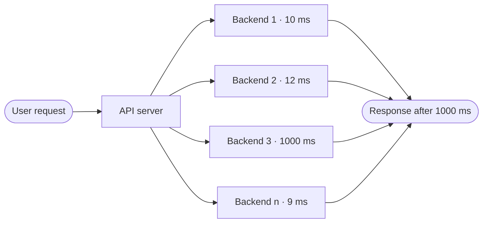

# 1.1 What production demands: requirements, SLOs, and the numbers

[Syllabus](../SYLLABUS.md) · Phase 1 · Next: [1.2 The life of a request](02-life-of-a-request.md)

> **Time:** about 45 minutes to read, 45 minutes of practice.
> **You need:** to have built a CRUD app. Nothing else.

**By the end of this chapter you can**

- separate functional from non-functional requirements, and explain why the second kind decides the design;
- explain why latency is reported in percentiles, and what fan-out does to the slowest 1%;
- do availability arithmetic: nines, dependencies in series, redundant components;
- write a service level objective precise enough to check a design against;
- estimate request rate, storage and bandwidth for a system in five minutes with a pencil.

---

## The problem

*An illustrative scenario.* You have built an app. The tests pass. You demo it and every page loads instantly. Then it launches, a few thousand people arrive in the same ten minutes, pages take forty seconds, and then they stop loading at all. You did not change a line of code.

What changed is the meaning of "it works". Until launch it meant: one user, two hundred rows, ten minutes, on a laptop that never failed in the middle of a request. Production is different in four ways, and each of them gets its own phases later in this course:

| | On your laptop | In production |
|---|---|---|
| **Load** | One user. A few hundred rows. | Many users in the same instant. Data that only ever grows. |
| **Failure** | You restart it. | Disks, networks, dependencies and your own deploys fail while requests are in flight. |
| **Time** | It runs for a demo. | It runs for years and has to be changed while it is running. |
| **Hostility** | You are the only user. | Some of the users are attackers. |

And every answer to those four costs money.

The failure this chapter is about comes before all of them: **nobody wrote the numbers down.** How many requests per second? How fast does a response have to be, and for what fraction of requests? How much downtime is acceptable? Without those numbers you cannot judge any design. Is one database enough? Do we need a cache? The honest answer to every such question is "it depends" — and the numbers are what it depends on.

Writing the numbers down does not mean getting them right. When Pokémon GO launched in 2016, the team had "targeted 1X player traffic, with a worst-case estimate of roughly 5X this target"; actual traffic reached "50X the initial target, ten times the worst-case estimate" ([Google Cloud blog](https://cloud.google.com/blog/products/containers-kubernetes/bringing-pokemon-go-to-life-on-google-cloud)). The estimate was off by a factor of ten beyond the *worst case*, and it was still worth having: because a target existed, everyone knew exactly how far outside its design the system was running, and what to add capacity to.

---

## The concept

### 1. Two kinds of requirement

A **functional requirement** says what the system does: *a user can create a short link; visiting the link redirects to the original URL.*

A **non-functional requirement** says how well it does it: how much load, how fast, how reliably, how safely, at what cost.

The apps you have built so far were specified entirely by the first kind. Production systems are *shaped* by the second kind. A URL shortener for your team and a URL shortener for the whole internet have identical features and almost nothing else in common.

These are the non-functional requirements that decide most designs:

| Requirement | The question | How it is stated |
|---|---|---|
| **Load** | How much work arrives? | Requests per second (average *and* peak), read-to-write ratio, data volume and growth |
| **Latency** | How long does one request take? | Milliseconds at a percentile |
| **Availability** | What fraction of requests succeed? | A percentage ("three nines") |
| **Durability** | Can data we accepted be lost? | Probability of loss |
| **Consistency** | Can two readers see different answers? | A model, not a number (Phase 5) |
| **Cost** | What do we pay per user or per request? | Money per month |

The rest of this chapter makes the first three precise, because they are the ones you can calculate with.

### 2. Latency is a distribution, not a number

Send the same request a thousand times and you get a thousand different response times. Most are close together. A few are much slower: the request that waited for a lock, hit a cold cache, or arrived during a garbage-collection pause.

So "the latency" of a service is a distribution, and we describe it with **percentiles**:

- **p50** (the median): half of the requests are faster than this.
- **p99**: 99% of requests are faster than this; 1 in 100 is slower.
- **p99.9**: 1 in 1,000 is slower.

Why not the average? Because a handful of slow requests drags the average to a value that describes nobody. The runnable example below models a backend that answers in 5–15 ms, except that one call in a hundred takes a full second. Its average is 20 ms — a response time that *no single request had*.

The slow tail of the distribution matters far more than its size suggests, for three reasons.

**It is a lot of people.** At 1,000 requests per second, "one in a hundred" is ten slow requests every second.

**It is not a random 1%.** Amazon's Dynamo paper makes the point that heavy users have heavy requests: "customers with longer histories require more processing which impacts performance at the high-end of the distribution", so "an SLA stated in terms of mean or median response times will not address the performance of this important customer segment" ([DeCandia et al., *Dynamo*, SOSP 2007, §2.2](https://www.allthingsdistributed.com/files/amazon-dynamo-sosp2007.pdf)).

**Fan-out multiplies it.** One user action is rarely one backend call. The same paper says that rendering one page on Amazon's site "typically requires the rendering engine to construct its response by sending requests to over 150 services." If a request has to wait for *n* calls made in parallel, it is as slow as the slowest of them:



If each call independently has a 1% chance of being slow, the chance that *at least one of n* is slow is `1 − 0.99ⁿ`. For 100 calls that is 63%. This is the central example of Dean and Barroso's paper *The Tail at Scale*: with servers whose 99th-percentile latency is one second, "if a user request must collect responses from 100 such servers in parallel, then 63% of user requests will take more than one second" ([Dean & Barroso, CACM 2013](https://www.barroso.org/publications/TheTailAtScale.pdf)).

Read that again, because it reverses the intuition. The backend's rare case — 1% — has become the user's *common* case. That is why experienced engineers ask "what is your p99?" and are not reassured by a good average.

### 3. Availability and the nines

**Availability** is the fraction of the time, or the fraction of requests, for which the service does its job. Google's SRE book gives both definitions: time-based (uptime divided by uptime plus downtime) and request-based, "the request success rate" — successful requests divided by total requests ([SRE book, *Embracing Risk*](https://sre.google/sre-book/embracing-risk/)). For a service that handles requests, prefer the request-based one: it is what users experience, and a service that is "up" but failing a third of its requests is not available in any useful sense.

Availability targets are quoted as a number of nines. The table below is from the [SRE book's availability table](https://sre.google/sre-book/availability-table/); it shows how much unavailability each target allows.

| Target | Per year | Per month | Per day |
|---|---|---|---|
| 99% ("two nines") | 3.65 days | 7.2 hours | 14.4 minutes |
| 99.9% ("three nines") | 8.76 hours | 43.2 minutes | 1.44 minutes |
| 99.95% | 4.38 hours | 21.6 minutes | 43.2 seconds |
| 99.99% ("four nines") | 52.6 minutes | 4.32 minutes | 8.64 seconds |
| 99.999% ("five nines") | 5.26 minutes | 25.9 seconds | 0.87 seconds |

Two rules of arithmetic turn this table into a design tool.

**Rule 1: dependencies in series multiply.** If your service cannot answer without service B, then B is a *hard dependency*, and you are down whenever B is down. AWS's reliability guidance states the rule: "the invoking system's availability is the product of the dependent systems' availabilities", with the example that a 99.99% system with hard dependencies on two other 99.99% systems can reach at most `99.99% × 99.99% × 99.99% = 99.97%` ([AWS Well-Architected, *Availability*](https://docs.aws.amazon.com/wellarchitected/latest/reliability-pillar/availability.html)).

The consequence: **you cannot be more available than the product of the things you cannot live without.** Every hard dependency you add lowers your ceiling.

**Rule 2: redundant components multiply their *failure* rates.** If either of two independent copies can do the job, you are only down when both are. The same AWS page gives the formula — 100% minus the product of the failure rates — and the example: two independent components at 99.9% each give `100% − (0.1% × 0.1%) = 99.9999%`.

The word carrying the weight in Rule 2 is *independent*. Two servers in the same rack, running the same bad deploy, behind the same misconfigured load balancer, do not fail independently. Phase 6 is largely about that word.

One more thing: the target is never 100%. The SRE book is blunt about it — "100% is probably never the right reliability target: not only is it impossible to achieve, it's typically more reliability than a service's users want or notice" — and gives the reason: "a user on a 99% reliable smartphone cannot tell the difference between 99.99% and 99.999% service reliability" ([SRE book, *Embracing Risk*](https://sre.google/sre-book/embracing-risk/)).

**Durability is a different property.** Availability asks "can I reach it now?"; durability asks "is the data I stored still there?". A system can be unavailable for an hour and lose nothing, or stay up while silently losing data. Amazon S3 states the two separately: its standard storage is "designed to provide 99.999999999% durability and 99.99% availability of objects over a given year" ([Amazon S3 user guide](https://docs.aws.amazon.com/AmazonS3/latest/userguide/DataDurability.html)). Seven more nines for durability than for availability — because a brief outage is forgiven and lost data is not.

### 4. SLI, SLO, SLA: writing the target down

Three terms from the [SRE book's chapter on service level objectives](https://sre.google/sre-book/service-level-objectives/) give the numbers a home.

- A **service level indicator (SLI)** is the measurement: "a carefully defined quantitative measure of some aspect of the level of service that is provided." Request latency and error rate are the usual ones. The SRE workbook recommends expressing an SLI as a ratio — "the number of good events divided by the total number of events" ([SRE workbook, *Implementing SLOs*](https://sre.google/workbook/implementing-slos/)).
- A **service level objective (SLO)** is the target for that measurement: "a target value or range of values for a service level that is measured by an SLI."
- A **service level agreement (SLA)** is a promise to someone else with a penalty attached: "an explicit or implicit contract with your users that includes consequences of meeting (or missing) the SLOs they contain."

The SLO is the one engineers work with every day. A usable SLO has five parts, and it is worth checking that yours has all of them:

```text
99.9% of  GET /links/{code}  requests,  measured at the load balancer,
  ▲            ▲                              ▲
  target       which requests                 where it is measured

return a non-5xx response in under 100 ms,  over a rolling 30 days.
              ▲                                   ▲
              what counts as "good"               the window
```

Subtract the target from 100% and you get the **error budget**: here, 0.1% of requests in any 30 days are allowed to be bad. That number is how reliability gets traded against speed of change — a team that has budget left can ship riskier changes; a team that has spent it slows down. The SRE book describes the mechanism in [*Embracing Risk*](https://sre.google/sre-book/embracing-risk/); Phase 7 of this course puts it to work.

### 5. Estimating: the back of the envelope

With targets in hand, you need a rough idea of the load. The goal of a back-of-envelope estimate is not accuracy. It is to get the **order of magnitude** right and to find out **which resource runs out first**, so you know where the design effort belongs.

**The method**

1. **Start from people.** Daily active users × actions per user per day = requests per day.
2. **Convert to per-second.** A day has 86,400 seconds. Round it to 100,000 (10⁵) and you are within 15%.
3. **Apply a peak factor.** Traffic is not flat across a day. Multiply the average by how much busier your busiest moment is. Take this from your own traffic graphs; for a system that does not exist yet it is an assumption, so write it down as one.
4. **Estimate data.** Writes per day × bytes per write × how long you keep it. Then multiply for copies (replicas, backups) and indexes.
5. **Estimate bandwidth.** Responses per second × bytes per response.
6. **Ask which of those numbers is the frightening one.** That is where the design starts.

Work to one significant figure. If an input might be wrong by a factor of three, carrying four digits through the arithmetic is self-deception.

**Numbers worth memorising**

| Per day | Average per second |
|---|---|
| 1 million | about 12 |
| 10 million | about 120 |
| 100 million | about 1,200 |
| 1 billion | about 12,000 |

| Unit | Bytes |
|---|---|
| 1 KB | 10³ — a short JSON document |
| 1 MB | 10⁶ — a compressed photo |
| 1 GB | 10⁹ |
| 1 TB | 10¹² |
| 1 PB | 10¹⁵ |

**How long things take.** The table below is a selection from the "Numbers Everyone Should Know" slide in a talk by Google's Jeff Dean ([slides, PDF](https://static.googleusercontent.com/media/research.google.com/en//people/jeff/stanford-295-talk.pdf)).

| Operation | Time |
|---|---|
| Main memory reference | 100 ns |
| Send 2 KB over a 1 Gbps network | 20,000 ns = 20 µs |
| Read 1 MB sequentially from memory | 250,000 ns = 0.25 ms |
| Round trip within the same datacenter | 500,000 ns = 0.5 ms |
| Disk seek | 10,000,000 ns = 10 ms |
| Read 1 MB sequentially from disk | 30,000,000 ns = 30 ms |
| Send a packet California → Netherlands → California | 150,000,000 ns = 150 ms |

These figures are old, and the disk rows describe spinning disks (an SSD has no arm to move, so no seek). [Colin Scott's interactive version](https://colin-scott.github.io/personal_website/research/interactive_latency.html) lets you scale them by year. Do not use them for precision. Use them for the ratios, which are what guide design:

- A round trip to another machine in the same datacenter costs as much as **thousands** of memory references. A request can afford tens of them, not thousands — which is why the "N+1 query" (Chapter 2.2) hurts.
- A round trip across an ocean costs **hundreds** of same-datacenter round trips, and no code optimisation reduces it. You can only make fewer trips or move closer (Chapter 1.2).

**What can one machine do?** Derive it rather than quote it. If handling a request uses 5 ms of CPU time, one core can do at most 1,000 ÷ 5 = 200 of them per second, and an 8-core machine at most 1,600 — before leaving any headroom. If the request mostly *waits* (for a database, for another service), the limit is not CPU but how many requests can be in progress at once; Chapter 1.6 gives you the formula for that.

---

## A real example

### Run it: the mean, the percentiles, and the fan-out

[`code/ch01-tail/main.go`](code/ch01-tail/main.go) simulates the backend from *The Tail at Scale* — usually about 10 ms, one call in a hundred takes a second — and then simulates user requests that wait for *n* such backends in parallel. It needs only Go's standard library.

```bash
go run ./phase-1-foundations/code/ch01-tail
```

```text
One backend, 200,000 calls
  mean       20ms   <- no real request took this long
  p50        10ms
  p90        14ms
  p99          1s
  p99.9        1s
  calls that took a full second: 1.01%

A user request that waits for n backends in parallel
  n     slower than 1s (simulated)   1 - 0.99^n (predicted)
  1        1.1%                          1.0%
  10       9.4%                          9.6%
  30      26.0%                         26.0%
  100     63.3%                         63.4%
```

Two things to notice. First, the mean (20 ms) sits in a gap: every real call took either 5–15 ms or 1,000 ms. Anyone who alerts on "average latency above 50 ms" would never hear about a backend where 1% of calls take a second. Second, the bottom table reproduces the paper's 63% without any special machinery — it is just "the slowest of *n*", repeated.

The heart of it is a dozen lines:

```go
// A user request that needs answers from n backends in parallel
// is as slow as the slowest of them.
var worst time.Duration
for range n {
    if d := backendCall(); d > worst {
        worst = d
    }
}
```

### How Amazon wrote one down

The Dynamo paper gives an example of the kind of SLA its internal services agreed with each other: a service "guaranteeing that it will provide a response within 300ms for 99.9% of its requests for a peak client load of 500 requests per second" ([*Dynamo*, §2.2](https://www.allthingsdistributed.com/files/amazon-dynamo-sosp2007.pdf)).

Hold that sentence against the five-part anatomy above. It has a threshold (300 ms), a target (99.9%), and — the part most first attempts leave out — the **load at which the promise holds** (500 requests per second at peak). A latency target with no load attached is not a requirement, because any system meets it at one request per second.

The paper also explains why Amazon stopped at 99.9% rather than going higher: the choice was "based on a cost-benefit analysis which demonstrated a significant increase in cost to improve performance that much." The target is an economic decision, not a matter of pride.

---

## Trade-offs

**Every nine costs more than the last.** Going from 99% to 99.9% may need only a second server and health checks. At 99.99%, a 30-day month allows 4.32 minutes of unavailability (see the table) — less time than it takes a person to be paged, find a laptop and log in — so recovery has to be automatic, and so does everything that could cause an outage, including deploys. AWS says the same in general terms: "Designing applications for higher levels of availability typically results in increased cost, so it's appropriate to identify the true availability needs before embarking on your application design" ([AWS Well-Architected, *Availability*](https://docs.aws.amazon.com/wellarchitected/latest/reliability-pillar/availability.html)).

**A tighter percentile costs more than a tighter threshold.** Bringing the p50 down usually means making the common path faster. Bringing the p99.9 down means removing *every* rare cause of slowness — a much longer list. Amazon's cost-benefit remark above is about exactly this.

**Targets that are too strict are as harmful as ones that are too loose.** Too loose, and users leave. Too strict, and you spend the engineering budget on reliability nobody notices, and release slowly to protect it. The SRE book adds a subtler cost of over-delivering: "Users build on the reality of what you offer, rather than what you say you'll supply", so if you run far better than your SLO, people will come to depend on the better number ([SRE book, *Service Level Objectives*](https://sre.google/sre-book/service-level-objectives/)).

**Estimates are cheap and wrong; no estimate is free and useless.** Pokémon GO's worst case was out by 10×. The answer is not to estimate harder. It is to (a) write the assumption down so you notice when reality departs from it, and (b) know what your system does *beyond* its design load — degrade, shed, or collapse. Phase 6 is about making that a choice instead of a surprise.

**When to skip all this.** A prototype with no users does not need an SLO document. It still benefits from one line — "built for about 10 requests per second; no availability target" — because that line tells the next engineer which shortcuts were deliberate.

---

## Practice

### Check yourself

Answer these before you read on. Write the answer down; "I roughly know" does not count.

1. A dashboard says a service's mean latency is 50 ms. Can you tell whether its users are having a good experience? What would you ask for?
2. Your API cannot answer without calling three other services one after another. Each is 99.9% available, and your own code never fails. What is the best availability you can offer, and how many minutes a month of failure is that?
3. A page makes 30 backend calls in parallel. Each has a p99 of 200 ms, independently of the others. What fraction of page loads include at least one call slower than 200 ms?

<details>
<summary>Answers</summary>

1. **No.** A mean of 50 ms is consistent with every request taking 50 ms, and with 95% taking 5 ms while 5% take 900 ms. Ask for percentiles — at least p50, p99 and p99.9 — and ask *where* they are measured (in the handler, or at the edge where the user's request arrives) and *at what load*.

2. Hard dependencies multiply: `0.999 × 0.999 × 0.999 ≈ 0.9970`, so **99.7%**. A 30-day month has 43,200 minutes; 0.3% of that is about **130 minutes**. Three "three-nines" dependencies have turned 43 minutes a month into more than two hours — and that is before your own failures.

3. `1 − 0.99³⁰ ≈ 26%`. One page load in four contains a "one in a hundred" slow call. (The program above prints this row.)

</details>

### Exercise: estimate a photo-sharing service

You are asked whether a small team can build the backend for a photo-sharing app. Product gives you these assumptions:

- 10 million daily active users.
- Each user views 100 photos a day in their feed.
- 2 million photos are uploaded per day.
- Each upload is stored as about 1 MB in total (the original plus resized versions) and has about 1 KB of metadata (owner, caption, timestamps).
- The version shown in the feed is about 200 KB.
- Assume peak traffic is 3× the average. *(An assumption — say so.)*

Estimate: (a) read and write request rates, average and peak; (b) storage growth per year for photos and for metadata; (c) outbound bandwidth for photos. Then answer the real question: **which part of this system is hard?**

Try it on paper first. Ten minutes is enough.

<details>
<summary>Worked solution</summary>

**(a) Request rates**

- Reads: 10 M users × 100 views = 1 billion photo views a day. From the table, 1 billion a day ≈ **12,000 per second** on average, **≈ 35,000 per second** at peak.
- Writes: 2 M uploads a day ≈ 2 × 12 = **about 25 per second** on average, **about 70 per second** at peak.
- Ratio: roughly 500 reads for every write.

**(b) Storage**

- Photos: 2 M × 1 MB = 2 TB a day ≈ **730 TB a year**. Keep three copies for safety and that is over **2 PB a year**, growing for ever.
- Metadata: 2 M × 1 KB = 2 GB a day ≈ **730 GB a year** — three orders of magnitude less than the photos.

**(c) Bandwidth**

- 12,000 views per second × 200 KB ≈ 2.4 GB per second ≈ **19 Gbit/s** on average, and three times that at peak.

**So which part is hard?**

Not the part a CRUD developer would worry about. The writes — the "create a row" path — arrive at about 25 per second, which is very little. The metadata is under a terabyte a year.

The hard parts are the **bytes**: two petabytes a year of photo storage, and tens of gigabits per second of outbound traffic. No application server should be in the path of those bytes. The estimate has just told you that this design is really about object storage and a content delivery network (Phase 3), and that the metadata database is, by comparison, the easy part.

That is what an estimate is for. It took ten minutes and it moved the design effort to the right place.

**Check your assumptions.** Which input matters most? The 200 KB feed image: halve it and you halve the bandwidth bill. Which is least certain? The peak factor. Note both next to the estimate.

</details>

---

## Production tips and common mistakes

**Tips**

- **Write the SLO before the design**, and write it from the user's side: which requests, measured where, what counts as good, what target, over what window.
- **Measure where the user is.** The SRE book notes that "client-side latency is often the more user-relevant metric" even though it is harder to collect ([SRE book](https://sre.google/sre-book/service-level-objectives/)). At the very least measure at the load balancer, not inside the handler — time spent queueing before your code runs is invisible from inside your code (Chapter 1.6).
- **Attach a load to every latency target**, as the Dynamo example does.
- **Keep your internal objective stricter than anything you promise customers.** The SRE book calls this keeping a safety margin: "using a tighter internal SLO than the SLO advertised to users gives you room to respond to chronic problems before they become visible externally" ([SRE book](https://sre.google/sre-book/service-level-objectives/)).
- **List your hard dependencies and multiply.** If the product is below your target, no amount of work on your own code will reach it. Either make a dependency soft — keep working, perhaps in a reduced way, when it is down — or change the target.

**Common mistakes**

- **Reporting the average.** It hides exactly the requests you most need to see.
- **Stating load as a daily total or an average.** Systems fail at the peak, not at the average.
- **Aiming for 100%**, or copying "five nines" from a slide without checking that it leaves 26 seconds a month.
- **Treating redundancy as independence.** Two copies that share a rack, a deploy or a configuration file fail together.
- **False precision.** "We need 11,574 requests per second" claims knowledge you do not have. "About 12,000" is honest.
- **Forgetting growth and copies.** Storage estimates that leave out replicas, backups and indexes are low by a multiple, not a percentage.
- **Counting only successful requests in the latency number.** A service that fails instantly looks fast. Track latency and error rate together.

---

## Key takeaways

- Non-functional requirements — load, latency, availability, durability, cost — decide the design. Write them down first.
- Latency is a distribution. Use percentiles; the mean describes nobody.
- With fan-out, a backend's rare slow case becomes the user's common case: `1 − 0.99ⁿ`.
- Hard dependencies multiply availabilities; independent redundant copies multiply failure rates.
- An SLO needs five parts: which requests, measured where, what counts as good, the target, the window — and a latency target needs a load.
- A back-of-envelope estimate exists to find the order of magnitude and the resource that runs out first.

**Next:** [1.2 The life of a request](02-life-of-a-request.md) — where the milliseconds go before your code even runs.

---

## Sources

- Jeffrey Dean and Luiz André Barroso, [*The Tail at Scale*](https://www.barroso.org/publications/TheTailAtScale.pdf), Communications of the ACM, 2013 ([publication page](https://research.google/pubs/the-tail-at-scale/)).
- Giuseppe DeCandia et al., [*Dynamo: Amazon's Highly Available Key-value Store*](https://www.allthingsdistributed.com/files/amazon-dynamo-sosp2007.pdf), SOSP 2007.
- Google, *Site Reliability Engineering*: [Service Level Objectives](https://sre.google/sre-book/service-level-objectives/), [Embracing Risk](https://sre.google/sre-book/embracing-risk/), [Availability Table](https://sre.google/sre-book/availability-table/).
- Google, *The Site Reliability Workbook*: [Implementing SLOs](https://sre.google/workbook/implementing-slos/).
- AWS Well-Architected Framework, Reliability Pillar: [Availability](https://docs.aws.amazon.com/wellarchitected/latest/reliability-pillar/availability.html).
- Amazon S3 User Guide: [Data durability](https://docs.aws.amazon.com/AmazonS3/latest/userguide/DataDurability.html).
- Google Cloud blog: [Bringing Pokémon GO to life on Google Cloud](https://cloud.google.com/blog/products/containers-kubernetes/bringing-pokemon-go-to-life-on-google-cloud).
- Jeff Dean, [*Software Engineering Advice from Building Large-Scale Distributed Systems*](https://static.googleusercontent.com/media/research.google.com/en//people/jeff/stanford-295-talk.pdf) (slides; includes "Numbers Everyone Should Know").
- Colin Scott, [Latency Numbers Every Programmer Should Know](https://colin-scott.github.io/personal_website/research/interactive_latency.html) (interactive, scaled by year).
