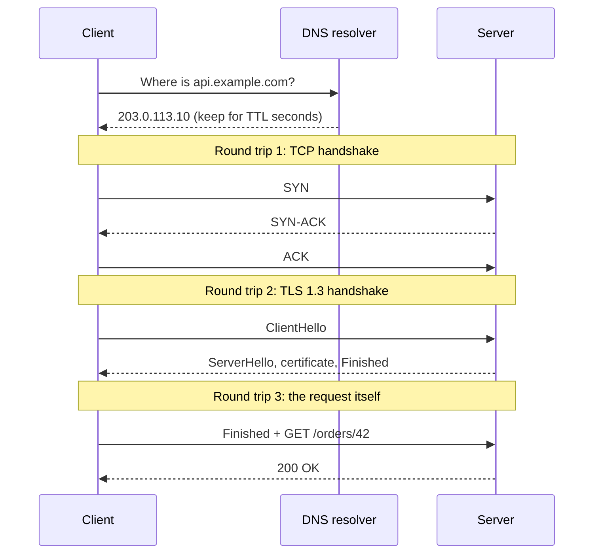

# 1.2 The life of a request: DNS, TCP, and TLS

[Syllabus](../SYLLABUS.md) · Phase 1 · Previous: [1.1 What production demands](01-what-production-demands.md) · Next: [1.3 HTTP for backend engineers](03-http-for-backend-engineers.md)

> **Time:** about 50 minutes to read, 45 minutes of practice.
> **You need:** [Chapter 1.1](01-what-production-demands.md) (percentiles, and the idea that a network round trip is expensive).

**By the end of this chapter you can**

- list what happens between "the client calls your API" and "your handler starts", and say how many network round trips each step costs;
- calculate the latency of a request on a new connection and on a reused one, from the round-trip time alone;
- explain what DNS caching, TCP slow start and the TLS handshake mean for a backend, not just for a browser;
- recognise the bugs and misconfigurations that stop connections being reused;
- measure each phase of a real request yourself.

---

## The problem

*An illustrative scenario.* Your API runs in a datacenter in California. Your logs say the handler for `GET /orders/42` takes 20 ms, and your dashboard, built from those logs, is green. A user in the Netherlands opens the app and waits almost half a second for that same call.

Nobody is lying. The handler really does take 20 ms. The other 450 ms was spent *before the request reached your code and after the response left it* — in work the network has to do to set up a conversation between two machines that have never talked.

If you do not know what that work is, three things go wrong in practice:

- You optimise the wrong thing. Shaving the handler from 20 ms to 10 ms improves the user's experience by 2%.
- You ship the classic bug — a new connection for every request — and pay the setup cost every time instead of once.
- You cannot explain the outages that live in this layer: a DNS record that will not update, a certificate that expired, connections that reset once a minute.

This chapter walks the path once, slowly, and counts the cost of each step.

---

## The concept

### The unit of cost is the round trip

A **round trip** is one message there and one message back. The time it takes is the **round-trip time (RTT)**.

RTT is set mostly by distance, because signals in fibre travel at about two-thirds of the speed of light. Ilya Grigorik's *High Performance Browser Networking* (HPBN) gives the theoretical best cases: New York to San Francisco is a 42 ms round trip, New York to London 56 ms, New York to Sydney 160 ms — and those numbers are "unrealistically optimistic" because real packets do not travel in a straight line ([HPBN, *Primer on Latency and Bandwidth*](https://hpbn.co/primer-on-latency-and-bandwidth/)). Jeff Dean's table from Chapter 1.1 has California to the Netherlands and back at 150 ms.

No code change makes a round trip faster. You have exactly two levers:

1. **Make fewer round trips.**
2. **Make each one shorter** by moving the two ends closer together.

Everything in this chapter is one of those two.

### What happens on a brand-new connection

Here is the whole journey for one HTTPS request when the client has never talked to the server before.



Four steps. Let us take them in order.

### Step 1 — DNS: turn a name into an address

Machines connect to IP addresses, not names. The Domain Name System (DNS) is the lookup service that turns `api.example.com` into `203.0.113.10`.

Your program asks a **recursive resolver** (usually run by your network or cloud provider). If the resolver does not already know the answer, it finds it by asking a chain of **authoritative servers** — the ones that hold the actual records — and then it remembers the answer. The terms are defined in [RFC 9499](https://www.rfc-editor.org/rfc/rfc9499.html).

The important part for you is the remembering. Every DNS record carries a **time to live (TTL)**: "the TTL describes how long a RR [resource record] can be cached before it should be discarded" ([RFC 1034, §3.6](https://www.rfc-editor.org/rfc/rfc1034.html)). Caching is why DNS is usually fast — most lookups are answered from memory — and it is also why DNS changes are slow: when you point a name at a new address, the old answer lives on in caches until its TTL runs out.

Three consequences that matter in production:

- **The TTL is how fast you can move traffic with DNS.** A record with a one-hour TTL means some clients keep using the old address for up to an hour after a change.
- **Not every cache obeys the TTL.** Java is the well-known example. The JDK documents that its address cache holds successful lookups "forever" if a security manager is installed and for an implementation-specific time otherwise ([JDK networking properties](https://docs.oracle.com/en/java/javase/21/docs/api/java.base/java/net/doc-files/net-properties.html)); AWS warns that with some configurations the JVM "will never refresh DNS entries until the JVM is restarted" and recommends setting the TTL explicitly ([AWS SDK for Java guide](https://docs.aws.amazon.com/sdk-for-java/latest/developer-guide/jvm-ttl-dns.html)).
- **An open connection never looks the name up again.** DNS is consulted when a connection is created. A client holding a connection to the old address keeps using it for as long as that connection stays open.

DNS is also a dependency of everything, which makes its failures large. AWS's own summary of its October 2025 outage in the US-East-1 region gives the root cause as "a latent race condition in the DynamoDB DNS management system that resulted in an incorrect empty DNS record for the service's regional endpoint" ([AWS post-event summary](https://aws.amazon.com/message/101925/)). The service was running; nobody could find it.

### Step 2 — TCP: a reliable stream of bytes

The internet delivers individual packets, and it may drop, duplicate or reorder them. **TCP** (Transmission Control Protocol) builds a reliable, ordered stream of bytes on top of that. Before any data moves, the two sides run the **three-way handshake** ([RFC 9293, §3.5](https://www.rfc-editor.org/rfc/rfc9293.html)): the client sends `SYN`, the server answers `SYN-ACK`, the client replies `ACK`.

The client can send data immediately after its `ACK`, so the handshake costs one round trip. HPBN states the consequence plainly: "each new connection will have a full roundtrip of latency before any application data can be transferred" ([HPBN, *Building Blocks of TCP*](https://hpbn.co/building-blocks-of-tcp/)).

Two more properties of TCP will come back throughout this course.

**Slow start.** A new connection does not know how much the network path can carry, so it starts cautiously and speeds up as acknowledgements arrive. The usual starting allowance is ten segments — at most 14,600 bytes ([RFC 6928](https://www.rfc-editor.org/rfc/rfc6928.html)) — before the sender has to wait for acknowledgements. So a response bigger than about 14 KB needs *extra* round trips on a new connection that it would not need on a warmed-up one. HPBN works through an example: a 64 KB file over a 56 ms round trip takes 264 ms on a new connection and 96 ms on an existing one, because the existing connection has already paid for the handshake and has already ramped up.

**Head-of-line blocking.** TCP delivers bytes in order. If one packet is lost, everything behind it waits until that packet is resent, even if the later packets have already arrived ([HPBN, *Building Blocks of TCP*](https://hpbn.co/building-blocks-of-tcp/)). Keep this in mind for the next chapter, where it explains a large part of why HTTP/3 exists.

### Step 3 — TLS: a secure channel

**TLS** (Transport Layer Security) is the "S" in HTTPS. It provides three things ([RFC 8446, §1](https://www.rfc-editor.org/rfc/rfc8446.html)): **authentication** (you are talking to the real `api.example.com`, proven by a certificate), **confidentiality** (nobody on the path can read the traffic), and **integrity** (nobody on the path can change it undetected).

Setting that up takes another handshake, on top of the TCP one:

- **TLS 1.3** needs **one** round trip. The client sends its key material in its first message; the server answers with its own, plus its certificate. RFC 8446 shows this flow in its Figure 1.
- **TLS 1.2**, the older version, needs **two** round trips for a full handshake ([HPBN, *Transport Layer Security*](https://hpbn.co/transport-layer-security-tls/)).
- A client that has connected to the server before can, with TLS 1.3, send data in its very first message — "0-RTT". It saves a round trip "at the cost of certain security properties": in particular, there are "no guarantees of non-replay between connections" ([RFC 8446, §1.2 and §2.3](https://www.rfc-editor.org/rfc/rfc8446.html)). An attacker who records that first message can send it again, so 0-RTT is only safe for requests that are harmless to repeat. Chapter 1.5 is about exactly that property.

### Step 4 — the request

Only now does the client send `GET /orders/42`. That is one more round trip, plus the time your server spends producing the answer.

### Adding it up

| Situation | Round trips before the response starts | With a 150 ms RTT and a 20 ms handler |
|---|---|---|
| New connection, TLS 1.2 | 4 (TCP + 2 for TLS + request) | 620 ms |
| New connection, TLS 1.3 | 3 (TCP + TLS + request) | 470 ms |
| **Reused connection** | **1 (just the request)** | **170 ms** |

A DNS lookup, when the answer is not cached, comes on top of the first two rows.

That table is the scenario at the top of the chapter. The user's 470 ms was three round trips plus your 20 ms. Your handler was 4% of it.

It also tells you where the win is. Look at the last row.

### Connection reuse: the cheapest speed-up you will ever ship

The handshakes set up a *connection*, not a request. Once it exists, any number of requests can use it, each paying one round trip. HTTP has done this by default since version 1.1: "HTTP/1.1 defaults to the use of 'persistent connections', allowing multiple requests and responses to be carried over a single connection" ([RFC 9112, §9.3](https://www.rfc-editor.org/rfc/rfc9112.html)). You will also see it called **keep-alive**.

HTTP client libraries implement this with a **connection pool**: finished connections are parked instead of closed, and the next request to the same host takes one from the pool. The same idea applies to database connections and to calls between your own services; Chapter 1.6 looks at pools in detail.

Reuse is the default — and it is surprisingly easy to switch off by accident. The three usual ways:

1. **Building a new client for every request.** The pool lives inside the client object, so a new client means an empty pool. Go's documentation says clients "should only be created once and re-used" ([`net/http`](https://pkg.go.dev/net/http)). The same holds in every language.
2. **Not finishing with the response.** In Go, the connection goes back to the pool only when you have closed the response body; the documentation warns that the transport "may not reuse HTTP/1.x 'keep-alive' TCP connections if the Body is not read to completion and closed" ([`net/http`, `Response.Body`](https://pkg.go.dev/net/http#Response)).
3. **A pool that is too small for the traffic.** Go keeps only two idle connections per host by default (`DefaultMaxIdleConnsPerHost = 2`, same page). A service that makes fifty HTTP/1.1 calls at once to one backend will open fifty connections, keep two, close forty-eight, and open them again a moment later.

### When the client is far away: move the handshake closer

Reuse helps from the second request onward. For the first one, the only lever left is the second one from the start of this chapter: make the round trips shorter.

You usually cannot move your servers next to every user, but you can put a small server near them that completes the TCP and TLS handshakes locally and forwards requests to your datacenter over connections it keeps open. HPBN calls this *early termination*: "by allowing the user to terminate their connection with a nearby server, instead of traversing across oceans and continental links to your origin, the client gets the benefit of 'early termination' with shorter roundtrips" ([HPBN, *Transport Layer Security*](https://hpbn.co/transport-layer-security-tls/)). This is one of the main things a content delivery network does, and Chapter 3.5 returns to it.

---

## A real example

### Run it: count the round trips

[`code/ch02-roundtrips/main.go`](code/ch02-roundtrips/main.go) starts a real HTTPS server on your machine and sends requests to it over a connection that delays every byte by 50 ms in each direction — a 100 ms round trip, as if the server were on another continent. It times each phase with Go's [`net/http/httptrace`](https://pkg.go.dev/net/http/httptrace) hooks.

The TLS and HTTP exchanges are real, so those round trips are measured rather than assumed. The one thing a program cannot slow down portably is the operating system's own TCP handshake, so the dialer stands in for it by waiting one round trip.

```bash
go run ./phase-1-foundations/code/ch02-roundtrips
```

```text
Simulated network: 50ms each way, so one round trip (RTT) = 100ms
The handler itself takes well under a millisecond.

TLS 1.3
  request            connect    TLS     request->1st byte   total   round trips
  1st (new conn)      101ms   104ms        102ms        307ms      3.1
  2nd (reused conn)     0ms     0ms        101ms        101ms      1.0
  3rd (reused conn)     0ms     0ms        101ms        101ms      1.0

TLS 1.2
  request            connect    TLS     request->1st byte   total   round trips
  1st (new conn)      101ms   205ms        101ms        407ms      4.1
  2nd (reused conn)     0ms     0ms        101ms        101ms      1.0
  3rd (reused conn)     0ms     0ms        101ms        101ms      1.0
```

Your numbers will differ by a millisecond or two. The shape will not: three round trips for a new TLS 1.3 connection, four for TLS 1.2, one for every request after that.

Now run it with the bug switched on — the connection is closed after every request, which is what happens when code builds a new client each time:

```bash
go run ./phase-1-foundations/code/ch02-roundtrips -no-reuse
```

```text
TLS 1.3
  request            connect    TLS     request->1st byte   total   round trips
  1st (new conn)      101ms   103ms        101ms        306ms      3.1
  2nd (new conn)      101ms   103ms        101ms        305ms      3.1
  3rd (new conn)      103ms   103ms        101ms        308ms      3.1
```

Every request is now three times slower, and nothing in the server's logs will show it.

The part of the code worth reading is how little it takes to stay on the good path:

```go
resp, err := client.Do(req)
if err != nil {
    fatal(err)
}
// Read the body to the end and close it. If you skip this, the
// connection cannot be reused and every request pays for a new one.
io.Copy(io.Discard, resp.Body)
resp.Body.Close()
```

### Measure a real site

The same program traces a real request if you give it a URL:

```bash
go run ./phase-1-foundations/code/ch02-roundtrips -url https://example.com
```

You do not need a program for this, though. `curl` can print the same phases; the variables are documented in the [curl manual](https://curl.se/docs/manpage.html) under `--write-out`:

```bash
curl -s -o /dev/null https://example.com -w '
dns:         %{time_namelookup}s
tcp connect: %{time_connect}s
tls done:    %{time_appconnect}s
first byte:  %{time_starttransfer}s
total:       %{time_total}s
'
```

Each value is measured from the start of the request, so subtract neighbours to get the length of a phase. This one command settles most "is it the network or is it us?" arguments.

---

## Trade-offs

**Keeping connections open** is nearly always right, but it is not free:

- Each idle connection holds memory and a file descriptor on both ends. A server with a hundred thousand idle clients is holding a hundred thousand sockets.
- Idle connections go stale. Something in the middle — a load balancer, a firewall — may close a connection that has been quiet too long, and the client finds out only when its next request fails. The fix is to agree on idle timeouts (see the tips below).
- Long-lived connections do not rebalance. If a client keeps its connections for hours, a newly added server gets none of that client's traffic. Chapter 3.2 deals with this.

**DNS TTLs** trade speed of change against load and risk. A short TTL lets you move traffic quickly, but means more lookups and makes you more dependent on DNS answering at every moment. A long TTL is cheap and robust, and slow to change. Amazon's Route 53 documentation describes both sides — a longer TTL "reduces latency and lowers your bill", but "it takes longer for changes to the record (for example, a new IP address) to take effect" — and recommends lowering it ahead of a change: "specify a shorter value first, such as 300 seconds, and increase the value after you confirm that the new settings are correct" ([Route 53 developer guide](https://docs.aws.amazon.com/Route53/latest/DeveloperGuide/resource-record-sets-values-basic.html)).

**TLS everywhere** costs a round trip per new connection and some CPU for the handshake. With connection reuse that cost is paid rarely, which is why encrypting everything — including traffic inside your own network (Phase 8) — is a reasonable default rather than a luxury.

**0-RTT** saves a round trip for returning clients and exposes you to replayed requests. Use it only for requests that are safe to repeat.

**Terminating connections near the user** shortens the handshakes dramatically, and adds a hop, a vendor or a fleet to run, and a place where requests can be cached or blocked — which is a feature and a risk at once.

---

## Practice

### Check yourself

Answer before reading on.

1. The round-trip time between a client and your server is 80 ms. Your handler takes 10 ms. The DNS answer is already cached. How long does the client wait for the response to its first HTTPS request over TLS 1.3? How long for its tenth request on the same connection?
2. You are moving a service to a new IP address on Saturday. On Thursday you lower the DNS TTL from one hour to one minute. Why? And after the move, why might some clients still be sending traffic to the old address an hour later?
3. Ignore handshakes completely. Why can the same 64 KB response still take longer to arrive on a brand-new connection than on one that has been in use for a while?

<details>
<summary>Answers</summary>

1. First request: three round trips plus the handler = 3 × 80 + 10 = **250 ms**. Tenth request: one round trip plus the handler = **90 ms**.

2. Resolvers keep an answer for as long as its TTL says. If the TTL is still an hour on Saturday, caches will hand out the old address for up to an hour after you change it. Lowering the TTL on Thursday gives every cache time to pick up the record with the short TTL, so on Saturday the change spreads within a minute.

   Clients can still be on the old address later because (a) some software caches DNS answers for longer than the TTL — the JVM, in some configurations, for ever — and (b) a client with an open keep-alive connection does not look the name up again; it keeps using the connection it has. So keep the old address serving, or close its connections deliberately, rather than assuming DNS has moved everyone.

3. **Slow start.** A new TCP connection may send only about ten segments (up to 14,600 bytes) before it must wait for acknowledgements, and it grows from there one round trip at a time. A 64 KB response needs several of those rounds on a new connection. A connection that has been in use has already grown its allowance and can send the whole response at once. (HPBN's worked example: 264 ms against 96 ms.)

</details>

### Exercise: a slow mobile screen

*A small design problem.* A mobile app's home screen makes **six API calls, one after another**. The users are in India; the API servers are in a datacenter in the eastern United States. You measure a round-trip time of 220 ms between them. Each handler takes about 30 ms. The API uses TLS 1.3.

A developer tells you the app creates a new HTTP client object for each call "to keep things clean".

1. How long does the home screen take to load today? (Ignore DNS.)
2. You fix the client so that it is created once. How long now?
3. You then put a server in Mumbai that terminates the users' connections — 20 ms round trip from the users — and forwards requests to the US over connections it keeps permanently open. How long now?
4. What would you do next?

Work it out before opening the solution. First predict, then use the program to check your arithmetic for one call: `-oneway 110ms` gives you a 220 ms round trip.

<details>
<summary>Worked solution</summary>

**1. Today.** A new client per call means a new connection per call. Each call costs three round trips plus the handler:

`3 × 220 + 30 = 690 ms` per call, × 6 calls = **4,140 ms**. Over four seconds.

**2. One client, connections reused.** The first call still pays for the connection; the other five pay one round trip each:

`690 + 5 × (220 + 30) = 690 + 1,250 =` **1,940 ms**. More than twice as fast, from a one-line fix.

**3. Terminate in Mumbai.** The user's handshakes now happen over a 20 ms round trip. Each request travels user → Mumbai (20 ms round trip) and Mumbai → US (about 220 ms round trip, on an already-open connection), plus the handler:

- First call: TCP 20 + TLS 20 + request (20 + 220 + 30) = 310 ms.
- Each later call: 20 + 220 + 30 = 270 ms.
- Total: `310 + 5 × 270 =` **1,660 ms**.

Notice what moved and what did not. The *handshake* cost collapsed from 440 ms to 40 ms. The *request* cost barely changed, because every request still has to cross the ocean. Early termination fixes connection setup; it does not bring your data closer.

(This treats the Mumbai–US round trip as the same 220 ms and ignores the forwarding server's own processing — an estimate, in the spirit of Chapter 1.1.)

**4. Next.** The remaining cost is six ocean crossings in a row. Options, roughly in order of effort:

- **Send the calls at the same time instead of one after another**, if they do not depend on each other. Six parallel calls take about as long as the slowest one: roughly 300 ms instead of 1,660 ms. (Whether one connection can carry several requests at once depends on the HTTP version — next chapter.)
- **Combine them** into one endpoint that returns everything the home screen needs: one crossing instead of six.
- **Cache** responses that do not change per user at the Mumbai server, so some requests never cross at all (Chapter 3.5).
- **Run the service in a region near the users** — which brings in everything Phase 5 has to say about data in more than one place.

The order of that list matters. The cheap fixes — reuse, parallelism, fewer calls — took the screen from over four seconds to a fraction of one before anyone had to think about a second datacenter.

</details>

---

## Production tips and common mistakes

**Tips**

- **Create HTTP clients once and share them.** One per process, or one per destination service. This applies to database clients and every other networked client too.
- **Always finish with the response**: read the body to the end and close it, on error paths as well.
- **Set a timeout on every client.** In Go, "a Timeout of zero means no timeout" for `http.Client` ([`net/http`](https://pkg.go.dev/net/http#Client)), and zero is the default. A client with no timeout will wait for ever for a server that never answers. Chapter 1.5 covers how to choose the value.
- **Size the idle pool for your concurrency.** If your service makes many simultaneous calls to one backend, raise the per-host idle limit so those connections are kept rather than rebuilt.
- **Make your server's idle timeout longer than the load balancer's.** If the server closes an idle connection first, the load balancer can send a request into a connection that is already closing. AWS documents this for its Application Load Balancer, whose idle timeout defaults to 60 seconds: "we also recommend that you configure the idle timeout of your application to be larger than the idle timeout configured for the load balancer", otherwise the load balancer may send a request just as the application closes the connection, and return an HTTP 502 error to the client ([AWS ALB documentation](https://docs.aws.amazon.com/elasticloadbalancing/latest/application/edit-load-balancer-attributes.html)). Occasional unexplained 502s are very often this.
- **Know your DNS TTLs and what your runtime does with them.** Decide the JVM's DNS cache time explicitly rather than inheriting a default.
- **Automate certificate renewal and alert on expiry.** Certificates expire by design — Let's Encrypt's default certificates are valid for 90 days and it recommends renewing them every 60 ([Let's Encrypt FAQ](https://letsencrypt.org/docs/faq/)). A renewal done by hand will eventually be forgotten.
- **Measure the phases** with `curl -w` or `httptrace` before you argue about where the time goes.

**Common mistakes**

- **A new client, or a new connection, per request.** The most expensive one-line bug in this chapter.
- **Believing the handler's own timing.** Your logs measure from the moment your code starts. Setup, queueing and the trip back are invisible from there.
- **Testing on localhost and trusting the result.** On your own machine a round trip takes microseconds, so every round-trip-shaped mistake is hidden. The example program exists to make the network visible.
- **Assuming a DNS change is instant**, or that it moves clients that already hold connections.
- **Using 0-RTT for requests that change something.**
- **Forgetting that every hop repeats all of this.** Your service calling another service is a client. It needs reuse, timeouts and sensible pool sizes exactly as a mobile app does.

*One line each on things you may meet:* Nagle's algorithm delays small writes to send fewer packets; Go turns it off by default ([`TCPConn.SetNoDelay`](https://pkg.go.dev/net#TCPConn.SetNoDelay)). QUIC, the transport under HTTP/3, combines the transport and TLS handshakes into one ([RFC 9000, §7](https://www.rfc-editor.org/rfc/rfc9000.html)) — more in the next chapter.

---

## Key takeaways

- Before your handler runs, a new HTTPS connection costs a DNS lookup plus three round trips (TLS 1.3) or four (TLS 1.2). A reused connection costs one.
- Round-trip time is set by distance. You can make fewer round trips or shorter ones; you cannot make them faster.
- Connection reuse is on by default and easy to break: one client, bodies closed, a pool big enough for your concurrency.
- DNS answers are cached for their TTL — sometimes longer — and open connections never re-resolve.
- New TCP connections are slow for large responses as well as for the first byte.
- Measure from the client's side. Server-side timings miss everything in this chapter.

**Next:** [1.3 HTTP for backend engineers](03-http-for-backend-engineers.md) — what actually travels over that connection, and what everyone in the middle assumes about it.

---

## Sources

- Ilya Grigorik, *High Performance Browser Networking* (O'Reilly, free online): [Primer on Latency and Bandwidth](https://hpbn.co/primer-on-latency-and-bandwidth/), [Building Blocks of TCP](https://hpbn.co/building-blocks-of-tcp/), [Transport Layer Security](https://hpbn.co/transport-layer-security-tls/).
- [RFC 9293](https://www.rfc-editor.org/rfc/rfc9293.html) — Transmission Control Protocol.
- [RFC 6928](https://www.rfc-editor.org/rfc/rfc6928.html) — Increasing TCP's Initial Window.
- [RFC 8446](https://www.rfc-editor.org/rfc/rfc8446.html) — TLS 1.3.
- [RFC 9112](https://www.rfc-editor.org/rfc/rfc9112.html) — HTTP/1.1 (persistent connections, §9.3).
- [RFC 1034](https://www.rfc-editor.org/rfc/rfc1034.html) — Domain names: concepts and facilities; [RFC 9499](https://www.rfc-editor.org/rfc/rfc9499.html) — DNS terminology.
- [RFC 9000](https://www.rfc-editor.org/rfc/rfc9000.html) — QUIC.
- Go standard library: [`net/http`](https://pkg.go.dev/net/http), [`net/http/httptrace`](https://pkg.go.dev/net/http/httptrace).
- [curl manual](https://curl.se/docs/manpage.html), `--write-out`.
- AWS: [Application Load Balancer attributes (idle timeout)](https://docs.aws.amazon.com/elasticloadbalancing/latest/application/edit-load-balancer-attributes.html); [JVM TTL for DNS lookups](https://docs.aws.amazon.com/sdk-for-java/latest/developer-guide/jvm-ttl-dns.html); [Route 53 record values (TTL)](https://docs.aws.amazon.com/Route53/latest/DeveloperGuide/resource-record-sets-values-basic.html); [post-event summary, October 2025](https://aws.amazon.com/message/101925/).
- Oracle: [JDK networking properties](https://docs.oracle.com/en/java/javase/21/docs/api/java.base/java/net/doc-files/net-properties.html).
- [Let's Encrypt FAQ](https://letsencrypt.org/docs/faq/).
