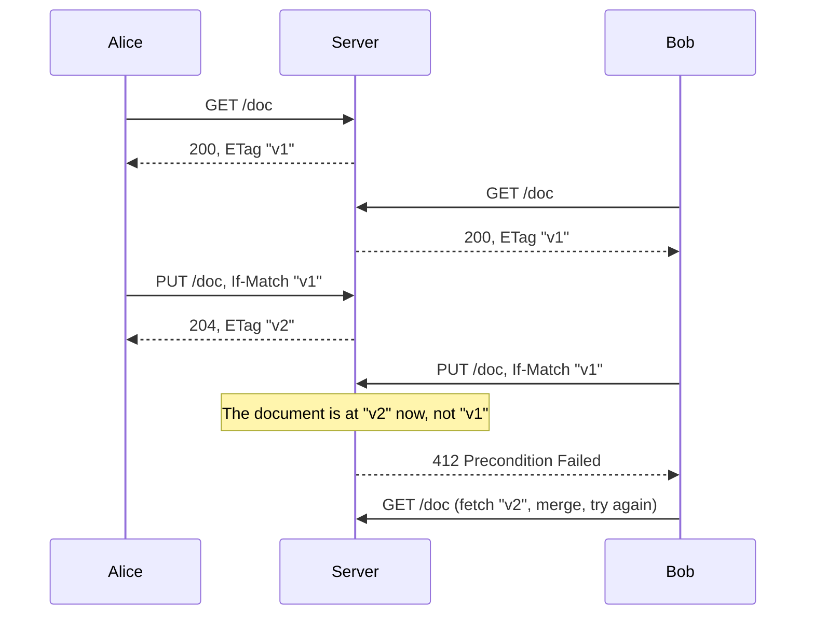

# 1.3 HTTP for backend engineers

[Syllabus](../SYLLABUS.md) · Phase 1 · Previous: [1.2 The life of a request](02-life-of-a-request.md) · Next: [1.4 API design](04-api-design.md)

> **Time:** about 50 minutes to read, 45 minutes of practice.
> **You need:** [Chapter 1.2](02-life-of-a-request.md) (connections, round trips, head-of-line blocking).

**By the end of this chapter you can**

- say what *safe*, *idempotent* and *cacheable* mean for each HTTP method, and what other software does because of those words;
- choose the status code that tells the truth, and explain who acts on it;
- use ETags and conditional requests to avoid re-sending data and to stop two clients overwriting each other;
- explain what changed between HTTP/1.1, HTTP/2 and HTTP/3, and what that means for a backend service.

---

## The problem

In May 2005 Google released a program called Web Accelerator. To make pages feel faster, it fetched the pages behind the links on whatever you were looking at, before you clicked. Within days the software company 37signals published a warning. Users of its product Backpack had been "reporting that their Backpack pages were 'disappearing.'" The cause: the accelerator "scours a page and prefetches the content behind each link", so that "Google is essentially clicking every link on the page — including links like 'delete this' or 'cancel that.'" ([Signal vs. Noise, 37signals, 6 May 2005](https://signalvnoise.com/archives2/google_web_accelerator_hey_not_so_fast_an_alert_for_web_app_designers)).

Any application that could lose data this way had one thing in common: a plain link — an HTTP `GET` — that changed something.

The accelerator was not misbehaving. HTTP says `GET` is for reading, and software all over the internet relies on that. The specification even warns what happens if you ignore it: "unfortunate side effects when automated processes perform a GET on every URI reference for the sake of link maintenance, pre-fetching, building a search index, etc." ([RFC 9110, §9.2.1](https://www.rfc-editor.org/rfc/rfc9110.html#section-9.2.1)).

This is the lesson of the chapter. When you build an API, HTTP is not just a pipe that carries your JSON. The **method** and the **status code** are promises, and they are read by software you did not write and do not control: browsers, crawlers, link previewers, caches, proxies, load balancers, client libraries, monitoring systems. If the promise is false, they do the wrong thing — correctly.

The same mistake in its modern forms:

- An API answers `200 OK` with `{"error": "database unavailable"}`. The monitoring system counts server errors by status code, so the dashboard shows 0% errors for the whole outage.
- An API answers `500` when the user mistypes an email address. Clients are written to retry on `500`, so they send the bad request again and again, and the on-call engineer is paged for a typo.
- A client library retries a request after a dropped connection, as it is allowed to for methods that claim to be repeatable. The endpoint was not repeatable.

---

## The concept

### 1. What is in a message

Every HTTP exchange is a request and a response. In HTTP/1.1 they are plain text, which makes them easy to read:

```http
PUT /doc HTTP/1.1
Host: api.example.com
Content-Type: text/plain
If-Match: "v1"

Alice's edit
```

```http
HTTP/1.1 204 No Content
ETag: "v2"
```

A request has a **method** (`PUT`), a **target** (`/doc`), **headers**, and sometimes a **body**. A response has a **status code** (`204`), headers, and sometimes a body. The rules for what these mean are in [RFC 9110, *HTTP Semantics*](https://www.rfc-editor.org/rfc/rfc9110.html), which "defines aspects of the protocol that are shared by all versions". Keep that phrase in mind: the meaning of methods and status codes is the same whether the bytes travel as HTTP/1.1, HTTP/2 or HTTP/3.

### 2. Methods make promises

RFC 9110 defines three properties a method can have.

- **Safe** — "essentially read-only; i.e., the client does not request, and does not expect, any state change on the origin server" ([§9.2.1](https://www.rfc-editor.org/rfc/rfc9110.html#section-9.2.1)).
- **Idempotent** — "the intended effect on the server of multiple identical requests with that method is the same as the effect for a single such request" ([§9.2.2](https://www.rfc-editor.org/rfc/rfc9110.html#section-9.2.2)).
- **Cacheable** — a cache may store the response and reuse it for a later request ([§9.2.3](https://www.rfc-editor.org/rfc/rfc9110.html#section-9.2.3)).

| Method | Used for | Safe | Idempotent |
|---|---|---|---|
| `GET` | Read a resource | yes | yes |
| `HEAD` | Read only the headers | yes | yes |
| `OPTIONS` | Ask what is allowed | yes | yes |
| `PUT` | Replace a resource completely (or create it at a URL the client chose) | no | yes |
| `DELETE` | Remove a resource | no | yes |
| `POST` | Create a resource, or "perform this action" | no | no |
| `PATCH` | Change part of a resource | no | no |

Sources: [RFC 9110, §9.2](https://www.rfc-editor.org/rfc/rfc9110.html#section-9.2); for `PATCH`, [RFC 5789](https://www.rfc-editor.org/rfc/rfc5789.html), which says it "is neither safe nor idempotent".

Each property is a licence for somebody else to do something:

| Property | Who relies on it | What they do |
|---|---|---|
| Safe | Crawlers, prefetchers, link previewers, health checkers | Call it whenever they like |
| Idempotent | Client libraries, proxies | Send it again after a failure: "the request can be repeated automatically if a communication failure occurs before the client is able to read the server's response" ([§9.2.2](https://www.rfc-editor.org/rfc/rfc9110.html#section-9.2.2)) |
| Cacheable | Browsers, CDNs, proxies | Answer from a stored copy without asking you |

Four details that people get wrong:

**Safe does not mean "nothing happens on the server".** Writing an access log line or incrementing a counter on a `GET` is fine. The specification's test is whether the *client asked for* a change: "the client did not request that additional behavior and cannot be held accountable for it" ([§9.2.1](https://www.rfc-editor.org/rfc/rfc9110.html#section-9.2.1)).

**Idempotent is about the effect, not the response.** Delete something twice and the second response may well be `404 Not Found`. That is still idempotent: after one `DELETE` or two, the server is in the same state — the thing is gone. The example program below shows exactly this.

**`POST` is the one that bites.** `POST /orders` sent twice creates two orders. `PUT /orders/123` sent twice leaves one. For `POST`, the specification tells clients not to retry automatically "unless it has some means to know that the request semantics are actually idempotent" ([§9.2.2](https://www.rfc-editor.org/rfc/rfc9110.html#section-9.2.2)). Chapter 1.5 shows how to give them those means.

**`PATCH` depends on what you send.** "Set status to `shipped`" can be repeated safely. "Add 1 to quantity" cannot.

### 3. Status codes tell machines what to do next

A status code is not a message for a human. It is an instruction to whatever software receives it. The first digit carries most of the meaning:

| Class | Meaning | What the receiver should conclude |
|---|---|---|
| `2xx` | It worked | Carry on |
| `3xx` | Look elsewhere, or use what you already have | Follow the redirect, or use the cached copy |
| `4xx` | **The request is wrong** | Do not send the same request again; fix it |
| `5xx` | **The server failed** | Not your fault; trying again later may work |

That split between `4xx` and `5xx` is the most important thing in this section, because three different systems act on it:

- **Clients** decide whether to retry.
- **Monitoring** decides whether you are having an outage: `5xx` responses count against your availability target from Chapter 1.1; most `4xx` responses do not.
- **Load balancers** decide whether a server is healthy.

The codes you will actually use, with the definitions from [RFC 9110, §15](https://www.rfc-editor.org/rfc/rfc9110.html#section-15):

| Code | Name | Use it when |
|---|---|---|
| `200` | OK | The request succeeded and here is the result. |
| `201` | Created | A new resource now exists. Say where: the created resource "is identified by either a Location header field in the response or … by the target URI". |
| `202` | Accepted | You have taken the request but not finished the work (Phase 4). |
| `204` | No Content | It succeeded and there is nothing to send back. |
| `301` / `308` | Moved Permanently / Permanent Redirect | The resource has a new URL for good. |
| `302` / `307` | Found / Temporary Redirect | Go there this time, but keep using the old URL. |
| `304` | Not Modified | The copy you already have is still current. |
| `400` | Bad Request | The request is malformed. |
| `401` | Unauthorized | You have not proved who you are: the request "lacks valid authentication credentials". |
| `403` | Forbidden | I know who you are, and you may not do this: the server "understood the request but refuses to fulfill it". |
| `404` | Not Found | No such resource — or none you may know about. |
| `409` | Conflict | The request collides "with the current state of the target resource" (a duplicate, for instance). |
| `412` | Precondition Failed | A condition you attached to the request (see below) was not met. |
| `422` | Unprocessable Content | Well-formed, but the content does not make sense (an end date before a start date). |
| `429` | Too Many Requests | You are being rate limited ([RFC 6585, §4](https://www.rfc-editor.org/rfc/rfc6585.html)). |
| `500` | Internal Server Error | The server has a bug or hit something it did not expect. |
| `502` | Bad Gateway | A proxy "received an invalid response from an inbound server". |
| `503` | Service Unavailable | "Temporary overload or scheduled maintenance". |
| `504` | Gateway Timeout | A proxy "did not receive a timely response from an upstream server". |

Things worth knowing about that table:

- **`401` versus `403`** is authentication versus authorization, and the names do not help. `401` means "log in"; `403` means "logging in will not help".
- **`403` versus `404`.** Telling a stranger that invoice 8812 exists but is forbidden leaks information. The specification allows you to hide it: a server "that wishes to 'hide' the current existence of a forbidden target resource MAY instead respond with a status code of 404" ([§15.5.4](https://www.rfc-editor.org/rfc/rfc9110.html#section-15.5.4)).
- **`400` versus `422`** is a judgement call. Pick one rule for validation errors and apply it everywhere.
- **`429` and `503` can say when to come back.** The `Retry-After` header indicates "how long the user agent ought to wait before making a follow-up request" ([§10.2.3](https://www.rfc-editor.org/rfc/rfc9110.html#section-10.2.3)). Send it, and well-behaved clients stop hammering you.
- **`502`, `503` and `504` are often not produced by your code** but by the load balancer in front of it. Read them as clues: `502` — your server sent rubbish or closed the connection (the idle-timeout race from Chapter 1.2, or a crash); `504` — your server was too slow; `503` — there was no healthy server to send the request to, or one was shedding load.
- **Redirects and methods.** With `301` and `302`, "for historical reasons, a user agent MAY change the request method from POST to GET" when it follows the redirect. `307` and `308` exist to forbid that: the client "MUST NOT change the request method" ([§15.4](https://www.rfc-editor.org/rfc/rfc9110.html#section-15.4)).

### 4. Conditional requests: "only if nothing changed"

A server can label each version of a resource with an **entity tag**, sent in the `ETag` response header: an opaque string that changes whenever the content does ([RFC 9110, §8.8.3](https://www.rfc-editor.org/rfc/rfc9110.html#section-8.8.3)). The client can send that tag back to make its next request *conditional*. This solves two unrelated problems.

**Problem one: do not send me what I already have.** The client sends `If-None-Match: "v1"`. If the resource is still at `"v1"`, the server answers `304 Not Modified` with no body. The client reuses its copy and you have saved the bytes — and, if you can check the version cheaply, the work of producing them.

**Problem two: the lost update.** Alice and Bob both open the same document. Alice saves. Bob, who is still looking at the old version, saves a moment later — and Alice's change is gone, with no error anywhere.



With `If-Match`, each write says which version it is replacing. If that version is no longer current, the server refuses with `412 Precondition Failed` instead of silently overwriting. RFC 9110 describes this use directly: conditionals "can also be applied to state-changing methods, such as PUT and DELETE, to prevent the 'lost update' problem: one client accidentally overwriting the work of another client that has been acting in parallel" ([§13](https://www.rfc-editor.org/rfc/rfc9110.html#section-13)).

A server can go one step further and refuse any write that carries no condition at all, with `428 Precondition Required`, whose "typical use is to avoid the 'lost update' problem" ([RFC 6585, §3](https://www.rfc-editor.org/rfc/rfc6585.html)).

You will meet this idea again in Chapter 2.4 under the name *optimistic concurrency control*. The ETag is the version number; `If-Match` is the "compare" in compare-and-set.

### 5. HTTP/1.1, HTTP/2 and HTTP/3: same meaning, different plumbing

Everything above is identical in every version of HTTP. What differs is how messages are packed onto connections.

```text
    HTTP/1.1            HTTP/2              HTTP/3
 ┌────────────┐     ┌────────────┐      ┌────────────┐
 │  HTTP/1.1  │     │   HTTP/2   │      │   HTTP/3   │
 ├────────────┤     ├────────────┤      ├────────────┤
 │    TLS     │     │    TLS     │      │    QUIC    │  ← includes TLS 1.3
 ├────────────┤     ├────────────┤      ├────────────┤
 │    TCP     │     │    TCP     │      │    UDP     │
 └────────────┘     └────────────┘      └────────────┘
  one request        many requests        many requests,
  at a time per      at once on one       and a lost packet
  connection         connection           delays only its own
```

**HTTP/1.1** carries one request at a time on a connection: the next request has to wait for the previous response to finish. That is head-of-line blocking again, one layer up from the TCP kind you met in Chapter 1.2. To do several things at once a client must open several connections; browsers "open up to six connections per host" ([HPBN, *HTTP/1.X*](https://hpbn.co/http1x/)).

**HTTP/2** ([RFC 9113](https://www.rfc-editor.org/rfc/rfc9113.html)) splits messages into binary frames and "allows interleaving of messages on the same connection", so many requests and responses — called *streams* — share one connection, and "a blocked or stalled request or response does not prevent progress on other streams". It also compresses headers. But all those streams still ride on one TCP connection, and the RFC is candid about the limit: "TCP head-of-line blocking is not addressed by this protocol." One lost packet stalls every stream until it is resent.

**HTTP/3** ([RFC 9114](https://www.rfc-editor.org/rfc/rfc9114.html)) fixes that by leaving TCP. It runs over **QUIC**, a transport built on UDP that knows about streams: "when a packet loss occurs, only streams with data in that packet are blocked waiting for a retransmission to be received, while other streams can continue making progress" ([RFC 9000, §13](https://www.rfc-editor.org/rfc/rfc9000.html#section-13)). QUIC also merges the transport and TLS handshakes into one, which removes a round trip from connection setup (Chapter 1.2).

What this means for you as a backend engineer:

- **At the edge**, HTTP/2 and HTTP/3 are usually handled by your load balancer or CDN. Your service may still receive plain HTTP/1.1 from it. You get most of the benefit without writing any code.
- **Between your own services**, HTTP/2 lets many simultaneous calls share a few connections. **gRPC**, a widely used framework for calls between services, is built on it, and lists "Multiplexing many requests on one connection (HTTP/2)" among its advantages ([gRPC blog, *gRPC Load Balancing*](https://grpc.io/blog/grpc-load-balancing/)).
- **But one long-lived connection is a trap for load balancing.** If the balancer hands out *connections* rather than *requests*, a client that keeps one HTTP/2 connection for hours sends everything to one server. The Kubernetes blog puts it bluntly: "Once the connection is established, there's no more balancing to be done. All requests will get pinned to a single destination pod" ([*gRPC Load Balancing on Kubernetes without Tears*](https://kubernetes.io/blog/2018/11/07/grpc-load-balancing-on-kubernetes-without-tears/)). Chapter 3.2 covers the fix.
- **One connection is not infinitely parallel.** Each side of an HTTP/2 connection announces how many simultaneous streams it will accept; the RFC recommends the limit "be no smaller than 100" ([RFC 9113, §6.5.2](https://www.rfc-editor.org/rfc/rfc9113.html#section-6.5.2)). Beyond the limit, requests queue.

---

## A real example

### Run it: validators, lost updates, and idempotent deletes

[`code/ch03-conditional/main.go`](code/ch03-conditional/main.go) is a server that stores one document and gives every version an ETag, followed by a scripted client that walks through the cases above.

```bash
go run ./phase-1-foundations/code/ch03-conditional
```

```text
1. Caching: ask again only if it changed
   GET    /doc                         -> 200 OK  ETag: "v1"  body: "first draft"
   GET    /doc  If-None-Match: "v1"    -> 304 Not Modified  ETag: "v1"

2. Two people edit the same version
   Alice and Bob have both read "v1"
   PUT    /doc  If-Match: "v1"         -> 204 No Content  ETag: "v2"
   PUT    /doc  If-Match: "v1"         -> 412 Precondition Failed  ETag: "v2"
   Bob fetches the new version and tries again
   GET    /doc                         -> 200 OK  ETag: "v2"  body: "Alice's edit"
   PUT    /doc  If-Match: "v2"         -> 204 No Content  ETag: "v3"

3. A write that does not say what it is replacing
   PUT    /doc                         -> 428 Precondition Required

4. Idempotent does not mean 'same response'
   DELETE /doc                         -> 204 No Content
   DELETE /doc                         -> 404 Not Found
```

Read section 2 of the output against the sequence diagram: Bob's stale write is refused, and nothing is lost. The server side of that protection is a few lines:

```go
ifMatch := r.Header.Get("If-Match")
if ifMatch == "" {
    // We refuse blind overwrites: the client must say which
    // version it is replacing.
    http.Error(w, "send If-Match with the ETag you last read", http.StatusPreconditionRequired) // 428
    return
}
if !s.exists || ifMatch != s.etag() {
    // Someone else changed the document since this client read it.
    w.Header().Set("ETag", s.etag())
    http.Error(w, "the document has changed; fetch it again", http.StatusPreconditionFailed) // 412
    return
}
s.body = string(body)
s.version++
```

Notice the lock held around the check and the update (`s.mu` in the full file). "Compare the version, then write" must happen as one step, or two requests can both pass the check. In a real service that step is a database statement — `UPDATE … WHERE version = ?` — which is where Chapter 2.4 picks the idea up.

To explore with your own requests, run the server and use `curl`:

```bash
go run ./phase-1-foundations/code/ch03-conditional -serve

# in another terminal
curl -i localhost:8080/doc
curl -i localhost:8080/doc -H 'If-None-Match: "v1"'
curl -i -X PUT localhost:8080/doc -H 'If-Match: "v1"' -d 'my edit'
curl -i -X PUT localhost:8080/doc -H 'If-Match: "v1"' -d 'a stale edit'
```

`curl -i` prints the status line and headers, which is where the interesting part of HTTP lives.

---

## Trade-offs

**Following HTTP's semantics, or `POST` for everything.** Some API styles send every call as a `POST`. gRPC does: every call is an HTTP/2 request with `:method POST` ([gRPC over HTTP/2 protocol](https://grpc.github.io/grpc/core/md_doc__p_r_o_t_o_c_o_l-_h_t_t_p2.html)). GraphQL mostly does: its APIs "are exposed at a single endpoint", and servers "must handle the HTTP POST method for query and mutation operations" ([GraphQL, *Serving over HTTP*](https://graphql.org/learn/serving-over-http/)). That is a legitimate choice, with a cost: nothing in the middle can tell a read from a write any more, so you give up free HTTP caching and the automatic retry of idempotent requests, and you have to rebuild the parts you need (explicit caches, idempotency keys). For an API used only by your own services that is often a fair trade. For a public API over the internet, using the methods as designed gets you a great deal of infrastructure for nothing.

**Conditional writes cost the client some work.** It must keep the ETag, handle `412`, re-read, and merge or ask the user. That is worth it for anything that two actors can edit — documents, settings, inventory records. It is pointless for resources that are only ever created, never edited.

**`304` saves bytes, not round trips.** The client still has to ask. For files that never change, there is a better tool: tell the client to keep its copy for a long time and change the URL when the content changes (Chapter 3.5).

**HTTP/2 and HTTP/3 are not free upgrades.**

| | You gain | You pay |
|---|---|---|
| HTTP/2 | Many concurrent requests on one connection; fewer handshakes; compressed headers | Connection-level load balancing stops working; one lost packet stalls every stream |
| HTTP/3 | No cross-stream stalls on lossy networks; faster connection setup | It needs UDP to get through; when it cannot, "clients SHOULD attempt to use TCP-based versions of HTTP" ([RFC 9114, §3.1](https://www.rfc-editor.org/rfc/rfc9114.html#section-3.1)), so you run both |

**gRPC or JSON over HTTP?** One line now, a chapter later (9.6): gRPC gives you a typed contract, generated clients and streaming, and suits calls between services you own; JSON over HTTP can be called by anything and debugged with `curl`, and suits APIs that other people consume.

---

## Practice

### Check yourself

Answer before reading on.

1. An API has the endpoint `GET /subscriptions/123/cancel`. Name two different kinds of software that could cancel a customer's subscription without the customer meaning to.
2. A client sends `DELETE /carts/9/items/4`. The connection drops before any response arrives. Is it safe to send the request again? What might the second attempt return, and how should the client treat that?
3. Pick the status code: (a) the JSON body is missing a required field; (b) the token is valid but the user does not own the resource; (c) your database is down; (d) the client has exceeded its request quota; (e) the client tries to save using an out-of-date ETag.

<details>
<summary>Answers</summary>

1. Anything that feels free to issue a `GET`: a chat or email application that fetches a link to show a preview; a browser or proxy that prefetches links; a search crawler that found the URL; a client library or proxy that retries the request after a network error. Because it is a plain link, another website can also trigger it from the user's logged-in browser simply by embedding it as an image address (Phase 8). The fix is the same in every case: cancelling changes state, so it is a `POST` or a `DELETE`, never a `GET`.

2. **Yes.** `DELETE` is idempotent, so repeating it cannot do more than doing it once. If the first attempt did reach the server, the second may return `404 Not Found`. The client should treat `404` after a retried `DELETE` as success: what it wanted — the item gone — is true.

3. (a) `400` or `422`, according to the rule your API has chosen. (b) `403` — or `404` if the existence of the resource is itself private. (c) `503` — it is a server-side failure and it is temporary, so tell the client it may come back; a bare `500` is acceptable but says less. (d) `429`, ideally with `Retry-After`. (e) `412`.

</details>

### Exercise: review this API

A teammate asks you to review the API of a small user service before it ships. Find what is wrong with each line and write what it should be. Say what each fix buys.

```text
1.  GET  /api/createUser?name=Ada&email=ada@example.com    → 200  {"ok": true}
2.  POST /api/getUser         body: {"id": 7}              → 200  {...user...}
3.  GET  /api/deleteUser?id=7                              → 200  {"status": "deleted"}
4.  POST /api/updateEmail     body: {"id": 7, "email": …}  → 200  {"error": "email already in use"}
5.  POST /api/users/7/avatar  (file upload)                → 500  when the file is over 5 MB
6.  GET  /api/report          (takes about 90 seconds)     → often 504 from the load balancer
```

<details>
<summary>Worked solution</summary>

**1. Creating with `GET`.** A crawler, a prefetcher or a retry creates users. The personal data is in the URL, and URLs end up in access logs and browser history.
→ `POST /api/users` with a JSON body, answering `201 Created` with a `Location: /api/users/7` header and the new user in the body. *Buys:* nothing creates users by accident; the client learns where the new resource lives. (It is still a `POST`, so a retry can create a duplicate — Chapter 1.5 fixes that.)

**2. Reading with `POST`.** It works, but no cache can ever store the answer, no client will retry it automatically, and nobody can tell from logs or metrics that it is a read.
→ `GET /api/users/7`, with an `ETag` if clients poll it. *Buys:* cacheability, safe automatic retries, and reads that are visibly reads.

**3. Deleting with `GET`.** This is the Web Accelerator bug exactly.
→ `DELETE /api/users/7`, answering `204 No Content` (and `404` if there is no such user). *Buys:* safety from prefetchers, and idempotent retries.

**4. An error with `200`.** Clients that check the status code think it worked. Monitoring sees a success.
→ `PATCH /api/users/7` with `{"email": …}`, answering `409 Conflict` with an error body that a program can read (next chapter). *Buys:* clients branch on the status; error-rate metrics tell the truth. If two actors can edit a user, also require `If-Match`.

**5. `500` for something the client did.** A `5xx` says "the server is broken, try again", so clients retry the same oversized upload, and your error-rate alert fires for a user's mistake.
→ `413 Content Too Large`, checked *before* reading the whole body (in Go, [`http.MaxBytesReader`](https://pkg.go.dev/net/http#MaxBytesReader) is "intended for limiting the size of incoming request bodies"), with the limit stated in the error. *Buys:* correct blame, no pointless retries, and no reading gigabytes you are going to reject.

**6. A 90-second request.** It holds a connection and a worker for a minute and a half, it is longer than the load balancer's timeout, and when it fails the client cannot know whether the report was produced.
→ `POST /api/reports` answering `202 Accepted` with `Location: /api/reports/abc123`; the client polls `GET /api/reports/abc123`, which says `pending` and then `done` with a link to the result. *Buys:* short requests that fit inside every timeout; work that survives a dropped connection. Doing the work in the background is the subject of Phase 4.

**The pattern.** All six fixes are the same move: make the method and the status code say what is true, so that everything between the client and your code can do its job.

</details>

---

## Production tips and common mistakes

**Tips**

- **Never change state in a `GET`.** If a click must change something, it is a form or a script sending a `POST`, not a link.
- **Make the status code truthful, always.** Decide for every failure whose fault it is: `4xx` if the request is wrong, `5xx` if you — or something you depend on — failed. Your alerts and your clients' retry logic both depend on that split.
- **Send `Retry-After` with `429` and `503`.**
- **Answer creates with `201` and a `Location`**; answer work you have only queued with `202` and somewhere to check on it.
- **Require `If-Match` on read-modify-write** of anything two actors can edit, and answer `428` when it is missing.
- **Limit the size of request bodies**, and reject oversized ones before reading them.
- **Find out who produced a `502`, `503` or `504`** before debugging your application. Load balancer logs tell you: AWS's, for example, record the status code the load balancer returned (`elb_status_code`) separately from the one your server returned (`target_status_code`) ([ALB access logs](https://docs.aws.amazon.com/elasticloadbalancing/latest/application/load-balancer-access-logs.html)).
- **Use one rule for validation errors** (`400` or `422`) across the whole API.

**Common mistakes**

- **`200` with an error inside.** The single most damaging habit in API design, because it blinds every tool that looks at status codes.
- **`500` for bad input.** It turns your users' typos into your outage.
- **Confusing `401` and `403`.** A client that receives `401` will ask the user to log in again; if the real problem is permissions, that is a loop.
- **Expecting a retried `DELETE` to return the same code.** Treat `404` after a retry as success.
- **Assuming `PATCH` is safe to retry.** It is only if you design the patch that way.
- **Sending a body with `GET`.** Content in a `GET` request "has no generally defined semantics", and some implementations will "reject the request and close the connection" ([RFC 9110, §9.3.1](https://www.rfc-editor.org/rfc/rfc9110.html#section-9.3.1)). If a query is too complex for a URL, use `POST` and say so in the documentation.
- **Putting HTTP/2 or gRPC behind a connection-level load balancer** and wondering why one server is hot.

---

## Key takeaways

- Methods and status codes are promises that other software acts on. Keep them true.
- `GET` never changes state. `PUT` and `DELETE` can be repeated. `POST` cannot, unless you make it so.
- `4xx` means "fix the request"; `5xx` means "the server failed, maybe retry". Clients, monitoring and load balancers all depend on that.
- An ETag names a version. `If-None-Match` saves re-sending it; `If-Match` stops two writers silently overwriting each other.
- HTTP/1.1, HTTP/2 and HTTP/3 mean the same thing and differ in plumbing: one request per connection, many on one TCP connection, many on QUIC without cross-stream stalls.
- Multiplexing over long-lived connections changes how load balancing has to work.

**Next:** [1.4 API design](04-api-design.md) — using these building blocks to design an API that still works at a million times the data.

---

## Sources

- [RFC 9110](https://www.rfc-editor.org/rfc/rfc9110.html) — HTTP Semantics (methods §9, conditional requests §13, status codes §15).
- [RFC 5789](https://www.rfc-editor.org/rfc/rfc5789.html) — PATCH Method for HTTP.
- [RFC 6585](https://www.rfc-editor.org/rfc/rfc6585.html) — Additional HTTP Status Codes (428, 429).
- [RFC 9113](https://www.rfc-editor.org/rfc/rfc9113.html) — HTTP/2. [RFC 9114](https://www.rfc-editor.org/rfc/rfc9114.html) — HTTP/3. [RFC 9000](https://www.rfc-editor.org/rfc/rfc9000.html) — QUIC.
- Ilya Grigorik, *High Performance Browser Networking*: [HTTP/1.X](https://hpbn.co/http1x/).
- 37signals, [*Google Web Accelerator: Hey, not so fast*](https://signalvnoise.com/archives2/google_web_accelerator_hey_not_so_fast_an_alert_for_web_app_designers), Signal vs. Noise, 6 May 2005.
- gRPC: [*gRPC Load Balancing*](https://grpc.io/blog/grpc-load-balancing/) (blog); [gRPC over HTTP/2 protocol](https://grpc.github.io/grpc/core/md_doc__p_r_o_t_o_c_o_l-_h_t_t_p2.html).
- GraphQL: [*Serving over HTTP*](https://graphql.org/learn/serving-over-http/).
- AWS: [Application Load Balancer access logs](https://docs.aws.amazon.com/elasticloadbalancing/latest/application/load-balancer-access-logs.html).
- Kubernetes blog: [*gRPC Load Balancing on Kubernetes without Tears*](https://kubernetes.io/blog/2018/11/07/grpc-load-balancing-on-kubernetes-without-tears/).
- Go standard library: [`net/http`](https://pkg.go.dev/net/http).
