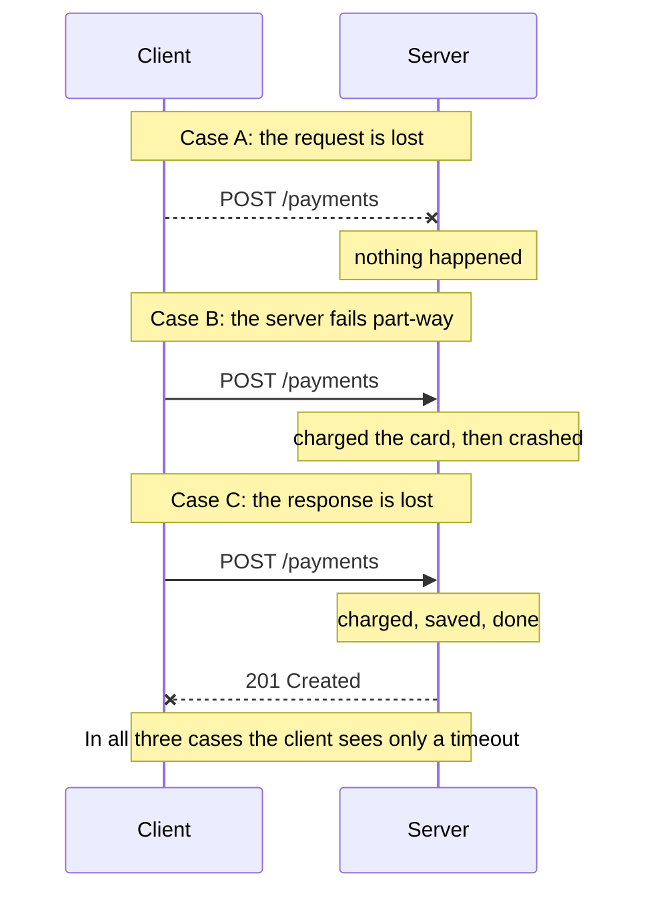
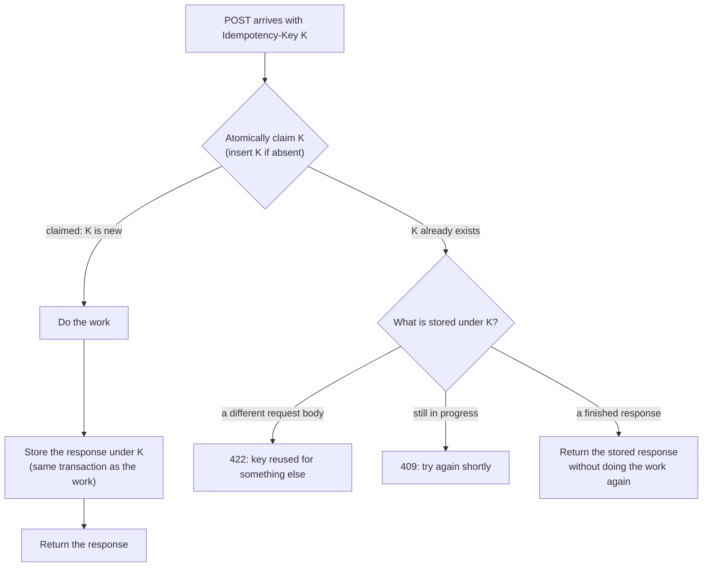

# 1.5 Timeouts, retries, and idempotency

[Syllabus](../SYLLABUS.md) · Phase 1 · Previous: [1.4 API design](04-api-design.md) · Next: [1.6 Inside the server](06-concurrency-pools-queues.md)

> **Time:** about 55 minutes to read, 60 minutes of practice.
> **You need:** [Chapter 1.3](03-http-for-backend-engineers.md) (what "idempotent" means, `4xx` versus `5xx`).

**By the end of this chapter you can**

- explain why a request that timed out is in an *unknown* state, and why no design removes that;
- choose a timeout from measurements, and say what happens when there is none;
- write a retry loop that helps instead of harming: which errors, how many attempts, how long to wait;
- design and implement idempotency keys, including the races that naive implementations lose;
- recognise the same problem wherever a side effect can be repeated.

---

## The problem

*An illustrative scenario.* A customer taps **Pay**. The app sends `POST /payments`. Your server charges the card and writes `201 Created` — and at that moment the customer's train goes into a tunnel. The response never arrives. After a few seconds the app shows "Something went wrong. Try again." The customer taps **Pay** again. The server, seeing a perfectly valid new request, charges the card again.

Nothing in that story is a bug in the ordinary sense. The server did what it was asked, twice. The app did the reasonable thing with the information it had. The information is the problem.

Stripe's engineering blog lists what can go wrong in any call between two machines:

> "The initial connection could fail as the client tries to connect to a server. The call could fail midway while the server is fulfilling the operation, leaving the work in limbo. The call could succeed, but the connection break before the server can tell its client about it. Any one of these leaves the client that made the request in an uncertain situation."
> — [Stripe, *Designing robust and predictable APIs with idempotency*](https://stripe.com/blog/idempotency)

A function call inside one program has two outcomes: it returns, or it throws. A call across a network has three: **it worked, it failed, or you do not know.** The third outcome is new, it is common, and most of the code you have written so far ignores it.

The runnable example in this chapter sends 1,000 payments over a network that loses one request in twenty and one response in ten. With no retries, 153 customers see an error — and **101 of them have been charged**. Add retries the obvious way and every customer sees success, but **101 are charged twice**. The rest of the chapter is how to get to "every customer sees success and is charged exactly once".

---

## The concept

### 1. The third outcome



From the client's side, cases A, B and C are indistinguishable. This is not a limitation of a particular library or protocol; a client that hears nothing cannot tell silence-because-it-did-not-arrive from silence-because-the-answer-was-lost.

So the goal changes. You cannot make the unknown outcome go away. You can make it **harmless**: design the operation so that the right response to "I do not know" is always "send it again". That takes three tools, and each needs the next:

- a **timeout**, so the client stops waiting and reaches a decision;
- a **retry**, so the decision can be "try again";
- **idempotency**, so that trying again is safe.

### 2. Timeouts: decide how long you are willing to wait

**What happens without one.** A call with no timeout waits for as long as the other side stays silent — which, if the other side has hung, is for ever. Meanwhile it is holding things. The AWS Builders' Library explains the consequence: "When a client is waiting longer than usual for a request to complete, it also holds on to the resources it was using for that request for a longer time. When a number of requests hold on to resources for a long time, the server can run out of those resources. These resources can include memory, threads, connections, ephemeral ports, or anything else that is limited" ([AWS Builders' Library, *Timeouts, retries, and backoff with jitter*](https://aws.amazon.com/builders-library/timeouts-retries-and-backoff-with-jitter/)).

That is how one slow dependency takes down a healthy service: every request that touches it gets stuck, the stuck requests use up the service's capacity, and soon requests that have nothing to do with the slow dependency cannot get in either. Chapter 1.6 shows the mechanism.

**The defaults are usually "wait for ever".** In Go, for `http.Client`, "a Timeout of zero means no timeout" ([`net/http`](https://pkg.go.dev/net/http#Client)), and zero is what you get if you do not set it. gRPC is the same: "By default, gRPC does not set a deadline which means it is possible for a client to end up waiting for a response effectively forever" ([gRPC, *Deadlines*](https://grpc.io/docs/guides/deadlines/)). You have to choose a value. Not choosing is choosing infinity.

**How to choose.** Both directions hurt:

- Too **long**, and a failing dependency holds your resources for the whole of that time.
- Too **short**, and you abandon requests that were about to succeed. Each of those becomes a retry, which adds load to a dependency that was merely a little slow.

Amazon's practice, from [the same article](https://aws.amazon.com/builders-library/timeouts-retries-and-backoff-with-jitter/): "we choose an acceptable rate of false timeouts (such as 0.1%). Then, we look at the corresponding latency percentile on the downstream service (p99.9 in this example)." In other words: **set the timeout from the dependency's measured latency distribution**, at the percentile that matches how many healthy requests you are prepared to give up on. This is Chapter 1.1's percentiles being used for something.

**Timeouts come in layers.** A complete setup has:

| Timeout | Protects against | Typical size |
|---|---|---|
| Connection timeout | A host that is not there | Short: setup is a few round trips |
| Per-attempt request timeout | A server that accepted the request and went quiet | From the latency percentile, as above |
| Overall deadline | Retries and sequential calls adding up to more than the user will wait | The user's patience, shared by every call made on their behalf |
| Server-side timeouts | Slow or vanished *clients* holding your connections | See the tips below |

In Go, a deadline travels with a `context`, and one line attaches it to an outgoing request:

```go
// This attempt gets two seconds. If ctx already had less time left
// than that, it keeps the smaller amount.
ctx, cancel := context.WithTimeout(ctx, 2*time.Second)
defer cancel()
req, err := http.NewRequestWithContext(ctx, http.MethodPost, url, body)
```

The useful property is the comment: a deadline derived from a parent context can only get shorter. Pass the incoming request's context down to every call you make, and the whole tree of work shares one budget. On the server side, Go cancels a request's context "when the client's connection closes" ([`net/http`, `Request.Context`](https://pkg.go.dev/net/http#Request.Context)) — so a handler that passes its context along stops working when its caller has given up. Phase 6 builds on this.

### 3. Retries: what, how many, how fast

A retry turns "unknown" or "failed" into another chance. It also sends more load to something that may be failing *because of* load. The [AWS article](https://aws.amazon.com/builders-library/timeouts-retries-and-backoff-with-jitter/) has the right word for this: "Retries are 'selfish.' In other words, when a client retries, it spends more of the server's time to get a higher chance of success." That is fine when failures are rare. But "when failures are caused by overload, retries that increase load can make matters significantly worse."

Four rules keep retries on the helpful side.

**Rule 1 — Retry only what can succeed and is safe to repeat.**

| What the client saw | Retry? |
|---|---|
| Timeout; connection refused or reset | Yes — *if* the request is idempotent |
| `502`, `503`, `504` | Yes, after a wait; obey `Retry-After` if present |
| `429` | Yes, after `Retry-After` |
| `500` | Only if the request is idempotent; the outcome is unknown |
| `400`, `401`, `403`, `404`, `422` | **No.** The same request will fail the same way |

**Rule 2 — Stop after a small number of attempts**, and stop when the overall deadline has passed. Three attempts is a common ceiling. If it has failed three times, the fourth is unlikely to work and the caller has stopped waiting anyway.

**Rule 3 — Wait longer each time (backoff), and randomise the wait (jitter).** If a thousand clients fail at the same moment and all retry after exactly one second, the server is hit by a thousand requests at once, one second later — and again a second after that. [Stripe's blog](https://stripe.com/blog/idempotency) calls this "the thundering herd problem" and gives the cure: "adding some amount of random 'jitter' to each client's wait time. This will space out requests across all clients, and give the server some breathing room to recover."

The standard recipe is *capped exponential backoff with full jitter*: the upper limit doubles on every attempt, up to a cap, and the actual wait is a random time between zero and that limit. AWS's article on the subject compares several variants by simulation and concludes that jittered backoff "should be considered a standard approach for remote clients" ([AWS Architecture Blog, *Exponential Backoff And Jitter*](https://aws.amazon.com/blogs/architecture/exponential-backoff-and-jitter/)). In code it is three lines:

```go
// A random time between zero and an exponentially growing, capped limit.
func backoff(attempt int, rng *rand.Rand) time.Duration {
    limit := min(base<<attempt, maxDelay)             // base, 2×base, 4×base, … up to maxDelay
    return time.Duration(rng.Int64N(int64(limit) + 1)) // anywhere from 0 to limit
}
```

**Rule 4 — Retry at one layer only.** Real systems are stacks of services calling services. If every layer retries, the retries multiply. The [AWS article](https://aws.amazon.com/builders-library/timeouts-retries-and-backoff-with-jitter/) works the example: with "a five-deep stack of service calls" and three retries at each layer, when the database at the bottom starts failing, "the load on the database will increase 243x, making it unlikely to ever recover." Decide which layer owns retries — usually the one closest to the user — and have the others fail fast. Phase 6 returns to this with retry budgets and circuit breakers.

### 4. Idempotency: make the retry harmless

Retries are only safe for operations that are **idempotent** — where doing it twice has the same effect as doing it once (Chapter 1.3). [AWS's summary](https://aws.amazon.com/builders-library/timeouts-retries-and-backoff-with-jitter/) is the rule to remember: "APIs with side effects aren't safe to retry unless they provide idempotency."

Some operations are idempotent by nature. Reading is. `DELETE /carts/9` is. So is anything phrased as "make it so" — `PUT`ting the full new state, or "set the status to shipped". The dangerous ones are phrased as "do it": *create* an order, *add* to a balance, *charge* a card, *send* an email. For those, you have to add the idempotency yourself.

#### The idempotency key

The fix is to let the client name the operation. Stripe's description:

> "When performing a request, a client generates a unique ID to identify just that operation and sends it up to the server along with the normal payload. The server receives the ID and correlates it with the state of the request on its end. If the client notices a failure, it retries the request with the same ID, and from there it's up to the server to figure out what to do with it."
> — [Stripe, *Designing robust and predictable APIs with idempotency*](https://stripe.com/blog/idempotency)

The ID usually travels in an `Idempotency-Key` header. That header is on its way to becoming a standard: at the time of writing it is an IETF Internet-Draft, not yet an RFC ([draft-ietf-httpapi-idempotency-key-header](https://datatracker.ietf.org/doc/draft-ietf-httpapi-idempotency-key-header/)). Amazon uses the same idea under another name — "a unique caller-provided client request identifier", called `ClientToken` in the EC2 API ([AWS Builders' Library, *Making retries safe with idempotent APIs*](https://aws.amazon.com/builders-library/making-retries-safe-with-idempotent-APIs/)).

Two rules for the client:

- **One key per operation, not per attempt.** The key is created when the user's intent is created — when the checkout page loads, or when **Pay** is tapped — and every retry of that payment carries the same key. A fresh key on each attempt defeats the whole mechanism.
- **Make it unique and keep it.** A random UUID is the usual choice ([Stripe suggests](https://docs.stripe.com/api/idempotent_requests) "V4 UUIDs, or another random string with enough entropy to avoid collisions"). If the app can be restarted mid-payment, the key must be stored with the pending payment so that the restarted app reuses it.

#### What the server does



In words:

1. **Try to claim the key**, in one atomic step: insert it if it is not already there.
2. **If the claim succeeded**, this is the first time: do the work, store the response under the key, and return it.
3. **If the key was already there**, look at what is stored:
   - a *different request* under the same key is a client bug — refuse it;
   - the first request is *still running* — tell the client to come back;
   - a *finished response* — send that same response again and do nothing else.

The status codes in the diagram are the ones [the IETF draft](https://datatracker.ietf.org/doc/draft-ietf-httpapi-idempotency-key-header/) recommends: `422` "if there is an attempt to reuse an idempotency key with a different request payload", and `409` "if the request is retried, while the original request is still being processed".

This is short to describe and easy to get subtly wrong. There are three classic mistakes.

**Mistake 1: check, then insert.** "Look the key up; if it is not there, do the work and save it" is two steps. Two requests with the same key that arrive close together — an impatient retry, a double tap — both find nothing and both do the work. The claim must be a **single atomic operation**: in a database, an `INSERT` into a table with a unique constraint on the key, so that exactly one of two concurrent inserts wins. The example below shows the naive version charging twice.

**Mistake 2: the work and the key are saved separately.** If the server charges the customer and then crashes before recording the key, the retry finds no key and charges again. If it records the key and then crashes before doing the work, the retry finds the key and nothing is ever done. The key and the effect have to succeed or fail **together**. [AWS states the requirement](https://aws.amazon.com/builders-library/making-retries-safe-with-idempotent-APIs/): recording the token and performing the change must be "an 'all or nothing' or atomic process", to "avoid situations where we could potentially record the idempotent token and fail to create some resources or, alternatively, create the resources and fail to record the idempotent token." When everything lives in one database, that means *one transaction*.

When the work includes a call to *another* system — the card network, an email provider — one transaction cannot cover it. The pattern then is to commit your own progress in steps and pass an idempotency key of your own to the downstream system, so that a retry can resume without repeating the external call. Brandur's article [*Implementing Stripe-like Idempotency Keys in Postgres*](https://brandur.org/idempotency-keys) works through exactly this with "atomic phases" and "recovery points"; read it when you have to build one.

**Mistake 3: not deciding what to store, for how long, and for whom.**

- *What.* Store enough to reproduce the response: the status code and the body. Stripe "saves the status code and body of the first request made with a given idempotency key after endpoint execution begins. Retries with the same key return the saved response, including `500` errors." Requests that failed *before* any work started — validation errors, rate limiting — are not stored, and can simply be retried ([Stripe API reference, *Idempotent requests*](https://docs.stripe.com/api/idempotent_requests)).
- *The fingerprint.* Store a hash of the request with the key, so that you can detect the same key arriving with a different body. Stripe's "idempotency layer compares incoming parameters to those of the original request and errors if they're not the same to prevent accidental misuse."
- *How long.* Keys cannot be kept for ever. Stripe "retains keys for at least 24 hours and can remove them after that" ([Stripe, *Advanced error handling*](https://docs.stripe.com/error-low-level)). The retention period must be longer than the longest time any client might keep retrying.
- *For whom.* Scope each key to the authenticated caller. Otherwise one customer's key can collide with — or be used to read — another's stored response.

#### It is not only payments

The same shape appears wherever an effect can be repeated: a form submitted twice, a webhook delivered twice, a message taken from a queue twice (Chapter 4.3 is this chapter again, for queues). The general statement is that reliable delivery across a network means *at least once*, and at-least-once delivery is only safe when the receiver can recognise a repeat.

---

## A real example

### Run it: 1,000 payments over a lossy network

[`code/ch05-idempotency/main.go`](code/ch05-idempotency/main.go) contains a payment server, a client with retries and jittered backoff, and a network between them that loses 5% of requests before they arrive and 10% of responses on the way back. It runs the same thousand payments under different rules and counts what the *server* did — the thing a real client can never see.

```bash
go run ./phase-1-foundations/code/ch05-idempotency
```

```text
1000 payments over a network that loses 5% of requests and 10% of responses.

1. No retries
  client was told "paid":              847
  client was told nothing (error):     153   <- 101 of these customers were charged anyway
  charges the server actually made:    948
  customers charged more than once:      0

2. Retries, no idempotency key
  client was told "paid":             1000
  client was told nothing (error):       0
  charges the server actually made:   1101
  customers charged more than once:    101

3. Retries with an idempotency key
  client was told "paid":             1000
  client was told nothing (error):       0
  charges the server actually made:   1000
  customers charged more than once:      0
  retries answered from stored result: 101

4. A retry arrives while the first attempt is still running
  look up, work, then store (racy):      charges: 2   the retry saw: 201
  claim the key first (atomic):          charges: 1   the retry saw: 409 x3, 201
```

(Scenarios 1–3 print the same numbers on every run. In scenario 4 the number of `409`s depends on timing.)

Go through it slowly.

- **Scenario 1** is the third outcome made visible. 153 payments ended in an error on the client. In 101 of them the money had moved. Not retrying does not avoid the problem; it only hides it.
- **Scenario 2** fixes what the client sees and breaks what the customer pays. Every lost response became a second charge.
- **Scenario 3** is the same client with one extra header. The server did the work 1,000 times and answered 101 retries from its records.
- **Scenario 4** is Mistake 1. The same payment is sent twice, 10 ms apart, while the server needs 50 ms to process it. The "look up, then store" server charges twice. The server that claims the key first charges once; the retry is told `409` until the first attempt finishes, and then receives the stored `201`.

The heart of the correct server is the claim. Everything else follows from doing this in one step:

```go
// One atomic step: either we claim the key, or we learn that
// somebody else already has. In a database this is an INSERT
// into a table with a unique constraint on the key.
s.mu.Lock()
rec, seen := s.keys[key]
if !seen {
    s.keys[key] = &record{fingerprint: fingerprint}
}
s.mu.Unlock()
```

And the heart of the client is that the key is created once, outside the retry loop:

```go
if c.sendKey {
    // The same key on every attempt: that is the whole point.
    req.Header.Set("Idempotency-Key", key)
}
```

### The same thing in a database

A mutex only works inside one process. In a real service the claim is a database constraint. [`code/ch05-idempotency/idempotency.sql`](code/ch05-idempotency/idempotency.sql) is a PostgreSQL version: a table of keys with a primary key on `(account_id, key)`, and one function that claims the key, creates the order and stores the response in a single transaction.

```bash
psql -f phase-1-foundations/code/ch05-idempotency/idempotency.sql
```

```text
==== First request ====
 code |                 body                 | replayed
------+--------------------------------------+----------
  201 | {"order_id": 1, "total_cents": 4599} | f

==== The same request again (a retry) ====
 code |                 body                 | replayed
------+--------------------------------------+----------
  201 | {"order_id": 1, "total_cents": 4599} | t

==== The same key with a different body (a client bug) ====
 code |                body                | replayed
------+------------------------------------+----------
  422 | {"type": "idempotency-key-reused"} | t

==== Orders created: exactly one ====
 orders
--------
      1
```

The claim is this statement:

```sql
INSERT INTO idempotency_keys (account_id, key, request_hash, response_code, response_body)
VALUES (p_account, p_key, p_hash, 0, '{}')
ON CONFLICT (account_id, key) DO NOTHING;
```

If it inserts a row, this request owns the operation. If it inserts nothing, another request got there first.

What about two requests with the same key at the same instant? Tested on PostgreSQL 16 for this chapter: while the first transaction is still open, the second `INSERT … ON CONFLICT DO NOTHING` **waits**. When the first transaction commits, the second inserts nothing and goes on to read the stored response; if the first rolls back, the second inserts its row and does the work itself. The unique constraint is doing the job of a lock, and the "in progress" state never needs to be visible to anyone. (The PostgreSQL manual notes the underlying behaviour: with `ON CONFLICT DO NOTHING`, an insert may "not proceed for a row due to the outcome of another transaction whose effects are not visible to the INSERT snapshot" — [*Transaction Isolation*](https://www.postgresql.org/docs/current/transaction-iso.html).) Phase 2 explains why this works.

### How Stripe does it

Stripe's public API is the best-known implementation, and its documentation states the contract precisely ([API reference](https://docs.stripe.com/api/idempotent_requests), [advanced error handling](https://docs.stripe.com/error-low-level)):

- Every `POST` accepts an `Idempotency-Key`. `GET` and `DELETE` do not need one: "these requests are idempotent by definition."
- The first response is stored and replayed, and a replay is labelled: "look for the header `Idempotent-Replayed: true`."
- A retry that arrives while the original is still running gets `409`, and the instruction is to "wait and retry with that key and the same parameters. A new key can start a second operation."
- For retries that span restarts: "generate and persist a key for the operation and supply it to every attempt."
- The key can be derived from something the user already has, "like the ID of a shopping cart", which also protects against double submission of a form.

---

## Trade-offs

**Timeouts: short or long.** There is no safe default. Short timeouts free resources quickly and turn slowness into errors and retries. Long ones tolerate slowness and let a stuck dependency tie you up. The AWS method — pick the false-timeout rate you accept, read off the percentile — makes the trade explicit instead of leaving it to a guess. Revisit the value when the dependency's latency changes.

**Retries: availability now, load later.** Retries hide transient failures from users, which is what you want — and from your dashboards, which is not. Count retries as a metric. A rising retry rate is the earliest sign of a dependency in trouble.

**Idempotency keys cost a write and some storage.** Every keyed request does at least one extra insert, and you keep a record per request for the retention period. For an endpoint that moves money or sends messages, that is cheap insurance. For an operation that is naturally idempotent, it is waste — a `PUT` of a complete resource needs no key.

**Reject the overlapping retry, or make it wait?** Answering `409` keeps the server simple and pushes a short wait onto the client. Blocking until the first attempt finishes (as the PostgreSQL version does) gives the client a simpler experience and ties up a server connection while it waits. Either is defensible; choose one and document it.

**Storing failures.** If you replay a stored `500` for the full retention period, a transient fault becomes a permanent failure for that key. If you do not store failures, a retry may run a half-finished operation again. Stripe stores them once execution has begun; whichever you choose, the rule must be something a client author can read and rely on.

**What this does not give you.** An idempotency key makes *one operation on one service* safe to repeat. It does not make a sequence of operations across several services atomic. That is a different problem, with different tools (Chapters 4.5 and 5.7).

---

## Practice

### Check yourself

Answer before reading on.

1. Your client's call to `POST /transfers` times out. List the states the transfer could be in. What should the client do next — and what does it need for that to be safe?
2. A dependency's latency is: p50 20 ms, p99 150 ms, p99.9 400 ms. A colleague sets the timeout to 100 ms, "because it normally takes 20". Roughly what fraction of *healthy* requests now time out? What happens to those requests, and to the dependency?
3. Why must the idempotency key be generated by the client rather than the server? And why once per operation rather than once per attempt?

<details>
<summary>Answers</summary>

1. Three: it never reached the server (not done); the server is still working on it or failed part-way (unknown, possibly partly done); it completed and the response was lost (done). The client cannot tell which. It should **retry with the same idempotency key**, after a backoff. That is safe only if the server implements idempotency keys. Without them, the only safe move is to *ask* — look the transfer up by some identifier — and that works only if the client chose an identifier the server recorded, which is the same idea by another route.

2. More than 1% — the p99 is 150 ms, so at least one request in a hundred takes longer than 100 ms — and certainly less than 50%. So somewhere above one in a hundred healthy requests is now abandoned. Each abandoned request is retried, so the dependency receives *extra* load, from requests it was about to answer successfully. If the dependency slows down a little — say its p90 drifts past 100 ms — one request in ten is suddenly timing out and retrying, which slows it further. A timeout near 400 ms (the p99.9) gives up on about one request in a thousand.

3. The key has to identify *the operation the client intends*, and only the client knows that two requests are the same intent. A server that receives two identical-looking `POST`s cannot tell a retry from a customer who really wants two of something. (AWS's example: two identical requests to launch a server may well mean "I want two servers.") And it must be once per *operation* because the retry has to present the same key as the original — a new key per attempt tells the server that each attempt is new work, which is exactly the bug.

</details>

### Exercise: make order creation safe to retry

Your service has this endpoint, backed by PostgreSQL:

```text
POST /orders      body: {"items": [...], "total_cents": 4599}      → 201 {"order_id": 8812}
```

The mobile team reports duplicate orders when users are on poor connections. Design the fix:

1. What changes in the API contract? What does the mobile app have to do?
2. What does the server store, and what constraint makes the claim atomic?
3. Write the server's algorithm for a request, covering: first time; exact retry after success; retry while the first is in flight; same key with a different body; first attempt failed and was rolled back.
4. How long do you keep keys, and why that long?
5. Creating the order must also send a confirmation email. What goes wrong, and what would you do?

<details>
<summary>Worked solution</summary>

**1. The contract.**
`POST /orders` accepts an `Idempotency-Key` header. For a new API, *require* it and answer `400` when it is missing; for an existing one, accept it as optional first and require it in a later version (adding a required header is a breaking change — Chapter 1.4).

The app generates a random UUID **when the user starts checkout**, stores it with the pending order on the device, and sends it on every attempt — including attempts after the app is killed and reopened. It retries on timeouts, connection errors, `409`, `429` and `5xx`, with capped exponential backoff and jitter, up to an overall limit. It does not retry other `4xx` responses.

**2. Storage.** The table from `idempotency.sql`:

```sql
CREATE TABLE idempotency_keys (
    account_id    bigint      NOT NULL,   -- keys are scoped to the caller
    key           text        NOT NULL,
    request_hash  text        NOT NULL,   -- fingerprint of the request body
    response_code int         NOT NULL,
    response_body jsonb       NOT NULL,
    created_at    timestamptz NOT NULL DEFAULT now(),
    PRIMARY KEY (account_id, key)
);
```

The primary key on `(account_id, key)` is the constraint that makes the claim atomic.

**3. The algorithm**, in one database transaction:

1. `INSERT … ON CONFLICT (account_id, key) DO NOTHING`.
2. **One row inserted — first time.** Insert the order. Update the key row with the response (`201` and the body). Commit. Return the response.
3. **No row inserted — the key exists.** Read the row.
   - `request_hash` differs → `422`, with an error type such as `idempotency-key-reused`.
   - Otherwise → return the stored `response_code` and `response_body`, with `Idempotent-Replayed: true`.

How the five cases come out:

| Case | What happens |
|---|---|
| First time | Step 2. |
| Exact retry after success | Step 3: the stored `201`, the same `order_id`. One order. |
| Retry while the first is in flight | The retry's `INSERT` waits for the first transaction, then takes step 3 and returns the first one's response. |
| Same key, different body | Step 3: `422`. |
| First attempt failed and rolled back | The rollback removed the key row together with the half-made order. The retry finds nothing, claims the key, and runs normally. |

Notice that the last row needed no special code. Because the key and the order are in the same transaction, a failed attempt leaves no trace, and "retry after failure" is just "first time" again.

**4. Retention.** Keep keys for longer than the longest period over which the app might still retry. If the app can retry a pending order for a day — a phone left offline overnight — keep keys for comfortably more than a day; Stripe's 24 hours is a reasonable reference. Delete older rows with a scheduled job. If a key is reused after its row has been deleted, it is treated as new — so the app must also stop retrying after its own limit, and at that point *look the order up* instead of submitting again.

**5. The email.** Sending the email is a second side effect, in a system your transaction does not cover:

- Send it *inside* the transaction, before commit: if the commit then fails, the customer has a confirmation for an order that does not exist.
- Send it *after* commit: if the process crashes in between, the order exists and no email is ever sent — and the retry, which replays the stored response, will not send one either.

The robust answer is to stop sending the email from the request at all. In the same transaction that creates the order, insert a row saying "confirmation email to send" — and have a separate worker send it, retrying until it succeeds, using the order ID as the idempotency key towards the email provider. The request stays atomic, and the email becomes a job that is delivered at least once and de-duplicated on the far side. That pattern is called the *transactional outbox*, and it is Chapter 4.5.

</details>

---

## Production tips and common mistakes

**Tips**

- **Every network call gets a timeout.** Client libraries, database drivers, queue clients — check each one's default. Treat "no timeout" as a bug.
- **Set timeouts on your server too**, so that slow or vanished clients cannot hold connections open. In Go that means building an `http.Server` with its timeout fields set (for example `ReadHeaderTimeout`) instead of calling the convenience function `http.ListenAndServe`. Cloudflare's write-up explains why: those convenience functions "leave the Timeouts to their default off value", and a server exposed without them will end up "leaking connections" and running out of file descriptors ([Cloudflare blog, *The complete guide to Go net/http timeouts*](https://blog.cloudflare.com/the-complete-guide-to-golang-net-http-timeouts/)).
- **Derive timeouts from measured percentiles**, and write next to the number where it came from.
- **Pass the deadline down.** A handler with 800 ms left should not start a call with a 5-second timeout.
- **Retry only idempotent operations**, with capped exponential backoff, jitter, a small attempt limit, and respect for `Retry-After`.
- **Retry at one layer.**
- **Create the idempotency key where the intent is created, and persist it** with the pending operation.
- **Claim keys with a unique constraint**, and commit the key together with the effect.
- **Fingerprint the request** and reject a key that comes back with a different body.
- **Mark replays** (as Stripe does with `Idempotent-Replayed`) and count them. Retry rate, timeout rate and replay rate are three of the most informative graphs a service can have.

**Common mistakes**

- **No timeout**, because the default was infinity and nobody looked.
- **A timeout below the dependency's normal tail latency**, which manufactures failures and then retries them.
- **Retrying a `POST` with no idempotency key** — sometimes without knowing it, because an HTTP library, a proxy or an SDK retries by default. Find out what yours does.
- **A new idempotency key on every attempt.**
- **Retrying immediately, in a tight loop**, with no backoff. Under failure this is a denial-of-service attack on your own dependency.
- **Retries at every layer.**
- **Check-then-insert** for the key.
- **Treating a timeout as a failure and "undoing" it** — refunding or cancelling — without finding out what actually happened. The original may have succeeded; now you have also refunded it.
- **Keeping keys only somewhere that can forget them.** If an entry disappears early — evicted from a cache, lost in a restart — the next retry is treated as new work. The store of keys needs the same durability as the data it protects.
- **Expiring keys sooner than clients stop retrying.**

---

## Key takeaways

- A remote call has three outcomes: success, failure, and unknown. You cannot remove the third; you can make it harmless.
- No timeout means waiting for ever while holding resources. Choose timeouts from the dependency's latency percentiles.
- Retry only failures that can succeed and operations that are safe to repeat; a few attempts, with exponential backoff and jitter, at one layer.
- An idempotency key is the client naming its operation so the server can recognise a repeat. One key per operation, the same on every attempt.
- On the server: claim the key atomically, commit it together with the effect, store the response, replay it.
- "At least once, plus the ability to recognise a repeat" is how reliable effects are built everywhere in this course.

**Next:** [1.6 Inside the server](06-concurrency-pools-queues.md) — what a request is waiting for when it is not using the CPU.

---

## Sources

- Stripe: [*Designing robust and predictable APIs with idempotency*](https://stripe.com/blog/idempotency) (blog); [Idempotent requests](https://docs.stripe.com/api/idempotent_requests) (API reference); [Advanced error handling](https://docs.stripe.com/error-low-level).
- AWS Builders' Library: [*Timeouts, retries, and backoff with jitter*](https://aws.amazon.com/builders-library/timeouts-retries-and-backoff-with-jitter/); Malcolm Featonby, [*Making retries safe with idempotent APIs*](https://aws.amazon.com/builders-library/making-retries-safe-with-idempotent-APIs/).
- AWS Architecture Blog: Marc Brooker, [*Exponential Backoff And Jitter*](https://aws.amazon.com/blogs/architecture/exponential-backoff-and-jitter/).
- IETF HTTPAPI working group: [*The Idempotency-Key HTTP Header Field*](https://datatracker.ietf.org/doc/draft-ietf-httpapi-idempotency-key-header/) (Internet-Draft).
- Brandur, [*Implementing Stripe-like Idempotency Keys in Postgres*](https://brandur.org/idempotency-keys), brandur.org.
- gRPC documentation: [Deadlines](https://grpc.io/docs/guides/deadlines/).
- Go standard library: [`net/http`](https://pkg.go.dev/net/http), [`context`](https://pkg.go.dev/context).
- Cloudflare blog: Filippo Valsorda, [*The complete guide to Go net/http timeouts*](https://blog.cloudflare.com/the-complete-guide-to-golang-net-http-timeouts/).
- PostgreSQL documentation: [Transaction Isolation](https://www.postgresql.org/docs/current/transaction-iso.html); [INSERT](https://www.postgresql.org/docs/current/sql-insert.html).
