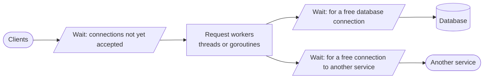

# 1.6 Inside the server: concurrency, pools, and queues

[Syllabus](../SYLLABUS.md) · Phase 1 · Previous: [1.5 Timeouts, retries, and idempotency](05-timeouts-retries-idempotency.md) · Next: [1.7 Measuring performance](07-measuring-performance.md)

> **Time:** about 55 minutes to read, 60 minutes of practice.
> **You need:** [Chapter 1.1](01-what-production-demands.md) (percentiles) and [Chapter 1.5](05-timeouts-retries-idempotency.md) (timeouts).

**By the end of this chapter you can**

- describe a server as a chain of queues and workers, and say where a slow request is waiting;
- compare threads, event loops and lightweight threads by what a *waiting* request costs in each;
- use Little's law to turn "requests per second" and "latency" into "how many at once";
- explain why latency climbs steeply well before a resource is 100% busy, and why a queue cannot absorb a sustained overload;
- size a pool deliberately, and put a bound on every queue.

---

## The problem

*An illustrative scenario.* Your checkout endpoint takes 210 ms and has handled 40 requests a second for months. A marketing email goes out and traffic rises to 100 a second. Within seconds, checkout takes three seconds, then five. Requests start timing out.

You open the dashboards. The servers' CPUs are at 15%. Memory is flat. The database's CPU is at 10%. The payment provider's status page is green. **Nothing is busy.** And yet nothing is getting done.

The cause turns out to be one line in a configuration file — `pool size: 10` — and one habit in the code: the handler takes a database connection at the start of the request and keeps it until the end, *including* the 200 ms it spends waiting for the payment provider. Ten connections, each tied up for 210 ms, can serve 48 requests a second. At 100 a second, more than half of all requests are standing in a line that only gets longer.

Nothing was busy. Everything was waiting. CPU graphs do not show waiting.

Finding where requests wait is a core skill of backend engineering, and it rests on a small amount of arithmetic that this chapter teaches.

---

## The concept

### 1. A server is a chain of queues

From the outside, a server takes a request and returns a response. Inside, a request passes through a series of stages. Each stage has a **limited number of workers** — and therefore a **place to wait** when all of them are occupied.



The time a request takes is the sum of the work done at each stage **plus the time spent waiting to be let into each stage**. In a healthy server the waits are zero. In a struggling one they are almost all of the latency.

You can see these stages in the configuration of real servers. Apache Tomcat, a widely used Java server, has `maxThreads` — "the maximum number of request processing threads… which therefore determines the maximum number of simultaneous requests that can be handled", 200 by default — and `acceptCount`, the length of the queue of connections waiting to be accepted, 100 by default ([Tomcat configuration reference](https://tomcat.apache.org/tomcat-10.1-doc/config/http.html)). A pool of workers with a bounded queue in front: that is the shape to look for everywhere.

This picture also explains a rule from Chapter 1.1 — measure latency from outside the handler. A request waiting in the first queue has not reached your code yet. Timing that starts inside the handler cannot see that wait.

### 2. What a waiting request costs: three concurrency models

Most backend requests spend most of their life waiting — for a database, a cache, another service. The question that separates server designs is: **what does it cost to have a request parked, waiting?**

**A thread per request.** Each in-flight request gets its own operating-system thread; when the request waits, the thread sleeps. The code reads top to bottom and is easy to debug. The price is that threads are not cheap. The proposal that added lightweight threads to Java describes the consequence: "OS threads are costly, so we cannot have too many of them… If each request consumes a thread, and thus an OS thread, for its duration, then the number of threads often becomes the limiting factor long before other resources, such as CPU or network connections, are exhausted" ([JEP 444, *Virtual Threads*](https://openjdk.org/jeps/444)). So thread-per-request servers cap the number of threads — Tomcat's 200 — and that cap becomes a queue.

**An event loop.** One thread handles many connections by never waiting: it starts an I/O operation, moves on to another request, and comes back when the result is ready. Node.js works this way; its documentation explains that "the secret to the scalability of Node.js is that it uses a small number of threads to handle many clients" ([Node.js, *Don't Block the Event Loop*](https://nodejs.org/en/learn/asynchronous-work/dont-block-the-event-loop)). A waiting request costs only a little memory. The price is in the title of that page: if one request does something slow *on* the loop — a heavy computation, an accidental blocking call — every other request waits behind it.

**Lightweight threads.** The language runtime provides threads of its own that are far cheaper than the operating system's, and parks them itself when they wait. You write simple blocking code and get roughly the efficiency of an event loop. Go's goroutines are the best-known example: "it is practical to create hundreds of thousands of goroutines in the same address space" ([Go FAQ](https://go.dev/doc/faq#goroutines)), and Go's HTTP server simply starts "a new service goroutine for each" connection ([`net/http`](https://pkg.go.dev/net/http#Serve)). Java's virtual threads (standard since Java 21) are the same idea: they "are cheap and plentiful, and thus should never be pooled" ([JEP 444](https://openjdk.org/jeps/444)).

| | A waiting request costs | Code style | The trap |
|---|---|---|---|
| Thread per request | An OS thread | Simple, blocking | The thread pool is a hard limit, often a low one |
| Event loop | A small object | Callbacks or `async`/`await` | One slow step blocks everybody |
| Lightweight threads | A small stack | Simple, blocking | Nothing limits how many requests pile up — unless you add a limit |

That last cell matters more than it looks. Lightweight threads remove the limit on *threads*. They do not remove the limits *further down*. A Go server will happily hold 100,000 requests in flight — all waiting for the same ten database connections. The bottleneck has not gone; it has moved to the next stage, and the server has lost the one thing that used to stop requests accumulating in front of it.

*One line on CPU-bound work:* if requests mostly compute rather than wait, none of this helps — the limit is the number of cores, and Chapter 1.1's arithmetic (cores ÷ CPU time per request) applies.

### 3. Little's law: how many at once

There is one formula in this chapter, and it is worth memorising because it applies to every box in the diagram above.

> **Requests in flight = arrival rate × time each one spends**
>
> `L = λ × W`

This is **Little's law**. [JEP 444](https://openjdk.org/jeps/444) states it in server terms: "For a given request-processing duration (i.e., latency), the number of requests an application handles at the same time (i.e., concurrency) must grow in proportion to the rate of arrival (i.e., throughput)", with the example that an application with "an average latency of 50ms" achieves "200 requests per second by processing 10 requests concurrently", and to reach 2,000 requests per second "will need to process 100 requests concurrently."

It is a statement about averages, it needs no assumptions about how requests arrive, and it holds for any part of a system you draw a boundary around: the whole server, one pool, one queue. Three ways to use it:

**To size something.** At 100 requests per second, each holding a database connection for 210 ms, the average number of connections in use is `100 × 0.21 = 21`. A pool of 10 cannot do it. That is the scenario at the top of the chapter, diagnosed in one multiplication.

**To find a capacity.** Turn it round: a pool of `N` connections, each held for time `T`, can serve at most `N ÷ T` requests per second. `10 ÷ 0.21 s ≈ 48`.

**To read a dashboard.** If traffic is steady and the number of in-flight requests is rising, latency must be rising — the law leaves no other possibility. "In flight" is cheap to measure and reacts immediately, which makes it one of the most useful numbers a service can export.

### 4. Utilisation: why latency climbs before 100%

**Utilisation** is how much of a resource's capacity is in use: arrival rate divided by capacity. It is tempting to think a pool running at 90% has 10% to spare and nobody waits. That would be true if requests arrived at perfectly even intervals and each took exactly the same time. They do not. They arrive in clumps, and some take longer than others, so there are moments when all the connections are busy and a new request has to wait — and the closer you are to full, the longer it takes to recover from each clump.

The example program simulates a pool of 10 connections with a capacity of 500 requests per second, and raises the arrival rate towards that:

```text
   arrivals  utilisation   in flight   rate x mean latency     mean      p50      p99
    100/s      20%           2.0          2.0                20ms     14ms     93ms
    250/s      50%           5.0          5.0                20ms     14ms     92ms
    400/s      80%           9.5          9.5                24ms     18ms     98ms
    450/s      90%          14.7         14.7                33ms     26ms    118ms
    475/s      95%          23.8         23.8                50ms     40ms    177ms
    490/s      98%          53.6         53.5               109ms     80ms    462ms
```

Three things to read off this table.

- **Up to 50%, load is free.** Latency at 250 requests per second is the same as at 100.
- **The curve bends, then goes vertical.** From 80% to 90% the mean rises by a third. From 95% to 98% it doubles. The last few percent of capacity cost more latency than all the rest together. This shape — flat, then a knee, then a wall — is the single most important picture in performance work.
- **Little's law holds on every row.** The third column was measured by counting the requests in the server; the fourth is arrival rate × mean latency. They agree.

The practical conclusion: **capacity you can actually use is well below capacity on paper.** Running a resource near its limit trades a small saving in hardware for a large and unpredictable cost in latency. Where the knee falls depends on how many workers there are and how variable the work is, so measure it for your system (Chapter 1.7) rather than trusting a rule of thumb.

*The mathematics of this is queueing theory. For a rigorous treatment written for computer scientists, see Mor Harchol-Balter's [*Performance Modeling and Design of Computer Systems*](https://www.cs.cmu.edu/~harchol/PerformanceModeling/book.html). Little's law is from J. D. C. Little, ["A Proof for the Queuing Formula: L = λW"](https://doi.org/10.1287/opre.9.3.383), Operations Research, 1961.*

### 5. Overload: a queue is not capacity

Now push the arrival rate *past* capacity: 550 requests per second into a pool that can serve 500.

A queue can absorb a burst — a few seconds of excess that is followed by a quieter spell in which the backlog drains. It cannot absorb a *sustained* overload, because nothing ever drains. The backlog grows by 50 requests every second. Every new arrival waits behind the entire backlog. Latency does not settle at some higher level; it rises for as long as the overload lasts.

```text
2. Beyond capacity: 550 requests per second for 60 seconds
   unbounded queue:        served 33024   rejected     0   p50   2.8s   p99   6.2s   still waiting at the end: 3100
   queue limited to 20:    served 29684   rejected  3295   p50   43ms   p99  124ms   still waiting at the end: 14
```

Look at the first line. The server "served" every request — and served them all badly. Half took more than 2.8 seconds. In a real system their callers gave up long before (Chapter 1.5), so much of that work was thrown away on arrival. The AWS Builders' Library has a word for the distinction: "Throughput is the total number of requests per second that is being sent to the server. Goodput is the subset of the throughput that is handled without errors and with low enough latency for the client to make use of the response" ([AWS Builders' Library, *Using load shedding to avoid overload*](https://aws.amazon.com/builders-library/using-load-shedding-to-avoid-overload/)). An overloaded server with an unbounded queue has high throughput and collapsing goodput. And it gets worse on its own: timed-out clients retry, adding load to a server that is already behind.

Now the second line. The only change is that the queue may hold at most 20 waiting requests; a request that arrives to find it full is refused immediately. One request in ten is rejected — and the other nine are served in 43 ms. The rejected ones get a fast, honest `503` (with `Retry-After`, Chapter 1.3) instead of a slow timeout.

**The server was 10% over capacity. It can fail 10% of requests quickly, or 100% of them slowly.** Those are the only two options, and the bounded queue chooses the first. [AWS's summary](https://aws.amazon.com/builders-library/using-load-shedding-to-avoid-overload/): "Load shedding lets a server maintain its goodput and complete as many requests as it can, even as offered throughput increases." Chapter 6.4 develops this into a full strategy; the foundation is simply that **every queue has a limit**.

Unbounded queues are easy to create without noticing, because they are often the default:

- Java's `Executors.newFixedThreadPool` creates a pool "operating off a shared unbounded queue" ([Java API documentation](https://docs.oracle.com/en/java/javase/21/docs/api/java.base/java/util/concurrent/Executors.html)).
- In Go, goroutines blocked waiting for a pooled connection are a queue with no limit, and no setting to give it one. Go's `database/sql` does not even limit the pool itself unless asked: for `SetMaxOpenConns`, "the default is 0 (unlimited)" ([`database/sql`](https://pkg.go.dev/database/sql#DB.SetMaxOpenConns)) — so by default the overload is passed straight through to the database.

### 6. Pools: a concurrency limit you choose

A **pool** is a fixed set of reusable resources — most often connections. It does two jobs.

**It saves setup cost.** Chapter 1.2 showed what a new connection costs in round trips. For a database it is worse: PostgreSQL uses "a 'process per user' client/server model" in which every connection gets its own server process ([PostgreSQL documentation](https://www.postgresql.org/docs/current/connect-estab.html)).

**It limits concurrency on the thing behind it.** This is the less obvious job and the more important one. The pool size is the maximum number of things your service can ask the database to do at once.

That second job is why **a bigger pool is usually not a better pool.** A database has a fixed number of cores and disks. Once they are all busy, extra connections do not get more work done; they make the work in progress contend with itself. The PostgreSQL wiki: "Once all of the resources are in use, you won't push any more work through by having more connections competing for the resources. In fact, throughput starts to fall off due to the overhead from that contention. You can generally improve both latency and throughput by limiting the number of database connections with active transactions to match the available number of resources" ([PostgreSQL wiki, *Number Of Database Connections*](https://wiki.postgresql.org/wiki/Number_Of_Database_Connections)).

The documentation of HikariCP, a widely used Java connection pool, cites a demonstration by Oracle's performance group in which reducing a pool "from 2048 down to just 96" connections "decreased the response times of the application from ~100ms to ~2ms" ([HikariCP wiki, *About Pool Sizing*](https://github.com/brettwooldridge/HikariCP/wiki/About-Pool-Sizing)). The same page gives a starting-point formula, taken from the PostgreSQL wiki — `connections = ((core_count * 2) + effective_spindle_count)`, counted on the *database* server — and a principle: "You want a small pool, saturated with threads waiting for connections."

Three consequences:

- **The limit is shared.** If the database can usefully run 40 queries at once and you have 20 application servers, each server's pool should be about 2, not 40. PostgreSQL also has a hard ceiling — `max_connections`, by default "typically 100" ([PostgreSQL documentation](https://www.postgresql.org/docs/current/runtime-config-connection.html)) — and `servers × pool size` must stay under it. Chapter 2.6 covers what to do when it cannot.
- **Waiting moves into your application, on purpose.** A small pool means requests queue in your service instead of piling into the database. That is the better place for the queue — it is where you can see it, bound it and time it out.
- **Hold a pooled resource for as short a time as you can.** Capacity is `N ÷ T`. Halving the time you hold a connection doubles what the pool can serve, at no cost. And the commonest way to make `T` enormous is to hold the connection while waiting for something else.

---

## A real example

### Run it: the cost of holding a connection

[`code/ch06-pool/main.go`](code/ch06-pool/main.go) has two parts. Part A is the simulation whose output you have already seen. Part B runs real goroutines against a real pool of ten connections, with a checkout handler written two ways:

```go
// Keeps its database connection for the whole request, including the
// 200 ms spent waiting for another company's API.
func checkoutHoldingConnection(db *pool) error {
    if err := db.acquire(); err != nil {
        return err
    }
    defer db.release()
    time.Sleep(queryTime)   // read the cart
    time.Sleep(paymentTime) // call the payment provider — connection idle but held
    time.Sleep(queryTime)   // save the order
    return nil
}

// Gives the connection back before the slow call and takes one again afterwards.
func checkoutReleasingConnection(db *pool) error {
    if err := db.acquire(); err != nil {
        return err
    }
    time.Sleep(queryTime) // read the cart
    db.release()

    time.Sleep(paymentTime) // call the payment provider — holding nothing

    if err := db.acquire(); err != nil {
        return err
    }
    time.Sleep(queryTime) // save the order
    db.release()
    return nil
}
```

Both do the same 210 ms of work. Run them at 100 requests per second:

```bash
go run ./phase-1-foundations/code/ch06-pool -part b
```

```text
PART B — a checkout handler: query (5ms), call a payment API (200ms), query (5ms).
Pool of 10 connections, 100 requests per second for 5s. The work itself takes 210ms.

Holding the connection during the payment call
  each request holds a connection for 210ms -> the pool can serve 48 requests per second
  succeeded 500, failed 0   p50   2.9s   p99   5.7s   slowest   5.7s
  pool: 490 acquisitions had to wait, 2.8s on average

Releasing the connection during the payment call
  each request holds a connection for 10ms -> the pool can serve 1000 requests per second
  succeeded 500, failed 0   p50  211ms   p99  213ms   slowest  214ms
  pool: 0 acquisitions had to wait, 0ms on average
```

(Timing on your machine will differ by a few milliseconds.)

Same pool, same database, same traffic. One version takes three seconds and the other 211 ms. The whole difference is how long each request *holds* the scarce resource: 210 ms against 10 ms, which is a pool capacity of 48 requests per second against 1,000.

While the first version was melting down, this process used almost no CPU: every goroutine was asleep, either in a `Sleep` or in line for a connection. That is what the dashboard in the opening scenario was showing.

Notice the last line of each block. The pool counts how many acquisitions had to wait and for how long. Those are the same two counters that Go's real connection pool exposes — `WaitCount`, "the total number of connections waited for", and `WaitDuration`, "the total time blocked waiting for a new connection" ([`database/sql`, `DBStats`](https://pkg.go.dev/database/sql#DBStats)). A graph of those two numbers would have diagnosed the opening scenario in a glance. This is **saturation** — in Brendan Gregg's definition, "the degree to which the resource has extra work which it can't service, often queued" ([*The USE Method*](https://www.brendangregg.com/usemethod.html)) — and it is the signal that utilisation graphs miss.

**One caution about the fix.** Releasing the connection in the middle means the two database steps are no longer one transaction. If the process dies after the payment call, the order is never saved although the customer has paid. The fast version is the right design, but it obliges you to handle that case — with the idempotency key from Chapter 1.5, so that a retry completes the job. Faster is not free; here its price is that you must think about partial failure.

---

## Trade-offs

**Which concurrency model?** You rarely choose it directly — it comes with the language and framework. What you must know is which limit it leaves you with. With OS threads, the thread pool is your concurrency limit, for better and worse. With an event loop or lightweight threads, there is no built-in limit, so you must add your own at the points where it matters: pool sizes, and a cap on requests in flight.

**Pool size.** Too small, and requests queue in your application while the database sits idle. Too large, and you overload the database and every query slows down. Start from what the database can run concurrently, divide by the number of application instances, and then measure. Err on the small side: a queue in your service is visible and controllable; contention inside the database is neither.

**Queue length.** A longer queue rides out bigger bursts and makes everything in it wait longer. A shorter one rejects sooner. A principled way to choose: a queue should never hold more work than can be served within the time callers are prepared to wait. If capacity is 500 requests per second and callers time out after 200 ms, a queue of more than about 100 guarantees wasted work.

**Reject or wait?** For a request a person is waiting on, a fast error beats a slow success that arrives after they have left. For work nobody is waiting on — sending email, resizing images — waiting is fine, and a deliberate, durable queue is the right tool (Phase 4).

**Holding versus releasing.** Holding a connection across a slow call keeps your transaction simple and destroys your capacity. Releasing it multiplies your capacity and splits your transaction. In a request path with any real traffic, release — and deal with the consequences properly.

---

## Practice

### Check yourself

Answer before reading on.

1. A service handles 300 requests per second with a mean latency of 40 ms. On average, how many requests are in flight? If each request uses a database connection for 10 ms of those 40, how many connections are busy on average?
2. A pool has 20 connections and each request holds one for 50 ms. What is the pool's capacity? Describe what a user experiences at 380 requests per second, and at 420.
3. A Go service has no limit on in-flight requests and uses `SetMaxOpenConns(0)`. Traffic doubles overnight. Where does the overload show up, and why there?

<details>
<summary>Answers</summary>

1. Little's law, twice. In the service: `300 × 0.040 = 12` requests in flight. In the pool: `300 × 0.010 = 3` connections busy on average. (Average — the peak is higher, which is why the pool needs more than 3.)

2. Capacity is `20 ÷ 0.05 = 400` requests per second. At 380 the pool is at 95% utilisation: it keeps up, but requests regularly find every connection busy and wait, so latency is noticeably above 50 ms and the tail is much worse — the 95% row of the table. At 420 the pool is beyond capacity: the backlog grows by 20 requests every second, without limit. After a minute 1,200 requests are waiting and a new arrival waits about `1,200 ÷ 400 = 3` seconds — and it is still climbing. There is no steady state above capacity.

3. In the database. Nothing in the service limits anything: every request gets a goroutine, and every goroutine may open a connection. The database receives twice the concurrent queries, and each one gets slower because they contend with each other; if the number of connections reaches `max_connections`, new ones are refused outright. The service has passed the overload downstream to the component that is hardest to scale and most painful to lose. A pool limit would have kept the queue in the service, where it could be bounded and observed.

</details>

### Exercise: predict, then measure

Part B of the program takes two flags:

```bash
go run ./phase-1-foundations/code/ch06-pool -part b -rate 40
go run ./phase-1-foundations/code/ch06-pool -part b -acquire-timeout 500ms
```

`-rate` sets the requests per second (default 100). `-acquire-timeout` makes a request give up, with an error, if it cannot get a connection within that time (default: wait for ever).

For the **connection-holding** handler, whose pool capacity is 48 requests per second, predict each of these *before* running it. Write down a number.

1. At `-rate 40`: the p50 latency, and how many acquisitions wait.
2. At `-rate 50`: is this fine, or broken? What p50 do you expect after five seconds?
3. At `-rate 100 -acquire-timeout 500ms`: roughly how many of the 500 requests succeed? What is the worst latency a *successful* request can have?
4. Then the design question: this endpoint must serve 100 requests per second and you may not change the pool size. List every option you have.

<details>
<summary>Worked solution</summary>

**1. `-rate 40`** — measured:

```text
Holding the connection during the payment call
  succeeded 200, failed 0   p50  211ms   p99  212ms   slowest  212ms
  pool: 0 acquisitions had to wait, 0ms on average
```

211 ms and nobody waits — at 83% utilisation. Did you predict some queueing, from the table in section 4? This is the lesson of the exercise: **queues come from variability.** This load generator sends requests at perfectly even intervals, and every request takes exactly 210 ms, so nothing ever collides until the pool is completely full. The simulation in Part A has random arrivals and random service times, like real traffic, and queues long before 100%. Any test that sends perfectly regular traffic will flatter your system. Chapter 1.7 comes back to this.

**2. `-rate 50`** — measured:

```text
  succeeded 250, failed 0   p50  347ms   p99  485ms   slowest  485ms
  pool: 240 acquisitions had to wait, 142ms on average
```

Broken, though only just. 50 per second in, 48 per second out: the backlog grows by about 2.4 requests per second, so after five seconds about 12 requests are queued and the newest waits about a quarter of a second. It does not look alarming in a five-second test. Run it for an hour and latency reaches minutes. "Slightly over capacity" is not a stable state; it is a slow failure.

**3. `-rate 100 -acquire-timeout 500ms`** — measured:

```text
  succeeded 260, failed 240   p50  705ms   p99  712ms   slowest  713ms
  pool: 490 acquisitions had to wait, 480ms on average
```

The pool can complete about 48 per second, so in five seconds of traffic (and the moment after) about 250–260 succeed and the rest fail. A successful request can have waited at most 500 ms and then worked for 210 ms: **at most about 710 ms**. Compare that with 5.7 s without the timeout. The same number of requests were served either way — the pool's capacity did not change — but now every caller hears *something* within 710 ms.

This is a time-based bound on the queue, and it is the minimum protection any pool should have. Notice, though, that the successful requests are still slow (705 ms): each one spent nearly the whole timeout in line. A limit on the *length* of the queue, as in Part A, serves the requests it accepts much faster. Real systems use both.

**4. Options for serving 100 requests per second with a pool of 10.**

Capacity is `N ÷ T`, and `N` is fixed, so everything is about `T`, the holding time — or about needing fewer acquisitions.

- **Release the connection during the payment call.** Holding time drops from 210 ms to 10 ms; capacity rises to 1,000 per second. This is the fix. It costs you a single transaction (see the caution above).
- **Make the queries faster** (Chapter 2.2). It helps the second version; in the first, the 200 ms payment call dominates and faster queries change nothing — a reminder to find the bottleneck before optimising.
- **Do not use a connection at all for some requests** — serve reads from a cache (Chapter 3.3).
- **Move the payment call out of the request**: accept the order, answer `202`, and process the payment in the background (Phase 4). The request then holds a connection only for its own short writes.
- **Add a pool acquire timeout and a queue limit regardless**, so that the next surprise fails fast instead of taking the service down.

What does *not* help: adding application servers. Each new server brings its own pool of ten connections to a database that has not changed, so you are raising the pool size by another route — and if the database is the real limit, you have made things worse.

</details>

---

## Production tips and common mistakes

**Tips**

- **Know your queues.** For each service, be able to list: where requests can wait, how long each queue can get, and what happens when it is full.
- **Export saturation, not just utilisation.** Requests in flight; pool wait count and wait time; queue depth. These move before latency does. The [USE method](https://www.brendangregg.com/usemethod.html) says it in one sentence: "For every resource, check utilization, saturation, and errors."
- **Set every pool's size on purpose**, working back from what the resource behind it can do, divided across all the instances that share it.
- **Give every pool an acquire timeout**, shorter than the caller's own timeout.
- **Bound every queue.** When it is full, refuse with `503` and `Retry-After`.
- **Hold pooled resources briefly.** Acquire late, release early, and never hold one across a call to another system.
- **Limit requests in flight** when your runtime does not (Go, Node.js, virtual threads): a cap on concurrent requests is a few lines and turns unbounded pile-up into fast refusals.
- **Do the multiplication.** Rate × holding time, for every pool, at your *peak* rate. If the answer is near the pool size, you are already in trouble.

**Common mistakes**

- **Looking only at CPU.** A service whose requests are all waiting shows an idle CPU and a terrible response time.
- **Fixing a slow service by enlarging the pool.** Sometimes right; often it moves the queue into the database, where it does more damage and is harder to see.
- **Holding a database connection — or a transaction — across an HTTP call.** The opening scenario, and one of the most common causes of this class of outage.
- **Unbounded queues by default**: executors, channels, in-memory job lists. Under sustained overload they convert a capacity problem into a latency problem and then a memory problem.
- **Believing that 90% utilisation means 10% headroom.**
- **Pooling things that should not be pooled.** Lightweight threads are meant to be created per task; pooling them only reintroduces the limit they were designed to remove.
- **Adding application servers when the database is the bottleneck.**
- **Testing with perfectly regular traffic** and concluding the system has no queueing.

*One line of history:* the idea that servers should not need one OS thread per connection dates from the "C10K problem" — handling ten thousand simultaneous clients — described by [Dan Kegel](http://www.kegel.com/c10k.html) on a page first published in 1999.

---

## Key takeaways

- A server is a chain of limited stages. A slow request is usually *waiting* at one of them, not working.
- Lightweight concurrency removes the thread limit, not the limits behind it — and removes the brake on pile-ups unless you add one.
- Little's law: in flight = arrival rate × time. Capacity of a pool = size ÷ holding time.
- Latency rises steeply as utilisation approaches 100%, because real traffic is uneven. Usable capacity is well below nominal capacity.
- A queue absorbs bursts, not sustained overload. Bound every queue and reject the excess quickly.
- A pool is a concurrency limit. Size it from the resource behind it, hold its connections briefly, and watch how long requests wait for it.

**Next:** [1.7 Measuring performance](07-measuring-performance.md) — finding these numbers for a real system without fooling yourself.

---

## Sources

- OpenJDK: [JEP 444, *Virtual Threads*](https://openjdk.org/jeps/444) (thread-per-request, Little's law).
- Node.js documentation: [*Don't Block the Event Loop (or the Worker Pool)*](https://nodejs.org/en/learn/asynchronous-work/dont-block-the-event-loop).
- Go: [FAQ — why goroutines instead of threads?](https://go.dev/doc/faq#goroutines); [`net/http`](https://pkg.go.dev/net/http); [`database/sql`](https://pkg.go.dev/database/sql).
- Apache Tomcat 10.1: [HTTP connector configuration](https://tomcat.apache.org/tomcat-10.1-doc/config/http.html).
- Java 21 API: [`java.util.concurrent.Executors`](https://docs.oracle.com/en/java/javase/21/docs/api/java.base/java/util/concurrent/Executors.html).
- PostgreSQL: [How Connections Are Established](https://www.postgresql.org/docs/current/connect-estab.html); [Connection settings (`max_connections`)](https://www.postgresql.org/docs/current/runtime-config-connection.html); wiki, [*Number Of Database Connections*](https://wiki.postgresql.org/wiki/Number_Of_Database_Connections).
- HikariCP wiki: [*About Pool Sizing*](https://github.com/brettwooldridge/HikariCP/wiki/About-Pool-Sizing).
- AWS Builders' Library: [*Using load shedding to avoid overload*](https://aws.amazon.com/builders-library/using-load-shedding-to-avoid-overload/).
- Brendan Gregg, [*The USE Method*](https://www.brendangregg.com/usemethod.html).
- Mor Harchol-Balter, [*Performance Modeling and Design of Computer Systems: Queueing Theory in Action*](https://www.cs.cmu.edu/~harchol/PerformanceModeling/book.html), Cambridge University Press, 2013.
- J. D. C. Little, ["A Proof for the Queuing Formula: L = λW"](https://doi.org/10.1287/opre.9.3.383), Operations Research 9(3), 1961.
- Dan Kegel, [*The C10K problem*](http://www.kegel.com/c10k.html).
