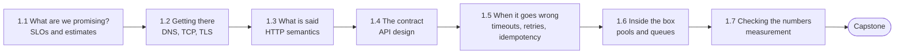

# Phase 1 — Foundations: one server, one request

[Course home](../README.md) · [Syllabus](../SYLLABUS.md)

Before you can scale a system, you have to know what one server actually does with one request, how much it can do, and how it fails. This phase takes the CRUD app you already know how to build and makes every part of it explicit and measurable.

**After this phase you can** follow a request from the client to your handler and back, say where each millisecond goes, design an HTTP API that stays correct when clients retry, and state with numbers what one server can handle and what breaks first.

## Chapters

| # | Chapter | The failure it prevents | Runnable example |
|---|---|---|---|
| 1.1 | [What production demands: requirements, SLOs, and the numbers](01-what-production-demands.md) | Launching with no idea how much load, how fast, or how available. | [`ch01-tail`](code/ch01-tail/main.go) — why the mean hides the tail, and what fan-out does to it |
| 1.2 | [The life of a request: DNS, TCP, and TLS](02-life-of-a-request.md) | The server's logs say 20 ms; the user's phone says 470 ms. | [`ch02-roundtrips`](code/ch02-roundtrips/main.go) — count the round trips of a new and a reused connection |
| 1.3 | [HTTP for backend engineers](03-http-for-backend-engineers.md) | Caches, crawlers and client libraries doing the wrong thing because the API misuses methods and status codes. | [`ch03-conditional`](code/ch03-conditional/main.go) — ETags, `If-Match`, and the lost update |
| 1.4 | [API design: resources, errors, pagination, and versioning](04-api-design.md) | A list endpoint that times out at five million rows; a renamed field that breaks every installed app. | [`ch04-pagination`](code/ch04-pagination/main.go) — offset versus cursor, in Go and in PostgreSQL |
| 1.5 | [Timeouts, retries, and idempotency](05-timeouts-retries-idempotency.md) | The network drops one response and a customer is charged twice. | [`ch05-idempotency`](code/ch05-idempotency/main.go) — 1,000 payments over a lossy network |
| 1.6 | [Inside the server: concurrency, pools, and queues](06-concurrency-pools-queues.md) | Latency of seconds while the CPU sits idle. | [`ch06-pool`](code/ch06-pool/main.go) — latency versus utilisation; the cost of holding a connection |
| 1.7 | [Measuring performance: percentiles, load tests, and bottlenecks](07-measuring-performance.md) | The load test said 40 ms; production says 4 s. | [`ch07-loadgen`](code/ch07-loadgen/main.go), [`ch07-profile`](code/ch07-profile/main.go) — coordinated omission; profiling |
| C1 | [Capstone: a URL shortener on one server](capstone-url-shortener.md) | — | [`capstone-shortener`](code/capstone-shortener/main.go) — reference implementation with a built-in load test |

## How the chapters fit together



Chapter 1.1 sets the targets. Chapters 1.2 to 1.5 follow a request outward-in: the network, the protocol, the API, and what happens when a call fails. Chapter 1.6 goes inside the server. Chapter 1.7 teaches you to check all of it against reality. The capstone uses every one of them.

## What you need

- **Go 1.22 or newer** for the examples. Each one is a single file with no dependencies; the command to run it is at the top of the file and in the chapter.
- **PostgreSQL** (optional) for two short SQL experiments, in Chapters 1.4 and 1.5. Any version from 12 will do. The chapters include the output, so you can follow along without it.

Check that everything builds:

```bash
go vet ./... && go build ./...
```

## Time

About 20 to 25 hours in total: roughly two hours per chapter, including the practice, and four hours for the capstone.
