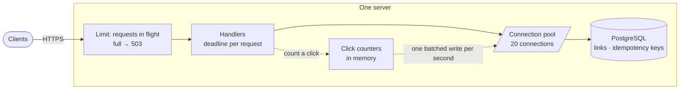

# Capstone: a URL shortener on one server

[Syllabus](../SYLLABUS.md) · Phase 1 · Previous: [1.7 Measuring performance](07-measuring-performance.md)

> **Time:** two to three hours for your own design, then an hour with the worked design.
> **You need:** all of Phase 1. Nothing from later phases.

A capstone is one real system, designed end to end, using everything in the phase. This one is deliberately small — a link shortener, on a single machine — so that you can hold the whole design in your head and justify every number in it.

It has a second purpose. A design is only finished when you can say **what breaks first**. The last section of the worked design is that list, and it is the agenda for Phases 2 and 3.

**How to use this page**

1. Read the brief.
2. Write your own design, on paper, against the task list. Give yourself a time limit. A design you wrote and got partly wrong teaches more than a correct one you read.
3. Only then open the worked design and compare, section by section.
4. Run the reference implementation and its load test.

---

## The brief

*From your product manager:*

> We are adding short links to the product — `sho.rt/Ab3xK9q` instead of a 200-character URL. Here is what we know.
>
> **What it must do**
> - A signed-in user submits a long URL and gets back a short one. They may ask for a specific alias (`sho.rt/summer-sale`).
> - Anyone who opens a short link is sent to the long URL.
> - The owner can see how many times a link has been clicked, and can delete it.
>
> **How much**
> - About **1 million new links a day**.
> - About **100 million clicks a day**.
> - Assume the busiest moment is **three times** the daily average, until we have real data.
> - Links live until they are deleted. Plan for **five years**.
> - Destination URLs average about 100 characters.
>
> **How well**
> - **Redirects:** 99.9% succeed, and 99% are answered within 50 ms, measured at our server, over any 30 days.
> - **Creating a link:** 99% within 300 ms.
> - Click counts may lag by up to a minute. Losing a few seconds of *counts* in a crash is acceptable. Losing a *link* is not.
>
> **Constraints**
> - Until this proves itself there is budget for **one server**: 16 cores, 64 GB of memory, 2 TB of SSD. The database runs on the same machine.
> - Users are all over the world.

---

## Your task

Produce a short design document — two or three pages — covering the following. The suggested times add up to about two and a half hours.

| # | Deliverable | Draws on | Time |
|---|---|---|---|
| 1 | Requirements restated as SLOs with all five parts, plus the questions you would ask the product manager | 1.1 | 15 min |
| 2 | Estimates: request rates (average and peak), storage, bandwidth, requests in flight | 1.1, 1.6 | 20 min |
| 3 | The API: every endpoint with method, path, status codes and error format | 1.3, 1.4 | 25 min |
| 4 | How short codes are generated, and what happens on a collision | 1.4, 1.5 | 15 min |
| 5 | What happens when a client retries a create | 1.5 | 10 min |
| 6 | A diagram of the server and the path of a redirect through it | 1.6 | 15 min |
| 7 | Every timeout, limit and pool size, each with a reason | 1.5, 1.6 | 15 min |
| 8 | What a user far from the server experiences, in milliseconds | 1.2 | 10 min |
| 9 | Failure analysis: what happens when each thing breaks | all | 15 min |
| 10 | How you would test that it meets the SLOs | 1.7 | 10 min |
| 11 | **What breaks first as it grows — in order** | all | 10 min |

Two rules:

- **Every number has a source**: the brief, arithmetic you show, or an assumption you label as an assumption.
- **Choose.** "It depends" is not a design. Pick an option, give the reason, and name what you gave up.

---

## Worked design

<details>
<summary><strong>Open only after writing your own.</strong></summary>

### 1. Requirements and SLOs

**Functional:** create a link (optionally with an alias); redirect; show a link with its click count; delete a link.

**Service level objectives**, each with which requests, where it is measured, what counts as good, the target and the window (Chapter 1.1):

| | Requests | Measured | Good means | Target | Window |
|---|---|---|---|---|---|
| Redirect availability | `GET /{code}` for codes that exist | In the server's access log | Any response that is not `5xx` | 99.9% | Rolling 30 days |
| Redirect latency | The same | The same, from request received to response written | Under 50 ms | 99% | Rolling 30 days |
| Create latency | `POST /v1/links` | The same | Under 300 ms | 99% | Rolling 30 days |

All at up to the peak load in section 2. A latency target with no load attached means nothing.

**Questions for the product manager** — and the answers this design assumes:

- *"Measured at our server" — are you sure?* A user in Sydney will experience something very different (section 8). Assumed: yes for now; recorded as a known limitation.
- *Is the 99.9% for the whole month, including months with a hardware failure?* One server cannot promise that (section 9). Assumed: understood and accepted until there is a second machine.
- *May a deleted link's code be reused?* Assumed: never. Old links live on in emails and printed posters.
- *What happens to abusive links — phishing, malware?* Assumed: out of scope for this phase; noted in section 11.

### 2. Estimates

Using the table from Chapter 1.1 (a million a day ≈ 12 per second):

| Quantity | Arithmetic | Result |
|---|---|---|
| Creates, average | 1 M a day | ≈ 12 per second |
| Creates, peak | × 3 | ≈ 35 per second |
| Redirects, average | 100 M a day | ≈ 1,200 per second |
| Redirects, peak | × 3 | **≈ 3,500 per second** |
| Reads per write | 100 M ÷ 1 M | 100 to 1 |
| Links after 5 years | 1 M × 365 × 5 | ≈ 1.8 billion |
| Storage per link | 7-byte code + 100-byte URL + owner, timestamps, row and index overhead | ≈ 300 bytes *(assumption — measure it in Phase 2)* |
| Storage growth | 1 M × 300 B a day | ≈ 300 MB a day ≈ 110 GB a year ≈ **550 GB in 5 years** |
| Bandwidth | 3,500 per second × about 300 bytes per redirect response | ≈ 1 MB/s — negligible |
| Requests in flight at peak | 3,500 per second × 3 ms *(assumed service time)* | ≈ 10 (Little's law) |

**What the estimates say**

- The request rates are modest. A few thousand small requests per second is within reach of one process.
- The bytes are trivial. Unlike the photo service in Chapter 1.1, nothing here is about bandwidth.
- **Storage fits the disk (550 GB of 2 TB) but not the memory (64 GB).** After about seven months the data is larger than RAM. Whether that hurts depends on how concentrated clicks are — recorded as a risk in section 11.
- **Click counting is the trap.** One database write per click would be 3,500 writes per second: a hundred times the rate of the product's actual writes. The brief allows a minute of lag for exactly this reason.

### 3. The API

Resource-oriented (Chapter 1.4): the resource is a *link*. The redirect lives at the root because the short URL is the product.

| Operation | Request | Success | Failures |
|---|---|---|---|
| Create | `POST /v1/links` with `{"url": "...", "alias": "..."}` and an `Idempotency-Key` header | `201 Created`, `Location: /{code}`, the link as JSON | `400` malformed JSON · `413` body too large · `422` URL or alias not acceptable, or key reused with a different body · `409` alias taken · `401` not signed in · `429` rate limited |
| Follow | `GET /{code}` | `302 Found`, `Location: <long URL>` | `404` no such link |
| Describe | `GET /v1/links/{code}` | `200` with the link and its click count | `404` |
| List mine | `GET /v1/links?limit=50&cursor=…` | `200`, `{"items": [...], "next_cursor": "..."}` | `400` bad cursor or limit |
| Delete | `DELETE /v1/links/{code}` | `204 No Content` | `404` |

Any endpoint may also answer `503` with `Retry-After` when the server is at capacity (section 7).

**Decisions, with reasons**

- **`302`, not `301`.** A `301` is "heuristically cacheable" ([RFC 9110, §15.4.2](https://www.rfc-editor.org/rfc/rfc9110.html#section-15.4.2)): a browser may remember it and never ask us again. That would be cheaper — and it would mean clicks go uncounted and a deleted link keeps working for everyone who has visited it. `302` is not cacheable by default, so every click reaches the server. *Given up:* some load we could have avoided.
- **Creation is a `POST` with an idempotency key**, because the server chooses the code, so the client cannot use an idempotent `PUT` to a URL it already knows (Chapters 1.3 and 1.5).
- **Errors are RFC 9457 problem details** with a stable `type` (Chapter 1.4). A client must be able to tell `alias-taken` from `invalid-alias` without reading English.
- **The list is cursor-paginated from day one** (Chapter 1.4). A power user will have a million links.
- **A deleted link answers `404`.** `410 Gone` — "no longer available… and that this condition is likely to be permanent" ([RFC 9110, §15.5.11](https://www.rfc-editor.org/rfc/rfc9110.html#section-15.5.11)) — would be more precise, but it requires remembering every deleted code for ever. *Given up:* a slightly more informative response.
- **Limits** (Chapter 1.4: every input has a maximum): request body 4 KB; URL 2,048 characters; alias 3–32 characters from `[0-9A-Za-z_-]`; page size at most 100; creates rate-limited per user.
- **Only `http` and `https` targets are accepted.** A shortener redirects browsers to whatever it is given, which makes it a tool for phishing — the risk OWASP describes for any redirect built from untrusted input ([OWASP cheat sheet](https://cheatsheetseries.owasp.org/cheatsheets/Unvalidated_Redirects_and_Forwards_Cheat_Sheet.html)). Rejecting `javascript:` and other schemes is the minimum; the rest is Phase 8.

### 4. Short codes

A code must be short, unique, safe in a URL, and — a requirement easy to miss — **not guessable**. If codes are consecutive, anyone can walk through every link in the system, and can tell how many links you create each day.

| Option | Unique? | Guessable? | Verdict |
|---|---|---|---|
| A counter, written in base 62 | By construction | Yes — consecutive | Leaks every link and the business's volume |
| A hash of the long URL, truncated | No — different URLs can collide, and the *same* URL always gives the same code, so two users cannot have separate links to one page | No | Solves a problem we do not have |
| **Random characters** | Not guaranteed — must be checked | No | **Chosen** |

**The design:** seven random characters from `0-9A-Za-z` (base 62), generated with a cryptographically secure random source. That is 62⁷ ≈ 3.5 trillion possible codes.

**Collisions.** A new random code may already exist. With *N* links stored, the chance is *N* ÷ 62⁷. Even after five years, with 1.8 billion links, that is 1.8 × 10⁹ ÷ 3.5 × 10¹² ≈ 0.05% — about one create in two thousand. So: do not check first. **Insert, and let the unique constraint on the code report a collision; on a collision, generate a new code and try again.** This is the lesson of Chapter 1.5's "check-then-insert" mistake applied a second time — the constraint is the only check that cannot race.

A requested alias is the same mechanism with one attempt: if the insert fails, answer `409`.

### 5. A retried create

The client generates a UUID when the user presses "Shorten", and sends it as `Idempotency-Key` on every attempt (Chapter 1.5). The server, in **one transaction**:

1. inserts the key (scoped to the user, with a hash of the request body);
2. if the key is new: inserts the link, and stores the link's code against the key;
3. if the key exists with the same body: returns the link created the first time, with `Idempotent-Replayed: true`;
4. if the key exists with a different body: `422`.

Because the key and the link commit together, a failed attempt leaves neither, and its retry is simply a first attempt. Keys are deleted after 24 hours.

Redirects need none of this: `GET` is safe, so clients and proxies may repeat it freely (Chapter 1.3). The only effect of a repeated redirect is one extra click in the count, which the brief tolerates.

### 6. The server



**The path of a redirect**

1. The request passes the in-flight limit, or is refused with `503`.
2. It is given a deadline of 200 ms.
3. The handler takes a connection, reads one row by primary key, and returns the connection.
4. It adds one to an in-memory counter for that code.
5. It answers `302`.

That is one short query and no writes. Once a second, a background task takes all the accumulated counts and writes them in a single batched statement.

**Three decisions here**

- **No cache.** The obvious addition is an in-memory cache of popular links. The estimates do not call for it: at peak the database does 3,500 primary-key reads per second, which section 7 shows is comfortably within the pool. A cache adds a second copy of the data, and with it the question of what happens when a link is deleted or changed. *The rule: add a component when a number demands it, not because the design looks bare without it.* It is the first thing to add later (section 11).
- **Clicks are batched in memory.** This trades durability for load: a crash loses up to a second of counts. The brief explicitly allows that. It would **not** be acceptable for the links themselves, which are written to the database before the `201` is sent.
- **The connection is held only for the query** — never across anything slow (Chapter 1.6).

### 7. Timeouts, limits and pools

Every number below is either derived or labelled as an assumption to be measured.

| Setting | Value | Reason |
|---|---|---|
| Database pool | 20 connections | The PostgreSQL wiki's starting point is about twice the core count for a database with its data in memory; this machine has 16 cores, shared with the application. 20 leaves room. One pool for the whole service, since there is one process. |
| Pool capacity | 20 ÷ 2 ms = 10,000 queries per second *(2 ms per query is an assumption)* | Chapter 1.6: capacity = size ÷ holding time. Peak load is 3,500 per second — about 35% utilisation, well below the knee. |
| Requests in flight | At most 200; beyond that, `503` with `Retry-After: 1` | Bounds the queue. By Little's law the longest a request can wait is about 200 ÷ capacity. At 10,000 per second that is 20 ms — inside the 50 ms objective. |
| Request deadline | 200 ms | Far above normal (a few milliseconds), so healthy requests never hit it; short enough that a stuck request frees its resources quickly. It also bounds the wait for a pool connection. |
| Query timeout | Inherits the request deadline | One budget for the whole request (Chapter 1.5). |
| Server timeouts | Read headers 5 s; read 10 s; write 10 s; idle 120 s | A slow or vanished client must not hold a connection indefinitely. |
| Body size | 4 KB | The largest valid request is a 2,048-character URL plus an alias. |
| Client retries | Up to 3, with exponential backoff and jitter, only on timeouts, `429`, `502`–`504`; creates always carry the idempotency key | Chapter 1.5. |

### 8. What a far-away user experiences

The objective says "50 ms, measured at our server". The server will meet it easily. Now work out what a person feels.

A click on a short link is almost always a **brand-new connection**: the user's browser has not talked to `sho.rt` recently. From Chapter 1.2, with TLS 1.3 that is a DNS lookup plus three round trips before the redirect arrives. For a user in Sydney and a server on the east coast of the United States, a round trip is at least 160 ms even in theory:

`3 × 160 ms + 3 ms of server time ≈ 480 ms`

— and only then can the browser begin connecting to the real destination. The server's share of that is under 1%.

Connection reuse, the cheapest fix in Chapter 1.2, does not apply: there is no earlier connection to reuse. The remaining lever is distance — answering from somewhere near the user — and a single server cannot pull it.

So the honest statement in the design document is: **the SLO as written is met; the user experience for distant users is poor; fixing it needs a presence near users (Chapter 3.5).** Saying this before launch is the difference between a known limitation and an incident.

### 9. Failure analysis

For each failure: what the user sees, what is lost, and what limits the damage.

| What breaks | What users see | What is lost | What limits it |
|---|---|---|---|
| The process crashes | Errors for the few seconds until a supervisor restarts it | Up to 1 s of click counts; requests in flight | Clients retry. Creates are idempotent. Links are in the database, not in the process. |
| A deploy | The same few seconds, on purpose | Nothing, if the server stops accepting connections and finishes its work first — Go's `Shutdown` "gracefully shuts down the server without interrupting any active connections" ([`net/http`](https://pkg.go.dev/net/http#Server.Shutdown)) | Deploy at the quietest hour. Each deploy still spends error budget. |
| The database is down or slow | Redirects and creates fail with `503` after at most 200 ms | Nothing | Deadlines and the in-flight limit stop requests piling up. This is the day a cache of popular links would have been worth having — for availability, not speed. |
| A sudden surge — a link goes viral | Up to capacity: nothing. Beyond it: some requests get an immediate `503`; the rest are served at normal speed | Clicks on rejected requests | The in-flight limit (Chapter 1.6). Without it, everyone would wait and time out. |
| The disk fills | Creates fail; redirects continue while reads still work | Nothing, if noticed | An alert at 70% full. 300 MB a day is weeks of warning. |
| **The machine dies** | **Everything is down until a new machine is running and the database restored** | **Every link created since the last backup** | Backups stored on a *different* machine, and a restore that has been practised (Chapter 2.9). |
| The TLS certificate expires | Every browser refuses to connect | Nothing | Automatic renewal and an alert well before expiry (Chapter 1.2). |
| A user scripts a million creates | Slower creates for everyone | Disk | A per-user rate limit, answered with `429`. |

**The availability arithmetic.** 99.9% over 30 days allows 43 minutes of failure (Chapter 1.1).

- Deploys: twenty a month at about five seconds each is under two minutes. Fine.
- A hardware failure: replacing a machine and restoring a database takes hours, not minutes. **One such event uses several months of error budget in an afternoon.**

So this design meets 99.9% in every month in which the machine does not fail, and misses it badly in any month in which it does. No tuning changes that: with one server, availability is bounded by how quickly a dead machine can be replaced. That is the single most important finding of this design, and it belongs on the first page.

It also violates the brief in a way worth stating precisely. "Losing a link is not acceptable" — yet every link created since the last backup is lost if the disk dies. On one machine that risk can be shrunk, by backing up more often, but not removed.

### 10. Testing that it meets the objectives

**What to measure** (Chapter 1.7): the four signals — latency as a histogram, request rate, error rate by status code, and saturation: requests in flight, pool wait count and wait time. Measured at the edge of the server, so that time spent queueing is included.

**The tests**

| Test | What | What it must show |
|---|---|---|
| Breakpoint | Open-loop redirects, stepped from 1,000 per second upwards | Where the p99 crosses 50 ms. It should be far above 3,500. |
| Average load | 1,200 redirects and 12 creates per second, for 30 minutes | Both objectives met with room to spare. |
| Spike | From 1,200 to 10,000 per second within a few seconds, then back | The excess is refused with `503`; accepted requests stay fast; **latency returns to normal afterwards**. |
| Soak | Normal load for several hours | Memory, connections and latency stay flat. |

**What makes them honest**

- **An open-loop generator**, measuring from the scheduled send time. A closed-loop test would hide exactly the stalls the objective cares about.
- **A production-sized table.** A test against ten thousand rows says nothing about 1.8 billion. Load at least a year of links first.
- **A realistic spread of codes**, including the unfavourable case where clicks are spread across old links that are not in memory.
- **The generator on a different machine.**

### 11. What breaks first

In the order in which it will hurt:

1. **The machine itself.** One server is one failure away from hours of downtime and from losing recent links. → Redundant servers (Chapters 3.1, 3.2); replication (3.6, 5.1); backups and restore (2.9).
2. **Data larger than memory.** After about seven months the links no longer fit in RAM. If clicks are concentrated on recent links this may never matter; if they are spread out, reads start waiting for the disk and the p99 rises. → How a database finds a row (2.1, 2.2); caching (3.3).
3. **Distant users.** Half a second before the redirect even arrives. → Edge caching and a presence near users (3.5); multiple regions (6.6).
4. **Clicks as a product.** "How many clicks, from which countries, per hour" turns the click counter into a firehose of events. → Queues and streams (Phase 4).
5. **Changing the schema** of a table with a billion rows without taking the service down. → Chapter 2.7.
6. **Abuse.** Phishing links, enumeration, scripted creation. → Phase 8, and rate limiting in Chapter 6.4.
7. **Raw request capacity.** Notably *last*. At 3,500 per second, one process is nowhere near its limit. The instinct to begin by "scaling the web tier" would have spent the effort on the one thing that was not a problem.

That ordering is the real output of the capstone. Estimation and failure analysis exist to produce it.

</details>

---

## Reference implementation

[`code/capstone-shortener/main.go`](code/capstone-shortener/main.go) implements the worked design in about 640 lines of Go — two-thirds of it the service itself, the rest the walk-through and the load test — using only what Phase 1 has covered. Storage is an in-memory stand-in for the database, behind a connection pool, where every "query" holds a connection for 2 ms — so it behaves like a database under load even though nothing is stored on disk. (A real database is Phase 2.)

Read it after doing your own design. Things to find in the code: the in-flight limit and the deadline wrapped around every request; `create`, where the idempotency key and the link are written together; `randomCode` and the retry on a collision; `countClick` and the batched flush.

### Walk through the API

```bash
go run ./phase-1-foundations/code/capstone-shortener
```

```text
1. Create a link, then follow it
  POST /v1/links  (Idempotency-Key: key-1)             -> 201 Created  Location: /uBbVrdz
  GET /uBbVrdz                                         -> 302 Found  Location: https://example.com/a/very/long/path?with=parameters

2. The response to the create was lost, so the client retries with the same key
  POST /v1/links  (Idempotency-Key: key-1)             -> 201 Created  same code: true, Idempotent-Replayed: true
  POST /v1/links  (key-1 again, different body)        -> 422 Unprocessable Entity  https://api.example.com/problems/idempotency-key-reused

3. Requests the server must refuse
  POST /v1/links  {"url":"javascript:alert(1)"}        -> 422 Unprocessable Entity  https://api.example.com/problems/invalid-url
  POST /v1/links  {"alias":"docs"} a second time       -> 409 Conflict  https://api.example.com/problems/alias-taken
  GET /nosuchcode                                      -> 404 Not Found  https://api.example.com/problems/not-found

4. Clicks are counted in memory and written in batches
  GET /v1/links/uBbVrdz  (after 6 redirects)           -> 200 OK  clicks: 6

5. Delete, and the link stops working
  DELETE /v1/links/uBbVrdz                             -> 204 No Content
  GET /uBbVrdz                                         -> 404 Not Found
  DELETE /v1/links/uBbVrdz  (again)                    -> 404 Not Found  idempotent: the link is gone either way
```

(The code is random, so yours will differ.)

To try it by hand:

```bash
go run ./phase-1-foundations/code/capstone-shortener serve

# in another terminal
curl -i -X POST localhost:8080/v1/links \
     -H 'Idempotency-Key: 6f1c2f0e' \
     -d '{"url": "https://example.com/some/long/path"}'
curl -i localhost:8080/<the code you were given>
```

### Find its capacity — predict first

The `loadtest` mode runs a breakpoint test: open-loop redirects at one arrival rate after another, over real HTTP on your machine.

With its defaults the server has a pool of **10** connections, 2 ms per query, and at most **100** requests in flight. Before you run it, write down:

1. Its capacity in redirects per second.
2. The latency of a request the server *accepts* while it is overloaded. (Hint: Little's law, applied to the in-flight limit.)

```bash
go run ./phase-1-foundations/code/capstone-shortener loadtest
```

<details>
<summary>Measured result and discussion</summary>

On the 4-core machine this was written on:

```text
Pool of 10 connections, 2ms per query -> predicted capacity 5000 redirects per second.
At most 100 requests in flight; each rate is held for 4s.

  target/s   redirected/s   302     503   other    p50      p99      max
    1000        1000       100.0%    0.0%    0.0%   3.5ms    5.6ms   10.7ms
    2000        2000       100.0%    0.0%    0.0%   3.5ms    5.6ms   10.9ms
    3000        3000       100.0%    0.0%    0.0%   3.5ms   26.0ms   54.1ms
    4000        3731        93.3%    6.7%    0.0%  26.4ms   31.4ms   53.5ms
    4500        3810        84.7%   15.3%    0.0%  26.2ms   30.1ms   32.4ms
    5000        3860        77.2%   22.8%    0.0%  25.8ms   32.4ms   52.1ms
    6000        3990        66.5%   33.5%    0.0%  25.3ms   30.2ms   36.9ms
```

**1. Capacity: predicted 5,000, measured about 3,900.** The `redirected/s` column stops rising just under 4,000 however hard the generator pushes.

The prediction was not wrong in method; it was wrong in an input. It assumed a query holds a connection for 2 ms. The stand-in query is a 2 ms sleep, and on this machine a 2 ms sleep takes about 2.4 ms on average — more when the machine is busy. `10 ÷ 0.0025 s = 4,000`. The formula was right all along; the "2 ms" was a specification, not a measurement.

This is the relationship between Chapter 1.1 and Chapter 1.7 in one table: **estimation gets you the order of magnitude and tells you what to measure; measurement gets you the number.** A real database query would differ from its nominal time by far more than a sleep does.

**2. Latency under overload: about 26 ms.** At most 100 requests are in the server, and they leave at about 3,900 per second, so each spends about `100 ÷ 3,900 ≈ 26 ms` there. The `p50` column from 4,000 per second upwards says 25–26 ms. Little's law, predicting a measurement to within a millisecond.

**3. The knee is visible** between 2,000 and 3,000 per second: the median is unchanged at 3.5 ms while the p99 jumps from 5.6 ms to 26 ms. That is about 75% of the *real* capacity. This is the hockey stick from Chapter 1.6, in a system you can run.

**4. Overload is survivable.** At 6,000 per second — 50% more than the server can do — a third of the requests are refused immediately and the other two-thirds are served in about 25 ms. Nothing times out; nothing collapses. That is the in-flight limit doing its job. To see the alternative, raise the limit until it no longer bites and run the same test:

```bash
go run ./phase-1-foundations/code/capstone-shortener loadtest -max-in-flight 100000
```

**Does this configuration meet the brief?** No. The brief's peak is 3,500 per second, and this server's p99 has already left the flat part of the curve at 3,000. The worked design chose a pool of 20 and an in-flight limit of 200 for this reason:

```bash
go run ./phase-1-foundations/code/capstone-shortener loadtest -pool 20 -max-in-flight 200 \
    -rates 2000,3500,5000,6000,7000,8000,9000
```

```text
  target/s   redirected/s   302     503   other    p50      p99      max
    2000        2000       100.0%    0.0%    0.0%   3.4ms    5.8ms   20.4ms
    3500        3500       100.0%    0.0%    0.0%   3.4ms    6.1ms    8.8ms
    5000        5000       100.0%    0.0%    0.0%   3.4ms    6.1ms    9.9ms
    6000        6000       100.0%    0.0%    0.0%   3.4ms    6.8ms   12.0ms
    7000        7000       100.0%    0.0%    0.0%   3.6ms    9.4ms   19.2ms
    8000        7666        95.8%    4.2%    0.0%  25.3ms   30.2ms   45.9ms
    9000        7905        87.8%   12.2%    0.0%  25.1ms   30.3ms   38.5ms
```

At the brief's peak of 3,500 per second the p99 is 6 ms, the knee is past 7,000, and there is a factor of two in hand. That is what "well below the knee" looks like.

One caveat, in the spirit of Chapter 1.7: the load generator and the server share one machine here, so at the highest rates they compete for the same cores. It is good enough to show the shape. For numbers you would stake a launch on, the generator runs elsewhere.

</details>

---

## Review your own design

Score your design before comparing it line by line. One point for each "yes".

| | |
|---|---|
| ☐ | Every SLO says which requests, where measured, what counts as good, the target, and the window. |
| ☐ | Peak rates are stated, not just daily totals. |
| ☐ | You noticed that a write per click is a hundred times the create rate. |
| ☐ | You noticed that the data outgrows memory. |
| ☐ | The redirect status code was chosen with a reason, and you named what the other choice would have cost. |
| ☐ | Creating a link is safe to retry. |
| ☐ | Collisions are detected by a constraint, not by checking first. |
| ☐ | Codes cannot be guessed or enumerated. |
| ☐ | The list endpoint is paginated with a cursor. |
| ☐ | Every pool, queue and wait has a limit, and each limit has a reason. |
| ☐ | You calculated what a distant user experiences, and it was not 50 ms. |
| ☐ | Your failure analysis includes the machine dying, and says what is lost. |
| ☐ | You stated plainly that one server cannot guarantee 99.9% in a month in which it fails. |
| ☐ | Your load-test plan uses an open-loop generator and production-sized data. |
| ☐ | You have an ordered list of what breaks first, and request capacity is not at the top. |

**12 or more:** you are ready for Phase 2. **Under 9:** reread the chapters behind the items you missed — the "Draws on" column of the task table says which — and try the extensions below.

---

## Extensions

Each of these changes one requirement. Say what changes in the design, and what does not.

1. **Links expire after 30 days unless renewed.** What happens to storage? To the code space? Can a code now be reused — and what could go wrong if it is?
2. **The redirect objective becomes "99% within 50 ms, measured in the user's browser."** Which parts of the design survive?
3. **Product wants click counts to be exact** — every click, never lost, even in a crash. What is the cheapest design that achieves it, and what does it cost in capacity? (You will have better answers after Phase 4. Write down your answer now, and compare then.)
4. **Add the "list my links" endpoint to the reference implementation**, with cursor pagination. What must the store be able to do efficiently?
5. **Traffic is ten times the brief.** Rerun the estimates. Which item on the "what breaks first" list moves?

---

## Sources

- [RFC 9110](https://www.rfc-editor.org/rfc/rfc9110.html) — HTTP Semantics (redirects §15.4; `410 Gone` §15.5.11; heuristically cacheable status codes §15.1).
- [RFC 9457](https://www.rfc-editor.org/rfc/rfc9457.html) — Problem Details for HTTP APIs.
- OWASP: [Unvalidated Redirects and Forwards Cheat Sheet](https://cheatsheetseries.owasp.org/cheatsheets/Unvalidated_Redirects_and_Forwards_Cheat_Sheet.html).
- PostgreSQL wiki: [*Number Of Database Connections*](https://wiki.postgresql.org/wiki/Number_Of_Database_Connections).
- Ilya Grigorik, *High Performance Browser Networking*: [Primer on Latency and Bandwidth](https://hpbn.co/primer-on-latency-and-bandwidth/) (round-trip times by distance).
- Go standard library: [`net/http`](https://pkg.go.dev/net/http) (`Server.Shutdown`, server timeouts); [`crypto/rand`](https://pkg.go.dev/crypto/rand).
- Everything else is from Chapters [1.1](01-what-production-demands.md)–[1.7](07-measuring-performance.md), where the sources are given.
