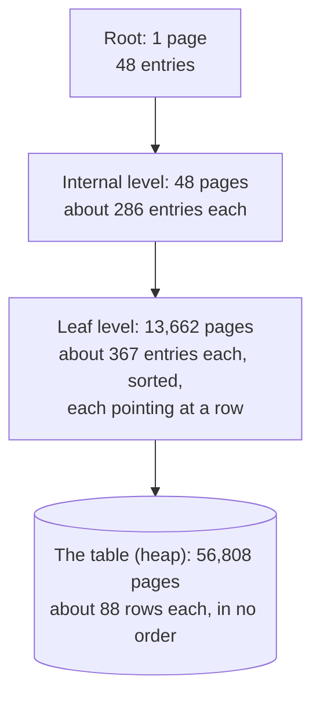
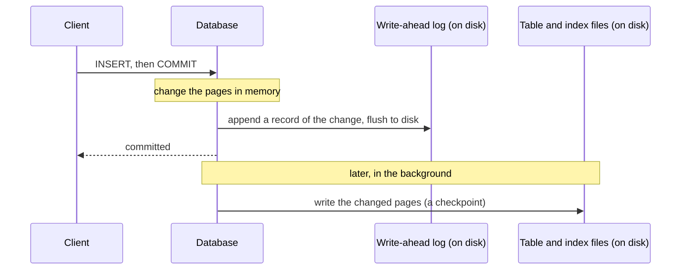
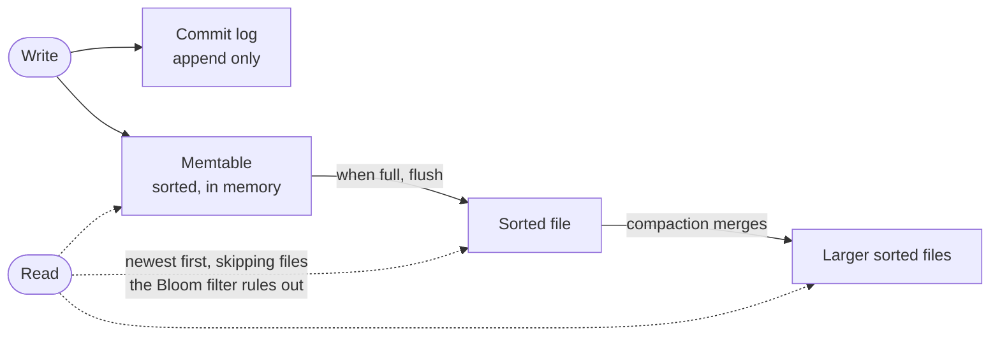

# 2.1 How a database stores and finds data

[Syllabus](../SYLLABUS.md) · Phase 2 · Previous: [Phase 1 capstone](../phase-1-foundations/capstone-url-shortener.md) · Next: 2.2 Indexes and query plans *(planned)*

> **Time:** about 50 minutes to read, 60 minutes of practice.
> **You need:** basic SQL, and [Chapter 1.1](../phase-1-foundations/01-what-production-demands.md) (how slow a disk is compared with memory). A PostgreSQL to experiment on is strongly recommended — see [the phase overview](README.md) for a one-line way to start one.

**By the end of this chapter you can**

- describe how rows are laid out in pages, and explain why "how many pages?" is the real unit of query cost;
- explain how a B-tree finds one row among billions by reading four or five pages;
- say what the write-ahead log is, what a commit actually costs, and what the log buys you;
- explain why updates leave old row versions behind, and what vacuum does and does not do about it;
- contrast B-tree storage with LSM-tree storage, and say which workload favours each.

---

## The problem

*An illustrative scenario — with real measurements, which you will reproduce below.* A support tool looks up customer accounts by email address. The `accounts` table has five million rows. Each lookup takes about 350 ms.

Someone says "add an index". The lookup now takes 0.04 ms — nine thousand times faster. Nobody on the team can say why.

A month later the same team meets three more mysteries:

- The nightly import, which inserts rows one at a time, will not go faster than a few thousand rows per second however powerful the server.
- A one-off job updates a single column in every row. The table doubles in size on disk. Running `VACUUM` does not shrink it.
- The table has reached 200 GB on a server with 64 GB of memory, and some queries have become erratically slow.

Each of these is usually met with folklore: "indexes make reads fast and writes slow", "run vacuum", "add RAM". The folklore is not wrong. But advice without a model cannot tell you *how much*, or *when it stops working*, or what to do in the case nobody wrote a rule for.

All four mysteries are consequences of three ideas — **pages, a tree, and a log** — and you can hold all three in your head. That is this chapter.

The examples use PostgreSQL, because its internals are documented and easy to inspect. The ideas apply to every relational database; the last section covers the main alternative design.

---

## The concept

### 1. A table is a pile of pages

A database does not read and write individual rows on disk. It works in fixed-size blocks called **pages**. In PostgreSQL, "every table and index is stored as an array of pages of a fixed size (usually 8 kB…)" ([PostgreSQL docs, *Database Page Layout*](https://www.postgresql.org/docs/current/storage-page-layout.html)).

A table's pages hold its rows in no particular order: "all the pages are logically equivalent, so a particular item (row) can be stored in any page" ([same page](https://www.postgresql.org/docs/current/storage-page-layout.html)). This unordered pile is called a **heap**.

The five-million-row `accounts` table from the example is 444 MB: **56,808 pages**, with about 88 rows in each.

Now the first consequence. With no other information, the only way to find the row whose email is `user4000000@example.com` is to read every page and look at every row. That is a **sequential scan**, and here is what it costs:

```text
 Seq Scan on accounts (actual time=299.907..358.530 rows=1 loops=1)
   Filter: (email = 'user4000000@example.com'::text)
   Rows Removed by Filter: 4999999
   Buffers: shared hit=13192 read=43616
 Execution Time: 358.791 ms
```

`Buffers` counts pages touched: 13,192 + 43,616 = 56,808. Every page of the table, to return one row. 4,999,999 rows were read and thrown away.

This is the habit to take from the chapter: **the cost of a query is the number of pages it touches.** Milliseconds vary with the machine and with what happens to be in memory. The page count is a property of the query and the data.

### 2. Memory first: the buffer cache

Reading a page from disk is slow (Chapter 1.1's table), so the database keeps recently used pages in memory, in its **buffer cache**. In the output above, `hit` means the page was found there — "a read was avoided because the block was found already in cache when needed" ([PostgreSQL docs, `EXPLAIN`](https://www.postgresql.org/docs/current/sql-explain.html)) — and `read` means the database had to ask the operating system for it.

Two consequences:

- **The same query can be fast or slow depending on what ran before it.** A test on a freshly started database, and the same test repeated, measure different things.
- **Performance changes character when the data you use regularly no longer fits in memory.** While it fits, queries cost CPU time. Once it does not, they cost disk reads, which are orders of magnitude slower. That is the "erratically slow" mystery: it depends on whether the pages a query needs happen to be cached.

"The data you use regularly" is the phrase that matters — not the whole database. Which pages those are is the subject of the next section.

*(Sizing: PostgreSQL's documentation suggests that "a reasonable starting value for shared_buffers is 25% of the memory in your system" on a dedicated server, because it "also relies on the operating system cache" — [resource configuration](https://www.postgresql.org/docs/current/runtime-config-resource.html).)*

### 3. The B-tree: finding one row in four page reads

An **index** is a second structure, kept alongside the table, that lets the database find rows without reading all of them. The default kind, in PostgreSQL and nearly every relational database, is the **B-tree**: "the standard btree (multi-way balanced tree) index data structure" ([PostgreSQL docs, *B-Tree Indexes*](https://www.postgresql.org/docs/current/btree.html)).

Think of the index of a very large reference book, itself too long to scan — so it has its own index, and that one has an index too.

- The bottom level — the **leaf pages** — holds every indexed value, *in sorted order*, each with a pointer to the row in the table: "each leaf page contains tuples that point to table rows" ([same page](https://www.postgresql.org/docs/current/btree.html)).
- Above them are **internal pages**: "each internal page contains tuples that point to the next level down in the tree." An internal page says, in effect, "values up to 40,000 are in that page, values up to 80,000 in that one…".
- At the top is a single **root** page.

Here is the actual primary-key index of the `accounts` table, measured with PostgreSQL's `pageinspect` extension:



To find `id = 4000000` the database reads the root, follows one pointer to an internal page, follows one pointer to a leaf, and follows the leaf's pointer into the table. Four pages:

```text
 Index Scan using accounts_pkey on accounts (actual time=0.019..0.020 rows=1 loops=1)
   Index Cond: (id = 4000000)
   Buffers: shared hit=4
 Execution Time: 0.033 ms
```

Four pages instead of 56,808. That is the whole reason an index is fast.

**Why it stays fast as the table grows.** Each page holds hundreds of entries, so each level multiplies the number of rows the tree can reach by a few hundred. With the page capacities measured above:

| Index levels | Rows it can reach (roughly) | Pages read per lookup, including the table |
|---|---|---|
| 3 | 286 × 286 × 367 ≈ 30 million | 4 |
| 4 | 286³ × 367 ≈ 8.6 billion | 5 |

Going from five million rows to several billion adds **one** page read. That is what "logarithmic" means in practice, and it is why a primary-key lookup is something you can rely on at any size.

**Why the upper levels are always in memory.** Look at the diagram again: 49 of the index's 13,711 pages are not leaves. PostgreSQL's [documentation](https://www.postgresql.org/docs/current/btree.html) notes this is typical — "over 99% of all pages are leaf pages." Every lookup passes through the root and an internal page, so those few pages are used constantly and never leave the cache. Even when the table is far bigger than memory, a lookup needs at most two disk reads: one leaf, one table page.

**What else the sorted order gives you.** Leaf pages are linked to their neighbours — each level "can be used as a doubly-linked list of pages" ([B-Tree Indexes](https://www.postgresql.org/docs/current/btree.html)). So after finding the first matching entry, the database can walk along the leaves to answer a *range* (`created_at > '2024-06-01'`), or return rows *already sorted* without a sort step. "B-trees can handle equality and range queries on data that can be sorted into some ordering" ([PostgreSQL docs, *Index Types*](https://www.postgresql.org/docs/current/indexes-types.html)). This is what made cursor pagination fast in Chapter 1.4.

**What it costs.** An index is a copy of the indexed column, kept sorted. The email index in the example is 194 MB — nearly half the size of the table. And every `INSERT`, and every `UPDATE` that changes an indexed column, has to update every index as well. Indexes speed up reads by slowing down writes and using space. Chapter 2.2 is about choosing them.

### 4. The write-ahead log: what "committed" costs

When you `COMMIT`, the database promises the change will survive a crash. The obvious way to keep that promise — write every changed page to disk before answering — would be slow: the changed pages are scattered all over the table and its indexes.

Instead, databases use a **write-ahead log (WAL)**. The rule, from PostgreSQL's documentation: "changes to data files (where tables and indexes reside) must be written only after those changes have been logged, that is, after WAL records describing the changes have been flushed to permanent storage" ([PostgreSQL docs, *Write-Ahead Logging*](https://www.postgresql.org/docs/current/wal-intro.html)).



At commit, the only thing forced to disk is a short record appended to the end of the log. The changed pages stay in memory and are written out later, in the background, at a **checkpoint**. If the server crashes in between, nothing is lost: on restart the database replays the log — "any changes that have not been applied to the data pages can be redone from the WAL records" ([same page](https://www.postgresql.org/docs/current/wal-intro.html)).

Why this is faster, from the [same page](https://www.postgresql.org/docs/current/wal-intro.html): "only the WAL file needs to be flushed to disk to guarantee that a transaction is committed, rather than every data file changed by the transaction. The WAL file is written sequentially, and so the cost of syncing the WAL is much less than the cost of flushing the data pages."

Three things follow for you.

**A commit has a fixed floor: one flush of the log.** However small the transaction, the database must wait for the storage device to confirm the log record is safe. In the example below, 2,000 one-row transactions take 338 ms — about 0.17 ms each, almost all of it waiting for the disk. That is the import mystery: a loop that commits after every row cannot exceed one flush per row, on one connection. (Transactions committing at the same moment on different connections can share a flush — PostgreSQL calls this *group commit* — which is why many connections together commit faster than one.)

**So group your writes.** A thousand rows inserted in one transaction pay for one flush. A thousand transactions pay for a thousand.

**The log is more than a safety net.** The same stream of change records is what gets shipped to replicas (Chapters 3.6 and 5.1) and archived for point-in-time recovery (Chapter 2.9). Much of what a database can do beyond storing rows is built on its log.

### 5. Old versions: why the table doubled

PostgreSQL does not overwrite a row when you update it. It writes a *new version* of the row and leaves the old one in place, because another transaction that started earlier may still need to see it. This is **multiversion concurrency control (MVCC)**, and Chapter 2.3 explains what it is for. The storage consequence is stated in the documentation: "an UPDATE or DELETE of a row does not immediately remove the old version of the row" ([PostgreSQL docs, *Routine Vacuuming*](https://www.postgresql.org/docs/current/routine-vacuuming.html)).

So updating every row of a 444 MB table produces an 888 MB table: every row now exists twice, one live version and one dead one.

Dead versions are cleaned up by **`VACUUM`**, which normally runs automatically in the background. But read what it does: it "removes dead row versions in tables and indexes and marks the space available for future reuse. However, it will not return the space to the operating system" except in a special case ([same page](https://www.postgresql.org/docs/current/routine-vacuuming.html)). After vacuuming, the table is still 888 MB — half of it now free space *inside* the file, which later inserts and updates will fill.

That is the third mystery. The practical rules: let autovacuum do its work; do very large updates in batches so that space freed by one batch is reused by the next; and do not hold transactions open for long periods, because vacuum cannot remove a row version that an old transaction might still see (Chapter 2.6).

### 6. The other design: LSM-trees

A B-tree keeps data sorted *in place*. Every write has to find the right page and change it, which means random writes scattered across the disk. That is a fine trade when reads dominate.

Some systems make the opposite trade. A **log-structured merge-tree (LSM-tree)** never modifies data in place. Google's Bigtable paper describes the design that most modern implementations follow ([Chang et al., *Bigtable*, OSDI 2006](https://static.googleusercontent.com/media/research.google.com/en//archive/bigtable-osdi06.pdf)):

- Writes go to a commit log (for durability) and into "a sorted buffer called a memtable", held in memory.
- When the memtable is full, it is "converted to an SSTable" — an immutable, sorted file — and written to disk in one sequential pass.
- Files accumulate, so a background process, **compaction**, merges them into fewer, larger sorted files, discarding overwritten and deleted values.
- A read checks the memtable and then the files, newest first. To avoid opening files pointlessly, each has a **Bloom filter**, which "allows us to ask whether an SSTable might contain any data for a specified row/column pair".



Everything written to disk is written sequentially, in bulk. The price is paid elsewhere: a read may have to look in several places, and compaction rewrites the same data repeatedly. Cassandra's documentation is frank about it: "Every write of data in Cassandra is re-written multiple times, known as write amplification, and this adds background I/O to the database workload" ([Cassandra docs, *Storage Engine*](https://cassandra.apache.org/doc/latest/cassandra/architecture/storage-engine.html)).

| | B-tree | LSM-tree |
|---|---|---|
| A write | Finds the page and changes it in place | Appends to a log and a memory table; no page to find |
| A read | One descent of the tree | May consult several files |
| Background work | Vacuum (or its equivalent) | Compaction |
| Space | Pages are left partly empty | Compact, and compresses well |
| Strongest when | Reads and range scans dominate | Writes dominate, or space is expensive |
| Examples | PostgreSQL; MySQL's InnoDB ("InnoDB indexes are B-tree data structures" — [MySQL manual](https://dev.mysql.com/doc/refman/8.4/en/innodb-physical-structure.html)) | Bigtable, Cassandra, [RocksDB](https://rocksdb.org/) ("uses a log structured database engine") |

You will rarely choose between these directly. You choose a database, and the engine comes with it. But knowing which one you have explains its behaviour: why Cassandra absorbs a flood of writes that would hurt PostgreSQL, and why its reads are less predictable.

*The original paper: O'Neil, Cheng, Gawlick and O'Neil, ["The log-structured merge-tree (LSM-tree)"](https://doi.org/10.1007/s002360050048), Acta Informatica, 1996. For a textbook treatment of both designs, see the chapter "Storage and Retrieval" in Martin Kleppmann's* [Designing Data-Intensive Applications](https://dataintensive.net/).

---

## A real example

### Run it: look inside PostgreSQL

[`code/ch01-storage/storage.sql`](code/ch01-storage/storage.sql) builds the five-million-row table and runs every measurement quoted above. It takes under a minute.

```bash
psql -f phase-2-data/code/ch01-storage/storage.sql
```

The output below is from PostgreSQL 16 on the machine this chapter was written on. Page counts and sizes will be identical on yours; times will differ.

```text
==== 1. A table is an array of 8 kB pages ====
 table_size | pages | rows_per_page
------------+-------+---------------
 444 MB     | 56808 |            88

==== 2. Find one row by email, with no index on email ====
 Seq Scan on accounts (actual time=299.907..358.530 rows=1 loops=1)
   Filter: (email = 'user4000000@example.com'::text)
   Rows Removed by Filter: 4999999
   Buffers: shared hit=13192 read=43616
 Execution Time: 358.791 ms

==== 3. Find one row by primary key (a B-tree index) ====
 Index Scan using accounts_pkey on accounts (actual time=0.019..0.020 rows=1 loops=1)
   Index Cond: (id = 4000000)
   Buffers: shared hit=4
 Execution Time: 0.033 ms

==== 4. Add an index on email, and repeat query 2 ====
 Index Scan using accounts_email on accounts (actual time=0.028..0.029 rows=1 loops=1)
   Index Cond: (email = 'user4000000@example.com'::text)
   Buffers: shared hit=1 read=3
 Execution Time: 0.036 ms

==== 5. How tall is the B-tree? ====
     index      |  size  | pages | levels_above_the_leaves
----------------+--------+-------+-------------------------
 accounts_pkey  | 107 MB | 13712 |                       2
 accounts_email | 194 MB | 24789 |                       2

==== 5b. The pages of the primary-key index, by level ====
   level    | pages | entries_per_page
------------+-------+------------------
 1 root     |     1 |               48
 2 internal |    48 |              286
 3 leaf     | 13662 |              367

==== 6. What a commit costs: 2,000 single-row transactions ====
-- each COMMIT waits for the write-ahead log to reach the disk:
Time: 337.958 ms
-- the same, but COMMIT returns before the log is flushed:
Time: 25.011 ms

==== 7. How much log does a write produce? ====
 wal_written_for_100000_rows | table_size_now
-----------------------------+----------------
 13 MB                       | 4504 kB

==== 8. An UPDATE writes a new copy of the row ====
 table_size_before:          444 MB
 after_updating_every_row:   888 MB
 after_vacuum:               888 MB
```

*(Lightly trimmed: plan headers and blank lines removed, and section 8's three one-row results set side by side.)*

Things to notice:

- **Sections 2 to 4 are the opening mystery, solved.** The same question — one row, by email — touches 56,808 pages without an index and 4 with one.
- **Section 5b matches section 3.** Two levels above the leaves means three index pages per lookup, plus one table page: `Buffers: shared hit=4`.
- **Section 6 is the import mystery.** Waiting for the log on every commit: 0.17 ms per row. Not waiting: thirteen times faster. The second number shows that the commit cost is the *wait*, not the work — but do not take it as advice. With `synchronous_commit = off`, a crash can lose the last few transactions the server had already confirmed. Chapter 2.9 covers when that is acceptable.
- **Section 7:** the log for 100,000 small rows is about three times the size of the rows. The log records each change to the table *and* to its index, with a header on every record. It is normal for a database to write more log than data.
- **Section 8 is the doubling mystery.**

### How Facebook used the other design

Facebook uses MySQL "to manage many petabytes of data" behind "social activities such as likes, comments, and shares". For years that meant InnoDB, a B-tree engine. In 2016 the company described moving its user database tier to MyRocks — MySQL running on RocksDB, an LSM-tree engine it had built ([Facebook Engineering, *MyRocks: A space- and write-optimized MySQL database*](https://engineering.fb.com/2016/08/31/core-infra/myrocks-a-space-and-write-optimized-mysql-database/)).

The reasons were the B-tree's two costs from the table above. InnoDB, [the article](https://engineering.fb.com/2016/08/31/core-infra/myrocks-a-space-and-write-optimized-mysql-database/) says, "has inefficiencies on space and write amplification when used with flash storage": pages left partly empty, and in the worst case "updating one row requires a number of page reads, makes several pages dirty, and forces many dirty pages to be written back to storage."

The result after migrating one region ([same article](https://engineering.fb.com/2016/08/31/core-infra/myrocks-a-space-and-write-optimized-mysql-database/)): "we were able to use 50 percent less storage for the same amount of data compared with compressed InnoDB. Ultimately this will allow us to use half as many UDB servers."

Note what kind of decision this was. Not "LSM-trees are better", but: *at our scale, storage is the dominant cost of this tier, and this engine halves it.* A team with a hundred gigabytes of data has no such reason to leave a B-tree.

---

## Trade-offs

**An index trades write speed and space for read speed.** One index turned a 359 ms query into a 0.04 ms one — and added 194 MB and extra work on every insert. The right number of indexes is neither zero nor "one per column" (Chapter 2.2).

**Waiting for the log trades speed for a guarantee.** Synchronous commit means a confirmed transaction survives a crash. Turning it off makes commits far cheaper and risks the last moments of work. Turning off `fsync` altogether is a different and much worse thing: it "can result in unrecoverable data corruption in the event of a power failure or system crash" ([PostgreSQL docs, *Write Ahead Log* settings](https://www.postgresql.org/docs/current/runtime-config-wal.html)). The first is a business decision; the second is only for data you can rebuild from scratch.

**Keeping old row versions trades space for concurrency.** Readers never block writers, because the old version is still there to read (Chapter 2.3). The cost is dead rows, and a background process to remove them.

**More memory postpones the cliff; it does not remove it.** While the pages you use fit in memory, everything is fast. Buying RAM moves the point at which they stop fitting. Understanding which pages a query touches — and touching fewer — is cheaper and lasts longer.

**B-tree or LSM-tree** is a trade between read cost on one side, and write cost and space on the other. Unless writes or storage dominate your costs, as they did for Facebook, the B-tree engine in the relational database you already run is the right default.

---

## Practice

### Check yourself

Answer before reading on.

1. A table has one billion rows and a B-tree primary key whose pages hold a few hundred entries each. Roughly how many pages does the database read to fetch one row by primary key?
2. Why does committing a one-row insert take about as long as committing a thousand-row insert?
3. A 10 GB table has one column updated in every row. How big is it afterwards? `VACUUM` then runs. How big is it now, and where did the space go?

<details>
<summary>Answers</summary>

1. **About five.** At a few hundred entries per page, three index levels reach tens of millions of rows and four reach billions. So: four index pages (root, two internal levels, leaf) plus one page of the table. And the root and internal pages are almost certainly in memory already.

2. Because the cost of a commit is dominated by **one flush of the write-ahead log to disk**, and that happens once per transaction whether the transaction changed one row or a thousand. A thousand rows produce more log to write, but writing is cheap; *waiting for the device to confirm* is the expensive part, and it happens once either way.

3. **About 20 GB**: each row now has a new live version and an old dead one. After `VACUUM` it is **still about 20 GB**. Vacuum marks the dead versions' space as reusable but does not give it back to the operating system. Roughly half the file is now free space, which future inserts and updates will fill, so the table will not grow again until that space is used up. (To really shrink it you would rewrite the table, with `VACUUM FULL` or a similar tool — which locks it, and is a subject for Chapter 2.7.)

</details>

### Exercise: scale it up on paper, then check your reasoning

The experiment measured, for five million accounts:

| | |
|---|---|
| Table | 444 MB · 56,808 pages · 88 rows per page |
| Primary-key index | 107 MB · leaf pages hold about 367 entries · internal pages about 286 |
| Sequential scan of the whole table | about 360 ms (mostly from memory) |

The product is doing well. Plan for **one billion accounts** on a server with 64 GB of memory. Estimate:

1. The size of the table, and of the primary-key index.
2. How many levels the primary-key index has, and how many pages a lookup by `id` reads.
3. How long "find the account with this email" takes **without** an index on email.
4. How much memory the *non-leaf* pages of the primary-key index need.
5. The data no longer fits in memory. For a lookup by `id` of an account nobody has touched in months, what is the worst case, in disk reads?
6. From your answers: which queries stay fast at this size, and which are now impossible to serve to a user?

<details>
<summary>Worked solution</summary>

A billion is 200 times five million, so most answers are the measured value × 200.

**1. Sizes.** Table: 444 MB × 200 ≈ **89 GB**. Primary-key index: 107 MB × 200 ≈ **21 GB**. Neither fits in 64 GB together with everything else; the table alone does not fit at all.

**2. Levels.** Work upward from the leaves:

- Leaf pages: 1,000,000,000 ÷ 367 ≈ 2.7 million pages.
- The level above must point to 2.7 million pages: 2,700,000 ÷ 286 ≈ 9,500 pages.
- The level above that: 9,500 ÷ 286 ≈ 34 pages.
- Above that: one root page, with 34 entries.

Four levels of index. A lookup reads **four index pages and one table page: five.** Two hundred times the data; one more page.

**3. Without an index.** A sequential scan is proportional to the number of pages: 360 ms × 200 ≈ **72 seconds** — and that assumes the pages are in memory, as most were in the experiment. Here most of the table is not, so the true figure is worse, and depends on how fast the disk can deliver 89 GB.

**4. Non-leaf pages.** 9,500 + 34 + 1 ≈ 9,500 pages × 8 kB ≈ **75 MB**. For a billion-row index.

**5. Worst case.** The non-leaf pages total 75 MB and every lookup uses them, so they are always in memory. The lookup then needs one leaf page and one table page. **At most two disk reads**, however cold the row.

**6. What stays fast.** Anything that reaches its rows through an index: by `id`, or by `email` once there is an index on it. These cost a handful of page reads at any size, and at most a couple of disk reads when cold. *What is now impossible:* anything that scans the table. A query that was a tolerable 360 ms at five million rows takes over a minute at a billion. It did not get gradually worse in a way anyone would notice in testing with small data; it crossed from "works" to "does not work".

The lesson is the same as Chapter 1.4's pagination experiment, at larger scale: **operations whose cost is a few pages are safe to grow; operations whose cost is proportional to the table are a deadline.** For every query in a design, know which kind it is. The tool for finding out is `EXPLAIN`, and it is the subject of the next chapter.

</details>

---

## Production tips and common mistakes

**Tips**

- **Count pages, not milliseconds.** `EXPLAIN (ANALYZE, BUFFERS)` shows how many pages a query touched. A query that touches thousands of pages to return one row is a problem waiting for the data to grow.
- **Test with production-sized data.** A sequential scan of a thousand rows and an index lookup are indistinguishable by eye. At a hundred million rows one of them is an outage.
- **Batch writes into transactions.** Bulk loads should commit every few thousand rows, not every row. For very large loads use `COPY`, which the manual says "is almost always faster than using INSERT, even if… multiple insertions are batched into a single transaction" ([PostgreSQL docs, *Populating a Database*](https://www.postgresql.org/docs/current/populate.html)).
- **Know what your commit costs** on your storage, and therefore how many commits per second one connection can do. It varies widely from one kind of storage to another, so measure it — section 6 of the script is all it takes.
- **Keep rows narrow.** Fewer bytes per row means more rows per page, and so fewer pages for everything. Very large values are handled specially — PostgreSQL moves values out of the row once a row exceeds about 2 kB, a mechanism called [TOAST](https://www.postgresql.org/docs/current/storage-toast.html) — but files and images still belong in object storage (Chapter 2.8), not in table rows.
- **Leave autovacuum on, and watch for tables it cannot keep up with.**
- **Do large updates in batches**, so that space freed by one batch is reused by the next rather than doubling the table.

**Common mistakes**

- **Judging a query by its speed on a small table or a warm cache.**
- **Committing once per row** in a bulk job, then scaling up the server when it is slow.
- **Expecting `VACUUM` to shrink a table.**
- **Turning off `fsync`** to make a benchmark look better, and leaving it off.
- **Treating "the database is slow" as one problem.** A table scan, a commit-rate limit, bloat and a cold cache are four different problems with four different fixes. The model in this chapter is how you tell them apart.
- **Assuming all databases behave like the one you know.** An LSM-tree store has different fast and slow paths from a B-tree store.

---

## Key takeaways

- Tables and indexes are arrays of fixed-size pages. The cost of a query is the number of pages it touches.
- Without an index, finding a row means reading the whole table. With a B-tree, it means reading one page per level — three or four for anything from millions to billions of rows — plus the row's own page.
- A B-tree's upper levels are tiny and always in memory, so even a cold lookup needs only a couple of disk reads.
- A commit forces one flush of the write-ahead log. That is the floor on commit latency and the reason to batch writes. The same log drives crash recovery, replication and point-in-time recovery.
- In PostgreSQL an update writes a new row version. Vacuum makes the old one's space reusable; it does not return it to the operating system.
- B-trees update in place and favour reads; LSM-trees append and merge, and favour writes and compact storage.

**Next:** 2.2 Indexes and query plans *(planned)* — choosing which indexes to build, and reading what the database decided to do with them.

---

## Sources

- PostgreSQL documentation: [Database Page Layout](https://www.postgresql.org/docs/current/storage-page-layout.html); [B-Tree Indexes](https://www.postgresql.org/docs/current/btree.html); [Index Types](https://www.postgresql.org/docs/current/indexes-types.html); [Write-Ahead Logging](https://www.postgresql.org/docs/current/wal-intro.html); [WAL Configuration](https://www.postgresql.org/docs/current/wal-configuration.html) (checkpoints, group commit); [Write Ahead Log settings](https://www.postgresql.org/docs/current/runtime-config-wal.html); [Routine Vacuuming](https://www.postgresql.org/docs/current/routine-vacuuming.html); [EXPLAIN](https://www.postgresql.org/docs/current/sql-explain.html); [Resource Consumption](https://www.postgresql.org/docs/current/runtime-config-resource.html); [TOAST](https://www.postgresql.org/docs/current/storage-toast.html).
- Fay Chang et al., [*Bigtable: A Distributed Storage System for Structured Data*](https://static.googleusercontent.com/media/research.google.com/en//archive/bigtable-osdi06.pdf), OSDI 2006.
- Patrick O'Neil, Edward Cheng, Dieter Gawlick and Elizabeth O'Neil, ["The log-structured merge-tree (LSM-tree)"](https://doi.org/10.1007/s002360050048), Acta Informatica 33(4), 1996.
- Apache Cassandra documentation: [Storage Engine](https://cassandra.apache.org/doc/latest/cassandra/architecture/storage-engine.html).
- Yoshinori Matsunobu, [*MyRocks: A space- and write-optimized MySQL database*](https://engineering.fb.com/2016/08/31/core-infra/myrocks-a-space-and-write-optimized-mysql-database/), Facebook Engineering, 2016.
- MySQL 8.4 Reference Manual: [The Physical Structure of an InnoDB Index](https://dev.mysql.com/doc/refman/8.4/en/innodb-physical-structure.html).
- [RocksDB](https://rocksdb.org/).
- Martin Kleppmann, [*Designing Data-Intensive Applications*](https://dataintensive.net/), O'Reilly — the chapter "Storage and Retrieval".
