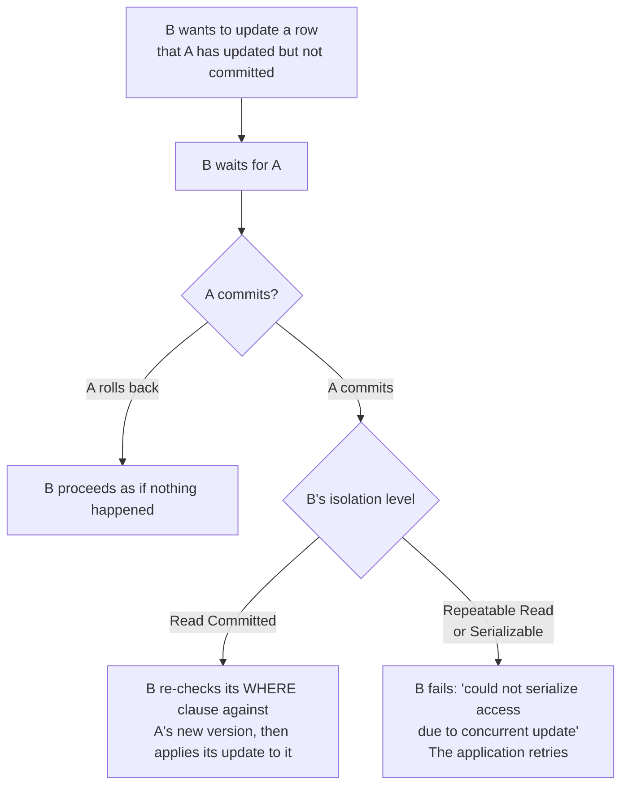

# 2.3 Transactions and isolation levels

[Syllabus](../SYLLABUS.md) · Phase 2 · Previous: [2.2 Indexes and query plans](02-indexes-and-query-plans.md) · Next: 2.4 Concurrency control in application code *(planned)*

> **Time:** about 55 minutes to read, 60 minutes of practice.
> **You need:** [Chapter 2.1](01-how-databases-store-data.md) (the write-ahead log, row versions), and a PostgreSQL to run the example on — see [the phase overview](README.md).

**By the end of this chapter you can**

- say what each letter of ACID promises, and — more usefully — what it does not;
- name the anomalies that concurrent transactions can produce, and recognise them in code;
- explain what Read Committed, Repeatable Read and Serializable each prevent, in PostgreSQL and in the SQL standard;
- explain how row versions let readers and writers avoid blocking each other;
- choose an isolation level deliberately, and write the retry loop that the stronger levels require.

---

## The problem

On 2 March 2014, an attacker emptied the Bitcoin exchange Flexcoin. The exchange's own account of it, as quoted in a later research paper: the attacker "successfully exploited a flaw in the code which allows transfers between Flexcoin users. By sending thousands of simultaneous requests, the attacker was able to 'move' coins from one user account to another until the sending account was overdrawn, before balances were updated." The result: "all Bitcoins stored in the Flexcoin exchange were stolen, all users lost their stored Bitcoins, and the exchange was forced to shut down" ([Warszawski and Bailis, *ACIDRain: Concurrency-Related Attacks on Database-Backed Web Applications*, SIGMOD 2017](http://www.bailis.org/papers/acidrain-sigmod2017.pdf)).

The paper illustrates the flaw with a withdrawal function of a kind you have probably written:

```text
balance = SELECT balance FROM accounts WHERE id = :from
if balance >= amount:
    UPDATE accounts SET balance = :balance - :amount WHERE id = :from
    …credit the other account…
```

Read the balance, check it, write the new one. Correct in every test — because tests run one request at a time. Send two requests at the same instant and both read the same balance, both pass the check, and both pay out.

This was not a one-off. The [same paper](http://www.bailis.org/papers/acidrain-sigmod2017.pdf) examined twelve widely used e-commerce applications, "deployed on over 2M websites", and found "22 critical ACIDRain attacks that allow attackers to corrupt store inventory, over-spend gift cards, and steal inventory". In three of the applications, "users can buy a single gift card, then spend it an unlimited number of times by concurrently issuing checkout requests."

Every one of those applications used a database that supports transactions. The paper found two reasons that did not save them. In 17 of the 22 cases the read and the write were simply not in the same transaction. But the obvious repair — wrap them in one — is not enough either. Of the withdrawal code with a transaction added, the authors write: "even this code is vulnerable to attack at isolation levels at or below Read Committed, unless explicit locking such as SELECT FOR UPDATE is used." Read Committed is the level PostgreSQL uses unless told otherwise. In the paper's words, "all 22 vulnerabilities manifest under the default isolation guarantees of popular transactional databases" ([same paper](http://www.bailis.org/papers/acidrain-sigmod2017.pdf)).

So "it's inside a transaction" does not mean what most developers assume it means. What it does mean depends on a setting called the **isolation level**, and the default is not the safe one.

---

## The concept

### 1. What a transaction promises

A **transaction** groups several statements so that they act as one. PostgreSQL's tutorial puts it this way: "The essential point of a transaction is that it bundles multiple steps into a single, all-or-nothing operation. The intermediate states between the steps are not visible to other concurrent transactions" ([PostgreSQL docs, *Transactions*](https://www.postgresql.org/docs/current/tutorial-transactions.html)).

The traditional summary is **ACID**. Take the letters in order of how much trouble they cause:

| | The promise | How it is kept | How far to trust it |
|---|---|---|---|
| **A**tomicity | All of the transaction's changes happen, or none do. | The write-ahead log (Chapter 2.1): changes that were not committed are undone or ignored. | Completely. |
| **D**urability | Once committed, a change survives a crash. | The log is flushed to disk before `COMMIT` returns. | As far as your settings and your disks deserve (Chapter 2.9). |
| **C**onsistency | The data obeys your rules before and after. | Mostly *you*: the database enforces the constraints you declare, and nothing else. | Only as far as your constraints go (Chapter 2.5). |
| **I**solation | Transactions running at the same time do not interfere. | It depends on the isolation level. | **Much less than you think, by default.** |

Atomicity is why you use transactions at all: money leaves one account *and* arrives in the other, or neither. It works, and it is not this chapter's subject.

Isolation is the subject, because it is the promise that is routinely weaker than its name.

### 2. What can go wrong: the anomalies

If transactions ran one at a time, none of this would matter. They do not — a busy database runs hundreds at once — so the question is what one transaction can observe of another that is running alongside it. The misbehaviours have names. The last two in this table are the ones that cost money; the first four are defined in PostgreSQL's documentation on [transaction isolation](https://www.postgresql.org/docs/current/transaction-iso.html):

| Anomaly | What happens |
|---|---|
| **Dirty read** | "A transaction reads data written by a concurrent uncommitted transaction." You act on a change that is then rolled back. |
| **Non-repeatable read** | "A transaction re-reads data it has previously read and finds that data has been modified by another transaction." |
| **Phantom read** | A transaction repeats a query and finds "that the set of rows satisfying the condition has changed". |
| **Serialization anomaly** | "The result of successfully committing a group of transactions is inconsistent with all possible orderings of running those transactions one at a time." |
| **Lost update** | Two transactions read a value, each computes a new one from it, each writes. The second write silently replaces the first. *This is Flexcoin.* |
| **Write skew** | Two transactions each check a rule that involves several rows, each changes a *different* row, and together they break the rule. |

The last two are both kinds of serialization anomaly. They get their own names because they are how application code actually fails.

### 3. Isolation levels: how much of that you are protected from

An **isolation level** is a setting, per transaction, that decides which anomalies the database will prevent. The SQL standard defines four. PostgreSQL implements three distinct behaviours: "you can request any of the four standard transaction isolation levels, but internally only three distinct isolation levels are implemented, i.e., PostgreSQL's Read Uncommitted mode behaves like Read Committed" ([same page](https://www.postgresql.org/docs/current/transaction-iso.html)).

| Level | What a query sees | In PostgreSQL, still possible |
|---|---|---|
| **Read Committed** — *the default* | Everything committed before *this statement* began | Non-repeatable reads, phantoms, lost updates, write skew |
| **Repeatable Read** | Everything committed before *this transaction's first query*: a fixed snapshot | Write skew |
| **Serializable** | The same snapshot, plus a guarantee that the outcome matches *some* one-at-a-time order | Nothing — but transactions may be aborted to keep the guarantee |

**Read Committed** "is the default isolation level in PostgreSQL" ([docs](https://www.postgresql.org/docs/current/transaction-iso.html#XACT-READ-COMMITTED)). Each statement sees a fresh view: a `SELECT` "sees only data committed before the query began". Two `SELECT`s in the same transaction can therefore return different answers. Nothing is ever read half-finished, but there is no protection against anything that happens *between* your statements. Read-check-write code is exactly that: something happening between statements.

**Repeatable Read** ([docs](https://www.postgresql.org/docs/current/transaction-iso.html#XACT-REPEATABLE-READ)) gives the transaction one snapshot for its whole life: "a query in a repeatable read transaction sees a snapshot as of the start of the first non-transaction-control statement in the transaction, not as of the start of the current statement". It reads a frozen picture of the database. And if it tries to update a row that someone else changed after that picture was taken, PostgreSQL refuses, with the error `could not serialize access due to concurrent update`. That detects lost updates. The price is stated in the documentation: "Applications using this level must be prepared to retry transactions due to serialization failures."

**Serializable** ([docs](https://www.postgresql.org/docs/current/transaction-iso.html#XACT-SERIALIZABLE)) "emulates serial transaction execution for all committed transactions; as if transactions had been executed one after another, serially, rather than concurrently." PostgreSQL does not achieve this by actually running them one at a time. It lets them run concurrently on snapshots, as in Repeatable Read, and additionally "monitors for conditions which could make execution of a concurrent set of serializable transactions behave in a manner inconsistent with all possible serial (one at a time) executions" — and aborts a transaction when it finds one. This catches write skew. Again, "applications using this level must be prepared to retry".

So the real trade is this. **Weaker levels let anomalies through silently. Stronger levels turn them into errors that your code must catch and retry.** There is no level at which concurrent code is both unrestricted and automatically correct.

### 4. How it works: versions, snapshots and row locks

Chapter 2.1 showed that PostgreSQL never overwrites a row; an update writes a new version and leaves the old one. That is what makes all of this possible without readers and writers queueing behind each other.

- **Readers use versions.** A query is given a snapshot — a rule for which row versions it may see — and simply ignores versions that are too new. It never waits. This is **multiversion concurrency control (MVCC)**, and its selling point is in the documentation: "reading never blocks writing and writing never blocks reading" ([PostgreSQL docs, *Introduction to MVCC*](https://www.postgresql.org/docs/current/mvcc-intro.html)).
- **Writers lock rows.** Two transactions cannot both update the same row at once. The second one **waits** until the first commits or rolls back.

What the second writer does *after* waiting is the entire difference between the levels:



Under Read Committed, the documentation describes the left branch: "The search condition of the command (the WHERE clause) is re-evaluated to see if the updated version of the row still matches the search condition. If so, the second updater proceeds with its operation using the updated version of the row" ([*Transaction Isolation*](https://www.postgresql.org/docs/current/transaction-iso.html#XACT-READ-COMMITTED)).

That sentence explains both the disease and one of its cures:

- If B's update says `SET balance = 20` — a value B computed earlier, in application code, from a balance it read before A committed — then B's update is applied on top of A's, and A's is lost.
- If B's update says `SET balance = balance - 80 WHERE balance >= 80`, the database recomputes it against A's new version. The check and the change happen together, on current data. Nothing is lost.

The example program shows both.

### 5. Names are not promises

Two warnings about other databases.

**Defaults differ.** PostgreSQL defaults to Read Committed. MySQL does not: "The default isolation level for InnoDB is REPEATABLE READ" ([MySQL manual](https://dev.mysql.com/doc/refman/8.4/en/innodb-transaction-isolation-levels.html)).

**The same name means different things.** PostgreSQL's Repeatable Read is what the research literature calls *snapshot isolation*. It prevents phantoms, which the SQL standard does not require of that level, and it allows write skew, which true serializability forbids. Other products use the standard's names for different behaviours again. Martin Kleppmann's [Hermitage](https://github.com/ept/hermitage) project tests what each database's levels really prevent, and its summary table lists the "so-called isolation level" beside the "actual isolation level"; Oracle's "serializable", for instance, is snapshot isolation.

The confusion goes back to the standard itself, which defines the levels by a short list of anomalies and misses several — the subject of a well-known paper, [*A Critique of ANSI SQL Isolation Levels*](https://www.microsoft.com/en-us/research/publication/a-critique-of-ansi-sql-isolation-levels/) (Berenson et al., 1995), which also introduced snapshot isolation.

The practical rule: **never reason from the name of an isolation level. Read what your database's documentation says that level does** — or test it, as the next section does.

---

## A real example

### Run it: two sessions, five experiments

[`code/ch03-isolation/main.go`](code/ch03-isolation/main.go) opens two connections to PostgreSQL — A and B — and makes them take turns in a fixed order, printing what each sees. Nothing is simulated; every value and every error comes from the database.

```bash
go run ./phase-2-data/code/ch03-isolation
```

**Experiment 1 — the same query twice in one transaction.**

```text
   -- at READ COMMITTED
   A: BEGIN                                              -> ok
   A: SELECT balance                                     -> 100
   B: UPDATE balance = 20; COMMIT (on its own)           -> 1 row updated
   A: SELECT balance   (same query again)                -> 20
   A: COMMIT                                             -> ok
   -- at REPEATABLE READ
   A: BEGIN                                              -> ok
   A: SELECT balance                                     -> 100
   B: UPDATE balance = 20; COMMIT (on its own)           -> 1 row updated
   A: SELECT balance   (same query again)                -> 100
   A: COMMIT                                             -> ok
```

At Read Committed the ground moves under A between statements. At Repeatable Read, A keeps seeing its snapshot.

**Experiment 2 — the Flexcoin bug, at the default level.**

```text
2. Two withdrawals of 80 from a balance of 100, at READ COMMITTED (the default)
   Each transaction reads the balance, checks it in application code, and writes the new value.
   A: BEGIN                                              -> ok
   B: BEGIN                                              -> ok
   A: SELECT balance                                     -> 100
   B: SELECT balance                                     -> 100
   A: UPDATE balance = 20   (100 - 80)                   -> 1 row updated
   B: UPDATE balance = 20   (100 - 80)                   ... waiting for the other transaction
   A: COMMIT                                             -> ok
   B:    (the statement above, once unblocked)           -> 1 row updated   [waited 300ms]
   B: COMMIT                                             -> ok
   final balance: 20
   Both withdrawals succeeded: 160 was paid out, and only 80 left the account.
```

Follow B. It reads 100. It waits for A's lock — the database *did* make it wait. Then it writes the 20 it had already computed, on top of A's 20. No error, no warning. Both transactions committed. This is a **lost update**, and it is what two "transactional" withdrawals do by default.

**Experiment 3 — the same code at Repeatable Read.**

```text
   A: UPDATE balance = 20   (100 - 80)                   -> 1 row updated
   B: UPDATE balance = 20   (100 - 80)                   ... waiting for the other transaction
   A: COMMIT                                             -> ok
   B:    (the statement above, once unblocked)           -> ERROR 40001: could not serialize access due to concurrent update   [waited 300ms]
   B: ROLLBACK                                           -> ok
   B must start again from the beginning:
   B: BEGIN                                              -> ok
   B: SELECT balance                                     -> 20
   B: balance 20 is less than 80: refuse the withdrawal
   B: ROLLBACK                                           -> ok
   final balance: 20
```

The database noticed that B was about to overwrite a change it had never seen, and refused. B starts again, reads the true balance, and correctly declines. The anomaly became an error — which is only an improvement if the application handles it.

**Experiment 4 — write skew: a rule that spans rows.**

A hospital requires at least one doctor on call. Alice and Bob are both on call, and both ask to go off call at the same moment. (This example is from Martin Kleppmann's *Designing Data-Intensive Applications*.)

```text
   -- at REPEATABLE READ
   A: SELECT count(*) on call  (2, so Alice may go)      -> 2
   B: SELECT count(*) on call  (2, so Bob may go)        -> 2
   A: UPDATE alice: on_call = false                      -> 1 row updated
   B: UPDATE bob:   on_call = false                      -> 1 row updated
   A: COMMIT                                             -> ok
   B: COMMIT                                             -> ok
   doctors on call: 0
   -- at SERIALIZABLE
   A: SELECT count(*) on call  (2, so Alice may go)      -> 2
   B: SELECT count(*) on call  (2, so Bob may go)        -> 2
   A: UPDATE alice: on_call = false                      -> 1 row updated
   B: UPDATE bob:   on_call = false                      -> 1 row updated
   A: COMMIT                                             -> ok
   B: COMMIT                                             -> ERROR 40001: could not serialize access due to read/write dependencies among transactions
   B: ROLLBACK                                           -> ok
   doctors on call: 1
```

At Repeatable Read nobody is on call. Notice why the previous level's protection did not help: the two transactions updated *different rows*, so neither ever waited for the other and there was no "concurrent update" to detect. Each made a decision from a snapshot that the other was about to invalidate. Only Serializable, which tracks what each transaction *read* as well as what it wrote, catches it.

**Experiment 5 — the withdrawals again, at the default level, as one statement.**

```text
   A: UPDATE balance = balance - 80 WHERE balance >= 80  -> 1 row updated
   B: UPDATE balance = balance - 80 WHERE balance >= 80  ... waiting for the other transaction
   A: COMMIT                                             -> ok
   B:    (the statement above, once unblocked)           -> 0 rows updated   [waited 300ms]
   B: COMMIT                                             -> ok
   final balance: 20
   B's statement changed no rows, so the application refuses the second withdrawal.
```

Same isolation level as experiment 2, and it is correct. B waited, then re-evaluated `balance >= 80` against A's committed version, found it false, and changed nothing. The application checks the row count instead of the balance.

This is the cheapest fix there is: **let the database do the check and the change in one statement**, so that there is no gap between them for another transaction to fall into. It only works when the rule fits in a `WHERE` clause on the row being changed — it would not save the doctors. Chapter 2.4 covers the tools for the cases where it does not.

### In the wild: gift cards spent without limit

The [ACIDRain paper](http://www.bailis.org/papers/acidrain-sigmod2017.pdf) documents this chapter's bug in real, widely deployed software. The gift-card attack has the shape of experiment 2: a value is read, checked, and written back, by requests that overlap — so "users can buy a single gift card, then spend it an unlimited number of times by concurrently issuing checkout requests."

Two things in the paper are worth carrying with you.

First, the causes — there were two, and they need different fixes. Seventeen of the 22 vulnerabilities were, in the [paper's](http://www.bailis.org/papers/acidrain-sigmod2017.pdf) words, "due to incorrect transaction usage": the statements that had to be atomic were not in one transaction, and those "manifest even under the strongest transactional guarantees". The other kind is the one this chapter demonstrates: code that *is* in a transaction, running at a level too weak to protect it. The first kind is fixed by getting transaction boundaries right; the second by the techniques here and in the next chapter. You need both.

Second, the scale: the vulnerable software ran on "approximately 2M websites… representing over 50% of all eCommerce websites" ([same paper](http://www.bailis.org/papers/acidrain-sigmod2017.pdf)). This is not an exotic mistake. It is the ordinary outcome of writing read-check-write code against a database at its default settings.

---

## Trade-offs

**Stronger isolation costs retries, not (in PostgreSQL) blocking.** Because of MVCC, moving from Read Committed to Serializable does not make readers wait. It makes some transactions fail and run again. Under low contention that is rare and cheap. When many transactions fight over the same rows, the retries multiply and throughput falls.

| Level | You get | You pay |
|---|---|---|
| Read Committed | No failed transactions; every statement sees fresh data | You must protect every read-check-write yourself. Nothing warns you when you forget. |
| Repeatable Read | A stable snapshot; lost updates detected | A retry loop. Write skew is still possible. |
| Serializable | Correctness by default, as if transactions ran one at a time | A retry loop; more aborts under contention; some bookkeeping overhead |

**Which should you use?** There are two defensible positions.

- *Serializable everywhere, with a retry wrapper.* You do not have to analyse each transaction for anomalies; the database does. The cost is aborts, and it is the choice to make when correctness errors are expensive and the team is not full of concurrency experts.
- *Read Committed, plus explicit protection where it matters* — single-statement updates, `SELECT … FOR UPDATE`, constraints (Chapter 2.4). This gives the most throughput and is by far the most common in practice. Its weakness is that it is correct only where someone remembered to make it so, and the ACIDRain paper is a catalogue of what gets forgotten.

Either way, decide. The dangerous option is the one most systems are running: the default level, with no particular protection, by accident.

**Long transactions make everything worse.** The longer a transaction is open, the more likely it is to conflict with another (more retries), the longer it holds row locks (more waiting), and the more dead row versions it prevents vacuum from removing (Chapter 2.1). Keep transactions short, and never hold one open across a call to another system (Chapter 1.6).

**Isolation is not the only tool, and often not the best.** A `UNIQUE` or `CHECK` constraint enforces a rule regardless of isolation level or of which code path wrote the data. "The balance must not be negative" is better stated as `CHECK (balance >= 0)` than left to every piece of code that touches balances. Chapter 2.5 returns to this.

---

## Practice

### Check yourself

Answer before reading on.

1. At PostgreSQL's default isolation level, a transaction runs `SELECT count(*) FROM seats WHERE show_id = 9 AND sold = false` and gets 1, then runs `UPDATE seats SET sold = true WHERE id = 4417`. Another transaction does exactly the same at the same moment. What happens — is the seat sold twice?
2. A colleague proposes fixing a lost-update bug by switching the transaction to Repeatable Read. They make the change and deploy. What have they almost certainly forgotten?
3. Why did Repeatable Read stop the two withdrawals in experiment 3, but not the two doctors in experiment 4?

<details>
<summary>Answers</summary>

1. Both transactions see one unsold seat. Both issue the `UPDATE`. The second waits for the first to commit, and then — at Read Committed — re-evaluates its `WHERE` clause against the new version of the row. The clause is only `id = 4417`, which still matches, so it "updates" the already-sold seat. **Both transactions believe they sold seat 4417.** The check (`sold = false`) was in a *different statement* from the change, so nothing re-checked it. Put the condition in the update — `UPDATE seats SET sold = true WHERE id = 4417 AND sold = false` — and test the row count: the second transaction then changes zero rows and knows it lost.

2. **The retry.** At Repeatable Read the second transaction no longer silently overwrites; it fails with SQLSTATE `40001`. If the application does not catch that error and run the whole transaction again, the lost update has simply become a `500` error for the user. The stronger isolation levels are only half of a mechanism; the retry loop is the other half.

3. Repeatable Read detects two transactions **writing the same row**: the second writer waits, and on finding the row changed since its snapshot, fails. The withdrawals both wrote account 1. The doctors wrote *different rows* — Alice's and Bob's — so there was no row-level conflict to detect. Their conflict was between what each one **read** (the count of doctors on call) and what the other **wrote**. Only Serializable tracks reads.

</details>

### Exercise: classify and fix

For each scenario: (a) name the anomaly; (b) say whether it can happen at Read Committed, Repeatable Read and Serializable in PostgreSQL; (c) give the cheapest correct fix. Assume each runs inside a transaction at the default level unless you change it.

**Scenario 1 — like counter.**

```text
n = SELECT likes FROM posts WHERE id = 7
UPDATE posts SET likes = :n + 1 WHERE id = 7
```

**Scenario 2 — meeting room.** A booking must not overlap another booking of the same room.

```text
c = SELECT count(*) FROM bookings WHERE room = 'A' AND overlaps(:start, :end)
if c == 0:
    INSERT INTO bookings (room, start_at, end_at) VALUES ('A', :start, :end)
```

**Scenario 3 — monthly report.** A long read-only transaction first sums all account balances, then lists each account's balance. Transfers between accounts are happening the whole time. The report's total does not equal the sum of the balances it lists.

**Scenario 4 — username.** Usernames must be unique.

```text
c = SELECT count(*) FROM users WHERE username = :name
if c == 0:
    INSERT INTO users (username) VALUES (:name)
```

<details>
<summary>Worked solution</summary>

**Scenario 1 — a lost update.**

- Two requests read `likes = 41`; both write 42. One like vanishes.
- *Read Committed:* happens silently. *Repeatable Read and Serializable:* the second transaction fails with `40001`, and must be retried.
- *Fix:* one statement — `UPDATE posts SET likes = likes + 1 WHERE id = 7`. It is correct at every isolation level, needs no retry, and is faster. Whenever the new value is a function of the old one, let the database compute it.

**Scenario 2 — write skew, by way of a phantom.**

- Two requests each count overlapping bookings, find none, and each insert one. The rule is broken by two rows that did not exist when either transaction looked.
- *Read Committed:* happens. *Repeatable Read:* **still happens** — the transactions insert different rows, so there is no same-row conflict to detect. This is experiment 4 in a different costume. *Serializable:* one transaction is aborted.
- *Fix:* there is no existing row to lock or to put a `WHERE` on, so the one-statement trick does not apply. The options are Serializable with a retry, or — better — a constraint that makes the database itself refuse overlapping bookings. PostgreSQL has one built for this: an [exclusion constraint](https://www.postgresql.org/docs/current/ddl-constraints.html#DDL-CONSTRAINTS-EXCLUSION), which the manual illustrates with almost this example. Chapter 2.4 covers the other approaches.

**Scenario 3 — a non-repeatable read** (the report-level version is sometimes called *read skew*).

- Each statement at Read Committed sees its own, later view of the data, so the two queries describe the database at two different moments. Money that moved between them is counted twice or not at all.
- *Read Committed:* happens. *Repeatable Read and Serializable:* cannot happen — the whole transaction reads from one snapshot.
- *Fix:* run the report in a Repeatable Read transaction. It is read-only, so it can never cause or suffer a write conflict and needs no retry. This is the textbook use for that level: any report or export made of more than one query.

**Scenario 4 — the same shape as scenario 2**, with a much simpler fix.

- Two sign-ups check, find the name free, and both insert.
- *Read Committed and Repeatable Read:* happens. *Serializable:* one is aborted.
- *Fix:* a `UNIQUE` constraint on `username`. Insert without checking first, and treat a unique-violation error as "that name is taken". The constraint holds at every isolation level, for every code path, including the ones not yet written. It is the same lesson as Chapter 1.5's idempotency keys: **check-then-insert is a race; insert-and-let-the-constraint-decide is not.**

**What the four have in common.** In each, the code *decided* from what it read and *acted* in a separate statement. The fixes close that gap in different ways: make the decision part of the write (1), have the database enforce the rule itself (2, 4), or freeze what you read (3). Raising the isolation level is always available as a fifth option — if you also write the retry.

</details>

---

## Production tips and common mistakes

**Tips**

- **Know your default level, and what it permits.** In PostgreSQL: Read Committed, which permits lost updates and write skew.
- **Close the gap between check and write.** Prefer one statement that does both (`UPDATE … SET x = x - 1 WHERE x > 0`) and inspect the number of rows changed.
- **State invariants as constraints** — `UNIQUE`, `CHECK`, foreign keys, exclusion constraints. They hold at every level, for all code.
- **If you use Repeatable Read or Serializable, wrap transactions in a retry loop** that catches SQLSTATE `40001` (`serialization_failure`) and `40P01` (`deadlock_detected`) — the codes are in [PostgreSQL's error-code table](https://www.postgresql.org/docs/current/errcodes-appendix.html) — and limits the attempts, with a short jittered pause as in Chapter 1.5.
- **Retry the whole transaction, including the logic.** PostgreSQL's documentation insists on it: "It is important to retry the complete transaction, including all logic that decides which SQL to issue and/or which values to use" ([*Serialization Failure Handling*](https://www.postgresql.org/docs/current/mvcc-serialization-failure-handling.html)). Re-sending the same statements with the same stale values would repeat the bug.
- **Use a Repeatable Read, read-only transaction for multi-query reports and exports.**
- **Keep transactions short.** Do the slow work — calling other services, rendering, anything a user waits on — before `BEGIN` or after `COMMIT`.
- **Test concurrency on purpose.** A test that fires the same request twenty times at once and then checks the invariant finds these bugs in seconds. A test that runs requests one at a time never will.

**Common mistakes**

- **Believing "it's in a transaction" means "it's safe".** At the default level a transaction gives you atomicity. It does not make read-check-write safe.
- **Computing the new value in the application** and writing it back.
- **Switching to a stronger level without adding the retry.** The anomaly becomes an error page.
- **Retrying only the failed statement.** The transaction's earlier reads are stale; that is why it failed.
- **Side effects inside a transaction that may be retried.** If the transaction sends an email and is then aborted and rerun, the email goes twice. Keep side effects outside, or make them idempotent (Chapter 1.5).
- **Assuming another database behaves like yours.** A different default; the same level names with different meanings.
- **Using Serializable for some transactions and not others**, and expecting the guarantee. Serializable transactions are only protected from *each other*.
- **Transactions left open** by a forgotten commit or a crashed job. They hold locks, block vacuum, and are a leading cause of mysterious slowness (Chapter 2.6).

*One line on deadlocks:* if two transactions each hold a row the other wants, neither can proceed. PostgreSQL "automatically detects deadlock situations and resolves them by aborting one of the transactions involved" ([*Explicit Locking*](https://www.postgresql.org/docs/current/explicit-locking.html)). Chapter 2.4 shows how to avoid them.

---

## Key takeaways

- A transaction's atomicity is dependable. Its isolation depends on the level, and the default level is weak.
- At Read Committed, each statement sees fresh data; nothing protects a decision made in one statement and acted on in another. Lost updates and write skew go through silently.
- Repeatable Read gives a fixed snapshot and turns same-row conflicts into errors. Serializable also catches conflicts between what one transaction read and another wrote.
- Stronger levels do not make concurrent code correct for free: they abort transactions, and your code must retry them — completely.
- Readers never block in PostgreSQL, because they read old row versions. Writers to the same row wait, and what they do after waiting is what distinguishes the levels.
- The cheapest fixes need no isolation change: do the check and the write in one statement, and state invariants as constraints.
- Level names differ between databases. Read the documentation, or test.

**Next:** 2.4 Concurrency control in application code *(planned)* — locks, version columns, and the cases a single statement cannot cover.

---

## Sources

- Todd Warszawski and Peter Bailis, [*ACIDRain: Concurrency-Related Attacks on Database-Backed Web Applications*](http://www.bailis.org/papers/acidrain-sigmod2017.pdf), SIGMOD 2017.
- PostgreSQL documentation: [Transactions](https://www.postgresql.org/docs/current/tutorial-transactions.html) (tutorial); [Transaction Isolation](https://www.postgresql.org/docs/current/transaction-iso.html); [Introduction to MVCC](https://www.postgresql.org/docs/current/mvcc-intro.html); [Serialization Failure Handling](https://www.postgresql.org/docs/current/mvcc-serialization-failure-handling.html); [Explicit Locking](https://www.postgresql.org/docs/current/explicit-locking.html); [Constraints](https://www.postgresql.org/docs/current/ddl-constraints.html); [Error Codes](https://www.postgresql.org/docs/current/errcodes-appendix.html).
- MySQL 8.4 Reference Manual: [Transaction Isolation Levels](https://dev.mysql.com/doc/refman/8.4/en/innodb-transaction-isolation-levels.html).
- Hal Berenson et al., [*A Critique of ANSI SQL Isolation Levels*](https://www.microsoft.com/en-us/research/publication/a-critique-of-ansi-sql-isolation-levels/), SIGMOD 1995.
- Martin Kleppmann, [Hermitage: Testing transaction isolation levels](https://github.com/ept/hermitage).
- Martin Kleppmann, [*Designing Data-Intensive Applications*](https://dataintensive.net/), O'Reilly — the chapter "Transactions" (the on-call doctors example of write skew).
