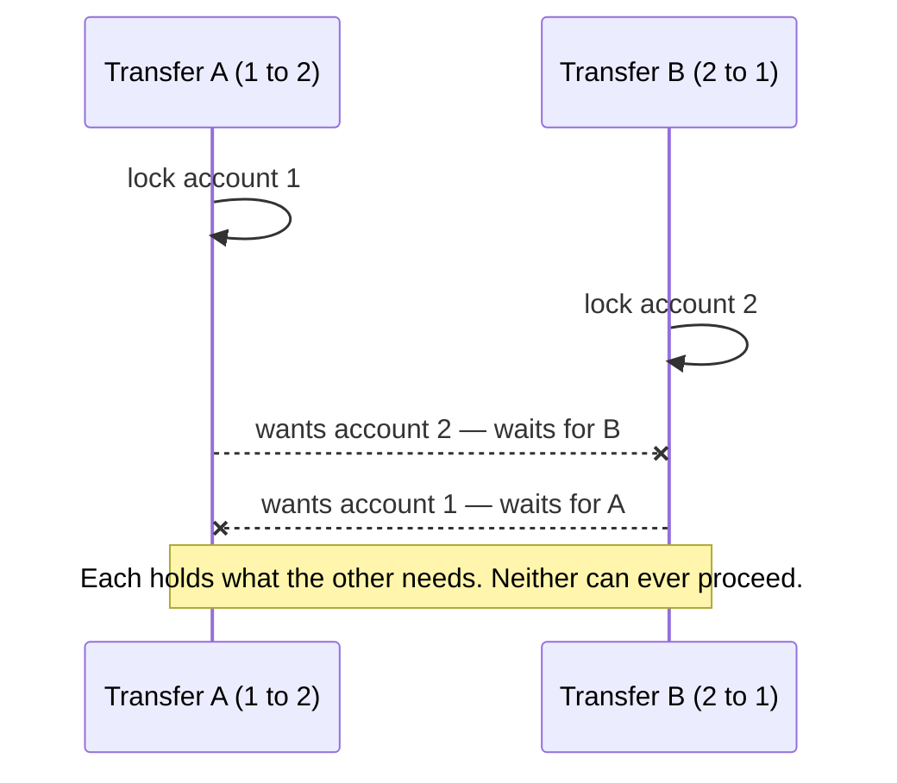

# 2.4 Concurrency control in application code

[Syllabus](../SYLLABUS.md) · Phase 2 · Previous: [2.3 Transactions and isolation levels](03-transactions-and-isolation.md) · Next: 2.5 Data modelling *(planned)*

> **Time:** about 50 minutes to read, 75 minutes of practice.
> **You need:** [Chapter 2.3](03-transactions-and-isolation.md) (isolation levels, lost updates, write skew), and a PostgreSQL to run the example on — see [the phase overview](README.md).

**By the end of this chapter you can**

- spot "check, then act" in code and explain exactly how two requests break it;
- fix it four ways — a single statement, a row lock, a version column, or a constraint — and choose between them;
- explain what pessimistic and optimistic locking each cost, and when each is the right tool;
- avoid deadlocks, and handle the ones you cannot avoid;
- keep a lock for milliseconds, never for as long as a user is thinking.

---

## The problem

In 2015 a security researcher, Egor Homakov, bought three Starbucks gift cards for $5 each and found, in his words, "a way to generate unlimited amount of money on Starbucks gift cards" ([Sakurity blog, *Hacking Starbucks for unlimited coffee*](https://sakurity.com/blog/2015/05/21/starbucks.html)).

The site let you transfer money between your own cards. He sent the same transfer twice at the same instant, from two browser sessions. Usually nothing unusual happened. On the sixth attempt, it did ([same post](https://sakurity.com/blog/2015/05/21/starbucks.html)): "the 6th request created two $5 transfers from wallet1 with 5 dollars balance. Now we have 2 cards with 15 and 5 (20 in total)." He had put in $15. He went to a shop and spent $16.70 to prove it, then reported the bug to Starbucks.

His [diagnosis](https://sakurity.com/blog/2015/05/21/starbucks.html) names the whole class: "It's very common bug for websites with balances, vouchers or other limited resources (mostly money)."

The code behind such a bug always has the same three steps:

```text
1. READ    the current state          balance = SELECT balance …
2. CHECK   it in application code     if balance >= amount:
3. WRITE   a new state                    UPDATE … SET balance = …
```

**Check, then act.** It is correct when requests arrive one at a time, which is how every test and every demo runs. It breaks when two requests both finish step 1 before either reaches step 3: both see the old state, both pass the check, both write.

Notice also *how* he found it: five failures, then a success. A race condition does not fail every time. It fails when the timing lines up — rarely in testing, constantly under production load, and on demand for an attacker who sends requests in pairs.

Chapter 2.3 explained why the database's default isolation level allows this. This chapter is the practical half: the specific techniques for closing the gap between the check and the write, how to choose among them, and what each one costs.

---

## The concept

Everything below is a way of doing one thing: making **the check and the write a single step** as far as any other transaction can tell.

The running example: an item has 5 units in stock, and 40 customers try to buy one at the same moment. Exactly 5 must succeed. The example program runs each technique against PostgreSQL and counts what ends up in the database.

### 1. Let the database do the check: one statement

```sql
UPDATE items SET stock = stock - 1
WHERE id = 1 AND stock > 0;
-- then look at how many rows were changed: 1 = you got one, 0 = sold out
```

The check (`stock > 0`) is part of the statement that makes the change. As Chapter 2.3 showed, if another transaction is changing the same row, this statement waits, then re-evaluates its `WHERE` clause against the newly committed row. There is no moment between check and write for anyone to slip into.

This is the first thing to reach for. It needs no explicit lock, no retry loop and no change of isolation level, and it is the fastest option in the experiment. Its limit is that the whole decision has to fit in one statement about the row being changed. "Decrement if positive" fits. "Charge the customer's card and, if that succeeds, reduce the stock" does not.

### 2. Pessimistic locking: lock first, then decide

When the decision needs application code, you can ask for the row *and a lock on it*:

```sql
BEGIN;
SELECT stock FROM items WHERE id = 1 FOR UPDATE;   -- others now wait here
-- … application logic, as much as you need …
UPDATE items SET stock = stock - 1 WHERE id = 1;
COMMIT;                                             -- lock released
```

`FOR UPDATE` "causes the rows retrieved by the SELECT statement to be locked as though for update. This prevents them from being locked, modified or deleted by other transactions until the current transaction ends" ([PostgreSQL docs, *Explicit Locking*](https://www.postgresql.org/docs/current/explicit-locking.html#LOCKING-ROWS)).

A second transaction running the same code stops at its own `SELECT … FOR UPDATE` and waits. When the first commits, the second proceeds — and reads the *new* stock. Requests are forced through the critical section one at a time.

It is called **pessimistic** because it assumes a conflict will happen and pays to prevent it, every time. That cost is waiting: while one transaction holds the lock, everyone else who wants that row queues behind it. Two rules follow.

- **Hold the lock for as short a time as possible.** Everything between the `SELECT … FOR UPDATE` and the `COMMIT` is time other requests spend waiting. Nothing slow belongs there — above all, no calls to other services (Chapter 1.6).
- **Never hold it across a human.** A lock taken when a user opens an edit form and released when they press Save may be held for an hour, or for ever if they close the tab. PostgreSQL's manual says so directly: "it is a bad idea for applications to hold transactions open for long periods of time (e.g., while waiting for user input)" ([same page](https://www.postgresql.org/docs/current/explicit-locking.html#LOCKING-DEADLOCKS)). For that situation, use the next technique.

Plain reads are unaffected. Row locks "do not affect data querying; they block only writers and lockers to the same row" ([docs](https://www.postgresql.org/docs/current/explicit-locking.html#LOCKING-ROWS)) — an ordinary `SELECT` without `FOR UPDATE` still returns immediately.

### 3. Optimistic locking: no lock, but check that nothing changed

The opposite bet: assume conflicts are rare, take no lock, and *detect* a conflict at the moment of writing.

Add a `version` column to the row. Read the version along with the data. When writing, require that the version is still the one you read, and increase it:

```sql
SELECT stock, version FROM items WHERE id = 1;          -- stock = 5, version = 12

-- … application logic, however long it takes …

UPDATE items SET stock = 4, version = version + 1
WHERE id = 1 AND version = 12;
-- 1 row changed: nobody interfered. 0 rows: someone did — read again and retry.
```

If another transaction changed the row in the meantime, the version is no longer 12, the `WHERE` matches nothing, and zero rows change. The application then starts again from the read.

You have seen this before. It is the `ETag` and `If-Match` of Chapter 1.3: the version is the entity tag, `WHERE version = 12` is the precondition, and "0 rows" is `412 Precondition Failed`. Martin Fowler's catalogue of patterns calls it *Optimistic Offline Lock*: it "prevents conflicts between concurrent business transactions by detecting a conflict and rolling back the transaction" ([martinfowler.com](https://martinfowler.com/eaaCatalog/optimisticOfflineLock.html)). Most object-relational mappers have it built in — in Rails, for instance, a column named `lock_version` turns it on, and a stale write raises an error ([Rails Guides](https://guides.rubyonrails.org/active_record_querying.html#optimistic-locking)).

Its great advantage is that **nothing is held between the read and the write**. They can be in different transactions, different requests, different days. That makes it the right tool for the edit-form case: send the version to the browser with the form, and send it back with the save.

Its cost is retries. When conflicts really are rare, a retry almost never happens. When forty requests want the same row at once, most of them lose each round and go again — the experiment below counts 156 start-overs to complete five purchases.

### 4. Constraints: let the database say no

Some rules need no code at all, because the database can enforce them itself.

- **A `UNIQUE` constraint** makes "at most one" rules impossible to break: one account per email, one redemption of a coupon per user, one booking per seat and show. Insert without checking, and treat a unique-violation error as the answer. This is the idempotency-key technique from Chapter 1.5, and it is the fix for "check whether it exists, then insert".
- **A `CHECK` constraint** — `CHECK (stock >= 0)`, `CHECK (balance >= 0)` — turns an impossible state into an error instead of a row.

A constraint is not a replacement for the techniques above; it is the net underneath them. It holds for every code path, including the one someone will write next year without having read this chapter. For anything involving money or stock, have both.

### 5. Deadlocks

Locks introduce a new way to fail. Suppose two transfers run at once — one from account 1 to account 2, the other from 2 to 1 — and each locks the sender's row first:



That is a **deadlock**. The database notices and breaks it: PostgreSQL "will detect this situation and abort one of the transactions" ([PostgreSQL docs, *Deadlocks*](https://www.postgresql.org/docs/current/explicit-locking.html#LOCKING-DEADLOCKS)). The victim gets an error (SQLSTATE `40P01`) and must be retried. In the experiment below, 39 of 40 opposing transfers are aborted this way.

The cure is on the [same page](https://www.postgresql.org/docs/current/explicit-locking.html#LOCKING-DEADLOCKS) of the manual: "The best defense against deadlocks is generally to avoid them by being certain that all applications using a database acquire locks on multiple objects in a consistent order."

In practice: **when a transaction needs several rows, lock them in a fixed order** — by primary key, say. Then both transfers lock account 1 first, one of them waits for the other, and no cycle can form. The same experiment with ordered locking: 40 of 40 complete.

You will not always control the order — an ORM may decide it, or two different features may touch the same tables in different sequences. So also treat `40P01` like a serialization failure: catch it and retry the whole transaction.

### 6. Raising the isolation level instead

Chapter 2.3's alternative still stands: run the naive code at `SERIALIZABLE`, wrapped in a loop that retries on SQLSTATE `40001`. The database then detects the conflict for you. It is optimistic locking performed by the database: no code changes to the transaction body, the same retry cost under contention, and it covers cases — write skew — that a version column on one row does not.

---

## A real example

### Run it: 5 items, 40 buyers, five strategies

[`code/ch04-concurrency/main.go`](code/ch04-concurrency/main.go) opens 40 connections to PostgreSQL and has all of them buy at once, using each strategy in turn from the same starting state. It then asks the database what actually happened. Each strategy that reads before writing pauses 2 ms in between, to stand in for application logic.

```bash
go run ./phase-2-data/code/ch04-concurrency
```

```text
PART 1 — 5 items in stock, 40 customers buy at the same moment. Exactly 5 should succeed.

  strategy                              told "yours"   stock left   start-overs    time   verdict
  1. read, check, write (naive)              40             4           0         59ms   WRONG: sold 35 items that did not exist
  2. one statement: check and change          5             0           0         17ms   correct
  3. pessimistic: SELECT ... FOR UPDATE       5             0           0         26ms   correct
  4. optimistic: version column               5             0         156         33ms   correct
  5. SERIALIZABLE with a retry loop           5             0         185         28ms   correct

PART 2 — 40 transfers at once: half from account 1 to 2, half from 2 to 1.

  locking order                          completed   deadlocks (40P01)   total money
  lock the sender, then the receiver          1            39              2000
  always lock the lower id first             40             0              2000
```

(The counts of start-overs and deadlocks vary a little from run to run; the verdicts do not.)

**Row 1** is the Starbucks bug. All forty customers were told the item was theirs. The stock column says 4, because forty transactions each read 5 and each wrote 4. Thirty-five customers have a confirmation for something that does not exist — and no error was raised anywhere.

The naive code, for reference. Every line is reasonable:

```go
var stock int
tx.QueryRow(ctx, `SELECT stock FROM cc_items WHERE id = 1`).Scan(&stock)
if stock <= 0 {
    return 0, errSoldOut
}
time.Sleep(thinking)   // application logic
tx.Exec(ctx, `UPDATE cc_items SET stock = $1 WHERE id = 1`, stock-1)
```

**Rows 2 to 5** are all correct, and they differ in cost.

- *One statement* is fastest and never starts over. The database serialises the forty updates on the row lock, and thirty-five of them change nothing.
- *Pessimistic* is correct with no start-overs: each buyer waits its turn, then reads the true stock. The waiting is the cost — and it would grow with every millisecond of "thinking" done while holding the lock.
- *Optimistic* needed **156 start-overs** for 5 purchases. With forty requests contending for one row, each round has one winner and many losers who must read again. This is optimistic locking in the situation it is worst at.
- *Serializable* is the naive code unchanged, with a retry loop around it: 185 start-overs, the same shape as optimistic.

**Part 2** is the deadlock. With each transfer locking its sender first, one transfer completed and thirty-nine were aborted. Locking the lower account number first, all forty completed. In both cases the total stayed at 2,000: deadlock victims are rolled back cleanly, so no money was created or destroyed. Atomicity held. But thirty-nine customers got an error for a transfer that should have worked.

The fix is three lines:

```go
first, second := from, to
if inOrder && first > second {
    first, second = second, first
}
```

### What the Starbucks fix has to look like

Homakov's own [conclusion](https://sakurity.com/blog/2015/05/21/starbucks.html): "Many developers use poor protections like limiting number of requests per IP/account/action, making a random delay or using DB transactions in a wrong way. The only right way to do it is a pessimistic lock (FOR UPDATE clause)."

He is right about the wrong fixes, and they are worth a second look because each is tempting:

- *Rate limiting* makes the attack slower, not impossible. Two requests are enough.
- *A random delay* changes the timing. A race is about timing; the attacker simply tries more often.
- *Using database transactions "in a wrong way"* is Chapter 2.3: wrapping read-check-write in a transaction at the default isolation level changes nothing.

He overstates one point. A pessimistic lock is *a* right way. A single conditional `UPDATE … WHERE balance >= amount`, a version column, or `SERIALIZABLE` with a retry would each have closed the same hole, as the table above shows. What they have in common is the real requirement: the check and the write must be one step.

---

## Trade-offs

| Technique | Others must… | Good when | Poor when |
|---|---|---|---|
| **One statement** | Wait briefly for the row | The rule fits in a `WHERE` clause on the row being changed. *Use this whenever you can.* | The decision needs application logic or other rows |
| **Pessimistic lock** (`FOR UPDATE`) | Wait for the whole transaction | Conflicts are frequent; the work in between is short; a failed attempt would be expensive to redo | The lock would be held across slow work, or across a person. Multiple locks risk deadlock |
| **Optimistic lock** (version column) | Start over if they lose | Conflicts are rare; read and write are far apart in time (an edit form); you cannot hold a transaction open | Many writers want the same row at once: mostly retries |
| **Serializable + retry** | Start over if they lose | You want correctness without analysing each transaction; write skew is a risk | High contention; code with side effects that are unsafe to repeat |
| **Constraint** | Get an error | The rule is "at most one", or "never below zero". *Use alongside the others.* | The rule spans rows in ways a constraint cannot express |

**Pessimistic or optimistic?** The names are the guide. If you *expect* a collision — a flash sale, a hot counter, a queue that many workers pull from — be pessimistic: waiting in line is cheaper than forty requests repeatedly redoing their work. If collisions are *unlikely* — two people editing the same customer record in the same second — be optimistic: there is nothing to wait for, and the occasional retry is cheap.

**Waiting has no limit by default.** A transaction that wants a locked row "will wait indefinitely for conflicting locks to be released" ([PostgreSQL docs](https://www.postgresql.org/docs/current/explicit-locking.html#LOCKING-DEADLOCKS)). Give it one: a lock timeout on the database side (Chapter 2.6), and a request deadline on the application side (Chapter 1.5). `FOR UPDATE NOWAIT` fails at once instead of waiting, which suits "someone else is editing this" messages.

**Locks protect rows that exist.** `SELECT … FOR UPDATE` cannot lock a row that is not there yet, so it cannot stop two transactions from each *inserting* a row that conflicts — two bookings for the same seat. That needs a constraint, or `SERIALIZABLE`. Chapter 2.3's exercise covered why.

---

## Practice

### Check yourself

Answer before reading on.

1. A user opens a "edit profile" form, spends five minutes on it, and saves. Meanwhile an administrator edited the same profile. Which technique stops the user silently overwriting the administrator's change — and why not the other one?
2. Forty workers pull jobs from a `jobs` table. Each runs `SELECT id FROM jobs WHERE status = 'queued' ORDER BY id LIMIT 1 FOR UPDATE`, processes the job, marks it done, and commits. It is correct. What is wrong with it?
3. Transaction A updates order 17 and then order 42. Transaction B updates order 42 and then order 17. Neither uses `SELECT … FOR UPDATE`. Can they deadlock?

<details>
<summary>Answers</summary>

1. **Optimistic locking** — a version column, sent to the browser with the form and checked on save. If the version has moved, the save changes zero rows and the application tells the user the profile was changed while they were editing. *Pessimistic* locking would mean holding a database lock and an open transaction for the five minutes the user spends typing — or for ever, if they wander off. Locks are for milliseconds.

2. All forty workers ask for the same row — the first queued job. One gets the lock; thirty-nine wait for it. When it commits, the next worker gets… a job that is now done, re-checks, and they all converge on the next row. The workers are processing one job at a time between them: forty workers with the throughput of one. PostgreSQL has a clause for exactly this: `FOR UPDATE SKIP LOCKED`, which skips rows someone else has locked and "can be used to avoid lock contention with multiple consumers accessing a queue-like table" ([PostgreSQL docs, `SELECT`](https://www.postgresql.org/docs/current/sql-select.html#SQL-FOR-UPDATE-SHARE)). Each worker then takes a *different* job. Chapter 4.2 builds on this.

3. **Yes.** An `UPDATE` takes a row lock just as `SELECT … FOR UPDATE` does, and holds it until the transaction ends. A holds 17 and wants 42; B holds 42 and wants 17. Deadlocks do not require explicit locking — only two transactions that change the same rows in different orders. The fix is the same: touch rows in a consistent order, and retry on `40P01`.

</details>

### Exercise: a coupon that can be used 100 times

Marketing launches a coupon, `SPRING`, with two rules:

- it can be redeemed **100 times in total**, and
- **each user may redeem it once**.

It will be announced to a million people at 09:00, so expect thousands of simultaneous attempts, including impatient users tapping the button twice.

The first version of the code:

```text
BEGIN
used   = SELECT used FROM coupons WHERE code = 'SPRING'
already = SELECT count(*) FROM redemptions WHERE coupon = 'SPRING' AND user_id = :user
if used < 100 and already == 0:
    INSERT INTO redemptions (coupon, user_id) VALUES ('SPRING', :user)
    UPDATE coupons SET used = :used + 1 WHERE code = 'SPRING'
COMMIT
```

1. List every way two simultaneous requests can break a rule.
2. Design the tables, with constraints.
3. Write the transaction so that both rules hold under any concurrency, using the techniques in this chapter. Say what the application does in each outcome.
4. Why does your version not deadlock?
5. Which technique did you *not* use, and why?

<details>
<summary>Worked solution</summary>

**1. What breaks.**

- *The total.* Many requests read `used = 99`, all pass, all insert, and all write `used = 100`. Hundreds of redemptions, and a counter that says 100. (A lost update on the counter — row 1 of the experiment.)
- *Once per user.* A double tap sends two requests for the same user. Both count zero prior redemptions; both insert. (Check-then-insert, as in Chapter 2.3's username example.)

**2. Tables.**

```sql
CREATE TABLE coupons (
    code     text PRIMARY KEY,
    max_uses int  NOT NULL,
    used     int  NOT NULL DEFAULT 0,
    CHECK (used <= max_uses)                  -- the net under rule 1
);

CREATE TABLE redemptions (
    coupon  text   NOT NULL REFERENCES coupons,
    user_id bigint NOT NULL,
    PRIMARY KEY (coupon, user_id)             -- rule 2, enforced by the database
);
```

**3. The transaction.** Two statements, each doing its own check.

```sql
BEGIN;

-- Rule 2. Insert without checking first; the primary key decides.
INSERT INTO redemptions (coupon, user_id) VALUES ('SPRING', $1)
ON CONFLICT DO NOTHING;
--   0 rows inserted  →  ROLLBACK;  "You have already used this coupon."

-- Rule 1. Check and change in one statement.
UPDATE coupons SET used = used + 1
WHERE code = 'SPRING' AND used < max_uses;
--   0 rows updated   →  ROLLBACK;  "Sorry, this coupon has run out."
--                        (the rollback also undoes the redemption row)

COMMIT;                -- →  "Coupon applied."
```

- A double tap: the second request's `INSERT` waits for the first transaction (the behaviour measured in Chapter 1.5), then inserts nothing.
- The hundred-and-first redemption: its `UPDATE` waits its turn on the coupon row, re-evaluates `used < max_uses`, and changes nothing. The rollback removes its redemption row, so the two tables never disagree.
- Atomicity ties the two together: a redemption row exists if and only if the counter was increased for it.

[`code/ch04-coupon/main.go`](code/ch04-coupon/main.go) is this solution as a program. It makes 1,000 attempts for 300 users over 40 connections and then checks both rules in the database:

```bash
go run ./phase-2-data/code/ch04-coupon
```

```text
1000 attempts by 300 users over 40 connections, for a coupon with 100 uses

  told "coupon applied":         100
  told "already used":           278
  told "run out":                622
  unexpected errors:               0

  in the database: counter = 100, redemption rows = 100, distinct users = 100
  both rules hold
```

(How the 900 refusals split between "already used" and "run out" varies from run to run. The 100 does not.)

**4. Why no deadlock.** Every transaction takes its locks in the same order: first its own new `redemptions` row, then the `coupons` row. Two different users never want each other's redemption row, and they all take the coupon row last. With a consistent order there is no cycle.

**5. What was not used.**

- *`SELECT … FOR UPDATE` on the coupon row* would also be correct. But it would make every request — including the hundreds of thousands arriving after the coupon has run out — queue for one lock just to learn that. The conditional `UPDATE` holds the row lock only for the instant of the change.
- *A version column* would be the worst choice here: thousands of requests for one row is the high-contention case, and nearly all of them would be retrying.
- *Counting the redemptions* instead of keeping a counter (`SELECT count(*) … < 100`) cannot be made safe with a row lock, because the conflicting rows do not exist yet — the phantom problem. The counter column gives the rule a single row to hang the check on. That is a small, deliberate piece of denormalisation, and Chapter 2.5 comes back to it.

One more thing to notice: after the first 100 succeed, every later request still takes a row lock on the coupon, briefly. If that became a bottleneck, the service could remember "exhausted" in memory and refuse without touching the database — safely, since a coupon that has run out never comes back. The database remains the authority; the shortcut is only an optimisation.

</details>

---

## Production tips and common mistakes

**Tips**

- **Search your code for "read, then decide, then write"** on anything that is limited or shared: balances, stock, seats, quotas, counters, "is this the first…?". Each one is a race until proven otherwise.
- **Prefer one conditional statement, and check the row count.** Ignoring the number of rows changed is the same as not checking.
- **Back every important rule with a constraint.**
- **Keep locked sections tiny.** Do the slow work before taking the lock or after releasing it.
- **Lock multiple rows in a consistent order** — for example with `SELECT … WHERE id IN (…) ORDER BY id FOR UPDATE` — and retry on `40P01` regardless.
- **Use a version column for anything a person edits**, and carry the version through the user interface.
- **Wrap retries in one helper** that handles `40001` and `40P01`, limits the attempts, and pauses briefly with jitter between them (Chapter 1.5). Then use it everywhere.
- **Test with concurrency.** Fire the same request forty times at once and assert the invariant afterwards — that is all the example program does, and it finds the bug in 59 ms.
- **For work queues in a table, use `FOR UPDATE SKIP LOCKED`.**

**Common mistakes**

- **Read-check-write at the default isolation level**, inside a transaction, believed to be safe.
- **An `UPDATE` with the condition but no check of the rows affected.**
- **Locking with `SELECT … FOR UPDATE` and then doing something slow** — an HTTP call, a payment, a file upload — before committing.
- **Holding a lock while a user thinks.**
- **Optimistic locking on a hot row.** It turns contention into a storm of retries.
- **Retrying only the last statement** after a conflict, with the stale values still in hand.
- **Relying on application-level locks alone** — a mutex in the process, a lock in a cache — when there is more than one server. The other servers do not share your mutex. (Distributed locks are harder than they look; Chapter 5.5.)
- **"We added a rate limit / a delay."** A race is not fixed by making it less likely.

*One line each:* PostgreSQL also offers **advisory locks**, which are locks on a number of your choosing rather than on a row — "the system does not enforce their use" ([docs](https://www.postgresql.org/docs/current/explicit-locking.html#ADVISORY-LOCKS)) — useful for "only one of these jobs at a time". And a lock you no longer need to wait for can be given up on with `NOWAIT` or a lock timeout.

---

## Key takeaways

- "Check, then act" across two statements is a race. It passes every sequential test and fails under concurrency — and attackers can make it fail on purpose.
- The fix is always to make the check and the write one step: in a single conditional statement, under a row lock, guarded by a version, or enforced by a constraint.
- One conditional statement is the simplest and fastest. Use it when the rule fits in a `WHERE` clause.
- Pessimistic locking makes others wait; use it when conflicts are likely and the locked work is short. Optimistic locking makes losers retry; use it when conflicts are rare or the read and write are far apart.
- Constraints are the net under everything else.
- Deadlocks come from taking locks in different orders. Take them in one order, and retry the ones that still happen.
- Locks are held for milliseconds. Never across slow work, never across a person.

**Next:** 2.5 Data modelling *(planned)* — designing tables so that rules like these are easy for the database to enforce.

---

## Sources

- Egor Homakov, [*Hacking Starbucks for unlimited coffee*](https://sakurity.com/blog/2015/05/21/starbucks.html), Sakurity blog, 2015.
- PostgreSQL documentation: [Explicit Locking](https://www.postgresql.org/docs/current/explicit-locking.html) (row-level locks, deadlocks, advisory locks); [SELECT — the locking clause](https://www.postgresql.org/docs/current/sql-select.html#SQL-FOR-UPDATE-SHARE) (`FOR UPDATE`, `NOWAIT`, `SKIP LOCKED`).
- Martin Fowler, *Patterns of Enterprise Application Architecture* catalogue: [Optimistic Offline Lock](https://martinfowler.com/eaaCatalog/optimisticOfflineLock.html); [Pessimistic Offline Lock](https://martinfowler.com/eaaCatalog/pessimisticOfflineLock.html).
- Ruby on Rails Guides: [Active Record Query Interface — Locking Records for Update](https://guides.rubyonrails.org/active_record_querying.html#optimistic-locking).
- Chapters [1.3](../phase-1-foundations/03-http-for-backend-engineers.md) (conditional requests), [1.5](../phase-1-foundations/05-timeouts-retries-idempotency.md) (idempotency keys) and [2.3](03-transactions-and-isolation.md) (isolation levels) of this course.
