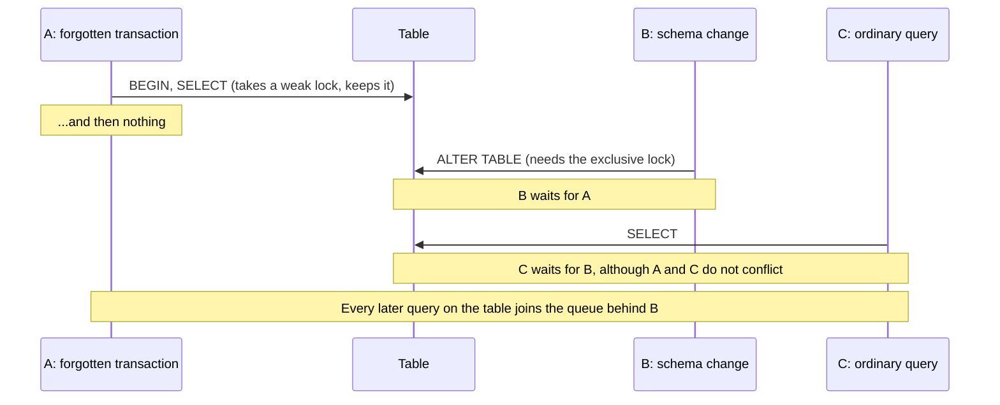

# 2.6 The database as a shared resource

[Syllabus](../SYLLABUS.md) · Phase 2 · Previous: [2.5 Data modelling](05-data-modelling.md) · Next: [2.7 Changing schemas without downtime](07-schema-changes.md)

> **Time:** about 45 minutes to read, 60 minutes of practice.
> **You need:** [Chapter 1.6](../phase-1-foundations/06-concurrency-pools-queues.md) (pools, queues, Little's law) and [Chapter 2.4](04-concurrency-control.md) (row locks), and a PostgreSQL for the example — see [the phase overview](README.md).

**By the end of this chapter you can**

- name the things every user of a database shares — connections, locks, memory, CPU — and say how one user exhausts each;
- explain the lock queue: how one idle transaction and one quick schema change make a table unreadable;
- set the three timeouts that stop a single session from hurting everyone else;
- find out, on a live database, who is waiting for whom;
- size connection pools across many application instances, and say what a connection pooler does;
- keep slow, low-priority work from starving fast, important work.

---

## The problem

*An illustrative scenario; you will reproduce its mechanism below.* An online shop has an internal sales report. It runs a large query and takes a few seconds, which nobody minds. One Monday morning the finance team opens it — ten people, in ten browser tabs, each pressing refresh when it is slow.

Within seconds, customers cannot check out. Checkout's own query has not changed; it still takes under a millisecond when it runs. It is not running. The application has a pool of ten database connections, all ten are held by report queries, and every checkout request is standing in line for a connection.

Nothing was wrong with either feature. The failure is in what connects them: **one database, and one pool, shared by everything.** A database is the most shared thing in most systems — every endpoint, background job, migration, analyst and administrator uses the same one — and by default nothing stops any of them from taking all of it.

This chapter is about the shared parts, the ways one user of the database can take the rest down, and the limits that prevent it.

---

## The concept

### 1. What is shared

| Shared thing | How it runs out | What everyone else sees |
|---|---|---|
| **Connections** | More clients than the server allows | New connections refused |
| **The application's pool** | Slow queries hold every connection | Fast requests queue for a connection |
| **Locks** | A transaction holds one too long | Everything that needs it waits |
| **CPU, memory, disk I/O** | A heavy query, or many at once | Every query gets slower |
| **Old row versions** | A transaction stays open | Vacuum cannot clean up; tables bloat (Chapter 2.1) |

The first three fail suddenly and completely, and most of this chapter is about them. The last two degrade gradually. Their cures are mostly elsewhere — the indexes of Chapter 2.2 for the heavy query — but the timeouts in section 4 put a ceiling on both.

### 2. Connections are expensive and limited

PostgreSQL starts a separate server process for every connection: in the manual's words, it "implements a 'process per user' client/server model", in which the server "spawns a new backend process every time a connection is requested" ([PostgreSQL docs, *How Connections Are Established*](https://www.postgresql.org/docs/current/connect-estab.html)). That makes a database connection far heavier than, say, an HTTP connection, and the server caps how many it will accept: `max_connections`, "typically 100" by default ([PostgreSQL docs](https://www.postgresql.org/docs/current/runtime-config-connection.html)). The example program opens connections until it hits the wall:

```text
  max_connections = 100, superuser_reserved_connections = 3
  as an ordinary role, the application opened 97 connections; the next one was refused:
    FATAL 53300: remaining connection slots are reserved for roles with the SUPERUSER attribute
  a superuser could still open 3 more; then nobody can connect at all:
    FATAL 53300: sorry, too many clients already
```

When that happens in production it is not one request that fails. It is *every* new connection: a pool cannot replace a broken connection, and a freshly started application instance cannot connect at all.

The first refusal in that output is a safety net worth knowing. PostgreSQL holds back a few slots — `superuser_reserved_connections`, three by default — "intended as final reserve for emergency use" ([PostgreSQL docs](https://www.postgresql.org/docs/current/runtime-config-connection.html)), so that an administrator can still get in and see what is using the rest. The net has a hole: if the *application* connects as a superuser, it takes those three as well, and the person who could have fixed the problem is locked out with everyone else.

The limit is easy to reach by multiplication. Each application instance has its own pool:

> **connections used = instances × pool size**, plus background workers, migrations, cron jobs, and people.

Twenty instances with a pool of 10 are already 200. Autoscaling makes it worse: a traffic spike adds instances, each new instance opens its pool, and the database hits its limit exactly when load is highest.

Raising `max_connections` is rarely the fix. Chapter 1.6 quoted the [PostgreSQL wiki](https://wiki.postgresql.org/wiki/Number_Of_Database_Connections) on why: once the server's cores and disks are all busy, more active connections make throughput *fall*. A database does its best work with a modest number of active connections — far fewer than the number of clients that want one.

The standard answer is a **connection pooler** between the applications and the database. Many client connections go in; a small, fixed number of real database connections come out. [PgBouncer](https://www.pgbouncer.org/features.html) is the usual one for PostgreSQL. Its most useful mode is *transaction pooling*: "A server connection is assigned to a client only during a transaction. When PgBouncer notices that the transaction is over, the server will be put back into the pool." A client that is connected but idle between transactions costs the database nothing.

That mode has a price, stated on [the same page](https://www.pgbouncer.org/features.html): it "breaks a few session-based features of PostgreSQL", and works only "when the application cooperates by not using features that break" — anything that assumes the *same* server connection from one transaction to the next. The page's table lists them; session-level `SET`, `LISTEN`, and session-level advisory locks are among those marked "Never" for transaction pooling. Read that table before turning the mode on.

### 3. The pool inside your application

Chapter 1.6 established that a pool is a concurrency limit and that its capacity is its size divided by the time each connection is held. The scenario at the top is that arithmetic at work: ten connections, each held for a full second by a report, serve ten requests per second in total — and checkout needs fifty.

Three defences, each stronger than the last. The example measures all three.

- **Limit how long anything may hold a connection** — a statement timeout (next section). This bounds the damage: a report can hold a connection for 100 ms, not for ever.
- **Limit how many connections slow work may hold** — give it its own, smaller pool. Reports get two connections; checkout's eight cannot be touched. This is the *bulkhead* pattern, "named after the sectioned partitions (bulkheads) of a ship's hull. If the hull of a ship is compromised, only the damaged section fills with water" ([Azure Architecture Center, *Bulkhead pattern*](https://learn.microsoft.com/en-us/azure/architecture/patterns/bulkhead)). Chapter 6.3 returns to it.
- **Send slow work somewhere else entirely** — a read replica (Chapter 3.6) or an analytics store (Chapter 2.8), so that it does not compete for the primary database at all.

### 4. Three timeouts

By default PostgreSQL lets a statement run for ever, wait for a lock for ever, and sit inside an open transaction for ever. Each of those defaults is a way for one session to hurt all the others. Each has a setting.

| Setting | What it stops | From the [documentation](https://www.postgresql.org/docs/current/runtime-config-client.html) |
|---|---|---|
| `statement_timeout` | A query that runs too long | "Abort any statement that takes more than the specified amount of time." |
| `lock_timeout` | A statement that waits too long for a lock | "Abort any statement that waits longer than the specified amount of time while attempting to acquire a lock on a table, index, row, or other database object." |
| `idle_in_transaction_session_timeout` | A transaction left open, doing nothing | "Terminate any session that has been idle (that is, waiting for a client query) within an open transaction for longer than the specified amount of time." |

The third deserves a word, because the state it targets is so harmful and so easy to create. A session that has run `BEGIN`, done something, and then gone quiet — because of a bug, a stuck worker, or an engineer who went to lunch with a console open — keeps its locks and pins old row versions. [The same page](https://www.postgresql.org/docs/current/runtime-config-client.html) explains: "Even when no significant locks are held, an open transaction prevents vacuuming away recently-dead tuples that may be visible only to this transaction; so remaining idle for a long time can contribute to table bloat."

(PostgreSQL 17 added a fourth, `transaction_timeout`, which ends "any session that spans longer than the specified amount of time in a transaction", idle or not — [same page](https://www.postgresql.org/docs/current/runtime-config-client.html). The outputs in this course come from version 16, so the example does not use it.)

Where to set them matters. [The manual](https://www.postgresql.org/docs/current/runtime-config-client.html) advises against setting `statement_timeout` globally in the configuration file "because it would affect all sessions" — including maintenance jobs that legitimately run for hours. Set timeouts **per role or per session**: a short `statement_timeout` for the web application's role, a longer one for the reporting role, none for migrations — which instead get a `lock_timeout`, for the reason in the next section.

These are the database-side partners of Chapter 1.5's client-side timeouts, and you want both, because a client that gives up does not necessarily stop its query. A careful driver tells the server to cancel: pgx, used in this course, does so when a request's context expires. But a client that crashes, is killed, or loses its network sends nothing, and by default the server "will detect the loss of the connection only at the next interaction with the socket" ([PostgreSQL docs, `client_connection_check_interval`](https://www.postgresql.org/docs/current/runtime-config-connection.html)). On the test machine, a `psql` that was killed one second into `SELECT pg_sleep(20)` was still listed as `active` in `pg_stat_activity` fifteen seconds later. A `statement_timeout` is the limit that holds whatever happens to the client.

### 5. The lock queue

This is the least obvious mechanism in the chapter: it produces outages in which the whole site stops for a minute, recovers by itself, and leaves no slow query behind to blame.

Chapter 2.4 dealt with locks on rows. There are also locks on whole tables, and almost every statement takes one. A plain `SELECT` takes the weakest, `ACCESS SHARE`. Many schema changes take the strongest, `ACCESS EXCLUSIVE`, which conflicts with every lock mode — including the one a `SELECT` takes — and so "guarantees that the holder is the only transaction accessing the table in any way" ([PostgreSQL docs, *Explicit Locking*](https://www.postgresql.org/docs/current/explicit-locking.html#LOCKING-TABLES)).

Readers do not conflict with each other, so normally none of this is visible. Now follow three sessions:



A is harmless on its own: it holds a lock that conflicts with nothing a normal query needs. B is harmless on its own: adding a column takes a few milliseconds. Together they are an outage. B must wait for A. And C — and every query after it — must wait for B, because lock requests are served in order. An engineering post from Citus describes it: "Every lock in PostgreSQL has a queue… even if your DDL command can run very quickly, it might be in a queue for a long time waiting for queries to finish, and queries that start after it will be blocked behind it" ([Citus Data, *When Postgres blocks: 7 tips for dealing with locks*](https://www.citusdata.com/blog/2018/02/22/seven-tips-for-dealing-with-postgres-locks/)).

So the table is unreadable for as long as A stays open. If A is an engineer's forgotten console session, that is until someone finds it.

The defence is one line, and [the same post](https://www.citusdata.com/blog/2018/02/22/seven-tips-for-dealing-with-postgres-locks/) gives it: before any schema change, set a `lock_timeout`. Then B gives up after, say, two seconds instead of waiting indefinitely; the queue behind it clears; and the change is retried later. A failed migration is an inconvenience. A queued one is an outage. Chapter 2.7 builds on this.

### 6. Seeing who is waiting for whom

When the database seems stuck, it will tell you why. The view [`pg_stat_activity`](https://www.postgresql.org/docs/current/monitoring-stats.html#MONITORING-PG-STAT-ACTIVITY-VIEW) has a row for every session: what it is running, since when, and its `state`. One state to know by sight is `idle in transaction`: "The backend is in a transaction, but is not currently executing a query". The function [`pg_blocking_pids`](https://www.postgresql.org/docs/current/functions-info.html) returns "the process ID(s) of the sessions that are blocking" a given session.

Put together, they draw the queue. This is real output from the example, taken while the three sessions above were stuck:

```text
    session                     state                  waiting for   blocked by                   last statement
    A: forgotten transaction    idle in transaction    Client        -                            SELECT count(*) FROM sr_items
    B: schema change            active                 Lock          A: forgotten transaction     ALTER TABLE sr_items ADD COLUMN IF NOT EXIST
    C: ordinary query           active                 Lock          B: schema change             SELECT count(*) FROM sr_items
```

Read it from the bottom up: C is waiting for a lock, blocked by B; B is waiting for a lock, blocked by A; and A is not waiting for the database at all — it is `idle in transaction`, waiting for its *client*. The session at the root of the chain is always the one to look at, and it is rarely the one that people are complaining about.

---

## A real example

### Run it: four ways to share badly

[`code/ch06-shared/main.go`](code/ch06-shared/main.go) demonstrates each mechanism against a real PostgreSQL. Use a scratch database: for a moment, Part 1 deliberately uses every connection the server has.

```bash
go run ./phase-2-data/code/ch06-shared
```

```text
PART 1 — connections are a limited resource
  max_connections = 100, superuser_reserved_connections = 3
  as an ordinary role, the application opened 97 connections; the next one was refused:
    FATAL 53300: remaining connection slots are reserved for roles with the SUPERUSER attribute
  a superuser could still open 3 more; then nobody can connect at all:
    FATAL 53300: sorry, too many clients already

PART 2 — three timeouts, each set to 500 ms
  statement_timeout: a 5-second query was stopped after 500ms
    ERROR 57014: canceling statement due to statement timeout
  lock_timeout: an update waiting for a locked row gave up after 500ms
    ERROR 55P03: canceling statement due to lock timeout
  idle_in_transaction_session_timeout: a transaction left open for 1 s was terminated by the server
    FATAL 25P03: terminating connection due to idle-in-transaction timeout

PART 3 — the lock queue: one forgotten transaction, one schema change, and a table nobody can read
    session                     state                  waiting for   blocked by                   last statement
    A: forgotten transaction    idle in transaction    Client        -                            SELECT count(*) FROM sr_items
    B: schema change            active                 Lock          A: forgotten transaction     ALTER TABLE sr_items ADD COLUMN IF NOT EXIST
    C: ordinary query           active                 Lock          B: schema change             SELECT count(*) FROM sr_items
  C is a plain SELECT. It is stuck behind B, which is stuck behind A.
  A commits at last. C's simple SELECT took 1.2s.

  The same again, but the schema change first runs: SET lock_timeout = '500ms'
  B gave up: ERROR 55P03: canceling statement due to lock timeout
  C's SELECT took 300ms. The schema change can be tried again later.

PART 4 — ten slow reports and a fast checkout, in one application
  Each report query takes 1 s. The checkout query takes well under 1 ms. 50 checkouts per second.

  setup                                              checkout p50   checkout p99   reports finished / cut off
  one pool of 10 for everything                          488ms          984ms             60 / 0
  one pool of 10; reports limited to 100 ms each          49ms           99ms              0 / 440
  checkout pool of 8, separate report pool of 2          1.3ms          3.2ms             18 / 0
```

(Timings in Part 4 vary a little between runs.)

**Part 1** is section 2 in action: an ordinary role is stopped three slots short of the limit, and once a superuser has used those too, the server refuses everybody.

**Part 2** shows what each timeout looks like from the application: an ordinary error for the first two, with a code your error handling can recognise, and a closed connection for the third. The severity says which is which — an `ERROR` is "an error that caused the current command to abort", a `FATAL` one "that caused the current session to abort" ([PostgreSQL docs, *Message Severity Levels*](https://www.postgresql.org/docs/current/runtime-config-logging.html#RUNTIME-CONFIG-SEVERITY-LEVELS)).

**Part 3** is the lock queue. In the first run, a `SELECT count(*)` on a thousand-row table took 1.2 seconds, which is simply how long the program then left transaction A open. In production it lasts until someone notices. In the second run, the schema change gives up after half a second, and the `SELECT` behind it completes as soon as it does.

**Part 4** is the opening scenario, three ways:

- *One pool for everything.* Checkout's median is half a second and its p99 a full second — for a query that takes about a millisecond. Each checkout waits for a report to finish and release a connection.
- *The same pool, with reports cut off at 100 ms.* Much better: the median drops to 49 ms, because no report can hold a connection longer than that. But checkout is still more than thirty times slower than in the last row — the reports keep coming back and the pool stays full. **A timeout limits how long the damage lasts. It does not prevent it.** (And every report now fails, which is its own problem.)
- *Separate pools.* Checkout runs at its natural speed, 1.3 ms, whatever the reports do. The reports are slower than before — two at a time instead of ten — and that is the intended trade.

The third configuration is one line of setup:

```go
checkout, reports := newPool(8), newPool(2)
```

The whole design decision is which work gets to wait.

---

## Trade-offs

**Timeouts turn slowness into errors.** A statement timeout protects everyone else at the cost of the query that hits it. Set it too low and legitimate work fails; too high and it protects nothing. Derive it the way Chapter 1.5 derived client timeouts — from how long the statements actually take — and set it per role, not globally.

**A lock timeout makes migrations fail instead of queue.** That is nearly always what you want: the failure is visible and retryable, and the alternative is an outage. The cost is that a migration on a busy table may need several attempts.

**Separate pools trade efficiency for isolation.** Eight plus two connections can do less in total than a shared ten, because the report pool's idle capacity cannot be lent to checkout. You are paying for the guarantee that one kind of work cannot starve another. Where the important work must never wait, it is worth it.

**A pooler adds capacity for connections, and a moving part.** PgBouncer lets far more clients stay connected than the database has connections. It is also one more thing that can be misconfigured or fail, and transaction pooling removes session-level features. Add it when `instances × pool size` approaches what the database can take — not before.

**More connections is not more capacity.** It is tempting to answer every "waiting for a connection" graph by raising a pool size or `max_connections`. If the connections are waiting because queries are slow, more of them make the queries slower still (Chapter 1.6). Find out what the connections are *doing* first.

---

## Practice

### Check yourself

Answer before reading on.

1. A service runs 30 instances, each with a pool of 20 connections. The database's `max_connections` is 400. Traffic doubles and autoscaling adds 15 instances. What happens, and when?
2. Monitoring shows 40 sessions `active` and waiting on a lock, and the application is timing out. Describe how you would find the cause in under a minute.
3. A deploy runs `ALTER TABLE orders ADD COLUMN note text`, which takes a few milliseconds. The site is unresponsive for 45 seconds. What happened, and what one line would have prevented it?

<details>
<summary>Answers</summary>

1. Before: 30 × 20 = 600 potential connections against a limit of 400 — it was only working because the pools were not full. After: 45 × 20 = 900. As load rises, pools fill; once the limit is reached, **every further connection attempt is refused** — including those from the new instances that were added to help, which may fail to start at all. The failure arrives at peak load, and adding capacity makes it worse. The fixes: size pools so that `instances × pool size` fits, with room for autoscaling; or put a pooler in front of the database.

2. Query `pg_stat_activity` together with `pg_blocking_pids`, as in the example. Follow the "blocked by" chain to its root: the session that is blocking others and is not itself blocked. Look at its `state` and its last statement. Typically it is `idle in transaction` — a forgotten transaction — or one long-running statement. Then decide: wait for it, or end it. PostgreSQL has a function for each degree of force ([docs](https://www.postgresql.org/docs/current/functions-admin.html#FUNCTIONS-ADMIN-SIGNAL)): `pg_cancel_backend(pid)` stops the session's current query and leaves the session connected; `pg_terminate_backend(pid)` "Terminates the session whose backend process has the specified process ID" — which is what an idle-in-transaction session needs, since it has no query to cancel. The root is the cause; the forty waiting sessions are the symptom.

3. The lock queue. Some transaction was already open on `orders` — a slow query, or an idle-in-transaction session. The `ALTER TABLE` needed an exclusive lock, so it waited for that transaction. Every query on `orders` that arrived afterwards queued behind the `ALTER TABLE`. For 45 seconds, until the old transaction finished, nobody could read or write the table. The line: `SET lock_timeout = '2s'` before the `ALTER TABLE`. The migration would have failed after two seconds, the queue would have cleared, and it could have been retried.

</details>

### Exercise: put limits on a shared database

You are responsible for the PostgreSQL behind a product with these users of it:

| Who | What it does | Typical statement time |
|---|---|---|
| **Web API** — 12 instances today, autoscaling up to 30 | Customer-facing requests | 1–20 ms |
| **Background workers** — 6 instances | Sending email, generating invoices | 50–500 ms |
| **Reporting tool** used by about 20 staff | Ad-hoc analytical queries | Seconds to minutes |
| **Migrations**, run by the deploy pipeline | Schema changes | Milliseconds, usually |
| **Engineers** with a console | Debugging | Anything |

The database server has 16 cores, and `max_connections` is 200.

Design the limits:

1. A database role for each user, and the three timeouts for each.
2. Pool sizes, such that the connection limit cannot be exceeded even at full autoscale.
3. What changes if the web API must scale to 100 instances.
4. What you would put on a dashboard, and what you would alert on.

<details>
<summary>Worked solution</summary>

**1. Roles and timeouts.** One role per kind of user, so that each can have its own limits and so that `pg_stat_activity` shows who is who. PostgreSQL lets you attach settings to a role with [`ALTER ROLE … SET`](https://www.postgresql.org/docs/current/sql-alterrole.html): "Whenever the role subsequently starts a new session, the specified value becomes the session default". For example, `ALTER ROLE web SET statement_timeout = '2s'`.

| Role | `statement_timeout` | `lock_timeout` | `idle_in_transaction_session_timeout` | Reasoning |
|---|---|---|---|---|
| `web` | 2 s | 1 s | 10 s | Normal statements take 20 ms; anything taking 2 s is broken, and the user has gone. Never sit in a transaction. |
| `worker` | 30 s | 5 s | 60 s | Slower work is legitimate, but bounded. |
| `reporting` | 5 min | 5 s | 5 min | Long queries allowed, with a ceiling. Better still, point this role at a replica (Chapter 3.6). |
| `migrator` | none | **2 s** | 60 s | A migration may legitimately run long — but must never *wait* long for a lock (section 5). |
| `engineer` | 60 s | 5 s | **10 min** | The forgotten console is the classic cause of the lock queue. Ten minutes of idleness in a transaction and the session is closed. |

The exact numbers are judgement; the shape is the point. Every role has a limit on every one of the three, and the migration role's lock timeout is the most important line in the table.

**2. Pool sizes.** Work back from what the database can usefully do. Sixteen cores suggest a few dozen statements in progress at once (Chapter 1.6); the hard limit is 200 connections. Divide a budget, leaving headroom:

| User | Instances | Pool each | Total |
|---|---|---|---|
| Web API | up to 30 | 4 | 120 |
| Workers | 6 | 3 | 18 |
| Reporting | 1 tool | 5 | 5 |
| Migrations, engineers, monitoring | — | — | 15 reserved |
| **Total** | | | **158 of 200** |

Is a pool of 4 per web instance enough? Little's law (Chapter 1.6): if an instance handles 100 requests per second and each holds a connection for 10 ms, it has `100 × 0.010 = 1` connection busy on average. Four gives room for bursts. If that feels small, remember where the queue belongs: in the application, where it is visible and bounded, not in the database.

Two details. The budget is computed at **maximum** autoscale, not today's size. And reporting gets its own small pool: twenty analysts can queue for five connections; they cannot take the web API's.

**3. A hundred web instances.** 100 × 4 = 400 connections, twice the limit — and a database with 16 cores should not be given 400 active connections even if the limit were raised. This is the point at which to add a pooler. Put PgBouncer in transaction-pooling mode in front of the database, allow it perhaps 60 server connections for the web role, and let each of the 100 instances hold as many client connections to *it* as they like. The database sees 60; the instances see no limit. Check first that the application does not rely on anything transaction pooling breaks.

**4. Dashboard and alerts.** The saturation signals from Chapters 1.6 and 1.7, for the database:

| Show | Alert when |
|---|---|
| Connections in use, by role, against the limit | Above 80% of `max_connections` |
| Each application pool: in use, and wait time to get a connection | Wait time is persistently above zero |
| Sessions waiting on locks | Any session waiting more than a few seconds |
| The oldest open transaction, and how long it has been open | Older than a few minutes |
| Sessions `idle in transaction` | Any, for longer than a minute |
| Statements cancelled by timeout, by role | A sustained rise |

The fourth and fifth rows are the ones most dashboards lack. A long-open transaction is the earliest warning of bloat and of the lock queue, and it is invisible in every graph of query latency.

</details>

---

## Production tips and common mistakes

**Tips**

- **Give each kind of client its own role**, with its own timeouts.
- **Never let the application connect as a superuser.** Among other reasons: it uses up the connection slots reserved for the person who has to fix things.
- **Set all three timeouts for application roles.** A web request has no business running a statement for more than a couple of seconds, or holding a transaction open while idle.
- **Always set `lock_timeout` before a schema change**, and retry on failure.
- **Budget connections**: `instances × pool size`, at maximum scale, plus everything else, must fit under the limit with room to spare.
- **Give slow or low-priority work its own small pool** — or its own replica.
- **Keep transactions short**, and never open one before you need it. Be wary of wrapping every request in a transaction: it stays open while the request does everything else, including calls to other services (Chapter 1.6). Django offers this as a setting, and its documentation warns that "it also makes it inefficient when traffic increases" ([Django docs, *Tying transactions to HTTP requests*](https://docs.djangoproject.com/en/5.2/topics/db/transactions/#tying-transactions-to-http-requests)).
- **Learn the `pg_stat_activity` and `pg_blocking_pids` query** before the incident. Keep it somewhere you can find it at 3 a.m.
- **Watch the age of the oldest transaction.**

**Common mistakes**

- **One pool for everything**, so the slowest feature sets the speed of the fastest.
- **No statement timeout**, because the default is none.
- **Raising `max_connections` or pool sizes** to cure a queue that slow queries are causing.
- **Forgetting that autoscaling multiplies pools.**
- **Running analytical queries against the primary database** at peak time.
- **A migration with no lock timeout**, on a table that someone has an open transaction on.
- **An interactive session left in a transaction.** `BEGIN`, a query, and then a meeting.
- **A client-side timeout without a server-side one.** The request gives up; if the client died rather than cancelled, the query runs on and keeps holding its resources.
- **Diagnosing by the symptom.** The sessions that are waiting are not the problem. Find the one they are waiting for.

---

## Key takeaways

- A database is shared by everything that uses it, and by default any one user can take all of its connections, hold its locks, or use its capacity.
- Connections are limited and multiply with instances. Budget them; use a pooler when the product outgrows the limit.
- An application's pool is shared too. Slow work starves fast work unless it has a timeout, and — better — a pool of its own.
- Three timeouts stop one session hurting the rest: for statements, for lock waits, and for idle open transactions. Set them per role.
- A waiting schema change blocks every query behind it. One idle transaction plus one quick `ALTER TABLE` is an outage; a lock timeout turns it into a retry.
- When the database is stuck, `pg_stat_activity` and `pg_blocking_pids` show the chain. Go to its root.

**Next:** [2.7 Changing schemas without downtime](07-schema-changes.md) — how to alter a table that is in use, one safe step at a time.

---

## Sources

- PostgreSQL documentation: [Client Connection Defaults](https://www.postgresql.org/docs/current/runtime-config-client.html) (`statement_timeout`, `lock_timeout`, `idle_in_transaction_session_timeout`, `transaction_timeout`); [Connections and Authentication](https://www.postgresql.org/docs/current/runtime-config-connection.html) (`max_connections`, `superuser_reserved_connections`, `client_connection_check_interval`); [How Connections Are Established](https://www.postgresql.org/docs/current/connect-estab.html); [Explicit Locking](https://www.postgresql.org/docs/current/explicit-locking.html) (table-level lock modes); [The Cumulative Statistics System](https://www.postgresql.org/docs/current/monitoring-stats.html) (`pg_stat_activity`); [System Information Functions](https://www.postgresql.org/docs/current/functions-info.html) (`pg_blocking_pids`); [Server Signaling Functions](https://www.postgresql.org/docs/current/functions-admin.html#FUNCTIONS-ADMIN-SIGNAL) (`pg_cancel_backend`, `pg_terminate_backend`); [ALTER ROLE](https://www.postgresql.org/docs/current/sql-alterrole.html); [Message Severity Levels](https://www.postgresql.org/docs/current/runtime-config-logging.html#RUNTIME-CONFIG-SEVERITY-LEVELS).
- Marco Slot, [*When Postgres blocks: 7 tips for dealing with locks*](https://www.citusdata.com/blog/2018/02/22/seven-tips-for-dealing-with-postgres-locks/), Citus Data blog, 2018.
- [PgBouncer — features](https://www.pgbouncer.org/features.html) (pooling modes and their limits).
- PostgreSQL wiki: [*Number Of Database Connections*](https://wiki.postgresql.org/wiki/Number_Of_Database_Connections).
- Azure Architecture Center: [*Bulkhead pattern*](https://learn.microsoft.com/en-us/azure/architecture/patterns/bulkhead).
- Django documentation: [*Database transactions*](https://docs.djangoproject.com/en/5.2/topics/db/transactions/) (per-request transactions).
