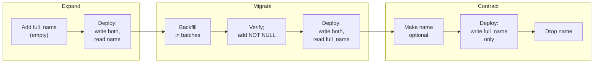

# 2.7 Changing schemas without downtime

[Syllabus](../SYLLABUS.md) · Phase 2 · Previous: [2.6 The database as a shared resource](06-database-as-shared-resource.md) · Next: 2.8 Choosing a datastore *(planned)*

> **Time:** about 50 minutes to read, 60 minutes of practice.
> **You need:** [Chapter 2.6](06-database-as-shared-resource.md) (the lock queue, `lock_timeout`), [Chapter 2.2](02-indexes-and-query-plans.md) (indexes) and [Chapter 2.5](05-data-modelling.md) (constraints), and a PostgreSQL for the examples — see [the phase overview](README.md).

**By the end of this chapter you can**

- say which schema changes take milliseconds and which lock a table for as long as it takes to rewrite or scan it;
- make the slow ones safe: build an index concurrently, add a constraint in two steps;
- explain why a change that takes one millisecond can still fail a third of your requests;
- carry out an incompatible change — a rename, a type change — with *expand, migrate, contract*;
- backfill a large table without hurting the application;
- review a migration and find what will go wrong.

---

## The problem

GoCardless, a payments company, described this in an engineering post: "A few months ago, we took around 15 seconds of unexpected API downtime during a planned database migration" ([Chris Sinjakli, *Zero-downtime Postgres migrations — the hard parts*](https://gocardless.com/blog/zero-downtime-postgres-migrations-the-hard-parts/)).

They were careful people making a small change. The migration recreated foreign keys on tables that were *empty* — "there would be no long-held lock taken to validate the constraints", as [the post](https://gocardless.com/blog/zero-downtime-postgres-migrations-the-hard-parts/) puts it. When they ran the same migration afterwards against a backup of the database, it "went through in a few hundred milliseconds".

What they had met was the lock queue of Chapter 2.6. A foreign key needs a lock on the table it points *to* as well, and that table was one of their busiest. In [their words](https://gocardless.com/blog/zero-downtime-postgres-migrations-the-hard-parts/): "An unfortunately timed, long-running read query on the parent table collided with the migration"; the statement "itself was fast to execute, but the effect of it waiting for an AccessExclusive lock on the referenced table caused the downtime - read/write queries issued by calls to our API piled up behind it, and clients timed out."

A schema is easy to change while nobody is using it. A production schema is always in use. This chapter is about changing it anyway.

---

## The concept

### 1. Two ways a schema change hurts

They are different problems with different cures, and a migration can have either or both.

- **It locks the table.** Either while it *waits* for its lock (the GoCardless incident, and Chapter 2.6) or while it *works* — rewriting or scanning every row with the table locked.
- **It is incompatible with the code that is running.** The table changes in an instant; the application does not. For a while, code written for the old schema runs against the new one, or the reverse.

Sections 2 and 3 deal with the first; sections 4 to 6 with the second.

### 2. What a change locks, and for how long

The starting point is in the manual for `ALTER TABLE`: "An ACCESS EXCLUSIVE lock is acquired unless explicitly noted" ([PostgreSQL docs](https://www.postgresql.org/docs/current/sql-altertable.html)). That is the lock that conflicts with everything, including a plain `SELECT`.

So the question for every change is *how long* it holds that lock. There are two cases.

**It changes only the table's description.** Milliseconds, whatever the size of the table. Adding a column is the important example: with a constant default, "the default value is evaluated at the time of the statement and the result stored in the table's metadata", which makes "the ALTER TABLE very fast even on large tables" ([same page](https://www.postgresql.org/docs/current/sql-altertable.html)). Dropping a column is the same: it "does not physically remove the column, but simply makes it invisible to SQL operations".

**It has to touch every row.** Then the lock is held for as long as that takes — which grows with the table — and there are two reasons it might:

- *A rewrite.* "Changing the type of an existing column will normally cause the entire table and its indexes to be rewritten", and so will adding a column "with a volatile DEFAULT (e.g., clock_timestamp())" — one that must be computed separately for each row ([same page](https://www.postgresql.org/docs/current/sql-altertable.html)).
- *A scan to check.* A new constraint must be verified against every existing row.

For each slow change there is a way to do the same thing without holding the lock while the work is done.

| You want | The blocking way | The safe way |
|---|---|---|
| A new column | — (already fast, unless the default is volatile) | Add it empty; set the default afterwards; backfill in batches (section 6) |
| A different column type | `ALTER COLUMN … TYPE` (rewrite) | A new column, and expand–migrate–contract (section 5) |
| An index | `CREATE INDEX` (blocks writes) | `CREATE INDEX CONCURRENTLY` |
| A `CHECK` or foreign key | `ADD CONSTRAINT` (scan) | `ADD CONSTRAINT … NOT VALID`, then `VALIDATE CONSTRAINT` |
| `NOT NULL` | `SET NOT NULL` (scan) | A `CHECK (… IS NOT NULL)` added the safe way, then `SET NOT NULL` |
| A unique constraint | `ADD CONSTRAINT … UNIQUE` (builds an index) | `CREATE UNIQUE INDEX CONCURRENTLY`, then `ADD CONSTRAINT … USING INDEX` |

The first example below measures most of these pairs. Some of them need a few words.

**`CREATE INDEX CONCURRENTLY`.** An ordinary index build "locks out writes (but not reads) on the table until it's done". With `CONCURRENTLY`, PostgreSQL builds the index while writes continue; in exchange it "must perform two scans of the table, and in addition it must wait for all existing transactions that could potentially modify or use the index to terminate", so it "requires more total work than a standard index build and takes significantly longer to complete" ([PostgreSQL docs, `CREATE INDEX`](https://www.postgresql.org/docs/current/sql-createindex.html)). Two consequences to know. It cannot run inside a transaction, which matters if your migration tool wraps every migration in one. And if the build runs into a problem part-way, the command "will fail but leave behind an 'invalid' index", which is ignored by queries but still slows down every write. The manual's advice: "The recommended recovery method in such cases is to drop the index and try again".

**`NOT VALID`, then `VALIDATE`.** The trick is to split *enforce this from now on* from *check what is already there*. [The manual](https://www.postgresql.org/docs/current/sql-altertable.html): "With NOT VALID, the ADD CONSTRAINT command does not scan the table and can be committed immediately." New and changed rows are checked from that moment. Then `VALIDATE CONSTRAINT` checks the old rows, and "does not need to lock out concurrent updates, since it knows that other transactions will be enforcing the constraint for rows that they insert or update; only pre-existing rows need to be checked."

**`NOT NULL`.** `SET NOT NULL` normally scans the table under the exclusive lock. But "if a valid CHECK constraint exists (and is not dropped in the same command) which proves no NULL can exist, then the table scan is skipped" ([same page](https://www.postgresql.org/docs/current/sql-altertable.html)). So: add `CHECK (col IS NOT NULL)` the two-step way, then `SET NOT NULL` — which is now instant — then drop the check.

**A unique constraint** follows the same idea. Build the unique index concurrently, then attach it: there is a form of `ADD CONSTRAINT` that "adds a new PRIMARY KEY or UNIQUE constraint to a table based on an existing unique index" ([same page](https://www.postgresql.org/docs/current/sql-altertable.html)).

> **Versions matter.** These rules change from release to release, usually for the better. Adding a column with a constant default rewrote the whole table until PostgreSQL 11 ("Allow ALTER TABLE to add a column with a non-null default without doing a table rewrite" — [release notes](https://www.postgresql.org/docs/11/release-11.html)), and the `NOT NULL` shortcut arrived in version 12 ([release notes](https://www.postgresql.org/docs/12/release-12.html)). Advice written for an older version may be out of date, in either direction. When in doubt, measure on a copy — the first example shows how.

### 3. Getting the lock: timeouts and short transactions

Every change in the "safe" column still needs a strong lock for a moment. Chapter 2.6 showed what happens if that moment is spent waiting behind a long transaction: every query on the table queues behind the migration.

Two rules follow, and the GoCardless post gives both.

**Set a lock timeout, and retry.** "Set lock_timeout in your migration scripts to a pause your app can tolerate. It's better to abort a deploy than take your application down" ([GoCardless](https://gocardless.com/blog/zero-downtime-postgres-migrations-the-hard-parts/)). A migration that waits at most two seconds, gives up, and tries again a minute later costs users a brief pause at worst.

**One change per transaction.** A lock does not end when its statement does: "Once acquired, a lock is normally held until the end of the transaction" ([PostgreSQL docs, *Explicit Locking*](https://www.postgresql.org/docs/current/explicit-locking.html)). A migration file that runs a quick `ALTER TABLE` and then a slow data update in one transaction holds the `ALTER TABLE`'s exclusive lock for the whole update. Hence [GoCardless's](https://gocardless.com/blog/zero-downtime-postgres-migrations-the-hard-parts/) advice: "Split your schema changes up. Problems become easier to diagnose. Transactions around DDL are shorter, so locks aren't held so long." (*DDL*, data definition language, is the family of statements that change the schema.)

### 4. Two versions of the code, one schema

Now the second problem. Suppose a column must be renamed, from `name` to `full_name`. In PostgreSQL the rename takes about a millisecond. It is still an outage.

The reason is that a deploy is not an instant. Instances are replaced a few at a time, so that the service stays up:

```text
            time ─────────────────────────────────────────►
instance 1   old   NEW   NEW   NEW   NEW
instance 2   old   old   NEW   NEW   NEW
instance 3   old   old   old   NEW   NEW
instance 4   old   old   old   old   NEW
                   └───────┬───────┘
          old and new code are both serving requests
```

During that window both versions talk to the same database. Rename the column *before* the deploy, and the old code — still serving most requests — asks for a column that no longer exists. Rename it *after*, and the new code asks for a column that does not exist yet. **No ordering works**, because the change is not compatible with both versions and both versions are running. The second example below counts the damage: about half of the requests made during the deploy fail, whichever order is chosen.

And the window is longer than a deploy. If the new version turns out to have a bug, you roll back — and then the *old* code must work with the *new* schema, perhaps for hours.

So the rule for a live system is stricter than "the migration works":

> **Every schema change must be compatible with the code that is running now and the code that will run next.**

Adding things is compatible: old code ignores a column it has never heard of. Removing, renaming and retyping are not. For those there is a standard technique.

### 5. Expand, migrate, contract

The idea is to never make an incompatible change — to replace it with a sequence of compatible ones. Its usual name comes from an article on Martin Fowler's site: "Parallel change, also known as expand and contract, is a pattern to implement backward-incompatible changes to an interface in a safe manner, by breaking the change into three distinct phases: expand, migrate, and contract" ([Danilo Sato, *ParallelChange*](https://martinfowler.com/bliki/ParallelChange.html)). A table's columns are an interface, and the application is its client.

For the rename:



- **Expand.** Add the new column, empty. Nothing uses it; nothing breaks. Then deploy code that writes *both* columns on every insert and update, and still reads the old one. From here on, new data is correct in both places.
- **Migrate.** Copy the old values into the new column for the rows that existed before (the *backfill*). Check that the two columns agree everywhere. Then deploy code that reads the new column — while still writing both, so that rolling back to the previous version is safe.
- **Contract.** Make the old column optional (drop its `NOT NULL`), so that code which no longer writes it can still insert rows. Deploy code that no longer mentions the old column. When no instance of the earlier code is left — and you are sure you will not roll back to it — drop the column.

Every step is compatible with the code before it and the code after it. One risky deploy has become three dull ones, and each can be paused or rolled back.

The same shape works at any size. Stripe moved its subscriptions data to a new table this way and describes "a common 4 step dual writing pattern": "Dual writing to the existing and new tables to keep them in sync", then "Changing all read paths in our codebase to read from the new table", then "Changing all write paths in our codebase to only write to the new table", and finally "Removing old data that relies on the outdated data model" ([Stripe, *Online migrations at scale*](https://stripe.com/blog/online-migrations)).

**A trap in the middle.** While the "write both" code is being deployed, old instances are still running. If a new instance updates a row (both columns), and then an old instance updates the same row (old column only), the new column is left holding an *out-of-date* value — not an empty one. A backfill that only fills in empty values will miss it. So:

- the backfill must run after every instance writes both columns, and must fix rows where the columns *differ*, not only rows where the new one is empty;
- verify, with a query, that no differences remain *before* any code reads the new column.

The second example hits this: a handful of rows are out of date after the deploy, and the backfill's condition decides whether they are repaired.

### 6. Backfilling without hurting anyone

A backfill is an `UPDATE` of every row in a large table, and done as one statement it is its own outage: a single enormous transaction that holds a row lock on everything it has touched, doubles the table with dead row versions (Chapter 2.1), and floods the write-ahead log.

Do it in **batches**:

- a few thousand rows at a time, by primary-key range, each batch in its own transaction, so that locks are held for milliseconds;
- with a short pause between batches, so that the application's own work — and vacuum, and replicas (Chapter 3.6) — can keep up;
- written so that it can be stopped and restarted at any point, and run twice without harm;
- run as a separate job, not inside the migration that changed the schema (section 3).

### 7. Other databases

The two problems are universal; the details are not. MySQL's InnoDB documents which changes it can make in place: "The online DDL feature provides support for instant and in-place table alterations and concurrent DML" ([MySQL manual, *InnoDB and Online DDL*](https://dev.mysql.com/doc/refman/8.4/en/innodb-online-ddl.html)). For changes it cannot, tools such as GitHub's gh-ost apply expand–migrate–contract to a whole table: "they create a ghost table, in the likeness of your original table, migrate that table while empty, slowly and incrementally copy data from your original table to the ghost table, meanwhile propagating ongoing changes", and at the end replace "your original table with the ghost table" ([GitHub, *gh-ost*](https://github.blog/news-insights/company-news/gh-ost-github-s-online-migration-tool-for-mysql/)).

---

## A real example

### Run it: what each change blocks

[`code/ch07-locks/main.go`](code/ch07-locks/main.go) builds a table of three million orders. While each schema change runs, one connection keeps reading the table and another keeps writing to it, and the program records the longest that any single read or write had to wait.

```bash
go run ./phase-2-data/code/ch07-locks
```

```text
  schema change                                                  took      longest      longest
                                                                         read wait   write wait

  Adding a column
  ADD COLUMN c1 text                                           1.8 ms       1.4 ms       3.4 ms
  ADD COLUMN c2 text NOT NULL DEFAULT 'new'                    1.5 ms       1.4 ms       3.1 ms
  ADD COLUMN c3 timestamptz DEFAULT clock_timestamp()           3.8 s        3.6 s        3.6 s

  Changing a column's type
  ALTER COLUMN amount TYPE bigint                               3.8 s        3.7 s        3.7 s

  Adding an index
  CREATE INDEX                                                  1.0 s       4.5 ms        1.0 s
  CREATE INDEX CONCURRENTLY                                     1.7 s       2.5 ms        20 ms

  Adding a CHECK constraint
  ADD CONSTRAINT ... CHECK (amount >= 0)                       213 ms       211 ms       214 ms
  ADD CONSTRAINT ... NOT VALID, then VALIDATE CONSTRAINT       207 ms       3.3 ms       4.7 ms

  Making a column NOT NULL
  ALTER COLUMN customer_id SET NOT NULL                        285 ms       283 ms       284 ms
  CHECK (... IS NOT NULL) NOT VALID, VALIDATE, SET NOT NULL    214 ms       1.9 ms       4.4 ms

  Adding a foreign key
  ADD FOREIGN KEY (customer_id) REFERENCES sc_customers        572 ms       6.3 ms       571 ms
  ADD FOREIGN KEY ... NOT VALID, then VALIDATE CONSTRAINT      587 ms       2.2 ms       2.6 ms

  A change that blocks nothing can still break a running query
    an application connection runs:   SELECT * FROM sc_orders WHERE id = $1
    before the change:                ok, 8 columns
    ALTER TABLE sc_orders ADD COLUMN c4 text
    the same query, first time after: ERROR: cached plan must not change result type (SQLSTATE 0A000)
    the same query, second time:      ok, 9 columns
```

(PostgreSQL 16; the timings are from one machine and will differ on yours. The pattern will not.)

Read the two right-hand columns. A few milliseconds means nobody noticed. Anything larger is how long the table was unavailable.

- **Adding a column** is free, with or without a constant default. With a volatile default — here `clock_timestamp()`; `gen_random_uuid()` behaves the same — it rewrites three million rows, and for 3.6 seconds nobody can read or write the table.
- **Changing a type** is another rewrite: 3.7 seconds of nothing.
- **`CREATE INDEX`** never delays a read, and blocks every write for the whole second it runs. `CONCURRENTLY` takes 1.7 seconds instead of 1.0, and the longest write waits 20 ms.
- **Constraints.** The one-step form holds everyone up for the length of the scan. The two-step form takes the same total time — the scan still happens — but nobody waits. That is the whole lesson of section 2: the work does not get smaller; it stops being done under the lock.
- **The foreign key** blocks writes and not reads. That is weaker than the lock [GoCardless](https://gocardless.com/blog/zero-downtime-postgres-migrations-the-hard-parts/) described: [today's manual](https://www.postgresql.org/docs/current/sql-altertable.html) says "ADD FOREIGN KEY requires only a SHARE ROW EXCLUSIVE lock", on both tables. Their advice to "Keep Postgres up to date" was sound — though a queued migration that blocks every write to a busy table is still an outage.

Scale these in your head. This table has three million narrow rows. The rewrite took 3.8 seconds; with a hundred times the rows, at the same rate, it is more than six minutes of complete unavailability.

**The last part** is a different kind of failure. Adding a column blocks nothing — and one query still failed. Many database drivers — pgx among them, by default — prepare a statement the first time a connection runs it and reuse it afterwards. When the *shape of the result* changes underneath it, as it does for `SELECT *` when a column is added or dropped, the server refuses to reuse the old statement. The pgx documentation warns of exactly this: "the first execution of a previously cached query may fail", for instance when "the number of columns returned by a 'SELECT *' changes or the type of a column is changed" ([pgx, `QueryExecMode`](https://pkg.go.dev/github.com/jackc/pgx/v5#QueryExecMode)). One failure per connection, on every instance, at the moment of the migration. The cure is an old rule with a new reason: **name your columns; do not `SELECT *`.**

### Run it: renaming a column under traffic

[`code/ch07-expand-contract/main.go`](code/ch07-expand-contract/main.go) runs eight "instances" of an application against a `users` table — reading names, changing them, signing users up — and renames `name` to `full_name` three ways. A deploy replaces the instances one at a time, 100 ms apart.

```bash
go run ./phase-2-data/code/ch07-expand-contract
```

```text
WAY 1 — rename the column, then deploy the new code
  step                                                              took   requests   failed
  ALTER TABLE ... RENAME COLUMN name TO full_name                 0.5 ms          0        0
  rolling deploy: v1 (uses name) -> v4 (uses full_name)           802 ms       2208      995
  => 995 of 3803 requests failed, for example:
     ERROR: column "name" of relation "sc_users" does not exist (SQLSTATE 42703)

WAY 2 — deploy the new code, then rename the column
  step                                                              took   requests   failed
  rolling deploy: v1 (uses name) -> v4 (uses full_name)           805 ms       2205     1275
  ALTER TABLE ... RENAME COLUMN name TO full_name                 1.6 ms          3        3
  => 1278 of 3737 requests failed, for example:
     ERROR: column "full_name" of relation "sc_users" does not exist (SQLSTATE 42703)

WAY 3 — expand, migrate, contract
  step                                                              took   requests   failed
  expand:   ADD COLUMN full_name text                             2.0 ms          7        0
  deploy:   v2 — write both columns, read name                    801 ms       2140        0
            (full_name is missing in 199992 rows and out of date in 7)
  migrate:  backfill full_name in batches of 10,000 rows          987 ms       2496        0
            (rows where full_name differs from name: 0)
  migrate:  make full_name NOT NULL, without a long lock           22 ms         54        0
  deploy:   v3 — write both columns, read full_name               802 ms       2128        0
  contract: ALTER COLUMN name DROP NOT NULL                       2.0 ms          7        0
  deploy:   v4 — write and read full_name only                    801 ms       2226        0
  contract: DROP COLUMN name                                      1.0 ms          0        0
  => 0 of 10783 requests failed
```

(Counts vary a little from run to run.)

**Ways 1 and 2.** The rename itself took about a millisecond. About half of the requests made during the deploy failed anyway — 995 of 2,208 one way, 1,275 of 2,205 the other — and this deploy lasted under a second, where a real one lasts minutes. Which requests fail depends on the order; that some fail does not.

**Way 3.** Eight steps, none of them exciting, and no failed requests. Three details:

- *Out of date in 7 rows* is the trap from section 5, caught in the act: seven rows were updated by a new instance and then again by an old one during the deploy. The backfill repairs them because its condition is `full_name IS DISTINCT FROM name`. Run the program with `-backfill-only-empty` to see the common mistake: the backfill fills only empty values, the check reports that a row still differs, nothing fails — and once reads switch, that user sees an old name come back.
- *`NOT NULL` is added the safe way* from section 2, in 22 ms, with the application running.
- *The old column loses its `NOT NULL` before the last deploy.* Code that no longer mentions `name` cannot insert a row while `name` is required. Forgetting this is the usual way a contract step fails.

The schema changes go through a small helper worth copying. Its connection has `lock_timeout` set to two seconds; if a statement cannot get its lock in that time, the helper waits and tries again.

```go
func migrate(conn *pgx.Conn, sql string) {
	for attempt := 1; ; attempt++ {
		_, err := conn.Exec(bg, sql)
		if err == nil {
			return
		}
		var pgErr *pgconn.PgError
		if errors.As(err, &pgErr) && pgErr.Code == "55P03" && attempt < 10 { // lock_not_available
			time.Sleep(time.Duration(attempt) * 200 * time.Millisecond)
			continue
		}
		log.Fatalf("%s: %v", sql, err)
	}
}
```

---

## Trade-offs

**Safe is slower and longer.** One migration and one deploy become several of each, spread over hours or days. A concurrent index build does more work than a plain one. For a large, busy table that price is obviously right. For a table of ten thousand rows, where any change takes milliseconds, the blocking forms in section 2 are fine — though the *compatibility* rule of section 4 applies at any size.

**Sometimes a maintenance window is the honest answer.** GoCardless end their post with it: "Some sites get by just fine putting up a maintenance page for the 30 seconds it takes to deploy" ([same post](https://gocardless.com/blog/zero-downtime-postgres-migrations-the-hard-parts/)). Zero-downtime changes are a cost you pay for a requirement. Check that you have the requirement.

**Dual writes are temporary complexity, and temporary things linger.** Between expand and contract, the code is harder to read and the table holds two copies of the truth. The danger is stopping halfway: a migration abandoned after "migrate" leaves two columns for ever, and the next engineer cannot tell which one is real. Plan the contract step when you plan the expand, and track it to the end.

**Is the change worth making?** A rename is the clearest case. If the only benefit is a nicer column name, three deploys and a backfill may be a poor trade — the application can map a good name onto the old column in one place. Save the full procedure for changes that matter: types that are too small, columns that must be split, tables that must move.

**A fast backfill competes with users.** Bigger batches and shorter pauses finish sooner and take more of the database while they run. Start gently and watch the application's latency, not the backfill's progress.

---

## Practice

### Check yourself

Answer before reading on.

1. A migration runs `ALTER TABLE events ADD COLUMN public_id uuid NOT NULL DEFAULT gen_random_uuid()` on a table of 500 million rows. What happens to the application, and how would you get the same result safely?
2. Your migration tool runs each migration file inside one transaction. A file contains `ALTER TABLE orders ADD COLUMN region text;` followed by `UPDATE orders SET region = 'eu';` on 80 million rows. Neither statement is slow to *start*. What does the application experience?
3. Someone proposes making a column rename safe by putting the application into "maintenance mode" for the 200 ms it takes to run the rename and restart the instances. What is right about this idea, and what does it not cover?

<details>
<summary>Answers</summary>

1. `gen_random_uuid()` is volatile — a different value for each row — so the statement rewrites all 500 million rows while holding an `ACCESS EXCLUSIVE` lock. Nobody can read or write `events` until it finishes; at the rate measured in this chapter that is many minutes at the very least. Safely: (a) `ADD COLUMN public_id uuid` — empty, instant; (b) `ALTER COLUMN public_id SET DEFAULT gen_random_uuid()` — which affects only future rows: "The new default value will only apply in subsequent INSERT or UPDATE commands; it does not cause rows already in the table to change" ([PostgreSQL docs](https://www.postgresql.org/docs/current/sql-altertable.html)); (c) backfill the existing rows in batches; (d) add `NOT NULL` through a validated `CHECK`. On the test machine, steps (a) and (b) took under a millisecond each on a two-million-row table that the one-statement form took 3.6 seconds to rewrite.

2. The `ALTER TABLE` takes an `ACCESS EXCLUSIVE` lock and keeps it until the transaction commits — that is, until the `UPDATE` of 80 million rows has finished. For all of that time no query can touch `orders`: it is a complete outage of everything that uses the table, caused by two statements that are each reasonable alone. The update is also one enormous transaction (section 6). The fix: the `ALTER TABLE` in its own migration; the data change as a batched backfill, outside it.

3. What is right: if the old and new code never run at the same time, the incompatibility never shows. A short, announced stop is a legitimate choice (see Trade-offs). What it does not cover: requests in flight when the switch happens; the time instances really take to restart; and, above all, rollback. If the new version misbehaves an hour later, the old code cannot run against the renamed column, so the "200 ms" window has to be opened again, under pressure, to rename it back. Expand–migrate–contract keeps the previous version runnable at every step.

</details>

### Exercise: review a migration

`orders` has 300 million rows and takes about 1,500 writes per second. The application runs on 20 instances, deployed a few at a time. The migration tool runs each file in one transaction. A colleague opens a pull request with this migration, together with the code changes that use the new columns and names:

```sql
ALTER TABLE orders ADD COLUMN region text NOT NULL DEFAULT 'eu';
ALTER TABLE orders ADD COLUMN public_id uuid NOT NULL DEFAULT gen_random_uuid();
UPDATE orders o SET region = c.region FROM customers c WHERE c.id = o.customer_id;
CREATE INDEX orders_region_idx ON orders (region);
ALTER TABLE orders ADD CONSTRAINT orders_customer_fk
    FOREIGN KEY (customer_id) REFERENCES customers (id);
ALTER TABLE orders RENAME COLUMN total TO total_cents;
ALTER TABLE orders DROP COLUMN legacy_status;
```

1. For each statement, say what it will do to the running application.
2. Say what is wrong with the file as a whole.
3. Rewrite it as a plan: an ordered list of small migrations, backfills and deploys.

<details>
<summary>Worked solution</summary>

**1. Statement by statement.**

| Statement | On its own |
|---|---|
| `ADD COLUMN region … DEFAULT 'eu'` | Harmless: a constant default is stored in the table's description. Milliseconds. |
| `ADD COLUMN public_id … DEFAULT gen_random_uuid()` | A volatile default: rewrites 300 million rows under an exclusive lock. No reads, no writes, for the duration. |
| `UPDATE orders … FROM customers` | Updates every row in one transaction: every row locked until commit, the table doubled with dead versions, a flood of write-ahead log. |
| `CREATE INDEX` | Blocks all writes to `orders` while the index is built. |
| `ADD CONSTRAINT … FOREIGN KEY` | Scans `orders` to check every row; blocks writes to `orders` *and* to `customers` meanwhile. |
| `RENAME COLUMN total` | Instant — and every instance still running the old code fails on every query that mentions `total`. |
| `DROP COLUMN legacy_status` | Instant — and the same for old code that reads or writes it. Cached `SELECT *` statements fail once per connection as well. |

**2. The file as a whole.**

- **One transaction.** The first statement's exclusive lock is held to the end. `orders` is unavailable for the entire run — the rewrite, the 300-million-row update, the index build and the foreign-key scan added together. The individual effects in the table above hardly matter: the first line already locks everybody out until the last line is done.
- **No lock timeout.** If any long query is running on `orders` or `customers` when it starts, the migration queues, and everything queues behind it (Chapter 2.6).
- **Schema changes, a data change, and incompatible changes in one step with the code.** There is no moment at which this file can run that suits both the old code and the new.
- **All or nothing.** If the foreign key fails after an hour — one orphaned row is enough — everything rolls back, and the hour of downtime bought nothing.

**3. A plan.** Every migration below is its own transaction, runs with a `lock_timeout`, and is retried if it times out.

| # | Step | Why it is safe |
|---|---|---|
| 1 | `ADD COLUMN region text` and `ADD COLUMN public_id uuid` — both empty. Then `ALTER COLUMN public_id SET DEFAULT gen_random_uuid()`. | Description only. The default applies to new rows; nothing is rewritten. |
| 2 | **Deploy:** code that sets `region` on every new order. It does not read the new columns yet. | Old code ignores the columns; new code fills them. |
| 3 | **Backfill** `region` (from `customers`) and `public_id`, a few thousand rows per transaction, by primary-key range, with pauses. | Short locks; restartable; watch latency and replica lag. |
| 4 | `NOT NULL` on both: `ADD CONSTRAINT … CHECK (… IS NOT NULL) NOT VALID`; `VALIDATE CONSTRAINT`; `SET NOT NULL`; drop the check. | The scan runs without blocking; `SET NOT NULL` is then instant. |
| 5 | `CREATE INDEX CONCURRENTLY orders_region_idx …` — outside a transaction. Check afterwards that the index is not marked invalid. | Writes continue during the build. |
| 6 | `ADD CONSTRAINT orders_customer_fk … NOT VALID`, then, separately, `VALIDATE CONSTRAINT`. | New rows are checked at once; old rows are checked without blocking writes. If validation finds orphans, fix them and validate again. |
| 7 | **Deploy:** code that reads `region` and `public_id`. | The data is complete and the constraints are in place. |
| 8 | **Deploy:** code that no longer reads or writes `legacy_status`, and names its columns instead of `SELECT *`. Wait until no older instance remains and a rollback is no longer likely. | Stop using before removing. |
| 9 | `ALTER TABLE orders DROP COLUMN legacy_status`. | Nothing refers to it. |

**And the rename?** Ask first whether it is worth doing. `total` → `total_cents` is a real improvement — the name now says what the number means — but done properly it is the whole of section 5: add `total_cents`, write both, backfill, verify, switch reads, stop writing `total`, drop it. That is three more deploys and another backfill. A reasonable review comment is: *leave the column, and rename it in the application's mapping layer*; or, if the team wants the rename, make it a separate project after this one has landed.

Seven lines became nine steps and at least three deploys. That is what the change always cost. The original file simply charged it to the users.

</details>

---

## Production tips and common mistakes

**Tips**

- **Set `lock_timeout` on every migration**, and build retries into the tool.
- **One schema change per migration, one migration per transaction.** Keep data changes out of schema migrations.
- **Know what each statement locks before you run it.** If you are not sure, run it against a production-sized copy with a read and a write probe, as the first example does.
- **Build indexes concurrently**, and check for an invalid index if the build fails.
- **Add constraints with `NOT VALID`, then validate.**
- **Add before you use; stop using before you remove.** Every schema state must work with the previous version of the code and the next.
- **Backfill in small batches**, as a restartable job, watching the application's latency.
- **Verify before switching reads**: a query that counts the rows where old and new disagree, and returns zero.
- **Name columns in queries.** `SELECT *` turns every added or dropped column into a failed request.
- **Finish.** Schedule the contract step when you start the expand step.
- **Rehearse on real volumes.** A migration that takes 50 ms on a developer's laptop tells you nothing about one on 300 million rows.

**Common mistakes**

- **Testing a migration on an empty or tiny database** and concluding that it is fast.
- **Renaming or dropping a column in the same deploy as the code change.**
- **A volatile default** — `gen_random_uuid()`, `clock_timestamp()` — on a new column of a big table.
- **A schema change and a full-table `UPDATE` in one transaction.**
- **`CREATE INDEX` without `CONCURRENTLY`** on a table that takes writes; or `CONCURRENTLY` inside a transaction, where it is refused.
- **Leaving an invalid index behind** after a failed concurrent build, slowing every write for nothing.
- **A backfill that only fills empty values**, missing the rows that old code overwrote during the deploy.
- **Switching reads before the backfill is verified.**
- **Dropping the old column as soon as the new code is out**, leaving no way to roll back.
- **Forgetting the old column's `NOT NULL`**, so the first insert from the final version of the code fails.
- **Trusting advice without checking the version it was written for.**

---

## Key takeaways

- A schema change can hurt in two ways: by locking the table, and by being incompatible with code that is still running. They need different cures.
- Most `ALTER TABLE` forms take the strongest lock. What matters is how long: milliseconds if only the table's description changes, the full duration if rows must be rewritten or scanned.
- For each slow change there is a form that does the same work without holding the lock: `CREATE INDEX CONCURRENTLY`; `NOT VALID` then `VALIDATE`; a validated `CHECK` before `SET NOT NULL`.
- Even a fast change must get its lock. Use a lock timeout and retries, and keep each change in its own short transaction.
- During a deploy, and after a rollback, two versions of the code share one schema. Additions are compatible; renames, removals and type changes are not.
- Make incompatible changes as expand, migrate, contract: add the new, write both, backfill and verify, switch reads, stop writing the old, remove it.
- Backfill in small restartable batches, and fix rows that differ, not only rows that are empty.

**Next:** 2.8 Choosing a datastore *(planned)* — what relational, key-value, document, wide-column, search and analytical stores are each built for.

---

## Sources

- Chris Sinjakli, [*Zero-downtime Postgres migrations — the hard parts*](https://gocardless.com/blog/zero-downtime-postgres-migrations-the-hard-parts/), GoCardless engineering blog.
- PostgreSQL documentation: [ALTER TABLE](https://www.postgresql.org/docs/current/sql-altertable.html) (lock levels, rewrites, `NOT VALID`, `SET NOT NULL`); [CREATE INDEX](https://www.postgresql.org/docs/current/sql-createindex.html) (*Building Indexes Concurrently*); [Explicit Locking](https://www.postgresql.org/docs/current/explicit-locking.html); release notes for [version 11](https://www.postgresql.org/docs/11/release-11.html) and [version 12](https://www.postgresql.org/docs/12/release-12.html).
- Danilo Sato, [*ParallelChange*](https://martinfowler.com/bliki/ParallelChange.html), martinfowler.com, 2014.
- Stripe, [*Online migrations at scale*](https://stripe.com/blog/online-migrations).
- pgx documentation: [`QueryExecMode`](https://pkg.go.dev/github.com/jackc/pgx/v5#QueryExecMode) (cached statements and schema changes).
- MySQL 8.4 Reference Manual: [*InnoDB and Online DDL*](https://dev.mysql.com/doc/refman/8.4/en/innodb-online-ddl.html).
- Shlomi Noach, [*gh-ost: GitHub's online schema migration tool for MySQL*](https://github.blog/news-insights/company-news/gh-ost-github-s-online-migration-tool-for-mysql/), GitHub blog, 2016.
