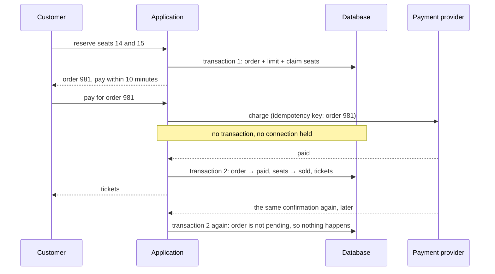

# Capstone 2: ticket booking — never sell the same seat twice

[Syllabus](../SYLLABUS.md) · Phase 2 · Previous: [2.9 Durability, backups, and restore](09-durability-backups-restore.md)

> **Time:** three hours for your own design, then an hour and a half with the worked design.
> **You need:** all of Phase 2, and from Phase 1 the chapters on idempotency (1.5) and pools (1.6). Nothing from later phases.

Phase 1's capstone ended with a list of what breaks first, and most of the list was about data. This capstone is the answer for one machine: a system whose whole difficulty is *correctness under concurrency*. Thousands of people want the same few seats in the same few seconds; each seat may be sold once; money is involved.

It uses every chapter of the phase: a schema whose constraints make the worst mistake impossible (2.5), transactions that claim seats atomically (2.3, 2.4), indexes for the queries that matter (2.2), limits that keep one database serving twenty application instances (2.6), a schema change on the live system (2.7), a decision about which stores to use (2.8), and a plan for getting the data back (2.9).

**How to use this page**

1. Read the brief.
2. Write your own design, on paper, against the task list. Give yourself a time limit.
3. Only then open the worked design and compare, section by section.
4. Run the reference implementation — and its deliberately broken variants.

---

## The brief

*From your product manager:*

> We are building the booking system for a ticketing company.
>
> **What it must do**
> - Each event takes place in a venue with numbered seats. Customers see a seat map and choose specific seats.
> - A customer may have at most **6 seats per event**.
> - After choosing, the customer has **10 minutes** to pay. If they do not, the seats go back on sale.
> - Payment is taken by an outside provider. It usually answers in one to three seconds. It sometimes fails. It sometimes tells us about the same payment twice, and occasionally tells us minutes late.
> - A customer who has paid gets one ticket per seat, each with a code that is scanned at the door.
>
> **How much**
> - About **3,000 events a year**, averaging 4,000 seats. The largest venue has 60,000.
> - On an ordinary day, a few orders a second. When a popular event goes on sale, expect **2,000 attempts to reserve seats per second** and **10,000 seat-map views per second** for the first ten minutes.
> - Records are kept for **7 years**.
>
> **How well**
> - **Never two tickets for one seat.** Never a ticket without a payment. Never a payment without either a ticket or a refund.
> - Reserving seats: 99% within 300 ms at our server, during an on-sale.
> - A confirmed sale must survive the loss of a server. After a mistake that damages data, we may lose at most 5 minutes and must be running again within 4 hours.
>
> **Constraints**
> - One PostgreSQL database. Add another datastore only with a reason you can defend.
> - The application runs on 20 instances.
>
> **Six months after launch**
> - Marketing will want to price seats by *tier* — a block of seats sharing a price that can be changed — instead of a fixed price per seat. The change must be made on the live system.

---

## Your task

Produce a design document of three or four pages. The suggested times add up to about three hours.

| # | Deliverable | Draws on | Time |
|---|---|---|---|
| 1 | Questions for the product manager; and the **invariants** — the statements that must be true at every moment | 2.3, 2.5 | 15 min |
| 2 | Estimates: rows, storage, request rates | 1.1, 2.1 | 15 min |
| 3 | The schema: tables, keys, types, constraints. Mark the constraint that makes a double sale impossible | 2.5 | 30 min |
| 4 | Reserving seats: the exact SQL, and why two customers cannot both get the same seat | 2.3, 2.4 | 25 min |
| 5 | Paying: the steps, what is inside a transaction and what is not, and what happens when the provider is slow, repeats itself, or is late | 1.5, 1.6, 2.4 | 20 min |
| 6 | How unpaid seats return to sale | 2.4 | 10 min |
| 7 | How the limit of six is enforced when one customer sends two requests at once | 2.3, 2.4 | 10 min |
| 8 | The isolation level, with a reason | 2.3 | 5 min |
| 9 | Indexes: each one, and the query it serves | 2.2 | 10 min |
| 10 | Roles, pools and timeouts for 20 instances and one database | 2.6 | 10 min |
| 11 | The price-tier migration, step by step | 2.7 | 15 min |
| 12 | Which datastores, and why not more | 2.8 | 5 min |
| 13 | Durability and recovery, against the brief's numbers | 2.9 | 10 min |
| 14 | **What breaks first as it grows — in order** | all | 10 min |

Two rules, as before:

- **Every number has a source**: the brief, arithmetic you show, or an assumption you label.
- **Choose.** Pick an option, give the reason, and name what you gave up.

And one more for this capstone:

- **For every guarantee, say which layer enforces it.** "The application checks" is the weakest answer. A constraint in the database is the strongest.

---

## Worked design

<details>
<summary><strong>Open only after writing your own.</strong></summary>

### 1. Questions and invariants

Questions worth asking before designing, with the answers assumed here:

| Question | Assumed answer |
|---|---|
| If a payment arrives after the 10 minutes, but the seats are still free? | Honour it. The customer paid; nobody else wants the seats. |
| …and if someone else has taken them? | Refund automatically, and say so. |
| Does the limit of six count seats being held, or only seats bought? | Both. Otherwise one customer holds sixty. |
| May a customer choose seats that leave a single empty seat between groups? | Yes, for now. (A real system has rules for this.) |
| Is the price fixed when the seats are reserved, or when they are paid for? | When reserved. A price change must not alter what a customer has already been shown. |
| Can tickets be cancelled or transferred? | Not in version one. |

**The invariants.** These are what the design exists to protect. Each is written so that a query can check it — the reference implementation runs exactly these checks after its stress test.

1. A seat has at most one ticket.
2. Every ticket belongs to a paid order, and every paid order has exactly the tickets for its seats.
3. The total of paid orders equals the total of tickets issued.
4. A seat is held by at most one order at a time, and no hold outlives its expiry.
5. No customer has more than six seats for an event, held and bought together.
6. Every payment taken leads to tickets or to a refund.

### 2. Estimates

**Rows.** 3,000 events × 4,000 seats = **12 million seat rows a year**; 84 million in seven years. If an order averages 2.5 seats, that is about 5 million orders a year. Tickets are at most one per seat.

**Storage.** A seat row measured about 60 bytes in the table and 40 in its indexes on the test database: roughly 100 bytes. 84 million × 100 bytes ≈ **8 GB**. Tickets and orders are the same order of magnitude. The whole database is a few tens of gigabytes after seven years: it fits in the memory of one ordinary server.

**Rates.** An ordinary day is nothing. An on-sale is 2,000 reservation attempts and 10,000 seat-map views a second — for one event, which means for one small set of rows.

So the estimate says what Phase 2 has been saying all along: **this is not a big-data problem. It is a contention problem.** All the difficulty is in a few thousand rows that everyone wants at once.

### 3. The schema

Five tables. The full definitions are at the top of the reference implementation; the parts that carry the design are these.

```sql
CREATE TABLE seats (                         -- one row per seat per event: the thing being sold
    event_id    bigint NOT NULL REFERENCES events,
    seat_no     int    NOT NULL,
    section     int    NOT NULL,
    price_cents int    NOT NULL CHECK (price_cents >= 0),
    status      text   NOT NULL DEFAULT 'available' CHECK (status IN ('available', 'held', 'sold')),
    order_id    bigint REFERENCES orders,
    held_until  timestamptz,
    PRIMARY KEY (event_id, seat_no),
    CHECK ((status = 'available') = (order_id IS NULL)),     -- a taken seat always says who took it
    CHECK ((status = 'held') = (held_until IS NOT NULL))     -- a hold always has an end
);

CREATE TABLE tickets (
    id          uuid PRIMARY KEY DEFAULT gen_random_uuid(),
    order_id    bigint NOT NULL REFERENCES orders,
    event_id    bigint NOT NULL,
    seat_no     int    NOT NULL,
    price_cents int    NOT NULL,                             -- the price paid, copied at the sale
    CONSTRAINT one_ticket_per_seat UNIQUE (event_id, seat_no),
    FOREIGN KEY (event_id, seat_no) REFERENCES seats
);

CREATE TABLE customer_limits (
    event_id    bigint NOT NULL,
    customer_id bigint NOT NULL,
    seats       int    NOT NULL CHECK (seats BETWEEN 0 AND 6),
    PRIMARY KEY (event_id, customer_id)
);
```

`orders` has a status (`pending`, `paid`, `expired`, `refund_due`), an expiry time, `UNIQUE (customer_id, idempotency_key)` and `UNIQUE (payment_ref)`.

Decisions, each from Chapter 2.5:

- **The seat's state lives on the seat row.** There is one row per thing being sold, so the question *who has this seat?* is answered by one row, under one row lock.
- **`one_ticket_per_seat` is the invariant, as a constraint.** Whatever the application does — a bug, a race, a hand-typed `INSERT` — a second ticket for a seat is refused by the database. Everything else in the design is about never *reaching* this constraint; the constraint is there for the day something else fails.
- **The two `CHECK`s tie the columns together**, so that a row cannot say "available" and name an order, or "held" without an end.
- **Money is integer cents; times are `timestamptz`.**
- **The ticket's ID is a random UUID on purpose.** It is the code printed on the ticket, so it must not be guessable. That costs something on insert (Chapter 2.5 measured it) and is worth it here. Orders, which are internal, use an ordinary `bigint`.
- **A ticket stores the price paid.** The seat's price can change later; what the customer paid cannot.

### 4. Reserving seats

The whole act is one transaction with three steps: record the order, count the seats against the customer's limit (section 7), and claim the seats. The claim is one statement:

```sql
UPDATE seats
SET    status = 'held', order_id = $1, held_until = now() + interval '10 minutes'
WHERE  event_id = $2 AND seat_no = ANY ($3)
AND    (status = 'available' OR (status = 'held' AND held_until < now()))
RETURNING price_cents;
```

If it returns as many rows as seats were asked for, the customer has them all, and the transaction commits. If it returns fewer, the transaction is rolled back and nothing has changed: no partial reservations.

**Why two customers cannot both get seat 14.** Both run this statement at the same instant. One of them reaches the row first and locks it. The other waits. When the first commits, the second does not act on what it saw earlier — under Read Committed, "The search condition of the command (the WHERE clause) is re-evaluated to see if the updated version of the row still matches the search condition" ([PostgreSQL docs](https://www.postgresql.org/docs/current/transaction-iso.html)). The row now says `held`, the condition is false, and the second customer gets one row fewer than they asked for. This is Chapter 2.4's first rule — put the check and the change in *one statement* — and there is no moment at which the check is true and the change has not yet happened.

The version that does not work is the natural one: `SELECT` the seats, see that they are free, then `UPDATE` them. Chapter 2.4 called it check-then-act. The reference implementation includes it, to show what it does.

**A retried request.** The app sends an idempotency key with each attempt (Chapter 1.5). The order is inserted with `ON CONFLICT (customer_id, idempotency_key) DO NOTHING`; if nothing was inserted, this is a retry, and the original order is returned. A customer on a bad connection who taps twice gets one reservation.

**Deadlocks.** Two reservations with overlapping seats could each lock one seat and wait for the other. Every transaction in the design therefore takes its locks in the same order — order, then the customer's limit row, then seats — and there is still a retry for the case the database reports anyway (Chapter 2.4). In the stress test the retry was never needed.

### 5. Paying



Three rules shape this.

**The provider is called outside any transaction.** A call that takes one to three seconds, inside a transaction, holds a database connection and row locks for that long; Chapter 1.6 showed what that does to capacity, and Chapter 2.6 what it does to everyone else. So there are two short transactions with the slow call between them.

**The charge carries an idempotency key** — the order ID — so that if *our* call to the provider is retried, the customer is charged once (Chapter 1.5).

**Confirming is idempotent, and decided by one conditional update:**

```sql
UPDATE orders SET status = 'paid', payment_ref = $2
WHERE  id = $1 AND status = 'pending'
RETURNING event_id, customer_id, seat_count;
```

- One row returned: this is the first confirmation. In the same transaction the order's seats go from `held` to `sold`, and the tickets are inserted.
- No row returned: the order was not pending. Either it is already paid — a duplicate confirmation, ignored — or it had expired, and the order is marked `refund_due`.

The awkward case is a payment that arrives after the ten minutes. The seat rows decide: `UPDATE seats SET status = 'sold' WHERE order_id = $1 AND status = 'held'`. If that changes as many rows as the order has seats, the seats are still this order's, and the late payment is honoured. If it changes fewer, someone else has taken one; the transaction gives back the rest and marks the order `refund_due`. Either way invariant 6 holds: the payment led to tickets or to a refund.

Two more things a real system needs here, named and not built: a job that actually issues the refunds marked `refund_due`; and a **reconciliation** job that asks the provider about orders still pending after their expiry — because a confirmation can be lost altogether, and then the only record of the payment is the provider's.

### 6. Returning unpaid seats to sale

Look again at the claim in section 4: a seat can be taken if it is available **or if its hold has run out**. Expiry is part of the condition, evaluated at the moment of the claim.

That means no clean-up job has to run for a lapsed seat to be sold again, and no job can race with a payment. A background *sweeper* still runs every few seconds — it marks lapsed orders `expired`, tidies their seat rows, and returns the seats to the customer's allowance — but **correctness does not depend on it**. If the sweeper is down for an hour, lapsed orders are not yet marked as such, and some customers cannot use their full allowance. No seat is sold twice and none is stuck.

The seat map applies the same rule when it reads: a seat that is `held` with `held_until` in the past is shown as available.

The sweeper and a late payment can reach the same order at the same moment. Both begin with a conditional update on the order row (`… WHERE status = 'pending'`), so one of them wins the row lock and the other finds the order no longer pending. This is the same mechanism as section 4, applied to a different row.

### 7. The limit of six

The natural code counts the customer's seats, checks that the count plus the new seats is at most six, and inserts. Two requests from the same customer, at the same moment, both count four, both add three, and the customer has ten. Chapter 2.3 called this write skew: each transaction read a state that the other was about to change.

The fix is to give the rule a row of its own, and a constraint:

```sql
INSERT INTO customer_limits (event_id, customer_id, seats) VALUES ($1, $2, $3)
ON CONFLICT (event_id, customer_id) DO UPDATE SET seats = customer_limits.seats + EXCLUDED.seats;
```

with `CHECK (seats BETWEEN 0 AND 6)` on the table. The statement is atomic — "ON CONFLICT DO UPDATE guarantees an atomic INSERT or UPDATE outcome; provided there is no independent error, one of those two outcomes is guaranteed, even under high concurrency" ([PostgreSQL docs](https://www.postgresql.org/docs/current/sql-insert.html)) — the two requests queue on the row, and the second one's update violates the `CHECK` and is refused. This is the pattern of Chapter 2.4's coupon exercise: turn a rule about *several* rows into a constraint on *one*.

The count goes down again when an order expires or is refunded.

### 8. Isolation level

**Read Committed**, PostgreSQL's default.

Every decision in this design is made by a single statement that locks the row it is deciding about and re-checks its condition (sections 4, 5, 6), or by a constraint (sections 3, 7). Nothing reads rows in one statement and relies on them in a later one. That is exactly the situation in which Read Committed is sufficient (Chapter 2.3).

Serializable would also be correct, and would have made the naive limit check safe without the extra table. Its price is aborted transactions that must be retried, and during an on-sale — when almost every transaction touches the same rows — there would be a great many. Where the conflicts are known in advance and few in kind, explicit row locks are cheaper.

### 9. Indexes

| Index | Serves | Notes |
|---|---|---|
| `seats (event_id, seat_no)` — the primary key | Claiming seats | The claim finds its three or four rows directly. |
| `seats (event_id, section)` | The seat map | One section is a few hundred rows. Status is deliberately *not* in the index: it changes constantly, and an index on it would be rewritten with every reservation (Chapter 2.2). |
| `seats (order_id) WHERE order_id IS NOT NULL` | *The seats of this order*, at payment and expiry; and the foreign key | Partial: seats that nobody has taken are not in it. |
| `orders (expires_at) WHERE status = 'pending'` | The sweeper | Partial: of millions of orders, only the pending ones are in it. |
| `orders (customer_id, idempotency_key)` — unique | Retries | The constraint is also the index. |
| `tickets (event_id, seat_no)` — unique | Invariant 1 | The constraint is also the index. |
| `tickets (order_id)` | "My tickets"; the foreign key | Chapter 2.5: index your foreign keys. |

The reference implementation prints the plans. Each query uses the index intended for it, on 500,000 seat rows:

```text
The seat map of one section (500 of 500,000 rows)
  Index Scan using tk_seats_by_section on tk_seats (actual rows=500 loops=1)
    Index Cond: ((event_id = 42) AND (section = 3))

Claiming three seats
  Update on tk_seats (actual rows=0 loops=1)
    ->  Index Scan using tk_seats_pkey on tk_seats (actual rows=3 loops=1)
          Index Cond: ((event_id = 42) AND (seat_no = ANY ('{1501,1502,1503}'::integer[])))
          Filter: ((status = 'available'::text) OR ((status = 'held'::text) AND (held_until < now())))
  Trigger for constraint tk_seats_order_id_fkey: calls=3

The sweeper: pending orders whose hold has run out
  Limit (actual rows=18 loops=1)
    ->  Index Scan using tk_orders_to_expire on tk_orders (actual rows=18 loops=1)
          Index Cond: (expires_at < now())
```

### 10. One database, twenty instances

Following Chapter 2.6.

**Roles.** `booking` for the application; `sweeper` for the background job; `reporting`, pointed at the standby; `migrator`; and named roles for engineers. The application's role cannot `DROP` or `TRUNCATE`, and is not a superuser.

**Timeouts**, set on the roles:

| Role | `statement_timeout` | `lock_timeout` | `idle_in_transaction_session_timeout` |
|---|---|---|---|
| `booking` | 2 s | 1 s | 5 s |
| `sweeper` | 10 s | 2 s | 10 s |
| `reporting` | 5 min | 5 s | 5 min |
| `migrator` | none | 2 s | 60 s |

A reservation that waits a full second for a seat's lock is better refused: the customer can pick again, and the queue behind it clears.

**Pools.** A reservation takes about 5 ms in the stress test below. By Little's law, 2,000 a second × 0.005 s = **10 connections busy on average**. Twenty instances with a pool of 4 each make 80 connections — eight times the average need, which leaves room for bursts. Seat-map reads get a *separate* pool of 2 per instance, so that 10,000 views a second can never use up the connections that reservations need (the bulkhead of Chapter 2.6). That is 120, plus the sweeper, migrations, monitoring and people: about 140. PostgreSQL's default limit is 100, so `max_connections` is set to 200 here — acceptable because nearly all of those connections are idle at any moment; it is the *busy* ones that must stay few (Chapter 1.6). Beyond twenty instances, put a pooler in front rather than raising the limit again.

**Reports** never run on the primary. They go to the standby, or to nightly extracts.

### 11. The migration: price tiers

The change: prices move from `seats.price_cents` to a new `price_tiers` table, and each seat points at a tier. `seats` has millions of rows and is in constant use. Following Chapter 2.7, every step is compatible with the code before it and after it, every schema statement runs with a `lock_timeout` and a retry, and no step rewrites or scans the table under a lock.

| # | Step | Safe because |
|---|---|---|
| 1 | `CREATE TABLE price_tiers (event_id, tier_id, name, price_cents, PRIMARY KEY (event_id, tier_id))` | A new table; nothing uses it. |
| 2 | `ALTER TABLE seats ADD COLUMN tier_id int` | Empty column: only the table's description changes. |
| 3 | **Deploy:** new events are created with tiers; changing a tier's price also updates `price_cents` on its seats, in the same transaction. Reads still use `seats.price_cents`. | Both representations are written; the old one is still the truth. |
| 4 | **Backfill** existing events: one tier per distinct price; set `tier_id` on their seats, a section at a time, each in its own transaction, with pauses. Events currently on sale go last, at a quiet hour. | Short row locks, a few hundred rows at a time; a reservation waits milliseconds at most. |
| 5 | **Verify:** no seat without a tier; no seat whose price differs from its tier's. Both queries must return zero. | Reads have not switched yet. |
| 6 | Add the foreign key `NOT VALID`, then `VALIDATE`. Add `CHECK (tier_id IS NOT NULL) NOT VALID`, `VALIDATE`, then `SET NOT NULL`, then drop the check. | The scans run without blocking writes. |
| 7 | **Deploy:** the seat map and the reservation read the price from the tier. `seats.price_cents` is still written. | Rolling back to the previous version is still safe. |
| 8 | **Deploy:** stop writing `seats.price_cents`, after `ALTER COLUMN price_cents DROP NOT NULL`. Some weeks later, drop the column. | Nothing reads it. |

Two things are untouched throughout, by design: an order's `total_cents` is fixed when the seats are reserved, and a ticket's `price_cents` when it is sold. A tier's price can change at any moment without altering what anyone has been quoted or has paid.

### 12. Which datastores

**PostgreSQL, and nothing else, for everything in the brief.** The data is relational, small, and needs transactions across orders, seats and tickets; this is the case Chapter 2.8 called the default. A second system of record for any part of it would put a boundary through the middle of invariants 1 to 6.

Two additions are defensible, and neither holds the truth:

- **Object storage** for anything that is a file — rendered ticket PDFs, venue maps — with its key in a row.
- **A cache for the seat map** (Phase 3), once measurements ask for it. It is derived data: thrown away and rebuilt from the database at any time, and never consulted when deciding whether a seat can be sold.

### 13. Durability and recovery

Against the brief, using Chapter 2.9.

| Requirement | Mechanism |
|---|---|
| A confirmed sale survives a crash | `synchronous_commit = on` (the default). Never relaxed for these tables. |
| A confirmed sale survives the loss of a server | A standby in another zone, replicated **synchronously**, so that a sale is confirmed only once it is on two machines (Chapter 5.1 covers how, and what it costs). |
| At most 5 minutes lost after a damaging mistake | Continuous WAL archiving with `archive_timeout` of one minute; a base backup every night. |
| Running again within 4 hours | The database is tens of gigabytes: a restore should take well under an hour. A weekly automated restore drill measures that, and alerts if it fails or does not run. |
| Seven years of records | Monthly logical dumps kept for seven years, in a second region and account, protected from deletion. |

**A scenario to think through.** A bug in the sweeper marks 3,000 *sold* seats as available at 14:02. It is noticed at 14:20. What has happened, and what do you do?

Follow it through the design. Customers see those seats as free and reserve them: the claim succeeds, because the seat rows say `available`. They pay. Then the confirmation tries to insert tickets — and `one_ticket_per_seat` refuses, because the original tickets were never touched. The sale is rolled back and the order is marked `refund_due`. **Nobody holds a second ticket for a sold seat.** The damage is some disappointed customers and refunds, not two people arriving for one seat. Step 9 of the reference implementation's demo plays this out for one seat.

The repair needs no restore of production, because the tickets table is intact and it is the record of what was sold: every seat that has a ticket should be `sold` to that ticket's order. One `UPDATE` joined to `tickets` puts the seat rows right. (The reference implementation does this for a seat the moment the constraint refuses a sale on it.) A copy restored to 14:01 on a side server (Chapter 2.9) is the independent check that the repair is complete. Then find the bug, and write the postmortem.

That is the argument for the constraint in section 3. The application code in sections 4 to 6 is believed to be correct. The constraint is what holds when that belief turns out to be wrong.

### 14. What breaks first

In order, as the system grows — and where the course picks each one up.

1. **The seat map.** 10,000 views a second, each reading 500 rows, is about one processor core of the database (the query measured 0.1 ms) plus the traffic — spent on data that could be a second old. It is the first thing to cache (Chapter 3.3), and the first to move to a replica (Chapter 3.6).
2. **The crowd itself.** In the stress test, nine out of ten reservation attempts were refused because the seats had gone. Each refusal still cost a transaction. When half a million people arrive for 60,000 seats, the database should not be what says no: admission control — a waiting room, rate limits, load shedding — belongs in front of it (Chapters 4.1 and 6.4).
3. **Customers fighting over the same seats.** Random choices collide. Offering "best available" seats, with `SKIP LOCKED` to step over seats someone else is taking (Chapter 2.4), wastes far fewer attempts.
4. **The payment provider.** When it slows down, holds pile up and expire; when it is down, nothing sells. Timeouts and a circuit breaker (Chapters 1.5 and 6.3), and the reconciliation job from section 5.
5. **Connections**, beyond twenty instances: a pooler (Chapter 2.6).
6. **The single primary.** Failover to the standby must be automatic, tested, and unable to promote a standby that is behind (Chapter 5.1).
7. **Seven years of rows in one table.** Past events are never updated. Partition `seats` and `tickets` by event date, or move finished events to cheaper storage (Chapter 5.3).

</details>

---

## Reference implementation

[`code/capstone-tickets/main.go`](code/capstone-tickets/main.go) is the worked design in about 750 lines of Go, of which the service itself — reserve, pay, sweep — is about 270. It needs PostgreSQL; see [the phase overview](README.md).

### Walk through every case

```bash
go run ./phase-2-data/code/capstone-tickets demo
```

```text
1. Ana holds seats 1 and 2
  order 1, total $240, error: <nil>
2. Ana's app retries the same request (same idempotency key)
  order 1 again, error: <nil>
3. Ben asks for seats 2 and 3 — seat 2 is Ana's
  error: one or more of those seats is no longer available
  seat 3 is available: Ben's request took nothing
4. Ana pays; the provider confirms twice
  first confirmation:  paid (error: <nil>)
  second confirmation: duplicate confirmation, ignored (error: <nil>)
  tickets issued for the order: 2
5. Ana tries for five more seats: that would make seven
  error: a customer may have at most six seats for an event
6. Cy holds seat 5 and walks away; half a second later Dee asks for it
  Dee gets order 6, error: <nil> — before any clean-up job has run
7. Cy's payment arrives after all
  refund due: a seat had gone (error: <nil>)
  Dee pays: paid; seat 5 is sold
8. Somebody tries to insert a second ticket for seat 1 by hand
  ERROR: duplicate key value violates unique constraint "one_ticket_per_seat" (SQLSTATE 23505)
9. A bug marks seat 1 — sold to Ana — as available. Eve reserves it and pays
  Eve gets order 7, error: <nil> — the seat row said the seat was free
  Eve pays: refund due: the seat was already sold (error: <nil>)
  tickets for seat 1: 1; the seat is sold again, to order 1
```

(The demo uses a hold of half a second instead of ten minutes.) Each numbered case is a section of the worked design: 2 is the retry in section 4; 3 is all-or-nothing; 4 is the idempotent confirmation; 5 is the limit; 6 is expiry without a sweeper; 7 is the late payment; 8 is the constraint; 9 is the scenario in section 13.

### Try to break it

`rush` puts one event of 5,000 seats on sale to 12,000 customers, 64 at a time. Customers pick one to four neighbouring seats at random, and try again elsewhere if refused. Seven in ten pay promptly — and one confirmation in ten is delivered twice, simultaneously. Some pay just as their hold runs out. Some walk away. A sweeper runs throughout. Holds last 400 ms, so that expiry happens thousands of times in a few seconds.

Then the program checks the invariants of section 1 with queries.

```bash
go run ./phase-2-data/code/capstone-tickets rush
```

```text
ON SALE: 5000 seats, 12000 customers, 64 at a time. A hold lasts 400ms; a payment takes 5 to 30 ms.

WHAT HAPPENED  (7.7 s)
  attempts to hold seats                                 31245
    refused: a seat was already taken                    27626
    refused: more than six seats for one customer          327
  orders paid, tickets issued                             2538
    of which paid after the hold ran out, seats kept       162
  holds abandoned, expired and released                    500
  paid too late, seats gone: refund due                    254
  paid, but the seat was already sold: refund due            0
  duplicate payment confirmations ignored                  225
  deadlocks retried                                          0
  time to hold seats                                   p50 5.2 ms, p99 12.5 ms

CHECKS
  seats sold (of 5,000)                                   4600
  seats with more than one ticket                            0
  tickets that do not belong to a paid order                 0
  paid orders without exactly their tickets                  0
  sold seats without a ticket                                0
  seats still held after every hold has run out              0
  customers with more than six seats                         0
  customers whose allowance does not match their tickets       0
  money: paid orders against tickets issued            $448370 against $448370  (equal)
```

(Counts vary from run to run; the checks do not.)

Every check is zero, and the money agrees to the cent. Some things to read in the upper half:

- **About 4,000 attempts a second**, on a four-core machine that was also running the database and the customers: twice the brief's on-sale rate. The 99th percentile, 12.5 ms, is far inside the 300 ms objective — at this size. The honest capacity test is the one in Capstone 1: raise the rate until the objective breaks.
- **27,626 refusals for 2,538 sales.** Most attempts lose a race for seats. That is item 2 of *what breaks first*, measured.
- **225 duplicate confirmations, all ignored; 254 late payments, all marked for refund.** Neither produced a ticket it should not have.
- **No deadlocks**, with every transaction taking locks in the same order.
- 400 seats were left unsold: with customers choosing at random, the last gaps are hard to hit. A real system would steer customers to them.

Now replace the one-statement claim with the code that reads first and writes afterwards:

```bash
go run ./phase-2-data/code/capstone-tickets rush -naive
```

```text
  paid, but the seat was already sold: refund due           17
  ...
  seats with more than one ticket                            0
```

Seventeen customers reserved seats that someone else was reserving at the same instant, were charged — and at the last step the constraint refused their tickets. Nobody has two tickets for a seat, and every other check still passes. Seventeen people are owed a refund and an apology. And with the constraint removed as well:

```bash
go run ./phase-2-data/code/capstone-tickets rush -naive -no-constraint
```

```text
  seats with more than one ticket                           20
```

Twenty seats sold twice, out of five thousand, in eight seconds. Nothing failed, no error was logged, and the money adds up. This is the bug that passes every test and is found at the door of the venue.

Three runs, three layers: the correct statement makes the race impossible; the constraint makes its consequence impossible; with neither, the system quietly does the one thing it must never do.

---

## Review your own design

Check your design against these. Each is a mistake that an experienced reviewer would look for.

- [ ] Is there a **database constraint** that makes two tickets for one seat impossible, whatever the code does?
- [ ] Is a seat claimed by **one statement** that both checks and changes it — or by a lock taken before the check? If your design reads the seat and then writes it, where is the lock?
- [ ] Is reserving several seats **all or nothing**?
- [ ] Is the payment provider called **outside** a database transaction?
- [ ] What happens when a payment is confirmed **twice**? **Late**? **Never**?
- [ ] Can an unpaid seat be resold **without** a background job having run? If expiry depends on a job, what happens when the job is slow?
- [ ] Does the limit of six hold when one customer sends **two requests at once**?
- [ ] Did you choose an isolation level and say **why** it is enough?
- [ ] Is every index there for a **named query**? Is there an index on a column that changes with every reservation?
- [ ] Do the application's connections have **timeouts**, and are seat-map reads prevented from starving reservations?
- [ ] Is every step of the migration compatible with the code **before and after** it? Does any step scan or rewrite the table under a lock?
- [ ] Does anything outside PostgreSQL hold data that cannot be **rebuilt** from it?
- [ ] Does the recovery plan cover a **mistake**, not only a broken disk? Has the restore been **timed**?
- [ ] Can you say what breaks **first**?

---

## Extensions

For more practice, extend your design — and, if you like, the reference implementation.

1. **Best available.** Add *give me four seats together, anywhere in section 3*, using `FOR UPDATE SKIP LOCKED` so that concurrent requests take different seats instead of colliding. Measure how the refusal rate changes.
2. **General admission.** Some events have no numbered seats, only a capacity. Model it. (It is Chapter 2.4's inventory problem; the interesting part is making both kinds of event fit one schema.)
3. **Cancellation.** A customer cancels and is refunded; the seat goes back on sale. Which invariants need rewording? What happens to the ticket row and to `one_ticket_per_seat`?
4. **Reconciliation.** Write the job that finds orders the provider says were paid but the database says are pending or expired, and repairs them. Make it safe to run twice.
5. **The migration, for real.** Carry out section 11 against the reference implementation's tables while `rush` is running, and count failed requests, as Chapter 2.7's example did.
6. **The drill.** Run Chapter 2.9's restore drill against this schema, with the scenario from section 13: flip sold seats to available, then repair them from the tickets table and from a point-in-time copy. Check that both give the same answer.

---

## Sources

This capstone applies the chapters of Phase 2, where the sources for each technique are given. The two documentation passages quoted directly:

- PostgreSQL documentation: [Transaction Isolation — Read Committed](https://www.postgresql.org/docs/current/transaction-iso.html) (how a waiting `UPDATE` re-checks its condition); [INSERT — `ON CONFLICT`](https://www.postgresql.org/docs/current/sql-insert.html).

All output shown was produced by the reference implementation on PostgreSQL 16.

**Next:** Phase 3 — Scaling out *(planned)*: load balancing, caching and read replicas — beginning with the first two items of this capstone's *what breaks first*.
