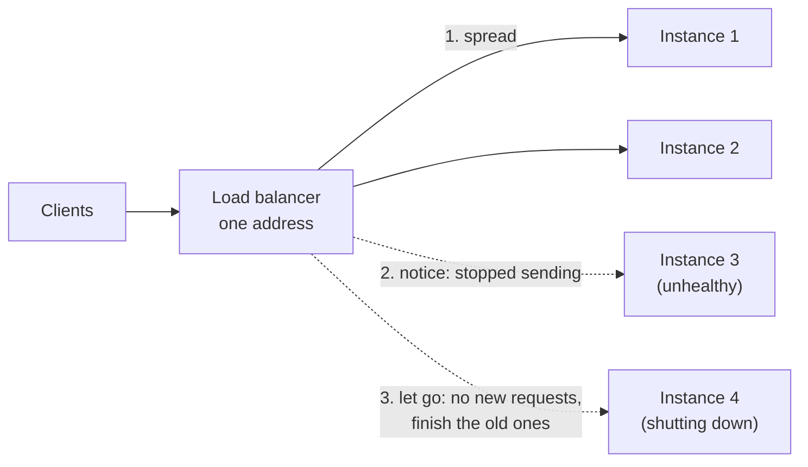
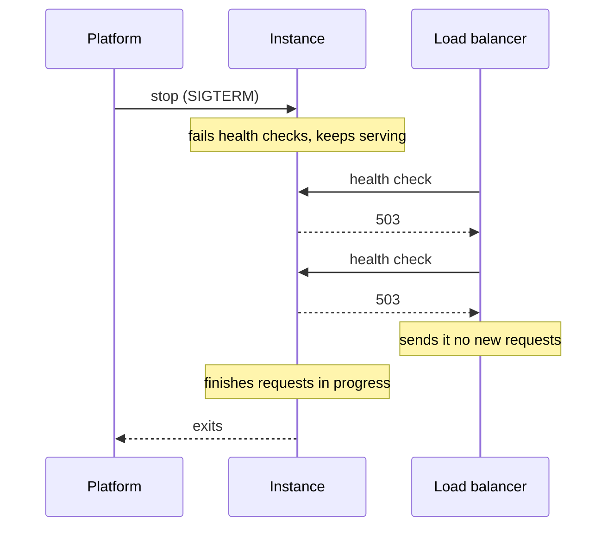

# 3.2 Load balancing

[Syllabus](../SYLLABUS.md) · Phase 3 · Previous: [3.1 Scaling up vs scaling out](01-stateless-services.md) · Next: [3.3 Caching patterns](03-caching-patterns.md)

> **Time:** about 45 minutes to read, 45 minutes of practice.
> **You need:** [Chapter 3.1](01-stateless-services.md), and from Phase 1 connections (1.2), timeouts and idempotency (1.5), and open-loop load (1.7). The examples are plain Go.

**By the end of this chapter you can**

- say what a load balancer does at layer 4 and at layer 7, and what each can and cannot see;
- choose a balancing policy, and explain when round robin goes wrong;
- design a health check that catches a hung instance without taking out every instance at once;
- work out, from the health-check settings, how long a failure goes unnoticed;
- stop an instance without dropping a single request;
- explain why long-lived connections defeat connection-level balancing, and what to do about it.

---

## The problem

*An illustrative scenario; the example below reproduces each part.* A service runs on three instances behind a load balancer. Two things keep happening.

One night, the third instance stops answering. It has not crashed: the process is running and its port is open. It accepts every request and never replies. The load balancer checks its instances by opening a connection to each — and a connection opens — so it goes on sending the instance a third of all traffic. For forty minutes, one request in three hangs until it times out, until somebody restarts the instance by hand.

And at every deploy there are "a few errors". Nobody worries, because there are only a few, until someone looks: each instance is being stopped in the middle of the requests it is working on.

Chapter 3.1 made instances interchangeable so that losing one, or replacing one, costs nothing. That is true only if something notices the loss and steers around it, and only if the replacement is done with care. That something is the load balancer — and the instances' cooperation with it.

---

## The concept

### 1. What a load balancer is for

A load balancer gives many instances one address, and does three jobs behind it:



1. **Spread** requests over the instances that can take them.
2. **Notice** an instance that cannot, and stop sending to it.
3. **Let go** of an instance that is leaving, without cutting off what it is doing.

Most trouble with load balancers is trouble with the second and third.

### 2. Layer 4 and layer 7

Load balancers come in two kinds, named after layers of the network model.

A **layer-4** balancer works with connections. In AWS's description of its own, it "functions at the fourth layer of the Open Systems Interconnection (OSI) model. It can handle millions of requests per second" ([Network Load Balancer](https://docs.aws.amazon.com/elasticloadbalancing/latest/network/introduction.html)). It picks an instance when a connection is opened and from then on passes bytes back and forth without reading them.

A **layer-7** balancer works with requests. It "functions at the application layer, the seventh layer" ([Application Load Balancer](https://docs.aws.amazon.com/elasticloadbalancing/latest/application/introduction.html)): it is itself an HTTP server, which reads each request and then makes a request of its own to an instance.

| | Layer 4 | Layer 7 |
|---|---|---|
| Balances | Connections | Requests |
| Understands | Addresses and ports | URLs, headers, cookies, status codes |
| Can route by | Nothing in the request | Path, host, header: `/api` to one service, `/images` to another |
| Can end TLS, retry a request, add headers | No | Yes |
| Cost per request | Very low | Parses and re-sends every request |

For a web service the choice is usually layer 7, because so much depends on seeing requests — NGINX, HAProxy and Envoy are the common ones to run yourself. Layer 4 is for raw speed and for protocols that are not HTTP, and often sits in front of a row of layer-7 balancers. Section 6 is about the one way layer 4 surprises people.

### 3. Choosing an instance

**Round robin** is the default nearly everywhere: each instance in turn. NGINX's documentation lists it first — "requests to the application servers are distributed in a round-robin fashion" — and notes that "When the load balancing method is not specifically configured, it defaults to round-robin" ([NGINX docs](https://nginx.org/en/docs/http/load_balancing.html)).

Round robin assumes that every instance is equally able and every request equally costly. When one instance is degraded — a noisy neighbour on its host, a slow disk, a cold cache after a restart — round robin goes on handing it its full share, and a queue builds on that instance alone.

**Least connections** fixes that with one piece of information the balancer already has: how many requests each instance is still working on. The "next request is assigned to the server with the least number of active connections" ([same page](https://nginx.org/en/docs/http/load_balancing.html)). Google's SRE book describes the same policy and why it works: "loaded tasks will tend to have higher latency than those with spare capacity, and this strategy will naturally take load away from these loaded tasks" ([*Site Reliability Engineering*, ch. 20](https://sre.google/sre-book/load-balancing-datacenter/)). A slow instance accumulates unanswered requests, so it looks busy, so it gets less.

[The same chapter](https://sre.google/sre-book/load-balancing-datacenter/) records the trap in it: "if a task is seriously unhealthy, it might start serving 100% errors. Depending on the nature of those errors, they may have very low latency". An instance that fails *instantly* always looks idle, and attracts more traffic than any healthy one. Least connections needs health checks beside it (section 4), and it should treat errors as a reason to avoid an instance.

Others, in a line each:

- **Two random choices**: pick two instances at random and send to the less busy of the pair ([Mitzenmacher, *The Power of Two Choices in Randomized Load Balancing*](https://www.eecs.harvard.edu/~michaelm/postscripts/tpds2001.pdf)). Its value shows when there are several balancers, each seeing only its own share of the traffic: it "is not as effective on a single load balancer, but it deftly avoids the bad-case 'herd behavior' that can occur when you scale out to a number of independent load balancers" ([NGINX blog](https://www.f5.com/company/blog/nginx/nginx-power-of-two-choices-load-balancing-algorithm)).
- **Weighted** versions of all of these, for instances of different sizes or a new version that should get 5% of traffic (Chapter 9.2).
- **Hashing** on something in the request, so that the same key always reaches the same instance — useful for caches (Chapter 5.3 covers doing it well). Not a substitute for moving session state out (Chapter 3.1).

### 4. Health checks

A balancer can learn that an instance is unwell in two ways.

- **Passively**, by watching real traffic. NGINX's built-in form: "If the response from a particular server fails with an error, nginx will mark this server as failed, and will try to avoid selecting this server for subsequent inbound requests for a while" ([NGINX docs](https://nginx.org/en/docs/http/load_balancing.html)). It costs nothing and reacts quickly — but only after real requests have failed.
- **Actively**, by sending a probe of its own every few seconds, whether or not there is traffic.

Three questions decide whether an active check is any good.

**What does it test?** Opening a connection tests that the operating system is accepting connections. It says nothing about the process behind it: a deadlocked or overloaded service still accepts them. An HTTP request to a health endpoint goes through the same server and the same worker pool as real requests, so if real requests would hang, so does the check.

**How deep should it go?** It is tempting to have the health endpoint check everything the service needs: the database, the cache, the payment provider. Consider what happens when the database is unreachable for twenty seconds. Every instance fails its check at the same moment; the balancer has nothing to send traffic to; and when the database returns, every instance must pass several checks before it is used again. A twenty-second blip has become a longer, total outage — including pages that never needed the database. AWS's balancer has a rule for exactly this: "If a target group contains only unhealthy registered targets, the load balancer routes requests to all those targets, regardless of their health status" ([AWS docs](https://docs.aws.amazon.com/elasticloadbalancing/latest/application/target-group-health-checks.html)).

The test for a health check is this: **it should fail only for a problem that taking *this instance* out of rotation would fix.** A hung process, a full disk, a failed start-up — yes. A dependency that every instance shares — no; that is a job for timeouts and fallbacks (Chapter 6.3), not for the load balancer.

**How long until it acts?** A check that runs every *interval* seconds and requires *n* failures in a row takes up to about *interval × n* seconds, plus the probe's timeout, to remove an instance. AWS's defaults make a useful example. For the interval between checks, "The default is 30 seconds"; and for "The number of consecutive failed health checks required before considering a target unhealthy … The default is 2" ([same page](https://docs.aws.amazon.com/elasticloadbalancing/latest/application/target-group-health-checks.html)). That is about a minute during which a dead instance receives its full share. Shorter intervals find failures sooner and are quicker to remove an instance for one slow response; requiring several successes before readmission stops an instance flapping in and out.

Container platforms split the question in two, and the split is worth keeping in mind anywhere. A *readiness* check asks whether to send traffic: "Readiness probes determine when a container is ready to accept traffic" ([Kubernetes docs](https://kubernetes.io/docs/concepts/workloads/pods/probes/)). A *liveness* check asks whether to restart the process. Failing readiness is cheap and reversible; failing liveness kills things. A service that is merely busy should fail the first and never the second.

### 5. Letting an instance go

Every deploy, every scale-down and every host replacement stops instances that are in the middle of requests. Stopping one cleanly takes cooperation from both sides.



1. **The instance is told to stop** and does not stop. It begins failing its health check, and carries on serving. Google's name for this state is *lame duck*: "The backend task is listening on its port and can serve, but is explicitly asking clients to stop sending requests" ([SRE book, ch. 20](https://sre.google/sre-book/load-balancing-datacenter/)).
2. **It waits for the balancer to notice** — at least *interval × n* from section 4. Requests keep arriving during this gap. An instance that shuts its door immediately refuses them.
3. **It finishes the requests in progress**, up to a deadline. Go's standard library has this built in: "Shutdown gracefully shuts down the server without interrupting any active connections. Shutdown works by first closing all open listeners, then closing all idle connections, and then waiting indefinitely for connections to return to idle and then shut down" ([`net/http`](https://pkg.go.dev/net/http#Server.Shutdown)).
4. **It exits.**

The balancer has its own half of the bargain, usually called *connection draining*. On AWS: "Elastic Load Balancing stops sending requests to targets that are deregistering. By default, Elastic Load Balancing waits 300 seconds before completing the deregistration process, which can help in-flight requests to the target to complete" ([AWS docs](https://docs.aws.amazon.com/elasticloadbalancing/latest/application/edit-target-group-attributes.html)).

The whole sequence has to fit inside whatever time the platform allows before it kills the process outright — on Kubernetes, "a term to terminate gracefully, which defaults to 30 seconds" ([Kubernetes docs](https://kubernetes.io/docs/concepts/workloads/pods/pod-lifecycle/)). The exercise below does that arithmetic.

Starting is the mirror image: a new instance should fail its health check until it can really serve — configuration loaded, connections open — so that the balancer does not send it requests it will drop.

### 6. Long-lived connections

Balancing connections is the same as balancing requests only if every connection carries about the same number of requests. Often they do not. Connections between services are kept open and reused (Chapter 1.2); HTTP/2 puts many requests on one connection at once. An article on the Kubernetes blog describes the result for gRPC, which is built on HTTP/2: it "breaks the standard connection-level load balancing, including what's provided by Kubernetes. This is because gRPC is built on HTTP/2, and HTTP/2 is designed to have a single long-lived TCP connection, across which all requests are multiplexed" ([William Morgan, *gRPC Load Balancing on Kubernetes without Tears*](https://kubernetes.io/blog/2018/11/07/grpc-load-balancing-on-kubernetes-without-tears/)).

Two symptoms follow, and the example shows both:

- **Uneven load.** Each instance has the same number of connections, but one busy client's connection carries far more than another's.
- **New instances stay idle.** Existing connections never move. You add capacity during a spike and it receives nothing.

The fixes: balance requests rather than connections (a layer-7 balancer, or a client that spreads its own requests over several instances — Chapter 9.6); or have servers close each connection after a certain age or number of requests, so that clients reconnect and are spread afresh.

### 7. The balancer itself

Everything now passes through one component, so it must not be one machine. Managed cloud balancers are built as redundant fleets; if you run your own, run at least two, with a way for clients to reach whichever is alive. Chapter 6.5 takes this up.

---

## A real example

### Run it: one balancer, four lessons

[`code/ch02-loadbalancer/main.go`](code/ch02-loadbalancer/main.go) contains a small layer-7 balancer (about a hundred lines), a layer-4 one (thirty), instances of a service whose behaviour can be changed while they run, and the open-loop load generator from Chapter 1.7. Each instance can work on eight requests at once.

```bash
go run ./phase-3-scaling-out/code/ch02-loadbalancer
```

**Part 1: a slow instance.**

```text
PART 1 — three instances; the third has become ten times slower (100 ms a request instead of 10)
         450 requests a second for 5 seconds; the balancer gives an instance 1 second to answer

  policy                     ok   failed       p50       p99   share answered by each instance
  round robin              1658      592     10 ms    904 ms   38% / 38% / 24%
  least connections        2250        0     10 ms    101 ms   47% / 46% / 6%
```

The slow instance can complete 80 requests a second (eight at a time, 100 ms each). Round robin sends it 150. The queue on that instance grows by 70 a second; within a few seconds its requests wait longer than the balancer's one-second timeout, and a quarter of *all* requests fail — while the other two instances are a fifth busy. Least connections sees the slow instance's unanswered requests pile up and sends it 6% of the traffic. Nothing fails, and the 99th percentile is one slow request, 101 ms.

The total capacity was the same in both rows. Round robin wasted it.

**Part 2: a hung instance.**

```text
PART 2 — three healthy instances; one second in, the third hangs: it accepts requests and never answers
         300 requests a second for 5 seconds; the balancer gives an instance 1 second to answer

  health check                             ok   failed   the hung instance stopped receiving requests after
  none                                   1100      400   never
  can a connection be opened?            1100      400   never
  does GET /healthz answer?              1469       31   316 ms
```

This is the forty-minute night from the top of the chapter, in five seconds. With a connection check the balancer is exactly as blind as with no check: 400 failures either way, every one of them a user waiting a full second for an error. The HTTP check fails twice, 100 ms apart, and the instance is out after 316 ms. The 31 failures are the requests sent to it in that window — which is *interval × n* made visible.

**Part 3: a deploy.**

```text
PART 3 — a deploy: each of three instances is restarted in turn, under 200 requests a second
         (a request takes 50 ms; the balancer checks health ten times a second)

  how an instance is stopped                                       ok   failed
  killed at once                                                 1168       32
  fails its health check, waits, finishes its requests, stops     1200        0
```

These are the few errors at every deploy. Killed at once, each instance takes with it the requests it was working on, and then refuses the ones the balancer goes on sending until its health check catches up. Stopped in the order of section 5, the same three restarts lose nothing.

**Part 4: long-lived connections.**

```text
PART 4 — nine clients, each with one long-lived connection; three of them are busy
         after two seconds a fourth instance is added

  the balancer forwards                        requests per instance, first 2 s   next 2 s, with a fourth instance
  connections (layer 4)                        1053 / 132 / 131                   1038 / 130 / 129 / 0
  requests (layer 7)                           431 / 432 / 432                    312 / 312 / 312 / 312
```

The layer-4 balancer did its job perfectly: three connections to each instance. But the three busy clients' connections all landed on the first instance — the program arranges that; in production it happens by chance, to a greater or lesser degree — and that instance is doing eight times the work of the others. And the fourth instance, added while they were running, received nothing at all — every connection had already been placed. The layer-7 balancer, deciding per request, is even in both columns.

### Run it: stopping without dropping

[`code/ch02-graceful/main.go`](code/ch02-graceful/main.go) is the instance's side of section 5, as a complete small server you can copy. The part that matters:

```go
ctx, stop := signal.NotifyContext(context.Background(), syscall.SIGTERM, syscall.SIGINT)
defer stop()
// ... start serving ...

<-ctx.Done()                    // told to stop
ready.Store(false)              // /healthz now answers 503; real requests are still served

time.Sleep(*notice)             // until the load balancer has noticed
shutdownCtx, cancel := context.WithTimeout(context.Background(), *deadline)
defer cancel()
srv.Shutdown(shutdownCtx)       // finish what is in progress, then stop
```

Run it, start a three-second request with `curl localhost:8080/slow`, and press Ctrl-C while it is running:

```text
serving on localhost:8080
told to stop: failing the health check, still serving
finishing requests in progress (up to 10s)
stopped
```

The health endpoint answers 503 from the second line onwards, and the slow request still completes.

---

## Trade-offs

**Layer 7 sees everything and costs more per request; layer 4 is cheap and blind.** For HTTP services the visibility is nearly always worth it. Where both are used, the layer-4 balancer in front must itself cope with long-lived connections to the layer-7 ones.

**Least connections is better than round robin whenever instances or requests are unequal — and worse if failures are fast.** Use it with health checks that catch an instance failing quickly, or the broken instance becomes the most popular.

**A fast health check finds failures sooner and makes more mistakes.** A two-second interval with two failures removes a dead instance in about five seconds — and removes a live one for a garbage-collection pause. Decide how long you can afford a third of requests to fail, and set the interval from that.

**A deep health check detects more and risks everything.** Each dependency added to the check is another way for all instances to become unhealthy together.

**Draining makes deploys slower.** Waiting for the balancer to notice, and then for requests to finish, adds perhaps twenty seconds for each instance. That is the price of the zero in Part 3; a rolling deploy of sixty instances has to be planned around it.

**Retrying at the balancer hides failures, and can repeat work.** A layer-7 balancer can send a failed request to another instance. That is safe when the request never reached the first instance, and for idempotent requests (Chapter 1.5). Retrying a `POST` that may already have run is how one click becomes two orders.

---

## Practice

### Check yourself

Answer before reading on.

1. A load balancer checks health every 30 seconds, with a 5-second timeout, and removes an instance after 2 failures in a row. One of four instances hangs at 12:00:00. Roughly when does it stop receiving traffic? What do users experience until then?
2. A service's health endpoint runs `SELECT 1` against the database. The database fails over, and is unreachable for 20 seconds. Describe what the load balancer does, and what users see, during and *after* those 20 seconds.
3. Service A calls service B over gRPC, through a layer-4 load balancer. During a spike, a fifth instance of B is added. Its CPU stays at zero. Why, and what are two ways to fix it?

<details>
<summary>Answers</summary>

1. The next check after 12:00:00 starts up to 30 seconds later and takes 5 seconds to time out. The second starts 30 seconds after the first and takes 5 more. So the instance is removed somewhere **between about 12:00:35 and 12:01:05**. Until then it receives a quarter of all requests under round robin, and each of those waits for whatever timeout the balancer or the client has, and then fails. Users see one request in four hang. Least connections would have sent it far fewer, since its unanswered requests pile up — a second reason to prefer it.

2. All instances fail their health checks at once — the database is shared. After two failed checks each, the balancer has no healthy instance, and what happens next depends on the balancer. Some refuse every request: then even pages that never touch the database are down, and they stay down **after** the database is back, until each instance has passed several checks in a row — five, by AWS's default, at 30-second intervals, which is minutes. A brief, partial problem has become a long, total one. Others, like AWS's, give up on health when nothing is healthy and send traffic to every instance: then the check did no harm, and no good. Either way it could not have helped, because removing instances does not repair a database. The fix is a health endpoint that reports only on the instance itself, and request handlers that cope with the database being unavailable.

3. gRPC keeps one long-lived HTTP/2 connection from each client to a server and sends every call down it. A layer-4 balancer places *connections*, and all of A's connections were placed before the fifth instance existed. Nothing ever moves them. Fixes: balance at layer 7, per request — a proxy that understands HTTP/2, or load balancing in the client itself; or make B's servers close each connection after a maximum age, so that clients reconnect every few minutes and are spread across whatever instances exist then.

</details>

### Exercise: a shutdown that fits

You own a service with six instances behind a layer-7 load balancer.

- The balancer checks `GET /healthz` every **5 seconds**, with a **2-second** timeout, and removes an instance after **2** failures in a row.
- Requests normally take under a second. A few — report downloads — take up to **8 seconds**.
- When the platform stops an instance, it sends `SIGTERM`, and kills the process **30 seconds** later if it is still running.
- Today the service exits as soon as it receives `SIGTERM`. Every deploy produces a burst of errors.

Design it properly:

1. What should `/healthz` check, and what should it not?
2. Write the shutdown sequence, with a time for each step. Does it fit in 30 seconds?
3. What changes if report downloads can take 40 seconds?
4. What should a *starting* instance do?
5. A rolling deploy replaces one instance at a time. How long does the whole deploy take?

<details>
<summary>Worked solution</summary>

**1. The health check.** It should answer through the normal HTTP server, so that it shares the fate of real requests, and report on *this instance*: it has finished starting; it is not shutting down; and, if you like, things local to it — disk space, its own worker pool not being exhausted. It should **not** call the database or other services (section 4): they are shared by all six instances, and a failure there must not empty the balancer.

**2. The sequence.**

| Step | What happens | Time |
|---|---|---|
| 1 | `SIGTERM` arrives. `/healthz` begins answering 503. Requests are still accepted and served. | 0 s |
| 2 | Wait for the balancer to notice. Worst case: the first failing check starts just under 5 s from now and the second 5 s after it; the balancer acts when the second one fails. Allow **12 s**. | 0 → 12 s |
| 3 | Stop accepting connections; let requests in progress finish. The longest is 8 s. Give them a **10 s** deadline. | 12 → 22 s |
| 4 | Close database connections, flush logs, exit. | 22 → 23 s |

Twenty-three seconds, inside the 30 with a margin. The code is the example's: fail the health check, sleep 12 seconds, `Shutdown` with a 10-second deadline.

The wait in step 2 feels wasteful, and it is the step most often left out. Without it, the instance closes its door while the balancer is still sending requests — which is the burst of errors at every deploy.

**3. Forty-second downloads.** 12 + 40 does not fit in 30. The choices: ask the platform for a longer grace period (60 seconds), which is fine if deploys can be that slow; or stop serving long work from request handlers at all — make the report a background job that the client polls for (Chapters 3.1 and 4.1), so that no request is long. The second is better, and it is the general rule: **a request that outlives a deploy is a design problem.**

**4. Starting.** `/healthz` answers 503 until the instance is ready: configuration loaded, database pool opened, any caches it needs warmed. Only then 200. The balancer then needs its required number of passing checks before sending traffic, so a new instance is in service perhaps 10 to 15 seconds after it starts — and the deploy must wait for that before stopping the next old instance.

**5. The whole deploy.** For each instance: about 23 seconds to stop the old one, a few seconds to start the new one, and 10 to 15 seconds until the balancer trusts it. Call it 45 seconds, six times: **four to five minutes**, with five of six instances serving throughout. That is the cost of dropping nothing. If it is too slow, replace two at a time — provided four instances can carry the load, which is a question for Chapter 9.7.

</details>

---

## Production tips and common mistakes

**Tips**

- **Balance requests, not connections**, for HTTP and gRPC traffic.
- **Prefer least connections (or two random choices) to round robin** unless instances and requests are truly uniform.
- **Health-check with a real HTTP request** to an endpoint served by the application itself.
- **Keep the health check about the instance.** Shared dependencies do not belong in it.
- **Know your detection time**: *interval × failures + timeout*. Decide whether you can live with it.
- **On `SIGTERM`: fail the health check, keep serving, wait, drain, exit.** Test it by deploying under load and counting errors. The number should be zero.
- **Fail the health check until start-up is complete.**
- **Give the balancer a timeout for each instance**, shorter than the client's (Chapter 1.5).
- **Limit the age of long-lived connections** where connection-level balancing is unavoidable.
- **Watch each instance's request rate and latency separately.** An average over all instances hides the one that is failing.

**Common mistakes**

- **A health check that only opens a connection.**
- **A health check that fails when the database is down**, taking every instance out together.
- **Exiting immediately on `SIGTERM`**, or closing the listener before the balancer has stopped sending.
- **No deadline on draining**, so that one stuck request blocks a deploy for ever — or a deadline shorter than the longest legitimate request.
- **Using the liveness check for load problems**, so that busy instances are killed and the rest become busier.
- **Round robin in front of instances of different sizes.**
- **Adding instances behind a layer-4 balancer and expecting existing connections to move.**
- **Retrying non-idempotent requests** at the balancer.
- **One load balancer**, on one machine.

---

## Key takeaways

- A load balancer spreads requests, notices instances that cannot serve, and lets departing instances finish. The last two are where the outages are.
- Layer 4 balances connections and cannot see requests. Layer 7 balances requests, and can route, retry and inspect them.
- Round robin wastes capacity when an instance is slow. Least connections steers away from it, but needs health checks so that a fast-failing instance is not rewarded.
- A health check should be a real request to the instance, should fail only for problems that removing that instance would fix, and takes about *interval × failures* to act.
- To stop an instance: fail the health check, keep serving until the balancer has noticed, finish the requests in progress, then exit.
- Long-lived connections make connection-level balancing uneven and leave new instances idle. Balance per request, or limit how long connections live.

**Next:** [3.3 Caching patterns](03-caching-patterns.md) — keeping the database from doing the same work again and again.

---

## Sources

- Betsy Beyer et al. (eds.), *Site Reliability Engineering*, O'Reilly, 2016 — chapter 20, [*Load Balancing in the Datacenter*](https://sre.google/sre-book/load-balancing-datacenter/).
- NGINX documentation: [*Using nginx as HTTP load balancer*](https://nginx.org/en/docs/http/load_balancing.html).
- AWS Elastic Load Balancing documentation: [Network Load Balancer](https://docs.aws.amazon.com/elasticloadbalancing/latest/network/introduction.html); [Application Load Balancer](https://docs.aws.amazon.com/elasticloadbalancing/latest/application/introduction.html); [health checks](https://docs.aws.amazon.com/elasticloadbalancing/latest/application/target-group-health-checks.html); [deregistration delay](https://docs.aws.amazon.com/elasticloadbalancing/latest/application/edit-target-group-attributes.html).
- Kubernetes documentation: [*Liveness, Readiness, and Startup Probes*](https://kubernetes.io/docs/concepts/workloads/pods/probes/); [*Pod Lifecycle*](https://kubernetes.io/docs/concepts/workloads/pods/pod-lifecycle/).
- William Morgan, [*gRPC Load Balancing on Kubernetes without Tears*](https://kubernetes.io/blog/2018/11/07/grpc-load-balancing-on-kubernetes-without-tears/), Kubernetes blog, 2018.
- Go standard library: [`net/http` — `Server.Shutdown`](https://pkg.go.dev/net/http#Server.Shutdown).
- Michael Mitzenmacher, [*The Power of Two Choices in Randomized Load Balancing*](https://www.eecs.harvard.edu/~michaelm/postscripts/tpds2001.pdf), IEEE Transactions on Parallel and Distributed Systems, 2001.
