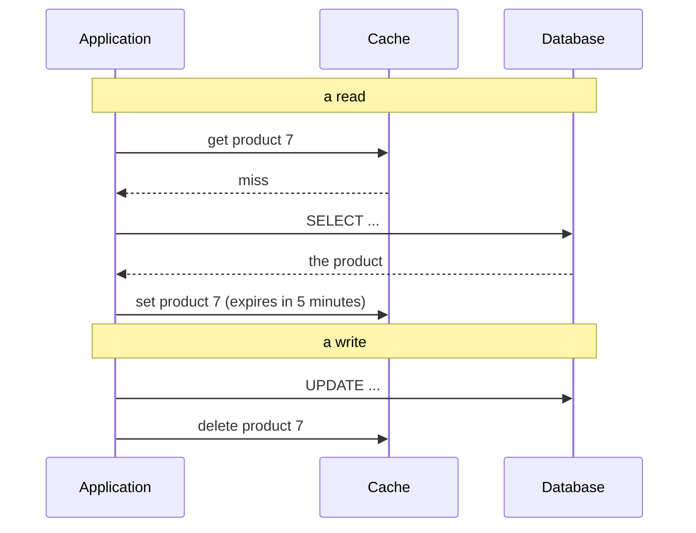

# 3.3 Caching patterns

[Syllabus](../SYLLABUS.md) · Phase 3 · Previous: [3.2 Load balancing](02-load-balancing.md) · Next: 3.4 Cache failure modes *(planned)*

> **Time:** about 45 minutes to read, 45 minutes of practice.
> **You need:** [Chapter 2.2](../phase-2-data/02-indexes-and-query-plans.md) (a cache is not a substitute for an index), [Chapter 2.8](../phase-2-data/08-choosing-a-datastore.md) (system of record and derived data), and percentiles from [Chapter 1.1](../phase-1-foundations/01-what-production-demands.md). The example is plain Go.

**By the end of this chapter you can**

- say when a cache will help, and work out how much from the hit ratio;
- describe cache-aside, read-through, write-through and write-behind, and choose between them;
- explain how cached data goes stale, and the three ways to limit it: expiry, deleting on write, updating on write;
- trace the races that leave a wrong value in a cache, and say what prevents each;
- decide what may be cached, for how long, and under what key.

---

## The problem

*An illustrative scenario.* A shop's database server is at 95% CPU. The slow-query log is empty: no query is slow. The busiest query is `SELECT … FROM products WHERE id = $1` joined to prices and stock, which takes five milliseconds and runs two thousand times a second — and nine times in ten it is for one of the same thousand products, whose answer has not changed since the last time it was asked.

The database is doing the same work again and again. Indexes (Chapter 2.2) have made each run cheap. They cannot make it unnecessary. A **cache** can: keep the answer somewhere quicker to reach, and ask the database only when you have to.

Facebook relied on that idea, and its engineers described their design in a paper: "We rely on memcache to lighten the read load on our databases. In particular, we use memcache as a demand-filled look-aside cache" ([Nishtala et al., *Scaling Memcache at Facebook*](https://www.usenix.org/system/files/conference/nsdi13/nsdi13-final170_update.pdf), 2013).

The idea is simple. The difficulty is in the second sentence of every caching design: the cached answer is a *copy*, and the original can change. There is a saying, attributed to Phil Karlton: "There are only two hard things in Computer Science: cache invalidation and naming things" ([Martin Fowler, *TwoHardThings*](https://martinfowler.com/bliki/TwoHardThings.html)). This chapter is about the first of them.

---

## The concept

### 1. What a cache buys

A cache pays off when three things are true: the same question is asked repeatedly; answering it is expensive compared with looking it up; and a slightly old answer is acceptable.

The number that matters is the **hit ratio** — the fraction of reads answered from the cache. Everything else follows from it:

- **Load on the database** = (1 − hit ratio) × reads. At 90% the database sees a tenth of the reads; at 99%, a hundredth. Going from 90% to 99% does not improve things by a tenth. It cuts the database's work by ten times again.
- **Average latency** = hit ratio × (cache time) + (1 − hit ratio) × (miss time).
- **The slow requests do not get faster.** A miss still goes to the database — after first asking the cache, and before writing the answer back. AWS's guide spells it out: "Each cache miss results in three trips" ([AWS, *Caching strategies*](https://docs.aws.amazon.com/AmazonElastiCache/latest/dg/Strategies.html)). A cache improves the median and the load. It does not improve the 99th percentile, and can make it worse. The example measures this.

Hit ratios are high in practice because real access is skewed: a few items get most of the attention (Chapter 2.2's skewed table was the same phenomenon). The more even the access, the less a cache can do.

### 2. Where a cache can live

| Where | Speed | Shared between instances? | Notes |
|---|---|---|---|
| **In the application's memory** | Fastest: no network | No — each instance has its own copy | Chapter 3.1's caveat: copies disagree, and each takes memory |
| **A cache server** — Redis, Memcached | One network round trip | Yes | The usual meaning of "the cache" |
| **The database's own memory** | — | — | Chapter 2.1: it already caches pages. That speeds up the query; it does not avoid it |
| **In front of the application** — HTTP caches, CDNs | Skips the application altogether | Yes | Chapter 3.5 |

This chapter and the next are about the second row.

### 3. Four patterns

They differ in *who* reads and writes the cache, and *when*.

**Cache-aside** — also called lazy loading — is the default, and the one Facebook describes. The application does the work itself.



On a read: ask the cache; on a miss, ask the database and put the answer in the cache. On a write: change the database, then remove the cached entry. Only what is actually read gets cached — "lazy loading is a caching strategy that loads data into the cache only when necessary" ([AWS](https://docs.aws.amazon.com/AmazonElastiCache/latest/dg/Strategies.html)) — and if the cache is empty or unreachable the application still works, slowly.

**Read-through** is the same thing with the miss handled by the cache layer and not by your code: "When an application asks the cache for an entry, for example the key X, and X is not in the cache, Coherence automatically delegates to the CacheStore and asks it to load X from the underlying data source" ([Oracle Coherence docs](https://docs.oracle.com/en/middleware/standalone/coherence/14.1.1.0/develop-applications/caching-data-sources.html)). The behaviour is identical; the code is tidier. Many caching libraries work this way: you give them a function that loads a value, and call `get`.

**Write-through** changes the write path: "The write-through strategy adds data or updates data in the cache whenever data is written to the database", so that "Data in the cache is never stale" ([AWS](https://docs.aws.amazon.com/AmazonElastiCache/latest/dg/Strategies.html)). The costs: every write pays for a cache update, including for data nobody will read; and a cache that starts empty holds nothing until the data is next written, so write-through is nearly always combined with lazy loading for reads.

**Write-behind** goes further: the application writes to the cache only, and the cache writes to the database later — "modified cache entries are asynchronously written to the data source after a configured delay" ([Oracle Coherence docs](https://docs.oracle.com/en/middleware/standalone/coherence/14.1.1.0/develop-applications/caching-data-sources.html)). Writes become very fast, and many writes to one item collapse into one. But for the length of that delay the *cache* holds the only copy of the change, and a cache is the least durable component in the system (Chapter 2.9). It suits counters and statistics that may lose a few seconds. It does not suit anything the business would mind losing.

| | Reads from the cache | On a write | Staleness | Risk |
|---|---|---|---|---|
| **Cache-aside** | Application, on demand | Database, then delete the entry | Until expiry, or until deleted | The races in section 5 |
| **Read-through** | Cache layer, on demand | As cache-aside | The same | The same |
| **Write-through** | — (combine with one of the above) | Database and cache together | None in the normal case | Slower writes; unread data cached; reordered updates |
| **Write-behind** | — | Cache now, database later | None | Losing writes |

Start with cache-aside and an expiry time. Add deletion on write when the expiry alone leaves data stale for too long. The rest are for particular needs.

### 4. How the cache finds out

A cached entry is right when it is stored, and stays right until the data changes. There are three ways for it to stop being served after that.

**Expiry.** Every entry is given a time to live (TTL) and disappears when it runs out. Nothing else is needed: no code on the write path, no way to forget a place where the data changes. The cost is that a change takes up to one TTL to be seen. Choosing the TTL is a real trade-off: "Don't make the expiration period too short because premature expiration can cause applications to continually retrieve data from the data store and add it to the cache. Similarly, don't make the expiration period so long that the cached data becomes stale" ([Azure Architecture Center, *Cache-Aside pattern*](https://learn.microsoft.com/en-us/azure/architecture/patterns/cache-aside)).

**Deleting on write.** The code that changes the data also removes the cached entry, and the next reader fetches the new value. Staleness drops from a TTL to milliseconds. The cost is that *every* path that changes the data must do it — the admin tool, the batch job, the migration run by hand — and the one that forgets leaves a stale entry.

**Updating on write.** Write-through: the writer puts the new value in. It saves the next reader a miss. Section 5 shows why Facebook chose not to.

In practice: **always set a TTL, and add deletion on write where the TTL is not fresh enough.** AWS's guide reaches the same place: "By adding a time to live (TTL) value to each write, you can have the advantages of each strategy" ([AWS](https://docs.aws.amazon.com/AmazonElastiCache/latest/dg/Strategies.html)). The TTL is the safety net: whatever the invalidation logic misses is corrected when the entry expires. A cache entry with no expiry and a bug in its invalidation is wrong for ever.

### 5. Two races

Deleting on write looks airtight. It is not, because the database and the cache are two systems and nothing makes a pair of operations on them atomic. Two interleavings matter; the example plays both.

**Updates that arrive out of order.** Two writers change the same item. Each updates the database, then the cache. If the cache updates arrive in the opposite order to the database updates, the cache ends up holding the *earlier* value. Facebook's answer was to delete and not update: "We choose to delete cached data instead of updating it because deletes are idempotent" ([Nishtala et al.](https://www.usenix.org/system/files/conference/nsdi13/nsdi13-final170_update.pdf)). Two deletes in either order leave the same result — nothing — and the next reader loads the current value.

**The stale set.** A reader misses, and reads the old value from the database. Before the reader has stored it, a writer changes the database and deletes the (still empty) cache entry. Then the reader stores the old value. The cache is now wrong, and no further delete is coming. The paper names it: "A stale set occurs when a web server sets a value in memcache that does not reflect the latest value that should be cached" ([same paper](https://www.usenix.org/system/files/conference/nsdi13/nsdi13-final170_update.pdf)).

The window is narrow — the gap between a reader's database query and its cache write — and at a few requests a second you may never see it. At thousands a second on a popular item, sooner or later you will.

Their fix is a **lease**. On a miss, the cache hands the reader a token: "The lease is a 64-bit token bound to the specific key the client originally requested. The client provides the lease token when setting the value in the cache", and the set is refused "if memcached has invalidated the lease token due to receiving a delete request for that item" ([same paper](https://www.usenix.org/system/files/conference/nsdi13/nsdi13-final170_update.pdf)). A value fetched before a delete can no longer be stored after it. Storing a version number with each entry, and refusing to replace a newer version with an older one, achieves the same thing.

If you use neither, the TTL bounds the damage: the wrong entry lives for one TTL at most. For much data that is enough, and it is the argument for never caching without one.

### 6. What is safe to cache

Three questions for every kind of data.

**How old may it be?** Ask the question per piece of data, and ask the product owner, because the answer is a product decision. A product description can be minutes old. A price, perhaps seconds. The number on a *display* of remaining stock can be a little old — but the *decision* to sell the last item must never be made from a cache. Capstone 2 drew exactly that line: the seat map may be cached; the claim on a seat goes to the database.

**What does the answer depend on?** The cache key must contain everything that changes the answer: the item, and also the user, their permissions, the language, the currency, the version of the code that built it. Leave one out and one user is served another's answer. This is the most serious kind of caching bug, because it is a data leak, and Chapter 3.5 opens with it.

**Should it be in a shared cache at all?** Microsoft's guidance: the pattern might not be suitable when "The data is sensitive or security related. Storing data in a cache might be inappropriate, especially when multiple applications or users share the cache" ([Azure, *Cache-Aside pattern*](https://learn.microsoft.com/en-us/azure/architecture/patterns/cache-aside)).

And one rule underneath all three, from Chapter 2.8: the cache holds **derived data**. It must be possible to empty it at any moment and lose nothing but speed. Facebook's paper says the same of theirs: "Memcache is not the authoritative source of the data and is therefore allowed to evict cached data" ([Nishtala et al.](https://www.usenix.org/system/files/conference/nsdi13/nsdi13-final170_update.pdf)).

---

## A real example

### Run it: what a cache buys, and what it costs

[`code/ch03-cache/main.go`](code/ch03-cache/main.go) serves a catalogue of 100,000 products, read 2,000 times a second, with a few products far more popular than the rest. The "database" and the "cache" are in-memory stand-ins that take 5 ms and 1 ms to answer, so that the output shows the patterns and nothing else.

```bash
go run ./phase-3-scaling-out/code/ch03-cache
```

**Part 1: with and without.**

```text
PART 1 — 2,000 reads a second; a database query takes 5 ms, a cache lookup 1 ms
         (the 1,000 most popular of 100,000 products receive 93% of the reads)

                                       db queries/s  hit ratio       p50       p90       p99
  no cache                                     2000          -    5.8 ms    6.0 ms    6.3 ms
  cache-aside, entries live 1s                  377        81%    1.1 ms    8.0 ms    8.5 ms
  cache-aside, entries live 30s                 174        91%    1.1 ms    1.3 ms    8.1 ms
```

- **The database's load falls from 2,000 queries a second to 174**: less than a tenth. That is the reason to cache, and it is what section 1 predicts: about (1 − 0.91) × 2,000.
- **The median request is five times faster**: 1.1 ms against 5.8.
- **The 99th percentile is worse than with no cache**: 8.1 ms against 6.3. A miss is a cache lookup, then the database query, then a cache write — the three trips. The cache has made most requests faster and the slowest ones slower.
- **The lifetime of an entry matters a great deal.** At one second, one read in five is a miss and the database does twice the work. Short TTLs are the cheapest way to be fresh, and they are paid for in hit ratio.

**Part 2: prices change.**

```text
PART 2 — the same, while prices of popular products change 20 times a second. Cached entries live 2 seconds.

  when a price changes, the writer...           stale reads  oldest price served was   db queries/s
  does nothing: the entry expires in time        2202 (22%)       1.98 s out of date            325
  deletes the cached entry                          0 ( 0%)                        -            338
  updates the cached entry                          0 ( 0%)                        -            313
```

A read counts as stale if the price it was given had already been replaced in the database when the request was made.

With expiry alone, more than a fifth of all reads returned a price that was out of date, by up to the full two seconds of the TTL. Nothing malfunctioned: that is what a TTL means. Whether it is acceptable is the question from section 6. Deleting or updating the entry on each write removed the staleness, for about the same database load.

**Part 3: the races.** The zeros in Part 2 are not a guarantee. This part performs the unlucky interleavings one step at a time, against the same cache and database code:

```text
  A. Two writers, each updating the cache after the database
     writer 1  database: price = $11.00 (version 2)
     writer 2  database: price = $12.00 (version 3)
     writer 2  cache:    set $12.00 (version 3)
     writer 1  cache:    set $11.00 (version 2)      <- arrives late
     => the database says $12.00 (version 3); the cache says $11.00 (version 2), and will until the entry expires

  B. The same two writers, each deleting the cached entry instead
     writer 1  database: price = $11.00 (version 2)
     writer 2  database: price = $12.00 (version 3)
     writer 2  cache:    delete
     writer 1  cache:    delete                       <- arrives late, and does no harm
     => the database says $12.00 (version 3); the cache has no entry: the next reader will fetch the right price

  C. A reader and a writer: the stale set
     reader    cache:    get -> found: false
     reader    database: reads $10.00 (version 1)
     writer    database: price = $11.00 (version 2)
     writer    cache:    delete                       (there is nothing to delete yet)
     reader    cache:    set $10.00 (version 1)      <- the old price, stored after the delete
     => the database says $11.00 (version 2); the cache says $10.00 (version 1), and will until the entry expires

  D. The same, with a lease
     reader    cache:    get -> found: false, and lease 1: the right to fill this entry
     reader    database: reads $10.00 (version 1)
     writer    database: price = $11.00 (version 2)
     writer    cache:    delete                       (which cancels the lease)
     reader    cache:    set $10.00 (version 1) with lease 1 -> stored: false
     => the database says $11.00 (version 2); the cache has no entry: the next reader will fetch the right price
```

A and B are the reason to delete and not update. C is the stale set; D is the lease that stops it. In A and C, read the last line: *until the entry expires*. With a TTL, each of these mistakes repairs itself. Without one, it stays.

The read path, without its counters, is eight lines, and it is the whole pattern:

```go
func (s *service) price(id int) product {
	if p, ok := s.cache.get(id); ok {
		return p // hit
	}
	p := s.db.read(id) // miss: ask the system of record...
	s.cache.set(id, p) // ...and remember the answer, with an expiry
	return p
}
```

---

## Trade-offs

**A cache trades freshness for load.** Every entry is an answer that was true when it was stored. The longer it may live, the more work it saves and the older what it serves. There is no setting that gets both; there is only a deliberate choice per kind of data.

**It makes typical requests faster and the system harder to reason about.** There are now two places a value can come from, and bugs that appear only when they disagree — which is rarely, and not in tests.

**It becomes a dependency without being a system of record.** Once the database is sized for a tenth of the traffic, it can no longer take all of it. If the cache is lost, the database is hit with ten times its normal load at once. Chapter 3.4 is about that.

**Deleting on write is fresher than expiry and more fragile.** It works only if every writer does it. Expiry needs no cooperation from anyone.

**Caching can hide a problem that should be fixed.** A query that takes 800 ms because an index is missing should get the index (Chapter 2.2), not a cache. A cache in front of a slow query leaves the slow query in place for every miss.

**Not everything needs one.** A query that takes a fraction of a millisecond, on a database with capacity to spare, gains nothing from a cache except a new way to be wrong.

---

## Practice

### Check yourself

Answer before reading on.

1. A service makes 5,000 reads a second with a 95% hit ratio. A change to the cache keys drops the ratio to 80%. What happens to the database?
2. A team caches user profiles with no expiry, and deletes the cached entry whenever a profile is updated. A support ticket says a user's old display name has been showing for three days. Give two different ways this could have happened.
3. The product page shows "Only 2 left!", read from a cache with a 60-second TTL. Is that acceptable? And is it acceptable for checkout to read stock from the same cache?

<details>
<summary>Answers</summary>

1. At 95%, the database sees 5% of 5,000: 250 queries a second. At 80% it sees 20%: 1,000 a second. **Four times the load**, from a change that sounds like "a 15-point drop". If the database was sized for 250 with comfortable headroom, it may not survive 1,000. Hit ratio should be on a dashboard, with an alert on a fall, because the load on the database is the *complement* of it.

2. (a) **A write path that does not delete.** An admin tool, a bulk import, a data fix run by hand, another service writing the same table — anything that changes the row without going through the code that invalidates. (b) **The stale set of section 5**: a reader fetched the old profile, the update and its delete happened, and then the reader stored the old value. Also possible: (c) the delete itself failed — the cache was briefly unreachable — and the error was ignored. In all three, **an expiry would have limited the damage** to minutes. Three days is what "no TTL" looks like.

3. **For display, yes** — if the product owner agrees that "Only 2 left" may be a minute out of date, which for most shops is fine, with the understanding that some customers will find it gone. **For checkout, no.** The decision to sell must be made against the system of record, with the atomic statements of Chapter 2.4. A cache may inform a customer. It must not make a promise on the business's behalf.

</details>

### Exercise: a caching plan for a product page

A product page shows the following. The page is viewed 3,000 times a second; 2% of products get 90% of the views. The database is struggling.

| Data | Changes | Cost to compute |
|---|---|---|
| Name, description, images | A few times a year | One indexed read |
| Price | A few times a day; flash sales change thousands at once | One indexed read |
| Stock level, shown as "in stock" / "only N left" / "sold out" | With every sale | One indexed read |
| Average rating and number of reviews | With every new review | An aggregate over all the product's reviews: 40 ms |
| "Customers also bought" — 8 products | Recomputed nightly | A join over order history: 300 ms |
| The visitor's own price, if they have a loyalty discount | Per visitor | Price plus a lookup of the visitor's tier |

For each: should it be cached? Under what key, for how long, and invalidated how? Then: what is the hit ratio you would aim for, and what happens at a flash sale?

<details>
<summary>Worked solution</summary>

| Data | Cache? | Key | Lifetime | On change |
|---|---|---|---|---|
| Name, description, images | Yes | `product:{id}:v{schema}` | 1 hour | Delete on edit. An hour's staleness after a missed delete is harmless |
| Price | Yes, briefly | `price:{id}:{currency}` | 30–60 s | Delete on change. The short TTL is the safety net: a wrong price is the costliest mistake on the page |
| Stock display | Yes, briefly | `stock:{id}` | 5–10 s | Expiry only. It changes with every sale; deleting on each would mean it was never cached for popular items |
| Rating summary | Yes | `rating:{id}` | 10 min | Expiry only — or, better, stop computing it: keep the count and the sum in a column, updated when a review is added (Chapter 2.5) |
| Also bought | Yes | `alsobought:{id}` | 24 h | Rewritten by the nightly job |
| Visitor's own price | **Not as a separate cached page.** Cache the price, and the discount *per tier*; combine them per request | `discount:{tier}` | 1 h | Delete on change |

**Reasoning worth saying aloud.**

- *Different lifetimes for different parts.* Caching the whole page as one entry would force the shortest lifetime — the stock's — on everything. Cache the parts, and assemble the page from them.
- *The stock display is cached; the stock decision is not.* Checkout goes to the database (Chapter 2.4).
- *The most valuable entries are the expensive ones*: "also bought" saves 300 ms per miss, the rating 40 ms. The cheap indexed reads are cached for load, not for speed.
- *The personal price is where a leak would happen.* A cached page keyed only by product, built for a visitor with a discount, would show that discount to everyone. Keying the page by visitor would make the hit ratio collapse. So the personal part is not cached as a page at all: only its shared ingredients are.
- *A version in the key* (`v{schema}`) lets a deploy that changes the cached structure simply stop reading the old entries, which then expire. Without it, new code reads entries written by old code.

**Hit ratio.** With 2% of products taking 90% of views and lifetimes of minutes, the long-lived parts should be above 95%. The stock display, at 5–10 seconds, will be lower — perhaps 80–90% for popular products — and that is the price of its freshness. Measure each kind separately; one overall number hides the entry that is doing badly.

**A flash sale** changes thousands of prices at once and brings a crowd at the same moment. Deleting thousands of entries just as traffic peaks sends every one of those reads to the database together. That is the subject of the next chapter. The short version: for a planned event, write the new prices *into* the cache as the sale starts, instead of deleting and letting the crowd reload them.

</details>

---

## Production tips and common mistakes

**Tips**

- **Measure before caching.** Know the query, its cost, how often it repeats, and whether an index would do instead.
- **Give every entry a TTL.** It is the only invalidation that cannot be forgotten.
- **Delete on write; do not update** — unless you have versioning or leases to keep updates in order.
- **Change the database first, then the cache.**
- **Put everything the answer depends on in the key**, including the user or tenant where it matters, and a version for the format.
- **Decide staleness per kind of data, with the product owner**, and write it down next to the TTL.
- **Watch the hit ratio, per kind of entry**, and alert when it falls.
- **Make the application work with an empty cache** — and check that the database could survive it (Chapter 3.4).
- **Keep decisions on the system of record.** Display from the cache; decide from the database.

**Common mistakes**

- **A cache to hide a missing index.**
- **Entries with no expiry.**
- **Invalidation in one write path and not in the others.**
- **A key that leaves out the user, the tenant or the locale** — one visitor served another's data.
- **Caching the whole of something whose parts change at different rates.**
- **Writing to the cache before the database**, so that a failed database write leaves the cache holding something that never happened.
- **Ignoring a failed delete.**
- **Treating the cache as storage**: data that exists only there.
- **Looking only at average latency**, when the cache has made the tail worse.
- **A TTL chosen by copying another TTL.**

---

## Key takeaways

- A cache helps when the same expensive question is asked repeatedly and a slightly old answer will do.
- The hit ratio decides everything: the database sees only the misses, so 90% to 99% is a tenfold cut in its load.
- A miss costs more than no cache at all. Caches improve medians and load, not the tail.
- Cache-aside with a TTL is the default pattern: read the cache, fall back to the database, store the answer; on a write, change the database and delete the entry.
- Entries go stale. Expiry bounds it and needs no cooperation; deleting on write shortens it and must be done on every write path. Use both.
- Delete instead of updating, because deletes can arrive in any order. A reader can still store an old value after a delete: leases or versions prevent it, and a TTL limits it.
- Cache only what can be rebuilt, key it by everything it depends on, and never make a decision from it that the business must stand behind.

**Next:** 3.4 Cache failure modes *(planned)* — what happens when the cache is empty, when one key is too popular, and when it fills up.

---

## Sources

- Rajesh Nishtala et al., [*Scaling Memcache at Facebook*](https://www.usenix.org/system/files/conference/nsdi13/nsdi13-final170_update.pdf), NSDI 2013.
- AWS, Amazon ElastiCache documentation: [*Caching strategies*](https://docs.aws.amazon.com/AmazonElastiCache/latest/dg/Strategies.html).
- Microsoft, Azure Architecture Center: [*Cache-Aside pattern*](https://learn.microsoft.com/en-us/azure/architecture/patterns/cache-aside).
- Oracle Coherence documentation: [*Caching Data Sources*](https://docs.oracle.com/en/middleware/standalone/coherence/14.1.1.0/develop-applications/caching-data-sources.html) (read-through, write-through, write-behind).
- Martin Fowler, [*TwoHardThings*](https://martinfowler.com/bliki/TwoHardThings.html), 2009.
