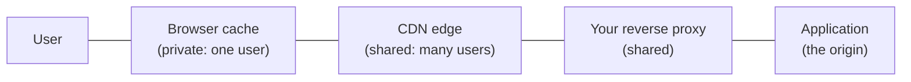

# 3.5 HTTP caching and CDNs

[Syllabus](../SYLLABUS.md) · Phase 3 · Previous: [3.4 Cache failure modes](04-cache-failure-modes.md) · Next: 3.6 Read replicas and replication lag *(planned)*

> **Time:** about 45 minutes to read, 45 minutes of practice.
> **You need:** [Chapter 1.2](../phase-1-foundations/02-life-of-a-request.md) (round trips), [Chapter 1.3](../phase-1-foundations/03-http-for-backend-engineers.md) (`ETag` and conditional requests) and [Chapter 3.3](03-caching-patterns.md). The example is plain Go.

**By the end of this chapter you can**

- name the caches between a user and your server, and say which are shared and which are private;
- write the `Cache-Control` header for a static asset, a public page, a personal page and an API response;
- explain what `Vary` does, and how leaving it out — or leaving out `private` — shows one user another's data;
- say what a CDN does for latency and for load, and what it cannot cache;
- change content that is already cached: by purging, and by never needing to;
- use a signed URL to serve a private file through a cache or an object store.

---

## The problem

Two failures, at opposite ends.

**The slow one.** A company's servers are in Virginia. A customer in Singapore opens the home page. Every image, script and stylesheet travels half-way round the world; each new connection costs several round trips before the first byte (Chapter 1.2). The logo — which is the same for everybody, and has not changed in three years — takes two seconds to appear.

**The dangerous one.** On 25 December 2015 users of Steam, the game store, saw other people's account pages. Valve's statement afterwards: "a configuration error resulted in some users seeing Steam Store pages generated for other users. Between 11:50 PST and 13:20 PST store page requests for about 34k users, which contained sensitive personal information, may have been returned and seen by other users" ([Valve, *Update on Christmas Issues*](https://store.steampowered.com/oldnews/19852)). The cause was a cache. During an attack on the store, a caching configuration was deployed that "incorrectly cached web traffic for authenticated users", and the results "varied from users seeing the front page of the Store displayed in the wrong language, to seeing the account page of another user" ([same statement](https://store.steampowered.com/oldnews/19852)).

Both are about caches that the application does not own: in the browser, and at the edge of the network. They can make a global product feel local. They will also faithfully hand one user's page to the next, if you tell them to — and the telling is done with a few HTTP headers.

---

## The concept

### 1. The caches you do not run

A response passes through several caches on its way to a user, and any of them may keep a copy.



The HTTP standard divides them into two kinds: "A 'shared cache' is a cache that stores responses for reuse by more than one user; shared caches are usually (but not always) deployed as a part of an intermediary. A 'private cache', in contrast, is dedicated to a single user; often, they are deployed as a component of a user agent" ([RFC 9111, *HTTP Caching*](https://www.rfc-editor.org/rfc/rfc9111.html)).

That distinction is the whole of the dangerous failure. A private cache can keep anything its one user is allowed to see. A shared cache must keep only what *everyone* may see.

None of these caches knows your application. They act on what the response says about itself.

### 2. `Cache-Control`: telling caches what to do

The origin describes each response with a `Cache-Control` header. The directives that matter, with the standard's own words ([RFC 9111](https://www.rfc-editor.org/rfc/rfc9111.html)):

| Directive | Meaning |
|---|---|
| `max-age=N` | Fresh for *N* seconds: any cache may reuse it without asking. |
| `s-maxage=N` | The same, for shared caches only: "for a shared cache, the maximum age specified by this directive overrides the maximum age specified by either the max-age directive or the Expires header field." |
| `private` | "a shared cache MUST NOT store the response (i.e., the response is intended for a single user)." A browser may. |
| `no-store` | "a cache MUST NOT store any part of either the immediate request or the response". Nothing is kept anywhere. |
| `no-cache` | Misleadingly named. The response may be stored, but "MUST NOT be used to satisfy any other request without forwarding it for validation". In other words: *ask before every reuse.* |
| `immutable` | The content at this URL will never change, so do not even ask ([RFC 8246](https://www.rfc-editor.org/rfc/rfc8246.html)). |
| `stale-while-revalidate=N` | Chapter 3.4: serve the old copy for up to *N* more seconds while fetching a new one. |

`no-cache` and `no-store` are the pair that people mix up. MDN's guide: "The no-cache directive does not prevent the storing of responses but instead prevents the reuse of responses without revalidation. If you don't want a response stored in any cache, use no-store" ([MDN, *HTTP caching*](https://developer.mozilla.org/en-US/docs/Web/HTTP/Guides/Caching)).

Four recipes cover most of what a backend serves:

| What | Header | Why |
|---|---|---|
| A static asset with a version in its name — `app.3f9a1c.js` | `Cache-Control: public, max-age=31536000, immutable` | It never changes; a new version gets a new name (section 6) |
| A page that is the same for everyone | `Cache-Control: public, s-maxage=60, stale-while-revalidate=30` (and a short or zero `max-age`) | Shared caches absorb the traffic; you choose how stale |
| A page or API response for one logged-in user | `Cache-Control: private, no-cache` — or `no-store` if it is sensitive | Never in a shared cache |
| HTML that names the current assets | `Cache-Control: no-cache`, with an `ETag` | Always checked, cheaply (section 3) |

And a rule for everything else: **say something.** A response with no `Cache-Control` at all is not thereby uncacheable: "a cache MAY assign a heuristic expiration time when an explicit time is not specified" ([RFC 9111, section 4.2.2](https://www.rfc-editor.org/rfc/rfc9111.html)). In plain words, caches are allowed to guess, and different ones guess differently.

### 3. Revalidation: asking whether it has changed

When a stored response is no longer fresh, a cache does not have to download it again. It can ask the origin whether its copy is still good, using the conditional request from Chapter 1.3: it sends the `ETag` it holds in `If-None-Match`, and the origin answers `304 Not Modified` with no body if nothing has changed.

This saves the *bytes*. It does not save the *round trip*: the cache still waits for the origin's answer. For a 200 KB image, that is most of the cost avoided. For a small API response, almost none of it. The example measures both.

### 4. `Vary`: when the URL is not the whole key

By default a cache identifies a response by its URL. That is wrong whenever the same URL gives different answers to different requests: compressed or not, in English or in French, for a phone or for a desktop.

The origin declares this with the `Vary` response header, which names the *request* headers the answer depended on. A cache then keeps one copy per combination, and "MUST NOT use that stored response without revalidation unless all the presented request header fields nominated by that Vary field value match those fields in the original request" ([RFC 9111](https://www.rfc-editor.org/rfc/rfc9111.html)). `Vary: Accept-Encoding` is nearly universal. `Vary: Accept-Language` is what Steam's users were missing when the front page came up "in the wrong language".

`Vary` is section 6 of Chapter 3.3 — *the key must contain everything the answer depends on* — written as an HTTP header. And it has the same cost: every header in it multiplies the number of copies and divides the hit ratio. `Vary: Cookie` is always *safe*, and makes a shared cache useless, since almost every user's cookie is different.

### 5. The leak: personal pages in shared caches

Now the dangerous failure can be stated exactly. A logged-in user's page depends on who is asking, and who is asking is in the `Cookie` header. If the response is cacheable by a shared cache and does not say that it depends on the cookie, the cache will store Ana's page under the page's URL and give it to Ben.

Nothing in HTTP prevents this on your behalf. The standard has a special rule for requests carrying an `Authorization` header — a shared cache must not reuse the response "unless the response contains a Cache-Control field with a response directive … that allows it to be stored by a shared cache" ([RFC 9111, section 3.5](https://www.rfc-editor.org/rfc/rfc9111.html)) — but there is no such rule for cookies, and cookies are how most sites know their users. MDN is explicit: "If a response contains personalized content and you want to store the response only in the private cache, you must specify a private directive", because "a cookie alone does not make the response private" ([MDN](https://developer.mozilla.org/en-US/docs/Web/HTTP/Guides/Caching)).

So the defence is in the application, and it should be a default, not a decision made page by page:

- **Every response to an authenticated request carries `Cache-Control: private`** (or `no-store`), set in one place — middleware — so that a new endpoint cannot forget it.
- **Caching rules at the CDN are written to match**: cache only what the origin marks as public; never "cache everything under `/`".
- **Anything public is on its own paths**, with no cookies involved, so that the two kinds of traffic cannot be confused.

There is an attack that exploits a mismatch between the two layers. If a CDN is configured to cache by file extension, a request for `/account/profile.css` may be treated by the application as the account page and by the CDN as a stylesheet — "a vulnerability that enables an attacker to trick a web cache into storing sensitive, dynamic content", "caused by discrepancies between how the cache server and origin server handle requests" ([PortSwigger, *Web cache deception*](https://portswigger.net/web-security/web-cache-deception)). The same defence holds: the origin's `Cache-Control: private` must win over any rule based on the URL.

### 6. CDNs: a shared cache next to every user

A **content delivery network** is a fleet of shared caches in many locations, in front of your origin. AWS describes its own: it "delivers your content through a worldwide network of data centers called edge locations. When a user requests content that you're serving with CloudFront, the request is routed to the edge location that provides the lowest latency" ([AWS, *What is Amazon CloudFront?*](https://docs.aws.amazon.com/AmazonCloudFront/latest/DeveloperGuide/Introduction.html)).

It helps in two ways.

- **Distance.** The user's connection ends at an edge a few milliseconds away, so the handshakes of Chapter 1.2 are short round trips instead of intercontinental ones — and a cached response does not travel to the origin at all. This is the fix for the logo in Singapore.
- **Load.** Requests answered at the edge never reach your servers. For a site that is mostly images, scripts and public pages, that is most requests.

What it cannot do is cache what is different for every user, or what must be current. Those still go to the origin; the CDN shortens the user's connection and passes the request on.

**Changing what is cached** is the hard part here, as in Chapter 3.3. Two approaches:

*Purge it.* CDNs have an API to remove an entry: "If you need to remove a file from CloudFront edge caches before it expires, you can … Invalidate the file from edge caches. The next time a viewer requests the file, CloudFront returns to the origin to fetch the latest version" ([AWS, *Invalidate files*](https://docs.aws.amazon.com/AmazonCloudFront/latest/DeveloperGuide/Invalidation.html)). A purge reaches the CDN. It does not reach browsers, which also hold copies. MDN: "there is nothing the server can do once the response is stored — since no more requests reach the server due to caching … responses will remain in the browser cache until max-age expires" ([MDN](https://developer.mozilla.org/en-US/docs/Web/HTTP/Guides/Caching)).

*Never need to.* Put a version in the URL — a hash of the file's contents is usual — and give the file a lifetime of a year. A change of content is then a change of URL, and no cache anywhere has the new URL. MDN calls it cache busting: "Content that never changes should be given a long max-age by using cache busting — that is, by including a version number, hash value, etc., in the request URL" ([MDN](https://developer.mozilla.org/en-US/docs/Web/HTTP/Guides/Caching)). AWS recommends the same over purging: "we recommend that you use a version identifier in file names or in folder names" ([AWS, *Use file versioning*](https://docs.aws.amazon.com/AmazonCloudFront/latest/DeveloperGuide/UpdatingExistingObjects.html)). The one thing that cannot be versioned is the page that names the versions — the HTML — so that is served with `no-cache` and revalidated every time.

Between them: versioned URLs for assets; short `s-maxage` plus purging for public pages; nothing shared for personal ones.

### 7. Signed URLs: private files through a cache

Some files are private *and* large: an invoice, a purchased video, a user's upload. Serving them through the application ties up a request handler for the length of the download (Chapter 1.6). Serving them from a CDN or object store is efficient — but those cannot check a session.

A **signed URL** carries its own permission. The application, having checked that the user may have the file, issues a URL containing an expiry time and a signature made with a secret key; the CDN or object store verifies the signature and the time, and serves the file to whoever presents it. AWS: "A signed URL includes additional information, for example, an expiration date and time, that gives you more control over access to your content" ([AWS, *Use signed URLs*](https://docs.aws.amazon.com/AmazonCloudFront/latest/DeveloperGuide/private-content-signed-urls.html)).

Note what kind of permission this is. It is the signed token of Chapter 3.1 again: checked without a lookup, and impossible to take back before it expires. *Anyone* who obtains the URL has the file until then. So signed URLs are issued at the moment of use and expire in minutes.

The same mechanism works in the other direction — a signed URL that permits one upload — which is how files reach object storage without passing through your application servers (Chapters 2.8 and 3.1).

---

## A real example

### Run it: one cache, and the headers that steer it

[`code/ch05-httpcache/main.go`](code/ch05-httpcache/main.go) contains a small HTTP cache — about 140 lines — that follows RFC 9111: it decides what to store from `Cache-Control`, how to match from `Vary`, and how to refresh from `ETag`. It stands between two "browsers" and an origin that is 80 ms away. Nothing in it knows about the pages it is caching.

```bash
go run ./phase-3-scaling-out/code/ch05-httpcache
```

**Part 1: what a nearby cache saves.**

```text
PART 1 — a 200 KB logo. The origin is 80 ms away; the cache is next to the user. The logo is fresh for 1 second.

                                       what the cache did                                  took  bytes from origin
  the first request                    MISS: fetched and stored                         83.2 ms             200000
  the same again                       HIT: served from the cache                        1.2 ms                  0
  again, after it has expired          REVALIDATED: unchanged, served from the cache    81.4 ms                  0
  again, after the logo has changed    MISS: fetched and stored                         82.9 ms             200000
```

A hit costs a millisecond and no bytes: the origin is not involved. The third line is section 3: the copy had expired, the cache asked, the origin said `304`, and no bytes of the image crossed the 80 ms link — but the 80 ms were still spent. Revalidation saves bandwidth; only freshness saves time.

**Part 2: who sees whose account.**

```text
PART 2 — /account shows the account of whoever is logged in. Ana loads it, then Ben, through one shared cache.

  the origin sends                             Ana sees         Ben sees         what the cache did for Ben
  Cache-Control: max-age=60                    Ana's account    ANA'S ACCOUNT !  HIT: served from the cache
  Cache-Control: private, max-age=60           Ana's account    Ben's account    MISS: fetched, not stored
  Cache-Control: max-age=60; Vary: Cookie      Ana's account    Ben's account    MISS: fetched and stored
  Cache-Control: no-store                      Ana's account    Ben's account    MISS: fetched, not stored
```

The first row is the Steam incident in two requests. The cache did nothing wrong. It was told the page was good for sixty seconds, it was not told that the page depended on anything but the URL, and it served a hit. `private` fixes it: the shared cache declines to store the page at all. `Vary: Cookie` also fixes it, by storing a separate copy for each cookie — safe, and nearly pointless, since no two users will ever share one.

**Part 3: one URL, two languages.**

```text
PART 3 — /welcome is in the reader's language. An English reader loads it, then a French one.

  the origin sends                                     the English reader     the French reader
  Cache-Control: max-age=60                            Welcome                Welcome
  Cache-Control: max-age=60; Vary: Accept-Language     Welcome                Bienvenue
```

Without `Vary`, the first reader's language becomes everyone's for a minute. Here `Vary` is the right tool, because there are only a handful of languages: a few copies, each shared by many readers.

**Part 4: shipping a new version.** A browser with its own cache sits behind the shared one, and the site deploys version 2 of a script.

```text
PART 4 — the site ships version 2 of its script. A returning visitor's browser has version 1 in its cache.

  how the script is served                                         before the deploy      after the deploy
  /app.js, max-age=3600                                            script, version 1      script, version 1   <- for up to an hour
  /app.v<N>.js, max-age=31536000, immutable; the page is no-cache  script, version 1      script, version 2
```

With a fixed URL, the returning visitor runs the old script against the new server for up to an hour, and nothing the server does can reach into that browser to change it. With the version in the URL, the page — revalidated on every load — names `/app.v2.js`, which no cache has ever seen. The script with the *longest* lifetime is the one that updates *immediately*.

**Part 5: a signed URL.**

```text
PART 5 — a private file, fetched with a signed URL: no cookie, no login

  the link:  /private/report.pdf?expires=1794467742&signature=974c3525426e950d...

  the link as issued                                   200
  the same signature on a different file               403
  the link as issued, after it has expired             403
```

The signature covers the path and the expiry time, so neither can be changed without the secret key. The check is a few lines:

```go
expires, _ := strconv.ParseInt(r.URL.Query().Get("expires"), 10, 64)
valid := hmac.Equal([]byte(r.URL.Query().Get("signature")), []byte(o.sign(path, expires)))
if !valid || time.Now().Unix() > expires {
	http.Error(w, "forbidden", http.StatusForbidden)
	return
}
```

No session was consulted. That is the convenience, and the reason the expiry is two seconds here and should be minutes in production.

---

## Trade-offs

**Every cache between you and the user is capacity you do not pay for, and control you give up.** Once a response is stored out there, it is served without your knowledge until it expires. MDN's summary is exact: "Caching reduces access to the server, which means that the server loses control of that URL" ([MDN](https://developer.mozilla.org/en-US/docs/Web/HTTP/Guides/Caching)). Long lifetimes are for things that will not change.

**Shared caching and personalisation pull against each other.** A page that is identical for everyone can be served entirely from the edge. Every personal element — a name in the corner, a cart count — either makes the page private or has to be fetched separately by the browser after the shared page has loaded. Designing pages so that the public part is cacheable is a product decision as much as a technical one.

**`Vary` buys correctness with hit ratio.** Each header listed multiplies the copies. Vary on things with few values.

**A CDN is one more system in the path of every request.** It has its own configuration, its own outages, and its own cache to reason about when something looks wrong. For a product with users in one city and little static content, it may not earn its place yet. For a global audience or heavy media, nothing else comes close.

**Purging is slower and less complete than it sounds.** It takes time to reach every edge, and never reaches browsers. A design that depends on purging to be *correct* — as opposed to merely fresher — is fragile.

**Signed URLs trade revocation for scalability.** Keep them short-lived, and never put one where it will be logged or shared.

---

## Practice

### Check yourself

Answer before reading on.

1. An API endpoint `GET /api/me` returns the logged-in user's profile, identified by a session cookie. It currently sends no `Cache-Control` header. The company is about to put a CDN in front of the whole site. What should the endpoint send, and what is the risk if nothing changes?
2. A stylesheet is served as `/styles.css` with `Cache-Control: max-age=86400`. A deploy changes it, and for the rest of the day some users see a broken layout. The team purges the CDN. Does that fix it? What should they have done?
3. A cached image has expired and the cache revalidates it. The origin answers `304 Not Modified`. What was saved, and what was not?

<details>
<summary>Answers</summary>

1. `Cache-Control: private, no-cache` — or `no-store` if the profile is sensitive. With no header, a cache may still decide to store the response and choose its own lifetime, and a CDN configured to cache `/api/*` by path would certainly store it: the first user's profile would be served to everyone who asks for `/api/me`. That is the Steam incident. Better still, set `private` on *every* authenticated response in one piece of middleware, so that the safe behaviour does not depend on each endpoint remembering.

2. **Only partly.** The purge clears the CDN's copies. Every browser that fetched the old stylesheet today has its own copy, good for up to 24 hours, and will not ask again until it expires — the server cannot reach it. Those users keep the old stylesheet with the new HTML. The fix is to put a version in the name — `/styles.4c1d.css`, with a lifetime of a year and `immutable` — and have the HTML, served with `no-cache`, refer to the current name. Then a deploy changes the URL, and no cache has anything to be stale about.

3. **Saved: the bytes.** The image was not sent again; the response was a few hundred bytes of headers. **Not saved: the round trip.** The cache still had to reach the origin and wait for its answer before serving. For a large file over a slow link that is most of the cost; for a small one, the round trip *was* the cost. To avoid the round trip too, the response must still be fresh — a longer `max-age` — or served stale while it is revalidated in the background.

</details>

### Exercise: headers for a whole site

You are putting a CDN in front of a news site. Decide the caching for each kind of response: the `Cache-Control` header, any `Vary`, and how a change reaches readers.

| # | Response | Notes |
|---|---|---|
| 1 | Article pages `/articles/{slug}` | Identical for all readers. Editors fix typos a few times a day; a correction must be visible within a minute. 5,000 requests a second at peak |
| 2 | The home page | Changes every few minutes. In English and Spanish at the same URL, chosen by the browser's language |
| 3 | Scripts, stylesheets, fonts | Change with each deploy |
| 4 | Article images | Uploaded once; never edited. 100 KB to 2 MB |
| 5 | "Your saved articles" `/me/saved` | Per reader, behind login |
| 6 | The login form's response, which sets the session cookie | — |
| 7 | Paid subscribers' PDF downloads of the print edition | 30 MB each; subscribers only |
| 8 | A small "Hello, Ana" in the corner of every article page | — |

<details>
<summary>Worked solution</summary>

| # | Header | How a change reaches readers |
|---|---|---|
| 1. Articles | `Cache-Control: public, max-age=0, s-maxage=60, stale-while-revalidate=30` and an `ETag` | The CDN serves each article for a minute, then refreshes it in the background. Browsers always revalidate (`max-age=0`), cheaply, against the edge. When an editor saves a correction, the publishing system also **purges that URL** — the purge makes it fast; the 60 seconds make it certain |
| 2. Home page | The same, with `s-maxage=30`, and `Vary: Accept-Language` | Two languages means two copies: an acceptable price. (Better still: separate URLs, `/en/` and `/es/`, which need no `Vary` and can be linked to) |
| 3. Scripts, styles, fonts | Content hash in the file name; `Cache-Control: public, max-age=31536000, immutable` | A deploy produces new names. The HTML, which is never fresh for long, refers to them. Nothing is purged |
| 4. Images | Unique name at upload; `public, max-age=31536000, immutable` | Never changes. An edited image is a new upload with a new name |
| 5. Saved articles | `Cache-Control: private, no-cache` | Not stored by the CDN at all. The browser may keep a copy and must revalidate it |
| 6. Login response | `Cache-Control: no-store` | A response that sets a session cookie must never be stored anywhere |
| 7. Subscribers' PDFs | Files in object storage behind the CDN. The application checks the subscription and redirects to a **signed URL valid for five minutes** | The 30 MB download does not pass through the application. The link is useless to anyone else after five minutes |
| 8. "Hello, Ana" | **Not in the article's HTML at all.** The page is public and identical for everyone; a small script fetches `/api/me` (`private, no-cache`) and fills in the name | This is the decision that makes row 1 possible. One personal word in the HTML would make every article page `private`, and the CDN would cache none of them |

**What the CDN now does.** Rows 1 to 4 are nearly all of the traffic. At 5,000 requests a second for articles with `s-maxage=60`, the origin renders each popular article about once a minute per edge location, whatever the traffic. The origin's real load is the personal endpoints, which are small.

**What to check before going live.**

- A default in the application: every response to a request with a session is `private` unless a handler explicitly says otherwise.
- The CDN is configured to honour the origin's headers, and has no rule that caches by path or extension regardless of them.
- A test: log in as two users, request each private URL as the first and then as the second through the CDN, and confirm that the second never receives the first's response. Run it in the deploy pipeline.

</details>

---

## Production tips and common mistakes

**Tips**

- **Send an explicit `Cache-Control` on every response.**
- **Default authenticated responses to `private`**, in middleware, and make public caching the exception that a handler opts into.
- **Version static assets in the URL** and cache them for a year with `immutable`.
- **Serve HTML with `no-cache` and an `ETag`**, so that it is always current and usually cheap.
- **Use `s-maxage` to give the CDN a different lifetime from browsers**: you can purge the CDN; you cannot purge browsers.
- **Add `stale-while-revalidate`** to public pages, for the reasons in Chapter 3.4.
- **Keep `Vary` short**: `Accept-Encoding`, and a language or two.
- **Keep personal data out of public pages**: fetch it separately.
- **Issue signed URLs at the moment of use, with lifetimes of minutes.**
- **Test for leaks with two users** through the real CDN configuration.
- **Look at the response headers** when debugging: `Age`, and the CDN's own hit-or-miss header, say which cache answered.

**Common mistakes**

- **A personal response with `max-age` and no `private`.**
- **A CDN rule that caches everything under a path**, overriding what the origin says.
- **Caching by file extension**, when the application ignores extensions.
- **No `Vary` on a response that depends on a request header** — or `Vary: Cookie`, or `Vary: User-Agent`, which make the cache useless.
- **Believing `no-cache` means "do not store".**
- **A long `max-age` on a URL whose content changes**, and then discovering that browsers cannot be purged.
- **Caching a response that sets a cookie**, and handing one user's session to another.
- **Depending on a purge for correctness.**
- **Long-lived signed URLs**, or signed URLs written to logs.
- **Caching error responses for as long as successes**, so that one failed render is served for an hour.

---

## Key takeaways

- Between a user and your server there are caches you do not run: private ones in browsers, shared ones in CDNs and proxies. They act only on the response's headers.
- `Cache-Control` says who may store a response and for how long. `private` keeps it out of shared caches; `no-store` out of all caches; `no-cache` means *store it, but ask first*.
- Revalidation with an `ETag` saves bytes, not round trips.
- A cache's key is the URL plus whatever `Vary` names. A response that depends on something not in the key will be served to the wrong requester.
- Personal responses in shared caches are a data leak. Make `private` the default for authenticated traffic.
- A CDN puts a shared cache near every user: shorter connections, and most requests never reaching the origin.
- To change cached content, purge it — which cannot reach browsers — or, better, give every version its own URL.
- A signed URL lets a cache or object store serve a private file without a session. It cannot be revoked, so make it short-lived.

**Next:** 3.6 Read replicas and replication lag *(planned)* — taking read traffic off the primary database, and what users see when a replica is behind.

---

## Sources

- R. Fielding, M. Nottingham and J. Reschke (eds.), [RFC 9111: *HTTP Caching*](https://www.rfc-editor.org/rfc/rfc9111.html), 2022; P. McManus, [RFC 8246: *HTTP Immutable Responses*](https://www.rfc-editor.org/rfc/rfc8246.html), 2017.
- Valve, [*Update on Christmas Issues*](https://store.steampowered.com/oldnews/19852), 30 December 2015.
- MDN Web Docs: [*HTTP caching*](https://developer.mozilla.org/en-US/docs/Web/HTTP/Guides/Caching).
- Amazon CloudFront Developer Guide: [*What is Amazon CloudFront?*](https://docs.aws.amazon.com/AmazonCloudFront/latest/DeveloperGuide/Introduction.html); [*Invalidate files to remove content*](https://docs.aws.amazon.com/AmazonCloudFront/latest/DeveloperGuide/Invalidation.html); [*Use file versioning to update or remove content*](https://docs.aws.amazon.com/AmazonCloudFront/latest/DeveloperGuide/UpdatingExistingObjects.html); [*Use signed URLs*](https://docs.aws.amazon.com/AmazonCloudFront/latest/DeveloperGuide/private-content-signed-urls.html).
- PortSwigger Web Security Academy: [*Web cache deception*](https://portswigger.net/web-security/web-cache-deception).
