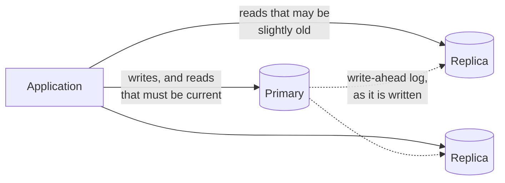

# 3.6 Read replicas and replication lag

[Syllabus](../SYLLABUS.md) · Phase 3 · Previous: [3.5 HTTP caching and CDNs](05-http-caching-and-cdns.md) · Next: [3.7 Long-lived connections](07-long-lived-connections.md)

> **Time:** about 40 minutes to read, 45 minutes of practice.
> **You need:** the write-ahead log from [Chapter 2.1](../phase-2-data/01-how-databases-store-data.md) and [Chapter 2.9](../phase-2-data/09-durability-backups-restore.md), and [Chapter 3.3](03-caching-patterns.md) on staleness. The example runs a real PostgreSQL primary with two replicas; it needs PostgreSQL's server programs, as Chapter 2.9's did.

**By the end of this chapter you can**

- explain how a read replica is kept up to date, and why it is always slightly behind;
- name the two anomalies that lag shows to users — not reading your own write, and time running backwards — and recognise each in a bug report;
- route reads so that neither happens, three ways, and say what each costs;
- say which reads belong on a replica and which never do;
- explain why replicas multiply read capacity and do nothing for writes;
- name what to monitor.

---

## The problem

*An illustrative scenario; the example reproduces it on a real primary and replica.* The database is the bottleneck, and nine queries in ten are reads. The team adds a read replica — a second server holding a copy of the data — and sends the reads to it. Database load halves. Everyone is pleased.

The first bug report arrives the same week. *"I changed my display name and pressed Save. The page reloaded and showed my old name. I changed it again. Now it's right."* It cannot be reproduced: for the developer who tries, it always works.

A second, stranger report follows. *"A comment appeared under my post, then vanished when I refreshed, then came back."*

Nothing is lost, and nothing is wrong in the database. The replica is a fraction of a second behind the primary, and the application has started showing users two slightly different moments in time. GitHub describes the first symptom in a post about its own replicas: "Serving traffic off of a lagging replica leads to poor user experience, as someone may make a change and then not see it reflected" ([GitHub Engineering, *Mitigating replication lag and reducing read load with freno*](https://github.blog/engineering/infrastructure/mitigating-replication-lag-and-reducing-read-load-with-freno/)).

A replica is a cache that the database maintains for you: it is complete, it is never missing a key, and it never needs invalidating. It has only the one property that every copy has. It is a little out of date.

---

## The concept

### 1. What a replica is

Chapter 2.9 restored a database by taking a copy of its files and replaying the write-ahead log on top. A **replica** — PostgreSQL's word is *standby* — is that process left running for ever. It starts from a copy of the primary, and then receives the primary's log as it is written and applies it continuously. It accepts read-only queries while it does so.



All writes go to one place, the **primary**. That is what keeps the scheme simple: there is one order of events, decided by the primary, and replicas only follow it. (Systems with more than one writer are Chapter 5.2.) MySQL — which GitHub and Shopify, quoted below, both use — replicates the same way, with different names for the parts.

What replicas give you:

- **Read capacity.** Each replica can answer queries. Two replicas roughly triple what can be read.
- **A place for heavy reads.** The reports that Chapter 2.6 kept away from checkout can run on a replica of their own.
- **A spare.** If the primary dies, a replica can take over (Chapter 5.1).

What they do not give you is write capacity. Every replica must apply every write the primary makes. Adding replicas to a write-heavy system adds servers that are all busy applying the same writes. Scaling writes means splitting the data (Chapter 5.3).

### 2. Lag

By default the primary does not wait for replicas. It commits, answers the client, and sends the log along. PostgreSQL's manual: "Streaming replication is asynchronous by default … in which case there is a small delay between committing a transaction in the primary and the changes becoming visible in the standby. This delay is … typically under one second assuming the standby is powerful enough to keep up with the load" ([PostgreSQL docs, *Log-Shipping Standby Servers*](https://www.postgresql.org/docs/current/warm-standby.html)).

That delay is **replication lag**. On a quiet system on a fast network it is a millisecond or less. It grows when:

- **the primary does a lot of writing at once** — a bulk import, a backfill (Chapter 2.7), a large delete. GitHub again: "we routinely run massive updates to our databases … Such large operations may easily introduce replication lag" ([same post](https://github.blog/engineering/infrastructure/mitigating-replication-lag-and-reducing-read-load-with-freno/));
- **the replica is busy** answering expensive queries;
- **the replica is far away**, or the network between them is slow;
- **a query on the replica is in the way.** A replica sometimes cannot apply a change without disturbing a query that is running on it. It can pause replay for that query — falling further behind — or cancel the query; the setting `max_standby_streaming_delay` decides "how long the standby server should wait before canceling standby queries that conflict with about-to-be-applied WAL entries" ([PostgreSQL docs](https://www.postgresql.org/docs/current/runtime-config-replication.html)). Long reports on a replica either get cancelled or hold the replica back.

Lag is measured in time — how old is the newest thing the replica has applied? — and in position — how far along the primary's log has it got? The second turns out to be the useful one for routing (section 4).

### 3. Two anomalies

Werner Vogels, Amazon's CTO, defines two guarantees in an article on eventual consistency. Each failure in the opening is the absence of one of them.

**Read-your-writes.** "This is an important model where process A, after it has updated a data item, always accesses the updated value and will never see an older value" ([Vogels, *Eventually Consistent*](https://www.allthingsdistributed.com/2008/12/eventually_consistent.html)). The user who saved a name and saw the old one was written to the primary and read from a replica that had not yet received the write.

Notice that it is a guarantee about *one user's own* changes. Other people seeing Ana's new name half a second late is ordinary staleness, and nobody can tell. Ana seeing her own old name is a bug, because she knows what she just did.

**Monotonic reads.** "If a process has seen a particular value for the object, any subsequent accesses will never return any previous values" ([same article](https://www.allthingsdistributed.com/2008/12/eventually_consistent.html)). The comment that appeared, vanished and reappeared was read first from a replica that had it, then from one further behind that did not, then from the first again. Each replica only ever moves forward. A user bounced between two of them moves back and forth in time.

Shopify's engineers describe the same thing happening inside a single page: "If these queries are routed to various read replicas with differing amounts of replication lag and the data changes in midstream, the results could be unpredictable" ([Shopify Engineering, *Read Consistency with Database Replicas*](https://shopify.engineering/read-consistency-database-replicas)).

### 4. Routing reads safely

The application decides, for every read, which server to ask. Four techniques, usually combined.

**Read from the primary when the reader has just written.** After a user writes, send that user's reads to the primary for a short while — a second or two, comfortably more than normal lag. It needs one timestamp per user, in the session or a cookie. It is simple and nearly always sufficient. Its costs: some reads go to the primary that did not need to; and it is a guess — if lag exceeds the window, the anomaly returns.

**Read from a replica only once it has your write.** Instead of guessing at time, use position. After a write, note how far the primary's log has got (in PostgreSQL, `pg_current_wal_lsn()`), and carry that with the user. Before reading from a replica, ask whether it has applied that much: `pg_last_wal_replay_lsn()` "Returns the last write-ahead log location that has been replayed during recovery" ([PostgreSQL docs](https://www.postgresql.org/docs/current/functions-admin.html)). If it has, the replica is safe *for this user*, however stale it is for anyone else. If not, use the primary, or wait a moment. This is exact, sends the fewest reads to the primary, and still works when lag is unusually large. It costs more machinery: a token that must travel with the user across requests and instances.

**Keep each user on one replica.** Monotonic reads need only that a user's successive reads come from the same replica — choose it by hashing the user's ID. This is what Shopify chose: "we settled on a form of monotonic read consistency: successive reads will follow a consistent timeline, though not necessarily reading the latest data in real time. The most direct way to ensure this is for any series of related reads to be routed to the same server" ([Shopify Engineering](https://shopify.engineering/read-consistency-database-replicas)). They are candid about its weakness: "server outages (especially intermittent ones) will tend to introduce read inconsistencies that may be difficult to detect". (The position-based technique gives monotonic reads as well, if the token is advanced on every read.)

**Stop using a replica that has fallen behind.** Whatever the routing, bound the staleness: measure each replica's lag continuously and take it out of rotation when it passes a threshold — a health check in the sense of Chapter 3.2. GitHub: "Our automation removes lagging replicas from the serving pool after a few seconds" ([GitHub Engineering](https://github.blog/engineering/infrastructure/mitigating-replication-lag-and-reducing-read-load-with-freno/)). The same post describes the other half: making bulk writes *pause* when replicas fall behind — "If lag is higher than desired, we throttle: we stall the operation, and keep polling lag until we're satisfied it is low enough". The backfills of Chapter 2.7 should do exactly this.

There is also a way to make the problem disappear at the source, at a price. PostgreSQL can make a commit wait for a replica: with `synchronous_commit = remote_apply`, "commits will wait until replies from the current synchronous standby(s) indicate they have received the commit record of the transaction and applied it, so that it has become visible to queries on the standby(s)… This will cause much larger commit delays than previous settings since it waits for WAL replay" ([PostgreSQL docs](https://www.postgresql.org/docs/current/runtime-config-wal.html)). Every write then takes as long as that replica's lag — the example measures it — and if the replica is unreachable, writes stop. Chapter 5.1 is about that trade.

### 5. What belongs on a replica

| Read | Replica? | Why |
|---|---|---|
| Lists, feeds, search results, other people's profiles | Yes | Nobody can tell that it is half a second old |
| Reports, exports, analytics | Yes — ideally a replica of their own | Heavy, and tolerant of staleness. Mind query cancellation (section 2) |
| A user's own data just after they changed it | Not without one of the techniques in section 4 | Read-your-writes |
| Anything read in order to decide what to write | **No** | The check-then-act of Chapter 2.4, made worse: the check is against the past. Read it on the primary, inside the transaction that writes |
| Logging in, permission checks | Usually the primary, or a replica with a strict lag limit | A revoked permission that still works on a replica is a security problem |

The fourth row is the one that must never be broken. A replica can tell you what was true. It cannot tell you what is true now, and a decision that the business will stand behind needs the second.

---

## A real example

### Run it: a primary, two replicas, and three routers

[`code/ch06-replicas/cluster.sh`](code/ch06-replicas/cluster.sh) starts three throwaway PostgreSQL servers on your machine: a primary, a replica that applies changes as fast as it can, and a replica deliberately held 300 ms behind (PostgreSQL has a setting for this, `recovery_min_apply_delay`), standing in for one that is busy or far away. [`code/ch06-replicas/main.go`](code/ch06-replicas/main.go) then runs three experiments against them.

```bash
bash phase-3-scaling-out/code/ch06-replicas/cluster.sh start
go run ./phase-3-scaling-out/code/ch06-replicas
bash phase-3-scaling-out/code/ch06-replicas/cluster.sh stop
```

The script needs PostgreSQL's server programs and must not run as root — the same requirements as Chapter 2.9's. (To use Docker instead, start a container with the three ports published to your machine only — `docker run -d --name course-replicas -e POSTGRES_PASSWORD=unused -p 127.0.0.1:54350-54352:54350-54352 postgres:16` — and run the script inside it: `docker exec -i -u postgres -e LISTEN='*' course-replicas bash -s start < phase-3-scaling-out/code/ch06-replicas/cluster.sh`. Docker was not available where this chapter was written, so that route is untested.)

```text
A write sent to a replica:  ERROR: cannot execute UPDATE in a read-only transaction (SQLSTATE 25006)

PART 1 — a row is changed on the primary. How long until each replica shows the change? (30 tries)

                                       shortest     median    longest
  the replica that keeps up              0.4 ms     0.5 ms     0.7 ms
  the replica held 300 ms behind         299 ms     299 ms     302 ms

  What the primary itself reports (SELECT application_name, state, replay_lag FROM pg_stat_replication):
    fast     streaming    replay_lag 00:00:00.000638
    slow     streaming    replay_lag 00:00:00.299792
```

On one machine, with nothing else happening, the replica that keeps up is half a millisecond behind. That is the best case, and it is still not zero: a read sent immediately after a write can miss it. The last two lines are the primary's own view, from `pg_stat_replication`, whose `replay_lag` column is the "Time elapsed between flushing recent WAL locally and receiving notification that this standby server has written, flushed and applied it" ([PostgreSQL docs](https://www.postgresql.org/docs/current/monitoring-stats.html)). It agrees with what the program measured from outside, and it is the number to put on a dashboard.

```text
PART 2 — 150 users each save their profile and then load it 10 times over the next 3 seconds.
         Reads go to the replica that is 300 ms behind, unless the router sends them to the primary.

  where a read goes                                                     stale reads   reads on the primary
  always the replica                                                      450 (30%)               0 ( 0%)
  the primary for 1 second after the user's own write                       0 ( 0%)             750 (50%)
  the replica once it has the user's write; until then, the primary         0 ( 0%)             450 (30%)
```

Each user reloads 20 ms, 100 ms, 200 ms, 400 ms … 3 seconds after saving.

- **Always the replica.** The three reloads inside the first 300 ms show the user their profile as it was before they saved: 450 stale reads. This is the first bug report, 450 times.
- **The primary for one second.** No stale reads. Half of all reads went to the primary — every one made within a second of the write, including those at 400 ms and 700 ms, when the replica already had the change.
- **By log position.** No stale reads, and only 30% of reads on the primary: exactly the ones the replica could not have answered correctly. The check is one line of SQL sent to the replica:

```go
func caughtUp(replica *pgxpool.Pool, lsn string) (ok bool) {
	must(replica.QueryRow(ctx, "SELECT pg_last_wal_replay_lsn() >= $1::pg_lsn", lsn).Scan(&ok))
	return ok
}
```

The difference between the last two rows grows with scale. A fixed window must be long enough for a bad day, so on a normal day it sends the primary many reads it did not need. The position check adapts: when replicas are 1 ms behind it sends almost nothing to the primary, and when they are 5 seconds behind it still returns no stale data.

```text
PART 3 — a counter goes up on the primary 100 times a second. One reader watches it for 3 seconds.

  the reader's requests go to...                            reads  times the counter went DOWN
  the two replicas in turn, as a load balancer would          191                           95
  always the same replica (the slow one)                      191                            0
```

A counter that only ever increases was seen to go down 95 times in 191 reads — every time the reader moved from the faster replica to the slower one. Each replica is consistent in itself. The reader was shown two timelines interleaved. Pinned to one replica, even the slower one, it sees time move only forwards — 300 ms late, and in order. This is the vanishing comment.

**What waiting for the replica costs.** One more measurement on the same cluster: the time to commit a one-row insert when the primary is told to wait for a replica to *apply* it (`synchronous_commit = remote_apply`).

| The primary waits for… | Commit takes |
|---|---|
| nothing | 0.4 ms |
| the replica that keeps up | 1.2 ms |
| the replica that is 300 ms behind | 302 ms |

With that setting, a read on that replica after the commit always sees the write. The cost has moved from the reader to the writer, and it is the replica's lag, paid on every commit.

---

## Trade-offs

**Replicas buy read capacity with consistency.** The primary alone always gives the current answer. Every replica added spreads the load and adds a place where the answer may be old. The routing in section 4 is the work that pays for it.

**They help reads only.** If writes are what is saturating the primary, replicas make no difference — and each one adds a little work to the primary, which must send it the log.

**A fixed "read from the primary" window is simple and wasteful; position tokens are exact and intricate.** Start with the window. Move to tokens if the primary is taking too many reads, or if lag is sometimes larger than any window you would accept.

**Synchronous replication removes lag from readers and adds it to writers**, and makes writes depend on the replica being reachable. It is the right tool for durability across machines (Chapter 5.1) and rarely the right one for read-your-writes alone.

**A replica is a second system to run.** It needs monitoring, capacity planning and connection budgets of its own (Chapter 2.6: each replica has its own connection limit, and its own pool in every application instance). A cache (Chapter 3.3) often removes more load for less operational weight; replicas are for the reads a cache cannot hold — arbitrary queries over all the data.

**Long queries and fresh data pull against each other on the same replica.** Give reporting its own replica, tuned to let queries run and lag grow, and keep it out of the pool that serves users.

---

## Practice

### Check yourself

Answer before reading on.

1. A user reports: "I deleted a photo, and it was still in my gallery when the page reloaded. After another refresh it was gone." Which guarantee was broken, and what is the smallest change that fixes it?
2. An application reads a customer's account balance from a replica, checks that it covers a withdrawal, and then writes the withdrawal to the primary. Replication lag is normally 50 ms. What can go wrong, and what is the fix?
3. Writes to the primary have tripled and its CPU is at 90%. A colleague proposes adding two more read replicas. Will that help? What should be measured first?

<details>
<summary>Answers</summary>

1. **Read-your-writes.** The delete went to the primary; the reload's query went to a replica that had not yet applied it; by the second refresh it had. The smallest fix: for a short time after a user writes, send that user's reads to the primary — record the time of the last write in their session, and check it when choosing where to read. A second or two is enough when lag is normally milliseconds; add a limit on replica lag so that "normally" stays true.

2. The balance on the replica may be up to 50 ms old — or far older during a lag spike. Two withdrawals made close together both read the *old* balance, both pass the check, and both are written: the account is overdrawn. This is the lost-update problem of Chapter 2.4 with the window widened from microseconds to the length of the lag. No routing trick fixes it, because the check and the write must be one atomic step: do both on the primary, in one statement — `UPDATE accounts SET balance = balance - $1 WHERE id = $2 AND balance >= $1` — or under a row lock. **A replica must never supply the data for a decision to write.**

3. **Probably not.** Replicas serve reads; every replica must also apply every write. If the primary's CPU is spent on writes, the replicas change nothing, and each adds a little replication work. Measure first what the primary's time is going on: what share of its load is reads that could move (then replicas, or a cache, help), and what share is writes (then the options are fewer or cheaper writes — batching, removing unused indexes as in Chapter 2.2 — a bigger machine, and eventually partitioning the data, Chapter 5.3).

</details>

### Exercise: a read-routing policy

A social application has a primary and three replicas. Typical lag is 20 ms, with spikes to several seconds during a nightly bulk job. For each read below, choose where it goes and say why. Then write the routing rule in a few lines, and say what you would monitor.

| # | Read |
|---|---|
| 1 | The home feed: recent posts from people the user follows |
| 2 | The user's own profile page, immediately after editing it |
| 3 | A post's comment thread — which the user is watching, and has just commented on |
| 4 | "Is this username taken?", while someone types in the sign-up form |
| 5 | Creating the account with that username |
| 6 | Checking that the user is allowed to delete a post, before deleting it |
| 7 | An admin's export of all users who signed up last month |
| 8 | Unread-notification count in the page header, on every page view |

<details>
<summary>Worked solution</summary>

| # | Goes to | Why |
|---|---|---|
| 1. Home feed | A replica, the same one for this user | Staleness of a second is invisible. Pinning keeps posts from appearing and disappearing between refreshes (monotonic reads) |
| 2. Own profile after editing | The primary, for a couple of seconds after the user's write — then a replica | Read-your-writes. The classic case |
| 3. Comment thread, just commented on | The same rule as 2: this user wrote recently, so this user reads the primary | The rule should be per *user*, not per page: having written anything, they will notice staleness anywhere they look next |
| 4. "Is this username taken?" | A replica | It is a hint for the form. A wrong "available" is corrected by step 5 |
| 5. Creating the account | The primary — and the *unique constraint* decides, not a prior read (Chapter 2.4) | A decision to write. Never from a replica, and not from a read at all |
| 6. Permission to delete | The primary, in the same transaction as the delete | A decision to write. Also: a permission revoked a moment ago must not still work |
| 7. Admin export | A dedicated reporting replica | Heavy and tolerant. Kept away from the replicas that serve users, so that neither its load nor its long queries affect them |
| 8. Notification count | A replica — and, at that request rate, a cache in front of it (Chapter 3.3) | On every page view, slightly old is fine. But a user who just *read* their notifications must not see the old count: that is a write by the user, so rule 2 applies |

**The rule**, in order:

1. Is this read part of a transaction that writes, or does its result decide a write? → **primary**.
2. Has this user written anything in the last 2 seconds? → **primary**.
3. Is it a report? → **the reporting replica**.
4. Otherwise → **the user's replica**, chosen by hashing the user ID over the replicas currently in rotation.
5. A replica whose lag is over 1 second is **out of rotation**; if none qualifies, reads go to the primary.

Step 5 is what makes steps 2 and 4 honest. During the nightly job's lag spike, replicas drop out and the primary takes the reads — so the job must also be made to *throttle itself* on replica lag, as GitHub's does, or the primary will be overwhelmed at exactly that moment.

**Monitor:** each replica's replay lag, in time and in bytes, with an alert well below the 1-second cut-off; how many replicas are in rotation; the share of reads going to the primary (a rising share means lag or a routing bug); queries cancelled on replicas; and the connection count on each server.

**When to change it.** If the primary's share of reads becomes a problem, replace the 2-second window with the position token from section 4. Nothing else in the rule changes.

</details>

---

## Production tips and common mistakes

**Tips**

- **Decide where each read goes deliberately.** *Reads to replicas, writes to the primary* is not a policy; section 5's table is.
- **Start with reading from the primary for a few seconds after a user's own write.** It fixes most of what users notice.
- **Pin a user to one replica**, so that their view of the data only moves forward.
- **Measure lag on every replica and remove laggards from rotation.**
- **Make bulk jobs watch replica lag and slow down.**
- **Give reporting its own replica.**
- **Read on the primary, in the transaction, whenever the result decides a write.**
- **Budget connections per server**: each replica has its own limit and needs its own pool.
- **Test with a delayed replica**, as the example does. Lag bugs do not appear on a developer's machine, where lag is a millisecond.

**Common mistakes**

- **Sending all reads to replicas** the day they are added.
- **Check-then-act with the check on a replica.**
- **Round-robin over replicas for one user's requests**, so that time runs backwards.
- **Assuming lag is always what it usually is.**
- **Adding replicas to fix a write bottleneck.**
- **Long analytical queries on the replicas that serve users**, holding back replay or being cancelled.
- **No alert on replication lag** — or on a replica that has stopped replicating altogether and is serving last Tuesday's data.
- **Treating a replica as a backup.** It faithfully applies your mistakes (Chapter 2.9).
- **Hard-coding which server is the primary**, so that a failover breaks every write (Chapter 5.1).

---

## Key takeaways

- A replica is a continuously restored copy of the primary: it replays the primary's log, and serves read-only queries.
- Replication is asynchronous by default, so a replica is always a little behind — milliseconds normally, seconds under bulk writes or heavy queries.
- Lag shows users two things: their own change missing (no read-your-writes), and data appearing and disappearing (no monotonic reads).
- Fix the first by reading from the primary after a user's own write, by time or — exactly — by log position. Fix the second by keeping each user on one replica.
- Bound staleness by measuring lag and taking slow replicas out of rotation.
- Never make a decision to write from a replica's data.
- Replicas multiply read capacity. They do nothing for writes.

**Next:** [3.7 Long-lived connections](07-long-lived-connections.md) — when the server needs to tell the client something, and polling is not good enough.

---

## Sources

- PostgreSQL documentation: [*Log-Shipping Standby Servers*](https://www.postgresql.org/docs/current/warm-standby.html) (streaming replication); [*Hot Standby*](https://www.postgresql.org/docs/current/hot-standby.html) (queries on a replica, and their conflicts with replay); [replication settings](https://www.postgresql.org/docs/current/runtime-config-replication.html); [`synchronous_commit`](https://www.postgresql.org/docs/current/runtime-config-wal.html); [`pg_stat_replication`](https://www.postgresql.org/docs/current/monitoring-stats.html); [recovery information functions](https://www.postgresql.org/docs/current/functions-admin.html).
- Werner Vogels, [*Eventually Consistent*](https://www.allthingsdistributed.com/2008/12/eventually_consistent.html), 2008.
- GitHub Engineering, [*Mitigating replication lag and reducing read load with freno*](https://github.blog/engineering/infrastructure/mitigating-replication-lag-and-reducing-read-load-with-freno/), 2017.
- Thomas Saunders, [*Read Consistency with Database Replicas*](https://shopify.engineering/read-consistency-database-replicas), Shopify Engineering, 2021.
