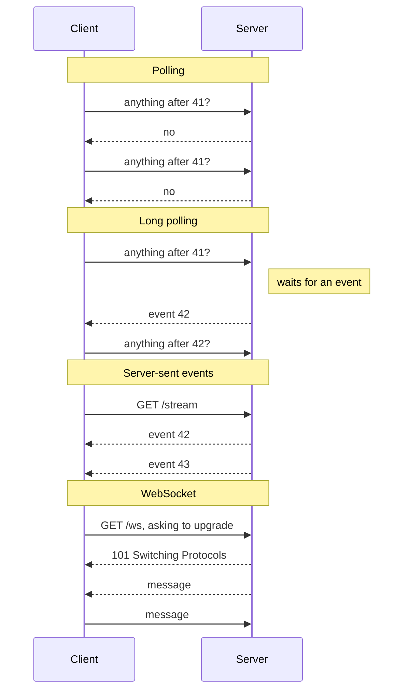
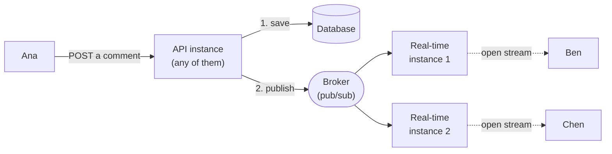

# 3.7 Long-lived connections: WebSockets, SSE, and long polling

[Syllabus](../SYLLABUS.md) · Phase 3 · Previous: [3.6 Read replicas and replication lag](06-read-replicas.md) · Next: Capstone 3 *(planned)*

> **Time:** about 45 minutes to read, 45 minutes of practice.
> **You need:** HTTP from [Chapter 1.3](../phase-1-foundations/03-http-for-backend-engineers.md); backoff and jitter from [Chapter 1.5](../phase-1-foundations/05-timeouts-retries-idempotency.md); stateless instances and graceful shutdown from [Chapters 3.1](01-stateless-services.md) and [3.2](02-load-balancing.md). The example needs only Go; it fetches one library the first time it runs.

**By the end of this chapter you can**

- say what polling costs, and when it is still the right answer;
- explain how long polling, server-sent events and WebSockets each deliver an event, and choose between them;
- explain why an instance that holds connections is no longer interchangeable, and get an event to a client connected to a different instance;
- design reconnection: backoff with jitter, and resuming without losing events;
- name what load balancers, proxies and deploys do to a connection that lasts for hours.

---

## The problem

*An illustrative scenario; the example measures the same thing at small scale.* A product gets a notification bell. The quickest way to build it: the page asks `GET /api/notifications?after=…` once a second and shows whatever comes back. It ships in a day, and it works.

Six months later, 20,000 people have the product open through the working day, and the bell makes 20,000 requests a second. Each one passes the load balancer, is authenticated, and runs a query. A typical user receives a handful of notifications an hour, so of the 3,600 requests their browser makes in that hour, all but a few are answered *nothing new*.

Someone changes the interval to 30 seconds. Load falls thirtyfold, and the complaints begin: a notification now takes 15 seconds to appear on average, and up to 30.

That is the whole of polling's trade, and no setting is good. Its cost is the number of clients multiplied by how often they ask, whether or not anything is happening. Its delay is half the interval, on average. Improving one worsens the other.

What is wanted is the reverse arrangement: the client asks nothing, and the server speaks when it has something to say. HTTP as this course has used it cannot do that — a server only ever answers a request. The three techniques in this chapter all get round it the same way, by keeping a connection open. And a connection that stays open for hours quietly removes two things every chapter in this phase has relied on: that any instance can serve any client, and that an instance can be stopped as soon as its current requests finish.

---

## The concept

### 1. Four ways to deliver an event

**Polling.** The client asks on a timer: *anything after event 41?* The server answers at once — usually, *no*.

**Long polling.** The client asks the same question, and the server does not answer until it has something to say. If nothing happens for a while, it answers *nothing* and the client asks again. The IETF's survey of these techniques describes the effect: "there is always a pending request to which the server can reply for the purpose of delivering events as they occur" ([RFC 6202](https://www.rfc-editor.org/rfc/rfc6202.html)). Each event costs one request per client, none is wasted, and delivery is immediate. On how long to hold a request, the same document: "Several experiments have shown success with timeouts as high as 120 seconds, but generally 30 seconds is a safer value".

**Server-sent events (SSE).** The client makes one request, and the server answers with a response that does not end: `Content-Type: text/event-stream`, then a few lines of text for each event, as it happens. It is ordinary HTTP: nothing between client and server has to learn a new protocol. Browsers have a client built in, `EventSource`, which does two useful things unasked. It reconnects: "Clients will reconnect if the connection is closed" ([HTML Standard, *Server-sent events*](https://html.spec.whatwg.org/multipage/server-sent-events.html)). And it resumes: if events carry an `id:` line, the browser remembers the last, and sends it back in a `Last-Event-ID` header, which "reports an EventSource object's last event ID string to the server when the user agent is to reestablish the connection" ([same section](https://html.spec.whatwg.org/multipage/server-sent-events.html)). SSE carries text one way, from server to client.

**WebSocket.** The client makes one HTTP request that asks to *change protocol*. If the server agrees, it answers `101 Switching Protocols`, and from then on the connection is no longer HTTP: either side may send a message — text or binary — at any moment. In the words of the standard, "The protocol consists of an opening handshake followed by basic message framing, layered over TCP" ([RFC 6455](https://www.rfc-editor.org/rfc/rfc6455.html)). The handshake is HTTP on purpose: it "is intended to be compatible with HTTP-based server-side software and intermediaries, so that a single port can be used by both HTTP clients talking to that server and WebSocket clients talking to that server". Nothing more is provided. Reconnecting, resuming, and matching a reply to a request are yours to build.



| | Polling | Long polling | SSE | WebSocket |
|---|---|---|---|---|
| Delay | Half the interval, on average | Almost none | Almost none | Almost none |
| Requests | Clients × rate, events or not | One per event, per client | One per client | One per client |
| Who can speak | Client asks, server answers | Client asks, server answers | Server | Both |
| Still HTTP? | Yes | Yes | Yes | Only the handshake |
| Reconnecting and resuming | Nothing to reconnect | Every request says where it had got to | Built into browsers | Build it yourself |
| Connections held open | None | One per client | One per client | One per client |

### 2. Choosing

Take the first that fits.

1. **Can it be polled slowly, or through a cache?** If thirty seconds' delay is acceptable, or the clients are few, poll: there is nothing to operate. And if the answer is the same for everybody — a status page, a scoreboard — poll it through a cache. With `Cache-Control: max-age=2` at a CDN (Chapter 3.5), a million polling clients reach the origin as a few requests every two seconds.
2. **Does only the server need to speak? Use SSE.** Notifications, feeds, dashboards, progress: most features described as *real-time* are this. Being plain HTTP, a stream passes through load balancers and proxies like any response (with two adjustments, in section 3), and carries the session cookie like any request. One limit matters: "When not used over HTTP/2, SSE suffers from a limitation to the maximum number of open connections, which can be especially painful when opening multiple tabs, as the limit is per browser and is set to a very low number (6)" ([MDN, *Using server-sent events*](https://developer.mozilla.org/en-US/docs/Web/API/Server-sent_events/Using_server-sent_events)). Serve it over HTTP/2, and open one stream per page for everything the page needs, not one per feature.
3. **Do both sides send often? Use a WebSocket.** Chat, collaborative editing, games. But a client that only *sometimes* sends does not need one: it can send with an ordinary `POST` and listen on SSE. LinkedIn's first instant messaging — typing indicators and read receipts included — pushed to its clients over SSE: "we chose SSE over Websockets because it works over traditional HTTP, and we wanted to start with a protocol that would provide the maximum compatibility with LinkedIn's widespread member base, which accesses our products from a variety of networks" ([LinkedIn Engineering](https://engineering.linkedin.com/blog/2016/10/instant-messaging-at-linkedin--scaling-to-hundreds-of-thousands-)).
4. **Long polling is the fallback** for networks where a stream will not pass. The Socket.IO library begins every connection with it by default, and explains why: "experience has shown that it is not always possible to establish a WebSocket connection, due to corporate proxies, personal firewall, antivirus software" ([Socket.IO docs, *How it works*](https://socket.io/docs/v4/how-it-works/)).

None of the four reaches an app that is not running: a phone in a pocket holds no connection to your servers. That is the job of the operating system's push service, which this course does not cover.

### 3. A connection lives on one instance

Chapter 3.1 made instances interchangeable by moving state out of them. An open connection cannot be moved out: it is a socket inside one process. Four things follow.

**The event has to find the connection.** The request that causes an event — Ana posts a comment — goes to whichever instance the balancer picks. Ben, who should see the comment appear, is connected to a different one. There are two established ways to bridge the gap.

- *Publish to everyone.* Every instance subscribes to a broker; whichever instance has an event publishes it; every instance receives it and writes it to those of its own connections that want it. Redis Pub/Sub is the usual first choice, and its guarantee must be understood before relying on it: "Redis' Pub/Sub exhibits at-most-once message delivery semantics… Once the message is sent by the Redis server, there's no chance of it being sent again" ([Redis docs, *Pub/Sub*](https://redis.io/docs/latest/develop/pubsub/)). An instance that is restarting when a message is published never receives it.
- *Route to the owner.* Decide, by hashing, which server is responsible for each topic, and send each event only there. This is Slack's design, described under *A real example*. It avoids every instance hearing every message, and costs more machinery.



**Balancing happens once, when the client connects.** Chapter 3.2 showed what follows: a new instance receives none of the existing clients, and an instance that restarts comes back empty while its neighbours carry its former load. Place new connections on the instance with the fewest, leave every instance room for a neighbour's clients, and consider limiting how long a connection may live. gRPC's server has a setting for exactly that — "MaxConnectionAge is a duration for the maximum amount of time a connection may exist before it will be closed by sending a GoAway. A random jitter of +/-10% will be added to MaxConnectionAge to spread out connection storms" ([gRPC-Go docs](https://pkg.go.dev/google.golang.org/grpc/keepalive#ServerParameters)).

**Something in between will close a quiet connection.** Load balancers and proxies assume that a silent connection is a dead one. On AWS: "By default, Elastic Load Balancing sets the idle timeout value for your load balancer to 60 seconds" ([AWS docs](https://docs.aws.amazon.com/elasticloadbalancing/latest/application/edit-load-balancer-attributes.html)). nginx, proxying a WebSocket: "By default, the connection will be closed if the proxied server does not transmit any data within 60 seconds" ([nginx docs](https://nginx.org/en/docs/http/websocket.html)). A notification stream on which nothing has happened for a minute is exactly such a connection. The remedy is a **heartbeat**: something small sent on a timer shorter than the shortest timeout on the path.

- For SSE, a comment line. The standard's own advice: "authors can include a comment line (one starting with a ':' character) every 15 seconds or so" ([HTML Standard](https://html.spec.whatwg.org/multipage/server-sent-events.html)).
- For WebSockets, the protocol has a frame for the purpose: "A Ping frame may serve either as a keepalive or as a means to verify that the remote endpoint is still responsive" ([RFC 6455](https://www.rfc-editor.org/rfc/rfc6455.html)).

The second use in that sentence matters as much as the first. A phone that loses its signal sends nothing to say so, and TCP's own keep-alive is off by default, with an interval that "MUST default to no less than two hours" ([RFC 9293](https://www.rfc-editor.org/rfc/rfc9293.html)). Without heartbeats, a server holds connections to clients that left long ago.

Proxies cause one more surprise, for SSE in particular: they may hold a response back in order to pass it on in larger pieces. Go's documentation warns of it where it describes `Flush`: "if the client is connected through an HTTP proxy, the buffered data may not reach the client until the response completes" ([Go docs, `net/http`](https://pkg.go.dev/net/http#Flusher)) — and a stream never completes. nginx buffers by default, and only "When buffering is disabled, the response is passed to a client synchronously, immediately as it is received" ([nginx docs, `proxy_buffering`](https://nginx.org/en/docs/http/ngx_http_proxy_module.html#proxy_buffering)). So a stream that was instant on a laptop arrives late and in lumps in production. Turn buffering off for the stream's route, or have the application send the `X-Accel-Buffering: no` header that the same page documents.

**A deploy disconnects everybody.** Chapter 3.2's graceful shutdown waited for requests in progress to finish. A stream never finishes. Go's documentation is plain about the two cases. An SSE response is a request in progress, and `Shutdown` works by "waiting indefinitely for connections to return to idle". A WebSocket is not waited for at all: "Shutdown does not attempt to close nor wait for hijacked connections such as WebSockets. The caller of Shutdown should separately notify such long-lived connections of shutdown and wait for them to close, if desired" ([Go docs, `net/http`](https://pkg.go.dev/net/http#Server.Shutdown)). (Part 4 of the example shows both.) So the instance must end its streams itself — and at that moment every one of its clients reconnects. Slack names the result: "Reconnection storms are resource intensive: When an entire office loses network connection or otherwise needs to connect all at once, the combined weight of those requests manifest as slower connections, more reconnects, more failures, and more retries" ([Slack Engineering, *Flannel*](https://slack.engineering/flannel-an-application-level-edge-cache-to-make-slack-scale/)).

### 4. Reconnecting without losing anything

Connections break constantly: deploys, idle timeouts, a laptop lid closing, a phone moving from Wi-Fi to the mobile network. A design that treats reconnection as the normal case has five parts.

**The stream is not the record.** A pushed message reaches whoever is connected at that instant, once, or not at all. The database is the system of record (Chapter 2.8); the push only makes its contents visible sooner. If a lost push means lost data, the design is wrong.

**Resume from a position.** Give events increasing IDs. The client remembers the last it received and says so when it reconnects; the server sends what came after. This needs the events to be *kept* somewhere that outlives the connection and the instance: rows in the database, or a log retained for a while. When a client has been away for longer than the log goes back, tell it to reload from scratch.

**Or send only a hint.** The push says *thread 123 has changed*, and the client fetches the thread through the ordinary API. A lost hint is repaired by the next hint, or by the fetch every client makes when it reconnects. Nothing has to be replayed. The price is one extra request per event.

**Back off, and add jitter.** A client that retries the instant its connection breaks, and every few milliseconds after, is one of thousands doing the same. The rule is Chapter 1.5's: wait a random time, with a limit that doubles on each failure up to a cap. Start again from a short wait once a connection has succeeded.

**Make reconnecting cheap.** Opening the socket is rarely the expensive part. Authenticating, and loading everything the client needs to start, is. Slack's reconnection storms were heavy because each client loaded a full snapshot of its workspace, and the cure was to stop: "The key is for the client to load minimal data upfront, and only load channel and user data as needed" ([Slack Engineering, *Flannel*](https://slack.engineering/flannel-an-application-level-edge-cache-to-make-slack-scale/)). A client that resumes from a position needs only what it missed.

One more rule, for the sending side. A client that reads more slowly than events arrive forces someone to hold what it has not yet read. Bound that: when a client falls too far behind, disconnect it and let it resume. (A deadline on each write does it: in Go, [`ResponseController.SetWriteDeadline`](https://pkg.go.dev/net/http#ResponseController.SetWriteDeadline).) The receiving side has the same problem in browsers: "The WebSocket interface doesn't support backpressure. As a result, when messages arrive faster than the application can process them, it will either fill up the device's memory by buffering those messages, become unresponsive due to 100% CPU usage, or both" ([MDN, *The WebSocket API*](https://developer.mozilla.org/en-US/docs/Web/API/WebSockets_API)).

### 5. What an open connection costs

A connection on which nothing is happening uses no CPU. It uses memory, and one file descriptor. In Go it also keeps a goroutine: the server works by "creating a new service goroutine for each" connection ([Go docs, `net/http`](https://pkg.go.dev/net/http#Server.Serve)).

LinkedIn's account of scaling its SSE servers is a list of limits, met one after another as connections were added: the queue of connections waiting to be accepted, the number of threads, file descriptors — "We had hit the per-process file descriptor limit when all connections were directed to one node" — and then the JVM's memory. It also warns of one that it did not reach itself, and that sits on the load balancer: "Since persistent connections don't terminate like usual HTTP connections, the pool of available ephemeral ports on the load balancer can get exhausted". The authors describe the whole as "how we eventually reached a hundred thousand connections per machine with simple optimizations" ([LinkedIn Engineering](https://engineering.linkedin.com/blog/2016/10/instant-messaging-at-linkedin--scaling-to-hundreds-of-thousands-)).

The expensive moments are two. *Connecting* is one: a handshake, authentication, and the first load of state, for every client — all at the same time, after a deploy. *Broadcasting* is the other: one event for a busy topic is thousands of writes.

---

## A real example

### Run it: five ways to deliver, two instances, a deploy, and a shutdown

[`code/ch07-push/main.go`](code/ch07-push/main.go) — about 700 lines — runs servers and 200 clients inside one process. It takes about 50 seconds.

```bash
go run ./phase-3-scaling-out/code/ch07-push
```

```text
PART 1 — 8 events at random moments in 10 seconds, to be delivered to 200 clients.

                              delivered         requests  "nothing new"   mean delay     worst 1%
  polling, every second       1600/1600             3295           2119       503 ms       992 ms
  polling, every 5 seconds    1600/1600              659            122        2.5 s        5.0 s
  long polling                1600/1600             1800              0       3.8 ms       5.9 ms
  server-sent events          1600/1600              200              0       3.8 ms       6.3 ms
  WebSocket                   1600/1600              200              0       3.8 ms       5.9 ms
```

- **Polling every second** made 3,295 requests to deliver 1,600 events, and 64% of them were answered *nothing new*. The mean delay is half a second: half the interval.
- **Polling every five seconds** made a fifth of the requests and took five times as long. That is the only adjustment polling has.
- **Long polling** made 1,800 requests: 200 to begin with, and one more per client for each of the eight events. None was wasted, and events arrived in milliseconds.
- **SSE and WebSockets** made 200 requests: one per client, for the whole run.

The few milliseconds in the last three rows are not network time. They are how long one process takes to write to 200 connections, and 200 clients on the same machine to read.

Now the same ten seconds with a single event (`-part 1 -events 1`):

```text
PART 1 — 1 event at a random moment in 10 seconds, to be delivered to 200 clients.

                              delivered         requests  "nothing new"   mean delay     worst 1%
  polling, every second        200/200             3288           3088       513 ms       989 ms
  polling, every 5 seconds     200/200              647            447        2.4 s        5.0 s
  long polling                 200/200              400              0       4.3 ms       6.3 ms
  server-sent events           200/200              200              0       3.9 ms       6.2 ms
  WebSocket                    200/200              200              0       4.6 ms       6.2 ms
```

An eighth of the events, and polling did the same work: 3,288 requests, 94% of them for nothing. Long polling's cost fell with the events. This is the opening scenario's notification bell.

**On the wire.** Run the program as a server — `go run ./phase-3-scaling-out/code/ch07-push -serve localhost:8080 -heartbeat 3s` — and look with `curl` from another terminal. The stream is ordinary HTTP whose body keeps arriving. Each event here is its number and the time it was published; the line beginning with a colon is the heartbeat.

```text
$ curl -N -i http://localhost:8080/stream
HTTP/1.1 200 OK
Cache-Control: no-store
Content-Type: text/event-stream
Date: Thu, 12 Nov 2026 07:46:38 GMT
Transfer-Encoding: chunked

id: 3
data: 3 1794469600121932705

: still here

id: 4
data: 4 1794469602122384131
```

Add `-H 'Last-Event-ID: 1'` and the stream begins with every event after the first, all at once, before carrying on live. The handler that does all of this is short:

```go
last := in.feed.latest() // a new client starts from now...
if id, err := strconv.Atoi(r.Header.Get("Last-Event-ID")); err == nil {
	last = id // ...a returning one, from where it left off
}
w.Header().Set("Content-Type", "text/event-stream")
w.Header().Set("Cache-Control", "no-store")
flusher := w.(http.Flusher)
flusher.Flush()
heartbeat := time.NewTicker(*beat)
defer heartbeat.Stop()
for {
	news, changed := in.feed.after(last)
	for _, e := range news {
		fmt.Fprintf(w, "id: %d\ndata: %s\n\n", e.id, e)
		last = e.id
	}
	flusher.Flush()
	select {
	case <-changed:
	case <-heartbeat.C:
		fmt.Fprint(w, ": still here\n\n")
	case <-r.Context().Done():
		return
	}
}
```

Each connection has its own position in a shared list of events, and takes from it at its own pace. No queue is kept per client, so a slow client delays only itself. `Flush` is what makes it a stream: without it, Go would hold the bytes until its buffer filled.

A WebSocket begins as a request too. Given the headers a browser would send, `curl -v` shows the change of protocol:

```text
$ curl -v -N --http1.1 -o /dev/null -H 'Connection: Upgrade' -H 'Upgrade: websocket' \
       -H 'Sec-WebSocket-Version: 13' -H 'Sec-WebSocket-Key: dGhlIHNhbXBsZSBub25jZQ==' http://localhost:8080/ws
> GET /ws HTTP/1.1
> Host: localhost:8080
> User-Agent: curl/8.5.0
> Accept: */*
> Connection: Upgrade
> Upgrade: websocket
> Sec-WebSocket-Version: 13
> Sec-WebSocket-Key: dGhlIHNhbXBsZSBub25jZQ==
>
< HTTP/1.1 101 Switching Protocols
< Upgrade: websocket
< Connection: Upgrade
< Sec-WebSocket-Accept: s3pPLMBiTxaQ9kYGzzhZRbK+xOo=
```

Everything after that blank line is WebSocket frames, not HTTP. A proxy in between has to be told to allow the switch — nginx's documentation notes that the `Upgrade` header "is not passed from a client to proxied server" unless configured ([nginx docs](https://nginx.org/en/docs/http/websocket.html)) — and can then do nothing with the connection except pass bytes along.

```text
PART 2 — two instances. 200 clients hold streams: half to each. Five events are published, each by a
         request that happens to reach instance 1.

  how an instance learns of an event                         clients that received each event
  only from requests it receives itself                      100 of 200
  from a broker that every instance subscribes to            200 of 200
```

With one instance this bug cannot be seen. With two, exactly half the audience misses every event — whichever half is connected to the instance that did not receive the request. (The broker here is a stand-in inside the program: a function that hands each event to both instances, which is what subscribing to a Redis channel achieves.)

```text
PART 3 — 200 clients hold streams to one instance. An event is published every 100 ms.
         Two seconds in, the instance is restarted: it is away for one second.

  when its stream breaks, a client...               events missed  attempts while away    busiest 100 ms      every client
                                                     (per client)        (all refused)  after it is back       back within
  reconnects at once, and carries on from "now"              10.0                 9411         200 conns             18 ms
  reconnects at once, and says where it left off              0.0                 9406         200 conns             23 ms
  waits a random moment, backing off; says where              0.0                  795          28 conns             1.8 s
```

- **Row 1** is a client written without thinking about disconnection. The instance was away for a second, in which ten events were published, and every client lost all ten. Meanwhile the 200 clients made 9,411 attempts to reach a server that was not there, and all arrived together when it returned.
- **Row 2** sends `Last-Event-ID` when it reconnects. Nothing is lost. This works only because the events were kept somewhere that survived the restart — in the program, a list that outlives the instance; in production, a table or a log.
- **Row 3** also waits a random time before each attempt, with a limit that doubles from 100 ms up to 2 seconds. Attempts fall from 9,406 to 795, and the returning server sees at most 28 new connections in any tenth of a second, where it had seen 200. The price is in the last column: the last client was back after 1.8 seconds, not after about 20 ms. It missed nothing; it received some events late.

At 200 clients none of this strains a server. At 200,000, with a login check and a database query behind every reconnection, the first two rows are an outage that begins when the deploy finishes.

```text
PART 4 — one client holds a stream; an event is published every 100 ms. The server is asked to shut
         down gracefully, as in Chapter 3.2, and is given two seconds to do it.

  the stream is          Shutdown returned after   saying                       and one second later, the stream is
  server-sent events                       2.0 s   context deadline exceeded    still open: 10 more events arrived
  a WebSocket                             0.1 ms   (no error)                   still open: 10 more events arrived
```

Chapter 3.2's graceful shutdown assumed that requests end. Go's `Shutdown` waited the whole two seconds for the SSE stream, gave up, and left it running. For the WebSocket it returned at once and reported success, with the connection open and still delivering: once a connection has been upgraded, the HTTP server no longer counts it as its own. In both cases an instance that believes it has drained has not. It has to close its streams itself — Go provides `Server.RegisterOnShutdown` as the place to do it — and that is the moment at which Part 3 begins.

### How Slack delivers a message

Slack's engineers describe their real-time system in [*Real-time Messaging*](https://slack.engineering/real-time-messaging/). It is the *route to the owner* design from section 3, and three details are worth taking from it.

**Connections and topics are held by different servers.** "Every Slack client has a persistent websocket connection to Slack's servers to receive real-time events to maintain its state". That connection ends at a *Gateway Server*, near the user: "Gateway Servers (GS) are stateful and in-memory. They hold users' information and websocket channel subscriptions". Channels belong to *Channel Servers*: "Every CS is mapped to a subset of channels based on consistent hashing". (Consistent hashing is Chapter 5.3.) When a client connects, its gateway "subscribes to all the channel servers that hold those channels" ([Slack Engineering](https://slack.engineering/real-time-messaging/)).

**A chat message does not go up the WebSocket.** It is an ordinary API call: "the client hits our Webapp API to send a message… When CS receives the message for that channel, it sends out the message to every GS across the world that is subscribed to that channel. Each GS that receives that message sends it to every connected client subscribed to that channel id". What does go up the WebSocket is the kind of message whose loss does not matter — a typing indicator — which the post calls a transient event: "These are a category of events that are not persisted in the database and are sent through a slightly different flow" ([same post](https://slack.engineering/real-time-messaging/)). The post does not spell out the reverse, but it follows: messages that are persisted enter through the request path, where storing them is routine. The WebSocket is for delivery.

**Deploys are designed around the connections.** Another Slack post recalls what reloading the configuration of the load balancers in front of those gateways used to involve: "We'd keep running the old process for many hours to allow long-lived websocket connections to drain and avoid frequent disconnections of users" ([Slack Engineering, *Migrating Millions of Concurrent Websockets to Envoy*](https://slack.engineering/migrating-millions-of-concurrent-websockets-to-envoy/)). Hours, where Chapter 3.2's stateless service drained in seconds. Among their reasons for changing proxy was that the new one "has the ability to hot restart itself without dropping any connections".

---

## Trade-offs

**Polling is wasteful and nearly free to run; push is efficient and has to be operated.** Polling needs no new infrastructure, survives every deploy, and can be cached. Push needs heartbeats, reconnection, resuming, a broker, and its own deploy procedure. Below some number of clients and some required speed, polling is the better engineering.

**SSE gives up one direction and keeps HTTP.** Authentication, load balancing, logging and HTTP/2 all work as for any request, and browsers reconnect and resume unasked. A WebSocket gives both directions and binary messages, and after the handshake nothing in between understands the traffic.

**Holding connections makes instances stateful again.** Everything Chapter 3.1 bought — any instance will do, restart at will — is partly given back. Keep that cost in one small service, and keep the rest of the system stateless.

**A broker that every instance subscribes to is simple, and every instance hears everything.** Routing each topic to an owner scales further and needs a way to agree on who owns what. Start with the broker.

**Resuming needs events to be stored; hints need an extra request.** Replay gives the client exactly what it missed, and requires IDs and retention. A hint followed by a fetch needs neither, and doubles the requests per event.

**Jitter trades recovery time for survival.** Spread-out reconnection means some clients wait longer. Reconnection all at once means the service they are reconnecting to may not be there.

---

## Practice

### Check yourself

Answer before reading on.

1. A page polls `GET /api/status` every 2 seconds, and 30,000 people have it open. The answer changes about once in ten minutes. (a) How many requests a second is that, and what fraction of them bring news? (b) What would SSE cost instead? (c) What would you ask before building either?
2. A WebSocket feature works on a laptop. In production, behind a load balancer: (a) a client that has been quiet for a minute receives nothing more until the page is reloaded; (b) once the client is changed to reconnect by itself, users still occasionally miss a message. Explain each.
3. A real-time service has 12 instances, each holding 40,000 connections. A deploy replaces them one after another over two minutes. On connecting, a client is authenticated and loads its starting state: three database queries. During every deploy the database slows down for everyone. Why — and what would you change?

<details>
<summary>Answers</summary>

1. (a) 30,000 ÷ 2 = **15,000 requests a second**. In ten minutes a client makes 300 requests, and one of them finds a change: **about 0.3%**. (b) 30,000 open connections; 30,000 events per 600 seconds is **50 writes a second**; and a heartbeat on each connection every 15 seconds is another 2,000 small writes a second, none of which is authenticated, routed, or queried for. (c) **Is the answer the same for everyone?** If it is, neither is needed: let the CDN cache it for two seconds (Chapter 3.5), and the origin receives a few requests every two seconds — one from each of the CDN's locations — however many people are watching. Only an answer that differs per user needs a stream.

2. (a) **An idle timeout.** The load balancer closed a connection that had carried nothing for 60 seconds, and the browser's `WebSocket` does not reconnect by itself. On the laptop there was nothing in between. Fix: the server sends a ping more often than the shortest timeout on the path, and the client reconnects when its connection closes. (b) **Messages published while the client was disconnected.** A push reaches whoever is connected at that instant; nothing delivers it again later. Fix: number the messages and have the client say where it left off, with the server replaying from stored events — or have the client fetch the current state through the API every time it reconnects.

3. Each replacement disconnects 40,000 clients, and all of them reconnect within about a second: **120,000 queries in a burst**, twelve times over. It is worse than that. Those clients land on the instances not yet replaced, so some are disconnected again a few seconds later, and again. Changes, in rough order of value: (i) clients wait a random, growing time before reconnecting (section 4); (ii) an instance being replaced closes its connections gradually, over a minute, not all together — and the replacement is started first, so that clients move to instances that will not be restarted; (iii) reconnecting is made cheap: a client that resumes from a position skips the full load of state, and what must be loaded is cached (Chapter 3.3); (iv) each instance limits how many new connections it accepts per second and refuses the rest, who back off. The deploy takes longer. The database does not notice it.

</details>

### Exercise: live updates for a project tracker

A project-tracking product — tasks, comments, reports — has 40,000 users online at peak. It runs a stateless API behind a load balancer, with PostgreSQL and Redis. Five features want live updates.

| # | Feature |
|---|---|
| 1 | The notification bell: a count, and new items as they arrive, for each user |
| 2 | New comments appearing on a task's page while it is open |
| 3 | *Ana is typing…* under a task's comments |
| 4 | A progress bar for a report export that runs for one to five minutes |
| 5 | An operations dashboard, used by a dozen staff, whose figures are recomputed every 30 seconds |

For each, choose how updates are delivered, and say what happens when one is lost. Then design the path from the request that causes an event to the browsers that should see it, and describe a deploy.

<details>
<summary>Worked solution</summary>

**Delivery**

| # | Technique | What is sent | If one is lost |
|---|---|---|---|
| 1. Bell | SSE | The new notification, with an ID that increases per user | The stream resumes from `Last-Event-ID`, reading the notifications table — which exists anyway |
| 2. Comments | The same stream, subscribed to `task:123` while that page is open | A hint: *task 123 has a new comment* | The client fetches `GET /tasks/123/comments?after=…` on each hint and each time it reconnects. The next fetch repairs any lost hint |
| 3. Typing | Up: a `POST`, at most one every few seconds while the user types. Down: the same stream | *Ana is typing on task 123.* Never stored | Nothing. The indicator expires in the receiving browser after a few seconds, so a lost message cannot leave it stuck |
| 4. Export progress | Polling every 2 or 3 seconds, while the export runs | — | Nothing to lose: the job's progress is a row |
| 5. Operations dashboard | Polling every 30 seconds, answered from a cache (Chapter 3.3) | — | — |

Three things to notice. There is **one stream per page**, shared by features 1 to 3. **Nothing needs a WebSocket**: typing is the only traffic from the browser, and a `POST` every few seconds carries it. (Collaborative editing of a document, if it came later, would.) And **two features are polled on purpose**: one user for a few minutes, and a dozen staff twice a minute, are not worth a connection.

**The path**

1. The request reaches any API instance, which writes the comment or the notification to PostgreSQL and commits.
2. It then publishes a small message to a Redis Pub/Sub channel named for the topic: `task:123`, `user:42`.
3. A separate **real-time service** holds the streams. Each of its instances subscribes to the topics its own clients are watching, and writes each message to those clients.
4. The client shows a notification, or fetches on a hint. Each time it reconnects it sends `Last-Event-ID` and fetches the comments of the task it has open.

The real-time service is separate because it differs from the API in the two ways that matter. It is sized by connections, not by requests. And it should be deployed rarely, while the API is deployed many times a day — if they were one service, every API deploy would disconnect 40,000 people.

**What can be lost, and why it does not matter.** Redis Pub/Sub delivers at most once, and step 2 can fail after step 1 has committed. (That gap between a database and a broker is Chapter 4.5's subject.) Neither loses anything a user can see for long, because the rows are the record: the bell resumes from its table, and comments are fetched. As a backstop the client also fetches the bell every few minutes — a slow poll that puts a limit on how long any lost message can go unnoticed.

**Capacity.** 40,000 connections. How many one instance can hold is found by testing, as LinkedIn did; suppose the answer is a comfortable 10,000. Four instances would then carry the peak with nothing to spare. Run six: when one is being replaced, the other five take its clients and hold 8,000 each. Raise the file-descriptor limit well above that beforehand.

**The stream.** A comment line every 20 seconds, comfortably under the load balancer's 60-second idle timeout. Response buffering off for the stream's route. A write deadline, so that a client that has stopped reading is dropped.

**A deploy of the real-time service**, one instance at a time:

1. Start the replacement.
2. Tell the old instance to stop. It fails its health check, so the balancer sends it no new connections (Chapter 3.2).
3. It closes its streams a few at a time, over about a minute.
4. Each client waits a random moment, reconnects, is placed on the instance with the fewest connections, and resumes.
5. When no streams remain, or at a deadline, the old instance exits.

**Monitor:** open connections per instance; connections opened and closed per second; the time from publishing a message to writing it to clients; clients dropped for reading too slowly; and reconnections per client — a client that reconnects every 60 seconds is reporting a missing heartbeat.

</details>

---

## Production tips and common mistakes

**Tips**

- **Ask first whether a slow poll, or a cached one, is enough.** Often it is.
- **Use SSE when only the server speaks.** Add a WebSocket when both sides send often.
- **Open one connection per client** and carry every topic on it.
- **Treat a push as a hint or a resumable stream.** The database is the record.
- **Give events IDs, and make reconnecting resume.**
- **Send a heartbeat** more often than the shortest idle timeout between client and server.
- **Turn off response buffering** on every proxy a stream passes through.
- **Reconnect with a random, growing wait.** Test it by restarting a server under load and watching the rate of new connections.
- **Run connection-holding instances as their own service**, deploy it rarely, and close connections gradually when you do.
- **Leave each instance room** for the clients of one that has stopped.
- **Raise the file-descriptor limit**, and find the real limit per instance by load test.
- **Authenticate the WebSocket handshake and check where it came from.** A browser will let a page on any site open a WebSocket to your server; deciding whether to accept it is left to you: "Servers that are not intended to process input from any web page but only for certain sites SHOULD verify the |Origin| field is an origin they expect" ([RFC 6455](https://www.rfc-editor.org/rfc/rfc6455.html)).
- **Remember that a connection outlives the login that opened it.** One authenticated at nine is still open at five. If access can be withdrawn, something must close the connection.

**Common mistakes**

- **A fast polling loop for per-user data**, at a scale where it becomes the largest source of traffic.
- **A WebSocket where SSE, or a `POST` and SSE, would do** — with reconnection and resuming then written by hand, or not at all.
- **Assuming a pushed message arrived.**
- **Sending events only to the connections of the instance that received the request.** It passes every test that runs one instance.
- **No heartbeat**, and connections that drop every 60 seconds in production only.
- **A buffering proxy in front of a stream.**
- **Reconnecting immediately, in a loop.**
- **Loading everything again on every reconnection.**
- **An unbounded queue for each client**, filled by the slowest.
- **Using Redis Pub/Sub as if it stored messages.**
- **Deploying connection-holding instances as if they were stateless**: all at once, or twenty times a day.
- **Disabling the origin check to make a development setup work**, and shipping it.
- **One stream per feature, per tab**, over HTTP/1.1 — until streams hold all six of the browser's connections and nothing else on the page can load.

---

## Key takeaways

- Polling costs clients × rate whether or not anything happens, and delays each event by half the interval on average. It is still right for few clients, slow updates, or answers a cache can share.
- Long polling, SSE and WebSockets let the server speak first by holding a connection open. SSE for server-to-client; WebSockets when both sides send often; long polling where streams cannot pass.
- An open connection lives on one instance. An event must be carried to the instance that holds it: through a broker that all subscribe to, or by routing each topic to an owner.
- A push is delivered at most once. Number events and resume, or send hints and fetch. The database stays the record.
- Idle connections are closed by whatever sits in between. Send heartbeats.
- Every deploy and every network failure is a mass reconnection. Spread it with jitter and gradual draining, and make each reconnection cheap.
- A quiet connection costs memory and a file descriptor. Connecting and broadcasting are what cost CPU.

**Next:** Capstone 3 *(planned)* — the read path of a photo-sharing app: load balancing, caches, a CDN, object storage and replicas, with a staleness budget for every hop.

---

## Sources

- IETF: [RFC 6202](https://www.rfc-editor.org/rfc/rfc6202.html), *Known Issues and Best Practices for the Use of Long Polling and Streaming in Bidirectional HTTP*, 2011; [RFC 6455](https://www.rfc-editor.org/rfc/rfc6455.html), *The WebSocket Protocol*, 2011; [RFC 9293](https://www.rfc-editor.org/rfc/rfc9293.html), *Transmission Control Protocol*, 2022 (keep-alives).
- WHATWG, HTML Standard: [*Server-sent events*](https://html.spec.whatwg.org/multipage/server-sent-events.html).
- MDN: [*Using server-sent events*](https://developer.mozilla.org/en-US/docs/Web/API/Server-sent_events/Using_server-sent_events); [*The WebSocket API*](https://developer.mozilla.org/en-US/docs/Web/API/WebSockets_API).
- Go documentation: [`net/http`, `Server.Shutdown`](https://pkg.go.dev/net/http#Server.Shutdown) and [`Server.Serve`](https://pkg.go.dev/net/http#Server.Serve); [`gorilla/websocket`](https://pkg.go.dev/github.com/gorilla/websocket), the library the example uses; [gRPC-Go `keepalive`](https://pkg.go.dev/google.golang.org/grpc/keepalive#ServerParameters).
- nginx documentation: [*WebSocket proxying*](https://nginx.org/en/docs/http/websocket.html); [`proxy_buffering`](https://nginx.org/en/docs/http/ngx_http_proxy_module.html#proxy_buffering).
- AWS documentation: [Application Load Balancer attributes](https://docs.aws.amazon.com/elasticloadbalancing/latest/application/edit-load-balancer-attributes.html) (idle timeout).
- Redis documentation: [*Pub/Sub*](https://redis.io/docs/latest/develop/pubsub/).
- Socket.IO documentation: [*How it works*](https://socket.io/docs/v4/how-it-works/).
- Sameera Thangudu, [*Real-time Messaging*](https://slack.engineering/real-time-messaging/), Slack Engineering, 2023.
- Bing Wei, [*Flannel: An Application-Level Edge Cache to Make Slack Scale*](https://slack.engineering/flannel-an-application-level-edge-cache-to-make-slack-scale/), Slack Engineering, 2017.
- Ariane van der Steldt and Radha Kumari, [*Migrating Millions of Concurrent Websockets to Envoy*](https://slack.engineering/migrating-millions-of-concurrent-websockets-to-envoy/), Slack Engineering, 2021.
- Akhilesh Gupta and Cliff Snyder, [*Instant Messaging at LinkedIn: Scaling to Hundreds of Thousands of Persistent Connections on One Machine*](https://engineering.linkedin.com/blog/2016/10/instant-messaging-at-linkedin--scaling-to-hundreds-of-thousands-), LinkedIn Engineering, 2016.
