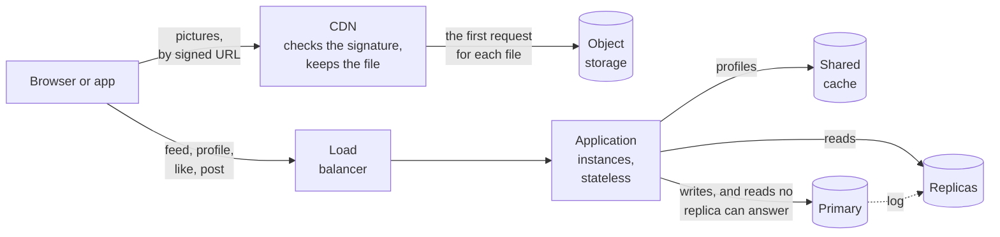

# Capstone 3: a photo-sharing app — the read path, and how stale each hop may be

[Syllabus](../SYLLABUS.md) · Phase 3 · Previous: [3.7 Long-lived connections](07-long-lived-connections.md)

> **Time:** three hours for your own design, then an hour and a half with the worked design.
> **You need:** all of Phase 3; from Phase 2, indexes (2.2) and the check-and-change statement (2.4). The reference implementation runs on the three PostgreSQL servers of Chapter 3.6.

Capstone 2 was about writes: a few rows that everybody wanted to change at once. This one is about reads. A photo is posted once and looked at thousands of times, from every continent, and almost none of those looks should reach the database.

Every chapter of this phase put a copy of the data somewhere nearer the reader: a CDN, a cache, a replica. Every copy is a little out of date. A design that uses all of them has to answer one question for each kind of data: *how out of date may this be, by the time someone sees it — and what guarantees that?* That answer, written as a table, is the main thing this capstone asks you to produce.

**How to use this page**

1. Read the brief.
2. Write your own design, on paper, against the task list. Give yourself a time limit.
3. Only then open the worked design and compare, section by section.
4. Run the reference implementation — and then run it with each safeguard removed.

---

## The brief

*From your product manager:*

> We are building the backend of a photo-sharing app.
>
> **What it must do**
> - People post photos, follow each other, and like photos.
> - The **feed** shows the newest photos from the people you follow. A **profile** shows one person's photos, with how many followers and photos they have.
> - An account can be **private**: only its followers may see its photos.
> - People can delete their photos.
>
> **How much**
> - **5 million people** use it each day. A typical person follows 200 accounts.
> - Each opens the feed about 12 times a day and loads 2 pages of 12 photos each time. Profiles are viewed 40 million times a day.
> - **2.5 million photos** are posted a day. Each is kept as an original (2 MB on average) and three smaller versions (400 KB together). What is sent to a phone averages 150 KB.
> - **100 million likes** a day.
> - Traffic at the evening peak is three times the average. A third of our users are on a different continent from our servers.
>
> **How well**
> - A page of the feed: 99% within 200 ms, measured at our servers. Pictures must come from somewhere near the user.
> - **What you do, you see.** Your own photo is on your profile the moment you post it. Your own like is counted the moment you tap.
> - **What others do, you may see a little late**: a new photo within 60 seconds; a like within 30 seconds; a change to someone's profile within 2 minutes.
> - **A deleted photo — or a photo in an account that has just been made private — must stop being shown to anyone else within 60 seconds. Everywhere.**
> - Losing any one server must not be an outage. A cache that restarts empty must not take the database down with it.
>
> **Constraints**
> - One PostgreSQL primary takes all writes. You may add replicas, a cache, object storage and a CDN.
> - The application is deployed several times a day.
>
> **Six months after launch**
> - An account with 3 million followers joins, and posts every day.

---

## Your task

Produce a design document of three or four pages. The suggested times add up to about three hours.

| # | Deliverable | Draws on | Time |
|---|---|---|---|
| 1 | Questions for the product manager, with the answers you will assume | 1.1 | 10 min |
| 2 | Estimates: requests, bytes, storage, and database work at the peak. What do they say must *not* reach your servers? | 1.1, 1.7 | 20 min |
| 3 | Where each kind of data lives, and which copy is the record | 2.8, 3.1 | 10 min |
| 4 | The path of a picture: its URL, the headers, the CDN, private accounts, deletion | 3.5 | 25 min |
| 5 | The feed: the query, its index, what it costs, and where it runs | 2.2, 3.6 | 20 min |
| 6 | Read routing: which server answers a read; how people see their own changes; what happens to a replica that falls behind | 3.6 | 20 min |
| 7 | The cache: what goes in, under what key, for how long, and how it is invalidated. What stays out, and why | 3.3 | 20 min |
| 8 | The cache on a bad day: a restart, a popular entry expiring, the account with 3 million followers | 3.4 | 10 min |
| 9 | **The staleness budget**: for each kind of data, each hop it passes, what each may add, and the total against the brief | all | 20 min |
| 10 | The application tier: state, load balancing, health checks, deploys | 3.1, 3.2 | 10 min |
| 11 | Telling people that something has happened, live | 3.7 | 10 min |
| 12 | **What breaks first as it grows — in order** | all | 10 min |

The two standing rules:

- **Every number has a source**: the brief, arithmetic you show, or an assumption you label.
- **Choose.** Pick an option, give the reason, and name what you gave up.

And one for this capstone:

- **For every bound on staleness, say what enforces it when the thing you were relying on fails.** *We delete the cache entry when the data changes* is the weakest answer: it says what happens when everything works. An expiry time is the strongest: it holds whatever else goes wrong.

---

## Worked design

<details>
<summary><strong>Open only after writing your own.</strong></summary>

### 1. Questions and assumptions

| Question | Assumed answer |
|---|---|
| *Stop being shown within 60 seconds* — does that include a copy already in someone's browser? | No. We cannot reach into a browser (Chapter 3.5). It means: nothing of ours serves it after 60 seconds. |
| Is the feed strictly newest-first, or ranked? | Newest-first. Ranking is a different system. |
| May a like count be approximate? | It may be late, by up to 30 seconds. It may not be wrong. |
| Must followers be *told* about a new photo, or only find it when they next look? | Find it. A live notification is welcome, and is not allowed to be the only way (section 11). |
| When an account becomes private, what happens to followers it already has? | They stay. Everyone else loses access, within the 60 seconds. |
| Who may see how many followers a private account has? | Anyone. Only photos are private. |

### 2. Estimates

At the peak — three times the daily average:

| | Per day | Average | Peak |
|---|---|---|---|
| Pages of the feed: 5 M × 12 × 2 | 120 million | 1,400 /s | **4,200 /s** |
| Pictures: 120 M pages × 12 | 1.44 billion | 17,000 /s | **50,000 /s** |
| Profile views | 40 million | 460 /s | 1,400 /s |
| Likes | 100 million | 1,160 /s | 3,500 /s |
| Photos posted | 2.5 million | 29 /s | 90 /s |

**Bytes out.** 50,000 pictures a second × 150 KB = 7.5 GB a second: **60 Gbit/s** at the peak, and about 216 TB a day.

**Storage.** 2.5 million photos × 2.4 MB = **6 TB a day**, about 2.2 PB a year, of files that never change. The database rows are small by comparison: 2.5 million photo rows a day. The table of likes is the one that grows — 100 million rows a day; at an assumed 80 bytes for a row and its index entry, 8 GB a day.

**Database work.** A page of the feed costs about 3 ms of one processor core (measured in section 5). 4,200 a second × 3 ms = **12.6 cores**, for the feed alone.

Three conclusions, and they are the design:

1. **Pictures must never touch our servers on the way out.** 60 Gbit/s to three continents is a CDN's job.
2. **Reads must leave the primary.** Twelve cores of feed queries would leave the one machine that takes writes with little for anything else.
3. **Writes are small.** 3,600 a second, nearly all of them one-row likes, is within what one primary does (Capstone 2 measured 4,000 reservation attempts a second on four cores). Phase 5 is about what happens when it is not.

### 3. Where each kind of data lives



| Data | Lives in | Why |
|---|---|---|
| The picture files | Object storage, one object per photo and size, never modified | Large, immutable, read by key (Chapter 2.8) |
| Photos, follows, likes, users | PostgreSQL: the primary, and replicas | The record. Everything else is a copy of this or can be rebuilt from it |
| Copies of pictures | The CDN, and browsers | Near the user |
| Profiles | A shared cache | The same for every viewer, expensive to compute, asked for constantly |
| Where each user last read from | The shared cache | Needed by whichever instance serves their next request (Chapter 3.1) |
| Nothing | The application instances | So that any of them can be stopped |

Uploading is not this capstone's subject, but one decision belongs here: the picture's bytes do not pass through the application. The app asks for a place to put them and is given a URL that allows an upload to that one place, for a short time — "You may use presigned URLs to allow someone to upload an object to your Amazon S3 bucket" ([AWS docs](https://docs.aws.amazon.com/AmazonS3/latest/userguide/PresignedUrlUploadObject.html)) — and then tells the API that the photo exists. Making the smaller versions is work for a queue (Phase 4).

### 4. The path of a picture

**The URL names the file, and the file never changes.** `/img/{photo}/{size}`. An edited photo is a new photo with a new ID. So the response can say `Cache-Control: public, max-age=31536000, immutable`, and the CDN may keep it for as long as it likes (Chapter 3.5).

**But a deleted photo must be gone in 60 seconds, and "as long as it likes" is a year.** Three ways to reconcile them:

| | How | Why not |
|---|---|---|
| A short lifetime | `s-maxage=60` | Most photos are seen by a few hundred followers spread over a day. At any one CDN location, the same photo is almost never asked for twice within a minute — so nearly every request would be passed back to the origin. The CDN would stop being one |
| Purge | Tell the CDN to drop the file when it is deleted | Right, and not enough: a purge is a request that can fail, and nothing bounds the damage if it does. Chapter 3.5 listed *depending on a purge for correctness* among the mistakes |
| **Signed URLs that expire** | The API hands out picture URLs that work for 60 seconds. The CDN checks the signature and the expiry itself, on every request, then serves its long-lived copy | **Chosen** |

With signed URLs, deleting a photo means *ceasing to hand out URLs for it*. Every URL already handed out dies within 60 seconds, whether or not the purge arrives. The purge is still sent, so that the bytes go too.

The CDN keeps one copy per file, under the path without the signature, so everyone who is allowed to see a photo shares it. And the same mechanism is the whole of privacy for pictures: the API gives a URL only to someone who may see the photo. Object storage itself accepts requests from the CDN and from nothing else.

**What this costs.** A browser treats each new URL as a new file, so its own cache is used only within a URL's lifetime; a second look later fetches the bytes again from the CDN's edge. If that traffic matters, CDNs offer signed *cookies* for the case where "You don't want to change your current URLs" ([AWS docs](https://docs.aws.amazon.com/AmazonCloudFront/latest/DeveloperGuide/private-content-choosing-signed-urls-cookies.html)): the expiry moves into a cookie, the URL stays the same, and the browser's cache works again.

**Everything that is not a picture is `private, no-store`.** A feed is one person's. A CDN that kept it would hand it to the next person who asked (Chapter 3.5; the reference implementation counts how many).

### 5. The feed

```sql
SELECT p.id, p.author_id, p.likes
FROM follows f
CROSS JOIN LATERAL (SELECT id, author_id, likes FROM photos
                    WHERE author_id = f.followee_id ORDER BY id DESC LIMIT 12) p
WHERE f.follower_id = $1
ORDER BY p.id DESC LIMIT 12;
```

For each account the user follows, an index on `photos (author_id, id DESC)` gives that account's 12 newest photos without looking at the rest. The newest 12 of all of those are the page. (The next page adds `AND id < $2` inside: keyset pagination, Chapter 1.4.)

Measured on PostgreSQL 16 with 2 million photos, for a user following 200 accounts: 200 visits to the index, 2,400 rows, about 3,000 buffer reads — **3.0 ms** with the data in memory. The cost depends on how many accounts the user follows and on nothing else. It does not grow with the number of photos or users.

The obvious query — join `follows` to `photos`, sort, take 12 — was *faster* on the test data: 0.9 to 1.7 ms. The planner read the photos newest-first and stopped when it had 12 by followed accounts, which took about 1,000 rows, because in a test population of 20,000 each user follows one account in a hundred. Follow 200 accounts out of five million, and that plan would read some 300,000 photos to find 12; the planner's alternative is to fetch every photo that every followed account has ever posted, and sort them. It is a query that passes every test and fails in production (Chapter 2.2). The lateral form says what is meant, and costs the same at any size.

**The feed is not cached.** It is different for every user, and a user seldom asks for the same page twice within a few seconds, so a cache would be mostly misses. It is read from a replica: 12.6 cores at the peak is two replicas' work, and a third so that one can be lost.

### 6. Which server answers a read

Three rules. The reference implementation's `reader` function is these and nothing more.

1. **Each user has a replica of their own**, chosen by their ID from the replicas in use. Reading from one server, they see time move only forwards (Chapter 3.6).
2. **A user may move to a different server only if it has caught up with the moment they last looked.** "Looked" includes writing, which is a look at the primary. So after liking a photo, a user's next read goes to their replica only if it has had time to receive the like; otherwise to the primary. The same rule covers a user whose replica is taken away: they move to another only if it is not behind what they have seen.
3. **A replica more than one second behind is given no reads**, until it catches up. If none qualifies, reads go to the primary.

Rule 2 replaces Chapter 3.6's *read from the primary for a second after writing*. It is the position technique from that chapter, and it gives both guarantees at once: people see their own writes, and nobody sees the past. The primary receives only the reads that no replica could answer correctly.

How far each replica has got is measured by writing the time on the primary ten times a second and reading it back on each replica. (The reference implementation compares times, which is sound on one machine. Across machines, compare positions in the log: Chapter 3.6 has the SQL.)

Rule 3 is what makes "at most one second" true of a replica, and so it appears in every row of the budget in section 9.

### 7. The cache

**In: profiles.** A profile is the same for everyone who may see it. It needs several queries, one of which counts followers. And a few accounts' profiles are asked for constantly.

- Key `profile:{user}`; what is stored is the data — counts and photo IDs — not the signed URLs, which are made fresh for each response.
- Whether *this* viewer may see a private profile is checked on every request, outside the cached value.
- Lifetime 45 seconds. Deleted when its owner posts or deletes (Chapter 3.3).

**Out: feeds** (section 5), **and like counts**, which arrive with the feed from a replica at most a second old. Section 9 shows that both have budget to spare; the cache can take them on the day the replicas need relief.

**The trap: a cache in front of a replica.** Ana deletes a photo. The application deletes `profile:ana`. A moment later Ben asks for her profile: nothing is cached, so it is loaded — from Ben's replica, which is 300 ms behind and still has the photo — and that goes into the cache, for 45 seconds, for everybody. The invalidation worked, and the cache is stale anyway.

Facebook's engineers describe the same problem and their answer to it: "We employ a remote marker mechanism to minimize the probability of reading stale data. The presence of the marker indicates that data in the local replica database are potentially stale and the query should be redirected to the master region" ([Nishtala et al., *Scaling Memcache at Facebook*](https://www.usenix.org/system/files/conference/nsdi13/nsdi13-final170_update.pdf)). Here: before writing, set `changed:profile:ana` for 1.5 seconds — longer than any replica in use can be behind. A request that finds nothing cached and finds the marker loads from the primary.

One more guard, from Chapter 3.3: a load that began before the deletion must not store what it read after it. The cache refuses a value for a key that was deleted while the value was being fetched.

### 8. The cache on a bad day

- **A popular profile expires.** A thousand requests arrive in the time one load takes. The cache lets one of them load and makes the others wait for it (Chapter 3.4).
- **The cache restarts empty.** Every profile request is a miss until it refills: at the peak, 1,400 a second, several queries each, against replicas that are already doing 12 cores of feeds. Bounded by coalescing — one load per profile, not per request — and by a limit on how many loads run at once; the rest wait or are refused (Chapter 6.4).
- **The cache is unreachable.** The same as empty, for longer. The limit on concurrent loads is what stands between that and Chapter 3.4's opening scene.
- **The account with 3 million followers.** Counting an ordinary account's 200 followers took 0.06 ms. Counting 3 million took **73 ms**, on three cores at once. That query must never run once per viewer, and it should not run at all: keep the number in a column, changed in the same transaction as the follow (Chapter 2.4). Then serve that profile stale while one request refreshes it (Chapter 3.4), so that its expiry is never felt.

### 9. The staleness budget

For each kind of data: every hop between the record and the eye, what each may add, and what holds the total when an invalidation is missed.

| What someone sees | Allowed | Hops, and what each adds | Worst case | What enforces it |
|---|---|---|---|---|
| Their own photo, on their own profile | 0 | Cache: deleted on the write, and reloaded from the primary while the marker stands | 0 | The marker; the lease |
| Their own like, in the count | 0 | Their replica, only if it has caught up; else the primary | 0 | Rule 2 |
| A new photo, in a follower's feed | 60 s | Replica | **1 s** | The lag limit |
| A like, in the count others see | 30 s | Replica | **1 s** | The lag limit |
| A new photo, on the profile others see | 120 s | Cache 45 s + replica 1 s | **46 s** | The cache lifetime; the lag limit |
| A deleted photo, listed in a feed | 60 s | Replica | **1 s** | The lag limit |
| A deleted photo, listed on a profile | 60 s | Cache: deleted on the write. If that is missed: 45 s + 1 s | **46 s** | The cache lifetime |
| A deleted photo's picture | 60 s | CDN: purged. If that is missed: until the URL expires | **60 s** | The URL's expiry |
| A picture from an account just made private | 60 s | No new URLs are given to non-followers; old ones expire | **60 s** | The URL's expiry |

Three things to read in it.

**Every bound ends in a clock.** The lag limit, the cache lifetime and the URL's expiry each hold without any message being delivered. The deletions and the purge make the usual case fast; the clocks make the worst case finite.

**The numbers constrain each other.** The profile's lifetime is 45 seconds, not 60, because a replica's second has to fit inside the same minute. The marker lasts longer than the lag limit, or it would protect nothing.

**The first rows have 59 and 29 seconds to spare.** That is capacity not yet spent. When the replicas run out, feeds and counts can be cached for most of a minute without breaking the brief — and section 12 says when.

### 10. The application tier

- **Stateless.** The session is a signed cookie or a row in the shared store (Chapter 3.1). The one piece of per-user state this design adds — where a user last read from — is in the shared cache.
- **Balanced at layer 7**, to the instance with the fewest requests in progress, with a health check that asks the instance itself and nothing behind it (Chapter 3.2).
- **Requests that are safe to repeat are retried on another instance** if the first does not answer at all: every read, and a like, which the database makes idempotent. Posting a photo is not retried by the balancer; the app retries it with an idempotency key (Chapter 1.5).
- **Deploys** drain: fail the health check, finish what is in progress, exit (Chapter 3.2).
- **Sized by load test**, as in Capstone 1, for about 9,200 requests a second at the peak, plus two instances: one being deployed, one lost.

### 11. Telling people, live

A notification — *Ben liked your photo* — and the feed's *new posts* marker are server-to-client: one SSE stream per open app, held by a separate small service (Chapter 3.7). Each message is a hint; the app then asks the API, through everything above. A missed hint costs nothing, because the feed finds new photos anyway when it is next opened.

One hint needs care. When the account with 3 million followers posts, *new posts* would reach every follower who is online at the same instant, and each would fetch their feed: a stampede caused by the system's own message. Spread it — each app waits a random few seconds before fetching — or do not send that hint for accounts above some size.

### 12. What breaks first

1. **The account with 3 million followers**, in three places. Its profile (section 8). Its photos' likes: if one follower in twenty likes a photo within ten minutes, that is 250 updates a second to one row, each waiting for the last (Chapter 2.4) — adding likes up in batches is Phase 4. And its hints (section 11). Its photo reaching 3 million feeds is *not* a problem: nothing is written per follower. Each follower's own query finds it.
2. **Replica lag under a burst of writes.** The lag limit takes a slow replica out of use — and sends its reads to the others, or to the primary, at the moment the primary is busiest. A limit that sheds replicas must come with a decision about what is shed next: serve feeds a little staler (the budget allows 60 seconds), or refuse some (Chapter 6.4).
3. **People who follow thousands of accounts.** The feed's cost is proportional to that number. Past some point the feed has to be prepared when photos are posted, not when it is read: a queue and a worker (Phase 4).
4. **The feed on replicas.** When 12 cores become 40, spend the spare budget: cache each user's first page for 30 seconds.
5. **The table of likes**, at 100 million rows a day: partition it (Chapter 5.3).
6. **The primary**: one machine, and everything written passes through it (Phase 5).
7. **One region.** The CDN brings pictures near users on other continents. Their feed requests still cross an ocean (Phase 5).
8. **The bill.** 216 TB a day leaving a CDN is the largest line on it (Chapter 9.8).

</details>

---

## Reference implementation

[`code/capstone-photos/main.go`](code/capstone-photos/main.go) is the worked design in about 1,300 lines of Go. Half is the system: an edge that is both the CDN's cache and the load balancer, three application instances, a shared cache, object storage, and the read routing of section 6. Half is a test that keeps its own record of everything that happens and checks every answer against it.

PostgreSQL is real: the primary and two replicas of Chapter 3.6, one of them held 300 ms behind. The edge, the cache and object storage are stand-ins inside the program, so the times printed are local ones.

```bash
bash phase-3-scaling-out/code/ch06-replicas/cluster.sh start
```

### Ten requests, hop by hop

```bash
go run ./phase-3-scaling-out/code/capstone-photos demo
```

```text
 1. Ana opens her feed
      12 photos                          edge (not for keeping) > app-2 > replica B
 2. Her browser asks for the first picture
      200 in 0.5 ms                      edge MISS > app-3 > object storage
 3. Ben is shown the same photo, with a URL of his own
      200 in 0.3 ms                      edge HIT
 4. Ana posts a photo, and looks at her own profile at once
      her new photo is there: true       edge (not for keeping) > app-2 > cache miss > primary (this profile changed a moment ago)
 5. Ben, who follows her, looks 100 ms later
      the new photo is there: true       edge (not for keeping) > app-3 > cache hit
 6. Cy looks a second and a half after that
      the new photo is there: true       edge (not for keeping) > app-1 > cache hit
 7. Ana likes the first photo, and her feed reloads
      likes: 0, then 1                   edge (not for keeping) > app-3 > primary (this user's replica has not caught up with what they last saw)
 8. Eve asks for the profile of Dee, whose account is private
      403                                edge (not for keeping) > app-1 > cache miss > replica B > refused: a private account
 9. Ana deletes her new photo. Ben's browser asks for the picture again
      404 in 0.3 ms                      edge MISS > app-1 > object storage
10. 6 seconds later, the URL from step 2 is used again
      403 in 0.6 ms                      edge: refused, the URL has expired or was not signed by us
```

(The program divides every lifetime and budget by ten, so that a short run exercises them: a URL lasts 6 seconds, a cached profile 4.5.)

Each line is the route one request took. Step 1: the feed is not kept at the edge, and is read from Ana's replica — the slow one. Steps 2 and 3: the picture is fetched once and then shared, though Ben's URL has a different signature. Step 4 is section 7's marker: Ana's profile had just changed, so the load went to the primary — and step 5 shows why that matters, because what it loaded is what Ben was then given from the cache. Step 7 is rule 2: replica B is 300 ms behind and Ana liked the photo a millisecond ago. Steps 9 and 10 are the two ways a picture stops being served: purged, and expired. Nothing in step 10 reached an application instance.

### Under load, with every answer checked

1,200 users for 20 seconds. Each does something about once a second: six times in ten they open the feed and load pictures; otherwise they look at profiles, like, post, or delete. That is a far higher share of writes than real use, deliberately. The test knows what has been posted, liked and deleted, and when, and compares every answer with it.

```bash
go run ./phase-3-scaling-out/code/capstone-photos load
```

```text
1200 users for 20 seconds. Lifetimes and budgets are a tenth of the design's.

WHERE READS WERE ANSWERED
  images      49447   edge HIT 94.5%   object storage 4.9%   refused 0.6%
  feeds       13044   replica 92.1%   primary 7.9%
  profiles     9596   cache hit 65.7%   replica 23.6%   primary 10.7%
  a feed took 0.7 ms (median), 4.2 ms (99th percentile)

THE DATABASE
  primary       2290 writes,   2060 reads
  replica A                    7461 reads     at the end: at most 102 ms behind, in use
  replica B                    7540 reads     at the end: at most 307 ms behind, in use

HOW STALE WERE THE ANSWERS?                       budget   worst seen
  a new photo, missing from a follower's feed           6.0 s        0.3 s
  a like, missing from the count others see             3.0 s        0.3 s
  a deleted photo, still listed                         6.0 s        0.3 s
  a deleted photo's picture, still served               6.0 s        0.0 s
  a new photo, missing from the profile others see     12.0 s        0.0 s

CHECKS
  answers staler than their budget                          0
  users who did not see their own photo or like             0
  users shown an older feed than one they had seen          0
  users shown somebody else's feed                          0
  private profiles shown to someone not allowed             0
  image URLs that still worked after expiring               0
  requests that failed                                      0
```

(Counts vary a little from run to run. The checks do not.)

- **Of 72,000 reads, the primary answered about 2,000.** Pictures were answered at the edge nineteen times in twenty. Two thirds of profiles came from the cache. Every feed came from a database, and nine in ten from a replica.
- **The stalest answer anyone received was 0.3 seconds old** — replica B's lag, as section 9 predicts. The budgets were never approached, because nothing failed. The runs below make things fail.
- **The primary's 2,060 reads** are users reading just after writing, and profiles loaded while a marker stood. These users write once in ten seconds. Real ones write far less, and the share falls with it.
- ***At most 102 ms behind*** is as fine as a measurement made ten times a second can be. Chapter 3.6 measured the same replica at half a millisecond.

### Remove one safeguard at a time

Each of these runs the same load with one line of defence switched off. Only the lines that change are shown.

```bash
go run ./phase-3-scaling-out/code/capstone-photos load -without read-rule
```

```text
  feeds       13041   replica 100.0%
  users who did not see their own photo or like           687
```

Without rule 2, every read goes to the user's replica. 687 times, someone liked a photo or posted one, looked, and did not find it.

```bash
go run ./phase-3-scaling-out/code/capstone-photos load -without private-header
```

```text
  feeds       12029   replica 0.2%   edge HIT 99.8%
  users shown somebody else's feed                      11999
```

One header, `public` where `private` should be, on the feed. The edge kept one person's feed for two seconds at a time, and gave it to everyone who asked. The database had a very quiet twenty seconds. This is Chapter 3.5's opening scene, and the hit ratio would have looked excellent on a dashboard.

```bash
go run ./phase-3-scaling-out/code/capstone-photos load -without marker
```

```text
  a deleted photo, still listed                         6.0 s        2.1 s
```

The trap of section 7. A deleted photo stayed on its owner's cached profile for 2.1 seconds, where the worst had been 0.3: the entry was deleted, refilled from a replica that had not yet heard, and then served until it expired. It is inside the budget for one reason only — the entry's lifetime was chosen to be. That is the rule of this capstone at work: the deletion was defeated, and the clock held.

```bash
go run ./phase-3-scaling-out/code/capstone-photos load -without purge
```

```text
  a deleted photo's picture, still served               6.0 s        5.4 s
```

With no purge, the edge went on serving a deleted picture to URLs handed out before the deletion — for 5.4 seconds, and not for 6.2, when those URLs had expired. In the design that is 54 seconds against a budget of 60. The purge is what makes it zero; the expiry is what makes it never more than a minute.

### Break something half-way through

```bash
go run ./phase-3-scaling-out/code/capstone-photos load -drill replica
```

Eight seconds in, replica A is told to stop applying changes (PostgreSQL's `pg_wal_replay_pause()`). It goes on answering queries, from a moment that recedes into the past.

```text
  replica A                    3400 reads     at the end: at most 21 s behind, taken out of use
  replica B                   11596 reads     at the end: at most 306 ms behind, in use
  a new photo, missing from a follower's feed           6.0 s        0.9 s
  answers staler than their budget                          0
```

A second later the lag limit took A out of use, and its users moved to B. The stalest answer was 0.9 seconds old. Now the same failure without the limit:

```bash
go run ./phase-3-scaling-out/code/capstone-photos load -drill replica -without lag-limit
```

```text
  replica A                    5678 reads     at the end: at most 21 s behind, in use
  a new photo, missing from a follower's feed           6.0 s       11.8 s
  a like, missing from the count others see             3.0 s       11.8 s
  answers staler than their budget                       5554
  users who did not see their own photo or like             0
```

Half the users spent twelve seconds looking at a feed that had stopped. No error was logged anywhere: a replica that has stopped replicating answers every query promptly. The last line is worth a look, too. Even here nobody missed their *own* change, because rule 2 sent them to the primary whenever A had not caught up with them. The two rules guard different things.

```bash
go run ./phase-3-scaling-out/code/capstone-photos load -drill instance
```

```text
DRILL: after 8 seconds, app-3 dies.
  requests that failed                                      0
```

One of three instances stopped without warning, and no request failed: the edge sent each unanswered request to another instance, and left the dead one alone for two seconds at a time. A photo being posted through the dead instance at that instant would have failed, since the edge does not repeat it; in this run none was.

```bash
bash phase-3-scaling-out/code/ch06-replicas/cluster.sh stop
```

---

## Review your own design

Check your design against these. Each is a mistake that an experienced reviewer would look for.

- [ ] Did your estimates tell you what must **not** reach your servers — and what must not reach the primary?
- [ ] Do picture URLs name **immutable** files? Can the CDN keep them for a long time?
- [ ] What makes a deleted picture stop being served if the **purge fails**?
- [ ] Is anything that differs between users marked so that a shared cache will **never** keep it?
- [ ] Is the feed query's cost independent of the number of photos and users? Did you look at its **plan**, on data shaped like production?
- [ ] After someone likes a photo, where does their next read go — and **why** is that enough?
- [ ] Can a user's view go **backwards** when they are moved from one server to another?
- [ ] What happens to a replica that **stops replicating** but still answers queries?
- [ ] For each thing you cache: what is the key, the lifetime, and the invalidation — and what did you decide **not** to cache?
- [ ] Can a cache entry be refilled from a **replica that has not yet heard** about the change that deleted it?
- [ ] What does the database see when the cache **restarts empty**?
- [ ] Is there a row in your budget for **every** kind of data in the brief, with a total, and something that enforces it without a message having to arrive?
- [ ] Does any instance hold anything that would be lost if it were stopped?
- [ ] Can you say what breaks **first**?

---

## Extensions

1. **Cache the first page of the feed** for 30 seconds, and measure the hit ratio under this load. Then decide whether section 5 was right.
2. **The big account.** Give one user 100,000 followers in the reference implementation, add the `followers` column of section 8, and compare its profile's load time with and without it.
3. **Positions, not times.** Replace the clock in the read rule with log positions (`pg_current_wal_lsn()` and `pg_last_wal_replay_lsn()`, as in Chapter 3.6), so that it would be correct across machines.
4. **Stale-while-revalidate for profiles** (Chapter 3.4): serve an expired profile while one request reloads it. What does that add to the budget?
5. **Make an account private** mid-run. Add it to the test's record, and check the 60 seconds: for pictures, and for the profile in the cache.
6. **A hint that causes a stampede.** Add Chapter 3.7's stream; send *new posts* to every follower of a popular account; count the feed requests in the following second, with and without a random delay.
7. **Drain it.** Replace the instance drill with a graceful shutdown (Chapter 3.2) and a deploy that replaces all three instances under load. The number of failed requests should be zero, including photos being posted.

---

## Sources

This capstone applies the chapters of Phase 3, where the sources for each technique are given. The passages quoted directly:

- Rajesh Nishtala et al., [*Scaling Memcache at Facebook*](https://www.usenix.org/system/files/conference/nsdi13/nsdi13-final170_update.pdf), NSDI 2013 (remote markers).
- AWS documentation: [*Uploading objects with presigned URLs*](https://docs.aws.amazon.com/AmazonS3/latest/userguide/PresignedUrlUploadObject.html); [*Deciding to use signed URLs or signed cookies*](https://docs.aws.amazon.com/AmazonCloudFront/latest/DeveloperGuide/private-content-choosing-signed-urls-cookies.html).
- PostgreSQL documentation: [recovery control functions](https://www.postgresql.org/docs/current/functions-admin.html) (`pg_wal_replay_pause`, used by the replica drill).

All output shown was produced by the reference implementation on PostgreSQL 16. The feed and follower-count timings in sections 5 and 8 were measured separately, on tables of 2 million photos and 7 million follows.

**Next:** [Phase 4 — Asynchronous systems](../phase-4-async/README.md): queues, streams and background work, which take on the items of *what breaks first* that say "a queue". It begins with [4.1 Why go asynchronous](../phase-4-async/01-why-asynchronous.md).
