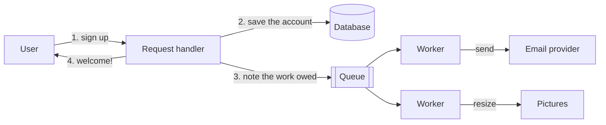

# 4.1 Why go asynchronous

[Syllabus](../SYLLABUS.md) · Phase 4 · Previous: [Capstone 3](../phase-3-scaling-out/capstone-photo-sharing.md) · Next: 4.2 Message queues *(planned)*

> **Time:** about 30 minutes to read, 40 minutes of practice.
> **You need:** timeouts, retries and idempotency from [Chapter 1.5](../phase-1-foundations/05-timeouts-retries-idempotency.md), and queues inside a server from [Chapter 1.6](../phase-1-foundations/06-concurrency-pools-queues.md). The example needs only Go.

**By the end of this chapter you can**

- sort the steps of a request into those that must happen before the answer and those that can happen after;
- name the three things a queue buys: a faster answer, independence from a dependency's bad afternoon, and a level load;
- name what it costs: no immediate result, errors with nobody waiting to hear them, overload that shows up as delay, and work that can be lost or done twice;
- recognise work that must not be deferred.

---

## The problem

*An illustrative scenario; the example reproduces it at small scale.* Signing up for a product takes eight seconds. The handler saves the account, sends a welcome email, sends a verification email, tells the sales team, resizes the avatar into four sizes, and reports the sign-up to the analytics system. Each step was added by someone for a good reason, and each waits for the one before.

Then the email provider has a bad afternoon. Its API answers slowly, then not at all. For two hours nobody can sign up — because a welcome message could not be sent.

Those are two different failures with one cause:

- **The user waits for the sum of every step**, including steps whose result they never see.
- **The request succeeds only if every step does.** Chapter 1.1's rule was that dependencies in series multiply: the sign-up had become exactly as available as its least reliable step.

Neither is necessary. Of the six things the handler does, the user needs one before being told *welcome*: the account must exist. The rest must happen — soon, and certainly — but not while they watch.

---

## The concept

### 1. One question for each step

*Does the answer depend on it?*

- **Yes** — the step produces what the response says, or decides whether the request succeeds. Saving the account. Checking a password. Authorising a payment: the user must be told whether it worked. These stay in the request.
- **No** — it must happen, but the user can be answered without it. A welcome email. Other sizes of a picture. Updating a search index. Telling another system. These can be done after the response.

When unsure, ask what the user would be *told* if the step failed. If the honest answer is *nothing — we would just try again*, the step does not belong in the request.

### 2. The shape

The handler does the necessary part, makes a note of the work that is owed, and answers. Something else does the work.



The words, which the rest of this phase uses:

- A **job** (or *message*, or *task*): one piece of work that is owed, written down. *Send the welcome email to user 42.*
- A **producer** writes jobs. Here, the request handler.
- A **queue** holds them until someone takes them. The software that provides queues is a *broker*.
- A **worker** (or *consumer*) takes a job, does it, and says that it is done.

This is the queue of Chapter 1.6 moved outside the process, where it can be seen, measured, and — from the next chapter on — made to survive a restart.

For an API whose caller is a program, HTTP has a status code for *I have taken this on and not yet done it*: "The 202 (Accepted) status code indicates that the request has been accepted for processing, but the processing has not been completed" ([RFC 9110](https://www.rfc-editor.org/rfc/rfc9110.html)). The response gives the caller somewhere to ask how the work is going.

### 3. What it buys

**A faster answer.** The user waits for the necessary part only. The total work is unchanged; it has moved to where nobody is waiting for it.

**Independence.** The email provider's outage is no longer the sign-up's outage. Jobs wait in the queue; workers retry; when the provider returns, the emails go out late. A hard dependency has become one that can be down for an hour without a user noticing.

**A level load.** Requests arrive in bursts; the things behind them often cannot take bursts. A queue between the two lets work arrive unevenly and be done steadily. Microsoft's catalogue of cloud patterns names this *queue-based load leveling*: "Use a queue that acts as a buffer between a task and the service that it invokes. This approach smooths intermittent heavy loads that might cause the service to fail or the task to time out" ([Azure Architecture Center](https://learn.microsoft.com/en-us/azure/architecture/patterns/queue-based-load-leveling)). The number of workers becomes a control: it sets the most work that will ever be attempted at once, whatever the arrival rate. That is how to stay inside a rate limit that someone else sets.

**Patient retries.** A request handler can retry for a second or two before the user gives up (Chapter 1.5). A worker can retry for an hour, with long pauses, and nobody is kept waiting.

Slack describes its own use in exactly these terms: "Slack uses a job queue system for business logic that is too time-consuming to run in the context of a web request. This system is a critical component of our architecture, used for every Slack message post, push notification, URL unfurl, calendar reminder, and billing calculation. On our busiest days, the system processes over 1.4 billion jobs at a peak rate of 33,000 per second" ([Slack Engineering, *Scaling Slack's Job Queue*](https://slack.engineering/scaling-slacks-job-queue/)).

### 4. What it costs

Each benefit has a price, and the prices are easier to overlook.

**No immediate result.** The user is told *accepted*, not *done*. If they need to know when it is done — an export, a video that is being processed — the system needs a way to tell them: a status they can poll, or a message pushed to them (Chapter 3.7). And for a moment after the response, the world is half-changed. The account exists and the avatar does not. Pages must be designed for *not yet*.

**Errors with nobody waiting.** When a step fails inside a request, there is a user to tell. When a job fails at three in the morning, there is nobody. The failure has to be recorded, retried, and — when retrying does not help — put somewhere a person will see it (Chapter 4.2).

**Overload looks like delay.** A request path that is overloaded fails loudly: errors, timeouts. A queue that is overloaded simply grows, and everything in it gets later. Amazon's engineers describe where that leads: "In a queue-based system, when processing stops but messages keep arriving, the message debt can accumulate into a large backlog, driving up processing time. Work can be completed too late for the results to be useful, essentially causing the availability hit that queueing was meant to guard against" ([AWS Builders' Library, *Avoiding insurmountable queue backlogs*](https://aws.amazon.com/builders-library/avoiding-insurmountable-queue-backlogs/)). A password-reset email that arrives after forty minutes has not been delivered in any sense the user cares about. Chapter 4.6 is about measuring and bounding this.

**Lost, or done twice.** Between *accepted* and *done* the job exists only in the queue. If the queue is the memory of a process, a restart loses it. If a worker dies half-way, either the job is lost or somebody else does it again — and then it may be done twice. Chapter 4.2 makes the queue durable, and Chapter 4.3 makes doing a job twice harmless.

**One more system.** A queue has to be run, sized, monitored and paid for. It also has to agree with the database: *the account was saved but the job was never written* is a new way to fail, with a chapter of its own (4.5).

### 5. What must not be deferred

- **Anything the response reports.** *Payment accepted* must be true when it is said.
- **Anything whose failure changes what the user should do next.** An invalid address on a form is fixed now, by the person who typed it, or never.
- **Anything that takes less time than writing a job.** A queue is not free; a five-millisecond step gains nothing by going through one.
- **Anything that must be all-or-nothing with the database write.** That is what a transaction is for (Chapter 2.3).

---

## A real example

### Run it: the same sign-up, two ways

[`code/ch01-background/main.go`](code/ch01-background/main.go) is about 300 lines with no dependencies. Signing up saves an account (5 ms), sends an email through a provider (50 ms when it is well), resizes an avatar (400 ms) and tells analytics (100 ms). The queue is a list in the program's memory — on purpose, as the last part shows.

```bash
go run ./phase-4-async/code/ch01-background
```

```text
PART 1 — one person signs up.

                                         the user waits everything is finished after
  all of it before answering                     556 ms                     556 ms
  save, queue the rest, answer                     5 ms                     406 ms
```

The user's wait went from 556 ms to 5 ms. The work did not get smaller: the avatar still took 400 ms. (It all finished sooner only because separate workers did the three jobs side by side.)

```text
PART 2 — 50 people sign up over five seconds. For three of those seconds the email provider is down.

                                      sign-ups failed      median wait     longest wait    welcome emails sent
  all of it before answering                 30 of 50            1.0 s            1.0 s             20 of 50
  save, queue the rest, answer                0 of 50             5 ms             6 ms             50 of 50   (the last, 3.7 s late)
```

Done inline, the provider's three seconds were the product's three seconds: thirty people waited a full second each — the timeout — and were then refused. Thirty accounts had been saved all the same, and thirty people were told otherwise. With a queue, nobody noticed. Every email was sent, the latest of them 3.7 seconds after its sign-up, by workers that kept trying.

```text
PART 3 — 200 people sign up within one second. The email provider accepts 20 emails a second.

                                      sign-ups failed     longest wait    welcome emails sent
  all of it before answering               159 of 200           558 ms              41 of 200
  save, queue the rest, answer                0 of 200             6 ms             200 of 200   (the last, 9.0 s late)

  emails waiting in the queue, second by second:  164 160 140 120 101 81 61 41 21 2 0
```

A burst of 200 against a limit of 20 a second. Inline, each sign-up called the provider the moment it arrived, and 159 were turned away. With a queue and **one worker** — one worker at 50 ms an email is 20 a second, exactly the limit — all 200 were sent. The last line is load levelling to look at: the burst arrived in one second and left at a steady 20 a second for ten. (People were still arriving during the first second.)

That last email was nine seconds late. For a welcome message, nobody minds. But the number is the product of an arrival rate, a service rate and a duration, and nothing in the system limits it. Double the burst and it is nineteen seconds.

```text
PART 4 — the same 200 sign-ups, all answered "welcome!". Three seconds later the process is restarted
         for a deploy. The queue was in its memory.

  sign-ups that were told they had succeeded      200
  welcome emails sent before the restart           61
  welcome emails that will now never be sent      139
  record that they were owed                     none
```

Two hundred people were told that they had signed up, which was true. A hundred and thirty-nine of them will never get the email, and nothing anywhere records that they should have. No error was returned, and none was logged. This is what Part 2's good result was resting on: the jobs existed only in the memory of one process.

Every in-process way of doing something *later* has this property — a goroutine, a thread pool, a list like this one. It is fine for work that may be dropped, and it is not a queue in the sense the rest of this phase means. That starts in Chapter 4.2, where a job is held somewhere that survives a restart, and is not forgotten until a worker says it is done.

---

## Trade-offs

**Asynchronous work is faster to answer and harder to reason about.** A request that does everything inline either worked or did not. One that queues work has a third state, *accepted*, which can last milliseconds or hours, and every reader of the data has to cope with it.

**A queue converts failures into delays.** That is its purpose, and its danger. A dependency's outage becomes late emails, which is better. Sustained overload becomes later and later work, with no error to alert on — which is worse than an error unless the delay itself is watched.

**Workers set the pace, in both directions.** Few workers protect what is downstream and make the backlog drain slowly. Many drain it quickly and can flatten the thing they call. The right number comes from the limit of what they call, not from how impatient the backlog looks.

**Inline is simpler, and simple is worth a lot.** One step that takes 30 ms and almost never fails does not need a queue. Defer because a step is slow, or unreliable, or bursty — not because it is possible.

**Later means the handler no longer knows.** Whatever the handler would have done on failure — tell the user, roll back, try another provider — now has to be done by a worker, without the user present.

---

## Practice

### Check yourself

Answer before reading on.

1. Saving a document takes 900 ms: 20 ms to write it, 380 ms to update the search index, 500 ms to make a preview image. The objective is 200 ms. What moves out of the request — and what does the user see if they search for the document, or look at its preview, a tenth of a second after saving?
2. To make checkout faster, a team moves *charge the customer's card* into a background job, and shows *order confirmed* at once. What goes wrong?
3. Workers handle 100 jobs a second. Jobs normally arrive at 80 a second. For ten minutes they arrive at 150 a second, and then return to 80. How large is the backlog when the burst ends? How long does a job arriving at that moment wait? How long until the queue is empty again?

<details>
<summary>Answers</summary>

1. **The index and the preview move out**; the request does the 20 ms write and answers. A tenth of a second later neither is ready: the search does not find the document, and there is no preview. Both must be designed for. The preview shows a placeholder that is replaced when the image exists. Search is harder, because *not found* looks like a bug to someone who has just saved: the usual answer is to show the user's own recent documents from the database, which has them, and not from the index, which does not yet (the read-your-writes problem of Chapter 3.6, in a new place).

2. **The user is told something that is not yet known.** Some cards are declined. Those customers have seen *order confirmed*, closed the page, and perhaps been sent a confirmation email by another job that ran first. The order now has to be unwound — stock released, the customer told by email that the thing they were told had happened did not. The step fails the test of section 1: its result is what the response says. Either charge in the request, or show *we are processing your payment* and tell the customer the real result when it is known. What may not be done is to report success before there is one.

3. During the burst the queue grows by 150 − 100 = 50 jobs a second, for 600 seconds: **30,000 jobs**. A job arriving then waits for all of them: 30,000 ÷ 100 = **300 seconds**. Afterwards the queue shrinks by 100 − 80 = 20 a second: 30,000 ÷ 20 = **1,500 seconds, twenty-five minutes**. A ten-minute burst caused thirty-five minutes of late work, and at its worst everything was five minutes late. Recovery is slow because the spare capacity is small: with 200 jobs a second of workers during recovery it would take about four minutes. This arithmetic is the whole of Chapter 4.6.

</details>

### Exercise: take a checkout apart

An online shop's *place order* handler does these things in order, and takes about three and a half seconds.

| # | Step | Typical time |
|---|---|---|
| 1 | Check the basket: prices, and that every item is still sold | 30 ms |
| 2 | Reserve the stock | 20 ms |
| 3 | Charge the card through a payment provider | 1,200 ms |
| 4 | Save the order | 15 ms |
| 5 | Send the confirmation email | 300 ms |
| 6 | Tell the warehouse's system to pick and pack | 400 ms |
| 7 | Generate a PDF invoice | 900 ms |
| 8 | Add loyalty points to the customer's account | 50 ms |
| 9 | Update the data behind *customers also bought* | 700 ms |

For each step, decide: before the answer, or after? For each one after, say what happens if it fails, and what happens if it is done twice. Then describe what the customer sees.

<details>
<summary>Worked solution</summary>

| # | Step | When | Why — and for jobs: on failure / if done twice |
|---|---|---|---|
| 1 | Check the basket | **Before** | Its result decides whether there is an order at all |
| 2 | Reserve the stock | **Before** | The same. One statement that checks and changes (Chapter 2.4) |
| 3 | Charge the card | **Before** | The answer says whether it worked. It is slow, and it stays: this is what the customer is waiting *for*. With an idempotency key (Chapter 1.5) |
| 4 | Save the order | **Before** | The record that everything after depends on. In one transaction with step 2 |
| 5 | Confirmation email | After | Retry for hours. Twice: a second email — annoying, harmless; prevent it by recording *sent* against the order |
| 6 | Tell the warehouse | After | **Must not be lost**: retry until accepted, and alert if an order is an hour old and unacknowledged. Twice: the warehouse must recognise the order number and ignore the repeat, or two parcels are sent |
| 7 | PDF invoice | After — or on demand, when the customer first asks for it | Retry. Twice: the same file is written again |
| 8 | Loyalty points | After | Retry. Twice: **points awarded twice** — so the job must be idempotent: *award the points for order 123*, recorded so that a second attempt does nothing (Chapter 4.3) |
| 9 | *Also bought* data | After, and it may be dropped | If it fails, nothing of value is lost. The only step for which a queue in memory would do |

**Before the answer:** steps 1 to 4, about 1.3 seconds, nearly all of it the payment. **After:** 2.35 seconds of work that the customer no longer waits for.

**What the customer sees.** *Thank you — your order number is 123.* The page does not say *your confirmation email has been sent*, because it has not. The invoice link works whenever it is clicked: if the PDF does not exist yet, it is made then.

**What the jobs carry.** The order's ID, and little else: *send the confirmation for order 123*. The worker reads the order when it runs. A job that carried a copy of the order would act on data from the moment it was queued — an address the customer has since corrected.

**The five jobs are five jobs**, not one job with five steps. A slow invoice then cannot delay the warehouse, and a failing recommendation update is retried without sending a second email.

**What is still unsolved.** Step 4 writes to the database and then to the queue. If the process dies between the two, there is a paid order and no jobs: no email, and — far worse — nothing sent to the warehouse. Chapter 4.5 closes that gap. Until then, a periodic check for orders that are paid and have no acknowledged warehouse job is the safety net, and it is worth keeping afterwards.

</details>

---

## Production tips and common mistakes

**Tips**

- **Ask of every step: does the answer depend on it?** Keep what does. Move what is slow, unreliable or bursty, and does not.
- **Put the work somewhere that survives a restart** before telling a user it has been accepted.
- **Have jobs carry IDs, not copies.** Let the worker read the current state.
- **One job per piece of work**, so that each can fail, be retried and be measured alone.
- **Make every job safe to do twice.** Assume it will be.
- **Choose the number of workers from the limit of what they call.**
- **Measure how long the oldest job has been waiting.** It is the one number that says whether the queue is keeping up.
- **Design the *not yet* state**: the placeholder, the *processing* label, the status endpoint.
- **Decide where a job goes when retrying does not help**, and who looks there.

**Common mistakes**

- **Doing slow, optional work inline**, so that a welcome email can take sign-up down.
- **Deferring something whose result the response reports**: *payment accepted*, said before it is known.
- **`go doIt()`** — or a thread pool, or an in-memory list — for work that must not be lost.
- **Telling the user it is done when it has been queued.**
- **Copying data into the job** and acting on it minutes later, when it has changed.
- **No limit on workers**, so that the queue protects the user and flattens the provider.
- **Watching the queue's error rate and not its age.** A stuck queue has no errors.
- **One huge job** for five independent pieces of work.
- **Queueing work that takes a few milliseconds and cannot fail.**

---

## Key takeaways

- A request should do what its answer depends on, and no more. The rest is noted as work owed and done by workers.
- A queue buys a faster answer, independence from a dependency's failures, a level load, and retries that can be patient.
- It costs an immediate result, an audience for errors, and the loudness of overload: a queue that cannot keep up does not fail, it gets later.
- Work that the response reports, or whose failure the user must act on, stays in the request.
- A list in memory is not a queue for work that matters. The work must be written where a restart cannot lose it, and the jobs must be safe to repeat.

**Next:** 4.2 Message queues *(planned)* — where a job lives between *accepted* and *done*, and what happens to it when a worker dies half-way.

---

## Sources

- Saroj Yadav, Matthew Smillie, Mike Demmer and Tyler Johnson, [*Scaling Slack's Job Queue*](https://slack.engineering/scaling-slacks-job-queue/), Slack Engineering, 2017.
- AWS Builders' Library: [*Avoiding insurmountable queue backlogs*](https://aws.amazon.com/builders-library/avoiding-insurmountable-queue-backlogs/).
- Microsoft, Azure Architecture Center: [*Queue-Based Load Leveling pattern*](https://learn.microsoft.com/en-us/azure/architecture/patterns/queue-based-load-leveling).
- IETF, [RFC 9110](https://www.rfc-editor.org/rfc/rfc9110.html), *HTTP Semantics*, 2022 (status 202).
