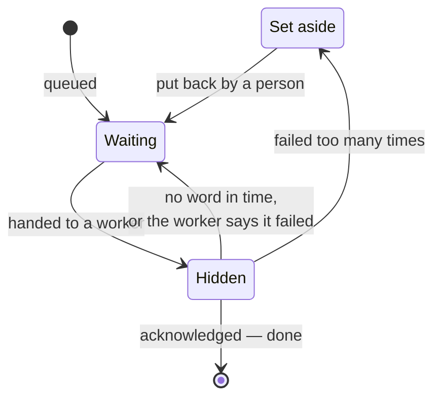

# 4.2 Message queues

[Syllabus](../SYLLABUS.md) · Phase 4 · Previous: [4.1 Why go asynchronous](01-why-asynchronous.md) · Next: [4.3 Delivery semantics and idempotent consumers](03-delivery-semantics.md)

> **Time:** about 40 minutes to read, 45 minutes of practice.
> **You need:** [Chapter 4.1](01-why-asynchronous.md); retries and backoff from [Chapter 1.5](../phase-1-foundations/05-timeouts-retries-idempotency.md); row locks from [Chapter 2.4](../phase-2-data/04-concurrency-control.md). The example needs the PostgreSQL database of Phase 2.

**By the end of this chapter you can**

- follow a job through its life: queued, handed out, acknowledged — or handed out again;
- explain how a queue learns that a worker has died, and choose a visibility timeout;
- say why a job that is never lost is sometimes done twice;
- stop a job that cannot succeed from being retried for ever, and say where it goes;
- explain what ordering a queue with many workers gives, what ordering by key costs, and when a table in your database is queue enough.

---

## The problem

*An illustrative scenario; the example reproduces each stage.* After Chapter 4.1, the team's background work goes through a list from which workers pop jobs. It works for months. Then a customer asks where their invoice is. The job that should have made it was popped by a worker at 14:02:07, and the worker was restarted by a deploy at 14:02:08. The job was in nobody's list and nobody's memory. Nothing recorded that it had ever existed.

The fix seems obvious: do not remove a job when it is taken; mark it *taken*, and remove it when it is finished. After the next deploy, three jobs are marked *taken* by workers that no longer exist. They will stay that way for ever.

Then one job arrives with a payload that cannot be parsed. A worker takes it, fails, and puts it back. Another worker takes it. By the time anyone looks, it has been attempted two million times.

Each of these is the same question, asked at a different moment: **when a job has been handed to a worker, who is responsible for it?** A message queue is, more than anything else, a precise answer to that.

---

## The concept

### 1. The life of a job



A job is **waiting** until a worker asks for one. It is then **hidden** — still in the queue, but not offered to anyone else. The worker does the work and **acknowledges** it, and only then does the queue forget the job. If the acknowledgement never comes, the job becomes visible again and is handed to someone else.

The queue never has to know whether the work happened. It knows one thing: whether it has been told so.

### 2. Acknowledge after the work, not before

There are two moments at which a queue can forget a job.

**When it is handed out.** RabbitMQ calls this automatic acknowledgement: "a message is considered to be successfully delivered immediately after it is sent" ([RabbitMQ docs, *Consumer Acknowledgements*](https://www.rabbitmq.com/docs/confirms)) — a mode, the same page says, often called *fire-and-forget*. A worker that dies takes its job with it. This is the invoice.

**When the worker says it is done.** The job outlives the worker. This is the default to want, and it has one consequence, which the rest of the chapter keeps returning to: a worker can finish the work and die before saying so. The queue, hearing nothing, hands the job out again.

### 3. How a queue learns that a worker has died

A dead worker does not report its death. There are two ways to find out.

**By its connection.** A broker that holds a connection to each worker notices when one closes. RabbitMQ: "any delivery (message) that was not acked is automatically requeued when the channel (or connection) on which the delivery happened is closed" ([RabbitMQ docs](https://www.rabbitmq.com/docs/confirms)).

**By the clock.** A queue that is asked for jobs over HTTP, or is a table, holds no connection. It gives each job a time limit instead. Amazon SQS calls it the visibility timeout: "The visibility timeout starts as soon as a message is delivered to you. During this period, you're expected to process and delete the message. If you don't delete it before the timeout expires, the message becomes visible again in the queue and can be retrieved by another consumer. The default visibility timeout for a queue is 30 seconds" ([AWS docs, *Amazon SQS visibility timeout*](https://docs.aws.amazon.com/AWSSimpleQueueService/latest/SQSDeveloperGuide/sqs-visibility-timeout.html)).

The time limit has to be chosen, and both directions hurt:

- **Too short**, and a job that is merely slow is handed to a second worker while the first is still on it. The work is done twice — and the slower the job, the more copies.
- **Too long**, and a job whose worker really has died waits out the whole limit before anyone else may touch it.

The way out is for a working worker to keep saying so. It takes the job for a short time and extends that while it works — on SQS, "Use the ChangeMessageVisibility action to programmatically extend or shorten the timeout as needed" ([same page](https://docs.aws.amazon.com/AWSSimpleQueueService/latest/SQSDeveloperGuide/sqs-visibility-timeout.html)). A live worker keeps its job however long it takes; a dead one loses it within one short interval.

### 4. Never lost means sometimes twice

Acknowledging after the work removes one failure and admits another. Between *the work is done* and *the queue has been told*, there is always a gap, and a worker can die in it. Add timeouts that expire on slow jobs, and networks that drop acknowledgements, and the conclusion is general. Both brokers say so plainly. SQS: "Standard queues ensure at-least-once message delivery, but due to the highly distributed architecture, more than one copy of a message might be delivered, and messages may occasionally arrive out of order" ([AWS docs](https://docs.aws.amazon.com/AWSSimpleQueueService/latest/SQSDeveloperGuide/standard-queues.html)). RabbitMQ: "consumers must be prepared to handle redeliveries and otherwise be implemented with idempotence in mind" ([RabbitMQ docs](https://www.rabbitmq.com/docs/confirms)).

So every job must be safe to do twice. How to make it so is Chapter 4.3.

### 5. Jobs that cannot succeed

Some failures pass: the email provider was down, and will be back. Retry, waiting longer each time (Chapter 1.5). Some never pass: the payload is malformed; the user it refers to has been deleted; the code has a bug. Such a job is called a **poison message**, and retrying it for ever does three kinds of damage. It burns workers. It fills the logs. And in a queue that preserves order, it blocks everything behind it.

So every queue needs a limit, and a place for what exceeds it: a **dead-letter queue**. On SQS the limit is "the number of times a consumer can receive a message from a source queue before it is moved to a dead-letter queue", and the purpose is stated just as plainly: "DLQs are useful for debugging your application because you can isolate unconsumed messages to determine why processing did not succeed" ([AWS docs, *Using dead-letter queues*](https://docs.aws.amazon.com/AWSSimpleQueueService/latest/SQSDeveloperGuide/sqs-dead-letter-queues.html)).

A dead-letter queue is not a bin. Each job in it is work that was promised and has not been done. It needs an alert when anything arrives, a person who looks, and a way to put jobs back once the cause is fixed.

### 6. Order

A queue hands jobs out in the order they arrived. With one worker, they are also *finished* in that order. With several workers they are not: job 2 can finish before job 1, because a different worker has it, and no amount of care inside the queue changes that.

Usually it does not matter. Two welcome emails for two different people can go in either order. It matters when two jobs concern the same thing: *set the address to A*, then *set the address to B*.

The standard remedy is ordering **by key**. Jobs carry a key — the account, the order, the document — and the queue promises that jobs with the same key are handed out one at a time, in order, while jobs with different keys go to different workers freely. SQS's FIFO queues call the key a message group: they "support message groups that allow multiple ordered message groups within a single queue" ([AWS docs, *Amazon SQS FIFO queues*](https://docs.aws.amazon.com/AWSSimpleQueueService/latest/SQSDeveloperGuide/sqs-fifo-queues.html)).

It has two prices.

- **Within one key there is no parallelism.** A key with a thousand jobs is worked through one at a time, however many workers stand idle.
- **A stuck job blocks its key.** If the first job for an account keeps failing, every later job for that account waits behind it. Setting it aside unblocks the key and breaks the order — which is why the SQS documentation warns: "Don't use a dead-letter queue with a FIFO queue if you don't want to break the exact order of messages or operations" ([AWS docs](https://docs.aws.amazon.com/AWSSimpleQueueService/latest/SQSDeveloperGuide/sqs-dead-letter-queues.html)).

Often the better answer is not to need order at all: make each job say what the final state should be, with a version, so that an older job arriving late can be recognised and ignored (Chapter 4.3).

### 7. Where the queue lives

A **broker** — SQS, RabbitMQ, and others — is a separate service built for this. It handles large volumes, and it is one more system to run.

A **table in the database you already have** is a queue too, since PostgreSQL gained one clause: "With SKIP LOCKED, any selected rows that cannot be immediately locked are skipped… [this] can be used to avoid lock contention with multiple consumers accessing a queue-like table" ([PostgreSQL docs, `SELECT`](https://www.postgresql.org/docs/current/sql-select.html)). The example below is built on it. A table is a reasonable first queue: nothing new to operate, jobs visible with `SELECT`, and — the property a broker cannot offer — a job can be queued *in the same transaction* as the data it concerns (Chapter 4.5 depends on this). It stops being reasonable at high volume: every job is an insert, an update and a delete in a table that the database must then clean up (Chapter 2.1), and workers have to poll.

---

## A real example

### Run it: a queue in one table

[`code/ch02-queue/main.go`](code/ch02-queue/main.go) — about 430 lines — is a job queue in a PostgreSQL table, and four experiments on it. It needs the database of Phase 2 ([setup](../phase-2-data/README.md)).

```bash
go run ./phase-4-async/code/ch02-queue
```

The table has a column `visible_at`: a job is not handed out before that moment. Handing out a job is one statement, which picks the oldest visible job and hides it:

```sql
UPDATE q_jobs SET attempts = attempts + 1, visible_at = now() + make_interval(secs => $1)
WHERE id = (SELECT id FROM q_jobs WHERE visible_at <= now()
            ORDER BY id FOR UPDATE SKIP LOCKED LIMIT 1)
RETURNING id, payload, attempts
```

Acknowledging is `DELETE FROM q_jobs WHERE id = $1`. That is the whole mechanism of sections 1 to 3. If the `DELETE` never comes, `visible_at` passes and the job is offered again.

```text
PART 1 — 200 jobs, 4 workers. Three times, a worker dies in the middle of a job:
         twice before the job's work has happened, and once just after.

  a job, when it is handed to a worker, is...     done once   done twice   never done   still in the queue
  deleted from the queue                                198            0            2                    0
  hidden, for good                                      198            0            2                    3
  hidden for one second                                 199            1            0                    0
```

- **Deleted when handed out**: two jobs were never done, and the queue is empty. Nothing anywhere says that anything is missing. This is the invoice.
- **Hidden for good**: the same two jobs were never done, and three rows sit in the table, invisible, for ever — the two, and the one whose work was finished by a worker that died before saying so.
- **Hidden for one second**: every job was done. One was done **twice**: the one whose worker died after the work and before the acknowledgement. This row is what *at least once* means.

```text
PART 2 — 100 jobs, 8 workers. Most jobs take 50 ms; one in ten takes 1.2 seconds. One worker dies.

  a job is hidden for...                            done more than once   the dead worker's job waited
  half a second                                                      10                          0.5 s
  three seconds                                                       0                          3.0 s
  half a second, renewed while work goes on                           0                          0.5 s
```

Half a second is plenty for the quick jobs and too little for the slow ones: all ten slow jobs were handed out again while their first worker was still busy, and done more than once. Three seconds cures that, and the dead worker's job then waited three seconds for someone else. The last row has neither problem: workers take a job for half a second and renew it every 200 ms while they work.

```text
PART 3 — 100 jobs, 4 workers. One job can never succeed: its payload cannot be read.

  when a job fails, it is...                        other jobs done  attempts at the bad job    where it is
  tried again at once, for ever                                  99                     6720   in the queue, still being tried
  tried again after a growing wait, 5 times                      99                        5   set aside

  SELECT * FROM q_dead:   id 7 | {"user": 41, "email":  | 5 attempts | unexpected end of JSON input
```

In three seconds, one unreadable job was attempted 6,720 times, and it would have gone on. With a limit of five attempts and a growing wait between them — 0.1 s, 0.2 s, 0.4 s, 0.8 s — it was tried five times and moved to a second table, with the error that defeated it. The last line is what a person finds there: which job, what it contained, and why it failed.

```text
PART 4 — 1,000 jobs, 8 workers. Each job says "set account A to value N". For each account the values
         were queued in order, 1 to 50, so every account should end at 50.

                                                 accounts with a wrong value  jobs a second
  20 accounts; any worker takes any job                            13 of 20            1768
  20 accounts; one job per account at a time                        0 of 20            1491
  1 account; one job per account at a time                          0 of 1              184
```

The jobs were queued in the right order and handed out in the right order. With eight workers, thirteen accounts in twenty still ended on the wrong value, because *set to 49* finished after *set to 50*. No job failed.

The second row changes one condition in the statement that hands jobs out: a job is eligible only if no earlier job with the same key is still in the table.

```sql
AND NOT EXISTS (SELECT 1 FROM q_jobs earlier WHERE earlier.key = j.key AND earlier.id < j.id)
```

Every account is now right, at nearly the same speed, because twenty accounts give eight workers plenty to do side by side. The third row is the price. The same thousand jobs, all for one account, ran at 184 a second where they had run at 1,491: seven of the eight workers had nothing they were allowed to take.

---

## Trade-offs

**Acknowledging late keeps every job and repeats some. Acknowledging early repeats none and loses some.** For work that matters, keep every job and make repeating harmless. Acknowledge early only for work that may be dropped.

**A short time limit recovers quickly and duplicates slow work; a long one does the reverse.** Renewing the limit while working gives both, and costs a little traffic and a little code.

**Retries save jobs from passing failures and waste effort on permanent ones.** Wait longer each time, stop after a set number, and set the job aside. A queue with no limit has no way to give up.

**Order by key is correct and serial.** Use it when the work for one key really does depend on order, choose the narrowest key that is true, and prefer jobs that do not need order at all.

**A table is the simplest queue and not the fastest.** Start there when volume is moderate and being in the same transaction as your data is valuable. Move to a broker when the table's churn, or the polling, starts to show.

**Every one of these settings is a decision about failure.** The defaults — 30 seconds, unlimited retries, no dead-letter queue — are somebody else's guesses about your jobs.

---

## Practice

### Check yourself

Answer before reading on.

1. A queue's visibility timeout is 30 seconds. Jobs normally take 5 seconds, but a job for a large file takes two minutes. What happens to the large-file jobs? Give two fixes and what each costs.
2. A worker takes the job *charge order 123*, charges the card, and dies before acknowledging. What happens next if the queue forgets jobs when it hands them out? If it forgets them when they are acknowledged? Which do you choose for this job, and what else must then be true?
3. On Monday morning the dead-letter queue holds 4,000 jobs. Nobody knew. What was missing — and what do you do with them?

<details>
<summary>Answers</summary>

1. After 30 seconds the job becomes visible and a second worker starts on it; after 60, a third; after 90, a fourth. Four workers spend two minutes each on the same file, and its work is done four times. If acknowledgements are checked against the most recent hand-out, it may never be acknowledged at all. **Fix one:** raise the timeout above the longest job — say five minutes. Cost: a job whose worker dies now waits five minutes before anyone retries it, and that applies to the five-second jobs too. **Fix two:** keep the timeout short and have workers extend it while they work. Cost: code, and a worker that hangs without dying keeps its job for as long as its renewals continue — so the renewing must stop when the work stops making progress. A third option is to give large files a queue of their own, with its own timeout.

2. **Forgotten when handed out:** nothing happens. The card was charged; the job is gone. Had the worker died *before* charging, the order would never be charged, and nothing would record that either. **Forgotten when acknowledged:** the job reappears and another worker charges the card **again**. Choose the second — an order that is silently never charged cannot be found, while a repeated job can be made harmless — and then the charge **must be idempotent**: sent with a key derived from the order, so that the payment provider recognises the second attempt and returns the first result (Chapter 1.5).

3. **An alert was missing.** A dead-letter queue should be empty; the first job to arrive is news. Alert on its size and on the age of its oldest job. As for the 4,000: first, stop more arriving — find what is failing. Then sort them by the error recorded with each. Jobs that failed because something was down can be put back. Jobs that failed because of a bug are put back after the fix is deployed. Jobs that can never succeed — the user is gone, the data is malformed — are decided one kind at a time: repair the data, or drop them deliberately and say so. Put them back gradually, not 4,000 at once, and only because the jobs are safe to repeat: some of them may have partly run.

</details>

### Exercise: settings for three kinds of job

A product has three kinds of background job. For each, choose: when it is acknowledged; the visibility timeout, and whether it is renewed; how many attempts, with what waits; what happens after the last; and whether order matters, and by what key.

| # | Job | How long it takes | Notes |
|---|---|---|---|
| 1 | Send a receipt email | 200 ms | Through a provider that is sometimes down for minutes |
| 2 | Transcode an uploaded video | 30 seconds to 20 minutes | Heavy; the result is a file |
| 3 | Apply a change to an account's balance | 20 ms | Changes to one account must be applied in the order they were made |

<details>
<summary>Worked solution</summary>

| | 1. Receipt email | 2. Transcode a video | 3. Balance change |
|---|---|---|---|
| Acknowledged | After sending | After the file is written | After the transaction commits |
| Timeout | 30 seconds, not renewed: a hundred times the normal duration, and short enough to recover quickly | 2 minutes, **renewed** every 30 seconds while the transcoder reports progress | 30 seconds |
| Attempts | Many, over hours: waits of 1 minute, 5, 15, then hourly for a day. The provider's outage must not exhaust them | 3. A video that fails three times will fail a fourth; each attempt costs minutes of a machine | 5, with short waits |
| After the last | Dead-letter queue. Alert. The customer can also ask for the receipt again | Dead-letter queue. Mark the video *failed* so that the user sees it, with a way to upload again | **Stop that account**, and alert. Do not set the job aside and carry on: the later changes depend on it |
| Order | None | None | **By account** |
| Done twice | A second receipt. Record *sent* against the order and check before sending | The same file written again: harmless if the output's name is fixed by the input | Must be impossible: each change carries an ID, and applying it records that ID in the same transaction (Chapter 4.3) |
| Workers | Limited by the provider's rate (Chapter 4.1) | Few, on machines sized for it, in a queue of their own so that they never delay emails | Any number; an account is worked on by one at a time |

Three things to notice.

**The three jobs want three queues.** One timeout cannot be right for 200 ms and for 20 minutes, and a twenty-minute transcode at the head of a shared queue delays a receipt behind it.

**The number of attempts follows the cost of a retry and the kind of failure expected.** Emails fail because a provider is down, so retry for a day. Videos fail because the file is bad, so stop soon.

**Job 3 is the only one where *set aside and carry on* is wrong.** For an ordered key, a job that cannot be applied is a stopped account, and a stopped account is something a person must be told about at once. Section 6's second price is not a detail here; it is the design.

</details>

---

## Production tips and common mistakes

**Tips**

- **Acknowledge after the work is done**, and never before, for work that matters.
- **Set the visibility timeout from measurements** of how long jobs take, not from the default. For long jobs, renew it.
- **Limit attempts, wait longer between them, and have a dead-letter queue.** Alert when it is not empty.
- **Record the error with the job** when setting it aside. The person who looks will need it.
- **Keep a way to put dead jobs back**, slowly.
- **Give different kinds of work different queues.**
- **Order by key only where the work needs it**, with the narrowest key.
- **Watch the age of the oldest waiting job** (Chapter 4.6), and how many jobs are hidden — a rising number of hidden jobs with no completions is a fleet of stuck workers.
- **Start with a table if you have a database and moderate volume.** Know the reason you would leave it.

**Common mistakes**

- **Removing a job when it is taken**, and losing one with every crash and every deploy.
- **Marking a job *taken* with no time limit.**
- **A timeout shorter than the slowest job**, so that slow jobs multiply.
- **Retrying at once, for ever.**
- **No dead-letter queue** — or one that nobody watches.
- **Assuming that jobs finish in the order they were queued** when there is more than one worker.
- **One global order where an order per key would do**, and one worker's throughput as a result.
- **Setting aside a failed job in an ordered stream** without deciding what that does to the jobs behind it.
- **Assuming a job runs once.**

---

## Key takeaways

- A queue keeps a job until it is told that the job is done. Handing it out only hides it.
- A dead worker is detected by its closed connection or by a time limit. The time limit trades duplicate work against slow recovery; renewing it while working avoids both.
- Because a worker can die after the work and before the acknowledgement, a job that is never lost is sometimes delivered twice.
- A job that cannot succeed must be stopped: limited attempts, growing waits, and a dead-letter queue that someone watches.
- Many workers finish jobs out of order. Ordering by key restores it for each key, at the price of working through each key one job at a time.
- A table with `SKIP LOCKED` is a real queue, and the simplest one to start with.

**Next:** [4.3 Delivery semantics and idempotent consumers](03-delivery-semantics.md) — if every job may arrive twice, how to make twice the same as once.

---

## Sources

- AWS documentation, Amazon SQS Developer Guide: [*visibility timeout*](https://docs.aws.amazon.com/AWSSimpleQueueService/latest/SQSDeveloperGuide/sqs-visibility-timeout.html); [*standard queues*](https://docs.aws.amazon.com/AWSSimpleQueueService/latest/SQSDeveloperGuide/standard-queues.html); [*FIFO queues*](https://docs.aws.amazon.com/AWSSimpleQueueService/latest/SQSDeveloperGuide/sqs-fifo-queues.html); [*dead-letter queues*](https://docs.aws.amazon.com/AWSSimpleQueueService/latest/SQSDeveloperGuide/sqs-dead-letter-queues.html).
- RabbitMQ documentation: [*Consumer Acknowledgements and Publisher Confirms*](https://www.rabbitmq.com/docs/confirms).
- PostgreSQL documentation: [`SELECT` — the locking clause](https://www.postgresql.org/docs/current/sql-select.html) (`SKIP LOCKED`).
