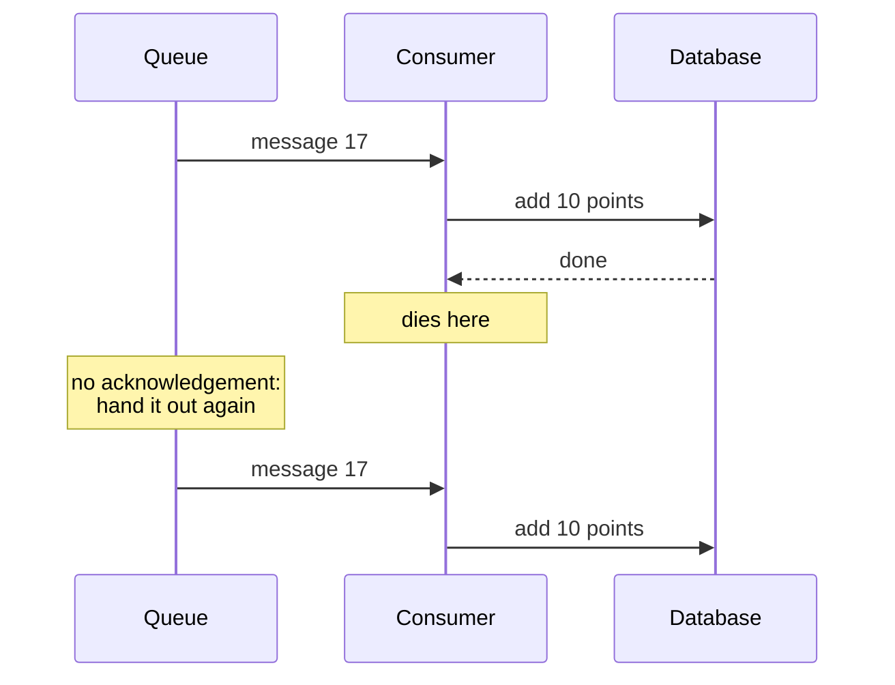

# 4.3 Delivery semantics and idempotent consumers

[Syllabus](../SYLLABUS.md) · Phase 4 · Previous: [4.2 Message queues](02-message-queues.md) · Next: 4.4 Logs and streams *(planned)*

> **Time:** about 35 minutes to read, 40 minutes of practice.
> **You need:** [Chapter 4.2](02-message-queues.md); idempotency keys from [Chapter 1.5](../phase-1-foundations/05-timeouts-retries-idempotency.md); transactions from [Chapter 2.3](../phase-2-data/03-transactions-and-isolation.md). The example needs the PostgreSQL database of Phase 2.

**By the end of this chapter you can**

- say what *at most once*, *at least once* and *exactly once* each promise, and which of them a queue can keep;
- explain why no queue can deliver a message exactly once, and what the phrase means when a product uses it;
- make a consumer idempotent, four ways, and say when each applies;
- choose the ID that duplicates are recognised by, and decide how long to remember it;
- say what remains impossible when the effect is outside your database.

---

## The problem

*An illustrative scenario; the example reproduces each incident.* The queue's product page says *exactly-once*. Over six months:

- New users sometimes receive two welcome emails.
- After a deploy, a few dozen customers have twice the loyalty points they earned.
- Finance finds eleven refunds that were paid twice.

Every one traces to the same event: a message was delivered to a consumer twice. In each case the consumer had done the work the first time, and something went wrong between finishing it and saying so — a deploy, a timeout, a dropped connection. Chapter 4.2 ended with the rule that makes this inevitable: a queue that never loses a job will sometimes hand it out twice.

The product page was not lying, exactly. It was describing something narrower than what its readers took it to mean.

---

## The concept

### 1. Three promises

Kafka's documentation lists them:

> "*At most once*—Messages may be lost but are never redelivered. *At least once*—Messages are never lost but may be redelivered. *Exactly once*—this is what people actually want, each message is delivered once and only once."
> — [Apache Kafka documentation, *Design: Message Delivery Semantics*](https://kafka.apache.org/39/design/design/)

Chapter 4.2 showed how to get the first two. Acknowledge a message before doing the work, and it is processed at most once. Acknowledge after, and at least once.

### 2. Why the third is not on offer

A consumer has two things to do: the work, and telling the queue. They are two actions on two systems, and one must come first.



If the consumer dies between the two, the queue cannot know which side of the work it died on. It can hand the message out again, and risk a second effect. Or it can not, and risk none. No protocol between the two removes the gap, because the acknowledgement itself can be lost.

So when a product says *exactly once*, read what it is that happens once. Of systems that make the claim, the same Kafka page says: "it is important to read the fine print, most of these claims are misleading (i.e. they don't translate to the case where consumers or producers can fail, cases where there are multiple consumer processes, or cases where data written to disk can be lost)" ([Kafka documentation](https://kafka.apache.org/39/design/design/)).

Amazon SQS's FIFO queues are a fair example of fine print that is honest and narrow: "If you retry the SendMessage action within the 5-minute deduplication interval, Amazon SQS doesn't introduce any duplicates into the queue" ([AWS docs, *Exactly-once processing*](https://docs.aws.amazon.com/AWSSimpleQueueService/latest/SQSDeveloperGuide/FIFO-queues-exactly-once-processing.html)). That is a promise about *sending*, for five minutes. It says nothing about a consumer that does the work and dies.

### 3. What is on offer: the effect, once

Give up on receiving each message once. Arrange instead that receiving it twice changes nothing. A consumer like that is **idempotent** — "An idempotent operation can be performed many times without causing a different effect than only being performed once" ([Confluent, *Exactly-Once Semantics Are Possible*](https://www.confluent.io/blog/exactly-once-semantics-are-possible-heres-how-apache-kafka-does-it/)).

**At-least-once delivery, plus an idempotent consumer, gives an effect that happens exactly once.** That is the whole answer, and it is the consumer's job, not the queue's.

### 4. Four ways to make a consumer idempotent

**The operation already is.** *Set the invoice's status to paid.* *Delete the session.* *Store this document under this ID.* Doing any of these twice leaves what doing it once left. Prefer messages that say what the state should be over messages that say how to change it: *the balance is now 120*, not *add 20*.

**Record the message's ID with the effect, in one transaction.** For operations that are not idempotent — *add 10 points* — keep a table of the IDs of messages already processed. The pattern catalogue at microservices.io describes it: "After starting the database transaction, the message handler inserts the message's ID into the PROCESSED_MESSAGE table. Since the (subscriberId, messageID) is the PROCESSED_MESSAGE table's primary key the INSERT will fail if the message has been already processed successfully" ([microservices.io, *Idempotent Consumer*](https://microservices.io/patterns/communication-style/idempotent-consumer.html)). The transaction is what makes it work. The ID and the effect are committed together or not at all, so there is no moment at which one exists without the other.

Kafka's documentation reaches the same design from the other side. The hard part, it says, is "the need to coordinate the consumer's position with what is actually stored as output", and the answer is "letting the consumer store its offset in the same place as its output" ([Kafka documentation](https://kafka.apache.org/39/design/design/)).

**Let the row itself remember.** Sometimes the thing being changed can carry the mark: `UPDATE orders SET points_awarded = true WHERE id = $1 AND NOT points_awarded`. If the statement changed a row, this is the first time; do the rest in the same transaction. No second table is needed.

**For effects outside your database, pass the ID on.** An email, a payment, a call to someone else's API cannot join your transaction. If the other side accepts an idempotency key (Chapter 1.5), send the message's ID as the key and let *them* recognise the repeat. If it does not, exactly-once is not available, and what remains is a choice between two errors: sometimes twice, or sometimes never.

### 5. Which ID

The ID must identify *the thing that should happen once* — and it must be chosen by whoever knows what that is: the producer.

The ID a broker assigns to a message identifies one *send*. A producer that is unsure whether its send arrived will send again, and the broker will give the second message a new ID. To a consumer that recognises duplicates by the broker's ID, these are two messages. They are one order.

So the producer names the effect — `order-123-points` — and puts the name in the message. Every hop can then recognise a repeat: the broker, if it deduplicates sends (SQS FIFO's deduplication ID; Kafka's idempotent producer, with which a retried message "will only be written to the Kafka log on the broker once", in the words of [the Confluent post](https://www.confluent.io/blog/exactly-once-semantics-are-possible-heres-how-apache-kafka-does-it/)); and the consumer, whatever the broker did.

### 6. How long to remember

A table of processed IDs grows by a row for every message. It can be trimmed by age, and the age must be longer than the latest moment a duplicate can arrive. That is not the visibility timeout. It is the longest retry schedule, plus the oldest message anyone might put back from a dead-letter queue: days, usually, and weeks to be safe. Marks kept in the business rows themselves — `points_awarded` — never need trimming.

### 7. Old news

Duplicates have a cousin: a message that arrives *late*, after a newer one about the same thing. *Address is A* is delivered, then *address is B*, then *address is A* again, redelivered after a timeout. An idempotent consumer applies it happily, and the address is wrong.

The defence is a version. Each message carries a number that increases with every change to the thing it describes, and the consumer applies a message only if its number is higher than the one it last applied: `UPDATE … SET address = $2, version = $3 WHERE id = $1 AND version < $3`. This is also the alternative to ordering by key that Chapter 4.2 promised.

---

## A real example

### Run it: one thousand messages, some of them twice

[`code/ch03-idempotent/main.go`](code/ch03-idempotent/main.go) — about 350 lines — plays the part of a queue that delivers at least once. Of every ten messages, one is handed to two workers at the same moment and one is delivered again later; one worker in a hundred dies half-way through, and its message is delivered again. The consumers, and the PostgreSQL database they write to, are real.

```bash
go run ./phase-4-async/code/ch03-idempotent
```

```text
PART 1 — 1,000 orders, each worth 10 points to one of 50 accounts. Every account should end with 200,
         and the total should be 10,000.

  the consumer...                                              deliveries   total points     accounts wrong
  adds the points, every time                                        1213          12070           50 of 50
  looks for the ID; if new: adds the points, records the ID          1213          11100           45 of 50
  records the ID; if new: adds the points                            1213           9940            5 of 50
  records the ID and adds the points, in one transaction             1213          10000            0 of 50
  marks the order as awarded and adds, in one transaction            1213          10000            0 of 50
```

A thousand messages became 1,213 deliveries.

- **Row 1** does the work every time, and gives away 2,070 points that nobody earned.
- **Row 2** is what most people write first: look in a table of IDs, do the work, record the ID. It is still 1,100 points over. Two workers given the same message at the same moment both look, both find nothing, and both add. And a worker that dies after adding and before recording leaves no trace for the next delivery to find. This is Chapter 2.4's check-then-act, in a consumer.
- **Row 3** records first and adds second, as two statements. Now nothing is added twice — and 60 points are missing. Six workers died between the two statements. Their messages were delivered again, were found in the table, and were skipped. The consumer has been made *at most once* by accident.
- **Row 4** is exact. The same two statements, inside one transaction:

```go
tx, err := pool.Begin(ctx)
// ...
tag, err := tx.Exec(ctx, "INSERT INTO idem_processed (message_id) VALUES ($1) ON CONFLICT DO NOTHING", m.id)
if err != nil || tag.RowsAffected() == 0 {
	return err // seen before — or a second copy waited for the first to commit, and then found it
}
// ...
if _, err := tx.Exec(ctx, addPoints, m.account); err != nil {
	return err
}
return tx.Commit(ctx)
```

  A worker that dies before the commit leaves nothing behind: no points and no ID. A second copy arriving at the same moment waits at the `INSERT` for the first transaction to finish, and then finds the ID.
- **Row 5** needs no table of IDs: the order's own row records that its points have been awarded.

(The second row's figure changes from run to run, since it depends on timing. The last two never do.)

```text
PART 2 — the producer is unsure whether 50 of its 1,000 sends arrived, and sends those again.
         They had arrived. The broker gives every send an ID of its own.

  duplicates are recognised by...                                messages   total points
  the ID the broker gave each message                                1050          10500
  an ID the producer chose: one per order                            1050          10000
```

The consumer is the correct one from Part 1, and with the broker's IDs it is 500 points over all the same: fifty orders had two messages, with two IDs. Only an ID that means *this order's points* recognises them as one.

```text
PART 3 — 1,000 orders, each owed one confirmation email. The email is sent by an outside provider,
         so sending it cannot be part of a database transaction.

  the consumer...                                               emails sent       sent twice
  sends, every time                                                    1213              213
  looks for the ID; if new: sends, then records the ID                 1091               91
  sends every time, with the message's ID as a key                     1000                0
```

Here there is no transaction to use, because the email leaves the building. Looking first and recording afterwards cuts 213 duplicates to 91 and cannot reach zero: the send and the record are two actions on two systems, with a gap between them. The last row has no duplicates because the *provider* was given the ID and refused to send the same email twice — the provider in this program does that; whether yours does is the first thing to find out.

---

## Trade-offs

**At least once with an idempotent consumer, or at most once with nothing.** The first costs a little work in every consumer and loses nothing. The second costs nothing and loses messages. Choose the second only where a lost message truly does not matter.

**A table of IDs is general and is one more write per message.** It works for any operation, and adds an insert and a growing table. A mark in the business row costs nothing extra, where such a row exists. An operation that is already idempotent costs nothing at all — which is a reason to design messages that way.

**Messages that state facts are easier to repeat than messages that state changes.** *The balance is 120* can be applied twice. *Add 20* cannot. But a fact can be out of date, and needs a version; a change cannot.

**Outside your database, exactly once is someone else's to give.** With a provider that accepts keys, pass the key. Without one, decide deliberately which is worse — a second email, or none — and build for the other.

**Remembering IDs for longer costs storage and protects against later duplicates.** Forgetting them after an hour is cheap, and wrong on the day someone puts back a week of dead letters.

---

## Practice

### Check yourself

Answer before reading on.

1. A consumer handles *order placed* with `UPDATE products SET stock = stock - 1 WHERE id = $1`. What goes wrong, and what are two different ways to fix it?
2. A team recognises duplicates with a key in Redis — *set this message's ID if it is not already set* — and, if the ID was new, does the work in PostgreSQL. Name two ways this still goes wrong.
3. A queue's page says *exactly-once*. Its documentation says that a message sent twice within five minutes is stored once. Name two ways your consumer can still be given the same order twice.

<details>
<summary>Answers</summary>

1. A message delivered twice takes two from the stock for one order: the shop believes it has fewer than it has. **Fix one:** record the message's ID in a table of processed messages, in the same transaction as the update, and skip the update if the ID was already there. **Fix two:** make the order itself carry the fact — insert a row into `stock_reservations` with the order's ID as its primary key, in the same transaction as the update; a second delivery fails to insert and changes nothing. The second is often better, because the reservation is worth having anyway: it says *which* order holds the stock.

2. **A worker can die between the two.** The ID is set in Redis; the work in PostgreSQL never happens; the message is delivered again, found in Redis, and skipped. The effect is lost — row 3 of the example. **And Redis can forget.** If the key expires, or is evicted when memory is short (Chapter 3.4), a late duplicate is treated as new and the work is done twice. Both come from keeping the mark in one system and the effect in another. Put the mark where the effect is, in one transaction.

3. **The producer sends it again after more than five minutes** — a retry job, a replay, a person pressing the button again — or sends it with a different deduplication ID. The broker stores both. **And the consumer finishes the work and dies before acknowledging.** The message is still in the queue and is handed out again (Chapter 4.2). The promise was about sending. The consumer must still be idempotent, with an ID that the producer chose.

</details>

### Exercise: five consumers

For each, say whether it is idempotent as described. If it is not, make it so — or say why it cannot be, and what you choose.

| # | Message | What the consumer does |
|---|---|---|
| 1 | *User signed up* | Sends a welcome email, through a provider that does not accept idempotency keys |
| 2 | *Payment received for invoice 55* | Sets the invoice's status to *paid* |
| 3 | *Order placed* | Takes the ordered items from stock |
| 4 | *Order placed* | Charges the customer's card through a payment provider |
| 5 | *Profile changed* (carrying the new profile) | Writes the profile into a search index |

<details>
<summary>Worked solution</summary>

| # | As described | What to do |
|---|---|---|
| 1. Welcome email | **Not idempotent, and cannot be made exactly-once**: the provider will send whatever it is asked to | Choose. *At least once*: look for a *sent* record, send, record — a rare second email, never a missing one. Or *at most once*: record, then send — never two, occasionally none. For a welcome email, the first. For a text message that costs money and annoys, perhaps the second. Say which, in the code |
| 2. Invoice paid | **Idempotent already** | `UPDATE invoices SET status = 'paid', paid_at = coalesce(paid_at, $2) WHERE id = $1`. The `coalesce` keeps the first payment time if the message comes twice |
| 3. Take from stock | **Not idempotent** | A reservation row keyed by the order, inserted in the same transaction as the update — or the order's ID in a table of processed messages |
| 4. Charge the card | **Not idempotent — and the provider can make it so** | Send the order's ID as the idempotency key (Chapter 1.5). The provider returns the first result for every repeat. Record that result in your database when it arrives |
| 5. Search index | **Idempotent, and still wrong sometimes** | Writing the same document twice is harmless. Writing an *older* one after a newer one is not (section 7). Carry a version in the message and have the index refuse anything older — or do not carry the profile at all: carry the user's ID, and read the current profile when the message is processed (Chapter 4.1) |

Two things to take from the table. **The answer is different for each consumer**, because it depends on what the effect is and where it lands; there is no setting on the queue that does this for you. And **the two that involve somebody else's system — 1 and 4 — are decided by what that system offers.** When choosing a provider, whether it accepts idempotency keys is not a detail.

</details>

---

## Production tips and common mistakes

**Tips**

- **Assume every message will be delivered twice**, and test it: deliver every message twice in a test environment and check that nothing changes.
- **Put the mark where the effect is.** Same database, same transaction.
- **Have the producer choose the ID**, and make it mean the thing that should happen once.
- **Prefer messages that state facts**, with a version, to messages that state changes.
- **Pass the ID on** as an idempotency key to any provider that accepts one.
- **Keep processed IDs for longer than the longest retry and the oldest dead letter.**
- **Where exactly-once is impossible, choose the error** and write the choice down.

**Common mistakes**

- **Believing *exactly-once* on a product page** without reading what it is that happens once.
- **Look, then act, then record** — three steps that two workers can interleave.
- **The mark in one system and the effect in another.**
- **Recognising duplicates by the broker's message ID.**
- **Forgetting IDs after minutes.**
- **`balance = balance + x`** in a consumer, with nothing else.
- **Treating a duplicate as an error** — logging it, alerting on it, sending it to the dead-letter queue. A duplicate is normal: acknowledge it and move on.
- **Applying an old message after a new one**, because it was not a duplicate.

---

## Key takeaways

- A queue can promise at most once, or at least once. It cannot promise exactly once, because doing the work and acknowledging it are two actions with a gap between them.
- *Exactly-once* on a product page describes something narrower. Read what it is.
- What can be had is an effect that happens once: at-least-once delivery and a consumer for which twice is the same as once.
- Make the consumer idempotent by the nature of the operation, by a mark in the row, or by recording the message's ID in the same transaction as the effect.
- The ID must name the thing that should happen once, and the producer chooses it.
- For effects outside your database, pass the ID on. If the other side will not take it, choose which error you prefer.

**Next:** 4.4 Logs and streams *(planned)* — a different shape of queue, in which messages are not removed when they are read.

---

## Sources

- Apache Kafka documentation, [*Design*](https://kafka.apache.org/39/design/design/) (message delivery semantics).
- Neha Narkhede and Guozhang Wang, [*Exactly-Once Semantics Are Possible: Here's How Kafka Does It*](https://www.confluent.io/blog/exactly-once-semantics-are-possible-heres-how-apache-kafka-does-it/), Confluent, 2017.
- AWS documentation: [*Exactly-once processing in Amazon SQS*](https://docs.aws.amazon.com/AWSSimpleQueueService/latest/SQSDeveloperGuide/FIFO-queues-exactly-once-processing.html).
- Chris Richardson, [*Pattern: Idempotent Consumer*](https://microservices.io/patterns/communication-style/idempotent-consumer.html), microservices.io.
