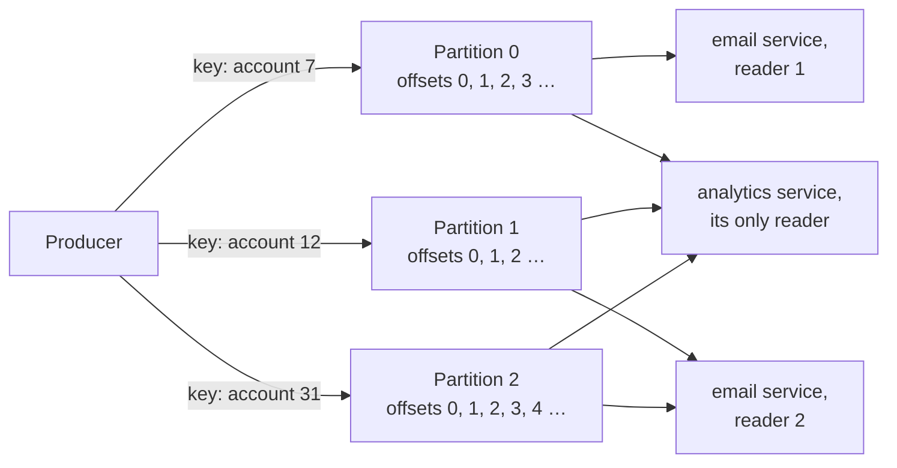

# 4.4 Logs and streams: Kafka's model

[Syllabus](../SYLLABUS.md) · Phase 4 · Previous: [4.3 Delivery semantics and idempotent consumers](03-delivery-semantics.md) · Next: 4.5 The dual-write problem *(planned)*

> **Time:** about 35 minutes to read, 40 minutes of practice.
> **You need:** [Chapters 4.2](02-message-queues.md) and [4.3](03-delivery-semantics.md). The example needs only Go.

**By the end of this chapter you can**

- say what a log is, and the one difference from a queue that the rest follows from;
- explain partitions, keys and offsets, and what each decides about order and parallelism;
- explain consumer groups: how several services each read everything, and how one service reads in parallel;
- say what committing an offset means, and what retention and compaction remove;
- choose between a queue and a log for a given piece of work.

---

## The problem

*An illustrative scenario; the example reproduces it.* When an order is placed, a message goes on a queue, and a worker sends the confirmation email. It works.

The analytics team wants the same messages. They start a consumer of their own on the same queue — and each service now receives about half the orders, because a queue gives each message to one worker. So the producer is changed to write every order to two queues. Then the fraud team wants them: three queues, and another change to the producer, which has now been altered twice for the benefit of services it knows nothing about.

Then a bug in the analytics consumer miscounts a week of orders. The fix takes an hour; rerunning the week is impossible, because the messages were deleted when they were acknowledged. And the fraud service, on its first day, would like to look at last month. There is no last month.

Nothing here is a fault in the queue. A queue holds *work to be done*, and when the work is done the message has no further purpose. What these teams wanted was a record of *things that happened*, which any number of readers could go through, each at its own pace, more than once.

---

## The concept

### 1. A log

A **log** is a sequence of records that is only ever added to at the end. Each record gets the next number in the sequence — its **offset** — and keeps it for ever. Reading a record does not remove it.

That last sentence is the whole difference from a queue. Kafka's introduction puts it this way: "Events in a topic can be read as often as needed—unlike traditional messaging systems, events are not deleted after consumption. Instead, you define for how long Kafka should retain your events through a per-topic configuration setting, after which old events will be discarded" ([Apache Kafka documentation, *Introduction*](https://kafka.apache.org/intro)).

Everything else follows from it.

| | A queue (Chapter 4.2) | A log |
|---|---|---|
| Holds | Work to be done | Things that happened |
| A message is removed | When a worker acknowledges it | When it is old enough, read or not |
| Several readers | Share the messages: each goes to one | Each reads all of them, independently |
| What the broker remembers per reader | The state of every message | One number per partition |
| Reading again | Not possible | Set the number back |
| Retrying one message, delaying it, setting it aside | Built in | Not built in |
| Order | By key, where offered | Within a partition |
| Working in parallel | Add workers | Limited by the number of partitions |

The fourth row is why logs are fast. A queue must track every message through hidden, acknowledged and redelivered. Kafka's design notes describe what a log needs instead: "the position of a consumer in each partition is just a single integer, the offset of the next message to consume. This makes the state about what has been consumed very small, just one number for each partition" ([Kafka documentation, *Design*](https://kafka.apache.org/39/design/design/)).

### 2. Partitions and keys

One sequence is read by one reader at a time, in order — which is correct, and slow. So a log is split into several **partitions**, each a sequence of its own. A **topic** is a named set of partitions.

Which partition a record goes to is decided by its **key**: "Events with the same event key (e.g., a customer or vehicle ID) are written to the same partition, and Kafka guarantees that any consumer of a given topic-partition will always read that partition's events in exactly the same order as they were written" ([Kafka documentation, *Introduction*](https://kafka.apache.org/intro)).

So order is kept **per key**, and there is no order between partitions. This is Chapter 4.2's ordering by key, built into the storage.



The choice of key is the most important decision about a topic, and it decides two things at once.

- **What stays in order.** Choose the thing whose events must not be reordered: the account, the order, the device.
- **How evenly the work spreads.** A key with few values, or one very busy value, puts most records in one partition, and that partition's one reader does most of the work.

The number of partitions is hard to change later. Kafka's operations guide warns: "if data is partitioned by hash(key) % number_of_partitions then this partitioning will potentially be shuffled by adding partitions but Kafka will not attempt to automatically redistribute data in any way" ([Kafka documentation, *Operations*](https://kafka.apache.org/39/operations/basic-kafka-operations/)). After the change, new records for an account may go to a different partition from its old ones, and for a while its order is not guaranteed.

### 3. Consumer groups

A **consumer group** is one logical reader: a service. Each group has its own offset in each partition, so the email service and the analytics service both read everything, and neither knows that the other exists. Adding a third service changes nothing for the producer or for the other two.

Within a group, the members divide the partitions between them. The rule: the topic is "a set of totally ordered partitions, each of which is consumed by exactly one consumer within each subscribing consumer group at any given time" ([Kafka documentation, *Design*](https://kafka.apache.org/39/design/design/)). That is how a service reads in parallel without losing per-key order — and it sets a ceiling. A group with more members than the topic has partitions has members with nothing to read.

When a member joins or leaves, the partitions are shared out again: a *rebalance*. It is not free. The same document notes that changing membership "can cause a large percentage of tasks re-assigned to different instances during administrative operations such as code deploys, configuration updates and periodic restarts" ([Kafka documentation, *Design*](https://kafka.apache.org/39/design/design/)).

### 4. Committing an offset

A reader records how far it has got by **committing** an offset. It is an acknowledgement for *everything up to here*, which is what makes it cheap — and it brings back Chapter 4.3's two orders exactly.

- **Handle the records, then commit.** A reader that dies in between leaves its replacement to start from the last commit and handle some records again: at least once.
- **Commit, then handle.** The replacement starts after records that were never handled: at most once.

So a consumer of a log has to be idempotent for the same reason as a consumer of a queue.

Two consequences of having one number, not a state per message:

- **A record that cannot be handled blocks its partition.** There is no way to acknowledge the records after it and not it. The reader must decide: retry for ever, or copy the record somewhere else — a retry topic, a dead-letter topic — and move past it (Chapter 4.6).
- **The number can be moved back.** "A consumer can deliberately rewind back to an old offset and re-consume data" ([Kafka documentation, *Design*](https://kafka.apache.org/39/design/design/)). That is how a week of miscounted orders is recounted, and how a new service reads history.

### 5. What a log forgets

A log that kept everything would grow without limit. There are two policies.

**Retention** drops the oldest records, by age or by size, *whether or not anyone has read them*. A reader that is down for longer than the retention period comes back to find a gap. This is why the distance between a reader and the end of the log — its **lag** — is the thing to watch (Chapter 4.6).

**Compaction** keeps the newest record for each key and drops the older ones: "Log compaction ensures that Kafka will always retain at least the last known value for each message key within the log of data for a single topic partition" ([Kafka documentation, *Design*](https://kafka.apache.org/39/design/design/)). A compacted topic is a table in the form of a log. A new reader that goes through it from the start ends with the current value of everything, without anyone having kept the whole history.

### 6. Queue or log?

Ask what the message *is*.

- **A job** — *resize this image*, *send this email* — is work for whoever is free. It should be done once, retried alone if it fails, perhaps delayed, perhaps set aside. That is a queue.
- **An event** — *order 123 was placed* — is a fact. Several services want it, in order, and may want it again. That is a log.

Many systems have both: a log of events, and queues of the jobs that readers of the log derive from them.

---

## A real example

### Run it: a log in a few hundred lines

[`code/ch04-log/main.go`](code/ch04-log/main.go) — about 390 lines, no dependencies — is **not Kafka**. It is a model with the same shape, small enough to read: partitions that are only appended to, keys that choose a partition, and a table of offsets per group. It has no network, no disk and no replication (Chapter 5.1), all of which the real thing has.

```bash
go run ./phase-4-async/code/ch04-log
```

```text
PART 1 — 1,000 "order placed" events. The email service and the analytics service each need all of
         them. A week later a fraud-checking service is added, and wants them too.

                                                        email saw analytics saw fraud, a week later, saw
  a queue: a message is removed once it is processed          498          502                      0
  a log: each reader keeps its own place                     1000         1000                   1000
```

The opening scenario in two lines. On a queue the two services split the events between them, and the latecomer finds nothing. On a log each has its own offsets, and the fraud service — whose offsets begin at zero — reads the same thousand events a week later.

```text
PART 2 — 2,000 events: 200 accounts, 10 changes each, produced in order. Handling an event takes 1 ms.

                                                       events a second       accounts seen out of order
  1 partition                                                   896                         0 of 200
  4 partitions, the account as the key                         3453                         0 of 200
  4 partitions, no key                                         3550                       200 of 200

  Each partition is read by one member of a group. The partitions each member gets, of 4:
    a group of 2 readers: [[0 2] [1 3]]
    a group of 4 readers: [[0] [1] [2] [3]]
    a group of 5 readers: [[0] [1] [2] [3] []]
```

One partition keeps everything in order and is read by one reader: 896 events a second. Four partitions are read four at once. With the account as the key, each account's changes are all in one partition, and stay in order. With no key, the changes are dealt out to the partitions in turn; the throughput is the same, and **every** account was seen out of order. The key costs nothing in speed and is what makes the parallel version correct.

The last lines are the ceiling: a fifth reader in a group on four partitions is given nothing.

```text
PART 3 — one reader, 1,000 records. It commits its place every 10 records, and dies at record 995.
         A replacement starts from the place that was committed.

  the reader commits its place...                         handled twice    never handled
  after handling a batch                                              5                0
  before handling a batch                                             0                5

  The group's place is set back to 0, to run a corrected version of the reader: 2000 records handled in all.
```

The two orders of Chapter 4.3, with offsets in place of acknowledgements. Committing after the work repeats the five records that were handled and not yet committed; committing before skips the five that were committed and not yet handled. The last line is the thing a queue cannot do: the group's offset is set to zero, and the same thousand records are handled again.

```text
PART 4 — what the log forgets.

  Retention. A reader stops at offset 500. While it is away, 5,000 more records are written, and the
  log keeps only its newest 1,000. When the reader returns, the oldest record left is offset 5000:
  4500 records were dropped before it read them.

  Compaction. 100000 address changes for 1,000 users. After compaction the log holds 1000 records:
  the latest for each user. A new service reads them from the start and has every user's
  current address: true.
```

Retention did not wait for the reader. Nothing failed and nothing was logged: the reader asked for offset 500 and was given offset 5,000. Kafka's consumer has a setting, `auto.offset.reset`, for exactly this moment — "What to do when there is no initial offset in Kafka or if the current offset does not exist any more on the server (e.g. because that data has been deleted)" ([Kafka documentation, *Consumer Configs*](https://kafka.apache.org/39/configuration/consumer-configs/)) — and one of its choices is to raise an error. Choose it on purpose.

Compaction turned a hundred thousand changes into a thousand records with nothing lost that a newcomer needs. This is how a log is used to carry the *current state* of something to services that were not there when it changed.

---

## Trade-offs

**A log serves many readers and replays; a queue manages each message.** A log gives independent readers, order per key, history, and very high throughput. It does not give per-message retries, delays, priorities or a dead-letter queue: those must be built around it. A queue gives those, and gives up the rest.

**One number per partition is cheap and coarse.** Committing is nearly free, and one bad record stops a partition until something decides what to do with it.

**Partitions buy parallelism and fix its ceiling.** More partitions allow more readers in a group, and order holds only inside each one.

**The key is chosen once.** It decides order and balance together, and changing it — or the number of partitions — disturbs both. Choose it for the thing that must stay in order, and check that no single value of it is most of the traffic.

**Retention is a deadline for every reader.** Long retention costs disk and makes replays possible. Short retention is cheap and turns a long outage of one consumer into lost data.

**A log is more machinery than a queue.** For a few kinds of background job, a table (Chapter 4.2) is enough. A log earns its keep when several services need the same events.

---

## Practice

### Check yourself

Answer before reading on.

1. A topic has 6 partitions. One consumer group has 10 members. How many of them do any work? What would you change to make all ten useful, and what does the change put at risk?
2. Events about one customer must be handled in order. Events about different customers need not be. What is the key? What happens if records are produced with no key? With the customer's *country* as the key?
3. A topic keeps records for two days. One of its consumers has been failing since Friday evening, and it is now Monday morning. What has happened, what should have told you, and what do you do?

<details>
<summary>Answers</summary>

1. **Six.** Each partition is read by one member of a group, so four members have no partition. To use all ten, the topic needs at least ten partitions. Adding them changes which partition a key maps to: for a while, new records for a customer may be in a different partition from their older, unread ones, and can be handled out of order. If order matters, add partitions when the readers have caught up — or create a new topic with the right number and move to it. (Often the cheaper answer is to run six members.)

2. **The customer's ID.** All of a customer's events then go to one partition and are read in order, while different customers spread across the partitions. **With no key**, a customer's events are dealt out across all the partitions and read by different members at once: the order is lost, as in Part 2. **With the country as the key**, order is kept — far more of it than needed — and the balance is lost: the largest country's partition holds much of the traffic, and its single reader cannot be helped by adding members. A key should be as fine as the ordering requirement allows.

3. The consumer's offset is where it was on Friday evening. Records written before Saturday morning are **gone**: retention dropped them unread. When the consumer is fixed, it will resume from the oldest record that remains, and silently miss about half a day. **Lag** should have told you — the distance between the consumer and the end of the log, alerted on long before it reaches the retention period. To recover: fix the consumer; rebuild what it missed from the system of record (the database the events came from), which is one more reason events should be derivable from it; and set retention to comfortably more than the longest outage you would tolerate — a weekend, at the least.

</details>

### Exercise: queue or log?

For each, choose a queue or a log. For a log, name the key. Give one setting that matters.

| # | Work |
|---|---|
| 1 | Resize each uploaded image into four sizes |
| 2 | *Order placed*: wanted by the email, analytics, fraud and warehouse services |
| 3 | Send a newsletter to 2 million subscribers, at the 50 a second the provider allows, retrying each failure separately |
| 4 | Every change to a user's profile, to keep a search index and a cache up to date. A new consumer must be able to build the complete current state |
| 5 | Clicks on a website: 50,000 events a second, for analytics. A new analysis may need last week's |
| 6 | *Charge this card in three days' time* |

<details>
<summary>Worked solution</summary>

| # | Choice | Key | The setting that matters |
|---|---|---|---|
| 1. Resize images | **Queue** | — | A visibility timeout longer than the slowest resize, and a dead-letter queue for images that cannot be read (Chapter 4.2). It is a job: one worker, once, retried alone |
| 2. *Order placed* | **Log** | The order's ID — or the customer's, if one customer's orders must be seen in sequence | One consumer group per service. Retention long enough for the slowest service's worst outage |
| 3. Newsletter | **Queue** | — | The number of workers, chosen to stay at 50 a second (Chapter 4.1). Two million independent jobs, each with its own retries, is what a queue is for; on a log, one address that keeps failing would hold up the partition behind it |
| 4. Profile changes | **Log, compacted** | The user's ID | Compaction on. Every reader then finds at least the latest profile for every user, however late it arrives |
| 5. Clicks | **Log** | The session's ID | Many partitions, for 50,000 a second; seven days of retention, for the replays. Losing a click is tolerable, so the producer need not wait for much confirmation (Chapter 5.1) |
| 6. Charge in three days | **Queue** — one that can delay a message — or a scheduler | — | The delay. A log delivers records as they arrive and has no way to hold one back; this is a job with a date on it |

The pattern: **1, 3 and 6 are jobs** — each is done once, by anyone, and each needs something per message: a retry, a rate, a delay. **2, 4 and 5 are events** — facts that more than one reader wants, in order, perhaps again. When a system has both, an event on the log often *produces* a job on a queue: the email service reads *order placed* from the log and puts *send this confirmation* on its own queue, where it can be retried without holding up the next order.

</details>

---

## Production tips and common mistakes

**Tips**

- **Decide whether a message is a job or an event** before choosing where it goes.
- **Choose the key for the thing that must stay in order**, and measure how evenly its values spread.
- **Choose the number of partitions for the parallelism you will need later**: it is the ceiling for every group, and awkward to raise.
- **Give each service its own consumer group.**
- **Commit after handling, and make handling idempotent** (Chapter 4.3).
- **Decide in advance what a reader does with a record it cannot handle**: a bounded number of tries, then a dead-letter topic.
- **Alert on lag**, as a time, well inside the retention period.
- **Set retention from the longest outage a consumer may have**, not from the default.
- **Keep the source of the events able to produce them again.**

**Common mistakes**

- **A queue where several services needed the events**, and a producer that grows a new write for each.
- **A log used as a job queue**, with one failing record holding up everything behind it.
- **No key**, and the order gone.
- **A key with a few values**, and one partition doing all the work.
- **More members than partitions**, and wondering why throughput did not rise.
- **Committing before handling** without meaning to.
- **Adding partitions to a keyed topic in the middle of the day.**
- **Retention shorter than a long weekend.**
- **Expecting a reader to be told that records were dropped.**

---

## Key takeaways

- A log is a sequence that is only appended to. Reading does not remove anything; age does.
- A reader's position is one number per partition. That makes many independent readers cheap, and reading again possible.
- A topic is split into partitions. Records with the same key go to the same partition and stay in order; there is no order between partitions.
- A consumer group is one logical reader. Its members share the partitions, one member per partition, so the partition count is the ceiling on parallelism.
- Committing an offset is an acknowledgement of everything before it — with the same at-least-once and at-most-once choice as a queue, and the same need for idempotent consumers.
- Retention drops old records whether or not they were read. Compaction keeps the latest record per key.
- Jobs go on queues. Events go on logs.

**Next:** 4.5 The dual-write problem *(planned)* — saving to the database and publishing an event are two writes, and one of them can fail.

---

## Sources

- Apache Kafka documentation: [*Introduction*](https://kafka.apache.org/intro) (topics, partitions, keys); [*Design*](https://kafka.apache.org/39/design/design/) (consumer position, consumer groups, log compaction); [*Operations*](https://kafka.apache.org/39/operations/basic-kafka-operations/) (adding partitions); [*Consumer Configs*](https://kafka.apache.org/39/configuration/consumer-configs/) (`auto.offset.reset`).
