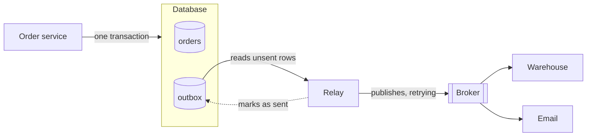

# 4.5 The dual-write problem: outbox and change data capture

[Syllabus](../SYLLABUS.md) · Phase 4 · Previous: [4.4 Logs and streams](04-logs-and-streams.md) · Next: 4.6 Operating queues *(planned)*

> **Time:** about 30 minutes to read, 40 minutes of practice.
> **You need:** transactions from [Chapter 2.3](../phase-2-data/03-transactions-and-isolation.md); the write-ahead log from [Chapter 2.1](../phase-2-data/01-how-databases-store-data.md); idempotent consumers from [Chapter 4.3](03-delivery-semantics.md). The example needs the PostgreSQL database of Phase 2.

**By the end of this chapter you can**

- explain why saving to a database and publishing a message cannot be made one atomic step;
- say what is lost, or invented, by each order of doing the two;
- build a transactional outbox, and say what its relay guarantees;
- explain change data capture, what it adds, and the one thing about it that fills disks;
- recognise the same problem wherever one fact is written to two systems.

---

## The problem

*An illustrative scenario; the example reproduces it.* When an order is placed, the service saves it and publishes *order placed*, which the warehouse, the email service and analytics all read (Chapter 4.4). The code is two lines, one after the other.

Three weeks later the warehouse reports that it shipped 9,412 orders in a period for which the shop's database holds 9,440 paid ones. Twenty-eight customers paid and were sent nothing. For each of the twenty-eight, the order is in the database and no event was ever published. Twenty-six fall in the four minutes when the broker was being restarted. Two were unlucky: the process was replaced by a deploy between the first line and the second.

No error reached a user. The orders were saved; the customers saw *thank you*. The second write simply did not happen, and nothing in the system was responsible for noticing.

---

## The concept

### 1. Two writes, and no transaction around them

A database transaction makes several changes all-or-nothing — *inside that database*. A broker is a different system. Nothing makes *the order is saved* and *the event is published* succeed or fail together. They are a **dual write**: one fact, written to two places, by two operations that can each fail alone.

### 2. Every order of doing them is wrong

| The code does | What goes wrong | The result |
|---|---|---|
| Save, then publish | The publish fails, or the process dies between | **An order with no event.** Downstream never hears of it |
| Publish, then save | The save fails, or the process dies between | **An event with no order.** Downstream acts on something that does not exist |
| Publish inside the transaction, then commit | The commit fails after the publish has gone — or the publish times out, having in fact arrived | **An event with no order**, and a transaction held open across a network call (Chapter 2.6) |

Retrying the failed half does not close the gap. The process that would retry is the one that died. And a publish that times out leaves the caller not knowing which of the two states it is in.

A protocol that makes two systems commit together does exist — two-phase commit, the subject of Chapter 5.7 — but both systems must take part in it, and the pattern below is the usual way to avoid needing it. Its own description lists, first among its benefits, "2PC is not used" ([microservices.io](https://microservices.io/patterns/data/transactional-outbox.html)).

### 3. The outbox: make it one write

If two writes cannot be atomic, write once. Put the event in the *same database*, in the *same transaction*, as the change it announces:

> "The solution is for the service that sends the message to first store the message in the database as part of the transaction that updates the business entities. A separate process then sends the messages to the message broker."
> — [microservices.io, *Pattern: Transactional outbox*](https://microservices.io/patterns/data/transactional-outbox.html)



The request does one thing: commit a transaction containing the order and a row in an `outbox` table. Either both exist or neither does. The broker is not involved, so the broker being down cannot fail an order.

A separate **relay** reads the outbox rows that have not been sent, publishes each, and marks it sent. The relay may be slow, may crash, may find the broker unreachable for an hour. None of that loses anything, because the row is still there. The same page lists the result: "Messages are guaranteed to be sent if and only if the database transaction commits" ([microservices.io](https://microservices.io/patterns/data/transactional-outbox.html)).

What the relay gives is **at least once**. It can publish a row and die before marking it; its replacement publishes the row again. So every event carries an ID — the outbox row's — and consumers are idempotent (Chapter 4.3). The dual write has not vanished; it has moved to *publish, then mark*, where a failure causes a repeat instead of a loss, and a repeat is something Chapter 4.3 knows how to make harmless.

Two details.

- **Order.** One relay, reading rows in the order of their IDs, publishes in that order. Several relays working at once do not. If order matters, publish with the order's ID as the key (Chapter 4.4) and keep to one relay per key.
- **Cleaning up.** Sent rows accumulate. Delete them in batches after a few days (Chapter 2.7) — late enough that a problem downstream can still be investigated.

### 4. Change data capture: read the database's own log

The database already keeps an ordered record of every committed change: its write-ahead log (Chapter 2.1). **Change data capture** (CDC) reads that log and turns it into a stream of events. PostgreSQL calls its mechanism logical decoding: "the process of extracting all persistent changes to a database's tables into a coherent, easy to understand format which can be interpreted without detailed knowledge of the database's internal state" ([PostgreSQL docs, *Logical Decoding Concepts*](https://www.postgresql.org/docs/current/logicaldecoding-explanation.html)).

With CDC the application does not publish at all. It saves the order. A separate process — Debezium is one open-source tool for it — follows the log and publishes what it finds.

Compared with a relay that polls a table:

- **Nothing is missed, including what a query cannot see.** Shopify moved from capturing changes by querying tables to reading the log, and one of its reasons was deletions: once a row is gone there is nothing left to query, so "Query-based capture will miss all hard-deletes" ([Shopify Engineering, *Capturing Every Change From Shopify's Sharded Monolith*](https://shopify.engineering/capturing-every-change-shopify-sharded-monolith)).
- **No polling**, and changes arrive in commit order, soon after they commit.
- **It is more to run**: a process attached to the database's replication machinery, with a position in the log that must be kept.

That position has a sharp edge. The database keeps the log for a reader that has not yet read it — for as long as it takes: "Replication slots persist across crashes and know nothing about the state of their consumer(s). They will prevent removal of required resources even when there is no connection using them" ([PostgreSQL docs](https://www.postgresql.org/docs/current/logicaldecoding-explanation.html)). A CDC reader that stops for a weekend can fill the database's disk. Its lag must be watched like a replica's (Chapter 3.6).

**CDC of what?** Capturing the business tables directly publishes your schema: every consumer now depends on column names, and a migration (Chapter 2.7) becomes a change to a public interface. The common combination avoids that: write deliberate, designed events to an outbox table — and use CDC as the relay that reads it.

### 5. The same problem in other clothes

The dual write is not about brokers. It is any single fact written to two systems:

- the database and a **cache** (Chapter 3.3's stale entries);
- the database and a **search index**;
- the database and **another service's API**;
- two databases.

The answer has the same shape each time. One system is the record. The write to it is the only write the request makes. Every other system is brought up to date *from the record*, by something that can retry until it succeeds — a relay, a CDC reader, a job. The alternative, two writes side by side and a hope, fails rarely enough to pass every test.

---

## A real example

### Run it: two writes, three ways — and no second write at all

[`code/ch05-outbox/main.go`](code/ch05-outbox/main.go) — about 350 lines — saves orders in PostgreSQL and publishes events to a broker. The database is real. The broker is a stand-in inside the program that is unreachable for one call in fifty. One order in fifty cannot be saved (the database refuses its total), and during one order in a hundred the process dies between steps.

```bash
go run ./phase-4-async/code/ch05-outbox
```

```text
PART 1 — 1,000 orders. One in fifty cannot be saved. One call in fifty finds the broker unreachable.
         During one order in a hundred, the process dies between one step and the next.

                                                 orders   events        orders with        events with           events
                                                  saved     sent           no event           no order       sent twice
  save the order, then publish                      981      951                 30                  0                0
  publish, then save the order                      953      977                  0                 24                0
  save order and note together; a relay sends       974      974                  0                  0                5

  The relay looks for new notes every 20 ms. From saving an order to publishing its event took
  10 ms (median) and 31 ms (longest).
```

- **Save, then publish**: thirty orders that nobody downstream will ever hear about. This is the opening scenario.
- **Publish, then save**: twenty-four events for orders that do not exist. The warehouse will try to ship them.
- **The outbox**: every saved order has its event, and every event its order. Five events were published twice — the relay died after publishing and before marking — which is the price, and one that idempotent consumers already pay.

The handler's whole contribution is one transaction, and no call to the broker:

```go
tx.Exec(ctx, "INSERT INTO dw_orders (id, total_cents) VALUES ($1, $2)", o.id, o.total)
tx.Exec(ctx, "INSERT INTO dw_outbox (event) VALUES ($1)", event(o))
tx.Commit(ctx)
```

The relay asks one question, over and over: `SELECT id, event FROM dw_outbox WHERE published_at IS NULL ORDER BY id LIMIT 50`. It publishes each row and then sets `published_at`. Asking every 20 ms, it delivered events about 10 ms after their orders were saved.

```text
PART 2 — no note, and no second write: the changes are read from the database's own log.

  1,000 orders were inserted; 981 of those transactions were committed, and one order was then deleted.
  Changes to the orders table found in the log: 981 inserts, 1 delete.

    table public.dw_orders: INSERT: id[integer]:1 total_cents[integer]:1001
    table public.dw_orders: INSERT: id[integer]:2 total_cents[integer]:1002
    table public.dw_orders: DELETE: id[integer]:7

  The reader now stops, and 200,000 more orders are saved. Log that the database must keep until
  the reader returns: 25 MB — and growing with every write.
```

Here the application only saves orders. The changes are read back with PostgreSQL's logical decoding, using the `test_decoding` plugin that ships with it. (This part needs the setting `wal_level = logical`; the program explains how if it is not set.)

Three things in that output. The nineteen transactions that were rolled back are **not there**: the log yields only what was committed, in the order it was committed. The deletion **is** there, which no query against the table could show. And the last lines are the sharp edge: with the reader stopped, the database was already holding 25 MB of log for it, with no limit.

---

## Trade-offs

**An outbox turns lost events into repeated ones.** Nothing is lost and nothing is invented; some events are delivered twice, and consumers must cope. It costs one more insert in each transaction, a relay to run, and a delay of about the relay's polling interval.

**Polling an outbox is simple and adds load; reading the log adds none and is more to run.** A relay that queries a table is a small program and a predictable query. CDC removes the query and the delay, sees everything including deletions, and brings a process that must be monitored and a log that grows when it stops.

**Capturing tables is free, and couples everyone to them.** Events designed on purpose, in an outbox, keep the schema private. Events that are raw rows cost nothing to produce and turn every migration into a negotiation.

**The event is later than the commit.** With either approach, a consumer hears about the order after the customer has been answered — milliseconds usually, longer when the broker or the relay is unwell. Anything that reads both the database and the stream must expect to see the order before the event.

**The outbox lives in the transactional database.** That is its strength — and it means event volume is now write volume on the primary (Chapter 3.6), and the outbox table needs the same care as any heavily written table.

---

## Practice

### Check yourself

Answer before reading on.

1. A handler ends: commit the transaction; publish the event; if publishing fails, log an error. What is lost, and how would anyone find out?
2. A colleague proposes publishing *inside* the database transaction, just before the commit, and rolling back if the publish fails. Name two things that still go wrong.
3. With an outbox, the relay publishes event 41 and dies before marking it. What do consumers see? What must be true of them? And what changes if two relays run at once?

<details>
<summary>Answers</summary>

1. **An event is lost every time the broker is unreachable or slow enough to time out, and every time the process dies between the two lines** — a deploy, a crash. The log line is written only in the first case, into a stream that nobody reads for meaning; in the second there is no log line, because the process that would have written it is gone. It is found the way the opening scenario found it: weeks later, by someone comparing two systems' totals. Losses of this kind are not found by the system that causes them.

2. **The commit can fail after the publish succeeded** — a constraint checked at commit, a lost connection, a serialization failure (Chapter 2.3). The event has gone out and the order was never saved. **And the publish can time out** when the broker did in fact receive the message: the code rolls back, and again there is an event with no order. It also holds a database transaction — and its locks, and its connection — open for the length of a network call to another system (Chapter 2.6). Moving the publish inside the transaction changes which failure is likely. It does not make the two writes one.

3. Consumers see **event 41 twice**: once from the relay that died, once from its replacement. They must be **idempotent** (Chapter 4.3), recognising the event by an ID that came from the outbox row, not one that the broker assigned to each publish. With **two relays** at once, each taking a batch of rows, events can be published out of order — 43 before 42. If consumers need an order's events in sequence, publish them with the order's ID as the key and arrange that one relay handles a given key, or run one relay. Many systems simply run one: an outbox relay is rarely the bottleneck.

</details>

### Exercise: an outbox for the order service

Design it. The service saves orders in PostgreSQL and must publish *order placed*, *order paid* and *order cancelled* to a log (Chapter 4.4) that four other services read. Give: the outbox table; what an event contains; the relay's loop; how the table is kept small; what you monitor; and what happens in each of these cases — the process dies before the commit; the broker is down for an hour; the relay dies in the middle of a batch.

<details>
<summary>Worked solution</summary>

**The table**

```sql
CREATE TABLE outbox (
    id           bigserial PRIMARY KEY,          -- also the event's ID
    aggregate_id bigint NOT NULL,                -- the order: used as the key when publishing
    type         text NOT NULL,                  -- 'order.placed', 'order.paid', 'order.cancelled'
    payload      jsonb NOT NULL,
    created_at   timestamptz NOT NULL DEFAULT now(),
    published_at timestamptz
);
CREATE INDEX outbox_unpublished ON outbox (id) WHERE published_at IS NULL;
```

The partial index (Chapter 2.2) covers only the rows the relay is looking for, so the relay's query stays fast however many sent rows remain.

**An event contains** its ID (the row's `id`), its type, the order's ID, the time, and a payload that was *designed*: the fields other services need, with a version number for the format (Chapter 4.7) — not a copy of the `orders` row. It is written by the same code, in the same transaction, as the change it describes.

**The relay**

1. `SELECT … WHERE published_at IS NULL ORDER BY id LIMIT 100`.
2. Publish each, in order, with `aggregate_id` as the key, so that one order's events stay in order in the log.
3. On success, set `published_at`. On failure, stop the batch and try again after a pause that grows (Chapter 1.5).
4. If nothing was found, wait 50 ms.

One relay runs at a time; a second instance stands by, and takes over only if it can obtain a lock the first one holds (an [advisory lock](https://www.postgresql.org/docs/current/explicit-locking.html) in PostgreSQL will do).

**Keeping it small.** A job deletes rows whose `published_at` is more than seven days old, a few thousand at a time (Chapter 2.7).

**Monitor**

- **The age of the oldest unpublished row.** This is the number. It is normally under a second; alert at a minute. It rises when the broker is down, when the relay is down, and when the relay cannot keep up — every way this can fail.
- The count of unpublished rows; the relay's publish errors; the table's size.

**The three cases**

| Case | What happens |
|---|---|
| The process dies before the commit | The transaction is rolled back. No order, no outbox row, no event. The customer sees an error and tries again |
| The broker is down for an hour | Orders are taken as usual: the request never talks to the broker. Unpublished rows pile up and the alert fires within a minute. When the broker returns, the relay sends an hour of events in order. Downstream is an hour late and misses nothing |
| The relay dies in the middle of a batch | Rows it had published and marked are done. A row it had published and *not* marked is published again by its replacement: a duplicate, with the same event ID, which consumers ignore |

**When to change it.** If the 50 ms matters, or the polling query starts to show in the database's load, replace the polling relay with CDC reading the same outbox table. Nothing else in the design changes — and then also monitor the replication slot.

</details>

---

## Production tips and common mistakes

**Tips**

- **Never write the same fact to two systems from one request.** Write it to the record, and derive the rest.
- **Put the event in the same transaction as the change.**
- **Give every event an ID from the outbox**, and make consumers idempotent.
- **Design the event.** Do not publish the row.
- **Monitor the age of the oldest unsent event.** One number covers the broker, the relay and the backlog.
- **Run one relay per key** if order matters, with a standby.
- **Delete sent rows on a schedule**, in batches.
- **With CDC, alert on the replication slot's lag**, and drop slots that are no longer used.
- **Reconcile anyway**: a periodic comparison between the record and what downstream holds finds the failures that nobody anticipated.

**Common mistakes**

- **Commit, then publish**, with a log line for the failure.
- **Publishing inside the transaction** and believing that this is atomic.
- **Publishing first**, so that downstream hears of things that never happened.
- **An outbox with no monitoring**, quietly holding a day of events.
- **Consumers that are not idempotent** behind an at-least-once relay.
- **Several relays** and a consumer that assumed order.
- **Raw table changes as the public event stream**, and then a migration.
- **A forgotten replication slot**, and a database disk filling at three in the morning.
- **Treating the cache, the search index or another service's API as different.** They are the same problem.

---

## Key takeaways

- Saving to a database and publishing to a broker are two writes. No ordering of them, and no retry, makes them atomic.
- Save-then-publish loses events. Publish-then-save invents them.
- The transactional outbox writes the event into the same database, in the same transaction, as the change. A relay publishes it afterwards, at least once.
- Change data capture reads committed changes from the database's own log: nothing missed, no polling, and a log that grows if the reader stops.
- Capture a designed outbox, not the business tables, to keep the schema private.
- The same rule covers caches, search indexes and other services: one record, and everything else derived from it by something that retries.

**Next:** 4.6 Operating queues *(planned)* — how to tell that a queue is falling behind before the users do.

---

## Sources

- Chris Richardson, [*Pattern: Transactional outbox*](https://microservices.io/patterns/data/transactional-outbox.html), microservices.io.
- PostgreSQL documentation: [*Logical Decoding Concepts*](https://www.postgresql.org/docs/current/logicaldecoding-explanation.html).
- John Martin and Adam Bellemare, [*Capturing Every Change From Shopify's Sharded Monolith*](https://shopify.engineering/capturing-every-change-shopify-sharded-monolith), Shopify Engineering, 2021.
