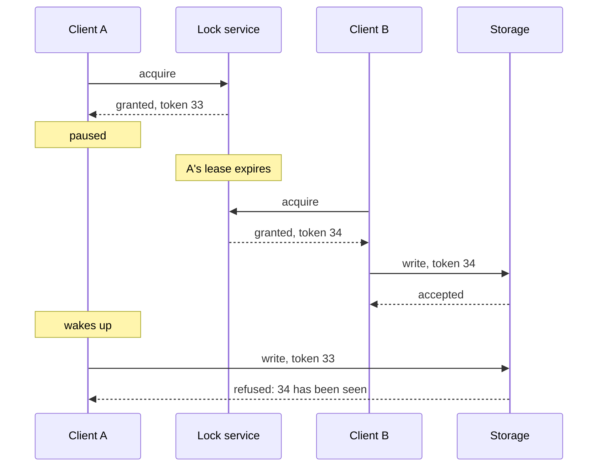

# 5.5 Time and order

[Syllabus](../SYLLABUS.md) · Phase 5 · Previous: [5.4 Consistency models and CAP](04-consistency-models-and-cap.md) · Next: [5.6 Consensus and coordination](06-consensus-and-coordination.md)

> **Time:** about 30 minutes to read, 35 minutes of practice.
> **You need:** leases and split brain from [Chapter 5.1](01-leader-follower-replication.md); last write wins and version vectors from [Chapter 5.2](02-multi-leader-and-leaderless.md). The example needs only Go.

**By the end of this chapter you can**

- say what a machine's clock can and cannot be trusted for, and which of its two clocks to use for what;
- explain why a lock with a time limit can be held by two clients at once, and how a fencing token makes that harmless;
- order events from different machines without trusting their clocks;
- recognise designs that depend on timing, and say what they depend on.

---

## The problem

*An illustrative scenario; the example reproduces it.* A nightly job rebuilds a customer's invoice file. Two copies of the job must never run at once, so each takes a lock in a lock service before it starts, with a thirty-second time limit in case a job dies holding it.

One night a job takes the lock, reads the invoices, and then stops — for forty seconds. Nothing is wrong with it: the virtual machine it runs on was being moved to another host. Its lock expires. A second copy of the job takes the lock, rebuilds the file, and finishes. Then the first wakes up. As far as it knows, no time has passed: it checked the lock a moment ago, and it holds it. It writes its file — built from what it read forty seconds earlier — over the second job's.

Every component behaved as designed. The lock service gave the lock to one holder at a time. The job checked before writing. The mistake is in a belief that sits under the whole design: that a program can know what time it is, or how much time has passed, or that something it checked a moment ago is still true.

---

## The concept

### 1. A machine has two clocks

Operating systems provide two clocks, and Go's documentation states the rule for using them: "The general rule is that the wall clock is for telling time and the monotonic clock is for measuring time" ([Go docs, `time`](https://pkg.go.dev/time)).

The **wall clock** says what time it is. It is kept right by being *corrected* — and a correction is a jump, sometimes backwards. Different machines' wall clocks never quite agree.

The **monotonic clock** says how much time has passed since some arbitrary moment. It only goes forward. It means nothing on any other machine.

Mixing them up is an old and reliable source of outages. Cloudflare's DNS failed for some customers at midnight on 1 January 2017, during a leap second: "The root cause of the bug that affected our DNS service was the belief that time cannot go backwards. In our case, some code assumed that the difference between two times would always be, at worst, zero" ([Cloudflare, *How and why the leap second affected Cloudflare DNS*](https://blog.cloudflare.com/how-and-why-the-leap-second-affected-cloudflare-dns/)).

So: **durations, timeouts and rates from the monotonic clock. Timestamps for people from the wall clock. Decisions about order between machines from neither.**

### 2. What clocks on different machines cannot tell you

Two machines' clocks differ, by an amount that neither knows exactly. So a timestamp from one machine cannot be compared with a timestamp from another to decide which of two things happened first, if they happened close together. Chapter 5.2's corrected address, lost to a clock three seconds slow, was this.

The honest way to use a clock across machines is to treat a reading as an interval: *the time is between T − ε and T + ε*. Two events are ordered only if their intervals do not overlap. Google's Spanner is built on a clock made for this — "TrueTime is a highly available, distributed clock that is provided to applications on all Google servers" — with which "an application can compute a timestamp T that is guaranteed to be greater than any timestamp T', if T' finished being generated before T started being generated" ([Google Cloud, *Spanner: TrueTime and external consistency*](https://cloud.google.com/spanner/docs/true-time-external-consistency)). Without such a clock, ε is unknown, and order has to come from somewhere else.

### 3. Order without clocks

Leslie Lamport's 1978 paper begins from the awkward fact: "In a distributed system, it is sometimes impossible to say that one of two events occurred first" ([Lamport, *Time, Clocks, and the Ordering of Events in a Distributed System*](https://lamport.azurewebsites.net/pubs/time-clocks.pdf)). Two events on different machines, with no message between them, simply have no order.

What *can* be known is causality: a message is sent before it is received, and things on one machine happen in sequence. A **logical clock** captures exactly that, with a counter in place of a clock:

- each machine keeps a counter, and adds one for every event;
- every message carries the sender's counter;
- on receiving a message, a machine sets its counter to more than both its own and the message's.

Sort events by counter, and no effect is ever placed before its cause. That is all it promises: of two events that had nothing to do with each other, it picks an order arbitrarily. To know that two events were *concurrent* takes the version vectors of Chapter 5.2. And when everyone must agree on **one** order for everything, the order has to be decided in one place — a leader's log (Chapter 5.1), or consensus (Chapter 5.6).

### 4. A lock with a time limit is a guess

A lock held across machines must have a time limit — a **lease** — or one dead client holds it for ever. With a time limit, the holder is no longer certain that it holds the lock. It knows that it *did*, when it last asked.

Between asking and acting, any amount of time can pass without the program noticing: a garbage-collection pause, a virtual machine frozen while it is moved, a full disk queue, a process swapped out. Martin Kleppmann's analysis of distributed locks puts it without qualification: "You simply cannot make any assumptions about timing, which is why the code above is fundamentally unsafe, no matter what lock service you use" ([Kleppmann, *How to do distributed locking*](https://martin.kleppmann.com/2016/02/08/how-to-do-distributed-locking.html)).

Checking again just before writing only makes the window smaller. There is always a gap between the last check and the write, and a pause can fall in it.

### 5. Fencing tokens

The fix moves the check to the one place that can make it reliably: the thing being protected.

In Kleppmann's words: "you need to include a fencing token with every write request to the storage service. In this context, a fencing token is simply a number that increases (e.g. incremented by the lock service) every time a client acquires the lock" ([Kleppmann](https://martin.kleppmann.com/2016/02/08/how-to-do-distributed-locking.html)).



The storage remembers the highest token it has accepted and refuses anything lower. The paused client's write arrives with an old token and is turned away. It no longer matters how long the pause was, or what any clock said.

This requires the storage to take part — a conditional write, a version column checked in the `UPDATE` (Chapter 2.4), a comparison in the service that owns the data. A lock whose protected resource cannot check a token is advisory: it reduces how often two holders collide, and does not prevent it.

### 6. Leases, used carefully

Leases are still everywhere — a leader's right to lead (Chapter 5.1), a worker's claim on a job (Chapter 4.2) — and are sound if their limits are respected:

- the holder measures its lease with its **monotonic** clock, from when it *sent* the request, not from when the answer arrived;
- the holder stops acting some margin *before* the lease ends, to allow for clocks that run at slightly different rates;
- and, because a pause can still outlast any margin, whatever the lease protects is **fenced**, or the work is idempotent (Chapter 4.3).

The first two make trouble rare. Only the third makes it harmless.

---

## A real example

### Run it: a pause, a correction, and three clocks

[`code/ch05-time/main.go`](code/ch05-time/main.go) — about 220 lines, no dependencies. Part 1 runs real goroutines with real waits. Parts 2 and 3 use clocks that the program controls.

```bash
go run ./phase-5-distributed-data/code/ch05-time
```

```text
PART 1 — a lock is granted for 20 ms at a time. Client A takes it, checks that it holds it, and writes.
         In 20 rounds of 100, A is paused for 60 ms between the check and the write — a garbage
         collection, a frozen virtual machine. Client B is waiting for the lock.

  the storage...                                   times B's finished write              writes refused as
                                                     was overwritten by A's                    out of date
  accepts any write                                                      20                              0
  refuses a token older than one it has seen                              0                             20
```

Twenty pauses, twenty times that B's finished work was replaced by A's stale write. The lock service never gave the lock to two clients at once; for a while, two clients *believed* they had it. With a token checked by the storage, the same twenty late writes arrive and are refused.

```text
PART 2 — a machine's clock is 800 ms fast. A request starts; 50 ms later, while it is still running,
         the clock is corrected; 50 ms after that the request ends. How long did it take?

  by the wall clock:          -700 ms
  by the monotonic clock:      100 ms

  A lock is granted for 500 ms, and the holder checks its wall clock to see whether it still has it.
  The clock is corrected just after. The holder goes on believing it has the lock for 1300 ms.
```

A request that took a tenth of a second is recorded as taking *minus* seven tenths. That number then goes into an average, a timeout calculation, or — at Cloudflare — a function that did not expect a negative. The second half is the same error in a lease: a holder that asks the wall clock whether its 500 ms are up is told *not yet* for 1,300.

```text
PART 3 — three machines exchange 2,000 messages. Their clocks are 40 ms slow, right, and 25 ms fast.
         Every send and every receive is logged, and the logs are merged into one, in order.

  the merged log is ordered by...               messages received before they were sent
  each machine's wall clock                                                         970
  a counter carried on every message                                                  0
```

Merged by timestamp, nearly half the messages appear to have been received before they were sent: the clocks disagree by more than a message takes to travel. Anyone reading that log to find out what caused what will be misled. Ordered by a counter that every message carries, no receive comes before its send — with no clock involved at all.

---

## Trade-offs

**Wall clocks are meaningful and unreliable; monotonic clocks are reliable and meaningless elsewhere.** Use each for what it is for, and neither to order events between machines.

**Logical clocks give an order that respects cause and effect, and nothing more.** They are cheap and need no synchronisation. They cannot say what time anything happened, and they order unrelated events arbitrarily.

**A clock with known uncertainty lets machines agree on order by waiting.** That is real, and it needs hardware and operations that few organisations have. Everyone else gets order from a single log.

**A lease gives progress when a holder dies, and gives up certainty.** Without a time limit, a dead holder blocks everyone. With one, two holders are possible. The protected resource must be able to tell them apart.

**Fencing makes a lock safe and requires the resource to cooperate.** Where the storage cannot check a token, choose a different design: make the work idempotent, or give it a single owner by partition (Chapter 4.4) instead of by lock.

---

## Practice

### Check yourself

Answer before reading on.

1. A function computes a request's duration as `end − start`, where both come from the system's time of day. Give two ways that the result can be badly wrong, and the fix.
2. A worker takes a lock with a 30-second lease, and checks that it still holds the lock immediately before each write. Is that safe? Why, or why not?
3. Two data centres log events with timestamps from clocks that are synchronised to within 10 ms. A reply was logged in one at 12:00:00.004, and the request it answers in the other at 12:00:00.007. What can be concluded? What should the logs have carried?

<details>
<summary>Answers</summary>

1. **The clock is corrected during the request** — stepped back by time synchronisation, or adjusted for a leap second — and the duration comes out negative, or far too large if it stepped forward. **Or the machine was suspended** — a laptop closed, a virtual machine paused — and the wall clock jumps forward on resume. Either number then poisons whatever it feeds: an average, a histogram, a timeout. The fix is to measure with the **monotonic clock**. In Go that is automatic if both values come from `time.Now()` and are subtracted with `Sub` or `Since`; it is lost if the time is converted to a number, stored, or sent to another machine first.

2. **No.** The check and the write are two steps, and the worker can be paused between them for longer than the lease has left. When it resumes, it does not re-check; it writes. Checking more often narrows the window and cannot close it. The safe design does not depend on the worker's belief at all: the lock service issues an increasing **token** with each grant, the worker sends it with every write, and the storage refuses a token lower than one it has already accepted.

3. **Nothing about their order from the timestamps.** They differ by 3 ms, and the clocks may differ by 10. We know the true order for another reason — a reply follows its request — and the log contradicts it. The logs should carry something that does not depend on clocks: a **logical counter** that each message passes on, so that the reply's number is always greater than the request's; or a request ID, with which the two lines can be joined and ordered by cause (Chapter 7.4). Keep the wall-clock time too, for people. Do not sort by it across machines.

</details>

### Exercise: make the nightly job safe

The job from the opening: several copies may be started; only one should rebuild a given customer's invoice file at a time; the lock has a 30-second lease; the file lives in object storage. Redesign it so that a paused job cannot overwrite a newer result. Say what you change in the lock service, in the job, and in the storage — and what you would do if the storage could not help.

<details>
<summary>Worked solution</summary>

**The lock service** returns, with each grant, a **token that only ever increases** — a counter it keeps durably, or the revision number of the lock's record. (A lock service that cannot do this cannot be made safe by anything the job does.)

**The job**

1. Acquires the lock and receives token *n*.
2. Renews the lease while it works, measuring with its monotonic clock, and gives up if a renewal fails.
3. Sends *n* with its write.

Step 2 keeps collisions rare. It is not what makes the design correct.

**The storage** refuses a write whose token is lower than the newest it has accepted for that file. With a database, that is a column and a condition:

```sql
UPDATE invoice_files SET content = $1, token = $2
WHERE customer_id = $3 AND token < $2;
```

Zero rows updated means: someone newer has been here; stop, and do not retry. With object storage, the equivalent is a *conditional write* — write only if the object's current version is the one I read — where the store offers one; the job reads the current version when it starts, and its final write succeeds only if nobody has written since. That is Chapter 2.4's check-and-change, made by the storage, at the moment of the write.

**The paused job** now behaves like this: it wakes, sends its write with token 33, and is refused because 34 has been seen. It logs that it lost the lock and exits. Nothing was overwritten.

**If the storage cannot check anything**, the lock cannot be made safe, and the design must not rely on it for correctness. Alternatives, in order of preference:

- **Make the result not depend on who wrote last.** Each run writes to a new name — `invoices/customer-42/run-0034` — and a small record that *can* be updated conditionally says which run is current. A stale job writes a file that nothing points to.
- **Make the work idempotent and deterministic**, so that two runs produce the same file and overwriting is harmless.
- **Give each customer one owner** without a lock: partition customers among the workers (Chapter 4.4), so that only one worker is ever responsible for a given customer.

In all of these the lock, if it is kept, is an optimisation — it saves duplicate work — and is no longer what keeps the data correct.

</details>

---

## Production tips and common mistakes

**Tips**

- **Measure durations and timeouts with the monotonic clock.** Never subtract two wall-clock times.
- **Monitor clock offset on every machine**, and alert on it: anything that uses timestamps for order depends on it.
- **Do not order events between machines by wall-clock time.** Carry a version, a counter or an ID.
- **Treat a lock held across machines as a hint**, unless the resource it protects checks a fencing token.
- **Get tokens from the lock service**, and check them where the data is.
- **Renew leases early, by the monotonic clock, counted from before the request.**
- **Prefer designs that need no lock**: idempotent work, conditional writes, one owner per key.
- **Test pauses**: stop a process holding a lock for longer than its lease (`kill -STOP`, then `-CONT`) and see what it does when it wakes.

**Common mistakes**

- **Assuming that time moves forward**, and at the same rate everywhere.
- **`end − start` from the time of day.**
- **Last write wins across machines**, trusting timestamps to say what is last.
- **Checking a lock and then acting**, as if nothing could happen in between.
- **A lease with no fencing**, protecting something that must not be written twice.
- **A lock service with no increasing token**, used for correctness.
- **Sorting a merged log by timestamp** to work out what caused what.
- **Timeouts chosen as if pauses did not exist.**

---

## Key takeaways

- A machine has a wall clock, which can jump and differs from every other machine's, and a monotonic clock, which only counts. Measure with the second; tell people the time with the first.
- Timestamps from different machines cannot order events that happened close together. Order comes from causality — counters carried on messages — or from one place that decides.
- A lock with a time limit can be believed held by two clients at once, because a client can be paused for longer than its lease without knowing.
- A fencing token — a number that increases with every grant, checked by the protected resource — makes a stale holder's writes fail. Nothing done by the holder alone can.
- Where the resource cannot check a token, do not rely on the lock for correctness.

**Next:** [5.6 Consensus and coordination](06-consensus-and-coordination.md) — how several machines agree on one thing, and the services that do it so that you need not.

---

## Sources

- Go documentation: [package `time`](https://pkg.go.dev/time) (monotonic clocks).
- John Graham-Cumming, [*How and why the leap second affected Cloudflare DNS*](https://blog.cloudflare.com/how-and-why-the-leap-second-affected-cloudflare-dns/), Cloudflare, 2017.
- Leslie Lamport, [*Time, Clocks, and the Ordering of Events in a Distributed System*](https://lamport.azurewebsites.net/pubs/time-clocks.pdf), Communications of the ACM, 1978.
- Martin Kleppmann, [*How to do distributed locking*](https://martin.kleppmann.com/2016/02/08/how-to-do-distributed-locking.html), 2016.
- Google Cloud documentation: [*Spanner: TrueTime and external consistency*](https://cloud.google.com/spanner/docs/true-time-external-consistency).
