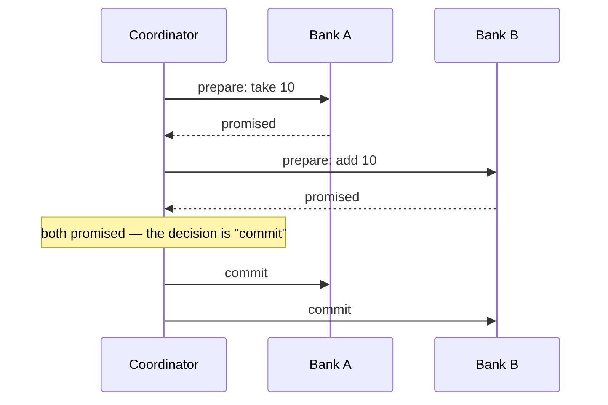

# 5.7 Distributed transactions

[Syllabus](../SYLLABUS.md) · Phase 5 · Previous: [5.6 Consensus and coordination](06-consensus-and-coordination.md) · Next: [Capstone 5: a chat system](capstone-chat-system.md)

> **Time:** about 35 minutes to read, 40 minutes of practice.
> **You need:** transactions from [Chapter 2.3](../phase-2-data/03-transactions-and-isolation.md); the dual write and the outbox from [Chapter 4.5](../phase-4-async/05-dual-writes-outbox-cdc.md); idempotent consumers from [Chapter 4.3](../phase-4-async/03-delivery-semantics.md). The example needs the PostgreSQL database of Phase 2.

**By the end of this chapter you can**

- say why a change that spans two databases cannot be made atomic by committing twice;
- explain two-phase commit: what it guarantees, and the failure that makes it block;
- design a saga, with its compensations, and say which of a transaction's properties it gives up;
- recognise when a design can avoid both, and prefer that.

---

## The problem

*An illustrative scenario; the example reproduces it.* A wallet service holds customers' balances. A separate rewards service holds their points. *Convert 1,000 points into 10 of credit* must take from one and add to the other. The code does exactly that: one call, then the next.

Reconciliation at the end of the quarter shows that the two services disagree. A few hundred customers have lost points and received no credit. Each case is a process that died between the two calls, or a second call that failed after the first had succeeded: the customer's wallet was frozen, the network dropped. Nothing rolled the first step back, because by then it had been committed, in a database that knew nothing of the second.

Inside one database this cannot happen. A transaction makes both changes or neither (Chapter 2.3). The moment the two changes live in two databases — two services, two shards (Chapter 5.3) — that guarantee is gone, and something has to be put in its place. Chapter 4.5 met this problem with a database and a broker. This chapter is the general case.

---

## The concept

### 1. Atomic commit

The requirement has a name: **atomic commit** — several participants either all commit or all abort. It is a kind of agreement (Chapter 5.6), with one extra difficulty. Each participant may have a reason to say no — a constraint, a closed account — and once any participant has committed, it cannot take that back.

Committing at each participant in turn does not provide it. After the first commit and before the second there is a gap, and a failure in the gap leaves one change made and the other not.

### 2. Two-phase commit

The classic protocol adds a step before committing. A **coordinator** asks every participant to **prepare**: to do all the work, make sure it could commit, write that down durably, and *promise*. Only when every participant has promised does the coordinator tell them to commit. If any refuses, it tells them all to abort.



PostgreSQL implements the participant's side as `PREPARE TRANSACTION`: "After this command, the transaction is no longer associated with the current session; instead, its state is fully stored on disk, and there is a very high probability that it can be committed successfully, even if a database crash occurs before the commit is requested" ([PostgreSQL docs, `PREPARE TRANSACTION`](https://www.postgresql.org/docs/current/sql-prepare-transaction.html)).

That promise is the whole mechanism, and its cost. A participant that has promised **may not decide for itself**. It cannot commit, because another participant may have refused. It cannot abort, because the coordinator may already have told the others to commit. It must wait to be told — holding its locks.

If the coordinator dies after collecting the promises and before delivering the decision, the participants wait for as long as it takes for the coordinator to come back. Jim Gray and Leslie Lamport put it in a sentence: "The classic Two-Phase Commit protocol blocks if the coordinator fails" ([Gray and Lamport, *Consensus on Transaction Commit*](https://lamport.azurewebsites.net/video/consensus-on-transaction-commit.pdf)). PostgreSQL's manual warns about the same state from the participant's side: "It is unwise to leave transactions in the prepared state for a long time… Keep in mind also that the transaction continues to hold whatever locks it held" ([PostgreSQL docs](https://www.postgresql.org/docs/current/sql-prepare-transaction.html)).

So two-phase commit gives atomicity, and takes:

- **Availability.** Every participant and the coordinator must be reachable for anything to commit, and one stuck transaction blocks every other that touches the same rows.
- **Time.** Two rounds of messages, and a durable write at each participant in each.
- **Participation.** Every system involved must implement *prepare*. Most HTTP APIs, and many brokers, do not.

The blocking can be removed by keeping the decision somewhere that survives the coordinator: the same paper's Paxos Commit "runs a Paxos consensus algorithm on the commit/abort decision" ([Gray and Lamport](https://lamport.azurewebsites.net/video/consensus-on-transaction-commit.pdf); Chapter 5.6). That is machinery for the inside of a database. As a way for separate *services* to cooperate, two-phase commit is rarely the right choice.

### 3. Sagas

A **saga** gives up atomicity as a transaction means it, and gets the practical effect another way. Each step is an ordinary local transaction, committed at once. If a later step fails, the earlier ones are undone — by new transactions that do the opposite, called **compensations**. The pattern's summary: "either all steps complete successfully or, if a local transaction fails because it violates a business rule, the changes made by the completed steps are undone by compensating transactions" ([microservices.io, *Pattern: Saga*](https://microservices.io/patterns/data/saga.html)).

For the points and the credit: take the points (commit); add the credit (commit). If adding the credit is refused, give the points back.

A saga needs four things to be sound.

- **A durable record of how far it has got**, written in the same local transaction as each step. A process that dies leaves a record saying what remains, and something else carries on. Without it, a saga is the opening scenario with a name.
- **Idempotent steps.** Whatever resumes a saga will repeat a step now and then (Chapter 4.3).
- **A compensation for every step that can be undone** — and compensations must not fail for business reasons, or there is nothing left to fall back on.
- **Order.** Put the steps that can be refused first and those that cannot be undone last. Sending an email, shipping a parcel or paying out money have no compensation; they go at the end, after everything that might say no.

What a saga does not give is **isolation** (Chapter 2.3). Between its steps, the world can see the half-finished state: points gone, credit not yet arrived. Anything that reads both sides in that window sees a total that is wrong. Designs live with this by making the intermediate state a real, named one — *conversion pending* — instead of an inconsistency that readers stumble on.

Who drives the steps is Chapter 4.7's choice between choreography and orchestration. For a saga with compensations, an orchestrator that owns the record is usually the clearer.

### 4. Designing so that neither is needed

Both mechanisms are expensive. The better question is why the change spans two places at all.

- **Put together what changes together.** If points and credit are always changed in one operation, they may belong in one service, or at least one database. A partition key chosen so that related rows share a shard (Chapter 5.3) turns a distributed transaction into a local one.
- **Make one side the record and the other a follower.** Write the conversion once, in one place, with an outbox (Chapter 4.5); the other service applies it idempotently when the event arrives. There is no second commit to fail — only a delivery, retried until it succeeds. This works whenever the follower *cannot refuse*.
- **Reserve, then confirm.** Where the second party can refuse, have it hold what is needed first — a hold on stock, an authorisation on a card — as a local, cancellable step with an expiry. Capstone 2's seat holds were this.

Pat Helland's essay on building systems without distributed transactions argues that the uncertainty they hide does not go away; it becomes part of the application's own logic — and that this is no bad thing: "While more complicated to implement than simply using distributed transactions, it is how the real world works" ([Helland, *Life beyond Distributed Transactions*](https://www.cidrdb.org/cidr2007/papers/cidr07p15.pdf)). A bank transfer between two banks has never been atomic. It is a debit, a message, a credit, and a process for when the message goes astray.

---

## A real example

### Run it: 2,000 transfers, four ways

[`code/ch07-transfers/main.go`](code/ch07-transfers/main.go) — about 340 lines — moves money from accounts at bank A to accounts at bank B, in PostgreSQL. Each bank has its own table and its own connection, and commits separately. (They share one database server here so that the example needs only one; nothing in it depends on that.) One account in twenty at B is closed and refuses the credit. In one transfer in a hundred, the process dies half-way. Meanwhile an auditor adds up all the money, over and over.

The two-phase part needs one PostgreSQL setting, `max_prepared_transactions`; the program explains how to set it if it is missing.

```bash
go run ./phase-5-distributed-data/code/ch07-transfers
```

```text
                                      one transfer   audits that transfers' worth  transactions left   transfers that   transfers' worth
                                             takes     found the of money missing  prepared, holding  gave up waiting      missing after
                                          (median)   total wrong       at the end              locks       for a lock           recovery
  two commits, one after the other         0.93 ms          100%               96                  0                0                 96
  two-phase commit                         2.14 ms            3%                0                 18              415                  0
  a saga, with compensation                1.85 ms           98%               22                  0                0                  0
  one transaction, in one database         0.98 ms            0%                0                  0                0                  0
```

**Two commits.** Ninety-six transfers' worth of money left A and never reached B: the process died in between, or B's account was closed. Nothing records which ones. Recovery finds nothing to recover, and the money is still missing afterwards. This is the opening scenario.

**Two-phase commit.** No money was lost, at any point. Now read the other columns.

- It took more than twice as long per transfer.
- Eighteen transactions were left *prepared* — nine transfers whose coordinator died after both banks had promised. Each holds a lock on an account at A and one at B.
- **415 other transfers gave up**, after waiting for one of those locks. Nine dead coordinators made a fifth of all transfers fail. Left alone, those accounts would be unusable until someone resolved the prepared transactions by hand.
- 3% of audits still found the wrong total: they looked between the commit at A and the commit at B. The protocol makes the *outcome* atomic. It does not make the two commits simultaneous.

After recovery — something that knows the decision was *commit* finishes each one — everything is right.

**A saga.** Nothing blocked, and nothing was lost in the end. Twenty-two transfers were left half-way by processes that died; the saga's record said so, and recovery carried each one on or refunded it. Transfers to closed accounts were refunded as they happened.

But 98% of audits found the wrong total. For most of the run, some money was *in the air*: taken from A and not yet at B, or not yet refunded. That is the missing isolation, measured. An auditor of this system has to count transfers in flight as a third place where money can be.

**One transaction.** As fast as the unsafe version, and every column is zero. When both accounts can be in one database, nothing else compares.

---

## Trade-offs

**Two-phase commit is atomic and fragile.** It gives a real all-or-nothing outcome, and makes every participant depend on every other and on the coordinator. One failure at the wrong moment leaves locks held until a person intervenes.

**A saga is available and visible.** Every step commits locally and nothing waits on anything else. In exchange, half-finished work can be seen, compensations must be designed and tested, and the code is longer than the transaction it replaced.

**Compensation is not rollback.** A rollback makes it as if nothing happened. A compensation is a second thing that happened: the customer may have seen the first, been notified of it, or acted on it.

**The record of the saga is the saga.** Without a durable note of each step, taken in the same transaction as the step, there is nothing to resume from.

**Avoiding the problem beats solving it.** Data that changes together and lives together needs neither. This is the strongest argument for drawing service boundaries around transactions (Chapter 9.5), and for choosing partition keys that keep them local.

---

## Practice

### Check yourself

Answer before reading on.

1. In a two-phase commit, both participants have answered *prepared*, and the coordinator dies before sending its decision. A participant's operator wants to free the locks. May the participant abort? May it commit? What is the safe course?
2. A travel site books a flight, then a hotel, then charges the card. The card is declined. What must the saga do — and what should the order of the steps have been?
3. A report sums all balances across two services, and is sometimes wrong by small amounts, though reconciliation shows that no money is ever lost. The services use a saga for transfers. Why — and what are two ways to produce a correct report?

<details>
<summary>Answers</summary>

1. **Neither, on its own knowledge.** If it aborts and the coordinator had decided *commit* — and told the other participant before dying — the transfer is half-done. If it commits and the coordinator had decided *abort*, the same. The participant does not know the decision and promised to wait for it. The safe course is to find the decision: from the coordinator's log when it restarts, or by asking the other participant what it was told. Only if *no* participant was told anything is it certain that no decision was acted on, and all can abort together. This is why the coordinator's decision must be written durably before it is sent — and why serious implementations keep it by consensus.

2. **Compensate, in reverse**: cancel the hotel, then cancel the flight. Each cancellation must succeed eventually, so it is retried until it does, and must be idempotent. But the order was wrong. Charging a card is the step most likely to be refused, and the cheapest to undo *before* it is completed. Better: **authorise the card first** — a hold, with an expiry, which can be released without cost — then book the flight and the hotel as holds if the suppliers allow, and only then capture the payment and confirm the bookings. Steps that can say no go first. Steps that cannot be undone go last.

3. **The report reads between a saga's steps.** At any moment some transfers are half-done: debited in one service, not yet credited in the other. Reading the two services one after the other also means reading them at two different moments. Each run of the report catches a different set of transfers in flight, so the error is small and never the same. Two fixes. **Count the in-flight money**: the saga's own record lists transfers that have been debited and not completed; add them. The total is then exact. Or **build the report from the events**, not from the balances: a ledger of completed transfers (Chapter 4.7) has no half-states in it. What will not work is retrying the report until the numbers happen to agree.

</details>

### Exercise: convert points into credit

Design the conversion from the opening scenario. The rewards service holds points; the wallet service holds credit; they are separate services with separate databases. 1,000 points become 10 of credit. A wallet may be frozen, in which case credit cannot be added. Give: the steps, in order; what is recorded, where; what happens for each failure — the process dies after taking the points; the wallet is frozen; the wallet service is down for an hour; a step is delivered twice; and what a customer sees at each moment.

<details>
<summary>Worked solution</summary>

**The design: the rewards service owns the conversion.** It is a saga with one step that can be refused, orchestrated by the service where it starts.

**Steps**

1. **Rewards service, one local transaction**: check that the customer has 1,000 points; subtract them; insert a row in `conversions` — its ID, the customer, the amounts, the state `pending` — and a row in the outbox: *credit 10 to this customer, for conversion C* (Chapter 4.5).
2. **Wallet service**, on receiving that message: in one local transaction, record conversion C in its table of processed requests and add the credit — or, if the wallet is frozen, record C as refused. Either way, publish the outcome through its own outbox. A message seen before changes nothing and publishes the same outcome again (Chapter 4.3).
3. **Rewards service**, on receiving the outcome: if credited, set the conversion to `done`. If refused, in one local transaction, give the 1,000 points back and set it to `refunded`.

**What is recorded, where**: the conversion's state, in the rewards service, changed only in the same transaction as the points. The wallet service records only which conversions it has handled and how.

| Failure | What happens |
|---|---|
| The process dies after step 1 | Nothing is lost. Step 1 committed the points, the `pending` row and the outbox row together. The relay sends the message when it can |
| The process dies during step 1 | The transaction rolls back. No points taken, no conversion |
| The wallet is frozen | The wallet service refuses, and says so. Step 3 refunds the points. The customer is told that the conversion did not go through, and why |
| The wallet service is down for an hour | The message waits in the outbox and is retried. The conversion stays `pending` for an hour, and the customer sees it as that. An alert fires on conversions that have been pending for more than a few minutes (Chapter 4.6) |
| A message is delivered twice, in either direction | The receiver recognises the conversion's ID and does nothing new |
| The refund in step 3 fails | It cannot fail for a business reason — adding points has no rule to break — so it is retried until it succeeds |

**What the customer sees**: *Converting 1,000 points…* from step 1; then *10 credit added*, or *We could not convert your points — they have been returned*. The points are shown as reduced from step 1, with the pending conversion listed beside them. At no moment does the customer have both the points and the credit, and at no moment do they have neither without an explanation on the screen.

**Why not the other choices**

- *Two-phase commit*: both services would have to implement prepare, and a stuck conversion would lock the customer's points and wallet until somebody resolved it.
- *Credit first, then take the points*: for a moment the customer has both, and can spend both. The step that takes something away goes first; the step that gives goes last.
- *One service*: if points and credit were always changed together, this would be the right answer. They are not — each is changed by many other things — so the boundary stands, and one saga crosses it.

</details>

---

## Production tips and common mistakes

**Tips**

- **First ask why the change spans two places.** Move the data together if it changes together.
- **Prefer one record and a follower** — an outbox and an idempotent consumer — whenever the second party cannot refuse.
- **In a saga, record every step in the same transaction as the step.**
- **Order the steps**: what can be refused first; what cannot be undone last.
- **Make every step and every compensation idempotent**, and make compensations unable to fail for business reasons.
- **Name the intermediate state** and show it: *pending*, *in transit*.
- **Alert on sagas that have been in progress too long.**
- **If you use two-phase commit, monitor prepared transactions** and have a tested procedure for resolving them.
- **Reconcile**: periodically compare the two sides, whatever mechanism joins them.

**Common mistakes**

- **Two calls in a row**, and a hope.
- **Catching the second call's error and "rolling back" the first** with a third call — which can also fail, and is not recorded.
- **A saga with no durable record**, so that a restart forgets what was in progress.
- **Compensations that are never tested**, and fail when first needed.
- **Irreversible steps early**: the email sent, then the order refused.
- **Assuming that a saga hides its intermediate states** from other readers.
- **Prepared transactions left for hours**, holding locks.
- **Two-phase commit across HTTP services** that do not implement it.
- **A distributed transaction where a different service boundary would have needed none.**

---

## Key takeaways

- A change in two databases cannot be made atomic by committing at each in turn: a failure between the commits leaves it half-done.
- Two-phase commit makes participants promise before anyone commits. It is atomic, and it blocks: a participant that has promised must hold its locks until it is told the outcome, however long the coordinator takes to return.
- A saga commits each step locally, records its progress durably, and undoes completed steps with compensations if a later one fails. It never blocks and it is not isolated: half-finished work is visible.
- Compensation is a new action, not an erasure. Order steps so that refusals come early and irreversible effects come last.
- The best distributed transaction is the one designed away: data that changes together kept together, or one side made the record and the other a follower.

**Next:** [Capstone 5: a chat system](capstone-chat-system.md) — ordering messages, delivering them, partitioning their storage, and knowing who is online.

---

## Sources

- PostgreSQL documentation: [`PREPARE TRANSACTION`](https://www.postgresql.org/docs/current/sql-prepare-transaction.html).
- Jim Gray and Leslie Lamport, [*Consensus on Transaction Commit*](https://lamport.azurewebsites.net/video/consensus-on-transaction-commit.pdf).
- Chris Richardson, [*Pattern: Saga*](https://microservices.io/patterns/data/saga.html), microservices.io.
- Pat Helland, [*Life beyond Distributed Transactions: an Apostate's Opinion*](https://www.cidrdb.org/cidr2007/papers/cidr07p15.pdf), CIDR 2007.
