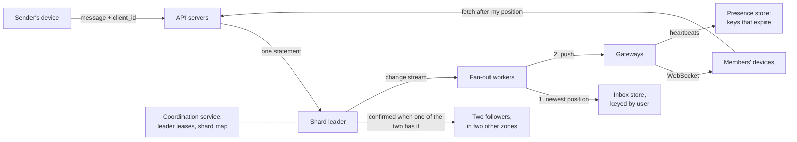

# Capstone 5: a chat system — one order, nothing lost, nothing twice

[Syllabus](../SYLLABUS.md) · Phase 5 · Previous: [5.7 Distributed transactions](07-distributed-transactions.md)

> **Time:** three hours for your own design, then an hour and a half with the worked design.
> **You need:** all of Phase 5; long-lived connections (3.7), idempotent consumers (4.3) and the log model (4.4) from earlier phases. The model in the reference implementation needs only Go. Its second part needs the PostgreSQL database of Phase 2.

Capstone 4 ended with a table that was about to outgrow its database. This capstone begins there: with data that cannot live on one machine, and must not be lost when a machine dies.

The system is chat, because chat asks every question of Phase 5 at once, and in a form that users notice. Two people who see the same conversation in different orders will tell you so.

Every chapter of the phase is in it. A message that was confirmed must survive the machine that confirmed it (5.1). Some of the data can be written in two places at once and merged, and some cannot (5.2). Messages are divided among machines by a key that has to be chosen (5.3). Each thing on the screen is promised something different about how fresh it is (5.4). The order of a conversation cannot come from clocks (5.5). Something has to decide which machine leads (5.6). And one message touches many users' data, with no transaction to span them (5.7).

**How to use this page**

1. Read the brief.
2. Write your own design, on paper, against the task list. Give yourself a time limit.
3. Only then open the worked design and compare, section by section.
4. Run the reference implementation — and then run it with each safeguard removed.

---

## The brief

*From your product manager:*

> We are adding chat to the product.
>
> **What it must do**
> - Conversations between two people, and groups of up to 1,000.
> - Text messages. (Pictures are links to files stored elsewhere: not your problem.)
> - A message reaches the other members' connected devices **within a second**. A device that was offline gets what it missed when it comes back. People have several devices.
> - **Everyone sees a conversation in the same order.**
> - **A message is never lost** once its sender has been shown that it was sent — including when a server dies.
> - **A message never appears twice**, however bad the sender's connection.
> - Each conversation shows how many of its messages the user has not read, on all of their devices.
> - A green dot shows who is online. It may be wrong for up to a minute.
> - History is kept. People scroll back through years of it.
>
> **How much**
> - 5 million people use it each day and send **100 million messages a day**. The peak is three times the average.
> - **1 million devices** are connected at the peak.
> - Most conversations have two members. Averaged over messages, a message has **8 recipients**.
> - The typical message is short: assume 100 bytes of text.
>
> **How well**
> - If one database server fails, sending is interrupted for at most a minute, in the conversations that server held and in no others. Nothing that was confirmed is lost.
> - A conversation that is already on a device can be read with no connection at all.
>
> **Constraints**
> - One region, three zones. (A zone is a separate data centre.)
> - The team runs PostgreSQL. You may choose another store, with a reason.
>
> **Six months after launch**
> - A second region, for users on another continent.
> - Announcement channels: 100,000 members, and a few people who may post.

---

## Your task

Produce a design document of three or four pages. The suggested times add up to three hours.

| # | Deliverable | Draws on | Time |
|---|---|---|---|
| 1 | Questions for the product manager; and the **invariants** — each written so that a program could check it | 5.4 | 15 min |
| 2 | Estimates: messages, bytes, deliveries, connections, heartbeats. Which is the largest? | 1.1 | 20 min |
| 3 | Sending: the request, what makes a second attempt harmless, and for how long | 1.5, 4.3 | 10 min |
| 4 | Order: who decides it, and how a device uses it | 5.5 | 15 min |
| 5 | The store, and the tables | 2.5, 2.8 | 15 min |
| 6 | Partitioning: the key, the scheme, the busiest conversation, and the data that has a different key | 5.3 | 20 min |
| 7 | Replication and failover: what a confirmation means, who decides, and what stops the old leader | 5.1, 5.5, 5.6 | 20 min |
| 8 | Delivery: connections, pushes, and what a device does when it reconnects | 3.7, 4.3, 4.4 | 15 min |
| 9 | What each thing on the screen is promised | 5.4 | 10 min |
| 10 | Presence | 5.4, 5.5 | 10 min |
| 11 | Unread counts, the list of conversations, membership: what crosses partitions, and how | 5.2, 5.7 | 15 min |
| 12 | What you monitor and alert on | 4.6 | 5 min |
| 13 | **What breaks first as it grows — in order.** Include the second region | all | 10 min |

The two standing rules:

- **Every number has a source**: the brief, arithmetic you show, or an assumption you label.
- **Choose.** Pick an option, give the reason, and name what you gave up.

And one for this capstone:

- **For every piece of data, say which machine decides it** — and what the others do when they cannot reach that machine, or disagree with it.

---

## Worked design

<details>
<summary><strong>Open only after writing your own.</strong></summary>

The whole design, before its parts. A message goes in on the left. The sections that follow take the boxes in turn.



### 1. Questions and invariants

| Question | Assumed answer |
|---|---|
| Is the order of a conversation the order of sending, or of arriving at the server? | Arriving. Two messages sent in the same instant may land either way round — but the same way round for everybody, for ever |
| What does the sender see while a message is on its way? | The message at once, marked *sending*; then *sent*. If it cannot be sent, the device keeps it and keeps trying |
| May a message be edited or deleted? | Yes. Everyone must see the change, and at the same place in the conversation |
| When someone is removed from a group, what do they keep? | What was sent before they were removed. Nothing after |
| How wrong may the unread count be? | It may lag by a few seconds. It must not *stay* wrong |
| Must the green dot be right before a message is sent to someone? | No. Nothing depends on it |

**The invariants.** The reference implementation checks each of these at the end of its run, by comparing what the servers hold and what every device shows with a record of what each sender was told.

1. One tap on *send* is one message, however many times the device tries.
2. A message that was confirmed to its sender is held by the servers.
3. In a conversation, each position belongs to one message.
4. A message appears below every message that its sender could see when writing it. An answer is never above its question.
5. Every member's device ends up with every message, whatever it missed on the way.
6. No device shows a message twice.
7. So a conversation looks the same on every member's device.
8. A user whose device has gone is shown as online for no longer than a stated time.

### 2. Estimates

| What | Arithmetic | Result |
|---|---|---|
| Messages | 100 million ÷ 86,400 seconds | 1,200 a second on average; **3,500 a second** at the peak |
| Deliveries — one push and one row in a list of conversations, for each recipient | × 8 | **28,000 a second** at the peak |
| Presence heartbeats | 1 million devices, one every 20 seconds (section 10) | **50,000 a second** |
| Bytes | 100 million × 300 bytes | **30 GB a day; 11 TB a year** — for one copy |
| Connections | 1 million ÷ an assumed 10,000 for each gateway server | 100 gateways. Run 120 |

*300 bytes* is 100 bytes of text, from the brief, and 200 that were measured. After a run, the reference implementation's table holds about 200 bytes for each message before any text: nearly 100 in the table itself, and about 50 in each of its two indexes — one on position, and one on the ID that the sender's device chose (section 3). `SELECT pg_size_pretty(pg_total_relation_size('chat_messages'))` shows the total. *10,000 connections for each gateway* is Chapter 3.7's assumption, and that chapter said how to replace it with a measurement.

Three things to read from the table.

**The message rate is small.** The reference implementation stores 15,000 to 18,000 messages a second in PostgreSQL on a four-core machine. A peak of 3,500 would fit on one server. This system is not partitioned for throughput.

**The bytes are not small.** Eleven terabytes a year for one copy, kept for ever, and there are three copies. Decide that no shard holds more than 1 TB, so that a replacement follower can be copied in an afternoon, during which the shard is a copy short: at an assumed 100 MB a second, 1 TB takes under three hours. The system then fills eleven shards a year. Start with 16.

**The largest numbers are not messages.** Deliveries are eight times the messages, and heartbeats fourteen times. Neither belongs in the store that holds the messages. Sections 10 and 11 say where they go.

**One conversation.** Section 4 lets a conversation store one message at a time. Measured, that is 3,000 to 3,500 messages a second in a single conversation. With a synchronous follower (section 7) each of them also waits for the follower. If that takes 1.5 ms — an assumption: Chapter 5.1 measured 0.5 ms with the follower on the same machine, and zones are further apart — the ceiling is about 650 a second. For a group of 1,000 to reach it, most of its members would have to post in the same second. Limit a conversation to 100 messages a second, and refuse the rest (Chapter 6.4).

### 3. Sending

A message is sent with an ordinary request, `POST /conversations/{id}/messages`, not up the WebSocket — Slack's design, from Chapter 3.7. Timeouts, retries and load balancing then work as they do for every other request.

The request carries the text and a **`client_id`: a random UUID that the device makes when the user taps *send***, and keeps with the unsent message. Every attempt to send that message carries the same one. The server stores it under a unique index, and a second attempt is answered with what the first one stored (Chapter 4.3: the producer chooses the ID). The answer is the message's position in the conversation (section 4) and the server's time.

Lost answers are not hypothetical. Telegram's documentation describes a session ending between a call and its response, in which case "the method call response is lost and cannot be recovered" ([Telegram API, *Working with Updates*](https://core.telegram.org/api/updates)). Its send method therefore takes a `random_id`, described as a "Unique client message ID required to prevent message resending" ([Telegram API, *messages.sendMessage*](https://core.telegram.org/method/messages.sendMessage)).

**For how long is a `client_id` remembered?** Two companies give two answers. Discord's API has an optional check: "If true and nonce is present, it will be checked for uniqueness in the past few minutes. If another message was created by the same author with the same nonce, that message will be returned and no new message will be created." ([Discord, *Message resource*](https://discord.com/developers/docs/resources/message)). Telegram's server recognises an ID used "from any session of the current account at any time in the past", and then "the method call will simply return the messages generated by the previous method call, instead of sending a new message" ([Telegram API, *Working with Updates*](https://core.telegram.org/api/updates)).

**Choose: for as long as the message exists.** A phone that is switched off with a message unsent will try again when it is switched on, and that may be next week. The price is the index: about 50 bytes for each message, a sixth of everything stored. That is what *never twice* costs here.

### 4. Order

**Not the sender's clock.** Chapter 5.5 merged three machines' logs by their wall clocks, and 970 of 2,000 messages appeared to have been received before they were sent. A phone's clock is whatever its owner set it to.

**Not the server's clock.** Two servers disagree by milliseconds, and two messages can arrive in the same one. Discord found this with its first design: `created_at` "didn't make a great clustering key because two messages can have the same creation time" ([Discord, *How Discord Stores Billions of Messages*](https://discord.com/blog/how-discord-stores-billions-of-messages)). And after a failover, the new leader's clock may be behind the old one's.

**A counter for each conversation**, kept in the conversation's own row and increased by the statement that stores the message:

```sql
WITH next AS (
    UPDATE conversations SET last_seq = last_seq + 1 WHERE id = $1 RETURNING last_seq
)
INSERT INTO messages (conversation_id, seq, sender_id, client_id, body)
SELECT $1, last_seq, $2, $3, $4 FROM next
RETURNING seq;
```

Three properties of that statement are relied on later.

1. **One message at a time.** The `UPDATE` locks the conversation's row until the transaction commits (Chapter 2.4). Message 8 cannot be given its number until message 7 is committed. So anyone who can see 8 can see 7.
2. **No holes.** The positions are 1, 2, 3, and so on. If the message is a second attempt, the unique index on `client_id` rejects the `INSERT`, and the whole statement is undone, the counter's increase included. The code catches the error and looks up the position that the message already has.
3. **Decided once.** The position is stored with the message. Nothing ever works it out again.

Because there are no holes, **a device can tell that it has missed something**. Telegram numbers the events of each of its message boxes in this way, and tells the authors of clients what to do with the numbers: if the number is the next one, "the update can be applied"; if it is lower, "the update was already applied, and must be ignored"; if it is higher, "there's an update gap that must be filled" ([Telegram API, *Working with Updates*](https://core.telegram.org/api/updates)). Section 8 uses the same three rules.

**Why not the database's auto-incrementing ID?** It has holes: "transaction aborts or database crashes can result in gaps in the sequence of assigned values" ([PostgreSQL documentation, *Sequence Manipulation Functions*](https://www.postgresql.org/docs/current/functions-sequence.html)). And it has a worse property. Numbers are handed out before transactions commit, and transactions commit in a different order. Number 101 can be visible before number 100 is. A reader that asks for *everything after the last number I saw* then steps over 100, for good. The reference implementation measures it: between 97 and 142 messages in 8,000, over five runs.

**The price** is the ceiling in section 2. A conversation's messages are stored one after another, at a fifth of the rate that the same machine reaches when the messages are spread over many conversations. Discord chose the other side of this trade. Its message IDs are made from the time — "every ID on Discord is actually a Snowflake (chronologically sortable)" ([Discord, *How Discord Stores Billions of Messages*](https://discord.com/blog/how-discord-stores-billions-of-messages)) — which needs no counter and no lock, and leaves no way to see a hole.

**Edits and deletions are entries in the same sequence**: *message 12 now reads…* is entry 31. A device applies entries in order, so an edit cannot arrive before the message it changes. Telegram does the same: "Each event related to a message box (message created, message edited, message deleted, etc) is identified by a unique auto-incremented pts" ([Telegram API, *Working with Updates*](https://core.telegram.org/api/updates)).

The time shown beside a message is the server's `sent_at`. It is for people to read. Nothing is ordered by it.

### 5. The store, and the tables

**Choose: PostgreSQL, divided into shards, each with one leader.** Section 4's statement needs a row lock and a unique index, and a single-leader database has both. Chapter 5.6 put it generally: a unique constraint or a locked row is a single decision, made by a system you already operate.

*What is given up.* A store that spreads itself over machines — Cassandra, which Discord chose (Chapter 2.8), is one — adds nodes and moves data without being told how, and has no leader to fail over. But it has no cheap way to say *the next number in this conversation*: with no single leader, that takes a round of consensus for each message (Chapter 5.6). With sharded PostgreSQL the map of shards, the moving of data and the failover are all yours to run. Sections 6 and 7 are the cost of this choice.

```sql
-- On the conversation's shard. The partition key is the conversation's ID.
CREATE TABLE conversations (
    id       bigint PRIMARY KEY,
    last_seq bigint NOT NULL DEFAULT 0     -- the position of the newest entry. This row is also the lock
);
CREATE TABLE members (
    conversation_id bigint NOT NULL,
    user_id         bigint NOT NULL,
    from_seq        bigint NOT NULL,        -- may read the entries after this position…
    to_seq          bigint,                 -- …and up to this one, if they have been removed
    PRIMARY KEY (conversation_id, user_id)
);
CREATE TABLE messages (
    conversation_id bigint NOT NULL,
    seq             bigint NOT NULL,        -- 1, 2, 3, …
    sender_id       bigint NOT NULL,
    client_id       uuid   NOT NULL,        -- chosen by the sender's device
    body            text   NOT NULL,
    sent_at         timestamptz NOT NULL DEFAULT now(),   -- for display. Never for ordering
    PRIMARY KEY (conversation_id, seq),
    UNIQUE (conversation_id, client_id)
);

-- On the user's shard. The partition key is the user's ID.
CREATE TABLE inbox (                        -- one row for each conversation the user is in
    user_id         bigint NOT NULL,
    conversation_id bigint NOT NULL,
    last_seq        bigint NOT NULL DEFAULT 0,   -- the newest entry that this row has been told of
    read_seq        bigint NOT NULL DEFAULT 0,   -- the newest entry the user has read, on any device
    last_at         timestamptz,                 -- for sorting the list
    PRIMARY KEY (user_id, conversation_id)
);
```

*The last 50 messages of a conversation* is a range of the primary key, on one shard. *My conversations, most recent first* is one user's rows in `inbox`, on one shard.

### 6. Partitioning

**The key is the conversation's ID**, because every question about messages names a conversation. Discord reasoned the same way: "channel_id became the partition key since all queries operate on a channel" ([Discord, *How Discord Stores Billions of Messages*](https://discord.com/blog/how-discord-stores-billions-of-messages)). The conversation's counter, its members and its messages are then on one shard, and sending is one statement on one machine.

**The scheme is fixed partitions** (Chapter 5.3). A conversation's ID is hashed into one of 4,096 partitions, and a small table says which shard holds each partition: 256 for each of the 16 shards. A new shard takes whole partitions from the others, and nothing else moves. Chapter 5.3 measured it: with a ninth shard added to eight, 11% of the keys moved, where `hash mod N` moved 89%.

**The map lives in the coordination service** (Chapter 5.6). It is small, it changes rarely, and everyone must agree on it. API servers keep a copy and watch for changes. A copy can be out of date, so a shard refuses a request for a partition that it does not hold, and the server then fetches the map again. *The shard has the last word, not the map.*

**Moving a partition**: copy it to the new shard; keep copying the changes; stop writes to that partition for a moment; change the map; resume. The pause is the only time the partition has no writer.

**A conversation is never divided.** Hashing spreads conversations evenly. It does not spread bytes or traffic: a busy group of 1,000 is one key (Chapter 5.3). It cannot be divided between shards without giving up its one counter, and by section 2's arithmetic it does not need to be. What does grow without limit is its history, and that can be cut by position. Discord cut by time: "We decided to bucket our messages by time" ([Discord, *How Discord Stores Billions of Messages*](https://discord.com/blog/how-discord-stores-billions-of-messages)). Section 13 uses the cut to move old history to cheaper storage.

**Two keys.** `inbox` is keyed by user, because its question is *which conversations am I in?* In Chapter 5.3's terms it is a global secondary index on `members`, and like most of those it is brought up to date after the write, not during it (section 11).

### 7. Replication and failover

**What a confirmation means.** Each shard has a leader and two followers, in three zones, with `synchronous_standby_names = 'ANY 1 (b, c)'` (Chapter 5.1). A message is confirmed to its sender when it is on two machines in two zones. Chapter 5.1 measured the cost on one machine, 0.28 ms becoming 0.51 ms; between zones, add the network's round trip.

**Who decides that a leader has failed.** Not the followers, by noticing that it has gone quiet: that is Chapter 5.6's home-made election, which elected two leaders. A manager decides, and it keeps its decision in a consensus store. For PostgreSQL, one such manager is Patroni, whose documentation states the rule: "the node is allowed to run Postgres as the primary only if it can update the leader lock in DCS. In case the update of the leader lock fails, Postgres is immediately demoted and started as read-only." ([Patroni documentation, *DCS Failsafe Mode*](https://patroni.readthedocs.io/en/latest/dcs_failsafe_mode.html)). DCS is its name for the consensus store: etcd, ZooKeeper or Consul. The rule is a lease (Chapter 5.5).

**What stops the old leader.** Three things, and the second is the one to rely on.

1. *The lease.* A leader that cannot renew its lease demotes itself. But Chapter 5.5 showed a paused process acting on a lease that had run out without its knowing.
2. *The followers' refusal.* The old leader cannot confirm a message until a follower has it, and its followers now take their changes from the new leader. A leader that nobody follows confirms nothing. Chapter 5.1 saw this on real servers: the old primary's commit waited, and timed out. This holds however confused the old leader is, because the refusal is made by other machines — provided that the leader is not allowed to carry on without them, which is the subject of the next paragraph.
3. *The map.* API servers learn of the new leader and stop sending to the old one. Until they do, the second fence does the work.

**The setting that quietly changes what a confirmation means.** Patroni's ordinary synchronous mode gives way when no follower is available: "When no suitable standby is available, primary server will still accept writes, but does not guarantee their replication. When the primary fails in this mode no standby will be promoted." ([Patroni documentation, *Replication modes*](https://patroni.readthedocs.io/en/latest/replication_modes.html)). A message confirmed in that state is on one machine. Patroni will not then promote a follower that may lack it, so the shard waits for the old leader to return; and if that machine's disk is gone, so are the messages. The same page names the stricter setting, which "prevents Patroni from switching off the synchronous replication on the primary when no synchronous standby candidates are available".

**Choose the strict setting**, with two followers so that one can be lost. If both are lost, sending stops in that shard: that is the brief's *never lost*, paid for in availability (Chapter 5.4). Whichever you choose, alert when a leader has no synchronous follower (section 12).

**What a user sees.** Sending in that shard's conversations fails, or times out, for about the length of the lease — Patroni's `ttl`, "the length of time before initiation of the automatic failover process", is 30 seconds unless changed ([Patroni documentation, *Dynamic configuration*](https://patroni.readthedocs.io/en/latest/dynamic_configuration.html)) — and then for the promotion. The device keeps the message, marked *sending*, and tries again with the same `client_id`, waiting longer each time, with jitter (Chapter 1.5). After the failover, the attempt either finds the message already stored — the old leader stored it, and only the answer was lost — or stores it now. One shard in sixteen is affected.

### 8. Delivery

**Connections.** Each device holds a WebSocket to a gateway (Chapter 3.7). A registry records which gateways hold connections for which user. Its entries expire unless renewed, like section 10's.

**Fan-out.** Workers read each shard's change stream (Chapter 4.5: the message's own row is the event, so there is no dual write). For each member they do two things, in this order: update the member's `inbox` row; then look up the member's connections and push the message, with its position, to those gateways.

**The push is a hint.** It may be lost, and it may arrive twice (Chapter 4.3). What guarantees delivery is the device's rule. For each conversation a device keeps `have`: the position up to which it has everything.

| The message's position | The device |
|---|---|
| `have + 1` | Shows it; `have` becomes that position |
| `have` or lower | Has it already. Ignores it |
| Higher than `have + 1` | Has missed something. Fetches `GET /conversations/{id}/messages?after={have}` |

**On reconnecting**, the device reads its `inbox` and fetches every conversation whose `last_seq` is ahead of its own `have`. Telegram's clients begin in the same way: "On startup, only updates.getDifference should be called, to fetch updates received while the client was offline" ([Telegram API, *Working with Updates*](https://core.telegram.org/api/updates)).

**The server keeps no queue for any device.** It keeps one sequence for each conversation, and each device keeps its own position in it. That is Chapter 4.4's log: a conversation is a small log, and a device is a consumer with its own offset. A new phone is a new consumer. Compare a design in which the server holds, for a while, what each connection has missed. Discord's gateway "allows your app to replay any lost events starting from the last sequence number it received", but only for so long: "It's possible your app won't reconnect in time to Resume" ([Discord, *Gateway*](https://discord.com/developers/docs/events/gateway)), and then the app must begin a new session. Here the thing to resume from is the stored conversation, so there is no *too late*.

**The order of two steps matters, twice.** The worker updates the `inbox` row and then looks for connections. The device connects and then reads its `inbox`. With both orders as stated, one of two things is true of every message: the worker's look-up found the connection, and the message was pushed; or the row was updated before the device read it, and the message was fetched. Reverse either order, and there is a moment in which a message is neither pushed nor listed.

**The newest messages are fetched from the leader.** A follower can hold a message that its leader has not yet been able to confirm, and such a message may not survive a failover. Old history, which is the same on every copy, can come from a follower.

**Presence is not delivery.** A member with no connection is told through the notification platform of Capstone 4. Decide that by acknowledgement: if none of the member's devices acknowledges the push within a few seconds, send the notification. A connection that the registry still lists may have ended minutes ago.

### 9. What each thing on the screen is promised

| On the screen | The promise (Chapter 5.4) | Kept by |
|---|---|---|
| The order of a conversation | One order, decided once: linearizable | One leader for each conversation, and its counter |
| Your own message, once sent | You read your own writes | The answer to the request carries the position. No replica is read |
| A conversation, on a device | Never goes backwards and never has a hole. Complete within a second, when connected | `have`, and fetching after it |
| Old history | May come from a follower | It does not change |
| The unread count and the list of conversations | Right in the end; seconds behind | Section 11: values that merge |
| The green dot | May be wrong for up to a minute | Section 10: a lease |

**When the network splits**, a leader that cannot reach either follower cannot confirm, and sending in its conversations fails. For messages, the design gives up availability to keep the order and the confirmations true. Devices keep what they could not send, and try again. Meanwhile the green dots and the unread counts go on answering, and may be out of date: for those, the design gives up consistency. *One system, and both choices — one for each kind of data*, which is how Chapter 5.4 said CAP is used.

### 10. Presence

**A heartbeat, and a key that expires.** For each connection it holds, a gateway writes the user's ID to the presence store every 20 seconds, with an expiry of 60. *Online* means that the key exists. The store is an in-memory one with expiring keys, like Chapter 3.3's cache, partitioned by user.

**Going offline is nothing happening.** No message says *I have left*, because a phone in a tunnel cannot send one. LinkedIn's presence platform is built on that: "To determine that a member went offline, we need to detect the absence of a heartbeat." Being online is the reverse: "As long as a heartbeat is received every d seconds, our Presence Platform will deem the member to be online", and each heartbeat stores an entry "with an expiry duration which is slightly larger than d seconds (d + ε)". The same post gives the reason for not reacting to each disconnection: on a poor network, "their presence status would constantly bounce between online and offline" ([LinkedIn Engineering, *Now You See Me, Now You Don't*](https://engineering.linkedin.com/blog/2018/01/now-you-see-me--now-you-dont--linkedins-real-time-presence-platf)).

**It is a lease** (Chapter 5.5), and its two numbers are a trade. A longer expiry gives a steadier dot that is wrong for longer. The brief allows a minute. With a heartbeat every 20 seconds and an expiry of 60, one lost heartbeat never puts out a connected user's dot, and two seldom do.

**It is the busiest write in the system**: 50,000 a second, fourteen times the messages. So it is never written to the message store. Gateways send heartbeats in batches. And if the whole presence store is lost, nothing is lost that 20 seconds will not restore — so it needs none of section 7.

**Who is told.** Only the devices that are looking. A device subscribes to the presence of the users who are on its screen (Chapter 3.7's topics). Telling every contact about every change would multiply the largest number in section 2.

### 11. What crosses partitions

A message is stored on one shard. It concerns up to 1,000 people, whose `inbox` rows are on other shards. No transaction spans them, and none is needed (Chapter 5.7).

**The message is the fact. Everything else is worked out from it, by operations that can be repeated and that can arrive in any order.**

```sql
-- From the fan-out: conversation $2 has reached position $3.
UPDATE inbox SET last_seq = greatest(last_seq, $3), last_at = greatest(last_at, $4)
WHERE user_id = $1 AND conversation_id = $2;

-- From one of the user's devices: read, up to position $3.
UPDATE inbox SET read_seq = greatest(read_seq, $3)
WHERE user_id = $1 AND conversation_id = $2;
```

- `greatest` makes each update safe to deliver twice, late, or out of order: the row ends the same (Chapter 4.3). Two devices that report reading at the same moment do not conflict, because a value that only grows is merged by taking the larger (Chapter 5.2).
- **The unread count is `last_seq − read_seq`**: the difference of two positions. It is not a counter that goes up for each message and down for each one read. A counter is wrong after every repeated or lost update, and stays wrong. Two positions that only move forwards cannot drift. (Where the sequence holds entries that are not messages, count the messages between the two positions. The principle is the same.)
- **Only the newest position matters**, so updates that are waiting for the same user and conversation can be merged into one before they are written. Under load, a busy group then costs each member one update every so often, not one for every message.

**Membership** is where a race would show. Someone is removed from a group in the same second as a message is sent: may they read it? Make the removal an entry in the conversation's sequence. It is given a position by the same statement as a message is, and `members.to_seq` records it. Every fetch and every push compares positions with the member's range. The order of the removal and the message is then whatever the counter made it, on every machine. No lock is held across shards.

**Creating a conversation** writes the conversation and its members on its shard, in one transaction. The `inbox` rows follow through the fan-out. If that stops half-way, it is repeated. Nothing has to be undone, because the first step is the fact.

### 12. Monitoring

For each shard:

- **Whether the leader has a synchronous follower, now** — the alert (section 7).
- The lag of each follower, and failovers.
- The time to store a message, as percentiles; and requests refused for reaching the wrong shard, which should be none between failovers.
- Its size, against the limit of 1 TB; and its ten busiest conversations.

For delivery:

- **The age of the oldest change that has not been fanned out** — the alert (Chapter 4.6) — and how much of the change stream the database is keeping for a reader that has stopped (Chapter 4.5).
- Gaps found by devices, for each thousand pushes. A rise means that pushes are being lost.
- Fetches a second: a reconnection storm shows here first (Chapter 3.7).
- Connections for each gateway.

And for the product: the time from the tap on *send* to the message appearing on another device, measured by the devices.

### 13. What breaks first

1. **The fan-out, at 100,000 members.** One announcement is 100,000 `inbox` updates and as many pushes. For a large channel, stop writing a row for each member. Keep the channel's one `last_seq`, and let each device compare it with its own position when the app is opened. The work moves from the one writer to the many readers. It is Capstone 3's account with 3 million followers, in another form.
2. **Reconnection storms.** A gateway that is replaced disconnects 10,000 devices, and each of them reconnects and reads its `inbox` (Chapter 3.7). Spread the reconnections with jitter, keep that read to one indexed query, and empty a gateway gradually before stopping it.
3. **Shards filling**, eleven a year. Moving partitions has to be routine before it is urgent. After that, old history leaves the database: ranges of positions, written once to object storage and fetched when somebody scrolls back for years.
4. **The coordination service.** Every leader's lease is held there. If it cannot be reached, then by the rule quoted in section 7 every leader demotes itself, and every shard stops taking messages although nothing is wrong with any of them. Patroni's [failsafe mode](https://patroni.readthedocs.io/en/latest/dcs_failsafe_mode.html) exists for this case. Whatever holds the leases must be more available than everything that depends on it (Chapter 6.5).
5. **The second region.** A conversation still has one leader, so it has a home region, and members elsewhere send to it across an ocean. The alternative, a leader in each region, is Chapter 5.2's multi-leader replication, and two leaders cannot both give out position 7. Section 7's question also returns, larger: a synchronous follower in the other region makes every message pay for the ocean; an asynchronous one loses the last messages when a region is lost (Chapter 6.6).
6. **One conversation at its ceiling.** Refuse what is above the limit (Chapter 6.4). There is nothing else to do, and nothing else should be done.
7. **Search.** *Find the message with the address in it* names no conversation, so no partition key answers it (Chapter 5.3). It needs an index outside the store, fed from the change stream (Chapters 2.8 and 4.5).
8. **The bill.** 33 TB more each year, counting all three copies, and most of it never read again (Chapter 9.8).

</details>

---

## Reference implementation

[`code/capstone-chat/main.go`](code/capstone-chat/main.go) is a model of the worked design, in about 470 lines of Go. It is a model in the sense of Chapters 5.2 to 5.6: one process, time counted in seconds, no network and no database. That lets it do what would be slow and awkward with real servers: replace the leader of every shard twice, lose pushes and confirmations at a chosen rate, and then compare what thirty devices show with a record of what every sender was told.

What a model cannot show is that a real database behaves as the model assumes. So the program has a second part, [`code/capstone-chat/sql.go`](code/capstone-chat/sql.go), which runs section 4's statement on PostgreSQL.

### The model

Thirty users are in twenty conversations of four, on four shards. Each shard has a leader and one follower — the design has two, and one is enough to show what each safeguard does. For 2,000 seconds:

- twice a second a member of some conversation sends a message, if their device is connected; a third of these answer the last message on the sender's screen;
- one push in ten is lost, and one in twenty arrives twice;
- one confirmation in twenty never reaches the sender, whose device sends the message again;
- each device drops off about once in a hundred seconds, for 20 to 60 seconds;
- each shard's leader is replaced twice, and for the next 20 seconds the first attempt of one send in three still reaches the old leader;
- three of the thirty devices have clocks that are wrong, by −40, +25 and +60 seconds.

Those rates are the model's own, chosen so that every failure happens often enough to count. Two things in the design are left out. Of section 7's three fences the model has only the second, a follower's refusal: it has no leases. And it has no `inbox`: a device that reconnects asks about each of its conversations.

```bash
go run ./phase-5-distributed-data/code/capstone-chat
```

```text
2000 seconds: 30 users, 20 conversations of four, 4 shards. Each shard's leader was replaced twice.
  messages sent 2925, in 3092 attempts; the servers hold 2925
  pushes 6753, of which 626 were lost and 276 arrived twice
  devices dropped off 425 times; presence heartbeats 8811

WHAT THE SAFEGUARDS DID
  repeated sends answered with the message already stored               153
  sends refused because they had reached a replaced leader               14
  repeated messages that a device dropped                               548
  gaps that a device noticed, and filled by fetching                    458
  messages fetched by devices when they reconnected                    2406

CHECKS
  messages stored twice, because the send was repeated                    0
  messages confirmed to their sender that the servers do not hold         0
  positions given to two different messages                               0
  answers shown above the message they answer                             0
  messages that some member's device never received                       0
  messages shown twice on some device                                     0
  conversations that do not look the same on every member's device        0
  longest that a user was shown as online after dropping off             13 s
```

Read the middle block first. It says how often each thing went wrong, and what dealt with it.

- **153 sends were repeated**, and each was answered with the message that the first attempt had stored. The servers hold 2,925 messages for 2,925 taps on *send*.
- **14 sends reached a leader that had been replaced.** Its follower refused it, so it could confirm nothing, and the device tried again.
- **626 pushes were lost and 276 arrived twice.** Devices noticed 458 gaps and fetched what was missing. They dropped 548 repeats: the 276, and most of the rest were pushed again because a send was repeated.
- **Devices dropped off 425 times**, and on returning fetched 2,406 messages that had been sent while they were away.
- **Presence wrote three times as often as messages were sent**, even in a model whose users do little but talk. In the brief it is fourteen times.

Every check reads zero, and the last line is inside the lease of 15 seconds.

### Remove one safeguard at a time

```bash
go run ./phase-5-distributed-data/code/capstone-chat -without request-id
```

```text
  messages sent 2925, in 3092 attempts; the servers hold 3078
  messages stored twice, because the send was repeated                  146
```

The device sends no ID, so the server cannot connect a second attempt with the first. 146 messages are in their conversations twice — on every device alike, and in the same place, so every other check still reads zero. Nothing later in the system can remove a duplicate that was made at the door, which is what Capstone 4 found too.

```bash
go run ./phase-5-distributed-data/code/capstone-chat -without sequence
```

```text
  answers shown above the message they answer                            46
  messages that some member's device never received                     550
  conversations that do not look the same on every member's device       20
```

No positions. Devices sort by the time on the sender's device, and catch up by asking for *everything later than the latest I have*. Three wrong clocks in thirty put 46 answers above their questions. And 550 messages never reached somebody. A device with no positions cannot see a hole, so a lost push stays lost; and a message stamped by a slow clock is *earlier* than the cursor of everyone who ought to fetch it.

```bash
go run ./phase-5-distributed-data/code/capstone-chat -without sync
```

```text
  messages sent 2925, in 3078 attempts; the servers hold 2909
  messages confirmed to their sender that the servers do not hold        16
  positions given to two different messages                              16
  messages that some member's device never received                      14
  conversations that do not look the same on every member's device        6
```

The leader confirms at once, and its follower is two seconds behind. Sixteen messages that their senders saw marked as *sent* are gone. Some were confirmed in the two seconds before a leader was replaced. The others were confirmed by a leader that had already been replaced — and which, since it no longer needed a follower's agreement, never found out. The positions of the sixteen were then given to other messages. A device that had been pushed one of the lost messages took the new holder of its position for a repeat, and dropped it: so 14 messages that the servers *do* hold are missing from somebody's screen.

```bash
go run ./phase-5-distributed-data/code/capstone-chat -without fencing
```

```text
  messages confirmed to their sender that the servers do not hold        12
  positions given to two different messages                              12
```

Replication is synchronous again. But a leader whose follower refuses it now takes the refusal for a failed follower, and carries on alone. Twelve messages were confirmed by a leader that had already been replaced. Section 7 quoted a setting that lets a leader carry on without a follower. That is safe only while something else guarantees that it is still the leader.

```bash
go run ./phase-5-distributed-data/code/capstone-chat -without cursor
```

```text
  messages that some member's device never received                    2093
  conversations that do not look the same on every member's device       20
```

Pushes, and nothing else. A message sent while a device was away never reaches it, and neither does one whose push was lost: 2,093 of this run's 2,902 messages are missing from at least one screen. This is what *the push is a hint* guards against.

```bash
go run ./phase-5-distributed-data/code/capstone-chat -without dedup
```

```text
  messages shown twice on some device                                   378
```

The device shows whatever arrives. Deliveries are at-least-once (Chapter 4.3), so the consumer must be idempotent, and here the consumer is a phone.

```bash
go run ./phase-5-distributed-data/code/capstone-chat -without lease
```

```text
  longest that a user was shown as online after dropping off             59 s
```

The dot is lit when a device connects and put out when it says goodbye. Half of the model's departures say nothing — a flat battery, a tunnel — and those users stay green until they return. It is 59 seconds here only because nobody in the model is away for more than a minute. A phone that is never switched on again is online for ever.

### The send path, on PostgreSQL

```bash
go run ./phase-5-distributed-data/code/capstone-chat -sql
```

```text
PART 1 — 16 senders, 8,000 messages, 20 conversations; one send in ten is repeated.
         A reader follows each conversation: "everything after the last number I saw".

  messages sent 8000, of which 771 were sent twice; the database holds 8000

CHECKS
  messages stored twice, because the send was repeated                    0
  repeated sends that were answered with a different number               0
  numbers missing from a conversation's sequence                          0
  messages that a reader's cursor went past without seeing                0

PART 2 — the price of one order per conversation: 16 senders, 6,000 messages.

                                      messages a second   a send, median    99th percentile
  spread over 200 conversations                   17338          0.82 ms            2.77 ms
  all in one conversation                          3489          2.85 ms           23.23 ms
```

(Timings vary from run to run and from machine to machine. Over five runs on four cores: 15,000 to 18,000 a second, and 3,000 to 3,500.)

Part 1 is the three properties of section 4, checked. 771 sends were repeated — half of them while the first attempt was still on its way — and each was answered with the first attempt's position. No position is missing from any conversation. And twenty readers, each asking again and again for everything after the last position it had seen, missed nothing.

Part 2 is the price. Sixteen senders store 17,000 messages a second when the messages are spread over many conversations, and 3,500 when they are all in one, because each waits for the one before it to be committed. That cost is charged to a conversation, not to the system. It limits how fast one group can talk.

```bash
go run ./phase-5-distributed-data/code/capstone-chat -sql -without counter
```

```text
  numbers missing from a conversation's sequence                        n/a
  messages that a reader's cursor went past without seeing              129

  all in one conversation                         20853          0.62 ms            3.36 ms
```

The position now comes from a database sequence shared by all conversations, as the value of an auto-incrementing column would. Nothing waits, and the single conversation is six times as fast.

And 129 of the 8,000 messages were stored, are in the table, and were never seen by a reader that had asked for everything after its last position. Each was given its number before a neighbour's and committed after it. The count changes from run to run — from 97 to 142 in five runs — and was never zero. Nor are there holes to notice: when the numbers are shared by all conversations, 41 followed by 57 means nothing.

IDs of this kind are a legitimate design: Discord orders its messages by them (section 4). But *everything after the last one I saw* is then not a safe question, and delivery has to be made reliable in some other way.

---

## Review your own design

Check your design against these. Each is a mistake that an experienced reviewer would look for.

- [ ] Does the **device** choose an ID for each message, and does a unique constraint enforce it — and for how long?
- [ ] Is the order decided by **one machine for each conversation**, and stored? Or is it worked out from a clock?
- [ ] Can a device **tell** that it has missed a message? From what?
- [ ] If your positions come from a sequence or an auto-incrementing column: can a reader step over a message that commits late?
- [ ] What does a confirmation **mean**: how many machines, in how many zones?
- [ ] Who decides that a leader has failed? What stops the old one from confirming a message afterwards — and does that still work if the old leader is paused, not dead?
- [ ] What does your failover manager do when **no follower is available**, and would you know?
- [ ] Is the push a **hint**, with a fetch that does not depend on it?
- [ ] On reconnecting, does the device **register first and read second**?
- [ ] Are the newest messages read from the **leader**?
- [ ] Is the partition key one that **every query about messages already names**? What has a different key, and how is it brought up to date?
- [ ] Is the unread count a **difference of two positions**?
- [ ] Is a removal from a group **ordered with the messages**?
- [ ] Does anything that matters depend on **presence**?
- [ ] Is anything in your design a **transaction across shards**? Could it be a fact, and things worked out from the fact?
- [ ] Can you say what breaks **first**?

---

## Extensions

1. **Edits and deletions.** Add them to the model as entries in the sequence. Check that every device ends with the same text for every message.
2. **Removal from a group.** Add it to the model, as an entry. Check that a removed member's device never holds a message from after the removal — also when the two are sent in the same second.
3. **Unread counts.** Give each user two devices, and deliver `read_seq` updates late, twice and out of order. Check that the counts converge. Then keep the count as a counter that goes up and down, and count how many are wrong at the end.
4. **A lease for the leader.** In the model, make a leader stop by itself when its lease runs out. Then pause a leader, as Chapter 5.5 did, so that it does not notice. Which fence catches what?
5. **The fan-out, on PostgreSQL.** Add the `inbox` table to the second part, with a worker that reads new messages and applies the `greatest` updates. Kill the worker half-way through a batch, restart it, and check the rows.
6. **Move a partition.** In the model, move a conversation from one shard to another while its members are sending. What has to stop, and for how long?
7. **A second region.** Give each conversation a home region and each user a region, with 100 ms between regions. Measure how long sending takes. Then decide where a conversation between two continents should live.
8. **100,000 members.** Build section 13's first item into the model: no `inbox` row for each member of a large channel. What does a device have to do when it opens the app?

---

## Sources

This capstone applies the chapters of Phase 5, where the sources for each technique are given. The designs that it compares its own with are described in:

- Telegram API documentation: [*Working with Updates*](https://core.telegram.org/api/updates) and [*messages.sendMessage*](https://core.telegram.org/method/messages.sendMessage).
- Discord developer documentation: [*Message resource*](https://discord.com/developers/docs/resources/message) and [*Gateway*](https://discord.com/developers/docs/events/gateway).
- Stanislav Vishnevskiy, [*How Discord Stores Billions of Messages*](https://discord.com/blog/how-discord-stores-billions-of-messages), Discord, 2017.
- Akhilesh Gupta and Meng Lay, [*Now You See Me, Now You Don't: LinkedIn's Real-Time Presence Platform*](https://engineering.linkedin.com/blog/2018/01/now-you-see-me--now-you-dont--linkedins-real-time-presence-platf), LinkedIn Engineering, 2018.
- Patroni documentation: [*Replication modes*](https://patroni.readthedocs.io/en/latest/replication_modes.html), [*DCS Failsafe Mode*](https://patroni.readthedocs.io/en/latest/dcs_failsafe_mode.html) and [*Dynamic configuration*](https://patroni.readthedocs.io/en/latest/dynamic_configuration.html).
- PostgreSQL documentation, [*Sequence Manipulation Functions*](https://www.postgresql.org/docs/current/functions-sequence.html).

All output shown was produced by the reference implementation; that of its second part, on PostgreSQL 16 on a four-core machine.

**Next:** Phase 6 — Reliability: designing for failure *(planned; see the [syllabus](../SYLLABUS.md#phase-6--reliability-designing-for-failure))*. This phase asked what a system may promise about its data when machines fail. The next asks how it keeps answering at all: timeouts and retries at scale, overload, and the failures that spread.
