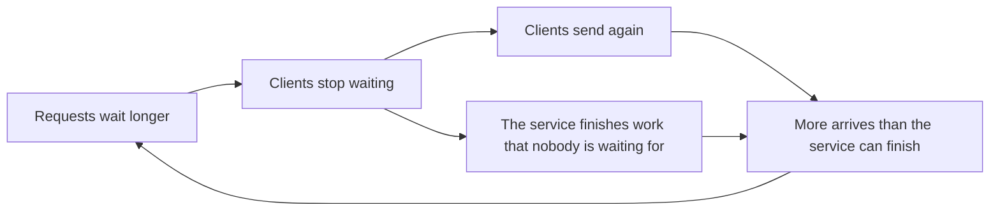
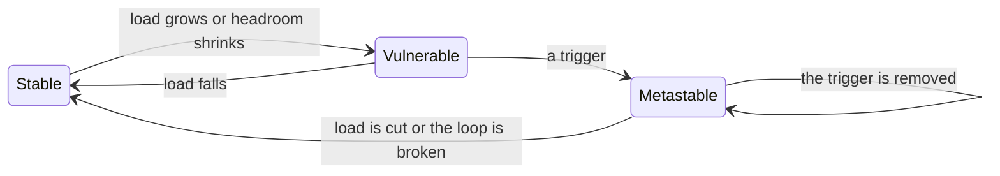

# 6.1 How distributed systems fail

[Syllabus](../SYLLABUS.md) · Phase 6 · Previous: [Capstone 5](../phase-5-distributed-data/capstone-chat-system.md) · Next: [6.2 Timeouts and retries at scale](02-timeouts-and-retries-at-scale.md)

> **Time:** about 35 minutes to read, 40 minutes of practice.
> **You need:** timeouts and retries from [Chapter 1.5](../phase-1-foundations/05-timeouts-retries-idempotency.md); queues and utilisation from [Chapter 1.6](../phase-1-foundations/06-concurrency-pools-queues.md); health checks from [Chapter 3.2](../phase-3-scaling-out/02-load-balancing.md). The example needs only Go.

**By the end of this chapter you can**

- explain why a distributed system is seldom simply *up* or *down*, and what cannot be known from inside one;
- recognise a grey failure: one that the health check does not see;
- trace the loop by which the loss of one server takes out the others;
- explain how retries hold a system down after the fault that started it has gone;
- say what a metastable failure is, which state a system you know is in, and what would get it out of the bad one.

---

## The problem

Early one Sunday morning, a network fault briefly cut off some of the storage servers of Amazon's DynamoDB. AWS's account of it begins: "at 2:19am PDT, there was a brief network disruption that impacted a portion of DynamoDB's storage servers. Normally, this type of networking disruption is handled seamlessly and without change to the performance of DynamoDB" ([AWS, *Summary of the Amazon DynamoDB Service Disruption and Related Impacts in the US-East Region*](https://aws.amazon.com/message/5467D2/)).

Each storage server has to confirm, every so often, which data it is responsible for, by asking a metadata service. A server that gets no answer in time stops taking customers' requests, and asks again. That morning the answers were slow. The servers that had been cut off all asked at once; some were not answered in time; they withdrew, and asked again. The metadata service, now busier, began to be late with servers that had never been affected by the network at all, and they withdrew and asked again too. In the words of [the same summary](https://aws.amazon.com/message/5467D2/), "Unavailable servers continued to retry requests for membership data, maintaining high load on the metadata service". Eighteen minutes after the disruption, the error rate for customers was "finally stabilizing at approximately 55%".

By then the network had long been healthy. The engineers tried to add capacity to the metadata service, and could not: "we were unable to add capacity to the metadata service because it was under such high load, preventing us from successfully making the requisite administrative requests". At 5:06 they did something else: "we decided to pause requests to the metadata service. This action decreased retry activity, which relieved much of the load" ([AWS](https://aws.amazon.com/message/5467D2/)). Service was normal again at 7:10.

The disruption was brief. The outage lasted nearly five hours.

Nothing in this story is a bug of the usual kind. Every part did what it was built to do: withdraw when unsure, and try again. Together, those behaviours held the service down long after its cause had gone.

Phase 5 asked what a system may promise about its data when machines fail. This phase asks how a system keeps answering at all. It begins with the ways in which systems of many machines fail, because they are not the ways in which one machine fails, and most of them are made by the system itself.

---

## The concept

### 1. Partial failure: some of it is broken, and you cannot be sure which part

A program on one machine either runs or has crashed. A system of many machines is, at most moments, partly broken: one server is restarting, one disk is slow, one network link is dropping packets. The rest carries on.

And from any one place in the system, the broken part cannot be told from a slow one. Chapter 1.5 called it the third outcome: a request that gets no answer may not have arrived, may have been carried out, or may be about to be. Amazon's engineers put the two difficulties together: "Independent failures and nondeterminism cause the most impactful issues in distributed systems", and "it's impossible always to know whether something failed" ([AWS Builders' Library, *Challenges with distributed systems*](https://aws.amazon.com/builders-library/challenges-with-distributed-systems/)).

So every statement that *server X is down* is a guess with a time limit: X did not answer **me**, within **my** timeout, just **now**. Chapter 5.6 built its elections on that guess. This chapter is about what follows from two facts: the guess is often wrong, and the system acts on it anyway.

### 2. Grey failure: the check passes and the users fail

The failure that systems are designed for is the clean one: a server stops, its health check fails, the balancer takes it out of use (Chapter 3.2). Most real failures are not clean. Engineers at Microsoft named the other kind **gray failure**: "component failures whose manifestations are fairly subtle and thus defy quick and definitive detection. Examples of gray failure are severe performance degradation, random packet loss, flaky I/O, memory thrashing, capacity pressure, and non-fatal exceptions" ([Huang et al., *Gray Failure: The Achilles' Heel of Cloud-Scale Systems*](https://web.eecs.umich.edu/~ryanph/paper/grayfailure-hotos17.pdf)).

What makes a failure grey is who can see it. The paper's term is *differential observability*: "the system's failure detectors may not notice problems even when applications are afflicted by them". Its example is the one that every health check invites: a server whose request handling is stuck while its heartbeat is not, so that "an error-handling module relying on heartbeats will perceive the system as healthy while a client seeking service will perceive it as failed" ([Huang et al.](https://web.eecs.umich.edu/~ryanph/paper/grayfailure-hotos17.pdf)).

A health check answers the question it asks. `GET /healthz` returning 200 says that the process is running and can answer `GET /healthz`. It says nothing about the query that has started to take four seconds.

**Slow is worse than dead.** A dead server is found and removed in seconds, and a request to it fails at once. A slow server keeps its share of the traffic. Each request to it holds a connection and a worker in the caller for the whole of the caller's timeout (Chapter 1.6), so its slowness is passed upstream. And, as the example will show, a server at a tenth of its speed does not deliver a tenth of its work.

### 3. Cascading failure: the load does not go away

When a server fails, its load does not. It goes to the others.

| Servers | Each at | One fails; the others are at | |
|---|---|---|---|
| 5 | 70% | 87.5% | They cope |
| 5 | 88% | 110% | They do not |
| 10 | 88% | 97.8% | In theory. Chapter 1.6: latency climbs long before 100% |

An overloaded server does not do 100% of its work and turn the rest away. Its queue grows, its memory fills, it becomes slow enough to fail its own health check or dies outright. Then its load goes to the others too. Google's SRE book defines the result: "A cascading failure is a failure that grows over time as a result of positive feedback" ([Google SRE book, *Addressing Cascading Failures*](https://sre.google/sre-book/addressing-cascading-failures/)).

The same chapter describes where it ends: "Once a couple of servers crash on overload, the load on the remaining servers can increase, causing them to crash as well. The problem tends to snowball and soon all servers begin to crash-loop. It's often difficult to escape this scenario because as soon as servers come back online they're bombarded with an extremely high rate of requests and fail almost immediately" ([Google SRE book](https://sre.google/sre-book/addressing-cascading-failures/)).

And it states the property that makes such failures last. The load at which the system recovers is well below the load at which it fell over: "if a service was healthy at 10,000 QPS, but started a cascading failure due to crashes at 11,000 QPS, dropping the load to 9,000 QPS will almost certainly not stop the crashes. This is because the service will be handling increased demand with reduced capacity" ([Google SRE book](https://sre.google/sre-book/addressing-cascading-failures/)).

Even the machinery of recovery can join in. Of systems that restart tasks which fail their health checks, the book says: "This practice may create a failure mode in which health-checking itself makes the service unhealthy" ([Google SRE book](https://sre.google/sre-book/addressing-cascading-failures/)). Under overload, slow servers fail their checks and are removed, which is the cascade again, carried out by the tool that was meant to help.

There are two defences. Have enough capacity *with a server missing*: the first row of the table, not the second. And build servers that stay up when overloaded by refusing what they cannot do (Chapter 6.4). The example compares them.

### 4. Retries: the work multiplies when capacity is lowest

Chapter 1.5 gave the rule: retry a few times, with backoff, at one layer. Here is what the rule is for.



When a service slows down, requests time out, and each one that times out is sent again. The load rises at the moment the capacity fell. If every client tries three times, a service in trouble receives three times its normal load.

There is a second loop inside the first. The service does not know that a client has stopped waiting. It goes on working through its queue in order, finishing requests whose answers will be thrown away, while the requests that somebody still wants wait behind them. Its **throughput** — requests finished — stays high. Its **goodput** — "throughput of useful work", in the words of [the paper that section 5 quotes](https://sigops.org/s/conferences/hotos/2021/papers/hotos21-s11-bronson.pdf) — can be nothing at all. A dashboard that shows CPU and requests a second will show a busy, healthy service.

### 5. Metastable failure: the fault is gone and the outage stays

Sections 3 and 4 have the same shape: a loop that, once started, feeds itself. Engineers who had seen many such outages gave the shape a name: "Metastable failures occur in open systems with an uncontrolled source of load where a trigger causes the system to enter a bad state that persists even when the trigger is removed" ([Bronson et al., *Metastable Failures in Distributed Systems*](https://sigops.org/s/conferences/hotos/2021/papers/hotos21-s11-bronson.pdf)).



The paper's vocabulary is worth having.

- **The trigger** starts it: a network fault, a deploy, a slow query, a cache that was emptied. It may last seconds.
- **The sustaining effect** keeps it going: retries, work for nobody, load moved on to the survivors, an empty cache that sends every read to the database (Chapter 3.4), a hundred thousand clients that reconnect at once (Chapter 3.7).
- **The vulnerable state** is the one that most efficient systems are in: "The vulnerable system is healthy, but may fall into an unrecoverable metastable state due to a trigger." It can be there for a long time: "a system can run for months or years in the vulnerable state and then get stuck in a metastable state without any increase in load" ([Bronson et al.](https://sigops.org/s/conferences/hotos/2021/papers/hotos21-s11-bronson.pdf)).

Two consequences follow, and both are about people.

**The trigger gets the blame.** "It is common for an outage that involves a metastable failure to be initially blamed on the trigger, but the true root cause is the sustaining effect" ([Bronson et al.](https://sigops.org/s/conferences/hotos/2021/papers/hotos21-s11-bronson.pdf)). A review that ends with *make the network more reliable* has prepared for the last trigger. The next one will be different, and the loop will still be there.

**Removing the trigger does not end it. Removing load does.** Of its own example, a database held down by retries, [the paper](https://sigops.org/s/conferences/hotos/2021/papers/hotos21-s11-bronson.pdf) says: "It will remain there until the load is significantly reduced or the retry policy is changed". The SRE book says the same of cascades: "Dropping load is a big hammer, usually reserved for situations in which you have a true cascading failure on your hands and you cannot fix it by other means" ([Google SRE book](https://sre.google/sre-book/addressing-cascading-failures/)). It is what the DynamoDB engineers did at 5:06.

The question to ask of a design is therefore not only *what can fail?* It is ***what does the system do to itself when something fails — and what would stop it?***

---

## A real example

### Run it: one model, three failures

[`code/ch01-failures/main.go`](code/ch01-failures/main.go) is a model, about 330 lines, with no network and no clock: every run prints the same numbers. Time moves in steps of 10 ms. In each step a server finishes a fixed amount of work from its queue, first come first served. A client waits one second for an answer.

```bash
go run ./phase-6-reliability/code/ch01-failures
```

```text
PART 1 — five servers, 180 requests a second each, of the 250 that each can do. At second 30 one
         server becomes ten times slower. It goes on answering its health check, every 5 seconds.

                                                          health checks    users' requests
  the balancer takes a server out of use when…                   passed       not answered
  …it fails its health check                                 300 of 300      48571 of 270000  (18.0%)
  …that, or 5 requests in a row get no answer                300 of 300       1665 of 270000  (0.6%)
```

The health check is a cheap request that does not wait in the queue with the real ones, so in the model it always passes. That is the scenario, not a finding. The finding is the other column.

**Every check passed, and from second 30 one request in five went unanswered** — the slow server's whole share. It could still finish 25 requests a second. It finished them too late: its queue was served in order, and within a second everything at the front of it had been abandoned by its client. A server at a tenth of its speed delivered none of its work.

A balancer that also counts what happens to real requests (Chapter 3.2's passive check) cut the loss to 0.6%. It rested the server for 30 seconds after five requests in a row went unanswered, and tried it again each time the rest ended — which cost a couple of hundred requests each time.

```text
PART 2 — five servers, 250 requests a second each. At second 30 one of them fails. It is back at second 90.
         A server with more than 400 requests waiting runs out of memory, and takes 20 to 30 seconds to restart.

                                       users' requests answered in time, by half-minute   servers up
                                           0    30    60    90   120   150   180   210 at the end
  70% load: 875 a second                100%  100%  100%  100%  100%  100%  100%  100%          5
  88% load: 1,100 a second              100%   33%    1%    3%    2%    2%    2%    3%          0
  88%, and servers refuse the excess    100%   92%   91%  100%  100%  100%  100%  100%          5
```

**At 70%, nobody noticed.** Four servers carried the load at 87.5% each.

**At 88%, the loss of one server took out all five.** Each survivor was sent 275 requests a second and could finish 250. Their queues grew; after ten seconds a request waited more than a second; after sixteen the four ran out of memory together. From then on, each server that restarted met most of the load by itself and was down again within seconds. The server that had failed first was repaired at second 90. It made no difference. At the end of the run no server is up, and the few requests answered are those that a server finished between starting and falling over.

**With servers that refuse work**, the same failure at the same load cost one request in eleven for a minute: the 1,000 a second that four servers can do, out of 1,100. When the fifth server returned, so did everything else. These servers accept no more than 100 waiting requests and turn the rest away at once. Chapter 6.4 is about doing that well.

```text
PART 3 — one service that can finish 1,000 requests a second, and is sent 800. From second 30 to
         second 60 it finishes nothing. Then it is as it was.

  (a) clients do not retry
  (b) clients try three times
  (c) as (b); and at second 240 the service is restarted, which empties its queue
  (d) as (c); and for the next 30 seconds every second attempt is turned away at the door

  users' requests answered in time, by the half-minute in which they were made

  seconds        (a)      (b)      (c)      (d)
    0–30        100%     100%     100%     100%
   30–60          0%       0%       0%       0%
   60–90          0%       0%       0%       0%
   90–120         0%       0%       0%       0%
  120–150         0%       0%       0%       0%
  150–180        17%       0%       0%       0%
  180–210       100%       0%       0%       0%
  210–240       100%       0%       5%       4%
  240–270       100%       0%       2%      88%
  270–300       100%       0%       0%     100%
  300–330       100%       0%       0%     100%
  330–360       100%       0%       0%     100%
  360–390       100%       0%       0%     100%
  390–420       100%       0%       0%     100%
  420–450       100%       0%       0%     100%
  450–480       100%       0%       0%     100%

             requests made       attempts sent, finished by the service    longest queue
                  by users     retries included     too late to matter                 
  (a)               384000               384000                 115980            24008
  (b)               384000              1104000                 424000           658200
  (c)               384000              1102274                 422280           334876
  (d)               384000               737400                 180000           321594
```

In all four runs, from second 60 onwards, the service can finish 1,000 requests a second and users are making 800. What differs is what the clients do.

**(a) No retries: the stall lasted 30 seconds and the outage about 145.** The service came back with 24,000 requests waiting, every one from a client that had gone, and it worked through them first: 115,980 requests finished too late to matter. This is section 4's second loop by itself. The service recovered without help, because 800 a second is less than 1,000 and the queue shrank.

**(b) Three attempts: it never recovers.** Every request waits more than a second, so every request is sent three times: 2,400 a second into a service that can finish 1,000. At the end of the run the queue holds 658,200 requests and is growing by 1,400 a second. The service has finished 424,000 requests for nobody. This is a metastable failure. Its trigger ended at second 60.

**(c) A restart does not help.** It empties the queue, and for a moment requests are answered. But the clients are in the middle of retrying. Everyone whose attempt was thrown away sends another within the second, on top of the new requests: 2,400 a second again. A second later the queue is 1,400 long, the newest request in it will wait too long, and the loop has closed.

**(d) What helps is less load.** The same restart, and then half of all attempts turned away for 30 seconds. In that half-minute 88% of users' requests were answered — a request fails only if it is turned away three times running — and after it, all of them. The corrective action was the cut in load, held until the retries had stopped.

### What AWS found

AWS's [summary of the DynamoDB event](https://aws.amazon.com/message/5467D2/) can be read with section 5's vocabulary. Every quotation below is from it.

**The vulnerable state had been approaching for months, in a number that nobody was watching.** A new feature had made the lists that the metadata service sends to storage servers much longer: "Over the last few months, customers have rapidly adopted a new DynamoDB feature called Global Secondary Indexes". By that Sunday, the service "was processing some membership lists that were now large enough that their processing time was near the time limit for retrieval" ([AWS](https://aws.amazon.com/message/5467D2/)). Nothing had failed. The system had less room than it appeared to have.

**The trigger was ordinary**: a network disruption of a kind that, [the summary](https://aws.amazon.com/message/5467D2/) says, was normally "handled seamlessly".

**The sustaining effect was a retry**: the sentence quoted at the top of this chapter. It spread the failure to servers that the network fault had never touched.

**The first correction could not be made**, because the tool for making it was inside the system that was overloaded.

**The correction that worked was to cut the load.**

The four actions that [AWS](https://aws.amazon.com/message/5467D2/) announced afterwards map on to this chapter, and on to the phase. More capacity in the metadata service: headroom. Monitoring of the number that had drifted: "stricter monitoring on performance dimensions, such as the membership size". A weaker loop: "reducing the rate at which storage nodes request membership data and lengthening the time allowed to process queries". And a smaller area for any one failure to cover: "many instances of the metadata service each serving only portions of the storage server fleet" — which is Chapter 6.5's subject.

---

## Trade-offs

**Efficiency against stability.** A fleet at 88% costs a fifth less than one at 70%, and Part 2 showed what the difference buys. The paper is blunt about why systems end up vulnerable: "many production systems choose to run in the vulnerable state all the time because it has much higher efficiency than the stable state" ([Bronson et al.](https://sigops.org/s/conferences/hotos/2021/papers/hotos21-s11-bronson.pdf)). That can be a reasonable choice — if it is a choice, and the means of getting out of the bad state exist and have been tried.

**Retries.** They hide the brief faults that happen all day, and they multiply load in the one situation where load is the problem. Chapter 6.2 keeps the first and limits the second.

**Strict health checks against lenient ones.** A check that is easy to pass leaves grey failures in service. A check that is hard to pass removes servers that are merely busy, and under overload removes all of them. Chapter 3.2's answer still stands: judge by real traffic as well, and never let the balancer remove everything.

**Queues.** A queue absorbs a burst (Chapter 4.1). A long queue served in order is also where work for nobody accumulates. Part 3's service recovers within a second of the stall ending if its queue is shorter than its clients' patience: add `refuseAt: 500` to that part's options, and run it.

**Automatic recovery.** Restarts, failovers and rebalancing shorten ordinary failures, and each is a way for the system to act on a wrong guess. Every automatic reaction should have a limit on how much of the system it may act on at once.

---

## Practice

### Check yourself

1. A health check requests `/healthz`, which returns 200 whenever the process is running. Name two failures that it cannot see. What would a check that *could* see them put at risk?
2. Six servers run at 75% of their capacity. One fails: how busy are the others? What if two fail? How busy may six servers be, if they are to survive the loss of one — and of two?
3. A 20-second network fault is followed by a two-hour outage. The review's only action is *make the network more reliable*. What is missing?

<details>
<summary>Answers</summary>

1. A dependency that has become slow, so that real requests time out while `/healthz` answers at once. A pool with no free connections. A server that can reach the balancer and not the database. A full disk. A check that exercised the real path — one that ran a query, say — would see these. But when the database is slow for everyone, every server fails that check at the same moment, and a balancer that believes it removes them all (Chapter 3.2). The deeper the check, the more it must be combined with a rule that the balancer never empties its own pool.
2. Six servers at 75% is the work of 4.5 servers. On five, that is **90%**; on four, **112.5%** — overload. To survive one loss, the six must be at no more than 5 ÷ 6 = **83%**; to survive two, 4 ÷ 6 = **67%**. Those are upper limits: Chapter 1.6 showed latency rising steeply well before 100%, so the real figures are lower.
3. The sustaining effect. A fault of 20 seconds does not explain an outage of two hours: something in the system kept it down, and the review has not named it. The next trigger will be a deploy or a slow disk, and the same loop will be waiting. The actions that matter are about the loop — a limit on retries, a shorter queue, servers that refuse excess — and about the control that was missing on the day: a tested way to cut load quickly.

</details>

### Exercise: where is the edge?

Part 3's service can finish 1,000 requests a second, and its clients try three times.

1. Without running anything: what is the highest steady load at which the service recovers by itself after a 30-second stall?
2. Check your answer with the model: `-part 3 -load N` sets the load.
3. The team proposes that clients wait 100 ms before the second attempt and 200 ms before the third. Does the answer to question 1 change?
4. In your run just above the edge, look at column (c). Why does a restart work there, when it did not at 800 a second?

<details>
<summary>Worked solution</summary>

**1.** After the stall, every request waits more than a second, so every request is sent three times. The service receives three times the load. Its queue shrinks only if that is less than it can finish: 3 × load < 1,000, so **load < 333 a second**. Clients that try three times make this service vulnerable above a third of its capacity.

**2.**

```bash
go run ./phase-6-reliability/code/ch01-failures -part 3 -load 300
go run ./phase-6-reliability/code/ch01-failures -part 3 -load 350
```

Column (b), three attempts, at 300 a second and then at 350:

```text
  270–300       100%       0%     100%     100%
  300–330       100%      70%     100%     100%
  330–360       100%     100%     100%     100%
```

```text
  270–300       100%       0%     100%     100%
  300–330       100%       0%     100%     100%
  330–360       100%       0%     100%     100%
```

At 300 a second the service does recover — at about second 310, more than four minutes after a stall of 30 seconds. It was sent 900 a second and could finish 1,000, so its queue of 26,000 shrank by 100 a second. At 350 it never recovers.

**3.** No. Backoff changes *when* the attempts arrive. It does not change how many there are: each request that fails is still sent three times, and 3 × 350 is still more than 1,000. Backoff and jitter spread a burst out (Chapter 1.5). Reducing the *number* of retries when many requests are failing is a different mechanism, a retry budget, and it is the subject of Chapter 6.2.

**4.** A restart throws away the queue, and with it the attempts of every request then in progress, all of which are sent again within a second. At 350 a second that wave is about 700 retries on top of 350 new requests: 1,050 arriving in a second at a service that finishes 1,000. The queue reaches fifty or so, nobody waits long, nobody times out, and the loop does not start. At 800 a second the wave is 2,400. A restart works only when the service can absorb the retries that the restart itself causes.

</details>

---

## Production tips and common mistakes

**Before the outage**

- **List the loops.** For each dependency, write down what happens to *load* when it becomes slow. Retries, queues, reconnections, cache refills, failovers. If the answer is *load goes up*, there is a loop, and it needs something that breaks it.
- **Measure capacity with a server missing** — or a zone, if you run in several (Chapter 6.5). The number that matters is the utilisation after the failure.
- **Test past the limit, and then watch the recovery.** The SRE book's first item for preventing overload is "Load test the server's capacity limits, and test the failure mode for overload", and it calls this "the most important exercise you should conduct" ([Google SRE book](https://sre.google/sre-book/addressing-cascading-failures/)). Raise the load until the service fails, lower it, and see whether the service comes back by itself, and at what load.
- **Measure goodput**: requests answered within the time that a client waits. Requests a second and CPU cannot tell a healthy service from Part 3's.
- **Watch the numbers that drift**: the size of the largest item, the time of the slowest regular job, the margin between a timeout and what it times. DynamoDB's edge was reached by a list that had grown for months.
- **Build the control, and try it.** A way to turn away a share of the traffic, to switch retries off, to empty a queue. It must work when the system is overloaded, which means that it cannot depend on the system.

**During it**

- **Break the loop first; find the trigger later.** If the system is busy and useless, cut the load. The trigger may have gone already.
- **Do not judge by the health checks.** Ask what users are getting.

**Common mistakes**

- **Adding capacity to a system that is in a loop** — when the new capacity will be taken down as it arrives, or cannot be added at all.
- **Restarting**, and then restarting again.
- **Blaming the trigger** in the review.
- **An unlimited queue.** Part 3's longest queue was 658,200. No request in it was ever going to be answered in time.
- **Treating *slow* as a kind of *working*.** Slow servers stay in service, hold their callers' resources, and pass every health check.

---

## Key takeaways

- A system of many machines is usually partly broken, and no part of it can be sure which part that is. *Down* means *did not answer me in time*.
- A grey failure is one that the failure detector does not see and the users do. Judge servers by real requests as well as by health checks.
- A slow server is worse than a dead one: it keeps its traffic, and with a queue served in order it may deliver none of its work.
- When a server fails, its load moves to the others. Capacity is what is left with one missing, and what a server does under overload — refuse, or fall over — decides whether a failure spreads.
- Retries multiply the load when capacity is lowest. A service can be fully busy and finish nothing that anybody is waiting for.
- A metastable failure has a trigger and a sustaining effect. Removing the trigger does not end it. Cutting the load does, and the load must fall below the level at which the trouble began.
- Know your system's loops before they run, and have a tested way to cut load.

**Next:** [6.2 Timeouts and retries at scale](02-timeouts-and-retries-at-scale.md) — deadlines that travel with a request, budgets that limit retries, and where in a stack of services a retry belongs.

---

## Sources

- Nathan Bronson, Abutalib Aghayev, Aleksey Charapko and Timothy Zhu, [*Metastable Failures in Distributed Systems*](https://sigops.org/s/conferences/hotos/2021/papers/hotos21-s11-bronson.pdf), HotOS 2021.
- Peng Huang and others, [*Gray Failure: The Achilles' Heel of Cloud-Scale Systems*](https://web.eecs.umich.edu/~ryanph/paper/grayfailure-hotos17.pdf), HotOS 2017.
- Mike Ulrich, [*Addressing Cascading Failures*](https://sre.google/sre-book/addressing-cascading-failures/), chapter 22 of *Site Reliability Engineering*, Google, 2016.
- Amazon Web Services, [*Summary of the Amazon DynamoDB Service Disruption and Related Impacts in the US-East Region*](https://aws.amazon.com/message/5467D2/).
- AWS Builders' Library, [*Challenges with distributed systems*](https://aws.amazon.com/builders-library/challenges-with-distributed-systems/).
