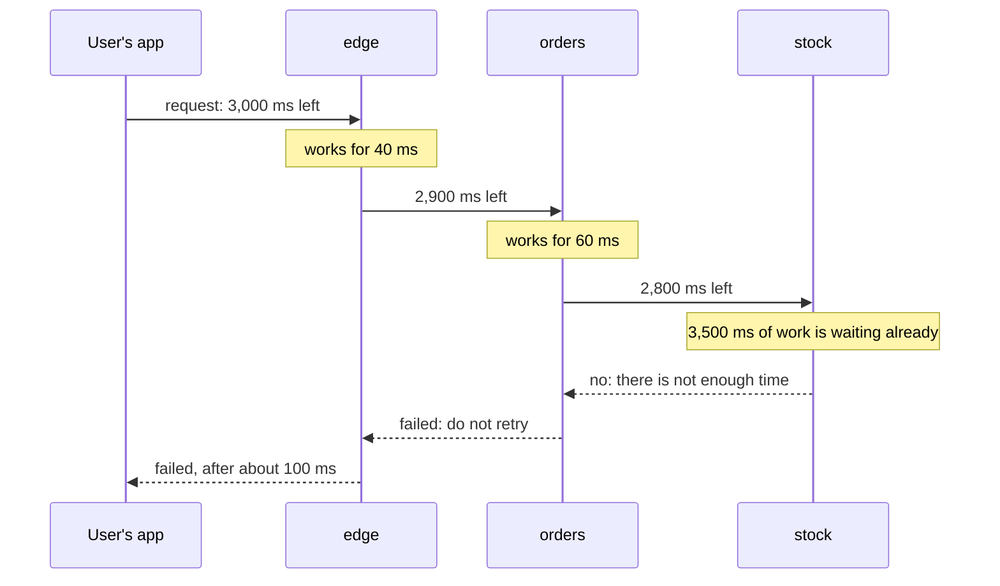

# 6.2 Timeouts and retries at scale

[Syllabus](../SYLLABUS.md) · Phase 6 · Previous: [6.1 How distributed systems fail](01-how-distributed-systems-fail.md) · Next: [6.3 Circuit breakers, bulkheads, and graceful degradation](03-circuit-breakers-bulkheads-degradation.md)

> **Time:** about 35 minutes to read, 45 minutes of practice.
> **You need:** timeouts, retries, backoff and idempotency for one call, from [Chapter 1.5](../phase-1-foundations/05-timeouts-retries-idempotency.md); retry storms and metastable failures from [Chapter 6.1](01-how-distributed-systems-fail.md). The example needs only Go.

**By the end of this chapter you can**

- give a request one deadline, and make every service on its path keep to it;
- say what a deadline passed on can do that a cancellation passed on cannot;
- put retries at one layer of a stack, and stop the layers above from repeating them;
- limit retries with a budget, and say what a budget does that backoff does not;
- use a hedged request against tail latency, and say when it makes things worse.

---

## The problem

*An illustrative scenario; the example reproduces its two halves.* A tap on *Buy* goes to an edge service, which calls an order service, which calls a stock service, which queries a database. Each team has read Chapter 1.5, and each client has a timeout and three attempts with backoff.

One afternoon the database slows down. The stock service's queries time out, and it tries each one three times. The order service sees the stock service fail, and tries each call three times. So does the edge. The database, which was slow because it had too much to do, is now sent 27 queries for every tap. (Chapter 1.5 quoted Amazon's version of this arithmetic: five layers, 243 times.)

The timeouts are no better. The app waits 3 seconds. The edge waits 5 for the order service, because orders are important. The order service allows the stock service 2 seconds, three times. Six seconds after the tap — three seconds after the user was shown an error and tapped again — the stack is still working on the first tap, and has started on the second.

Every rule of Chapter 1.5 was followed, by each team, separately. Those rules are about one caller and one service. This chapter is about what changes when callers are stacked several deep and multiplied by thousands: **timeouts have to agree with each other, and retries have to be counted across the whole system.**

---

## The concept

### 1. One deadline for the whole request

A **timeout** is a length of time, chosen by one caller: *I will wait this long.* A **deadline** is a moment, and it belongs to the request: *after this, nobody is waiting.* gRPC's documentation defines it: "A deadline is used to specify a point in time past which a client is unwilling to wait for a response from a server" ([gRPC, *Deadlines*](https://grpc.io/docs/guides/deadlines/)).

Timeouts chosen hop by hop do not add up to a deadline. An inner hop waits longer than the hop above it. An inner hop starts a retry after everyone above has given up. And nothing below the top knows that the user has gone. Google's SRE book describes the cost: "A common theme in many cascading outages is that servers spend resources handling requests that will exceed their deadlines on the client. As a result, resources are spent while no progress is made: you don't get credit for late assignments with RPCs" ([Google SRE book, *Addressing Cascading Failures*](https://sre.google/sre-book/addressing-cascading-failures/)). That is Chapter 6.1's *work for nobody*.

The cure is to choose the deadline once, at the top, where the user's patience is known, and to send it down with the request: "Rather than inventing a deadline when sending RPCs to backends, servers should employ deadline propagation. With deadline propagation, a deadline is set high in the stack (e.g., in the frontend). The tree of RPCs emanating from an initial request will all have the same absolute deadline. For example, if server A selects a 30-second deadline, and processes the request for 7 seconds before sending an RPC to server B, the RPC from A to B will have a 23-second deadline" ([Google SRE book](https://sre.google/sre-book/addressing-cascading-failures/)).



Each hop passes on what is left, less a little for the journey. The last one can see at once that it cannot answer in time, and says so.

**Inside a Go process**, the deadline travels in the `context`: "Package context defines the Context type, which carries deadlines, cancellation signals, and other request-scoped values across API boundaries and between processes" ([Go documentation, *context*](https://pkg.go.dev/context)). Every function on the request's path takes the context and passes it on, down to `QueryContext` and `http.NewRequestWithContext`.

**Between processes**, something must carry it. gRPC does so itself; its documentation says that passing the deadline from an incoming call to an outgoing one must be switched on in some languages, and that "in others it is enabled by default (e.g. Java and Go)" ([gRPC, *Deadlines*](https://grpc.io/docs/guides/deadlines/)). Plain HTTP has no standard header for it, so you define one. The example's takes a few lines on the way in:

```go
// withDeadline gives a handler a context that ends when the request's deadline does.
func withDeadline(r *http.Request) (context.Context, context.CancelFunc, time.Time) {
    if ms, err := strconv.ParseInt(r.Header.Get(timeLeft), 10, 64); err == nil {
        at := time.Now().Add(time.Duration(ms) * time.Millisecond)
        ctx, cancel := context.WithDeadline(r.Context(), at)
        return ctx, cancel, at
    }
    return r.Context(), func() {}, time.Time{}
}
```

and fewer on the way out:

```go
if at, ok := ctx.Deadline(); ok {
    req.Header.Set(timeLeft, strconv.FormatInt(time.Until(at).Milliseconds(), 10))
}
```

**Send the time that is left, not a time of day.** Two machines' clocks do not agree (Chapter 5.5). gRPC does the same, and says why: "Since a deadline is set point in time, propagating it as-is to a server can be problematic as the clocks on the two servers might not be synchronized. To address this gRPC converts the deadline to a timeout from which the already elapsed time is already deducted" ([gRPC, *Deadlines*](https://grpc.io/docs/guides/deadlines/)).

**Is passing the context on not enough?** In Go it does a great deal. For a request that a server is handling, "the context is canceled when the client's connection closes" ([Go documentation, *net/http*](https://pkg.go.dev/net/http)). If every hop passes that context to its outgoing calls, a user who gives up causes a chain of closed connections, and the work stops. But a cancellation arrives *after* the caller has gone. A deadline is known *beforehand*, and a service that knows it can do three things that a cancellation cannot.

1. **Use it as the timeout for every call it makes** — never longer than the time that is left. The SRE book adds a margin: "You may want to reduce the outgoing deadline a bit (e.g., a few hundred milliseconds) to account for network transit times and post-processing in the client" ([Google SRE book](https://sre.google/sre-book/addressing-cascading-failures/)).
2. **Refuse work that cannot finish in time**, at once, so that the caller hears *no* in milliseconds and can do something else. The same applies to a retry: before a second attempt, ask whether there is time for one.
3. **Throw away, unstarted, what has expired in a queue.** The [book](https://sre.google/sre-book/addressing-cascading-failures/) again: "the server should check the deadline left at each stage before attempting to perform any more work on the request".

A cancellation also fails to cross some boundaries that a deadline crosses easily: a queue, a proxy that keeps its own connections open, a hop that answered early and carried on working.

### 2. Retry at one layer, and tell the others

If each of *n* layers makes up to *k* attempts, the bottom of the stack can receive *kⁿ* requests for one request at the top. Three layers and three attempts: 27.

**Which layer should retry?** The SRE book's rule: "requests should only be retried at the layer immediately above the layer that is rejecting them" ([Google SRE book, *Handling Overload*](https://sre.google/sre-book/handling-overload/)). That layer is nearest to the failure. It repeats the least work, and it is the one that knows whether the failure is of a kind worth repeating.

**How do the layers above know not to?** They cannot work it out. A failure looks the same from above whether it has been retried or not. So the layer that has retried must say so. Google's services use an error for it: "When we decide that a given request can't be served and shouldn't be retried, we use an "overloaded; don't retry" error and thus avoid a combinatorial retry explosion" ([Google SRE book, *Handling Overload*](https://sre.google/sre-book/handling-overload/)).

That gives every failure passed upwards one of two meanings:

- *This attempt failed; another might work.* The layer directly above may retry.
- *I have tried already — or trying again is pointless. Pass this up.* Nobody retries.

HTTP has no standard way to say the second. Choose one for your own services — a header, or a code in the error body — and make every client library obey it. The example uses a header.

And count the layers honestly. One hop can hold several: the HTTP library, the vendor's SDK, a service-mesh proxy and your own loop may each be retrying.

### 3. A retry budget: retries as a share of the traffic

A limit of three attempts caps what one request can cost. It does not cap what all of them cost together. When everything is failing, everything is tried three times, and the SRE book puts a number on it: the load grows "to somewhere just below 3X" ([Google SRE book, *Handling Overload*](https://sre.google/sre-book/handling-overload/)). Chapter 6.1's service was held down by exactly that.

Backoff and jitter do not change this. They move the retries later and spread them out (Chapter 1.5). They do not make them fewer.

A **retry budget** does. It allows retries only while they are a small share of all requests. Google's version: "Each client keeps track of the ratio of requests that correspond to retries. A request will only be retried as long as this ratio is below 10%". The effect, in the same passage: a retry ratio of 10% "reduces the growth to just 1.1x in the general case" ([Google SRE book, *Handling Overload*](https://sre.google/sre-book/handling-overload/)).

It is a small piece of code: a bucket of tokens, to which every request adds a fraction and from which every retry takes a whole one.

```go
func (b *budget) request() {            // called for every request
    b.mu.Lock()
    b.tokens = min(b.max, b.tokens+b.ratio)   // ratio 0.1: one retry for every ten requests
    b.mu.Unlock()
}

func (b *budget) retry() bool {         // called before every retry
    b.mu.Lock()
    defer b.mu.Unlock()
    if b.tokens < 1 {
        return false                    // no budget: let the failure stand
    }
    b.tokens--
    return true
}
```

What makes this the right shape is that it needs no threshold for *is there an outage?* When failures are rare, there are always tokens, and every failure is retried: brief faults stay invisible. When failures are common, the tokens run out, and the load on the struggling service stays near what it was. The same code does both.

It is built into the common clients. gRPC keeps a count of tokens for each server: "Failed RPCs decrement the count by 1, successful RPCs increment it by tokenRatio", and when the count is low, "retries are paused until the count recovers" ([gRPC, *Retry*](https://grpc.io/docs/guides/retry/)). Amazon's engineers write that "we can mitigate this risk by limiting retries locally using a token bucket", and that "AWS added this behavior to the AWS SDK in 2016" ([AWS Builders' Library, *Timeouts, retries, and backoff with jitter*](https://aws.amazon.com/builders-library/timeouts-retries-and-backoff-with-jitter/)).

### 4. Hedged requests: a retry before the failure

Some requests are not failing. They are slow, and a slow answer from one server in a hundred matters more than it seems to. Google's Jeffrey Dean and Luiz André Barroso give the arithmetic for a server that is slow once in a hundred requests: "If a user request must collect responses from 100 such servers in parallel, then 63% of user requests will take more than one second" ([Dean and Barroso, *The Tail at Scale*](https://www.barroso.org/publications/TheTailAtScale.pdf)).

A **hedged request** does not wait for the failure. When a call has taken longer than usual, the client sends the same request to a second server and uses whichever answer comes first. gRPC's description: "a gRPC client sends multiple copies of the same request to different backends and uses the first response it receives" ([gRPC, *Request Hedging*](https://grpc.io/docs/guides/request-hedging/)).

*Longer than usual* is what keeps it cheap. The paper proposes sending the second request only when the first "has been outstanding for more than the 95th-percentile expected latency for this class of requests. This approach limits the additional load to approximately 5% while substantially shortening the latency tail". In one of its measurements, "sending a hedging request after a 10ms delay reduces the 99.9th-percentile latency for retrieving all 1,000 values from 1,800ms to 74ms while sending just 2% more requests" ([Dean and Barroso](https://www.barroso.org/publications/TheTailAtScale.pdf)).

Hedging rests on one assumption, which [the paper](https://www.barroso.org/publications/TheTailAtScale.pdf) states: "the source of latency is often not inherent in the particular request but rather due to other forms of interference". A second server is probably not slow at the same moment. When that is false — when every server is slow, because the service is overloaded — a hedge is a retry sent to a service in trouble, and section 3 applies. So hedges are only for requests that are safe to repeat (Chapter 1.5), they come out of the same budget as retries, and the loser is cancelled.

---

## A real example

### Run it

[`code/ch02-deadlines/main.go`](code/ch02-deadlines/main.go) has four parts, in about 470 lines. The first two start real HTTP servers inside the program. The last two are models, like Chapter 6.1's.

```bash
go run ./phase-6-reliability/code/ch02-deadlines
```

```text
PART 1 — a user's request passes through three services: edge, orders, stock. Stock is failing every
         request. 1,000 users make a request. Every caller is willing to try three times.

                                                                      requests that       for each
                                                                      reached stock   user request
  every layer retries                                                         27000           27.0
  a layer that has retried tells the layers above not to                       3000            3.0
  …and may retry only one request in ten                                       1109            1.1
```

**27, 3, and 1.1.** The first row is the scenario at the top of the chapter, counted: three callers above the failing service, three attempts each. In the second row the code of every caller is unchanged — each is still willing to try three times — but a caller that has used up its attempts adds a header to the failure that it passes up, and a caller that sees the header does not retry. Only the order service, directly above the failure, repeats anything. In the third row the order service also has a budget, and since every request is failing, the budget is spent almost at once: it retries one request in ten.

```text
PART 2 — the same three services. Stock does one job at a time, and a job takes 100 ms. Ten users ask at
         the same moment, and each waits 350 ms.

                                                 users       the others   stock worked       of which    edge and orders
                                              answered  were told after            for     for nobody      were held for
  each hop has a timeout of its own                  3           351 ms        1000 ms         660 ms           11148 ms
  each hop passes its context on                     3           351 ms         340 ms          10 ms            6011 ms
  each hop passes the deadline on                    3             9 ms         300 ms           0 ms            1227 ms
```

(Timings vary by a few milliseconds from run to run.)

Three users are answered in every row: three jobs fit into 350 ms. The rows differ in what happens to the other seven, and in what it costs.

**A timeout of its own at each hop.** Each service calls the next with a new context and *two seconds should be plenty*. Seven users give up at 350 ms. Nothing below them knows. Stock does all ten jobs — a second of work, two thirds of it for nobody — and the two services in the middle hold a connection and a goroutine for each request until stock has finished with it: 11 seconds of holding, for 3.5 seconds of anyone's patience.

**The context passed on.** One line is different in each service: the outgoing request is made with the context of the incoming one. When a user's connection closes, the cancellation runs down the chain, and stock stops within 10 ms. No work is wasted. But seven users still waited the whole 350 ms to be told nothing, and the services in the middle were held for all of it.

**The deadline passed on.** Stock now knows, when a request arrives, how long its caller will wait, and it can see three jobs ahead in its queue. The fourth user's job would finish at 400 ms. Stock says no at once. Seven users have an error in 9 ms — time enough to show a message, to offer a cached answer, to try elsewhere (Chapter 6.3) — and nothing is held.

```text
PART 3 — Chapter 6.1's stall, as a model: a service that can finish 1,000 requests a second is sent 800,
         and finishes nothing from second 30 to second 60. Clients wait 1 s and try up to three times.

                                                               once the stall ends,    attempts sent    finished too late
                                                                  answers 99% again                             to matter
  retries at once                                                             never           816000               305000
  retries after a backoff, with jitter                                        never           816000               305000
  retries limited to one for every ten requests                         after 212 s           307444               212787
  retries at once; the service drops what has expired                       at once           334200                    0
  a retry budget, and a service that drops what has expired                 at once           290419                    0
```

This is the metastable failure of Chapter 6.1, and it answers the question that chapter's exercise left open.

**Backoff changes nothing.** The second row is identical to the first, to the last digit. Every failed request is still sent three times, a little later. Backoff is for spreading a burst, and this is not a burst.

**A budget turns *never* into *three and a half minutes*.** The service is sent 880 requests a second, not 2,400, so its queue shrinks. But the queue is still full of requests whose clients have gone, and the service still works through them, in order: 212,787 requests finished too late to matter.

**Deadlines make the recovery immediate.** A service that knows each request's deadline throws the expired ones away without working on them. When the stall ends it discards 30 seconds of dead requests at once and starts on the live ones. Even with clients that retry carelessly, every request made after the stall is answered within its three attempts.

The fourth row might suggest that deadlines make the budget unnecessary. They do not: the model's service discards an expired request at no cost, and a real one does not. Receiving a request, parsing it and refusing it is work, and of capping retries at three attempts the SRE book says that "a threefold increase in requests is significant, especially if the cost of rejecting versus processing a request is considerable" ([Google SRE book, *Handling Overload*](https://sre.google/sre-book/handling-overload/)). The budget limits what arrives. The deadline limits what is done with it.

```text
PART 4 — a model: a page needs answers from 100 servers. 99 calls in 100 take 8 to 12 ms. One in 100
         takes a second. 10,000 pages.

                                                         pages slower       median    99th percentile    extra calls
                                                          than 100 ms         page                                  
  wait for every server                                         63.6%      1000 ms            1000 ms              —
  after 20 ms with no answer, ask a second server                0.9%        29 ms              32 ms           1.0%
```

The first row is Dean and Barroso's 63%, reproduced: when a page needs a hundred servers, *one slow call in a hundred* means *most pages are slow*. The median page takes a second. With a second call to any server that has not answered in 20 ms, the median page takes 29 ms, and the cost is one extra call in a hundred. A page is still slow when both calls to the same shard are slow: 0.9% of pages.

The model's servers are slow independently of one another. That is the assumption on which hedging rests, and the model cannot test it.

### What the clients you already use do

Before writing any of this, look at what the libraries in your stack do already — and how many of them are doing it at once.

- **gRPC** propagates deadlines between services, has retry throttling by tokens, and has a hedging policy with a delay. Its documentation notes that "gRPC call deadlines apply to the entire chain of hedged requests" ([gRPC, *Request Hedging*](https://grpc.io/docs/guides/request-hedging/)): a hedge or a retry never extends the time that the caller will wait.
- **The AWS SDKs** have the token bucket quoted in section 3 built in.
- **Go's standard library** gives you the deadline — `context` — and little else. `net/http` repeats a request in one narrow case: "Transport only retries a request upon encountering a network error if the connection has already been used successfully and if the request is idempotent" ([Go documentation, *net/http*](https://pkg.go.dev/net/http)). It has no backoff, no budget and no hedge. If your services speak plain HTTP, the header, the budget and the do-not-retry signal are yours to write, once, in the client library that every service uses.

---

## Trade-offs

**One deadline for the request.** It works only if every hop takes part: one service that calls onwards with a fresh context breaks the chain for everything below it. A deadline that is too short fails the slow but legitimate requests, every time; the SRE book warns that "Short deadlines can cause some more expensive requests to fail consistently" ([Google SRE book](https://sre.google/sre-book/addressing-cascading-failures/)). And a deadline stops at an asynchronous boundary: a job on a queue has no caller waiting, and needs an expiry of its own (Chapter 4.6).

**Refusing early.** To refuse a request that cannot finish, a service needs an estimate of how long the request would take. A bad estimate refuses work that would have succeeded. Part 2's stock service has an easy case: one job at a time, each of a known length.

**Retrying at one layer.** The layers above give up the chance to try something *different*: another replica, another region, a cached answer. That is a decision for a higher layer to take deliberately (Chapters 6.3 and 6.6), not something to get by retrying the same call.

**A budget.** It lets some requests fail that a retry would have saved, and it does so during trouble, which is the point. A client with very little traffic earns tokens slowly; the bucket's starting allowance is what covers it.

**Hedging.** It costs extra requests in proportion to how early the hedge is sent, it needs the loser to be cancelled, and it must never be used for a request with an effect that is not idempotent.

---

## Practice

### Check yourself

1. A service receives a request with 80 ms left before its deadline. The query it needs usually takes 150 ms. What should it do — and what should it not do?
2. A calls B, B calls C, C calls D. Every caller makes up to four attempts, and D is failing every request. How many requests reach D for one request to A? How many if only the layer directly above the failure retries? And if that layer also has a retry budget of 10%, during a long outage?
3. Why is a retry budget a *ratio* of retries to requests, and not a fixed number of retries a second?

<details>
<summary>Answers</summary>

1. Refuse at once, with an error that says the request should not be retried: the caller then has 80 ms to do something else. Better still, if there is a cheaper answer — a cached value, a default — give that (Chapter 6.3). What it should not do is start the query, which would be work for nobody. Nor should it start the query with a new timeout of its own, which is the same thing with a longer wait.
2. A, B and C each make four attempts: 4 × 4 × 4 = **64** requests reach D. If only C retries: **4**. With a 10% budget during a long outage, C retries one request in ten: about **1.1**.
3. Because the right number of retries depends on the traffic. A service that handles 10,000 requests a second and has a brief fault affecting 1% of them needs 100 retries a second, and should have them. A service that handles 10 requests a second and is allowed 100 retries a second can multiply its load by ten. A ratio limits the *multiplication* — 1.1 times, at any volume — and that is the quantity that holds a service down.

</details>

### Exercise: give the stack one deadline

A mobile app waits **3 s** for a purchase, and if it gets no answer, tries **twice more**. `edge` waits **5 s** for `orders`. `orders` calls `payments` up to **three times**, waiting **2 s** each time, with pauses of 100 ms and 200 ms between attempts. `payments` waits **4 s** for the bank.

One day the bank stops answering.

1. Draw the timeline of one tap. When does each layer give up? For how long after the user has seen an error is the stack still working on that tap?
2. How many times is the bank called for one purchase?
3. Redesign it with one deadline. Decide who retries, and what `orders` does after its first attempt fails.
4. What must be true of `payments` for any of this to be safe?

<details>
<summary>Worked solution</summary>

**1. The timeline of the first tap.**

| Time | What happens |
|---|---|
| 0.0 s | Tap. `orders` makes attempt 1; `payments` calls the bank |
| 2.0 s | `orders` gives up on attempt 1. `payments` is still waiting for the bank |
| 2.1 s | `orders` makes attempt 2; `payments` calls the bank again |
| 3.0 s | **The app gives up, shows an error, and sends the request again** |
| 4.0 s | `payments` gives up on its first call to the bank |
| 4.1 s | `orders` gives up on attempt 2 |
| 4.3 s | `orders` makes attempt 3; a third call to the bank |
| 5.0 s | `edge` gives up on `orders` |
| 6.1 s | `payments` gives up on its second call |
| 6.3 s | `orders` gives up on attempt 3, and reports a failure to an `edge` that left 1.3 s ago |
| 8.3 s | `payments` gives up on its third call |

The stack works on the first tap until 8.3 s: **5.3 seconds after the user was told it had failed.** No layer's timeout is wrong by itself. They were never compared.

**2.** Three calls to the bank for each request from the app, and the app sends three: **nine calls to the bank for one purchase**, the last of them starting at 10.3 s.

**3. One deadline.** The app sends its patience with the request, less a margin: *2.8 s left*. Every hop uses what remains.

- `orders` calls `payments` with the smaller of its usual 2 s and the time that is left.
- `payments` calls the bank with the time that is left to *it*, not with 4 s.
- When attempt 1 fails at 2.0 s, `orders` has 0.8 s. If a payment normally takes longer than that, there is no time for a second attempt, and `orders` does not make one. It fails at once, with *do not retry*.
- `edge` passes that up. The app shows the error at about 2.0 s, a second sooner than before, and does not retry by itself. If the user taps again, that is a new request, with the same idempotency key (Chapter 1.5).

The bank is called **once**, and everything has stopped by 2.0 s.

**Who retries?** `orders`, the layer directly above the call that fails — when there is time, and within a budget. Not `edge`, and not the app.

**4.** `payments` must be idempotent: the same key must give the same payment, however many times it arrives (Chapter 1.5). In the original design the bank was called nine times for one purchase. Whether the customer was charged nine times depended entirely on that.

</details>

---

## Production tips and common mistakes

**Deadlines**

- **Set the deadline at the edge**, from what the client will wait, and give every request that arrives without one a default.
- **Send the time that is left**, not a clock reading.
- **Never start an outgoing call from `context.Background()` inside a handler.** It is the one-line mistake that produces Part 2's first row. For work that must outlive the request — an audit record, say — detach on purpose, with `context.WithoutCancel`, and give that work a limit of its own.
- **Check the deadline where work begins**: on taking a request from a queue, before each stage, before a retry. Make the database keep to it: `QueryContext`, with a statement timeout on the server as a second line (Chapter 2.6).
- **Leave a margin at each hop** for the journey back.
- **Count *deadline exceeded* separately from other errors**, at each hop. It tells you where the time went (Chapter 7.4).

**Retries**

- **One layer retries**, the others pass failures up, and a failure says whether it may be retried.
- **Give every retrying client a budget.** Ten per cent is the figure in the SRE book.
- **Measure the ratio of attempts to requests** for each client. It should sit just above 1. A rise is the earliest sign of a retry storm.
- **Do not retry what ran out of time.** If the request's deadline has passed, there is nobody to retry for.

**Common mistakes**

- **Timeouts chosen one hop at a time**, so that an inner hop outwaits the outer.
- **A retry with the same timeout** against a service that is slow: the second attempt times out as the first did, and the service has done the work twice.
- **Retrying at every layer, to be safe.**
- **Not counting the layers inside one hop**: a library, an SDK, a proxy and a loop.
- **Backoff offered as the cure for a retry storm.**
- **Hedging a request that changes something.**

---

## Key takeaways

- Timeouts chosen hop by hop do not agree. A request needs one deadline, set at the top and carried down as the time that is left.
- Passing the context on stops work after the caller has gone. Passing the deadline on lets a service refuse, shorten or skip work before then.
- Retries multiply through layers: *k* attempts at each of *n* layers is *kⁿ* at the bottom. Retry at the layer directly above the failure, and mark failures that must not be retried.
- Backoff spreads retries out. Only a budget makes them fewer: retries as a fixed share of requests keep the load near 1.1 times normal when everything is failing.
- A budget limits what arrives at a struggling service; a deadline limits the work done on it. Recovery needs both.
- A hedged request cuts tail latency for a few per cent more load, as long as slowness is independent between servers and the request is safe to repeat.

**Next:** [6.3 Circuit breakers, bulkheads, and graceful degradation](03-circuit-breakers-bulkheads-degradation.md) — what a caller does when a dependency is failing, so that one slow service does not take the others with it.

---

## Sources

- Mike Ulrich, [*Addressing Cascading Failures*](https://sre.google/sre-book/addressing-cascading-failures/), and Alejandro Forero Cuervo, [*Handling Overload*](https://sre.google/sre-book/handling-overload/), chapters 22 and 21 of *Site Reliability Engineering*, Google, 2016.
- Jeffrey Dean and Luiz André Barroso, [*The Tail at Scale*](https://www.barroso.org/publications/TheTailAtScale.pdf), Communications of the ACM, 2013.
- gRPC documentation: [*Deadlines*](https://grpc.io/docs/guides/deadlines/), [*Retry*](https://grpc.io/docs/guides/retry/) and [*Request Hedging*](https://grpc.io/docs/guides/request-hedging/).
- Go documentation: [*context*](https://pkg.go.dev/context) and [*net/http*](https://pkg.go.dev/net/http).
- AWS Builders' Library, [*Timeouts, retries, and backoff with jitter*](https://aws.amazon.com/builders-library/timeouts-retries-and-backoff-with-jitter/).
