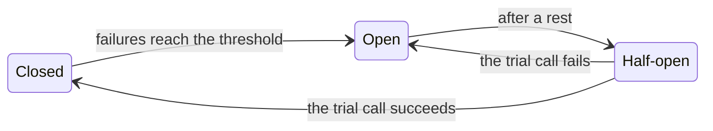

# 6.3 Circuit breakers, bulkheads, and graceful degradation

[Syllabus](../SYLLABUS.md) · Phase 6 · Previous: [6.2 Timeouts and retries at scale](02-timeouts-and-retries-at-scale.md) · Next: 6.4 Overload: rate limiting, load shedding, and admission control *(planned)*

> **Time:** about 30 minutes to read, 40 minutes of practice.
> **You need:** pools and Little's law from [Chapter 1.6](../phase-1-foundations/06-concurrency-pools-queues.md); deadlines and retry budgets from [Chapter 6.2](02-timeouts-and-retries-at-scale.md). The example needs only Go, and takes about 20 seconds to run.

**By the end of this chapter you can**

- sort a service's dependencies into those that a request needs and those that it can do without;
- explain how one slow dependency uses up a pool that everything shares, and limit the damage with a bulkhead;
- describe the three states of a circuit breaker, and choose what opens it;
- design a degraded answer that does less work, not different work;
- say why fallbacks are dangerous, and how to keep a degraded mode in working order.

---

## The problem

Around 2001, Amazon added a feature to its website: beside every product, how quickly it could be delivered. The figures came from a database that the warehouses also used, and that database "couldn't keep up with the request volume from the website". So the team put a cache in front of it, as a separate process on each web server. And they did the careful thing. They planned for the cache failing: "In this scenario, the web servers reverted to querying the database directly" ([AWS Builders' Library, *Avoiding fallback in distributed systems*](https://aws.amazon.com/builders-library/avoiding-fallback-in-distributed-systems/)).

The same article tells what happened: "Falling back to direct database queries was an intuitive solution that did work for a number of months. But eventually the caches all failed around the same time, which meant that every web server hit the database directly. This created enough load to completely lock up the database. The entire website went down because all web server processes were blocked on the database." The warehouses used that database too, and "all fulfillment centers worldwide ground to a halt" ([AWS Builders' Library](https://aws.amazon.com/builders-library/avoiding-fallback-in-distributed-systems/)).

The feature was a line of text beside a product. Its failure should have cost a line of text. [Amazon's own summary](https://aws.amazon.com/builders-library/avoiding-fallback-in-distributed-systems/): "The fallback turned a partial website outage (not being able to display shipping speeds) into a full-site outage".

There are two mistakes in the story, and this chapter is about both. The delivery estimate shared something scarce — the web servers' processes — with every other part of every page, so when it hung, everything hung. And the plan for its failure did *more* work than the normal path, against the very thing that was least able to take it.

---

## The concept

### 1. What a request needs, and what it would like

For each kind of request that a service handles, sort its dependencies into two lists.

| A checkout page | | If it fails or is slow |
|---|---|---|
| Payments | **Needed** | No page. Say so quickly and clearly |
| Stock | **Needed** | No page |
| Recommendations | Wanted | The page, without them |
| Number of reviews | Wanted | The page, without it |

The second list is longer than it looks at first. Much of a page is decoration, from the point of view of what the user came to do.

For a dependency that is only wanted, the rule has two halves, and the second is the one that is forgotten.

1. **Its failure costs nothing except its own absence.** The page appears without recommendations.
2. **Its failure costs nothing that cannot be seen, either**: not the request's time, and not the service's workers.

Code that says *if recommendations fail, carry on* satisfies the first half. The rest of this chapter is about the second.

### 2. How slowness spreads: the pool that everything shares

Martin Fowler describes the mechanism: "if you have many callers on a unresponsive supplier, then you can run out of critical resources leading to cascading failures across multiple systems" ([Fowler, *CircuitBreaker*](https://martinfowler.com/bliki/CircuitBreaker.html)).

Every server has something that all its requests share and that there is only so much of: workers, threads, connections in a pool, memory (Chapter 1.6). A call to a dependency holds some of it until the call returns. Little's law, from the same chapter, says how much:

> held at any moment = calls a second × seconds that each call takes

At 200 calls a second and 5 ms a call, one worker is busy with recommendations. If a call starts to take one second, the same traffic needs 200 workers. A service with 20 has none left for anything, and *anything* includes the requests that never wanted recommendations.

**A short timeout is the first defence.** Give the optional call a timeout from its own normal latency (Chapter 1.5), not from the user's patience. At 50 ms, the same traffic holds 200 × 0.05 = 10 workers. The service survives, and every page is 50 ms slower.

But the arithmetic has traffic in it. Double the traffic, and 10 workers become 20. **A timeout limits how long each request can be held up. It does not limit how many are held up at once.**

### 3. Bulkheads: a limit for each dependency

The second defence takes its name from ships. Microsoft's description of the pattern: "Isolate the elements of an application into pools so that if one element fails, the others continue to function"; it "is named after the sectioned partitions (bulkheads) of a ship's hull. If the hull of a ship is compromised, only the damaged section fills with water" ([Microsoft Azure Architecture Center, *Bulkhead pattern*](https://learn.microsoft.com/en-us/azure/architecture/patterns/bulkhead)).

In a service, a bulkhead is a limit on how much of the shared pool one dependency may hold. The simplest is a count of calls in progress:

```go
select {
case p.bulkhead <- struct{}{}:           // a place is free: take it, and make the call
    defer func() { <-p.bulkhead }()
default:
    return false                         // every place is held by a call that is waiting: go without
}
```

Two things about it matter.

**When the limit is reached, do not wait.** Waiting for a place is the queue that the bulkhead was built to prevent. An optional call is skipped. A necessary one fails, at once.

**Size it from normal traffic**, with Little's law again. 200 calls a second × 5 ms is one call in progress, on average; a limit of 2 to 4 leaves room for bursts. In normal times the limit is never reached. In bad times it is the most that the dependency can take.

The same idea appears at every size: a separate connection pool for each downstream service; Chapter 4.6's workers reserved for urgent jobs; Capstone 4's share of a provider's rate kept back for transactional email; and, largest of all, whole copies of a service for different groups of customers (Chapter 6.5).

A warning about names. The proxy Envoy calls its limits of this kind *circuit breaking*: among them "Cluster maximum pending requests: The maximum number of requests that will be queued while waiting for a ready connection pool connection". Its reasoning is the bulkhead's: "It's nearly always better to fail quickly and apply back pressure downstream as soon as possible" ([Envoy documentation, *Circuit breaking*](https://www.envoyproxy.io/docs/envoy/latest/intro/arch_overview/upstream/circuit_breaking)). In this chapter a circuit breaker is the thing in the next section.

### 4. Circuit breakers: stop asking

With a timeout and a bulkhead, a broken dependency is still asked, over and over, and each request that asks still waits for the timeout. A **circuit breaker** remembers. The pattern was made popular by Michael Nygard's book *Release It!*, and Fowler's summary of it is the usual one: "You wrap a protected function call in a circuit breaker object, which monitors for failures. Once the failures reach a certain threshold, the circuit breaker trips, and all further calls to the circuit breaker return with an error, without the protected call being made at all" ([Fowler, *CircuitBreaker*](https://martinfowler.com/bliki/CircuitBreaker.html)).



- **Closed**: calls pass, and failures are counted.
- **Open**: calls fail at once, without being made. Nobody waits for a timeout, and the dependency is left alone.
- **Half-open**: after a rest, one call is let through. In [Fowler's](https://martinfowler.com/bliki/CircuitBreaker.html) words, the trial "will either reset the breaker if successful or restart the timeout if not".

A breaker is about forty lines of Go; the example has one. In a real service, use a library that has been tested. A widely used one in Go is [`sony/gobreaker`](https://pkg.go.dev/github.com/sony/gobreaker/v2), and its documentation shows the decisions that any breaker needs.

- **What counts as a failure.** Timeouts, and errors that say the dependency is in trouble. Not *this customer does not exist*: an error that the caller caused says nothing about the dependency's health.
- **What opens it.** A number of failures in a row is simplest: by default, gobreaker's breaker "returns true when the number of consecutive failures is more than 5" ([gobreaker documentation](https://pkg.go.dev/github.com/sony/gobreaker/v2)). A share of the calls in a recent window is steadier when traffic is heavy, and needs a minimum number of calls before it means anything.
- **How long it rests.** Long enough to give the dependency room; short enough that recovery is noticed.
- **What it covers.** One breaker for each dependency, in each process that calls it. Nothing is coordinated: each process learns for itself.

Two connections with earlier chapters. A breaker that opens for one *server* of a dependency is Chapter 3.2's passive health check, and belongs in the balancer. And an open breaker is a failure that must not be retried (Chapter 6.2): the answer will be the same.

### 5. Graceful degradation: do less

When a dependency is skipped, or a breaker is open, the service gives an answer of lower quality on purpose. The SRE book's definition has the important word in it: graceful degradation works by "reducing the amount of work that needs to be performed" ([Google SRE book, *Addressing Cascading Failures*](https://sre.google/sre-book/addressing-cascading-failures/)).

Degraded answers, cheapest first:

- **Leave it out.** No recommendations.
- **A fixed default.** *Popular this week*, built once an hour and kept in memory.
- **An old copy.** The last good answer, kept past its normal expiry for this purpose (Chapter 3.4).
- **Later.** Accept the request and do the work when the dependency is back (Chapter 4.1) — where the work can wait.

What is missing from that list is *get the same answer another way*. That is a **fallback**, and it is what took Amazon's website down. The article that tells the story draws the conclusion without hedging: it is about "fallback strategies and why we almost never use them at Amazon", and it asks, of a fallback that is slower or heavier than the normal path: "Why use a fallback that's worse, when something is already going wrong?" ([AWS Builders' Library](https://aws.amazon.com/builders-library/avoiding-fallback-in-distributed-systems/)).

So a degraded mode has to pass three tests.

1. **It is cheaper than the normal mode**, in every resource. If it were not, it would be an extra load arriving at the worst moment.
2. **It depends on nothing that might be failing for the same reason.** A default that is read from the same database is not a default.
3. **It runs often.** The SRE book: "Remember that the code path you never use is the code path that (often) doesn't work" ([Google SRE book](https://sre.google/sre-book/addressing-cascading-failures/)). Amazon's version: "If fallback is essential in a system, we exercise it as often as possible in production" ([AWS Builders' Library](https://aws.amazon.com/builders-library/avoiding-fallback-in-distributed-systems/)).

And one rule about honesty: a degraded answer must be recognisable as one. Leave the price out; never show a price of zero.

---

## A real example

### Run it: a slow dependency, four ways

[`code/ch03-breaker/main.go`](code/ch03-breaker/main.go), about 270 lines, starts three real HTTP services inside one process. `checkout` has 20 workers. Each page needs `payments`, which takes 5 ms, and shows `recommendations`, which normally takes 5 ms. 200 users a second ask for the page, and each waits a second. From second 1 to second 4, `recommendations` takes two seconds to answer.

```bash
go run ./phase-6-reliability/code/ch03-breaker
```

```text
A checkout page needs payments, and shows recommendations if it can. 20 workers; 200 users a second;
a user waits 1 s. From second 1 to second 4, recommendations takes 2 s to answer, not 5 ms.

                                                     USERS WHO ARRIVE IN SECONDS 1 TO 3                             AFTER SECOND 4
                                                         pages     median         99th   most workers       calls to    recommendations are
                                                      answered       page   percentile   held at once     recommend.    back on the page in
  (a) no recommendations, no page                           0%          —            —             20            219                   7 ms
  (b) waits 50 ms for them, then goes without             100%      56 ms        57 ms             11            400                   7 ms
  (c) as (b), and at most 2 such calls at a time          100%       6 ms        57 ms              2             75                  17 ms
  (d) as (b), with a circuit breaker                      100%       5 ms        57 ms             11             18                 407 ms
```

(Timings vary by a few milliseconds from run to run. The left-hand columns count the users who arrive in seconds 1 to 3: they will have gone before `recommendations` recovers.)

**(a) Nobody gets a page.** `payments` is healthy throughout. But every worker is waiting for `recommendations`, for as long as its user will wait, and then the user has gone. This is the chapter's opening story in small.

**(b) Everybody gets a page, 50 ms late.** The call has a timeout taken from its normal latency, and the page does without. Eleven of the twenty workers are waiting at any moment — the ten that Little's law predicted, and one more. All 400 pages paid for the timeout, and all 400 calls were made to a service that was already in trouble.

**(c) A bulkhead: two workers, and no more.** Two calls at a time may wait for `recommendations`. Every other page skips it without waiting. The median page takes 6 ms, as on a good day. A few pages — those that held one of the two places — still take 57 ms. The struggling service receives 75 calls, not 400.

**(d) A breaker: 18 calls.** After five failures in a row the breaker opens, and for half a second at a time no call is made at all. Each half-second, one trial goes through. The median page is back to normal. Two costs show in the table. For the first tenth of a second, before the breaker had opened, eleven workers were held: a breaker reacts, where a bulkhead limits. And when `recommendations` recovered, the page was without it for another 407 ms, until the next trial. With a rest of a minute, that would be a minute.

The table hides how close (b) is to the edge. Run it with three times the traffic:

```bash
go run ./phase-6-reliability/code/ch03-breaker -users 600
```

```text
  (b) waits 50 ms for them, then goes without              71%     535 ms       992 ms             20            710                   7 ms
  (c) as (b), and at most 2 such calls at a time          100%       5 ms        56 ms              2             78                  48 ms
  (d) as (b), with a circuit breaker                      100%       5 ms        56 ms             20             23                 347 ms
```

600 × 0.055 s is 33 workers, and there are 20. With only a timeout, three pages in ten are lost and the rest take half a second. The bulkhead and the breaker do not notice the extra traffic: on a good day this service can produce 2,000 pages a second, and with either protection it still can.

**In practice, use all three**: the timeout so that no call waits long, the bulkhead so that few calls wait at all, and the breaker so that a dependency which is down is left alone.

### What Amazon does instead of falling back

The article quoted at the top of this chapter ends with what its author does in place of fallback. Three of those practices carry over to any system, and all three quotations below are from it.

- **Make the normal path good enough to rely on**, and spend the effort there: "we favor code paths that are exercised in production continuously rather than rarely" ([AWS Builders' Library](https://aws.amazon.com/builders-library/avoiding-fallback-in-distributed-systems/)).
- **Let the caller deal with the failure.** Where a request cannot be served, say so, and let the layer above decide: "One solution to critical system failures is not to fall back, but to let the calling system handle the failure" ([AWS Builders' Library](https://aws.amazon.com/builders-library/avoiding-fallback-in-distributed-systems/)).
- **Have the data before it is needed.** A service that already holds what it needs has no call to fail: "If, for example, a service needs data to fulfill a request, and that data is already present locally (it doesn't need to be fetched), there is no need for a failover strategy" ([AWS Builders' Library](https://aws.amazon.com/builders-library/avoiding-fallback-in-distributed-systems/)). The *fixed default* and the *old copy* of section 5 are small versions of this.

Read against the outage of 2001: the delivery estimate could have been left off the page (the caller handles it), or kept on each web server and refreshed in the background (the data is already there). Either would have cost a line of text.

---

## Trade-offs

**A breaker adds a mode.** A system with breakers behaves in one way when they are closed and in another when they are open, and the second is seldom seen. Amazon's engineers are wary for that reason: "circuit breakers introduce modal behavior into systems that can be difficult to test, and can introduce significant addition time to recovery" ([AWS Builders' Library, *Timeouts, retries, and backoff with jitter*](https://aws.amazon.com/builders-library/timeouts-retries-and-backoff-with-jitter/)). The example's fourth column measured that extra time.

**A breaker can turn a partial failure into a total one.** If three calls in ten are failing, an open breaker fails all ten. For a dependency that is only wanted, that is a fair trade. For one that is needed, think hard about the threshold — or leave the breaker out, and let the timeout, the retry budget and the balancer's per-server checks do the work.

**A bulkhead wastes capacity that is idle.** Places reserved for one dependency cannot be lent to another that is busy. That is its purpose, and its price.

**Thresholds are guesses** until the system has been watched under failure. A limit that is too tight skips work on ordinary busy days.

**Degradation changes what the product is.** Whether a checkout without recommendations is acceptable is not a question for engineers alone. Decide it with the people who own the page, before the day on which it happens.

---

## Practice

### Check yourself

1. A handler has `recs, err := getRecommendations(ctx)`, and if there is an error it logs it and carries on without recommendations. Which half of section 1's rule does it satisfy, and what is missing?
2. A service makes 500 calls a second to a dependency that normally answers in 20 ms. How many calls are in progress on average? What happens to that number if the dependency starts taking 2 seconds, with no timeout? With a timeout of 100 ms? What would you set a bulkhead to?
3. A team adds a fallback: if the search service fails, the product service runs the search as a `LIKE` query on its own database. Apply section 5's three tests.

<details>
<summary>Answers</summary>

1. The first half: the page appears without them. The second is missing. If `getRecommendations` waits for as long as `ctx` allows, a slow recommendations service costs the request its whole deadline and the service a worker for all that time. It needs a short timeout of its own, and a limit on how many such calls can be waiting at once.
2. 500 × 0.02 = **10** in progress. At 2 seconds, 500 × 2 = **1,000**: every worker the service has, many times over. With a timeout of 100 ms, 500 × 0.1 = **50**, which may still be more than the pool. A bulkhead of about **20 to 30**: two or three times the normal ten, so that it is never reached on a good day, and is all that the dependency can hold on a bad one.
3. It fails all three. It is far more expensive than the normal path: a `LIKE` query scans, where the search service used an index built for the purpose (Chapter 2.2). It leans on the product database, which every other request needs, so a search outage can become a product outage — the shape of Amazon's story. And it will run only on the day that search is down, with a load it has never been tested under. Degrading would be better: return no results, with a message; or only exact matches on the product code, which the primary key can answer cheaply.

</details>

### Exercise: a product page

A product page is built from six calls. The figures are each one's normal latency, and the page's deadline is 800 ms.

| Call | Normal latency |
|---|---|
| Product details (name, description, images) | 15 ms |
| Price | 10 ms |
| Stock level | 20 ms |
| Reviews: the average and the count | 30 ms |
| *Customers also bought* | 60 ms |
| Delivery estimate for this customer's address | 40 ms |

The page gets 300 requests a second, and the service that builds it has 60 workers. The calls are made one after another.

1. Sort the calls into *needed* and *wanted*. For each wanted one, say what the page shows without it.
2. Give each wanted call a timeout, and a bulkhead sized by Little's law.
3. The delivery estimate starts to take 5 seconds. With your design, how many workers does it hold? Without it — one deadline of 800 ms for the whole page, and no other protection — how many?
4. Which calls deserve a circuit breaker?

<details>
<summary>Worked solution</summary>

**1.**

| Call | | Without it |
|---|---|---|
| Product details | Needed | No page |
| Price | Needed | No page. Never a wrong or missing price beside a *Buy* button |
| Stock level | Wanted, with care | *Check availability at checkout*. The checkout checks stock anyway (Capstone 2) |
| Reviews | Wanted | No stars |
| *Customers also bought* | Wanted | The section is left out |
| Delivery estimate | Wanted | *Delivery times shown at checkout* |

Stock is the debatable one. The argument for *wanted* is that the page is a place to look, and the decision is made at checkout, where stock is needed.

**2.** Timeouts of two to three times the normal latency, and bulkheads of two to three times the calls normally in progress (300 a second × the latency):

| Call | Timeout | In progress normally | Bulkhead |
|---|---|---|---|
| Stock level | 60 ms | 300 × 0.02 = 6 | 15 |
| Reviews | 80 ms | 9 | 20 |
| *Customers also bought* | 150 ms | 18 | 40 |
| Delivery estimate | 100 ms | 12 | 25 |

On a normal day the page takes 175 ms and uses 300 × 0.175 = 53 of the 60 workers. That is too close, and it is true whatever is done about failures: this service needs more workers, or to make its calls in parallel.

**3.** With the design: the timeout would let it hold 300 × 0.1 = 30 workers, and the bulkhead stops it at **25**. But every page still needs its other five calls, which take 135 ms: 300 × 0.135 = 41 workers' worth, and only 35 are left. So the bulkhead is still too generous for this pool. It may be at most 60 − 41 = 19, and a limit that close to the normal 12 will be reached on an ordinary busy minute. The arithmetic is saying what answer 2 said: the pool is too small. Without the design: every request holds a worker for the whole 800 ms. 300 × 0.8 = **240 workers**, and there are 60. No page is built for anyone.

**4.** The delivery estimate and *Customers also bought*: both are wanted only, both are slow enough that the timeout is costly to pay on every page, and both are the kind of service that fails as a whole. Not the price or the product details: when a needed call is failing there is nothing to degrade to, and a breaker would only make a partial failure total.

</details>

---

## Production tips and common mistakes

- **Write the two lists down** for every endpoint that matters, and review them when a dependency is added. The default, if nobody decides, is that everything is needed.
- **Time out optional calls by their own latency**, not by the request's deadline.
- **A bulkhead for every dependency**, sized from normal traffic. Fail or skip when it is full; never queue.
- **One connection pool for each dependency**, not one for everything.
- **Make degradation visible.** Count pages served without each optional part, and breaker openings, and alert when either stays high. A degraded mode that nobody is watching becomes the normal mode.
- **Exercise the degraded paths.** Switch an optional dependency off in production for a minute, on purpose and on a schedule (Chapter 6.7). If that is frightening, the degraded path does not work.
- **Spread out the trials.** If a thousand processes all rest for exactly 30 seconds, the recovering dependency receives a thousand trials in the same instant. Add jitter to the rest (Chapter 1.5).

**Common mistakes**

- **Catching the error and calling it resilience**: the first half of the rule without the second.
- **A fallback that does more work** than the path it replaces.
- **A fallback that uses a shared dependency**: the database, most often.
- **A breaker in front of a dependency that is needed**, with a hair trigger.
- **One breaker for a whole fleet of servers**, opened by a single bad one. That is the balancer's job.
- **Retrying against an open breaker.**
- **A default that looks like data**: a price of zero, an empty list where *unknown* was meant.

---

## Key takeaways

- Sort every dependency into *needed* and *wanted*. The failure of a wanted one must cost nothing but its own absence — including time and workers.
- Slowness spreads through whatever is shared. Workers held = calls a second × seconds a call. A timeout limits the second number only.
- A bulkhead limits how much of the pool one dependency can hold. When it is full, skip or fail; do not wait.
- A circuit breaker stops calling a dependency that keeps failing, and tries again now and then. It spares the callers the timeout and the dependency the load, and it delays the recovery by its rest.
- Degrade by doing less. A fallback that reaches the same answer by a heavier road adds load at the worst moment, and has never been run.
- A degraded path that is not exercised does not work.

**Next:** 6.4 Overload: rate limiting, load shedding, and admission control *(planned)* — what a service does when more arrives than it can do, so that it finishes what it accepts.

---

## Sources

- Jacob Gabrielson, [*Avoiding fallback in distributed systems*](https://aws.amazon.com/builders-library/avoiding-fallback-in-distributed-systems/), AWS Builders' Library.
- Martin Fowler, [*CircuitBreaker*](https://martinfowler.com/bliki/CircuitBreaker.html), 2014. The pattern is from Michael Nygard's book *Release It!*, which is not quoted here.
- Microsoft Azure Architecture Center, [*Bulkhead pattern*](https://learn.microsoft.com/en-us/azure/architecture/patterns/bulkhead).
- Envoy documentation, [*Circuit breaking*](https://www.envoyproxy.io/docs/envoy/latest/intro/arch_overview/upstream/circuit_breaking).
- [`sony/gobreaker`](https://pkg.go.dev/github.com/sony/gobreaker/v2), package documentation.
- Mike Ulrich, [*Addressing Cascading Failures*](https://sre.google/sre-book/addressing-cascading-failures/), chapter 22 of *Site Reliability Engineering*, Google, 2016.
- AWS Builders' Library, [*Timeouts, retries, and backoff with jitter*](https://aws.amazon.com/builders-library/timeouts-retries-and-backoff-with-jitter/).
