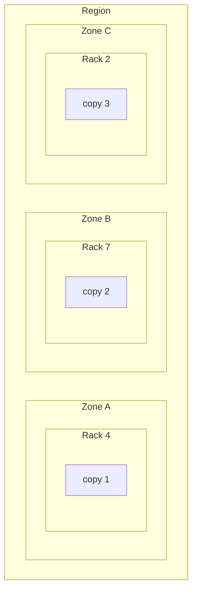

# 6.5 Redundancy and failure domains

[Syllabus](../SYLLABUS.md) · Phase 6 · Previous: [6.4 Overload](04-overload.md) · Next: 6.6 Multi-region architectures *(planned)*

> **Time:** about 30 minutes to read, 40 minutes of practice.
> **You need:** cascading failure from [Chapter 6.1](01-how-distributed-systems-fail.md); bulkheads from [Chapter 6.3](03-circuit-breakers-bulkheads-degradation.md); replication and failover from [Chapter 5.1](../phase-5-distributed-data/01-leader-follower-replication.md). The example needs only Go.

**By the end of this chapter you can**

- say why three copies that fail together are worth one, and name the things that make copies fail together;
- place copies and servers across racks, zones and regions, and say what each placement survives;
- work out the capacity that a service needs in order to lose a zone, and explain *static stability*;
- tell a control plane from a data plane, and say which of them a recovery plan may depend on;
- limit how much of a system one fault can reach, with cells and with shuffle sharding.

---

## The problem

On the evening of 29 June 2012, a storm passed over the data centres of Amazon's US East region. One of them, in one availability zone, lost its mains power twice in about half an hour. It had generators for exactly this. AWS's account: "the generators started successfully, but each generator independently failed to provide stable voltage as they were brought into service" ([AWS, *Summary of the AWS Service Event in the US East Region*](https://aws.amazon.com/message/67457/)). The batteries ran down, and "servers began losing power at 8:04pm PDT". The summary adds a detail that this chapter will come back to: "The generators and electrical switching equipment in the datacenter that experienced the failure were all the same brand and all installed in late 2010 and early 2011."

About 7% of the region's virtual machines were in it. That is the kind of loss that a region with several zones is built to take, and customers who had spread their servers across zones had servers left.

But many of them had a plan for this evening that was a list of things to *do*: start replacement servers in the other zones, and add them to the load balancers. For more than an hour, that could not be done. "From 8:04pm PDT to 9:10pm PDT, customers were not able to launch new EC2 instances, create EBS volumes, or attach volumes in any Availability Zone in the US-East-1 Region." The load balancers' own management system fell behind as well, partly because of what customers were asking of it: "customers began launching new EC2 instances to replace capacity lost in the impacted Availability Zone, requesting the instances be added to existing load balancers in the other zones. These requests further increased the ELB control plane backlog" ([AWS](https://aws.amazon.com/message/67457/)).

Two kinds of redundancy failed that night, in two different ways. The generators were redundant, of one make and one age, and they failed together. And the customers' spare zones were real, but getting to them needed machinery that was itself caught up in the failure.

Redundancy is the first idea in reliability and the easiest to get wrong, because it is so easy to count. Three replicas. Two generators. Three zones. The count says nothing about the question that matters: **do they fail separately?**

---

## The concept

### 1. Copies help only against failures that are independent

If a copy is unavailable one hour in a thousand, and three copies fail *independently*, all three are down together one hour in a thousand million. That multiplication is the whole case for redundancy, and it depends entirely on the word *independently*.

If the three copies share something — a rack, a power feed, a switch, a version of the software, a configuration file — then when that thing fails, all three are down at once, and the chance of losing everything is the chance of losing the shared thing. The copies have added cost, and no safety against that failure.

In real systems, failures that come together are not the exception. Engineers at Google measured them across their storage clusters: "we observe that 37% of failures are part of a burst of at least 2 nodes". Their conclusion: "We find that correlation among node failures dwarfs all other contributions to unavailability in our production environment" ([Ford et al., *Availability in Globally Distributed Storage Systems*](https://static.googleusercontent.com/media/research.google.com/en//pubs/archive/36737.pdf)).

A **failure domain** is a set of things that can fail together, for one cause.

| Domain | What its members share | Typical cause |
|---|---|---|
| A machine | Everything | Hardware, the kernel, a full disk |
| A rack | Power strip, top-of-rack switch | A switch fails; a breaker trips |
| A room or building — a **zone** | Mains power, cooling, the links out | Power, cooling, fire, flood, a cut cable |
| A **region** | A city's power grid and weather; the provider's regional systems | A storm, an earthquake, a regional control plane |
| A provider or an account | Billing, identity, the provider's global systems | A provider-wide fault; a suspended account |

Those are places. The domains that are *not* places cause at least as much trouble, because nobody draws them on the diagram:

- **A version of the software, or a model of hardware.** Every server runs the same build, with the same bug. Every generator in the opening story was of the same brand.
- **A deploy or a configuration change**, applied everywhere at once (Chapters 9.2 and 9.4).
- **A dependency that everything uses**: DNS, the identity service, a certificate that expires on one date.
- **A moment in time**: every cache entry written at 09:00 expires at 10:00 (Chapter 3.4); every client retries on the same schedule (Chapter 1.5).
- **A customer**, whose requests go to every server (section 5).

### 2. Zones and regions

Cloud providers sell two sizes of place, and it matters what each one promises.

A **zone** — an *availability zone* — is one or more data centres with their own power and networking, close enough to the others in its region that calls between them are quick. Amazon's description: "Availability Zones are physically separated by a meaningful distance to protect from correlated impact from potential issues such as lightning strikes, tornadoes, and earthquakes. They don't share power or other infrastructure" ([AWS Builders' Library, *Static stability using Availability Zones*](https://aws.amazon.com/builders-library/static-stability-using-availability-zones/)).

A **region** is a group of zones in one part of the world. Regions are far apart, and the distance shows in every round trip (Chapter 1.2).

That difference in distance decides what each is for. Zones are near enough for **synchronous** replication (Chapter 5.1), so a system can lose a zone without losing a confirmed write, and near enough for one load balancer to spread traffic over them. Regions are not, and Chapter 6.6 is about what that costs.

So the ordinary design, for a system that must survive the loss of a building, is **one region, three zones**: servers in all three, and the three copies of the data in three different zones.

Why three and not two? Capacity, as the next section shows, and votes: anything that decides by majority (Chapter 5.6) can lose one zone of three and still have two votes. With two zones, losing either one leaves no majority.

### 3. Put the copies in different domains — at every level

The rule is short: **no two copies of anything in the same failure domain**, for every domain that you intend to survive.



It has to be asked for. A scheduler that places servers *wherever there is room* will, sooner or later, put all three replicas of something in one rack: the syllabus's line for this chapter — three replicas, one rack, one power failure. Google's storage paper names the policy and measures it: "A rack-aware policy is one that ensures that no two chunks in a stripe are placed on nodes in the same rack", and in their clusters, "using a rack-aware placement policy increases the stripe MTTF by a factor of 3 typically" ([Ford et al.](https://static.googleusercontent.com/media/research.google.com/en//pubs/archive/36737.pdf)). (A *stripe* is one piece of data with its redundant copies, and MTTF is the mean time until it is unavailable.)

Every orchestrator has a way to say it. Kubernetes's: "You can use topology spread constraints to control how Pods are spread across your cluster among failure-domains such as regions, zones, nodes, and other user-defined topology domains" ([Kubernetes documentation, *Pod Topology Spread Constraints*](https://kubernetes.io/docs/concepts/scheduling-eviction/topology-spread-constraints/)).

And check the layers underneath. Three database replicas in three zones, all writing to one storage system, are in one failure domain. So are three zones reached through one load balancer, or one DNS server.

### 4. Static stability: a plan that needs nothing to happen

Losing a zone removes servers, and the load that they carried goes to the rest (Chapter 6.1). There are two ways to be ready.

**React**: run each zone fairly full, and when one is lost, start more servers in the others.

**Be there already**: run each zone with enough room that the others can carry everything, and when one is lost, do nothing.

Amazon's engineers call the second **static stability**: "In a statically stable design, the overall system keeps working even when a dependency becomes impaired." For zones: "a more effective, statically stable service would overprovision its infrastructure to the point where it would continue operating correctly without having to launch any new EC2 instances, even if an Availability Zone were to become impaired" ([AWS Builders' Library](https://aws.amazon.com/builders-library/static-stability-using-availability-zones/)).

The capacity is arithmetic. With *n* zones, the *n − 1* that are left must carry the whole peak:

> capacity to pay for = peak × *n* ÷ (*n* − 1)

With two zones that is double. With three it is half as much again — Amazon's own figure: "when we use three Availability Zones, we overprovision by 50 percent" ([AWS Builders' Library](https://aws.amazon.com/builders-library/static-stability-using-availability-zones/)). More zones make it cheaper.

**Why not react?** Because reacting needs things to work at the moment when they are least likely to. The same article separates every service into two parts: "A control plane is the machinery involved in making changes to a system—adding resources, deleting resources, modifying resources", and the data plane is "the daily business of those resources". And it says which fails more: "a system's control plane tends to have more moving parts than its data plane, so it's statistically more likely to become impaired for that reason alone" ([AWS Builders' Library](https://aws.amazon.com/builders-library/static-stability-using-availability-zones/)).

During a large failure, the control plane has two further problems. It may have been damaged by the same event. And every customer is asking it for the same thing at once — the opening story, and Chapter 6.1's retry storm at the scale of a cloud.

So the test of a recovery plan is this: **does it depend on changing anything?** Starting servers, changing DNS records, pushing configuration, promoting by hand: each is a call to a control plane. A plan that needs none of them — traffic simply stops going to servers that fail their health checks, and the rest have room — is one that will work on the night.

### 5. Blast radius: cells and shuffle sharding

Zones contain a failure that comes from a place. Many failures do not: a bad deploy, a request that crashes whatever handles it, a customer whose traffic is a hundred times normal. These follow the *software* and the *traffic*, and they go wherever those go.

The answer is Chapter 6.3's bulkhead, at the size of the whole system: divide it into **cells**. A cell is a complete copy of the service — servers, queues, databases — that serves a share of the customers and shares nothing with the other cells. AWS's description of the purpose: "Fault isolated boundaries restrict the effect of a failure within a workload to a limited number of components. Components outside of the boundary are unaffected by the failure" ([AWS Well-Architected, *What is a cell-based architecture?*](https://docs.aws.amazon.com/wellarchitected/latest/reducing-scope-of-impact-with-cell-based-architecture/what-is-a-cell-based-architecture.html)).

With cells:

- a customer who breaks their cell breaks only the customers who share it;
- a deploy goes to one cell first, and to the rest only if that cell stays healthy (Chapter 9.2);
- a cell that is misbehaving can be emptied — its traffic sent elsewhere — before anyone knows why.

Amazon's engineers put numbers on it, for a service of eight workers: divided into four cells of two, "that shard represents just one quarter of the overall service. A 25 percent impact is much better than a 100 percent impact" ([AWS Builders' Library, *Workload isolation using shuffle-sharding*](https://aws.amazon.com/builders-library/workload-isolation-using-shuffle-sharding/)).

**Shuffle sharding** improves on that without more servers. Each customer is given its own small *combination* of workers, and two customers seldom have the same one. From [the same article](https://aws.amazon.com/builders-library/workload-isolation-using-shuffle-sharding/): "With eight workers, there are 28 unique combinations of two workers, which means that there are 28 possible shuffle shards. If we have hundreds or more of customers, and we assign each customer to a shuffle shard, then the scope of impact due to a problem is just 1/28th." A customer who shares *one* worker with the troublemaker still has the other, provided that its client tries again.

Cells have one part that cannot be divided: the thing that sends each request to its cell. Whatever that router is, every cell depends on it, so it must be as small and as simple as it can be made.

---

## A real example

### Run it

[`code/ch05-domains/main.go`](code/ch05-domains/main.go) is a model in three parts, about 230 lines, and prints the same numbers every run.

```bash
go run ./phase-6-reliability/code/ch05-domains
```

```text
PART 1 — three zones of ten racks of ten machines, for 50 years, an hour at a time. Assumed: a machine is
         down for 2 hours, four times a year; a rack for 2 hours, once a year; a zone for 4 hours, once in
         five years. 1,000 pieces of data, each kept on three machines.

                                                    no copy can be reached: fewer than two can be reached:
                                                               hours a year                   hours a year
  one copy (for comparison)                                          10.667                              —
  three copies, in one rack                                           2.665                          2.688
  three copies, in three racks of one zone                            0.726                          0.761
  three copies, in three zones                                        0.000                          0.038
```

The failure rates are assumptions, chosen to be easy to follow. Change them, and the numbers change. The shape does not.

**One copy** is unreachable for 10.7 hours a year: its own machine's 8, its rack's 2, and its zone's 0.8.

**Three copies in one rack** cost three times as much and are unreachable for 2.7 hours a year. They have removed the 8 hours of single-machine failures and nothing else: the rack's 2 hours and the zone's 0.8 are all still there. Against the failures that take the rack, three copies are one copy.

**Three racks** remove the rack's hours and leave the zone's.

**Three zones**: in 50 simulated years there was no hour in which a piece of data had no copy, and for 0.038 hours a year — a little over two minutes — it had only one. The arithmetic agrees: for all three to be down, three unrelated failures must overlap.

The second column matters to anything that needs a majority. A system that needs two of its three copies in order to accept a write (Chapter 5.6) is stopped by the rack, not only by the loss of everything.

```text
PART 2 — a service whose busiest hour needs 1,000 requests a second, spread evenly over its zones. One
         zone is lost.

  zones      each zone must be able to do     capacity to pay for,         each zone is this busy
                      (requests a second)         against the peak   at the peak, on a normal day
  2                                  1000                     200%                            50%
  3                                   500                     150%                            67%
  4                                   333                     133%                            75%
  6                                   200                     120%                            83%

  Three zones, and the peak. The zone is lost at minute 0. Servers that refuse what they cannot do (Chapter 6.4).

                                                                     requests refused     full service again
  each zone can do 500: nothing needs to happen                                     0                at once
  each zone can do 400; new servers are serving after 5 minutes                 60000        after 5 minutes
  each zone can do 400; nothing can be launched for 66 minutes                 852000       after 71 minutes
```

The first table is section 4's formula. The second is three ways for the same evening to go.

With room already there, nothing happens: the balancer stops sending to the lost zone, and the other two carry the peak.

With zones that can each do 400 — a fleet that costs a fifth less — the two that remain can do 800, and 200 requests a second are refused until new servers arrive. If that takes five minutes, 60,000 requests are refused. If nothing can be launched for 66 minutes, as on the evening of 29 June 2012, it is 852,000. And this is the kind version: these servers refuse what they cannot do. Chapter 6.1 showed what happens to servers that do not.

```text
PART 3 — eight servers and 1,000 customers. One customer sends requests that break every server which
         handles them.

                                                                       customers with       customers with        customers
                                                                       no server left      one of two left        untouched
  every customer is served by all eight                                 999  (100.0%)            0  (0.0%)        0  (0.0%)
  four cells of two servers; a customer belongs to one cell              249  (24.9%)            0  (0.0%)     750  (75.1%)
  each customer is given two of the eight, at random                       34  (3.4%)         438  (43.8%)     527  (52.8%)
```

These are the numbers from Amazon's article, reproduced: everyone; a quarter; and one in 28, which is 3.6%. In the third row a further 438 customers have lost one of their two servers, and they are still served if their clients try the other. The hardware is the same in all three rows. Only the assignment differs.

### How Slack made its zones into cells

Slack ran in several zones long before it could survive the loss of one cleanly. Its engineers describe a day in 2021 when a network fault cut one zone off from the others, in a way that looked different from every side: "In a gray failure, different components have different views of the availability of the system" ([Slack Engineering, *Slack's Migration to a Cellular Architecture*](https://slack.engineering/slacks-migration-to-a-cellular-architecture/)). Their services called each other across zones freely, so a fault in one zone appeared as errors in all of them.

What the engineers wanted during the incident was a way to stop using that zone. They did not have one. The same post describes what they built in the following year and a half.

**Each zone became a cell.** "Services may be said to be siloed if they only receive traffic from within their AZ and only send traffic upstream to servers in their AZ." The result: "All services are present in all AZs, but each service only communicates with services within its AZ" ([Slack Engineering](https://slack.engineering/slacks-migration-to-a-cellular-architecture/)). A request that enters a zone is served entirely inside it.

**A cell can be emptied without understanding the fault.** "as long as a failure is contained within a single AZ, a drain may be effectively used to mitigate even if the root cause is not yet understood" ([Slack Engineering](https://slack.engineering/slacks-migration-to-a-cellular-architecture/)). Their goal was to remove a zone's traffic within five minutes.

**The mechanism does not depend on the thing that is failing.** "The draining mechanism must not rely on resources in the AZ being drained" ([Slack Engineering](https://slack.engineering/slacks-migration-to-a-cellular-architecture/)). Traffic is steered by load balancers that sit outside the zones altogether: this is section 4's test, applied to their own tool.

**Coming back is gradual.** "When undraining, an operator should be able to assign as little as 1% of traffic to an AZ to test whether it has truly recovered" ([Slack Engineering](https://slack.engineering/slacks-migration-to-a-cellular-architecture/)).

---

## Trade-offs

**Static stability is paid for every day.** Half as much capacity again, with three zones, to be used a few hours a year. The alternative price is in Part 2's last line. For many services the right answer is in between: room for the *critical* traffic to survive a zone's loss, and shedding for the rest (Chapter 6.4).

**Spreading across zones costs latency and money.** A request that crosses zones several times pays a little each time, and cloud providers charge for traffic between zones (Chapter 9.8). Slack's siloing removes both, as a side effect.

**Cells multiply what must be run**: more deployments, more databases, more dashboards. A customer too large for one cell needs special handling, and moving a customer between cells is a migration.

**The router is shared by every cell.** It is the one component whose failure reaches everyone, and there is always a temptation to make it clever.

**Independence wears away.** A shared library, a shared configuration service or a shared on-call rotation each join domains that were separate. It has to be checked again and again, and the only real check is to switch a domain off (Chapter 6.7).

---

## Practice

### Check yourself

1. *Each of our three replicas is available 99.9% of the time, so together they are available 99.9999999% of the time.* What has been assumed? Name four things that could make it false.
2. A service runs in two zones, each able to carry the whole peak. Another runs in three, each able to carry half. Compare what they cost and what they survive — for the servers, and for a database that needs a majority of its copies.
3. A hundred servers, and each customer is given five of them at random. How many combinations are there? Among 10,000 customers, about how many share all five servers with a given customer? Compare with twenty cells of five servers.

<details>
<summary>Answers</summary>

1. That the three fail independently. They do not if they share a rack or a zone; a version of the software with the same bug; a configuration change applied to all three at once; a dependency such as DNS or a storage system; or an operator's mistake repeated three times. The true figure is set by the most likely thing that takes all three together.
2. Two zones: capacity of 200% of the peak. Three zones: 150%. Both survive the loss of one zone as far as serving traffic goes. For a database that needs a majority, they differ: with one copy in each of two zones, the loss of either leaves one copy of two, which is not a majority, and writes stop. With three zones, two of three remain. Three zones cost less and survive more.
3. 100 × 99 × 98 × 97 × 96 ÷ 120 = **75,287,520** combinations. Among 10,000 customers, the expected number sharing all five with a given customer is 10,000 ÷ 75 million: about **0.0001**, so none. With twenty cells of five, a twentieth of the customers share a cell: **500** of them.

</details>

### Exercise: *we run in three zones*

A team says that its service runs in three zones. Here is what that means.

- 12 application servers, four in each zone, behind one load balancer. At the daily peak, each server runs at 80% of what it can do.
- A PostgreSQL primary in zone A. One synchronous replica in zone B. One asynchronous replica in zone A.
- Sessions are kept in a single Redis server, in zone A.
- Every server finds the database through one internal DNS server, in zone B.
- A deploy goes to all 12 servers at once.
- The TLS certificate is renewed once a year, by an engineer running a script.
- The plan for losing a zone: raise the size of the autoscaling group.

1. For each zone in turn: what happens if it is lost at the peak?
2. List the failure domains that are not zones.
3. Change as little as you can to make the claim true.

<details>
<summary>Worked solution</summary>

**1. Each zone in turn.**

*Zone C*, the one with nothing special in it. Eight servers remain. The load is 12 × 0.8 = 9.6 servers' worth: 120% of what eight can do. Unless they refuse the excess (Chapter 6.4), this is Chapter 6.1's cascade. The plan is to start more servers, at the moment when everyone else in that zone is doing the same.

*Zone B.* The same overload. The synchronous replica is gone, so the primary's commits wait for a replica that will not answer (Chapter 5.1): writes stop. And the DNS server is gone, so as cached answers expire, servers in zones A and C can no longer find the database either.

*Zone A.* The same overload. The primary is gone; the replica in zone B can be promoted, and is then the only copy. Every session is gone with the Redis server, so every user is signed out. The asynchronous replica was in zone A too, and protected against nothing that takes the zone.

**No zone can be lost.** The service is in three zones in the sense that it has things in three zones.

**2. Domains that are not zones.**

- The deploy: one bad build reaches all 12 servers at once.
- The certificate: it expires on every server in the same second, and depends on one person remembering.
- The load balancer, the Redis server, the DNS server: one of each.
- The autoscaling service: a control plane, needed exactly when a zone has failed.

**3. The smallest changes.**

- **Capacity: 18 servers, six in each zone.** If a zone is lost, 12 remain for 9.6 servers' worth of load: 80%. That is section 4's 50% more.
- **Database: a replica in zone B and one in zone C**, with the primary waiting for either one (`ANY 1`, Chapter 5.1). Any one zone can go.
- **Sessions: out of the single server.** Either replicated across zones, or carried by the client in a signed cookie, so that there is nothing to lose (Chapter 3.1).
- **DNS: a resolver in every zone**, and long enough caching that a brief loss does not matter.
- **Deploys: one zone at a time**, with a pause to watch (Chapter 9.2).
- **The certificate: renewed automatically, well before it expires**, with an alert on the days remaining (Chapter 8.4).
- **The plan for losing a zone: nothing.** With 18 servers there is nothing to do.

Then prove it: take a zone out of service on an ordinary afternoon (Chapter 6.7).

</details>

---

## Production tips and common mistakes

- **Draw the failure domains**, the ones that are not places as well as the ones that are, and mark what each one would take with it.
- **State the placement rule to the scheduler.** Left alone, it will not keep copies apart.
- **Three zones, with room to lose one.** Measure utilisation as it would be *after* the loss.
- **Keep the recovery path free of control planes.** If the plan includes *launch*, *resize*, *update DNS* or *deploy*, it is a plan that can fail on the night.
- **Roll out everything — code, configuration, certificates — to one domain at a time.**
- **Stagger what is periodic**: expiry times, scheduled jobs, renewals. A fleet that does something at the same second is one failure domain in time.
- **Keep each zone able to work alone**: its own resolver, its own copy of the configuration, calls that stay inside the zone where they can.
- **Switch a zone off, regularly.** It is the only way to find the dependency that nobody drew.

**Common mistakes**

- **Counting copies, not domains.**
- **Two zones**, for something that needs a majority.
- **Replicas in three zones, on one storage system.**
- **A standby that has never taken traffic** (Chapter 6.3: the path you never use).
- **A failover that needs the thing that failed**: the runbook is on the wiki, and the wiki is in the zone.
- **One global configuration push.**
- **Cells that share a database.**

---

## Key takeaways

- Redundancy multiplies availability only for failures that are independent. Copies in one failure domain are one copy against that domain's failure.
- Failure domains are nested places — machine, rack, zone, region — and also things that are not places: a build, a configuration change, a certificate, a shared dependency, a moment in time.
- Zones are near enough for synchronous replication and one load balancer. One region and three zones is the ordinary design.
- To lose one of *n* zones, pay for *n* ÷ (*n* − 1) times the peak, and have it running already. A plan that needs nothing to change is the plan that works.
- A control plane changes things, and a data plane does the daily work. Control planes fail more often, and most of all during large failures. Recovery should not depend on one.
- Cells and shuffle sharding limit how far a fault that follows the traffic or the software can reach.

**Next:** 6.6 Multi-region architectures *(planned)* — when a region is the failure domain: active–passive and active–active, what each costs in consistency, and failing over and back.

---

## Sources

- Amazon Web Services, [*Summary of the AWS Service Event in the US East Region*](https://aws.amazon.com/message/67457/), 2012.
- Daniel Ford and others, [*Availability in Globally Distributed Storage Systems*](https://static.googleusercontent.com/media/research.google.com/en//pubs/archive/36737.pdf), USENIX Symposium on Operating Systems Design and Implementation, 2010.
- AWS Builders' Library: [*Static stability using Availability Zones*](https://aws.amazon.com/builders-library/static-stability-using-availability-zones/) and [*Workload isolation using shuffle-sharding*](https://aws.amazon.com/builders-library/workload-isolation-using-shuffle-sharding/).
- AWS Well-Architected, [*What is a cell-based architecture?*](https://docs.aws.amazon.com/wellarchitected/latest/reducing-scope-of-impact-with-cell-based-architecture/what-is-a-cell-based-architecture.html)
- Cooper Bethea, [*Slack's Migration to a Cellular Architecture*](https://slack.engineering/slacks-migration-to-a-cellular-architecture/), Slack Engineering, 2023.
- Kubernetes documentation, [*Pod Topology Spread Constraints*](https://kubernetes.io/docs/concepts/scheduling-eviction/topology-spread-constraints/).
