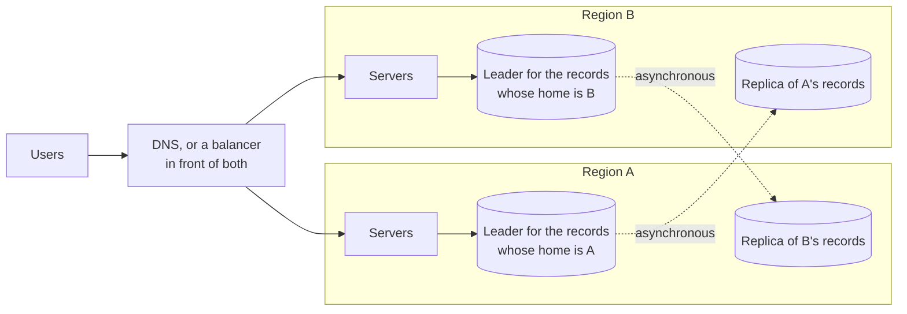

# 6.6 Multi-region architectures

[Syllabus](../SYLLABUS.md) · Phase 6 · Previous: [6.5 Redundancy and failure domains](05-redundancy-and-failure-domains.md) · Next: [6.7 Disaster recovery and resilience testing](07-disaster-recovery-and-resilience-testing.md)

> **Time:** about 30 minutes to read, 40 minutes of practice.
> **You need:** failure domains and static stability from [Chapter 6.5](05-redundancy-and-failure-domains.md); replication, failover and split brain from [Chapter 5.1](../phase-5-distributed-data/01-leader-follower-replication.md); multi-leader replication from [Chapter 5.2](../phase-5-distributed-data/02-multi-leader-and-leaderless.md); recovery objectives from [Chapter 2.9](../phase-2-data/09-durability-backups-restore.md). The example needs only Go.

**By the end of this chapter you can**

- say when a second region is worth what it costs, and what it does not give you;
- place a design on the ladder from *backup and restore* to *active–active*, with the time and the data that each loses;
- explain why replication between regions forces a choice between losing writes and slowing them, and name the ways of arranging data in two regions;
- describe how users are moved to another region, and why that region should be carrying traffic already;
- plan a failback, and say why it is harder than the failover.

---

## The problem

Cloudflare ran the systems behind its dashboard and API in three data centres near one another in Oregon, as a cluster designed so that any one of them could be lost. On 2 November 2023, one of them lost power.

The design had been tested, and the post-mortem says how: "We had performed testing of our high availability cluster by taking each (and both) of the other two data center facilities entirely offline. And we had also tested taking the high availability portion of PDX-04 offline. However, we had never tested fully taking the entire PDX-04 facility offline. As a result, we had missed the importance of some of these dependencies on our data plane" ([Cloudflare, *Post mortem on the Cloudflare Control Plane and Analytics Outage*](https://blog.cloudflare.com/post-mortem-on-cloudflare-control-plane-and-analytics-outage/)). PDX-04 was the one that failed. Some services ran only there, and services in the other two buildings depended on them.

There was a second line: a disaster recovery site in Europe. It had to be brought into use while the incident was under way. The first services were started there two hours after the outage began, and met a new problem: "we experienced a thundering herd problem where the API calls that had been failing overwhelmed our services. We implemented rate limits to get the request volume under control". Most of the control plane was back, on that site, about six hours after the start. The same post gives the full length of the incident: "from November 2 at 11:44 UTC until November 4 at 04:25 UTC" ([Cloudflare](https://blog.cloudflare.com/post-mortem-on-cloudflare-control-plane-and-analytics-outage/)).

[Cloudflare's own summary](https://blog.cloudflare.com/post-mortem-on-cloudflare-control-plane-and-analytics-outage/): "We believed that we had high availability systems in place that should have stopped an outage like this". They had built them, and tested most of them. What was missing was one afternoon on which somebody switched that building off.

A second site that is real, replicated and funded is the beginning of surviving the loss of a place. This chapter is about the rest: what data the move loses, how the users get there, what is waiting for them, and how to come back.

---

## The concept

### 1. Why a second region, and what it does not give you

There are three reasons to run in more than one region.

- **The region is a failure domain** (Chapter 6.5): a storm, a regional fault at the provider, a mistake that reaches every zone.
- **Users are far away.** A round trip across an ocean is paid on every request (Chapter 1.2).
- **Laws** that say where some data must be kept.

A second region is not a way to get more capacity: one region can be made as large as you can pay for. And it does not replace getting one region right. A service that cannot lose a zone will not be saved by a region that it does not know how to move to.

What makes regions hard is not the servers. Servers without state can be started anywhere (Chapter 3.1). It is the data. Zones are near enough to replicate synchronously, so a zone can be lost without losing a confirmed write. Regions are not.

### 2. The ladder: what is running in the other region

Amazon's guide to disaster recovery sorts the choices into four, "ranging from the low cost and low complexity of making backups to more complex strategies using multiple active Regions" ([AWS, *Disaster recovery options in the cloud*](https://docs.aws.amazon.com/whitepapers/latest/disaster-recovery-workloads-on-aws/disaster-recovery-options-in-the-cloud.html)). Chapter 2.9 gave the two measures: the **recovery time** (RTO: how long until service is back) and the **recovery point** (RPO: how much recent data is gone).

| | In the other region, on a normal day | To recover, you must | Recovery time is mostly | Data lost |
|---|---|---|---|---|
| **Backup and restore** | Copies of backups | Build everything, and restore | The restore: hours (Chapter 2.9) | Since the last backup |
| **Pilot light** | The data, replicated. Servers defined and switched off | Start servers; grow them | Starting: tens of minutes | The replication lag |
| **Warm standby** | The data, and a small working copy of everything | Grow it; move the users | Growing: minutes | The replication lag |
| **Active–active** | A full share of real traffic | Move the remaining users | Moving users: seconds to minutes | The replication lag — or conflicts (section 3) |

The same guide draws the line between the middle two: "pilot light cannot process requests without additional action taken first, whereas warm standby can handle traffic (at reduced capacity levels) immediately". And of the last: "Multi-site active/active serves traffic from all regions to which it is deployed" ([AWS](https://docs.aws.amazon.com/whitepapers/latest/disaster-recovery-workloads-on-aws/disaster-recovery-options-in-the-cloud.html)).

Two things about the ladder.

**Each rung up costs more every day, and less on the bad day.** The right rung is set by what an hour of outage costs the business, and it is seldom the top one.

**The lower rungs need things to be started during the disaster.** Chapter 6.5's rule applies with full force, and the guide states it: "For maximum resiliency, you should use only data plane operations as part of your failover operation" ([AWS](https://docs.aws.amazon.com/whitepapers/latest/disaster-recovery-workloads-on-aws/disaster-recovery-options-in-the-cloud.html)). On the day that a region is lost, everyone who uses it is trying to start servers in the next one.

### 3. The data: lose some, or wait for all

Replication to another region can be asynchronous or synchronous (Chapter 5.1), and the distance makes each choice sharper.

- **Asynchronous**: the first region confirms a write and sends it on afterwards. If the region is lost, so are the writes that had not yet arrived: the lag at that moment, times the rate of writes. The lag is not a constant. It is whatever it happened to be (Chapter 5.1).
- **Synchronous**: the first region confirms a write when the second has it. Nothing confirmed is lost, and every write waits for a round trip between regions. And the two regions are now tied together: if the second cannot be reached, either writes stop, or the system quietly becomes asynchronous.

This is Chapter 5.4's PACELC with real distances in it. There is no third option that is both fast and lossless.

With that settled, there are four ways to arrange data in two regions.

**One region writes.** The other holds a replica, and may serve reads. Simple, and Chapter 5.1 in full: a failover loses the tail, and the old leader must be fenced. Servers in the second region that need to write must cross to the first, and may not be built for that. GitHub found this in 2018, when its databases were failed over to the other coast: "applications running in the East Coast that depend on writing information to a West Coast MySQL cluster are currently unable to cope with the additional latency introduced by a cross-country round trip for the majority of their database calls" ([GitHub, *October 21 post-incident analysis*](https://github.blog/news-insights/company-news/oct21-post-incident-analysis/)).

**Each record has a home.** Both regions take writes, but never for the same record: a European customer's data is led from Europe, an American's from America, and each region holds a replica of the other's. This is partitioning (Chapter 5.3) with geography as the key. Most users are served nearby, there are no conflicts, and losing a region is the first case again, for half the records.



**Both regions write the same records.** That is multi-leader replication (Chapter 5.2), with everything that chapter said: two writes to one record in two regions conflict, and something has to merge them or pick a loser. It is right for data that merges — a shopping basket, a counter, a *last seen* time — and wrong for a balance.

**A database that agrees across regions**, by consensus (Chapter 5.6). Nothing confirmed is lost and no failover is needed. It takes at least three regions, so that a majority survives the loss of one, and every write waits for the nearest majority.

Most systems that are called *active–active* serve requests in every region and use the first or second arrangement for their data. That is a good design. It should be described accurately, because the data decides what a failover loses.

### 4. Moving the users

Something has to send users to a region, and change its mind when a region is lost.

**DNS.** The name resolves to one region or the other. Every answer carries a time to live, which Amazon's documentation defines as the value "that DNS resolvers use to decide how long a record can be cached for", and whose choice it describes as "a trade-off between latency and reliability, and responsiveness to change" ([Amazon Route 53, *Best practices*](https://docs.aws.amazon.com/Route53/latest/DeveloperGuide/best-practices-dns.html)). Until a resolver's copy expires, its users are still sent to the region that has gone.

**A balancer in front of both regions.** Users connect to an address that is served from many places, and the balancer chooses a region for each request. A change takes effect as fast as its health checks do. It is also something that both regions now share (Chapter 6.5), and it had better be simpler and more available than either.

Either way, **something outside both regions must decide** that one of them is lost. If each region judges the other, a broken link between them makes each conclude that it is the survivor: split brain (Chapter 5.1), at the largest size. The decision needs a third place, or a person. And it should need no control plane: the [Route 53 guide](https://docs.aws.amazon.com/Route53/latest/DeveloperGuide/best-practices-dns.html) recommends, for failover, features "that rely on data plane functionality to update DNS".

**Then the users arrive.** What they find is Chapter 6.5's question at a larger scale.

- **Is there room?** Two regions, each able to carry everything, cost 200% of the peak; three, 150%. A warm standby that must grow first will refuse most of what arrives until it has.
- **Is it warm?** Empty caches send every read to the database (Chapter 3.4). A hundred thousand clients reconnect at once (Chapter 3.7).
- **Is everyone retrying?** Cloudflare's thundering herd was the requests that had been failing for two hours, all arriving at once. A region that takes over needs limits at its door (Chapter 6.4) *most* on the day that it takes over.

### 5. Failover is a habit

The second region's weakness is that it is not used. A standby is Chapter 6.3's code path that is never run: its configuration drifts, its capacity falls behind, its certificates expire, and the one service that was never moved to it is the one that everything needs.

So make it used.

- **Serve real traffic from every region, all the time**, even if the data has one writer. Then the servers, the network, the deploys and the dashboards of the second region are exercised daily, and a failover moves *more* traffic to a place that already works.
- **Fail over on purpose, on a schedule**: move the writer, run there for a week, move it back. The procedure that is run every month is one command and is believed. The one that is run in the disaster is a document.
- **Decide beforehand who decides.** What is measured, for how long, and who may say *go*. Whether it is automatic is Chapter 5.1's question, and between regions a wrong answer costs more. Among the changes GitHub made after 2018 was to stop its failover tool from promoting a database in another region by itself: "Leader-election within a region is generally safe, but the sudden introduction of cross-country latency was a major contributing factor during this incident" ([GitHub](https://github.blog/news-insights/company-news/oct21-post-incident-analysis/)).

### 6. Failing back

A failover has a second half, and it is the harder one.

When the old region returns, it is not a copy of the new one. With asynchronous replication, it holds the writes that it had confirmed and not yet sent. The new region has meanwhile taken writes of its own. GitHub's account of this state: "Because the database clusters in both data centers now contained writes that were not present in the other data center, we were unable to fail the primary back over to the US East Coast data center safely" ([GitHub](https://github.blog/news-insights/company-news/oct21-post-incident-analysis/)).

So a failback has steps, in order.

1. **The old region comes back as a follower, and takes no writes.** This is fencing (Chapter 5.5). An old leader that returns and accepts writes is the worst outcome on offer.
2. **Its stranded writes are set aside**, not applied. Each one has to be compared with what has happened since, and the example shows how quickly *can simply be applied* becomes *cannot*.
3. **It is rebuilt from the new region**, and catches up.
4. **Then, if at all, the writer is moved back**: a second failover, planned, in a quiet hour.

The fourth step is optional, and the best designs make it unnecessary. If the regions are equal, there is nothing to go back to: the system runs from where it is, and the old region becomes the standby. Moving back only because the first region *is the primary* is a second risk taken for no gain.

---

## A real example

### Run it

[`code/ch06-regions/main.go`](code/ch06-regions/main.go) is a model in three parts, about 180 lines. Its distances and delays are assumptions, stated in the output, and every run prints the same numbers.

```bash
go run ./phase-6-reliability/code/ch06-regions
```

```text
PART 1 — a database in region A takes 500 writes a second, each in 5 ms, and replicates to region B,
         80 ms away there and back. Region A is lost.

                                                                      a write takes    confirmed writes that
                                                                                      region B does not have
  asynchronous; B is 100 ms behind                                             5 ms                       50
  asynchronous; B is 1 s behind                                                5 ms                      500
  asynchronous; B had fallen 30 s behind, and nobody was looking               5 ms                    15000
  synchronous: A confirms a write when B has it                               85 ms                        0
```

The first three rows are one design on three different days. What an asynchronous failover loses is decided by how far behind the replica was at that moment, and the only way to know is to measure it all the time, and to refuse to promote a replica that is far behind (Chapter 5.1).

The last row loses nothing, and every write takes seventeen times as long. A program that makes ten writes one after another now waits most of a second for them.

```text
PART 2 — 100,000 users, 1,000 requests a second, all served by region A. It is lost at second 0, and
         health checks take 30 seconds to say so. Then users are sent to region B.

  how users are sent to a region                                  half have moved       all have moved        requests that
                                                                            after                after         went nowhere
  by DNS; the answer may be kept for 300 seconds                            179 s                329 s               179211
  by DNS; the answer may be kept for 60 seconds                              59 s                 89 s                59435
  through a balancer in front of both regions                                30 s                 30 s                30000

  What is waiting for them in region B, once they have all arrived: 1,000 requests a second.

  region B, before the failure                                   requests refused   full service after
  was serving half the users, and can serve them all                            0              at once
  a small copy that can do 200; it takes 10 minutes to grow                480000           10 minutes
  data only; servers must be started: 30 minutes                          1800000           30 minutes
```

**The first table is the time to live.** With answers kept for five minutes, the last user moves five and a half minutes after the failure, and 179,000 requests have gone to a region that was not there. With one minute, a third of that. With a balancer, only the 30 seconds that the health checks took. The model's resolvers all honour the time to live, and assuming that every resolver in the world does would be optimistic.

**The second table is the ladder's top three rungs**, and the last column of section 2's table as numbers. The users have moved in a minute or two. Whether there is anything for them to move *to* is what the choice of rung decided, months earlier.

```text
PART 3 — 100,000 accounts; 500 writes a second, each to an account chosen at random. Region A is cut off
         with B one second behind, so A holds 500 writes that B never received. B takes over. Later A
         comes back, with those 500 writes.

  region B has been taking                 writes B has taken      of A's 500: the account has     of A's 500: can simply
  writes for                                            since          been written again in B            be applied in B
  1 minute                                              30000                              118                        382
  10 minutes                                           300000                              469                         31
  1 hour                                              1800000                              500                          0
  24 hours                                           43200000                              500                          0
```

Region A returns holding 500 writes that nobody else has. If it returns within a minute, three quarters of them are to accounts that nothing has touched since, and can be applied. After ten minutes, 31 can. After an hour, none: every one of those accounts has been written again in region B, and each stranded write has to be judged against what happened after it — by a rule, if the data has one, or by a person.

The model's writes are spread evenly over the accounts. Real writes concentrate on the busy ones, and the busy ones are the accounts that will have been written again.

### GitHub, October 2018

Chapter 5.1 used this incident for its trigger: 43 seconds without a network link between two sites. Its second half belongs here, and the quotations are again from GitHub's analysis.

GitHub's databases had their leaders on the East Coast of the United States and replicas on the West Coast. During the 43 seconds, the failover tool promoted the western replicas. When the link came back, the two sides had diverged: the east held "a brief period of writes that had not been replicated to the US West Coast facility", and the west was taking new writes. How many were stranded? "one of our busiest clusters had 954 writes in the affected window" ([GitHub](https://github.blog/news-insights/company-news/oct21-post-incident-analysis/)).

Nine hundred and fifty-four writes, and the recovery took a day. The reason is Part 3. GitHub could not go back to the east without discarding what the west had taken since, and could not stay in the west without stranding the 954. It chose, and said what it was choosing: "our strategy was to prioritize data integrity over site usability and time to recovery" ([GitHub](https://github.blog/news-insights/company-news/oct21-post-incident-analysis/)). The eastern databases were rebuilt from backups and brought up to date from the west, while the site ran slowly across the continent. The service was degraded for 24 hours and 11 minutes. The stranded writes were kept aside and worked through afterwards.

Two of the actions that followed are sections 5 and 2 of this chapter. The failover tool would no longer promote across regions by itself. And the company set out to serve "from multiple data centers in an active/active/active design", with "the goal of supporting N+1 redundancy at the facility level" — together with a sentence that every team with a second site could put on its wall: "We will take a more proactive stance in testing our assumptions" ([GitHub](https://github.blog/news-insights/company-news/oct21-post-incident-analysis/)).

---

## Trade-offs

**A second region roughly doubles the work, not only the bill.** Every deploy, schema change, secret and dashboard now exists twice, and can differ. Many teams are better served by one region done properly, with backups in a second and a restore that is rehearsed (Chapter 6.7).

**Speed against loss.** Asynchronous replication keeps writes fast and loses the tail. Synchronous keeps the tail and slows every write, always, to protect against a rare day. A common middle course is synchronous within the region, across zones, and asynchronous to the other region: nothing is lost unless the *whole region* goes, and then only seconds.

**A short time to live costs queries.** Resolvers ask more often, which costs money and adds a look-up to more requests. It is usually worth paying for names that must move.

**Automatic against deliberate.** An automatic failover between regions is fast and can be wrong, and a wrong one creates divergence that takes a day to repair. A human decision takes minutes. For a failure that will last hours, minutes are cheap.

**Home regions against simplicity.** Giving each record a home removes conflicts and adds a router, a migration when a customer moves, and a question for every query that spans homes (Chapter 5.3).

---

## Practice

### Check yourself

1. A system replicates asynchronously to a second region, 50 ms behind on a normal day, and takes 2,000 writes a second. Its owners say that a regional failover would lose *about 100 writes*. What is that statement assuming?
2. A service's DNS answers may be kept for an hour. Its second region can be serving in five minutes. What is its recovery time, roughly? What would you change first?
3. After a failover to region B, region A comes back. Somebody proposes to *switch back to A straight away, since it is the primary*. Give two reasons not to.

<details>
<summary>Answers</summary>

1. That the lag at the moment of the failure is the lag on a normal day. A region is rarely lost on a normal day: the events that take a region out — overload, a network fault, a storage problem — are also the events that make replication fall behind. The honest statement is *the lag at that moment, times 2,000*, with a limit beyond which the replica will not be promoted without a person deciding.
2. About an hour, for the last users: the five minutes do not matter while resolvers are still handing out the old answer. Change the time to live to a minute or so — well before any failure, since the old value is itself cached for an hour — or put a balancer in front of both regions.
3. Region A holds writes that B never received, and B has taken writes since: A is not a copy of B, and switching to it would lose everything that B took. And A has just failed, for a reason that may not be understood yet. It should rejoin as a follower, be rebuilt from B, and prove itself with a small share of traffic. Whether to move back at all is a separate decision, to be made on a quiet day.

</details>

### Exercise: choose the rung

For each system, choose a rung of the ladder and an arrangement for the data. Say what a regional failure would then cost in time and in data, and what the choice costs on a normal day.

1. **A reporting dashboard** used inside a company. If it is down for a day, people complain. Its data is derived from other systems.
2. **The checkout of a shop** that takes 50 orders a second at its peak. An hour of outage costs more than a month of running a second region. An order that the customer was told had been placed must not vanish.
3. **A document editor** used on three continents. Users expect their own documents to open quickly wherever they are.

<details>
<summary>Worked solution</summary>

**1. The dashboard: backup and restore.** Keep the definitions of the infrastructure and a nightly copy of the data in a second region. A regional failure costs hours, and since the data can be derived again, nothing that matters is lost. On a normal day it costs the storage for the backups, and the discipline of a restore that is rehearsed (Chapter 6.7). Anything more would be spending on a problem that the business does not have.

**2. The checkout: active–active for requests, one writer for orders, and care about the tail.** Both regions serve traffic every day, each with room for the whole peak. Orders have one leader region, replicated synchronously across that region's zones and asynchronously to the other region.

- *Time*: users move in a minute or two, to servers that are already working.
- *Data*: the orders in the replication lag would be missing in the other region. *Must not vanish* rules that out. Replicating orders synchronously to the second region would close the gap, at the price of a round trip on every order; at 50 orders a second, an extra 80 ms on each is affordable. If it is not, then accept an order only once it is in both regions, and show the customer *being confirmed* until it is. Either way, a lost region then loses nothing that a customer was told.
- *Normal day*: twice the capacity, and the round trip on each order.

Fail over on purpose each month, in both directions.

**3. The editor: a home region for each document.** A document is led from the region nearest its owner, with replicas in the others. Opening and editing are fast for its owner, wherever they are.

- *Time*: if a region is lost, its documents are led from another: minutes.
- *Data*: the lag, for the documents whose home was lost. If edits are merged and not overwritten (Chapter 5.2), the stranded edits can be merged back when the region returns, which is the one case in which Part 3's problem solves itself.
- *Normal day*: a router that knows each document's home; a rule for documents shared across continents, which will be slow for somebody; and a migration when an owner moves.

</details>

---

## Production tips and common mistakes

- **Get one region right first**: three zones, and room to lose one (Chapter 6.5).
- **Choose the rung from the cost of an outage**, with the people who know that cost, and write the recovery time and recovery point down.
- **Measure the replication lag between regions continuously**, alert on it, and set a limit beyond which nobody is promoted automatically.
- **Serve traffic from every region every day.**
- **Fail over on a schedule, and fail back.** Time both.
- **Keep the failover free of control planes**: no launches, no changes that need the lost region or the provider's management systems.
- **Protect the surviving region's door** with the limits of Chapter 6.4, and expect cold caches.
- **Bring a returned region back as a follower**, set its stranded writes aside, and rebuild it.
- **Lower the time to live of names that must move** long before it is needed.

**Common mistakes**

- **A standby that has never taken traffic.**
- **Calling a design active–active** without saying where writes go.
- **Quoting the lag of a normal day** as the recovery point.
- **A failover that can be started from only one region**: the lost one.
- **One service left behind** in the first region, on which everything depends. Cloudflare's had several.
- **Applying the old region's stranded writes on top of the new region's data.**
- **Moving back immediately**, because the first region *is the primary*.

---

## Key takeaways

- A second region protects against the loss of a region, and serves distant users. It costs twice the work as well as twice the capacity, and it is not a substitute for getting one region right.
- The ladder — backup and restore, pilot light, warm standby, active–active — trades daily cost for recovery time. The lower rungs need things to be started during the disaster.
- Between regions, replication either loses the most recent writes or slows every write. What is lost is the lag at the moment of failure, and that is not the lag of a normal day.
- Decide where writes go: one region, a home for each record, both with merging, or consensus across three. *Active–active* does not say.
- Moving users takes as long as the health checks and the time to live. What they find depends on capacity that was there beforehand, and on limits at the door.
- A failover that has not been practised will be practised during the outage.
- Failing back is harder than failing over: the old region comes back as a follower, its stranded writes are judged one by one, and going back is a choice.

**Next:** [6.7 Disaster recovery and resilience testing](07-disaster-recovery-and-resilience-testing.md) — recovery objectives as inputs to a design, restores that are rehearsed, and breaking things on purpose.

---

## Sources

- Matthew Prince, [*Post mortem on the Cloudflare Control Plane and Analytics Outage*](https://blog.cloudflare.com/post-mortem-on-cloudflare-control-plane-and-analytics-outage/), Cloudflare, 2023.
- GitHub, [*October 21 post-incident analysis*](https://github.blog/news-insights/company-news/oct21-post-incident-analysis/), 2018.
- Amazon Web Services, [*Disaster recovery options in the cloud*](https://docs.aws.amazon.com/whitepapers/latest/disaster-recovery-workloads-on-aws/disaster-recovery-options-in-the-cloud.html), from the whitepaper *Disaster Recovery of Workloads on AWS*.
- Amazon Route 53 documentation, [*Best practices for Amazon Route 53 DNS*](https://docs.aws.amazon.com/Route53/latest/DeveloperGuide/best-practices-dns.html).
