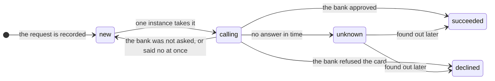

# Capstone 6: a payments API — the same answer, whatever fails

[Syllabus](../SYLLABUS.md) · Phase 6 · Previous: [6.7 Disaster recovery and resilience testing](07-disaster-recovery-and-resilience-testing.md)

> **Time:** three hours for your own design, then an hour and a half with the worked design.
> **You need:** all of Phase 6; idempotency keys (1.5), check-and-change statements (2.4) and synchronous replication (5.1) from earlier phases. The reference implementation needs the PostgreSQL database of Phase 2, and takes half a minute to run.

Every capstone so far has had a list of things that must stay true. This one has the shortest list, and the least forgiving: a customer is charged once, and what the shop was told is what happened.

The difficulty is that the service cannot do its work alone. It depends on a bank that it does not control, which is sometimes slow, sometimes refuses, and now and then charges a card and never says so. It is called by shops whose software it did not write, and which retries as it pleases. It runs on machines in three buildings, any one of which may go dark. Its promises have to hold through all of that, and in combination.

Every chapter of the phase is in it. The failures that feed themselves (6.1). One deadline from the shop to the bank, and a retry that is made in exactly one place (6.2). A dependency that is needed and one that is only wanted, and a pool that neither may exhaust (6.3). More traffic than there is room for, and a decision about who goes first (6.4). A zone lost with nothing to be done about it (6.5). A second region, for later (6.6). And a way to find out whether any of it is true (6.7).

**How to use this page**

1. Read the brief.
2. Write your own design, on paper, against the task list. Give yourself a time limit.
3. Only then open the worked design and compare, section by section.
4. Run the reference implementation — and then run it with each safeguard removed.

---

## The brief

*From your product manager:*

> We are building the service through which every purchase on the platform is paid for. Shops call it. It calls the bank.
>
> **What it must do**
> - `POST /payments`: charge this card this amount, for this shop. The answer is *paid*, or *declined*, or — if it cannot be known yet — *pending*, with a way to find out.
> - `GET /payments/{id}`: what became of a payment.
> - Reports for shops: totals, exports. Useful, and not urgent.
> - Each payment is scored by the fraud service before the card is charged.
>
> **How much**
> - 300 payments a second on an ordinary day. **1,000 a second in a sale.**
> - Three status queries for every payment. A few reports a second, each taking about a second.
>
> **What it depends on** — none of it ours
> - **The bank.** Half its answers come within 300 ms, and 99 in 100 within 1.5 s. It charges a given reference once, however many times it is asked, and it can be asked what became of a reference. A few times a month it is slow, or refuses everything, for some minutes. Occasionally it charges a card and the answer never reaches us.
> - **The fraud service**, run by another team. It answers in 20 ms, 99 times in 100 within 100 ms. It is sometimes down.
> - PostgreSQL.
>
> **How well**
> - **A customer is never charged twice** for one purchase, however many times a shop sends the request.
> - **Paid means charged, and declined means not charged.** What we tell a shop, what our records say and what the bank did must agree: at once whenever we claim to know, and in the end always.
> - **Every request has an answer within 5 seconds.** *Pending* is an answer. Silence is not.
> - While the bank is in trouble, status queries and reports go on working.
> - In a sale, payments come before everything else.
> - **The loss of one zone at the peak costs nothing**, and nobody has to do anything.
>
> **Constraints**
> - One region, three zones.
> - The shops' software is not ours. Some of it retries at once, and for ever.
>
> **Six months after launch**
> - A second bank, for when the first is in trouble.
> - A second region.

---

## Your task

Produce a design document of three or four pages. The suggested times add up to three hours.

| # | Deliverable | Draws on | Time |
|---|---|---|---|
| 1 | Questions for the product manager; and the **invariants**, each written so that it could be checked against the bank's own record | 6.7 | 15 min |
| 2 | Estimates: requests in progress, by Little's law; places; what a zone must hold | 1.6, 6.5 | 15 min |
| 3 | The API: the key, the states of a payment, and for each answer whether the shop may send it again | 1.5, 6.2 | 15 min |
| 4 | The deadline: one budget, from the shop to the bank | 6.2 | 10 min |
| 5 | The table, and the statements that make a second attempt harmless | 2.4 | 10 min |
| 6 | Calling the bank: the timeout, the bulkhead, the breaker. Who retries? | 6.2, 6.3 | 15 min |
| 7 | The payment whose outcome is not known | 1.5, 5.7 | 15 min |
| 8 | The fraud service: needed, or wanted? | 6.3 | 10 min |
| 9 | Too much traffic: a limit for each shop, a limit on work in progress, and an order of priority | 6.4 | 15 min |
| 10 | Zones: placement, capacity, and what must not need doing | 5.1, 6.5 | 15 min |
| 11 | What a shop sees, failure by failure | 6.1 | 10 min |
| 12 | The experiments you would run before launch | 6.7 | 15 min |
| 13 | What you monitor and alert on | 6.1 | 10 min |
| 14 | **What breaks first** — including the second bank | all | 10 min |

The two standing rules:

- **Every number has a source**: the brief, arithmetic you show, or an assumption you label.
- **Choose.** Pick an option, give the reason, and name what you gave up.

And one for this capstone:

- **For every call the service makes, say what happens when the other side is slow, when it fails, and when it does not answer** — and in each case, what the shop is told and what the customer has been charged.

---

## Worked design

<details>
<summary><strong>Open only after writing your own.</strong></summary>

### 1. Questions and invariants

| Question | Assumed answer |
|---|---|
| If we cannot tell whether a card was charged, what do we tell the shop? | *Pending*. Never *paid* or *declined* on a guess |
| May a pending payment be completed after the shop has stopped waiting? | Yes. The shop finds out by asking, or from an event that we publish (Chapter 4.7). A shop that cannot accept that needs a way to cancel, which is not in version one |
| If the fraud service cannot be reached, do we charge? | For small amounts, yes: up to 50 in the shop's currency. Above that, no. The business chose this, and may change it |
| For how long is a shop's key remembered? | For as long as the payment is kept (Capstone 5 made the same choice, for the same reason) |
| What is the order of importance? | Payments, then status queries, then reports |

**The invariants.** The reference implementation checks each of them at the end of its run, by comparing three records: what each shop was told, what the database says, and what the bank really charged.

1. One purchase is charged once.
2. If the shop was told *paid*, the bank charged. If it was told *declined*, the bank did not.
3. Every charge at the bank is recorded as paid — in the end.
4. No payment is left with its outcome unknown.
5. No request is still being worked on after its caller's deadline.
6. The bank's trouble does not reach status queries.
7. With a zone lost, in a sale, no payment is refused for lack of room.

### 2. Estimates

Little's law (Chapter 1.6): in progress = arrivals a second × seconds each.

| At the sale's peak | Arithmetic | In progress |
|---|---|---|
| Payments | 1,000 a second × 0.33 s (the bank's 0.3, and 0.03 for everything else) | 330 |
| Status queries | 3,000 a second × an assumed 5 ms | 15 |
| Reports | an assumed 5 a second × 1 s | 5 |
| | | **350** |

**Places.** An instance takes a fixed number of requests at once (Chapter 6.4): say 100. The sale needs 350 places busy. The brief says that a zone may be lost at the peak, so two zones must hold all 350. They should not be full when they do — the bank's slow hundredth takes five times as long, and traffic comes in bursts — so aim for 60% busy with a zone missing: 350 ÷ 0.6 ≈ 580 places in two zones, **300 for each zone, 900 in all**. Nine instances, three in each zone.

On an ordinary day, 300 payments a second keep about 105 places busy: an eighth of what has been bought. That is the price of the brief's last line, and it should be stated when the brief is agreed, and not discovered in the bill (Chapter 6.5).

**The bank.** At the peak, 300 calls to the bank are in progress. If the bank slows down until every call ends at a 2-second timeout, the same traffic would hold 2,000. There are 900 places. Section 6 exists because of that subtraction.

**The database.** Three statements for each payment: 3,000 a second at the peak, and as many reads for status queries. That is within one primary. It is also one primary (section 14).

### 3. The API

A shop sends `POST /payments` with the amount, the card, and an **`Idempotency-Key`** that it made up for this purchase (Chapter 1.5). The same purchase, sent again, carries the same key. A new key is a new purchase: that sentence belongs at the top of the documentation.

Every answer says what happened *and* what the shop may do next.

| Answer | It means | The shop may |
|---|---|---|
| `200` paid | The bank charged the card, and it is recorded | Deliver the goods |
| `402` declined | The bank refused. Nothing was charged | Ask the customer for another card. Sending the same request again returns the same answer |
| `202` pending | The bank was asked, and we do not know what it did | Ask again with **the same key**, or `GET` the payment. Never start again with a new key |
| `503`, with `Retry-After` | The bank was **not** asked, or said no at once: we are too busy, or the bank is in trouble. Nothing was charged | Send it again later, with the same key |
| `429`, with `Retry-After` | This shop is sending too much | Slow down |

The line between `202` and `503` is the one that matters. `503` is a promise that no money moved. `202` is an admission that it may have.

### 4. The deadline

One budget for the whole request (Chapter 6.2). The shop sends the time that it will wait; if it sends nothing, the service assumes 5 seconds. Every step takes its timeout from what is left.

| Step | May take | If it runs out |
|---|---|---|
| Record the request | 100 ms | `503`: nothing has been charged |
| The fraud score | 100 ms | Section 8 |
| The bank | What is left, less 300 ms, and never more than 2 s | Record *unknown*; answer `202` |
| Record the outcome | Its own 2 seconds, **whatever is left** | Section 7 finds it |

Two rules in that table are easy to miss.

**There is no second attempt at the bank inside a request.** A call that timed out may have charged the card. Trying again would be safe, because the bank charges a reference once — but it would spend the time that is left on a bank that has just shown itself to be slow, while holding a place. The request answers *pending*, and the second attempt is made afterwards (section 7).

**The outcome is recorded even if the shop has gone.** By the time the bank answers, the shop may have given up and the request's context may be cancelled. The write that records *paid* uses a context of its own (`context.WithoutCancel`, Chapter 6.2). To abandon that write would be to take money and keep no record of it.

### 5. The table

```sql
CREATE TABLE payments (
    id         bigserial PRIMARY KEY,         -- also the reference that the bank is given
    merchant   int  NOT NULL,
    key        text NOT NULL,                 -- chosen by the shop: the same on every attempt
    amount     int  NOT NULL,
    state      text NOT NULL DEFAULT 'new',   -- new | calling | succeeded | declined | unknown
    updated_at timestamptz NOT NULL DEFAULT now(),
    UNIQUE (merchant, key)
);
```



Three statements carry a payment through it.

```sql
-- 1. Record the request, or find the one recorded before. One statement, so two attempts cannot both be first.
INSERT INTO payments (merchant, key, amount) VALUES ($1, $2, $3)
ON CONFLICT (merchant, key) DO UPDATE SET merchant = payments.merchant
RETURNING id, state;

-- 2. Take it. Only one instance can: the others find that no row was changed (Chapter 2.4).
UPDATE payments SET state = 'calling', updated_at = now() WHERE id = $1 AND state = 'new';

-- 3. Record what the bank said.
UPDATE payments SET state = $2, updated_at = now() WHERE id = $1;
```

**The order is the design.** The payment is written down, with its reference, *before* the bank is asked. Whatever happens next — the instance dies, the zone goes, the answer is lost — there is a row that says *somebody was asking the bank about reference 4411*, and somebody else can ask again.

### 6. Calling the bank

The bank is *needed*: no bank, no payment. So nothing here is a way of doing without it. It is about what its trouble is allowed to cost (Chapter 6.3).

- **A timeout** from the deadline (section 4).
- **A bulkhead**: at most three quarters of an instance's places may be waiting for the bank. At the sale's peak with a zone gone, about 55 of an instance's 100 places are, so the limit is not reached on a good day. However slow the bank becomes, the last quarter serves status queries, reports, and repeats of requests that have already been answered.
- **A breaker**: after five failures in a row, an instance stops asking for a while and answers `503` at once, with nothing charged. One trial call at a time finds out when the bank is back. For a needed dependency, a breaker is usually a doubtful idea (Chapter 6.3). It is right here for a particular reason: every call to a bank in trouble risks another *unknown*, and unknowns are the expensive outcome.

**Who retries?** Two parties, and nobody else (Chapter 6.2).

- **The shop**, with the same key, when told `503` or `202`.
- **The reconciler** of section 7, with the same reference, for payments whose outcome is not known.

The request handler does not retry. Nor does the HTTP client, the SDK or any proxy in between: each must be checked, and switched off.

### 7. The payment whose outcome is not known

A timeout on the call to the bank is Chapter 1.5's third outcome, with money in it. The payment is marked *unknown*, and the shop is told *pending*. The same state arises without any timeout, when an instance dies between asking the bank and recording the answer: the row stays at *calling* with nobody attending to it.

A **reconciler** runs in every instance. A few times a second it looks for payments that are *unknown*, or have been *calling* for longer than any request could last, and **asks the bank again with the same reference**.

```sql
UPDATE payments SET updated_at = now()               -- taking a payment renews its time, so two reconcilers do not both take it
WHERE id IN (SELECT id FROM payments
             WHERE state IN ('calling', 'unknown') AND updated_at < now() - interval '1 minute'
             ORDER BY id LIMIT 20 FOR UPDATE SKIP LOCKED)
RETURNING id, amount;
```

It is safe because of what the brief says about the bank: a reference is charged once. If the first call did charge the card, the second is told so. If the first call never arrived, the second is the charge. Either way the payment reaches a final state, and the next time the shop asks, it is told.

Three properties make this trustworthy.

- **It runs everywhere, and owns nothing.** Any instance can settle any payment. Losing an instance, or a zone, loses no part of the job (Chapter 6.5).
- **It goes through the same breaker and bulkhead** as every other call to the bank. A bank that is recovering is not then hit with a queue of unknowns.
- **Its backlog is watched**: the number of unsettled payments, and the age of the oldest (Chapter 4.6). Half a minute is normal during trouble. An hour means that reconciliation itself has failed.

And once a day, outside the service altogether, a job compares the payments table with the bank's own statement of what it charged. It should find nothing. It is the only check that does not depend on the code that it is checking.

### 8. The fraud service

Is it needed, or wanted? The business decided, in section 1: wanted for small payments, needed for large ones.

- A call with a timeout of 100 ms, its own bulkhead, and a breaker.
- If there is a score, use it.
- If there is none and the amount is small: charge, and mark the payment for review afterwards.
- If there is none and the amount is large: `503`. Nothing is charged, and the shop may try again.

This is a degraded mode that does less work than the normal one and depends on nothing else, which is the kind that Chapter 6.3 allows. It also has to be exercised: it goes into every game day (section 12), because a path that runs only when the fraud service is down is a path that nobody has seen run.

### 9. Too much traffic

Three limits, in the order in which a request meets them (Chapter 6.4).

1. **For each shop**: a token bucket, with the rate and the burst from that shop's contract. Over it: `429`. This is what stands between one shop's runaway retry loop and everybody else.
2. **For each instance**: 100 requests in progress, and no queue to speak of. Over it: `503`, at once.
3. **By priority**, within that limit. A report is let in only while the instance is less than a quarter busy. Status queries and payments are let in while there is a place.

A repeat of a request that has already been answered costs one read, and is always worth serving: it is what ends a shop's retries.

### 10. Zones

- **Instances**: three in each of three zones, and the scheduler is told so (Chapter 6.5). The balancer stops sending to an instance that does not answer.
- **Capacity**: section 2's 900 places. With a zone gone there are 600, and the sale uses 350 of them.
- **What must not need doing**: nothing is started, resized or reconfigured when a zone is lost. No instance holds anything that the others lack: breakers are per instance, the reconciler runs everywhere, and a request that was in flight on a lost instance is sent again by its shop, finds its own row, and is settled.
- **The database**: a primary in one zone and replicas in the other two, with the primary confirming a commit when either replica has it (Chapter 5.1). A payment that was recorded as paid is on two machines in two zones. When the primary's zone is lost, payments stop for the length of a failover — and for that time every answer is `503`, which is a promise that nothing was charged.

### 11. What a shop sees

| What fails | The shop sees | The customer is charged | What puts it right |
|---|---|---|---|
| The shop's request, or our answer, is lost | Nothing. It sends again, with the same key | Once | The record of the first attempt |
| An instance dies in the middle of a payment | An error. It sends again, and is told *pending*, then *paid* | Once | The reconciler |
| The bank is slow | *Pending* for the first few payments; then `503` | Once, or not at all | The breaker; the reconciler |
| The bank refuses everything | `503` | No | The shop tries again later |
| The bank charges, and its answer is lost | *Pending*; then *paid* | Once | The reconciler |
| The fraud service is down | Small payments as usual; large ones `503` | As told | The business rule |
| A sale | Payments as usual. Reports are refused | As told | Priority |
| A zone is lost | Requests in flight fail, and are sent again. Everything else carries on | Once | Nothing needs doing |
| The database's primary is lost | `503` for about half a minute | No | The failover of Chapter 5.1 |

There is no row in which the shop is told something false, and no row in which the customer pays twice. Several rows are slow or unhelpful. That is the trade this design makes, everywhere: when it cannot be both right and available, it is right, and says that it is not available.

### 12. The experiments

Each has the same steady state — payments answered within their deadline, and the invariants of section 1 holding against the bank's test system — and each is run in a test environment first (Chapter 6.7).

| Fault | Hypothesis |
|---|---|
| The bank takes 3 s to answer | Status queries are unaffected. Within a second, payments are answered `503` in under 100 ms. No payment is charged twice. Every *pending* is settled within a minute of the bank recovering |
| The bank charges and does not answer, for 1 payment in 20 | Each such payment is *pending*, then *paid*. None is charged twice, and none is recorded as unpaid |
| An instance is killed while holding 50 payments | Their shops retry and reach final answers. The 50 rows left at *calling* are settled within a minute |
| The fraud service is down | Small payments are unaffected. Large ones get `503` within 150 ms |
| Three times the sale's traffic | Payments are answered at the rate the fleet can do, in normal time. The excess gets `503` at once. Reports are refused first |
| A zone is switched off at the sale's traffic | No payment is refused for lack of room. Nobody does anything |
| The database's primary is stopped | Payments are answered `503` until a replica leads, and then resume. Nothing recorded as paid is lost |

The reference implementation is the first three and the last-but-one, at small scale.

### 13. Monitoring

- **Payments answered *paid* or *declined* within their deadline**, as a share of all: the measure of whether the service is doing its job (Chapter 7.2).
- **Payments unsettled**: how many, and the age of the oldest. The alert.
- **The daily comparison with the bank**: any difference at all pages someone.
- **Calls to the bank**: latency, failures, and each instance's breaker.
- **Repeats as a share of requests**: a rise is a shop's retry loop, or our own slowness seen from outside (Chapter 6.2).
- **Refusals**, by reason and by kind of request. Refused payments should be zero outside bank trouble.
- **Places busy, and what that would be with a zone gone.** Alert on the second number.
- **Whether the database's primary has a synchronous replica**, now (Chapter 6.5).

### 14. What breaks first

1. **The bank.** It is one provider, and the service is exactly as available as it is. The second bank helps with refusals: a payment that the first bank certainly did not charge can go to the second. It does *not* help with unknowns. A payment that is *pending* at the first bank must never be sent to the second, or the customer may be charged by both, and no reference shared between two banks prevents that. Unknowns wait for the bank that has them.
2. **The database's primary.** Every payment is three writes to one machine, and a failover is half a minute of `503`. Partitioning by shop (Chapter 5.3) spreads the load, and also makes each failover smaller.
3. **The backlog of unknowns** after a long bank outage. The reconciler is deliberately gentle, and thousands of unsettled payments drain slowly. The arithmetic is Chapter 4.6's.
4. **One shop's sale.** Limits for each shop protect the others from a runaway, and they also cap a shop on its best day. They have to be raised beforehand, by people.
5. **Shops that retry badly.** Nothing can be done about their code. The defence is that a repeat is cheap, that `Retry-After` is always sent, and that the limit for each shop holds.
6. **The second region** (Chapter 6.6). A payment has a home: the region that recorded it. A repeat of the request must find the first attempt's record wherever it arrives, so shops are routed by home, and a region is not failed over while it holds unknowns that only it knows about.
7. **Keys kept for ever.** The table grows without limit, and old payments have to move somewhere cheaper while their keys can still be found.

</details>

---

## Reference implementation

[`code/capstone-payments/main.go`](code/capstone-payments/main.go) is the worked design in about 700 lines of Go. Six instances of the service — two in each of three zones — run as real HTTP servers inside the program, and share a real PostgreSQL database. The bank is a stand-in inside the program. It charges a reference once, as the brief says, and it keeps its own record of every charge that it really made. The checks are read from that record.

Everything is scaled down. The bank answers in 30 ms and a request's deadline is 1.5 seconds. An instance has 8 places, of which 6 may be waiting for the bank. A breaker rests for half a second, and the reconciler leaves a payment alone for one second.

Two parts of the design are left out: the fraud service, and the limit for each shop. The database is one server; losing its primary was Chapter 5.1's example.

```bash
go run ./phase-6-reliability/code/capstone-payments
```

```text
26 seconds: 2953 purchases. Merchants were told that 2700 were paid and 139 declined, and gave up on 114,
  of which the bank had charged 0.
  the bank was called 2954 times, 86 of them while it was slow or refusing
  reports: 2096 asked for, 603 produced; during the sale, 111 of 1406
  a purchase made during the sale had its answer in 32 ms (median) and 1609 ms (99th percentile)

WHAT THE SAFEGUARDS DID
  requests answered from the record of an earlier attempt                  1220
  payments refused at once, uncharged, by the breaker or the bulkhead      1917
  payments whose outcome was not known when the request ended                94
  …and was found out afterwards                                              94
  reports refused for lack of room, during the sale                        1294

CHECKS
  purchases charged twice by the bank                                             0
  purchases the merchant was told were paid, that the bank never charged          0
  purchases the merchant was told were declined, that the bank charged            0
  purchases charged by the bank and not recorded as paid                          0
  payments left with their outcome unknown                                        0
  requests still being worked on after their caller's deadline                    0
  status queries late or refused while the bank was in trouble (of 342)           0
  purchases given up on, in the four seconds after the zone was lost              0
  payment requests refused for lack of room, during the sale                      0
  purchases given up on, during the sale                                          0
```

(The counts vary a little from run to run. The checks do not.)

In those 26 seconds the bank was slow for three seconds and refused everything for two; a zone was lost at second 14 and never came back; a sale ran from second 18 to second 22, on the two zones that were left; and throughout, one charge in a hundred was made by the bank and never answered.

Read the middle block first.

- **1,220 requests were repeats**, and were answered from the record of the first attempt: shops retrying, and shops asking again about a payment that was pending.
- **1,917 payments were refused at once** with nothing charged, nearly all in the five seconds of the bank's trouble. In those five seconds the bank received 86 calls. It was not being asked.
- **94 payments ended with their outcome unknown**: the bank's lost answers, the calls that timed out before the breakers opened, and the breakers' trial calls. All 94 were settled afterwards.
- **The sale was carried by two zones.** No payment was refused for lack of room. Reports gave way: 111 of 1,406 were produced.

**Merchants gave up on 114 purchases**: those made while the bank could not be used, by shops that stopped trying after six attempts. That is not a broken promise. Each of them had been told `503`, and the first line of the output says what that was worth: the bank had charged none of them. (In some runs it has charged one or two: payments that were *pending* when their shop stopped asking. They are settled and recorded as paid like any other, which is what the fourth check confirms.)

The 99th percentile during the sale, 1.6 seconds, is the hundredth payment whose answer the bank never sent: *pending*, then settled by the reconciler about a second later, then *paid* when the shop asked again.

### Remove one safeguard at a time

```bash
go run ./phase-6-reliability/code/capstone-payments -without idempotency-key
```

```text
  purchases charged twice by the bank                                            37
```

Each attempt carries a new key, so each is a new payment, with a new reference, and the bank does as it is asked. Thirty-seven customers paid twice. Everything else in the design worked perfectly, on both payments.

```bash
go run ./phase-6-reliability/code/capstone-payments -without reconcile
```

```text
26 seconds: 2944 purchases. Merchants were told that 2586 were paid and 136 declined, and gave up on 222,
  of which the bank had charged 93.
  purchases charged by the bank and not recorded as paid                         93
  payments left with their outcome unknown                                       97
```

Nothing goes back to find out. Ninety-three customers were charged for purchases that the database does not know to be paid, and whose shops, after asking twenty times and being told *pending*, gave up. No shop was told anything false: invariant 2 holds, and the money has still gone astray. This is the failure that the daily comparison with the bank exists to catch.

```bash
go run ./phase-6-reliability/code/capstone-payments -without deadline
```

```text
  reports: 2101 asked for, 289 produced; during the sale, 18 of 1407
  requests still being worked on after their caller's deadline                   30
```

The call to the bank has no timeout taken from the request: the instance waits for as long as the bank takes. Thirty requests — the bank's lost answers — were held for five seconds each, long after their shops had gone. No invariant about money broke. What was lost was room: with places held by calls that nobody was waiting for, half as many reports were produced.

```bash
go run ./phase-6-reliability/code/capstone-payments -without breaker
```

```text
  the bank was called 4389 times, 1429 of them while it was slow or refusing
```

Every check still reads zero, and that is worth noticing: the bulkhead, the timeout and the reconciler keep the service correct without the breaker. What the breaker saves is in this line. A bank in trouble was called 1,429 times where it had been called 86. Each of those calls was a chance of another unknown outcome, and each was load on a bank that was trying to recover.

```bash
go run ./phase-6-reliability/code/capstone-payments -without priority
```

```text
  reports: 2101 asked for, 1559 produced; during the sale, 870 of 1412
  a purchase made during the sale had its answer in 33 ms (median) and 2433 ms (99th percentile)
  payment requests refused for lack of room, during the sale                    554
```

A report and a payment have the same claim on a place. During the sale 870 reports were produced, where there had been 111, and 554 payment requests were refused to make room for them. The shops sent them again, and got through, later.

```bash
go run ./phase-6-reliability/code/capstone-payments -without spare
```

```text
  a purchase made during the sale had its answer in 177 ms (median) and 3496 ms (99th percentile)
  payment requests refused for lack of room, during the sale                    230
  purchases given up on, during the sale                                         25
```

Each instance has 3 places, not 8: enough for the sale with all three zones, and bought on that assumption. The zone was lost at second 14 and the sale began at second 18. The median purchase took more than five times as long, 230 payment requests were refused, and 25 purchases were abandoned by shops that had tried six times. Nothing was charged wrongly. The sale was simply smaller than it should have been.

---

## Review your own design

Check your design against these. Each is a mistake that an experienced reviewer would look for.

- [ ] Does every answer tell the shop **whether money moved**, and whether to send the request again?
- [ ] Is there an answer for *we do not know* — and is it different from *we did not try*?
- [ ] Is the payment **recorded before** the bank is asked, with the reference that the bank will be given?
- [ ] What makes two simultaneous attempts with the same key result in **one** call to the bank?
- [ ] Does the request have **one deadline**, and does the call to the bank take its timeout from it?
- [ ] Is the bank's answer recorded **even if the shop has gone**?
- [ ] Who retries a call to the bank? If the answer has more than two parties in it, count again.
- [ ] How many of an instance's places can the bank hold? What is left for status queries?
- [ ] What finds a payment that was left half-way by an instance that died — and what watches that it is working?
- [ ] Is there a check on the invariants that **does not depend on your own code**?
- [ ] For the fraud service: did you decide *needed* or *wanted*, by amount, with the business?
- [ ] In a sale, what is refused first? Can a report take a payment's place?
- [ ] Is the peak carried by **two** zones? Does anything have to be done when one is lost?
- [ ] With a second bank: can a payment that is pending at the first be sent to the second?
- [ ] Which of these have you **tried**?

---

## Extensions

1. **A limit for each shop.** Add Chapter 6.4's token bucket, and one shop that retries in a tight loop. Check that the other shops' purchases are unaffected.
2. **The fraud service.** Add it, with section 8's rule, and take it down for five seconds. Check that no large payment was charged without a score.
3. **Kill an instance in the middle of the bank's trouble**, and check that the rows it left at *calling* are settled.
4. **The daily comparison.** Write the job that compares the payments table with the bank's record, and run it after `-without reconcile`.
5. **A second bank.** Send to it the payments that the first bank certainly did not charge. Then deliberately send it a pending one, and count the customers who are charged by both.
6. **Lose the database's primary.** Run the service against Chapter 3.6's three servers with synchronous replication, promote a replica half-way, and check the invariants.
7. **A game day.** Turn section 12's table into Chapter 6.7's harness: a hypothesis for each fault, and a guard.

---

## Sources

This capstone applies the chapters of Phase 6, where the sources for each technique are given. All output shown was produced by the reference implementation on PostgreSQL 16.

**Next:** [Phase 7 — Observability and operations](../phase-7-observability/README.md). This phase kept asking for things to be measured: goodput, the age of the oldest unsettled payment, places busy with a zone gone. The next is about measuring them, deciding which of them should wake someone, and what that person does next. It begins with [7.1 Telemetry](../phase-7-observability/01-telemetry.md).
