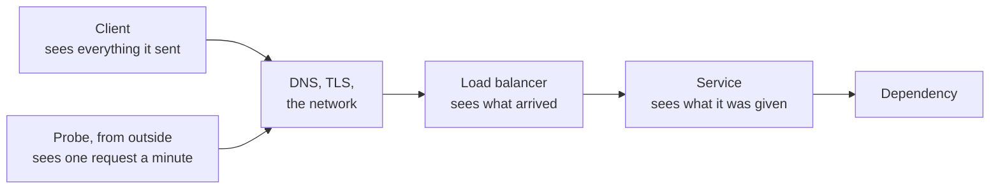

# 7.2 SLIs, SLOs, and error budgets in practice

[Syllabus](../SYLLABUS.md) · Phase 7 · Previous: [7.1 Telemetry](01-telemetry.md) · Next: 7.3 Alerting *(planned)*

> **Time:** about 35 minutes to read, 45 minutes of practice.
> **You need:** SLI, SLO, SLA and error budget as [Chapter 1.1](../phase-1-foundations/01-what-production-demands.md) defined them; metrics, labels and histograms from [Chapter 7.1](01-telemetry.md); load shedding from [Chapter 6.4](../phase-6-reliability/04-overload.md). The example needs only Go, and runs in under a second.

**By the end of this chapter you can**

- choose an indicator: which events, what makes one of them good, and where they are counted;
- say what each place of counting cannot see;
- express *fast enough* as a count, and say why a mean or a percentile over a month will not do;
- turn an objective into an error budget, and say what each incident cost;
- choose between a rolling window and a fixed one;
- write a policy for a spent budget, agreed before it is needed;
- choose a target from evidence, and recognise one that the service cannot meet.

---

## The problem

*An illustrative scenario; the example reproduces it.* A company's sales deck says *99.99% uptime*. Nobody remembers who wrote it. A large customer, renewing its contract, asks a fair question: what was the figure last month?

The team goes to find out, and finds four answers.

- The uptime monitor, which asks for a health page once a minute from outside, says **99.95%**.
- The service's own dashboard, built on the request counts of Chapter 7.1, says **99.91%**.
- The load balancer's logs say **99.88%**.
- What the customers got, which nobody was recording, was **99.84%**.

None of them is 99.99%. The two that the team reaches first are the two most flattering. And the month had six incidents. In one of them a certificate expired and no customer could connect for twelve minutes. The service and the balancer recorded nothing at all, because nothing reached them.

Three things are wrong here, and they are separate.

1. **Nothing was measured against the number.** Each source counts different things in a different place, and nobody had chosen one.
2. **The number was never chosen either.** For this service, 99.99% leaves room for 13,302 failed requests in four weeks. In four weeks in which nothing goes wrong at all, the service fails about 26,600: a restart here, a lost connection there. The promise was broken before the first incident.
3. **Nothing happens when it is missed.** No decision in the company depended on the figure. A target that changes no decision is decoration.

Chapter 1.1 gave the vocabulary, and one objective written out in full. This chapter is the work behind such a sentence: deciding what to count and where, turning the target into a budget, and deciding in advance what a spent budget changes.

---

## The concept

### 1. An indicator is a count of good events, out of all events

Chapter 1.1 gave the definitions. An indicator (SLI) is the measurement, an objective (SLO) is the target for it, and the error budget is what the target leaves over. It also gave the form that Google's SRE workbook recommends for an indicator: good events divided by all events. That form is what makes the rest of this chapter possible: "The SLI ranges from 0% to 100%, where 0% means nothing works, and 100% means nothing is broken", and "the SLO is a target percentage and the error budget is 100% minus the SLO" ([SRE workbook, *Implementing SLOs*](https://sre.google/workbook/implementing-slos/)).

The workbook separates two things that the scenario's team had run together. The **specification** is "the assessment of service outcome that you think matters to users, independent of how it is measured". The **implementation** is "the SLI specification and a way to measure it" ([*Implementing SLOs*](https://sre.google/workbook/implementing-slos/)). The four answers in the scenario are four implementations, and no specification.

An indicator is three decisions. Two make the specification, and the third is the implementation.

1. **Which events.** The requests that users make for something they want. Not health checks, not the probe's own requests, not a load test. And not every request in one heap. Chapter 7.1's shop had 0.5% of its requests failing while one customer in twenty could not pay at all. The workbook's advice is that "you should write SLOs in terms of user-centric actions" ([*Implementing SLOs*](https://sre.google/workbook/implementing-slos/)): checkout gets its own indicator, apart from search.
2. **What makes one good.** It was answered, correctly, and quickly enough. Each of those words is a decision. Sections 2 and 3 take them.
3. **Where they are counted.** Section 2.

Most indicators come from a short list.

| Kind of service | Indicator | What it counts ([workbook, Table 2-1](https://sre.google/workbook/implementing-slos/)) |
|---|---|---|
| Answers requests | Availability | "The proportion of requests that resulted in a successful response." |
| | Latency | "The proportion of requests that were faster than some threshold." |
| | Quality | "the proportion of responses that were served in an undegraded state": for a service that degrades by doing less ([Chapter 6.3](../phase-6-reliability/03-circuit-breakers-bulkheads-degradation.md)) |
| Processes data in a pipeline | Freshness | "The proportion of the data that was updated more recently than some time threshold." |
| | Correctness | "The proportion of records coming into the pipeline that resulted in the correct value coming out." |
| Stores data | Durability | "The proportion of records written that can be successfully read." |

Choose few. The workbook: "We recommend choosing a small number (five or fewer) of SLI types that represent the most critical functionality to your customers" ([*Implementing SLOs*](https://sre.google/workbook/implementing-slos/)). The SRE book gives the reason in both directions: "Choosing too many indicators makes it hard to pay the right level of attention to the indicators that matter, while choosing too few may leave significant behaviors of your system unexamined" ([SRE book, *Service Level Objectives*](https://sre.google/sre-book/service-level-objectives/)).

### 2. Where it is counted decides what it can see

A request passes several places on its way, and each place can count only what gets that far.



The workbook takes one specification and measures it three ways, and says what each way loses ([*Implementing SLOs*](https://sre.google/workbook/implementing-slos/)):
- from the server's log: "This measurement will miss requests that fail to reach the backend."
- from probes: "This measurement will catch errors when requests cannot reach our network, but may miss issues that affect only a subset of users."
- from code in the client: "This measurement will more accurately capture the user experience, although we now need to modify the code to capture this information and build the infrastructure to record it".

The example below puts numbers on those sentences. In summary:

| Counted by | It sees | It cannot see |
|---|---|---|
| The service itself | every request it was given, in full detail | whatever never reached it: requests that the balancer refused, and everything while no server was up |
| The load balancer | every request that arrived, whatever happened behind it | whatever never arrived: a DNS fault, an expired certificate, a broken network path |
| A probe from outside | the whole path, including what is in front of the balancer | everything between two probes, every path that the probe does not take, and how many users are affected |
| The client | what the user got | nothing, in principle. In practice it needs code in every client, and its data includes the faults of the user's own network |

**Which to choose.** The workbook's example uses the balancer, "as the metrics are already available and provide SLIs that are closer to the user's experience than those from the application server's logs" ([*Implementing SLOs*](https://sre.google/workbook/implementing-slos/)). Its example SLO document then writes the blind spot down, which is the part most teams leave out: "Request metrics are measured at the load balancer. This measurement may fail to accurately measure cases where user requests didn't reach the load balancer" ([SRE workbook, *Example SLO Document*](https://sre.google/workbook/slo-document/)). The SRE book makes the case for going further when you can: "not measuring behavior at the client can miss a range of problems that affect users but don't affect server-side metrics" ([SRE book, *Service Level Objectives*](https://sre.google/sre-book/service-level-objectives/)).

A reasonable order: count at the balancer, add a probe from outside for what is in front of it, and move towards the client when the product justifies the work. And begin with what exists. The workbook: "If your web server logs are already available, but setting up probes would take weeks and instrumenting your JavaScript would take months, use the logs" ([*Implementing SLOs*](https://sre.google/workbook/implementing-slos/)).

**What is a failure.** The workbook's example document is plain about it: "We only count HTTP 5XX status messages as error codes; everything else is counted as success" ([*Example SLO Document*](https://sre.google/workbook/slo-document/)). That includes the 502s and 503s that the balancer sends itself, and the 503s of load shedding (Chapter 6.4). A refused request is a failed one, however sensible the refusal was. A 4xx is normally the client's mistake and is not counted. It is worth a graph of its own all the same: a release that starts rejecting valid requests with a 400 is an outage that this rule will not see.

### 3. *Fast enough* is a count too

The latency indicator in the table is a proportion: the requests that were faster than a threshold, out of all of them. It is not a mean, and it is not a percentile.

Chapter 1.7 showed why a mean hides the tail, and why percentiles cannot be averaged. A window of four weeks adds a third problem. A percentile over the whole window answers one question only: were fewer than 1% of the requests slow? In the example, a dependency makes one correct answer in five take more than a second, for six hours. Over the four weeks that is 0.27% of the requests. The 99th percentile of the four weeks does not move. Nor, to speak of, does the mean.

A count of slow requests can be added up over any window, an hour or a quarter. It can be compared with a budget. And it has the same shape as the availability indicator, so the same tools serve both.

**Use more than one threshold**, because one threshold forgives everything on its far side. The workbook's pattern: "90% of requests are faster than 100 ms, and 99% of requests are faster than 400 ms" ([*Implementing SLOs*](https://sre.google/workbook/implementing-slos/)).

**Put a histogram bucket exactly at the threshold.** Chapter 7.1's histograms know only which bucket a request fell in. If the threshold lies between two boundaries, the count is an estimate. Prometheus's documentation: "If you already know in advance that, for example, you have an SLO to serve 95% of requests within 300ms, you could use the fixed bucket boundaries of a classic histogram to allow an accurate calculation" ([Prometheus, *Histograms and summaries*](https://prometheus.io/docs/practices/histograms/)). The workbook goes one step further: "Generally speaking, it is better to count the slow requests than to approximate them with a histogram" ([*Implementing SLOs*](https://sre.google/workbook/implementing-slos/)).

**Time only the correct answers.** A refusal takes a millisecond. Counted as fast, it would make an overloaded service look quicker than a healthy one. Failures already have an indicator of their own.

In Prometheus's query language, both indicators are one line each. The first is in the form of the workbook's example, and the second is from the Prometheus page above:

```promql
# availability: the share of requests in four weeks that did not get a 5xx
sum(rate(http_requests_total{host="api", status!~"5.."}[28d]))
  / sum(rate(http_requests_total{host="api"}[28d]))

# latency: the share of requests in five minutes that took 300 ms or less
sum by (job) (rate(http_request_duration_seconds_bucket{le="0.3"}[5m]))
  / sum by (job) (rate(http_request_duration_seconds_count[5m]))
```

### 4. The objective, and its budget

An **objective** is a target for an indicator over a window: *99.9% of requests succeed, counted at the balancer, over four weeks*. The **error budget** is what that leaves. The workbook's arithmetic: "if you have a 99.9% success ratio SLO, then a service that receives 3 million requests over a four-week period had a budget of 3,000 (0.1%) errors over that period. If a single outage is responsible for 1,500 errors, that error costs 50% of the error budget" ([*Implementing SLOs*](https://sre.google/workbook/implementing-slos/)).

The budget is a number of requests. Three things follow from that, and the example shows each.

- **Everything spends it.** Not only outages. A release that fails one request in ten for 40 minutes spends it. So does a dependency that fails two in a hundred for six hours, and so do the ordinary errors of ordinary days. A long shallow incident and a short deep one can cost the same.
- **It weighs every minute by its traffic.** Four minutes of complete outage at 03:00 are not four minutes at the afternoon peak, when nearly nine times as many requests arrive.
- **It can be accounted for.** Every failed request belongs to an incident or to the background. A ledger of the budget shows where reliability work would pay, and it often surprises. The outage that everyone remembers may have cost less than the errors that nobody looks at.

It helps to turn a budget into time once, to feel its size. For a complete outage at the average rate of traffic, 99.9% over four weeks is 40 minutes, and 99.99% is 4 minutes. Chapter 1.1's table has the rest.

**The budget is there to be spent.** The SRE book: "The error budget provides a clear, objective metric that determines how unreliable the service is allowed to be within a single quarter. This metric removes the politics from negotiations between the SREs and the product developers when deciding how much risk to allow" ([SRE book, *Embracing Risk*](https://sre.google/sre-book/embracing-risk/)). A release that goes wrong spends some of it. So does a game day (Chapter 6.7). A service that never spends any is either held to too loose a target or run too cautiously, and its users come to rely on what it does, not on what it promises.

Google's lock service, Chubby, is the standard case. It failed so rarely that "service owners began to add dependencies to Chubby assuming that it would never go down". The remedy was to spend the budget on purpose: "In any given quarter, if a true failure has not dropped availability below the target, a controlled outage will be synthesized by intentionally taking down the system" ([SRE book, *Service Level Objectives*](https://sre.google/sre-book/service-level-objectives/)).

### 5. The window

The workbook: "SLOs can be defined over various time intervals, and can use either a rolling window or a calendar-aligned window (e.g., a month)" ([*Implementing SLOs*](https://sre.google/workbook/implementing-slos/)).

- A **rolling window** is the last four weeks, whatever today is. "Rolling windows are more closely aligned with user experience: if you have a large outage on the final day of a month, your user doesn't suddenly forget about it on the first day of the following month" ([*Implementing SLOs*](https://sre.google/workbook/implementing-slos/)).
- A **fixed window** is a calendar month or a quarter, and the budget is whole again at the start of the next one. "Calendar windows are more closely aligned with business planning and project work." They have a difficulty of their own: "in the middle of the quarter, it is impossible to know how many requests you will receive for the rest of the quarter" ([*Implementing SLOs*](https://sre.google/workbook/implementing-slos/)). So the size of the budget is a forecast until the last day.

On the length, the workbook recommends "defining this period as an integral number of weeks so it always contains the same number of weekends", and gives its own choice: "We have found a four-week rolling window to be a good general-purpose interval. We complement this time frame with weekly summaries for task prioritization and quarterly summarized reports for project planning" ([*Implementing SLOs*](https://sre.google/workbook/implementing-slos/)).

A shorter window reacts sooner and forgives sooner. A longer one is steadier, and it remembers.

### 6. The policy: what a spent budget changes

The scenario's third fault was that nothing followed from the number. The workbook has a name for that state: "an SLO without teeth" ([*Implementing SLOs*](https://sre.google/workbook/implementing-slos/)).

The teeth are an **error budget policy**: a short written agreement, made in advance, about what changes when the budget is spent. It is agreed in advance because, during an incident, everyone has a reason to argue for an exception. The workbook names who has to agree, and to what ([*Implementing SLOs*](https://sre.google/workbook/implementing-slos/)):
- "The product managers have to agree that this threshold is good enough for users—performance below this value is unacceptably low and worth spending engineering time to fix."
- "The product developers need to agree that if the error budget has been exhausted, they will take some steps to reduce risk to users until the service is back in budget".

The workbook's example policy is one page, and worth reading whole. Its rules ([SRE workbook, *Example Error Budget Policy*](https://sre.google/workbook/error-budget-policy/)):
- While the service is within its objective: "releases (including data changes) will proceed according to the release policy."
- When the budget of the preceding four weeks is spent: changes and releases stop, other than the most urgent fixes and security fixes, "until the service is back within its SLO".
- For a large incident: "If a single incident consumes more than 20% of error budget over four weeks, then the team must conduct a postmortem."
- It also lists, in advance, the cases in which the team need not put its other work aside. One is a budget that "was consumed by users out of scope for the SLO (e.g., load tests or penetration testers)".

The policy also says what it is not, and that sentence is the one to copy: "This policy is not intended to serve as a punishment for missing SLOs. Halting change is undesirable; this policy gives teams permission to focus exclusively on reliability when data indicates that reliability is more important than other product features" ([*Example Error Budget Policy*](https://sre.google/workbook/error-budget-policy/)).

A halt is not a holiday. The days go to whatever spent the budget: a faster rollback, a tighter timeout, a test that would have caught the fault.

### 7. Choosing the number

The target is where the scenario began, and it comes last because it needs everything above.

**It is never 100%**, as Chapter 1.1 said, and each step towards it costs more than the last: "each extra nine comes at an increased cost, but the marginal utility to your customers steadily approaches zero" ([*Implementing SLOs*](https://sre.google/workbook/implementing-slos/)).

**It comes from two directions.** From above: what do users need before they stop noticing? From below: what can the service do? The second has hard limits. The errors of an ordinary day are one. Dependencies are another. Of a component that an action cannot do without, the workbook says that "its reliability guarantee should be at least as high as the reliability guarantee of the dependent action" ([*Implementing SLOs*](https://sre.google/workbook/implementing-slos/)). Chapter 1.1's rule gives the arithmetic: a service that needs three dependencies, each good for 99.9%, cannot promise 99.9% itself.

**Start from measurement, and say that you did.** The SRE book warns against taking current performance as the target: "adopting values without reflection may lock you into supporting a system that requires heroic efforts to meet its targets" ([SRE book, *Service Level Objectives*](https://sre.google/sre-book/service-level-objectives/)). The workbook agrees, and adds the practical half: "your current performance can be a good place to start if you don't have any other information, and if you have a good process for iterating in place" ([*Implementing SLOs*](https://sre.google/workbook/implementing-slos/)). Its example document records exactly what was done, so that nobody later mistakes a starting guess for a finding: "No attempt has yet been made to verify that these numbers correlate strongly with user experience" ([*Example SLO Document*](https://sre.google/workbook/slo-document/)).

**Then check it against the users.** An objective is right when meeting it means that users are content, and missing it means that they are not. The workbook's decision table has a row for each mismatch. When the objective is met and the customers are unhappy, tighten it, or find the indicator that is missing. When it is missed and they are content, loosen it. The first version will be wrong somewhere: "Your first attempt at an SLI and SLO doesn't have to be correct; the most important goal is to get something in place and measured, and to set up a feedback loop so you can improve" ([*Implementing SLOs*](https://sre.google/workbook/implementing-slos/)).

---

## A real example

### Run it: one month, four counts, one budget

[`code/ch02-slo/main.go`](code/ch02-slo/main.go), about 420 lines, is a model, not a measurement. It holds what happened in every minute of eight weeks: how many requests were sent, and what became of them. Traffic follows the clock, from 10 requests a second at 04:00 to 100 a second at 16:00. The first four weeks have six incidents, and the second four have none. Nothing is random, so your numbers will be the ones below.

The model records the whole truth about each minute. Each observer sees part of it:

```go
type minute struct {
	sent    int  // requests that clients sent
	reached int  // …of which the balancer received
	refused int  // …of which the balancer answered itself, with a 502 or a 503: no server could take them
	failed  int  // …of which a server answered with a 500
	slow    int  // …of which a server answered correctly, in 300 ms to 1 s
	stuck   int  // …of which a server answered correctly, in 1 s to 2 s
	probe   bool // the probe that asks for /healthz once a minute, from outside: did it get an answer?
}

// The four observers: what each counts as bad, and out of how many.
func (t tally) probe() (bad, all int)    { return t.probeFailed, t.minutes }
func (t tally) service() (bad, all int)  { return t.failed, t.reached - t.refused }
func (t tally) balancer() (bad, all int) { return t.refused + t.failed, t.reached }
func (t tally) clients() (bad, all int)  { return t.sent - t.reached + t.refused + t.failed, t.sent }
```

```bash
go run ./phase-7-observability/code/ch02-slo
```

```text
PART 1 — four weeks, counted from four places. The sales deck says 99.99%.

                                                                    failures counted in that time, by
  day  what went wrong                                for       the probe  the service  the balancer  the clients
    3  a bad release: 1 request in 10 fails           40 min        0 min       23,010        23,010       23,010
    9  every server is down, at 03:00                 4 min         4 min            0         2,749        2,749
   16  a surge: 1 request in 5 is refused             25 min        5 min           29        37,494       37,494
   19  the certificate has expired                    12 min       12 min            0             0       48,727
   22  a dependency is slow: 2 requests in 100 fail   6 h           0 min       36,467        36,467       36,467
   26  a bad release: 2 requests in 10 fail           30 min        0 min       35,702        35,702       35,702
       the rest: 2 requests in 10,000 fail            28 days       0 min       26,124        26,124       26,124

       counted in all                                          40,320 min  132,984,452   133,024,666  133,073,393
       of which good                                               99.95%       99.91%        99.88%       99.84%
```

Every number in the last row is true. They differ because the columns do not count the same things.

**The probe** asks whether anything answers, and its health page says only that a server is running. It caught the two incidents in which nothing answered, and five of the surge's 25 minutes, because it is one request a minute and one in five was refused. It missed both bad releases and the slow dependency: 95,179 failures, during which a server was up and answering wrongly. This is Chapter 6.1's grey failure, measured over a month.

**The service** counted its own errors exactly, and nothing else. On day 16 the balancer was turning away one request in five, and the service's own count for those 25 minutes is 29 failures. From the inside, a surge looks like a busy, successful afternoon.

**The balancer** saw all of that. It did not see day 19, which by the clients' count was the largest incident of the month. An expired certificate does not appear in the balancer's request count as errors. It appears as quiet.

**The clients** are the truth, and here they are free, because this is a model.

```text
PART 2 — "fast enough", said three ways. Requests that were answered correctly, timed at the balancer.

                                           four quiet weeks       the four weeks  day 22, 10:00–16:00
                                               (days 29–56)            of part 1
  mean                                                70 ms                74 ms               356 ms
  99th percentile                              under 300 ms         under 300 ms           1 s to 2 s
  answered within 300 ms                             99.95%               99.65%               79.96%
  …so this many were not                             66,505              464,963              354,466
```

Compare the first two columns. The mean moved by 4 ms. The 99th percentile did not move at all. An objective of *99th percentile under 300 ms, monthly* was met in both, and in one of them 354,466 requests took more than a second, within six hours of one day. Only the third row tells the two months apart, and the fourth turns the difference into something that a budget can be set against.

```text
PART 3 — the objective: 99.9% of requests succeed, counted at the balancer, over four weeks.
  Requests in the four weeks: 133,024,666. The error budget is 0.1% of them: 133,024 failures.

  day  what happened                                    failures   of the budget    budget left, at the
                                                                                        end of that day
    3  a bad release: 1 request in 10 fails               23,010             17%                    81%
    9  every server is down, at 03:00                      2,749              2%                    74%
   16  a surge: 1 request in 5 is refused                 37,494             28%                    41%
   19  the certificate has expired                             0              0%                    39%
   22  a dependency is slow: 2 requests in 100 fail       36,467             27%                    10%
   26  a bad release: 2 requests in 10 fail               35,702             27%                   -20%
       the rest: 2 requests in 10,000 fail                26,124             20%
   28  the four weeks                                    161,546            121%                   -21%

  Day 9's four minutes cost 2,749 failures. The same four minutes at 16:00 would have cost 23,997: 18% of the budget.

  The policy: while the budget of the window is spent, no releases other than fixes.

  at the end   the last four weeks (rolling)      this period (days 1–28, then 29–56)
  of day       budget left    releases            budget left    releases
  7            63%            allowed             78%            allowed
  14           61%            allowed             71%            allowed
  21           33%            allowed             38%            allowed
  28           -21%           halted              -21%           halted
  35           -4%            halted              95%            allowed
  42           -2%            halted              90%            allowed
  49           26%            allowed             85%            allowed
  56           80%            allowed             80%            allowed

  releases halted, rolling window:  day 26 to day 43   (18 of the 56 days)
  releases halted, fixed periods:   day 26 to day 28   (3 of the 56 days)
```

**The ledger.** Six hours of a dependency failing two requests in a hundred cost the same as half an hour of a release failing twenty in a hundred: 27% each. The outage that would be remembered, every server down, cost 2%, because it came at 03:00. The errors that nobody was looking at cost 20%, and they will cost 20% in every four weeks until somebody looks. Three incidents each took more than a fifth of the budget. Under the workbook's rule, each of those gets a written review.

**The budget ran out on day 26**, and not because day 26 was the worst day. It was the fourth large incident in a window that had room for three.

**The two windows** agree until day 28 and then part. On day 29 the fixed period has a full budget again, three days after a release failed a fifth of all requests for half an hour. The rolling window keeps releases halted until day 44, when the surge of day 16 finally leaves it. On day 7 the rolling window already shows less budget than the fixed period does, because it always holds four weeks of ordinary errors, and a fixed period starts with none.

```text
PART 4 — the same four weeks against other objectives. The balancer counted 99.88% good.

  objective    the budget, in    or a complete    spent in four     spent in the    days on which releases
              failed requests      outage of *      quiet weeks       four weeks     were halted, of 56 **
  99%               1,330,246       6 h 43 min               2%              12%                         0
  99.5%               665,123       3 h 22 min               4%              24%                         0
  99.9%               133,024           40 min              20%             121%                        18
  99.95%               66,512           20 min              40%             243%                        34
  99.99%               13,302            4 min             200%           1,214%                        56
  99.999%               1,330             24 s           2,000%          12,144%                        56

  *  at the average rate of traffic     ** by the policy of part 3, with a rolling window
```

Read the fourth column first. It is the budget that this service spends when nothing goes wrong. At the deck's 99.99%, that is twice the whole budget. No month, however quiet, could have met it, and a team held to it would never release anything. At 99.5%, a month with six incidents uses a quarter of the budget, and the policy never speaks. Between the two is a target that the bad month misses and a better month would meet. The exercise asks you to choose it.

### How Evernote began

The SRE workbook has an account by Evernote's engineers of introducing SLOs, and it is useful because the first version was so modest ([SRE workbook, *SLO Engineering Case Studies*](https://sre.google/workbook/slo-engineering-case-studies/)).

**The objective.** "This was an uptime measure: 99.95% uptime measured over a monthly window, set for certain services and methods." In a month of 30 days, that is a budget of about 22 minutes. The window was a deliberate choice of the fixed kind: "We deliberately chose to bind our SLOs to a calendar month versus a rolling period to keep us focused and organized when running service reviews" ([*SLO Engineering Case Studies*](https://sre.google/workbook/slo-engineering-case-studies/)).

**The indicator** was a probe, which is the observer that came off worst in part 1. Evernote's was better built than the example's, in three ways, each given in the same account ([*SLO Engineering Case Studies*](https://sre.google/workbook/slo-engineering-case-studies/)):
- It asked for more than a sign of life: "we have a status page built into our service that exercises most of our stack and returns a 200 status code if all is well".
- It ran outside their own systems, from a company that specialises in probing: "We wanted that prober to be located completely outside of and independent from our environment so we could test all our components, including our load balancing stack."
- One failed check did not count. A second prober in another place had to agree: "If the second check fails, the node is marked down for SLO calculation purposes."

**They knew what it missed, and went on anyway.** "we selected an initial SLO that covered most, but not all, user interactions, which was a good proxy for quality of service", and then revised it: "Since we began, we have revised our SLOs twice". The stated direction is the one that part 1's table points in, towards the client: "We plan to start probing individual API calls and accounting for the in-client view of metrics/performance so we can represent user QoS even better" ([*SLO Engineering Case Studies*](https://sre.google/workbook/slo-engineering-case-studies/)).

**What it bought them** was a shared basis for deciding: "an error budget/SLO approach has led both teams to make similar decisions when presented with the same facts" ([*SLO Engineering Case Studies*](https://sre.google/workbook/slo-engineering-case-studies/)).

The same chapter has The Home Depot's starting point, which is the scenario of this chapter in two sentences: "None of our services had SLOs. The closest metric our production systems had to a customer-facing SLO was support tickets" ([*SLO Engineering Case Studies*](https://sre.google/workbook/slo-engineering-case-studies/)).

---

## Trade-offs

**Counting requests against counting time.** Google Cloud's monitoring documentation names the two kinds. "Request-based SLIs, where good service is measured by counting atomic units of service, like the number of successful HTTP requests." "Windows-based SLIs, where good service is measured by counting the number of time periods, or windows, during which performance meets a goodness criterion" ([Google Cloud, *Concepts in service monitoring*](https://docs.cloud.google.com/stackdriver/docs/solutions/slo-monitoring)). Counting requests weighs each minute by the people in it, which is why this chapter uses it. Counting windows treats 03:00 and the peak alike, and treats a minute in which 2% failed like a minute in which everything did. It suits a service that must work at every hour, whoever is there.

**A rolling window against a fixed one.** The rolling window is honest about what users lived through, and its halts are long: 18 days in the example against 3. A fixed window is easy to report and to plan with, and it forgets on a known date. The workbook's own arrangement uses both: a rolling four weeks, with weekly summaries and quarterly reports.

**A tight target against a loose one.** Too loose, and the policy never speaks, even in a month that users will remember. Too tight, and it speaks all the time. A team that is always halted stops believing in the halt, and the policy is dead. A useful target is one that a bad month misses and a good month meets.

**One total against its parts.** An objective on all requests can be met while one group of users gets nothing: that was Chapter 7.1. The remedies are an objective for each action that matters, and, where the data allows, a count of customers: "If you have the data available to apply your SLO to each customer independently, you can track the number of customers who are in SLO at any given time" ([*Implementing SLOs*](https://sre.google/workbook/implementing-slos/)). Every further objective is another thing to agree, watch and review, which is why the advice is five or fewer.

**Low traffic.** A count needs events. The workbook's arithmetic: "if a system receives 10 requests per hour, then a single failed request results in an hourly error rate of 10%. For a 99.9% SLO, this request constitutes a 1,000x burn rate and would page immediately, as it consumed 13.9% of the 30-day error budget" ([SRE workbook, *Alerting on SLOs*](https://sre.google/workbook/alerting-on-slos/)). Its first remedy is to make events: "Generate artificial traffic to compensate for the lack of signal from real users." That is a probe, used as an indicator on purpose.

**When to do less.** A prototype needs one line, as Chapter 1.1 said. A small team with one service needs one or two objectives, for the one or two things that its users come for, and a policy of three sentences. The agreement is the expensive part, and it is the part that works. The arithmetic takes an afternoon.

---

## Practice

### Check yourself

1. For the four weeks, the service's own count is 99.91% and the balancer's is 99.88%. Which failures make the difference? Which incident is in neither count, and what would have shown it?
2. A team's objective is *99th percentile under 300 ms, measured monthly*. In the example's four weeks, was it met? What did it hide, and what would you write in its place?
3. Four minutes with every server down cost 2% of the budget at 03:00. What would they have cost at 16:00? What would an indicator that counts minutes say about the two?

<details>
<summary>Answers</summary>

1. The requests that the balancer answered itself, because no server could take them: the 2,749 of day 9, when every server was down, and all but 29 of the 37,494 of day 16's surge. The service never saw them, so they are missing from its failures and from its total. The expired certificate is in neither count: 48,727 requests that reached nothing. The probe from outside showed it, as twelve failed checks. An indicator in the client would have counted it exactly.
2. It was met: the 99th percentile of the four weeks is under 300 ms. It hid 464,963 slow requests, 354,466 of them in six hours on day 22, when one correct answer in five took more than a second. Write a count: *99.5% of the requests that are answered correctly take 300 ms or less, timed at the balancer, over four weeks*. That is a budget of about 664,000 slow requests. A quiet four weeks spend a tenth of it, and the four weeks of part 1 spend 70%. A second threshold, at one second, would catch what the first forgives.
3. 23,997 failures in place of 2,749: 18% of the budget, nearly nine times as much, because nearly nine times as many requests arrive in those minutes. A count of minutes would call the two equal: four bad minutes each.

</details>

### Exercise: choose the objective

You are the engineer whom the scenario's team asks for a proposal. The product manager wants 99.95%: *the deck says 99.99%, and we cannot be seen to retreat further*. The lead developer wants 99.5%: *we would never be halted*. Part 4 has the outline. The ledger for any target comes from:

```bash
go run ./phase-7-observability/code/ch02-slo -target 99.95
go run ./phase-7-observability/code/ch02-slo -target 99.5
```

1. Run both. For each, and for 99.9%, note what four quiet weeks spend, what the four weeks with the incidents spend, and on which days releases are halted under each kind of window.
2. Choose the target for availability. Write the objective in full, with the five parts that Chapter 1.1 listed, and one or two sentences of reasoning.
3. Add an objective for speed, from part 2's numbers.
4. The expired certificate is in neither. Add an indicator that counts it, and give it a target that it can bear.
5. Write the policy in five lines.
6. What should the deck say?

<details>
<summary>Worked solution</summary>

**1. The three ledgers.**

| Target | Budget, in failed requests | Four quiet weeks spend | The four weeks spend | Halted, rolling window | Halted, fixed periods |
|---|---|---|---|---|---|
| 99.5% | 665,123 | 4% | 24% | never | never |
| 99.9% | 133,024 | 20% | 121% | day 26 to day 43 | day 26 to day 28 |
| 99.95% | 66,512 | 40% | 243% | day 16 to day 49 | day 16 to day 28 |

**2. The target: 99.9%.**

> 99.9% of requests to the API, counted at the load balancer, get an answer that is not a 5xx, over a rolling four weeks.

At 99.5%, a month with six incidents spends a quarter of the budget. If customers noticed that month, and in the scenario one of them is asking about it, then an objective that calls it a good month does not describe what they will accept. At 99.95%, ordinary errors take 40% of the budget before anything happens, and the release of day 3 alone takes another 35%. Releases are halted on 34 days of 56. A policy that is in force more often than not will be worked around, and then there is no policy.

At 99.9%, the month is missed, and not by much: without any one of its three largest incidents it would have been met. That is what a target should do. It tells this team that the month had one large incident too many.

Two things would change the choice. If customers are unhappy in months that meet the objective, tighten it, or look for the indicator that is missing. If the team is halted again and again while customers are content, loosen it, openly.

**3. Speed.**

> 99.5% of the requests that are answered correctly take 300 ms or less, timed at the load balancer, over a rolling four weeks.

A quiet four weeks answers 99.95% within 300 ms, and the four weeks of part 1 answer 99.65%. The budget is about 664,000 slow requests. The quiet weeks spend a tenth of it and the bad weeks 70%. This objective would have passed the month. That may be right: six bad hours in four weeks. If it is not, add a second threshold, at one second.

**4. The certificate.** Only something outside can count what never arrives. Keep the probe, and make it an indicator with its own objective:

> A probe asks for the checkout page once a minute, from outside our network. 99.9% of the probes succeed, over a rolling four weeks.

There are 40,320 probes in four weeks, so the budget is 40 failed probes. The example's probe failed 21 times in part 1's four weeks: twelve for the certificate, five in the surge, four on the night of day 9. A target of 99.99% would be a budget of four probes. One bad network path on the monitor's side would spend a quarter of it, so the target would measure the monitor more than the service. Two improvements, both from Evernote's account: have the probe ask for something that exercises the real path, not a bare health page, and count a failure only when a second place agrees.

**5. The policy.**

1. While the budget of the last four weeks is not spent, releases go out as usual.
2. When it is spent, nothing is released except fixes for what spent it, and security fixes, until it is positive again. The team's planned work gives way to reliability work.
3. Any incident that spends more than a fifth of the budget gets a written review, with at least one action of the highest priority.
4. Requests from load tests and from the probe do not count. Failures caused outside the team's control do count, because users felt them, and releases halt as in rule 2. The planned work may then go on.
5. If the team and the product manager disagree about any of this, the head of engineering decides.

**6. The deck.** Nothing that cannot be shown. With an internal objective of 99.9%, the promise to customers has to be lower. That is Chapter 1.1's margin. So: *99.5% of requests, counted at our load balancer, monthly*, and the report to prove it. The honest answer to the customer's question is 99.88%, with how it was counted, and what it does not include.

</details>

---

## Production tips and common mistakes

- **Write the objective as a document**: the indicator in full, the target, the window, the reasoning, and what the measurement cannot see. The workbook's [example](https://sre.google/workbook/slo-document/) is short enough to copy.
- **Count at the balancer, and probe from outside** for what is in front of it.
- **Keep numerators and denominators**, as counters. Any window can then be computed from them. A stored percentage cannot be added to another.
- **Put a histogram bucket at each latency threshold**, before the objective needs it.
- **Leave out what is not a user**: health checks, probes, load tests. Label them at the source.
- **Report the budget, not the percentage.** *99.88% against 99.9%* looks like nothing. *121% of the budget spent* is the same fact.
- **Keep a ledger**: each incident, and what it cost. The ordinary errors get a line too.
- **Agree the policy before it is needed**, in writing, with the people who will want the exception.
- **Review the objectives on a schedule.** Evernote's account: "we've settled on a six-month SLO review cycle, which strikes the right balance between changing SLOs too often and letting them become stale" ([*SLO Engineering Case Studies*](https://sre.google/workbook/slo-engineering-case-studies/)).
- **Promise customers less than the objective**, as Chapter 1.1 said.

**Common mistakes**

- **A target copied from a slide**, or from a cloud provider's page, and checked against nothing.
- **Uptime from a health check** as the only indicator.
- **The service's own count as the indicator.** It cannot see the requests that it never received.
- **An objective on a mean**, or on a percentile over a month.
- **A target that the service's ordinary errors already break**, or one tighter than its dependencies allow.
- **An objective for every metric.**
- **A budget with no policy**, or a policy that only one side agreed to.
- **Never spending the budget**, and calling that success.
- **Changing the objective quietly** after missing it.

---

## Key takeaways

- An indicator is good events out of all events. Specify it by what users are doing and what makes that good. Then choose where to count, and write down what that place cannot see.
- The service's own count misses what never reached it. The balancer misses what never arrived. A probe misses everything between probes. The client sees it all and costs the most.
- *Fast enough* is a count of requests under a threshold. A mean or a percentile over a month can hide six bad hours.
- The error budget is the objective turned into a number of failures. Everything spends it, each minute weighs what its traffic weighs, and a ledger shows where it went.
- A rolling window remembers what users lived through. A fixed one forgets on a known date.
- The policy is what gives the objective force: agreed in advance, releases halted when the budget is spent, and the time given to reliability.
- Choose the target from evidence: what users need, what the service does on a quiet day, what its dependencies allow. A good target is one that a bad month misses and a good month meets.

**Next:** 7.3 Alerting *(planned)* — the budget says how four weeks went. A page has to say, within minutes, that the budget is being spent too fast.

---

## Sources

- Google, *The Site Reliability Workbook*: [*Implementing SLOs*](https://sre.google/workbook/implementing-slos/); [*Example SLO Document*](https://sre.google/workbook/slo-document/); [*Example Error Budget Policy*](https://sre.google/workbook/error-budget-policy/); [*Alerting on SLOs*](https://sre.google/workbook/alerting-on-slos/).
- Ben McCormack (Evernote) and William Bonnell (The Home Depot), with others, [*SLO Engineering Case Studies*](https://sre.google/workbook/slo-engineering-case-studies/), chapter 3 of *The Site Reliability Workbook*.
- Google, *Site Reliability Engineering*, 2016: [*Service Level Objectives*](https://sre.google/sre-book/service-level-objectives/) and Marc Alvidrez, [*Embracing Risk*](https://sre.google/sre-book/embracing-risk/).
- Prometheus documentation, [*Histograms and summaries*](https://prometheus.io/docs/practices/histograms/).
- Google Cloud documentation, [*Concepts in service monitoring*](https://docs.cloud.google.com/stackdriver/docs/solutions/slo-monitoring).
