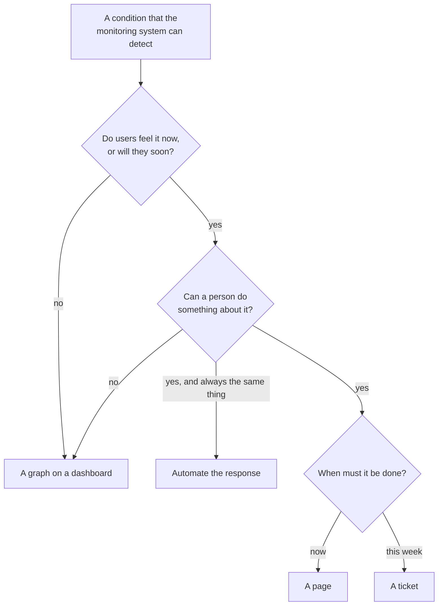

# 7.3 Alerting

[Syllabus](../SYLLABUS.md) · Phase 7 · Previous: [7.2 SLIs, SLOs, and error budgets in practice](02-slis-slos-error-budgets.md) · Next: [7.4 Distributed tracing and context propagation](04-distributed-tracing.md)

> **Time:** about 35 minutes to read, 45 minutes of practice.
> **You need:** the error budget, and where an indicator is counted, from [Chapter 7.2](02-slis-slos-error-budgets.md); symptoms and causes from [Chapter 7.1](01-telemetry.md). The example needs only Go, and runs in under a second.

**By the end of this chapter you can**

- decide whether a condition deserves a page, a ticket, or a graph;
- say why pages belong to symptoms, and which causes are the exceptions;
- judge an alert rule by four measures, with numbers;
- compute a burn rate, and derive an alert's threshold from an error budget;
- write the rule with two windows and two burn rates, and say what each number in it is for;
- cover what that rule cannot see: no traffic, and a monitoring system that has itself failed;
- keep a pager quiet enough to be believed.

---

## The problem

*An illustrative scenario; the example reproduces one service of it.* A team runs ten services. Each has the same two paging rules, written when the services were new: *CPU above 80% for five minutes*, and *error rate at or above 0.1% over ten minutes*. Together they produce about two hundred pages a week.

For one of the ten, over eight weeks, the count is 168: three a day. The CPU rule sends 112 of them. The service has grown, its afternoon peak now crosses 80% every day, and a nightly batch job sets the rule off again at 02:05. The error rule sends 49 for small blips: servers restarting, a server lost. Each blip fails a hundred or so requests and is over in a minute. That leaves seven pages that reported something real.

Nobody reads 168 pages. What follows from that is three different failures.

- **The real page looks like the others.** On day 26 a release failed a fifth of all requests. The page came within a minute. It was the same page, in the same words, as the 49 that restarts had caused.
- **The worst incident sent nothing.** On day 19 a certificate expired, and for twelve minutes no customer could connect. No requests arrived, so there were no errors to count, and the CPU was idle. Both rules were silent, and correctly so by their own terms.
- **A rule that is always on says nothing.** On day 40, at four minutes past midnight, the error rule paged for a fault that failed one request in four hundred. It could have waited for the morning. The rule then stayed on for five days, and while it was on it could report nothing else.

Google's SRE book describes the first: "When pages occur too frequently, employees second-guess, skim, or even ignore incoming alerts", and "Outages can be prolonged because other noise interferes with a rapid diagnosis and fix" ([SRE book, *Monitoring Distributed Systems*](https://sre.google/sre-book/monitoring-distributed-systems/)). The same chapter has Google's own case, from the team that ran Bigtable: "Both types of alerts were firing voluminously, consuming unacceptable amounts of engineering time: the team spent significant amounts of time triaging the alerts to find the few that were really actionable, and we often missed the problems that actually affected users, because so few of them did."

Chapter 7.2 ended with a budget that says how four weeks went. This chapter is about the minutes: what should interrupt a person, how to write a rule that does that and nothing else, and how to tell a good rule from a bad one by measurement.

---

## The concept

### 1. Three outputs, and one of them interrupts

The SRE book's introduction says what a monitoring system may produce, and the list is short: "There are three kinds of valid monitoring output" ([SRE book, *Introduction*](https://sre.google/sre-book/introduction/)).

| Output | The book's definition ([*Introduction*](https://sre.google/sre-book/introduction/)) | Reaches a person |
|---|---|---|
| **Alert** (a page) | "Signify that a human needs to take action immediately in response to something that is either happening or about to happen, in order to improve the situation." | now, wherever they are |
| **Ticket** | "Signify that a human needs to take action, but not immediately. The system cannot automatically handle the situation, but if a human takes action in a few days, no damage will result." | in working hours, in a queue |
| **Logging** | "No one needs to look at this information, but it is recorded for diagnostic or forensic purposes." | when they go and look: a graph, a log |

Nothing else is on the list. In particular, an email to a channel that somebody might read is not: "a system that requires a human to read an email and decide whether or not some type of action needs to be taken in response is fundamentally flawed" ([*Introduction*](https://sre.google/sre-book/introduction/)). The deciding is the monitoring system's job: "software should do the interpreting, and humans should be notified only when they need to take action."

A page costs the most: "Paging a human is a quite expensive use of an employee's time" ([*Monitoring Distributed Systems*](https://sre.google/sre-book/monitoring-distributed-systems/)). So it has the hardest test. The book's questions for any proposed rule begin with these ([*Monitoring Distributed Systems*](https://sre.google/sre-book/monitoring-distributed-systems/)):
- "Does this rule detect an otherwise undetected condition that is urgent, actionable, and actively or imminently user-visible?"
- "Will I ever be able to ignore this alert, knowing it's benign?"
- "Can I take action in response to this alert? Is that action urgent, or could it wait until morning? Could the action be safely automated?"

Urgent, actionable, and felt by users. Fail any one, and the condition is a ticket or a graph. The scenario's CPU rule fails all three every afternoon.



### 2. Page on symptoms

Chapter 7.1 separated a **symptom**, which a user would notice, from a **cause**. Pages belong to symptoms. Prometheus's guidance says so in one sentence: "Aim to have as few alerts as possible, by alerting on symptoms that are associated with end-user pain rather than trying to catch every possible way that pain could be caused" ([Prometheus, *Alerting*](https://prometheus.io/docs/practices/alerting/)).

There are three reasons, and the scenario has each.

- **Most causes hurt nobody.** Phase 6 was spent making sure of it: a server is lost, a dependency slows, and the system carries on. SoundCloud's engineers put it this way: "it wouldn't make any sense to wake somebody up whenever a single machine goes down" ([SoundCloud, *Alerting on SLOs like Pros*](https://developers.soundcloud.com/blog/alerting-on-slos/)).
- **The list of causes is never complete.** Nobody had written a rule for an expired certificate. A rule on what users get does not need the cause to have been foreseen.
- **Causes multiply.** One fault in a database shows as slow queries, full pools, queues and timeouts in every service that uses it. One symptom rule for each thing that users do is a number that stays small.

**The exception is a cause that is certain and close.** The SRE book: "it's better to spend much more effort on catching symptoms than causes; when it comes to causes, only worry about very definite, very imminent causes" ([*Monitoring Distributed Systems*](https://sre.google/sre-book/monitoring-distributed-systems/)). A disk that will be full in four hours is one. A certificate that expires in fourteen days is another. Neither hurts anyone yet, both will, and there is time to act. That makes most of them tickets. Prometheus's guidance on capacity is the general form: "While not a problem causing immediate user impact, being close to capacity often requires human intervention to avoid an outage in the near future" ([Prometheus, *Alerting*](https://prometheus.io/docs/practices/alerting/)).

**Causes go on dashboards.** The person who is paged for a symptom needs the causes next: CPU, queues, pools, the last release. That is where those graphs earn their keep, and it is the subject of Chapter 7.5. Prometheus again: "Alerts should link to relevant consoles and make it easy to figure out which component is at fault" ([Prometheus, *Alerting*](https://prometheus.io/docs/practices/alerting/)).

### 3. Four measures of a rule

A symptom rule can still be a bad rule. The scenario's error rule watches the right thing and is wrong 49 times in 56. The SRE workbook gives the target, and four measures of how well a rule hits it. The target: "Your goal is to be notified for a significant event: an event that consumes a large fraction of the error budget" ([SRE workbook, *Alerting on SLOs*](https://sre.google/workbook/alerting-on-slos/)).

| Measure | The workbook's definition ([*Alerting on SLOs*](https://sre.google/workbook/alerting-on-slos/)) | When it is poor |
|---|---|---|
| **Precision** | "The proportion of events detected that were significant." | pages for nothing, and then pages that are ignored |
| **Recall** | "The proportion of significant events detected." | incidents that nobody is told about |
| **Detection time** | "How long it takes to send notifications in various conditions." | budget spent before anyone knows |
| **Reset time** | "How long alerts fire after an issue is resolved." | a rule that is still on cannot report the next incident |

The four pull against one another. A rule that fires on anything has perfect recall. A rule that waits to be sure has perfect precision. The rest of this section is about getting all four at once.

### 4. From a budget to a threshold: the burn rate

The error budget gives the question a number. An incident matters in proportion to the budget it spends. So a rule should fire when the budget is being spent fast, and how fast decides how loudly.

The workbook's term: "Burn rate is how fast, relative to the SLO, the service consumes the error budget" ([*Alerting on SLOs*](https://sre.google/workbook/alerting-on-slos/)). For an objective of 99.9%, the allowed error rate is 0.1%. The burn rate is the error rate divided by that. "With an SLO of 99.9% over a time window of 30 days, a constant 0.1% error rate uses exactly all of the error budget: a burn rate of 1." An error rate of 1% is a burn rate of 10, and the budget of 30 days is gone in three. A complete outage is a burn rate of 1,000.

**The threshold comes from a decision about the budget.** Choose how much of it may go before a person is told, and within what time. The workbook's first choice is 2% within an hour. A window of 30 days has 720 hours, so spending 2% in one of them is spending at 0.02 × 720 = 14.4 times the allowed rate. The rule is: *the error rate of the last hour is above 14.4 × 0.1%*.

Three simpler rules are common, and each fails one of the four measures.

- **A threshold on a short window**: *error rate of the last ten minutes at or above 0.1%*. It detects fast and has no precision: "A 0.1% error rate for 10 minutes would alert, while consuming only 0.02% of the monthly error budget", and at the extreme "you could receive up to 144 alerts per day every day, not act upon any alerts, and still meet the SLO" ([*Alerting on SLOs*](https://sre.google/workbook/alerting-on-slos/)). This is the scenario's error rule.
- **The same threshold with a waiting time**, which is what most people try next. Prometheus calls it the `for` clause, which "causes Prometheus to wait for a certain duration between first encountering a new expression output vector element and counting an alert as firing for this element" ([Prometheus, *Alerting rules*](https://prometheus.io/docs/prometheus/latest/configuration/alerting_rules/)). It restores precision and destroys the rest: "Because the duration does not scale with the severity of the incident, a 100% outage alerts after one hour, the same detection time as a 0.2% outage", and "If the metric even momentarily returns to a level within SLO, the duration timer resets" ([*Alerting on SLOs*](https://sre.google/workbook/alerting-on-slos/)).
- **One long window with a burn rate.** Precision, recall and detection time are all good, and the rule stays on for most of an hour after the incident is over, because the hour still contains it.

**Two windows fix the reset.** Add a short window with the same threshold, and require both. The long one says that enough budget has gone. The short one says that it is still going. The workbook: "A good guideline is to make the short window 1/12 the duration of the long window", and the result "fires only once you've consumed 2% of the budget, but exhibits a better reset time by ceasing to fire five minutes later, rather than one hour later" ([*Alerting on SLOs*](https://sre.google/workbook/alerting-on-slos/)).

**Several burn rates fix the slow incidents.** An error rate of 1% never reaches 14.4 times the allowed rate, and it empties the budget in three days. A second pair of windows, longer and with a lower threshold, catches it. A third, lower still, catches the leak that would take the whole month, and that one opens a ticket.

### 5. The rule, and what each number is for

The workbook's recommended starting point, for an objective of 99.9% ([*Alerting on SLOs*, Table 5-8](https://sre.google/workbook/alerting-on-slos/)):

| Severity | Long window | Short window | Burn rate | Budget spent when it fires |
|---|---|---|---|---|
| Page | 1 hour | 5 minutes | 14.4 | 2% |
| Page | 6 hours | 30 minutes | 6 | 5% |
| Ticket | 3 days | 6 hours | 1 | 10% |

Every number in it follows from two decisions. The last column is the decision about the budget. The long window is the decision about time. The burn rate is the first divided by the second, as a share of the 30 days: 5% in 6 hours is 0.05 × 720 ÷ 6 = 6. The short window is a twelfth of the long one.

In Prometheus the paging rule is one expression, given in the workbook. The names ending in `ratio_rate1h` are recording rules, each of which keeps the error rate of one window up to date:

```yaml
# a recording rule for each window, in the workbook's form:
- record: job:slo_errors_per_request:ratio_rate1h
  expr: sum(rate(slo_errors[1h])) by (job) / sum(rate(slo_requests[1h])) by (job)

# the page:
- alert: ErrorBudgetBurn
  expr: |
    (
      job:slo_errors_per_request:ratio_rate1h{job="myjob"} > (14.4*0.001)
    and
      job:slo_errors_per_request:ratio_rate5m{job="myjob"} > (14.4*0.001)
    )
    or
    (
      job:slo_errors_per_request:ratio_rate6h{job="myjob"} > (6*0.001)
    and
      job:slo_errors_per_request:ratio_rate30m{job="myjob"} > (6*0.001)
    )
  labels:
    severity: page
```

The workbook's judgement on it: "In most cases, we believe that the multiwindow, multi-burn-rate alerting technique is the most appropriate approach to defending your application's SLOs." Its stated cost: "Lots of parameters to specify, which can make alerting rules hard to manage" ([*Alerting on SLOs*](https://sre.google/workbook/alerting-on-slos/)). That is the reason to keep the table the same for every service and change only the objective.

A latency objective gets the same rule. Count slow requests where this one counts failed ones.

### 6. What a burn-rate rule cannot see

**No traffic.** An error rate is failures divided by requests. When no requests arrive, there is nothing to divide, and no rule on the rate is true. An expired certificate, a DNS fault and a broken route all look like a quiet afternoon. Two rules cover it: a probe from outside, which Chapter 7.2 introduced, and a rule on traffic that has fallen far below what is normal for the hour.

**Little traffic.** With ten requests an hour, one failure is an error rate of 10% for that hour, and the page goes out for a single request. Chapter 7.2 had the workbook's arithmetic and its remedy: make traffic, with a probe.

**A monitoring system that has failed.** A rule that is never evaluated never fires, and silence looks the same as health. Prometheus's guidance: "It is important to have confidence that monitoring is working" ([Prometheus, *Alerting*](https://prometheus.io/docs/practices/alerting/)). The usual device is an alert that fires all the time on purpose, and something outside that pages when it stops arriving. It is often called a dead man's switch.

**What has no objective.** Disks, certificates, quotas, capacity: the certain and close causes of section 2, as tickets with enough warning to act.

### 7. Keeping the pager believable

A person can answer only so many pages well. The SRE book's working figure comes from what an incident costs after it is over: "We've found that on average, dealing with the tasks involved in an on-call incident—root-cause analysis, remediation, and follow-up activities like writing a postmortem and fixing bugs—takes 6 hours. It follows that the maximum number of incidents per day is 2 per 12-hour on-call shift" ([SRE book, *Being On-Call*](https://sre.google/sre-book/being-on-call/)). And its statement of the principle: "Every time the pager goes off, I should be able to react with a sense of urgency. I can only react with a sense of urgency a few times a day before I become fatigued" ([*Monitoring Distributed Systems*](https://sre.google/sre-book/monitoring-distributed-systems/)).

Four habits keep the count there.

- **Review every page.** Was it urgent? Was there something to do? Did users feel it? A page that fails gets its rule changed or deleted that week. A page whose answer is always the same gets a script: "If a page merely merits a robotic response, it shouldn't be a page" ([*Monitoring Distributed Systems*](https://sre.google/sre-book/monitoring-distributed-systems/)).
- **Make each page carry its own context**: what users are getting, how fast the budget is going, since when, and links to the dashboard and to the runbook for this alert.
- **Send one notification for one event.** Prometheus's Alertmanager has three tools for it ([Prometheus, *Alertmanager*](https://prometheus.io/docs/alerting/latest/alertmanager/)). "Grouping categorizes alerts of similar nature into a single notification." "Inhibition is a concept of suppressing notifications for certain alerts if certain other alerts are already firing." "Silences are a straightforward way to simply mute alerts for a given time."
- **Keep the rules simple.** "Rules that generate alerts for humans should be simple to understand and represent a clear failure" ([*Monitoring Distributed Systems*](https://sre.google/sre-book/monitoring-distributed-systems/)).

---

## A real example

### Run it: eight weeks, seven rules

[`code/ch03-alerts/main.go`](code/ch03-alerts/main.go), about 480 lines, is a model, like Chapter 7.2's, and it is the same service: the same traffic, the same objective of 99.9%, and the same six incidents in the first four weeks. Two things are added. The first is blips, which every real service has: servers restart in turn each weekday, and a server is lost twice a week. Each blip fails 3% or 5% of requests for one minute. The second is two slow incidents in weeks five to eight. Seven rules are evaluated once a minute, as a monitoring system would evaluate them:

```go
var rules = []rule{
	{"cpu", "CPU above 80% for 5 min", func(w *watcher, i int) bool {
		return every(i, 5, func(j int) bool { return w.ms[j].cpu > 0.80 })
	}},
	{"threshold", "error rate of the last 10 min at or above 0.1%", func(w *watcher, i int) bool {
		return w.rate(i, 10) >= allowed
	}},
	{"for an hour", "error rate of each minute above 0.1%, for 60 min", func(w *watcher, i int) bool {
		return every(i, 60, func(j int) bool { return w.rate(j, 1) > allowed })
	}},
	{"burn, 1 h", "error rate of the last 1 h above 14.4 × 0.1%", func(w *watcher, i int) bool {
		return w.rate(i, 60) > 14.4*allowed
	}},
	{"burn, 2 windows", "the last 1 h and 5 min above 14.4 × 0.1%, or the last 6 h and 30 min above 6 × 0.1%", func(w *watcher, i int) bool {
		return w.rate(i, 60) > 14.4*allowed && w.rate(i, 5) > 14.4*allowed ||
			w.rate(i, 360) > 6*allowed && w.rate(i, 30) > 6*allowed
	}},
	{"slow burn", "the last 3 days and the last 6 h above 0.1%", func(w *watcher, i int) bool {
		return w.rate(i, 3*day) > allowed && w.rate(i, 360) > allowed
	}},
	{"probe", "the probe failed 3 times running", func(w *watcher, i int) bool {
		return every(i, 3, func(j int) bool { return !w.ms[j].probe })
	}},
}
```

```bash
go run ./phase-7-observability/code/ch03-alerts
```

```text
PART 1 — what a burn rate means, for an objective of 99.9% over four weeks and steady traffic.

  error rate    burn rate       the budget    who is told first                 after   budget spent
                                is gone in                                                   by then
  100%              1,000           40 min    a page: the 1 h window             52 s           2.1%
  20%                 200           3 h 22    a page: the 1 h window            4 min           2.1%
  10%                 100           6 h 43    a page: the 1 h window            9 min           2.1%
  2%                   20          33 h 36    a page: the 1 h window           43 min           2.1%
  1%                   10         2 d 19 h    a page: the 6 h window           3 h 36           5.4%
  0.25%               2.5         11 d 4 h    a ticket: the 3 day window      28 h 48          10.7%
  0.1%                  1          28 days    nobody                                —              —
  0.05%               0.5            never    nobody                                —              —
```

This is arithmetic, not simulation, and it is the whole idea in one table. Read down the *after* column. The worse the fault, the sooner the page: under a minute for an outage, three quarters of an hour for 2%, a ticket the next day for a leak. Now read the last column. Whatever the fault, the same share of the budget has gone when someone is told. The rule does not measure how bad things are. It measures how much has been lost, and that is the thing to be protected.

The figures are 2.1%, 5.4% and 10.7% where the workbook has 2%, 5% and 10%, because this objective's window is four weeks and the workbook's is 30 days. The row at 0.1% is worth a look: an error rate that spends the budget exactly, to the last request, and tells nobody.

```text
PART 2 — eight weeks, eight incidents, seven rules. For each incident: how long until each rule sent a notification.

  1  cpu              CPU above 80% for 5 min
  2  threshold        error rate of the last 10 min at or above 0.1%
  3  for an hour      error rate of each minute above 0.1%, for 60 min
  4  burn, 1 h        error rate of the last 1 h above 14.4 × 0.1%
  5  burn, 2 windows  the last 1 h and 5 min above 14.4 × 0.1%, or the last 6 h and 30 min above 6 × 0.1%
  6  slow burn        the last 3 days and the last 6 h above 0.1%
  7  probe            the probe failed 3 times running

  day  incident                                      rule 1    rule 2    rule 3    rule 4    rule 5    rule 6    rule 7
    3  a bad release: 10% fail, for 40 min             (on)     1 min         —     9 min     9 min    20 min         —
    9  every server is down, for 4 min                    —     1 min         —     1 min     1 min         —     3 min
   16  a surge: 20% refused, for 25 min                (on)     1 min         —     4 min     4 min     8 min         —
   19  the certificate has expired, for 12 min            —         —         —         —         —         —     3 min
   22  a dependency is failing: 2% fail, for 6 h     3 h 50     1 min    60 min    40 min    40 min    2 h 17         —
   26  a bad release: 20% fail, for 30 min             (on)     1 min         —     5 min     5 min    10 min         —
   33  a cache node is failing: 1% fail, for 8 h     4 h 50     1 min    60 min         —    2 h 14    4 h 30         —
   40  a slow leak: 0.25% fail, for 5 days           2 h 05     4 min    60 min         —         —   21 h 58         —

       notifications in the eight weeks                 112        56         3         5         6         6         2
       …that began with no incident in progress         100        49         0         0         0         0         0
       time spent firing                              283 h     145 h     131 h      11 h      15 h     141 h    12 min
       still firing after an incident, at most       2 h 16     9 min         —    59 min    29 min    5 h 59         —

  (on): the rule was already firing when the incident began, so it sent nothing new.
```

**Rule 1, the cause.** Every entry in its column is an accident. It fires at 13:50 each afternoon and at 02:05 each night. Where the table shows a time, that is the daily page falling inside a long incident. Where it shows *(on)*, the rule was already firing when the real trouble began, and so had nothing to add. During the surge of day 16 the CPU really was the cause, and the rule that watches CPU said nothing new.

**Rule 2, the threshold.** It reported seven of the eight within minutes, which is what makes it tempting. It also fired 49 times for nothing, at each restart and each lost server. And it woke someone at 00:04 on day 40 for a leak, then stayed on for five days.

**Rule 3, the wait.** No false alarms, and no page for five of the eight. A release that failed a fifth of all requests for half an hour was over before the hour was up.

**Rule 4, the burn rate.** Five notifications, all real. Compare its delays with rule 2's: nine minutes against one for the bad release. Those eight minutes are the price of the 49 false pages, and the last table shows what they cost in budget. Its fault is in the last row: 59 minutes still firing after the incident was over. It also has nothing to say about the two slow incidents.

**Rule 5, two windows.** The same five at the same times, the cache node after 2 hours 14 minutes through its second pair of windows, and at most 29 minutes of firing after the end. This is the workbook's rule.

**Rule 6, the ticket.** It caught the leak in under a day, with half of a month's budget at stake. It also opened a ticket for five incidents that had already paged, which is what inhibition is for.

**Rule 7, the probe.** The only rule with an entry for day 19.

```text
PART 3 — two ways to run a pager.

                                                      pages     a week    began in an    began in no    no new page for
                                                                             incident       incident
  before: rules 1 and 2 page                            168       21.0             19            149    day 19
  after: rules 5 and 7 page, rule 6 opens a ticket        8        1.0              8              0    day 40

  After, incident by incident:
  day  incident                                   first told by          after     budget spent     budget spent
                                                                                        by then           in all
    3  a bad release: 10% fail, for 40 min        a page: burn rate      9 min             3.8%              17%
    9  every server is down, for 4 min            a page: burn rate      1 min             0.5%               2%
   16  a surge: 20% refused, for 25 min           a page: burn rate      4 min             4.5%              28%
   19  the certificate has expired, for 12 min    a page: the probe      3 min                —                —
   22  a dependency is failing: 2% fail, for 6 h  a page: burn rate     40 min             2.2%              27%
   26  a bad release: 20% fail, for 30 min        a page: burn rate      5 min             4.4%              27%
   33  a cache node is failing: 1% fail, for 8 h  a page: burn rate     2 h 14             3.5%              18%
   40  a slow leak: 0.25% fail, for 5 days        a ticket             21 h 58             9.1%              49%

  Day 19 has no figures: the balancer, which the budget is counted at, received nothing.
```

**Twenty-one pages a week became one**, and the one is always real. Of the 19 pages that *before* sent during an incident, twelve were the CPU rule's daily pages, so seven of the 168 told anyone anything. *After* reports everything that *before* did, the leak by ticket, and it reports day 19, which *before* did not.

**The page comes early in the incident's cost.** The last two columns are what the page is for. When it arrived, between 0.5% and 4.5% of the budget had gone, and the incident went on to cost 17%, or 27%, or 28%. Everything between the two columns is what a fast response can save. The share at the time of the page is above part 1's 2.1% for the afternoon incidents, because a minute at the peak holds nearly twice the average traffic, and the budget is counted in requests.

**The leak never paged, and that is the design.** It cost 49% of a month's budget, more than any other incident, and nobody was woken. A ticket after 22 hours, with 9% gone, left four days in which to fix it in working hours.

### How SoundCloud pages

SoundCloud's engineers described their alerting in 2019, and it is this chapter's rule in production ([Björn Rabenstein, *Alerting on SLOs like Pros*](https://developers.soundcloud.com/blog/alerting-on-slos/)).

**The position on what pages** is stated first: "Paging alerts, those that wake you up in the night, should be based on symptoms, i.e. something that actively or imminently impacts the user experience." What fails that test may still be worth a person's time, later: "Let's call these kinds of alerts tickets, as somebody will have to look at them eventually, e.g. a dead server has to be dealt with at a suitable time" ([*Alerting on SLOs like Pros*](https://developers.soundcloud.com/blog/alerting-on-slos/)).

**The indicator is counted at the edge**, which is where Chapter 7.2 said to count it. Their load balancers are HAProxy, and the error rate is taken from there: "With the error rate as seen by the HAProxy terminator layer, we can now apply the alerting technique described in Chapter 5 of the SRE workbook" ([*Alerting on SLOs like Pros*](https://developers.soundcloud.com/blog/alerting-on-slos/)).

**The rules are the workbook's, with small changes.** "We have chosen to use four different alerts, each combining a long window, a short window, and a burn rate factor": two pages, at 14.4 over one hour and five minutes and at 6 over six hours and thirty minutes, and two tickets. The example they give is the fast page: "The owners of api-v4 get paged if their backend has returned more than 1.44% 5xx responses over the last 1h and over the last 5m" ([*Alerting on SLOs like Pros*](https://developers.soundcloud.com/blog/alerting-on-slos/)). Each service's objective is itself a recorded series, so one set of rules serves every backend, and each alert carries a link to its runbook.

**Their reason for the short window** is the one that rule 4 showed: "The short window ensures a short reset time of the alert, i.e. an alert should stop firing soon after the problem has been solved (which is not only convenient but also allows for paging to happen again if the problem comes back)" ([*Alerting on SLOs like Pros*](https://developers.soundcloud.com/blog/alerting-on-slos/)).

**What it was for**: "enabling us to fulfill our SLOs without flooding our engineers on call with an unsustainable amount of pages" ([*Alerting on SLOs like Pros*](https://developers.soundcloud.com/blog/alerting-on-slos/)).

### What Bigtable's team did about its pager

The Bigtable case from the start of this chapter ended in an unexpected way. The team did not add better alerts. It removed some, and loosened the objective for a while: "We also disabled email alerts, as there were so many that spending time diagnosing them was infeasible." The result: "Ultimately, temporarily backing off on our alerts allowed us to make faster progress toward a better service" ([*Monitoring Distributed Systems*](https://sre.google/sre-book/monitoring-distributed-systems/)). The general statement is in the same chapter: "Every page that happens today distracts a human from improving the system for tomorrow".

---

## Trade-offs

**Speed against noise.** Rule 2 was eight minutes faster than rule 5 on a bad release, and paid for it with 49 false pages. The burn-rate rule fixes the price: about 2% of the budget, whatever the fault. If 2% is too much, lower the threshold and accept more pages. Do it knowingly, from this table and not by feel.

**Slow detection of mild faults.** At 2% failing, the page took 40 minutes. For a payments service that may be too long. The answers are a tighter objective for that service, which moves every threshold with it, or a separate indicator for the action that matters most. Both are better than a hair trigger on the whole service.

**Symptoms come late.** A symptom rule fires after users are hurt. It cannot fire before. The certain and close causes buy the time that it cannot: a ticket fourteen days before the certificate expired would have meant no incident on day 19 at all.

**Short incidents.** Day 9's four minutes paged at the first minute, and it was over before anyone could have opened a laptop. A waiting time of two minutes on the fast rule, which SoundCloud uses, drops some of these. It also delays every real page by two minutes.

**More rules, more to maintain.** Three pairs of windows for each objective, a probe, the tickets. Keep the table identical everywhere and generate the rules from the objectives.

**Needs traffic, and needs an objective.** A service with a few requests an hour cannot use this, and a service with no objective has no budget to burn. Both need Chapter 7.2 first.

**Paging against fixing.** Every recurring page poses a choice: keep answering it, or spend the time to make it impossible. The Bigtable team chose the second and had to accept a worse-looking service for a while to do it.

---

## Practice

### Check yourself

1. Rule 3 never fired for nothing. Which incidents did it miss, and what do they have in common? Give one more reason, from the workbook, not to use it.
2. A service with an objective of 99.9% over four weeks runs at a steady error rate of 0.5%. What is the burn rate? When is the budget gone? Who is told, after how long, and how much of the budget has been spent by then?
3. On day 19, rules 2 to 6 were all silent. Why? Name two rules that report it, and one alert that would have prevented it.

<details>
<summary>Answers</summary>

1. Days 3, 9, 16 and 26, and day 19. The first four were over in less than an hour, and they were the severe ones: 10%, 100%, 20% and 20% failing. A wait of fixed length is blind to anything shorter than itself, however bad. The workbook's other reason is that the timer starts again whenever the rate dips below the threshold for a moment, so an error rate that comes and goes may never fire it. The model's error rates are too smooth to show that.
2. The burn rate is 0.5% ÷ 0.1% = 5. The budget is gone in 28 ÷ 5 = 5.6 days. Nobody is paged: 0.5% is under both paging thresholds, 1.44% and 0.6%. The ticket rule fires when the three-day average passes 0.1%, which takes a fifth of three days: 14 hours 24 minutes. By then 5 × 14.4 ÷ 672 hours = 10.7% of the budget has gone, the same as for every ticket in part 1.
3. No requests reached the balancer, so there was no error rate for any of them to compare with a threshold. The probe reports it, in three minutes. So does a rule on traffic that has fallen far below normal, which is the exercise. A ticket when the certificate has fourteen days left would have prevented it.

</details>

### Exercise: a rule for silence

The probe is one way to see that nothing is arriving. The balancer's own count is another: it knows how many requests came, and how many came at this time last week.

1. Add an eighth rule to `rules` in the example: *the last five minutes brought less than half the requests of the same five minutes a week before*. The watcher's `all` field is a running total of requests, so the requests of any window are one subtraction.
2. Run it. Which incidents does it report, and how soon? Does it fire when nothing is wrong?
3. Day 9 had every server down for four minutes. Why does the new rule say nothing?
4. Would you make it a page or a ticket? What would make it fire wrongly in production, and never in this model?
5. Go through all eight rules and say what each should be: a page, a ticket, a graph, or deleted. Add whatever is still missing.

<details>
<summary>Worked solution</summary>

**1. The rule.**

```go
	{"traffic", "the last 5 min brought less than half the requests of the same 5 min a week before", func(w *watcher, i int) bool {
		const week = 7 * day
		if i+1-5-week < 0 {
			return false
		}
		now := w.all[i+1] - w.all[i+1-5]
		then := w.all[i+1-week] - w.all[i+1-5-week]
		return 2*now < then
	}},
```

**2. The result.**

```text
  day  incident                                      rule 1    rule 2    rule 3    rule 4    rule 5    rule 6    rule 7    rule 8
    3  a bad release: 10% fail, for 40 min             (on)     1 min         —     9 min     9 min    20 min         —         —
    9  every server is down, for 4 min                    —     1 min         —     1 min     1 min         —     3 min         —
   16  a surge: 20% refused, for 25 min                (on)     1 min         —     4 min     4 min     8 min         —         —
   19  the certificate has expired, for 12 min            —         —         —         —         —         —     3 min     3 min
   22  a dependency is failing: 2% fail, for 6 h     3 h 50     1 min    60 min    40 min    40 min    2 h 17         —         —
   26  a bad release: 20% fail, for 30 min             (on)     1 min         —     5 min     5 min    10 min         —         —
   33  a cache node is failing: 1% fail, for 8 h     4 h 50     1 min    60 min         —    2 h 14    4 h 30         —         —
   40  a slow leak: 0.25% fail, for 5 days           2 h 05     4 min    60 min         —         —   21 h 58         —         —

       notifications in the eight weeks                 112        56         3         5         6         6         2         1
       …that began with no incident in progress         100        49         0         0         0         0         0         0
       time spent firing                              283 h     145 h     131 h      11 h      15 h     141 h    12 min    12 min
       still firing after an incident, at most       2 h 16     9 min         —    59 min    29 min    5 h 59         —     2 min
```

One notification in eight weeks, for day 19, after three minutes: three minutes with no requests out of five is less than half. It never fired for nothing.

**3. Day 9.** The requests arrived. The balancer received every one and answered each with an error, because no server was up. That is a failure of answers, and the burn-rate rule had it within a minute. The traffic rule sees only requests that do not come.

**4. A page, with care.** Twelve minutes in which nobody can connect is as urgent as anything in the table. But this model's traffic repeats exactly, week after week, which is why the rule is never wrong here. Real traffic does not. A public holiday, the end of a sale, or a large customer leaving will halve the traffic and hurt no one. So compare with more than one earlier week, set the margin wide, and keep the probe as well: the two fail in different ways. If it proves noisy, make it a ticket and let the probe page.

**5. The eight rules.**

| Rule | Becomes | Why |
|---|---|---|
| 1. CPU above 80% | a graph, on the dashboard that the page links to | a cause that hurts nobody, 112 times |
| 2. Error rate over ten minutes | deleted | rule 5 reports everything it does, without the 49 false pages |
| 3. Above the threshold for an hour | deleted | misses every short incident |
| 4. Burn rate, one window | deleted | rule 5 is the same with a faster reset |
| 5. Burn rate, two windows | **a page** | the workbook's rule |
| 6. Slow burn | **a ticket**, inhibited while rule 5 is firing | the leak, in working hours |
| 7. Probe | **a page** | the only view from outside |
| 8. Traffic far below normal | **a page**, or a ticket if it proves noisy | what never arrives |

Still missing: a ticket when a certificate has fourteen days left, which would have prevented day 19. A ticket when a disk will be full within days. The same pair of burn-rate rules for the latency objective. And a dead man's switch, so that a monitoring system that has stopped is noticed.

</details>

---

## Production tips and common mistakes

- **Start from the objectives.** For each one: a paging rule with two windows and two burn rates, and a ticket rule for the slow burn.
- **Add a probe from outside**, and a rule for traffic that has stopped.
- **Make tickets of the certain and close causes**: certificates, disks, quotas, with days of warning.
- **Put causes on the dashboard** that the page links to, not on the pager.
- **Give every alert an owner, a dashboard and a runbook.** If nobody can say what to do when it fires, it is not ready to fire.
- **Count pages for each shift**, and review each one: urgent, actionable, felt by users?
- **Inhibit the lower severity** while the higher one is firing, and group by service.
- **Silence during planned work, with an end time.**
- **Watch the watcher.** An alert that always fires, and a page when it stops.
- **Send a test page** after every change to routing, and to every new person on the rota.

**Common mistakes**

- **Paging on CPU, memory, or one lost server.**
- **A threshold on a short window**, which pages for every restart.
- **Quietening it with a long `for`**, which hides everything short.
- **Alerts by email to a list.**
- **A rule that has been firing for days**, and so can report nothing.
- **Reading no errors as healthy** when there are no requests.
- **The same event sent as a page, a ticket and an email.**
- **Rules that are added after each incident and never removed.**
- **A page with no link and no instructions**, at three in the morning.

---

## Key takeaways

- A monitoring system has three outputs: a page for what needs a person now, a ticket for what needs one this week, and a graph for the rest.
- Page on symptoms: what users get. Causes go on dashboards. The exceptions are causes that are certain and close, and most of those are tickets.
- Judge a rule by precision, recall, detection time and reset time, measured against real incidents.
- The burn rate is the error rate divided by the rate that the objective allows. A threshold on it fires when a fixed share of the budget has gone, whatever the fault: fast for an outage, slow for a leak.
- Two windows give a rule that fires when enough has been lost and stops when the loss stops. Two burn rates page for fast and medium faults, and a third opens a ticket for slow ones.
- A rule on an error rate is blind when nothing arrives. Add a probe, a rule on traffic, and a check on the monitoring itself.
- A pager is believed only while it is nearly always right. Review every page, and delete rules as readily as you add them.

**Next:** [7.4 Distributed tracing and context propagation](04-distributed-tracing.md) — the page says that checkout is slow. A request crosses nine services, and something has to say which one.

---

## Sources

- Rob Ewaschuk, [*Monitoring Distributed Systems*](https://sre.google/sre-book/monitoring-distributed-systems/), chapter 6 of *Site Reliability Engineering*, Google, 2016; the same book's [*Introduction*](https://sre.google/sre-book/introduction/) and Andrea Spadaccini, [*Being On-Call*](https://sre.google/sre-book/being-on-call/).
- Google, *The Site Reliability Workbook*: [*Alerting on SLOs*](https://sre.google/workbook/alerting-on-slos/).
- Björn Rabenstein, [*Alerting on SLOs like Pros*](https://developers.soundcloud.com/blog/alerting-on-slos/), SoundCloud Backstage Blog, 2019.
- Prometheus documentation: [*Alerting*](https://prometheus.io/docs/practices/alerting/) (practices), [*Alerting rules*](https://prometheus.io/docs/prometheus/latest/configuration/alerting_rules/) and [*Alertmanager*](https://prometheus.io/docs/alerting/latest/alertmanager/).
