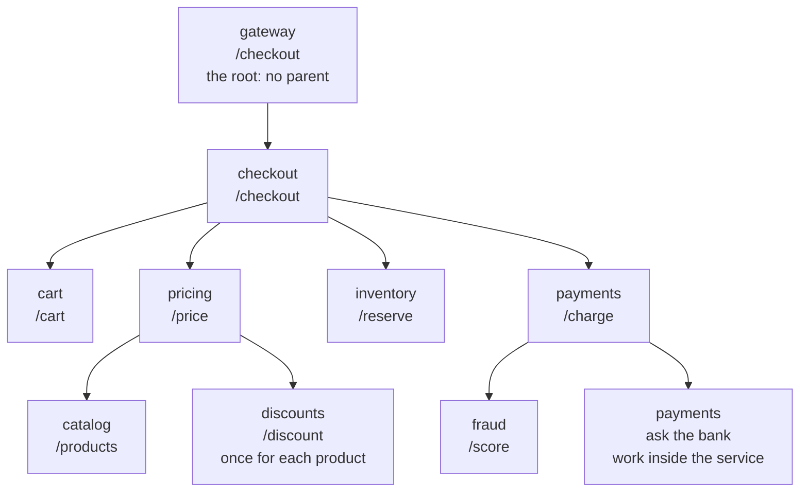

# 7.4 Distributed tracing and context propagation

[Syllabus](../SYLLABUS.md) · Phase 7 · Previous: [7.3 Alerting](03-alerting.md) · Next: 7.5 Debugging production *(planned)*

> **Time:** about 35 minutes to read, 45 minutes of practice.
> **You need:** the three signals from [Chapter 7.1](01-telemetry.md); Go's `context` as [Chapter 6.2](../phase-6-reliability/02-timeouts-and-retries-at-scale.md) used it to carry a deadline; the N+1 pattern from [Chapter 2.2](../phase-2-data/02-indexes-and-query-plans.md). The main example needs only Go and takes about seven seconds. A second, small example uses OpenTelemetry and fetches its modules the first time it runs.

**By the end of this chapter you can**

- say what a span holds, and how spans make a trace;
- follow the context through a process and across the network, and write the header by hand;
- read a trace: whose own work the time was, what ran in series, what was repeated;
- say what a trace looks like when one service drops the context, and why that is worse than no trace;
- choose between sampling at the start of a trace and at its end;
- instrument a Go service with OpenTelemetry.

---

## The problem

*An illustrative scenario; the example reproduces it.* The page from Chapter 7.3 says that checkout is slow: one request in a hundred takes more than half a second. Checkout is nine services, owned by several teams. Each team opens its own dashboard.

Three services show a 99th percentile above half a second: the gateway, checkout, and pricing. Inventory shows 315 ms. The other five are fast and flat. So the suspicion falls on pricing, the deepest of the slow ones.

Pricing's team reads its own code. It does 4 ms of work, asks the catalog for the products, and asks the discount service for discounts. The catalog answers in 10 ms. The discount service answers in 13 ms, all day: its 99th percentile is 13 ms too. Pricing is slow, and everything that pricing does is fast.

Nobody's dashboard is wrong. Each one times the requests that one service serves. The question is about one customer's request, which is work in nine services, and no dashboard holds that. Google's engineers described the same position in the paper on Dapper, their tracing system: "An engineer looking only at the overall latency may know there is a problem, but may not be able to guess which service is at fault, nor why it is behaving poorly" ([Sigelman et al., *Dapper*](https://static.googleusercontent.com/media/research.google.com/en//archive/papers/dapper-2010-1.pdf)).

Three things are missing.

1. **Nothing says which pieces of work belong together.** This checkout caused 49 of them. They sit among 17,000 others.
2. **Nothing says who called whom, or in what order.** Whether two calls ran at the same time or one after the other is not in any service's metrics.
3. **The logs have the detail and no way to join it.** Nine services, nine sets of lines, and no field that they share.

---

## The concept

### 1. A trace is a tree of spans

Chapter 7.1 introduced the third signal in a paragraph. This is the detail.

A **span** is one piece of work, in one service, for one request. OpenTelemetry lists what it holds: a name, the ID of its parent span, the times at which it started and ended, its span context, and attributes, events, links and a status ([OpenTelemetry, *Traces*](https://opentelemetry.io/docs/concepts/signals/traces/)). The example's span is that list with the optional parts left out:

```go
type span struct {
	trace, id, parent string // the trace it belongs to, its own ID, and the span that caused it
	service, name     string
	start, end        time.Time
	failed            bool
}
```

A **trace** is every span that carries the same trace ID. The parent IDs make them a tree: "Spans can be nested, as is implied by the presence of a parent span ID: child spans represent sub-operations" ([OpenTelemetry, *Traces*](https://opentelemetry.io/docs/concepts/signals/traces/)). The one span with no parent is the root. The Dapper paper says the same in its own terms: "Spans created without a parent id are known as root spans. All spans associated with a specific trace also share a common trace id" ([*Dapper*](https://static.googleusercontent.com/media/research.google.com/en//archive/papers/dapper-2010-1.pdf)).



Not every span is a call to another service. Any piece of work that is worth timing can have one: a query, a lock, a loop. The last box in the diagram is a span inside payments.

Nothing in a span is new. Its times are a duration, as a metric has. Its name and attributes are what a log line has. What is new is the three IDs, and the tree that they make.

### 2. The context, and its two journeys

For a service to make a span that belongs to the right trace, it has to know two things when a request arrives: which trace this is, and which span is the parent. Those two IDs are the **context**. OpenTelemetry: "When Service A calls Service B, Service A includes a trace ID and a span ID as part of the context. Service B uses these values to create a new span that belongs to the same trace, setting the span from Service A as its parent" ([OpenTelemetry, *Context propagation*](https://opentelemetry.io/docs/concepts/context-propagation/)).

Carrying the context along is **propagation**: "the mechanism that moves context between services and processes" ([*Context propagation*](https://opentelemetry.io/docs/concepts/context-propagation/)). It makes two different journeys, and it can be lost on either.

**Inside a process**, from the code that receives a request to the code that makes the next call. In Go the vehicle is `context.Context`, the same value that carried the deadline in Chapter 6.2. Every function on the way takes it and passes it on. Dapper, written for C++ and Java, used storage that belongs to the thread: "When a thread handles a traced control path, Dapper attaches a trace context to thread-local storage" ([*Dapper*](https://static.googleusercontent.com/media/research.google.com/en//archive/papers/dapper-2010-1.pdf)).

**Across the network**, in the request itself. OpenTelemetry's terms are *inject* and *extract*: "On the side of the sender, the context is injected into the carrier, for example, into the headers of an HTTP request", and "On the receiving side, the context is extracted from the carrier" ([*Context propagation*](https://opentelemetry.io/docs/concepts/context-propagation/)).

The header has a standard, from the W3C, and OpenTelemetry uses it unless told otherwise: "The default propagator uses the headers specified by the W3C TraceContext specification" ([*Context propagation*](https://opentelemetry.io/docs/concepts/context-propagation/)). It is one line of four fields ([W3C, *Trace Context*, the request header](https://raw.githubusercontent.com/w3c/trace-context/main/spec/20-http_request_header_format.md)):

```http
traceparent: 00-85e3a10da7c1e800c6693d22f873e283-e8cc7758494d8eda-01
```

| Field | Here | What [the specification](https://raw.githubusercontent.com/w3c/trace-context/main/spec/20-http_request_header_format.md) says |
|---|---|---|
| version | `00` | two hexadecimal digits; this is version 00 |
| trace-id | `85e3…e283` | 16 bytes, as 32 digits: "the ID of the whole trace forest" |
| parent-id | `e8cc…8eda` | 8 bytes, as 16 digits: "the ID of this request as known by the caller" |
| trace-flags | `01` | 8 bits. The lowest is the sampled flag: "denotes that the caller may have recorded trace data" |

The example writes and reads it in a dozen lines, and there is nothing more to it:

```go
func inject(ctx context.Context, h http.Header) {
	if c, ok := ctx.Value(key{}).(current); ok {
		h.Set("traceparent", "00-"+c.trace+"-"+c.span+"-01")
	}
}

// extract reads it back on the other side of the network.
func extract(ctx context.Context, h http.Header) context.Context {
	parts := strings.Split(h.Get("traceparent"), "-")
	if len(parts) != 4 || len(parts[1]) != 32 || len(parts[2]) != 16 {
		return ctx // no header, or not one that we understand: a new trace begins here
	}
	return context.WithValue(ctx, key{}, current{trace: parts[1], span: parts[2]})
}
```

**Where the context is lost.** Each of these is common, and each cuts the tree in two.

- A function that does not take the context, or that starts again from `context.Background()`.
- Work handed to another goroutine, a pool or a timer without it.
- A queue. The context has to travel in the message, as a header or an attribute, and the consumer has to read it.
- A proxy or a gateway that passes on only the headers it knows.
- One service, or one client library, that was never instrumented.
- A batch. One write to disk done for forty requests has forty parents and can have one. The Dapper paper lists this among its limits: "a traced request can be blamed for a deceptively large unit of work" ([*Dapper*](https://static.googleusercontent.com/media/research.google.com/en//archive/papers/dapper-2010-1.pdf)).

### 3. Reading a trace

A trace is usually drawn as a waterfall: one row for each span, a bar from its start to its end, children under their parent. Four things are worth looking for.

**Own time.** A span's length includes everything it waited for. Its **own time** is its length less the time during which a child was running. A service can be the slowest on every dashboard and have almost no own time: it was waiting. Own time is where a fix has to go.

**Shape.** Bars that step down like a staircase ran in series, each waiting for the one before. Bars stacked under one another ran at the same time. A staircase of calls that do not depend on each other is time that can be had back.

**Repetition.** Forty short, identical bars are the N+1 pattern of Chapter 2.2, between services where that chapter had it between a service and its database. Every one of them is fast. No dashboard of the service that is called will show it, because nothing there is slow. There is just a lot of it.

**Gaps.** Time inside a span that no child covers and that its own work does not explain: waiting for a connection from a pool, for a lock, for a turn on a full queue (Chapter 1.6), or a call through a library that makes no span.

One trace is an anecdote. The useful questions are about many: *of the slowest hundred requests, whose own time was it?* That is a query over spans, and part 3 of the example runs it.

Google found exactly these things when it first had traces. One team used Dapper "to identify unnecessary serial requests along the critical path – often originating in sub-systems the developers didn't write themselves". And across services: "There were many problematic and expensive query patterns which resulted from unintended interactions between services. Once identified they were often corrected for easily, but identification itself was difficult before Dapper" ([*Dapper*](https://static.googleusercontent.com/media/research.google.com/en//archive/papers/dapper-2010-1.pdf)).

### 4. Sampling

A checkout in the example makes about eleven spans. At a thousand checkouts a second that is eleven thousand spans a second, to be sent, stored and indexed. Almost all of them describe requests that went well. OpenTelemetry: "if the large majority of your requests are successful and finish with acceptable latency and no errors, you do not need 100% of your traces to meaningfully observe your applications and systems. You just need the right sampling" ([OpenTelemetry, *Sampling*](https://opentelemetry.io/docs/concepts/sampling/)).

A trace has to be kept whole or not at all. Half a tree is the broken trace of part 4. So the decision is made once for each trace, and there are two moments at which to make it.

**At the head.** "Head sampling is a sampling technique used to make a sampling decision as early as possible. A decision to sample or drop a span or trace is not made by inspecting the trace as a whole" ([*Sampling*](https://opentelemetry.io/docs/concepts/sampling/)). The first service decides, usually from the trace ID, and the decision travels in the flags of the header, so that every service keeps the same traces. It is cheap, and spans that will not be kept need never be sent. Its limit is stated plainly: "you cannot ensure that all traces with an error within them are sampled with head sampling alone." When the decision is made, nobody knows yet how the request will end.

**At the tail.** "Tail sampling is where the decision to sample a trace takes place by considering all or most of the spans within the trace" ([*Sampling*](https://opentelemetry.io/docs/concepts/sampling/)). Every span is sent to a collector, which holds each trace until it is complete and then keeps the failed ones, the slow ones, and a small share of the rest. This is Chapter 7.1's rule for logs, applied to traces. The price is in what the collector has to be: "The component(s) that implement tail sampling must be stateful systems that can accept and store a large amount of data."

Head sampling at a low rate was enough for Google's busiest services: "we have found that a sample of just one out of thousands of requests provides sufficient information for many common uses of the tracing data". The same paper gives the limit: "lower traffic workloads may miss important events at such low sampling rates" ([*Dapper*](https://static.googleusercontent.com/media/research.google.com/en//archive/papers/dapper-2010-1.pdf)).

Whatever is chosen, count with metrics. A sample of traces answers *why*, and it cannot answer *how many*.

### 5. OpenTelemetry

The example's tracer is a hundred lines, to show that there is nothing hidden in one. In production the tracer is **OpenTelemetry**, which describes itself as "vendor- and tool-agnostic, meaning that it can be used with a broad variety of observability backends", and adds: "OpenTelemetry is not an observability backend itself" ([OpenTelemetry, *What is OpenTelemetry?*](https://opentelemetry.io/docs/what-is-opentelemetry/)). It has four parts that matter here.

- **An API and an SDK** for each language: starting and ending spans, and the samplers and exporters behind them.
- **Instrumentation libraries**, which wrap the things that every service uses. In Go, for HTTP: "NewHandler wraps the passed handler in a span named after the operation", and "NewTransport wraps the provided http.RoundTripper with one that starts a span, injects the span context into the outbound request headers" ([Go package `otelhttp`](https://pkg.go.dev/go.opentelemetry.io/contrib/instrumentation/net/http/otelhttp)). Those two wrappers are this chapter's `serve` and `call`.
- **Propagators**, with the W3C header as the default.
- **The Collector**, a separate process that receives spans, samples them, and sends them on: "a vendor-agnostic implementation of how to receive, process and export telemetry data" ([OpenTelemetry, *Collector*](https://opentelemetry.io/docs/collector/)). Tail sampling lives there.

The wrappers are the important part, and the Dapper paper says why. Its second design goal: "Application-level transparency: programmers should not need to be aware of the tracing system. A tracing infrastructure that relies on active collaboration from application-level developers in order to function becomes extremely fragile" ([*Dapper*](https://static.googleusercontent.com/media/research.google.com/en//archive/papers/dapper-2010-1.pdf)). Instrument the shared server and client once, and every service has spans and passes the header without its authors doing anything. Spans for work inside a service are then added by hand, where they are wanted.

---

## A real example

### Run it: nine services, one trace

[`code/ch04-tracing/main.go`](code/ch04-tracing/main.go), about 610 lines, starts nine real HTTP servers in one process and sends 1,500 checkouts through them, forty at a time. The work in each service is a pause of a few milliseconds. Three things are built in. One customer in a hundred is a wholesaler with forty products in the cart, and pricing asks for the discount on each product in turn. One in a hundred has stock rows that a slow job has locked. One in a hundred has no fraud score, and that checkout fails.

Each server is wrapped in the same dozen lines, which is all the instrumentation there is:

```go
func (m *mesh) serve(service string, work func(ctx context.Context, q url.Values) error) http.Handler {
	return http.HandlerFunc(func(w http.ResponseWriter, r *http.Request) {
		ctx := extract(r.Context(), r.Header)
		ctx, s := m.t.begin(ctx, service, r.URL.Path, r.URL.Query().Get("trace"))
		err := work(ctx, r.URL.Query())
		m.t.finish(s, err != nil)
		if err != nil {
			w.WriteHeader(http.StatusBadGateway)
		}
	})
}
```

```bash
go run ./phase-7-observability/code/ch04-tracing
```

The times are real, so yours will differ by a few milliseconds. The counts will not.

```text
PART 1 — nine dashboards. Each service times the requests that it serves, and knows nothing else.

  service        requests     median    99th percentile
  gateway            1500     109 ms             584 ms
  checkout           1500     107 ms             581 ms
  cart               1500       8 ms               9 ms
  pricing            1500      40 ms             516 ms
  catalog            1500      10 ms              11 ms
  discounts          3564      13 ms              13 ms
  inventory          1500      15 ms             315 ms
  payments           1500      54 ms              56 ms
  fraud              1500      20 ms              21 ms
```

This is the scenario. Read it as each team would. Pricing's team sees 516 ms, and the two services it calls at 11 ms and 13 ms. The discount team sees 13 ms at worst and has no reason to look further. The only clue is a number in the wrong column: 3,564 requests to discounts for 1,500 checkouts.

```text
PART 2 — one slow request, as a trace. Customer 7's checkout took 589 ms and made 49 spans.

  the header on the request from checkout to pricing:
  traceparent: 00-85e3a10da7c1e800c6693d22f873e283-e8cc7758494d8eda-01

  service                work             starts    lasts
  gateway                /checkout          0 ms   589 ms  ████████████████████████████████████████████
    checkout             /checkout          3 ms   586 ms  ███████████████████████████████████████████
      cart               /cart              6 ms     8 ms  █
      inventory          /reserve          15 ms    15 ms   █
      pricing            /price            15 ms   520 ms   ██████████████████████████████████████
        catalog          /products         19 ms    11 ms   █
        discounts        /discount         30 ms    13 ms    █
        discounts        /discount         43 ms    13 ms     █
                         … and 38 more of the same, each beginning as the one before it ends
      payments           /charge          535 ms    53 ms                                         ███
        fraud            /score           538 ms    20 ms                                          █
        payments         ask the bank     558 ms    30 ms                                           ██

  Of pricing's 520 ms, 9 ms was work of its own.
```

**One picture answers the question.** Pricing's bar is long and its children fill it: forty calls to the discount service, each starting as the last one ends. Of pricing's 520 ms, 9 ms was its own. The discount service did nothing wrong, forty times. The fault is in how it was asked, and that belongs to neither team's dashboard.

The second line of the output is the whole mechanism: the header that checkout sent to pricing, with this trace's ID and the ID of checkout's span.

```text
PART 3 — every trace, added up. Whose own work was the time? All 1500 requests, and the slowest 30.

                  all: calls in   share of the            slowest: calls   share of the
  service          each request           time           in each request           time
  gateway                   1.0             3%                       1.0             1%
  checkout                  1.0             4%                       1.0             1%
  cart                      1.0             6%                       1.0             2%
  pricing                   1.0             4%                       1.0             2%
  catalog                   1.0             8%                       1.0             2%
  discounts                 2.4            22%                      21.1            51%
  inventory                 1.0            14%                       1.0            32%
  payments                  1.0            25%                       1.0             6%
  fraud                     1.0            15%                       1.0             4%

  The slowest 30, one at a time: where most of each one's time went.
    15 requests  discounts  called 40 times in each
    15 requests  inventory  called 1 time in each
```

**All the traces, as a table.** Over every request the discount service has 22% of the time, and nothing stands out. Over the slowest thirty it has 51%, with 21 calls in each request on average. The last three lines are what one trace could not say. The slow requests are two different problems. Fifteen spent their time in forty calls to discounts. Fifteen spent it in inventory, in one call, on inventory's own work: the lock. Inventory's dashboard had shown that 315 ms. It could not show which checkouts paid for it.

```text
PART 4 — the same services, but pricing does not pass the header on to the services that it calls.

  100 requests made 437 traces: 100 that begin at the gateway, and 337 others, of 337 spans, that begin nowhere.
  Customer 7's checkout again: 599 ms, and now 8 spans.

  service                work             starts    lasts
  gateway                /checkout          0 ms   599 ms  ████████████████████████████████████████████
    checkout             /checkout          4 ms   595 ms  ███████████████████████████████████████████
      cart               /cart              9 ms     8 ms  █
      pricing            /price            19 ms   526 ms   ██████████████████████████████████████
      inventory          /reserve          19 ms    15 ms   █
      payments           /charge          546 ms    53 ms                                          ███
        fraud            /score           548 ms    20 ms                                          █
        payments         ask the bank     568 ms    30 ms                                           ██

  By this trace, pricing spent 526 ms on work of its own.
```

**One service that drops the header ruins the trace for everyone.** The requests are the same. Pricing calls its two services without `traceparent`, so each of those calls starts a trace of its own: 337 single spans that belong to nothing. Customer 7's trace is still there, and it now makes a false statement. Pricing took 526 ms and has no children, so the time appears to be pricing's own. An engineer who believes this trace will spend the afternoon profiling pricing's 4 ms of code.

A missing trace sends nobody anywhere. A broken one sends them to the wrong place. This is why the Dapper paper put coverage first among its requirements: tracing is of little use "if even small parts of the system are not being monitored" ([*Dapper*](https://static.googleusercontent.com/media/research.google.com/en//archive/papers/dapper-2010-1.pdf)).

```text
PART 5 — sampling. The traces of part 1, kept three ways.

                                                                 traces    spans    of the slow  of the failed
                                                                   kept   stored       requests       requests
  keep everything                                                  1500    17049       30 of 30       15 of 15
  head: 1 trace in 50, chosen at the start                           40      429        0 of 30        0 of 15
  tail: every slow or failed trace, and 1 in 50 of the rest          85     1485       30 of 30       15 of 15
```

**Head sampling kept 40 traces and none of the 45 that anyone would want.** That is not bad luck. One in fifty of thirty slow requests is less than one. **Tail sampling kept all 45**, and 40 ordinary ones for comparison, in 9% of the spans. The slow traces are the large ones, which is why 85 traces hold 1,485 spans. What the table cannot show is the cost: to choose at the end, the collector held all 17,049 spans until each trace was finished.

### The same, with OpenTelemetry

[`code/ch04-otel/main.go`](code/ch04-otel/main.go) is the first hop of the same journey with the real library: one service calling another. It is a module of its own, so that the rest of the course does not depend on OpenTelemetry. It was run with version 1.38.0 of the Go SDK, and it needs Go 1.23 or later.

```go
	otel.SetTracerProvider(provider)
	otel.SetTextMapPropagator(propagation.TraceContext{}) // the W3C traceparent header
	tracer := otel.Tracer("checkout")

	// The service that is called. The wrapper reads traceparent and starts a span for each request.
	var header string
	pricing := httptest.NewServer(otelhttp.NewHandler(http.HandlerFunc(func(w http.ResponseWriter, r *http.Request) {
		header = r.Header.Get("traceparent")
		_, span := tracer.Start(r.Context(), "apply discounts") // a span for work inside the service
		defer span.End()
	}), "GET /price"))
	defer pricing.Close()

	// The service that calls. The wrapped transport starts a span for each call and writes traceparent.
	client := &http.Client{Transport: otelhttp.NewTransport(http.DefaultTransport)}

	ctx, root := tracer.Start(context.Background(), "POST /checkout")
	req, err := http.NewRequestWithContext(ctx, http.MethodGet, pricing.URL+"/price", nil) // the context goes with the request
```

```bash
cd phase-7-observability/code/ch04-otel && go run .
```

```text
the header that the called service received:
  traceparent: 00-6e16f74c0548198e3d05aebf7dd47912-93948454f765e9b1-01

  span               trace                              span ID            parent
  POST /checkout     6e16f74c0548198e3d05aebf7dd47912   0b67313f3e9e96c2   0000000000000000
  HTTP GET           6e16f74c0548198e3d05aebf7dd47912   93948454f765e9b1   0b67313f3e9e96c2
  GET /price         6e16f74c0548198e3d05aebf7dd47912   6535103302776c5d   93948454f765e9b1
  apply discounts    6e16f74c0548198e3d05aebf7dd47912   992597451689e3d9   6535103302776c5d
```

The IDs are random, so yours will differ. The shape will not: four spans in one trace. The library makes one more span than this chapter's tracer did, because it times the call from both ends: `HTTP GET` is the caller's view and `GET /price` is the view of the service that was called. The difference between the two is the network, and the wait for a connection. The parent in the header is the caller's span, as the specification says.

Three lines did the work: `NewHandler`, `NewTransport`, and `NewRequestWithContext`. Leave out the third, and this is part 4.

### How Google built Dapper

Dapper is the system that most tracing since has copied, and the paper's choices are still the right ones to understand ([Sigelman et al., *Dapper, a Large-Scale Distributed Systems Tracing Infrastructure*](https://static.googleusercontent.com/media/research.google.com/en//archive/papers/dapper-2010-1.pdf), 2010).

**The need** was a search request: "In total, thousands of machines and many different services might be needed to process one universal search query" ([*Dapper*](https://static.googleusercontent.com/media/research.google.com/en//archive/papers/dapper-2010-1.pdf)).

**It had to be cheap enough to leave on.** The first goal: "Low overhead: the tracing system should have negligible performance impact on running services." The measurements are in nanoseconds: "Root span creation and destruction takes 204 nanoseconds on average, while the same operation for non-root spans takes 176 nanoseconds" ([*Dapper*](https://static.googleusercontent.com/media/research.google.com/en//archive/papers/dapper-2010-1.pdf)).

**It sampled at the head, and heavily**: "The first production version of Dapper used a uniform sampling probability for all processes at Google, averaging one sampled trace for every 1024 candidates" ([*Dapper*](https://static.googleusercontent.com/media/research.google.com/en//archive/papers/dapper-2010-1.pdf)).

**It was put into shared libraries, not into applications.** That is the transparency goal of section 5, and it is why whole systems were covered without their authors' help.

**It could not trust clocks**, and said so. A caller and the service it calls are on different machines: "we have to be mindful of clock skew. In our analysis tools, we take advantage of the fact that an RPC client always sends a request before a server receives it" ([*Dapper*](https://static.googleusercontent.com/media/research.google.com/en//archive/papers/dapper-2010-1.pdf)). A child span that seems to start before its parent is usually this.

---

## Trade-offs

**Head sampling against tail sampling.** The head is cheap, simple, and blind to how a request ends. The tail keeps what matters and needs a stateful collector that sees every span. A small service can keep everything: OpenTelemetry's first reason not to sample at all is "You generate very little data (tens of small traces per second or lower)" ([*Sampling*](https://opentelemetry.io/docs/concepts/sampling/)). A common middle is to sample at the head generously and at the tail selectively.

**Spans from wrappers against spans by hand.** Wrappers give every call between services for nothing, which is the skeleton of every trace. Spans by hand show the work inside a service. Too many of them, and the trace is noise that costs money. Add one where a gap needs explaining.

**Detail against privacy.** An attribute with the customer's ID makes a trace easy to find. It is also personal data in another system, with another retention period. Chapter 7.1's rule for logs applies: decide what may be recorded, as a list.

**One standard against a mixture.** Two services that speak different header formats cut every trace that crosses between them. Use the W3C header everywhere, and translate at the edges if something old cannot.

**Traces against the other two signals.** Metrics say whether something is wrong, cheaply and for every request. Traces say where, for the requests that were kept. Logs say what exactly, for one piece of work. Put the trace ID on every log line, as Chapter 7.1 said, and the three can be joined.

**When not to bother.** A single service with one database has no tree to draw. A request ID in its log lines and a profiler (Chapter 7.5) will do. Tracing pays when a request crosses services, and most when it crosses teams.

---

## Practice

### Check yourself

1. In part 2, pricing took 520 ms. How much of that was its own work? Where was the rest, and why did the discount service's dashboard show nothing?
2. In part 4, what did the broken trace say about pricing? Why is that worse than having no trace?
3. Head sampling kept none of the 30 slow requests. How many should it have been expected to keep? What does tail sampling need that head sampling does not?

<details>
<summary>Answers</summary>

1. 9 ms. The rest was about 10 ms waiting for the catalog and about 500 ms waiting for forty calls to the discount service, one after another. Each of those calls took 12 or 13 ms, which is what the discount service's dashboard showed, correctly. A dashboard times each request to a service. It does not know that forty of them were for the same checkout.
2. That pricing spent 526 ms on its own work. With no trace, the team knows that it does not know. With this one, it has evidence, and the evidence points at 4 ms of code. The spans that would have corrected it exist, in 337 traces of one span each, with nothing to connect them to the checkout.
3. One in fifty of 30 is 0.6, so none is the likeliest result. Head sampling decides before anything has happened, so slow and failed requests are kept at the same rate as any others. Tail sampling needs every span of a trace to reach one place, and to be held there until the trace is complete.

</details>

### Exercise: fix it, and read the trace again

Pricing can ask for discounts in two other ways, and the example has both:

```bash
go run ./phase-7-observability/code/ch04-tracing -discounts parallel
go run ./phase-7-observability/code/ch04-tracing -discounts batch
```

1. Run the first. What does customer 7's trace look like now? What is checkout's 99th percentile, and what is it made of?
2. The parallel version sends forty requests to the discount service at the same instant, for one checkout. What happens on the day that two hundred wholesalers check out in the same second? Which chapters of Phase 6 does that involve?
3. Run the second. Compare the trace with the parallel one. Which would you ship?
4. Checkout publishes an *order placed* message to a queue, and a worker sends the confirmation email some seconds later. How does the worker's span join the trace?

<details>
<summary>Worked solution</summary>

**1. Parallel.**

```text
PART 2 — one slow request, as a trace. Customer 7's checkout took 97 ms and made 49 spans.

  the header on the request from checkout to pricing:
  traceparent: 00-85e3a10da7c1e800c6693d22f873e283-bede001ac1e1533a-01

  service                work             starts    lasts
  gateway                /checkout          0 ms    97 ms  ████████████████████████████████████████████
    checkout             /checkout          2 ms    95 ms  ██████████████████████████████████████████
      cart               /cart              6 ms     9 ms    ████
      pricing            /price            15 ms    28 ms        ████████████
        catalog          /products         20 ms    10 ms          ████
        discounts        /discount         30 ms    13 ms               █████
        discounts        /discount         31 ms    13 ms               █████
                         … and 38 more of the same, all at the same time
      inventory          /reserve          15 ms    15 ms        ██████
      payments           /charge           44 ms    53 ms                     ████████████████████████
        fraud            /score            46 ms    20 ms                      █████████
        payments         ask the bank      66 ms    31 ms                               ██████████████

  Of pricing's 28 ms, 5 ms was work of its own.
```

Customer 7's checkout takes 97 ms where it took 589. The forty calls are still there, and still 49 spans. The staircase has become a stack: the forty start within a millisecond or two of 30 ms and each is done about 13 ms later. In part 1 of the same run, pricing's 99th percentile falls from 516 ms to 60, and checkout's from 581 to 381. What is left at the 99th percentile is the other problem, inventory's lock, which the first run had already named.

**2. The cost of the parallel version.** One checkout is now forty requests at once. Two hundred wholesalers in a second are 8,000 requests to the discount service in a few milliseconds, where the serial version would have had at most 200 in flight. That is a surge of the kind in Chapter 6.4, and we made it ourselves. If the discount service slows under it, every checkout slows, including those with one product. The defences are those of Chapters 6.3 and 6.4: a limit on how many discount calls pricing may have in flight, and a limit in the discount service on what it will accept. The trace shows the stack. It does not show that the stack is dangerous.

**3. Batch.**

```text
PART 2 — one slow request, as a trace. Customer 7's checkout took 107 ms and made 10 spans.

  the header on the request from checkout to pricing:
  traceparent: 00-85e3a10da7c1e800c6693d22f873e283-7322f22733dba561-01

  service                work             starts    lasts
  gateway                /checkout          0 ms   107 ms  ████████████████████████████████████████████
    checkout             /checkout          2 ms   105 ms  ███████████████████████████████████████████
      cart               /cart              6 ms     8 ms    ███
      inventory          /reserve          15 ms    15 ms        ██████
      pricing            /price            15 ms    38 ms        ███████████████
        catalog          /products         20 ms    10 ms          ████
        discounts        /discounts        30 ms    23 ms              █████████
      payments           /charge           53 ms    53 ms                       █████████████████████
        fraud            /score            56 ms    20 ms                         ████████
        payments         ask the bank      77 ms    30 ms                                 ████████████

  Of pricing's 38 ms, 4 ms was work of its own.
```

One call, 23 ms, ten spans in the trace where there were 49. It is a few milliseconds slower for this customer than the parallel version and better in every other way: one request where there were forty, no fan-out to defend against, and a trace that is easy to read. Ship the batch. It needs a new endpoint in the discount service, which is why the parallel version is tempting: pricing's team can do it alone. That is the usual shape of this choice.

**4. The queue.** The context has to be in the message. Checkout writes `traceparent` into the message's headers or attributes, exactly as it would into an HTTP request, and the worker extracts it before it starts its span. If nobody does this, the email is a trace of its own and the question *why did this customer's email take four minutes?* has no answer.

Two details differ from a call. The worker's span starts long after its parent ended, so the waterfall has a gap, and that gap is the time spent in the queue, which is worth seeing. And when one worker handles a batch of messages, its span has many causes. OpenTelemetry's spans have links for that: a span can point at others without being their child.

</details>

---

## Production tips and common mistakes

- **Instrument the shared HTTP and RPC code once**, server and client, and let every service inherit it.
- **Pass the context to everything**: every function on the path, every goroutine, every message.
- **Use the W3C header**, and check that proxies and gateways pass it through.
- **Put the trace ID in every log line** and in error responses, so that a complaint can be turned into a trace.
- **Sample at the tail if you can afford the collector**: every failure, everything slow, a little of the rest. Otherwise sample at the head, and at a higher rate for services with little traffic.
- **Query traces in aggregate**: own time by service for the slowest requests, calls for each request, by endpoint.
- **Look for the count as well as the time.** Forty fast calls are a finding.
- **Check coverage.** A dashboard of traces with no parent, by the service that started them, finds the hop that drops the header.
- **Keep attributes few and safe**, with the same field names in every service.

**Common mistakes**

- **Reading a slow service's dashboard as blame.** Its time may all be waiting.
- **`context.Background()` in the middle of a request.**
- **One service that was not instrumented**, and a trace that everyone trusts anyway.
- **Head sampling at 1%, and wondering where the failures went.**
- **Counting requests from sampled traces.**
- **A span for every function.**
- **Trusting timestamps across machines to the millisecond.**
- **Personal data in span attributes.**

---

## Key takeaways

- A span is one piece of work: a name, two times, and three IDs. The spans that share a trace ID are a trace, and their parent IDs make it a tree.
- The context is the trace ID and the current span's ID. It travels through a process in `context.Context`, and across the network in the `traceparent` header.
- A trace shows what no single service can: whose own work the time was, what ran in series, and what was repeated.
- Lose the context at one hop, and the trace does not go missing. It tells a false story.
- Sampling at the head is cheap and cannot know how a request will end. Sampling at the tail keeps the failed and the slow, and needs a collector that holds every span until then.
- Instrument the shared libraries, not each service. OpenTelemetry provides the wrappers, the header and the collector.
- One trace explains one request. The questions that matter are asked of many.

**Next:** 7.5 Debugging production *(planned)* — the trace says that inventory's own work took 300 ms. Finding out what that work was needs a method, and a profiler.

---

## Sources

- Benjamin H. Sigelman, Luiz André Barroso, Mike Burrows, Pat Stephenson, Manoj Plakal, Donald Beaver, Saul Jaspan and Chandan Shanbhag, [*Dapper, a Large-Scale Distributed Systems Tracing Infrastructure*](https://static.googleusercontent.com/media/research.google.com/en//archive/papers/dapper-2010-1.pdf), Google Technical Report dapper-2010-1, 2010.
- OpenTelemetry documentation: [*Traces*](https://opentelemetry.io/docs/concepts/signals/traces/), [*Context propagation*](https://opentelemetry.io/docs/concepts/context-propagation/), [*Sampling*](https://opentelemetry.io/docs/concepts/sampling/), [*What is OpenTelemetry?*](https://opentelemetry.io/docs/what-is-opentelemetry/) and [*Collector*](https://opentelemetry.io/docs/collector/).
- W3C, [*Trace Context*](https://www.w3.org/TR/trace-context/); the text quoted here is from the specification's source, [the `traceparent` request header](https://raw.githubusercontent.com/w3c/trace-context/main/spec/20-http_request_header_format.md).
- Go package documentation, [`otelhttp`](https://pkg.go.dev/go.opentelemetry.io/contrib/instrumentation/net/http/otelhttp).
