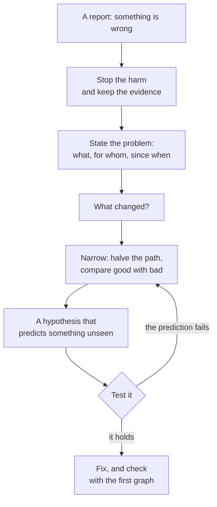

# 7.5 Debugging production

[Syllabus](../SYLLABUS.md) · Phase 7 · Previous: [7.4 Distributed tracing and context propagation](04-distributed-tracing.md) · Next: [7.6 Incidents](06-incidents.md)

> **Time:** about 35 minutes to read, 45 minutes of practice.
> **You need:** the RED and USE checklists from [Chapter 7.1](01-telemetry.md); own time from [Chapter 7.4](04-distributed-tracing.md); pools and queues from [Chapter 1.6](../phase-1-foundations/06-concurrency-pools-queues.md). The example needs only Go, including `go tool pprof`, which comes with it. It takes about 18 seconds.

**By the end of this chapter you can**

- put the first minutes in order: stop the harm, keep the evidence, then look for the cause;
- state a problem precisely enough to test an explanation of it;
- narrow a search by what changed and by halving;
- tell a process that is working from one that is waiting, and pick the tool for each;
- take a CPU profile and a goroutine dump from a live Go service, and read them;
- recognise a leak, and say why a restart seems to fix it;
- name the common ways of fooling yourself.

---

## The problem

*An illustrative scenario; the example reproduces its three faults.* A service takes orders. Every few days it slows down. Somebody restarts it, and it is fast again. This has happened nine times in two months. Each note in the log reads the same: *restarted, recovered, cause unknown*.

On the tenth occasion the restart does nothing. Orders that took 3 ms take 170, and they still take 170 after the restart, and after the second restart. The team has one move, and it has stopped working.

There were two faults all along, and on that day a third.

- **A leak.** When the database is slow, a request gives up after 50 ms, and the goroutine that was doing its work waits for ever, holding half a megabyte. A restart throws them all away. That is why it helped nine times.
- **A lock.** That morning's release moved a query inside a lock. One order at a time can make it, and thirty wait in a line. The process is doing almost nothing. A restart changes nothing, because the fault is in the code that starts again.
- **A waste of CPU**, in a release the week before: a check on product codes that compiles its pattern on every call. It was there through three restarts and nobody saw it, because the orders were not yet slow enough to page anyone.

Each of the three is named, to the line, by a question that takes a few seconds to ask of the running process. Nobody asked. And every restart destroyed the answer, which was in the memory of the process that was killed.

Three things went wrong, and none of them is technical.

1. **The team acted before it looked.** A restart is a reasonable way to stop harm. Done first, it is also a way to delete the evidence.
2. **It had no method.** *It is slow* was treated as one problem with one remedy. It is at least three, and they need different tools.
3. **It learned from a coincidence.** Nine successes taught that restarting works. It never had.

---

## The concept

### 1. Stop the harm first, and keep the evidence

The order of work in an incident is not the order that curiosity suggests. Google's SRE book: "Your first response in a major outage may be to start troubleshooting and try to find a root cause as quickly as possible. Ignore that instinct! Instead, your course of action should be to make the system work as well as it can under the circumstances" ([Chris Jones, *Effective Troubleshooting*](https://sre.google/sre-book/effective-troubleshooting/)).

Phase 6 was a catalogue of ways to do that: roll back the release, move traffic away, shed load, add capacity, restart. None of them needs the cause to be known.

The same passage has a second half, and the scenario's team never read it: "Stopping the bleeding should be your first priority; you aren't helping your users if the system dies while you're root-causing. Of course, an emphasis on rapid triage doesn't preclude taking steps to preserve evidence of what's going wrong" ([*Effective Troubleshooting*](https://sre.google/sre-book/effective-troubleshooting/)).

Some evidence survives a restart: metrics, logs, traces. Some does not: what every goroutine was doing, what was in memory, where the CPU was going. That takes ten seconds to collect, and section 4 shows how. Collect it, then restart. Better still, take one sick instance out of the load balancer and keep it alive to be questioned, and restart the others.

### 2. A method

The SRE book's description of what a good troubleshooter does is the scientific method, by name: "given a set of observations about a system and a theoretical basis for understanding system behavior, we iteratively hypothesize potential causes for the failure and try to test those hypotheses" ([*Effective Troubleshooting*](https://sre.google/sre-book/effective-troubleshooting/)).



**State the problem.** Not *it is slow*. Which requests, how slow, since when, and for whom. The earlier chapters of this phase are the tools: the labels of Chapter 7.1 say which endpoint, version and zone, its logs say what the failures have in common, and the traces of Chapter 7.4 say which service's own time it is. A problem stated well is half found: *orders, from every customer, 170 ms where 3 ms is normal, since 09:40, all instances*.

**Ask what changed.** The book's reason: "Systems have inertia: we've found that a working computer system tends to remain in motion until acted upon by an external force, such as a configuration change or a shift in the type of load served. Recent changes to a system can be a productive place to start identifying what's going wrong" ([*Effective Troubleshooting*](https://sre.google/sre-book/effective-troubleshooting/)). Releases, configuration, feature flags, the mix of traffic, the size of the data, a dependency's release, a certificate, a scheduled job. Since 09:40 is a question about 09:39.

**Narrow.** Halve the path between the user and the fault, and ask which half is healthy: "an alternative, bisection, splits the system in half and examines the communication paths between components on one side and the other" ([*Effective Troubleshooting*](https://sre.google/sre-book/effective-troubleshooting/)). Or compare a good thing with a bad one: an instance, a zone, a version, a customer. Whatever differs between them is where to look.

**Form a hypothesis, and test it.** A useful hypothesis predicts something that has not been looked at yet. *If thirty requests are queued on a lock, the CPU will be idle, and a dump will show thirty goroutines at one line.* Then look. A prediction that fails is progress: it removes a branch for good. The book's advice on record-keeping belongs here: "Take clear notes of what ideas you had, which tests you ran, and the results you saw" ([*Effective Troubleshooting*](https://sre.google/sre-book/effective-troubleshooting/)).

**Fix, and check with the graph that showed the problem.** Not with a new graph.

The same chapter lists how this goes wrong ([*Effective Troubleshooting*](https://sre.google/sre-book/effective-troubleshooting/)):
- "Looking at symptoms that aren't relevant or misunderstanding the meaning of system metrics."
- "Coming up with wildly improbable theories about what's wrong, or latching on to causes of past problems, reasoning that since it happened once, it must be happening again."
- "Hunting down spurious correlations that are actually coincidences or are correlated with shared causes."

The second is the scenario. The remedy for it is an old one from medicine, which the book borrows: "when you hear hoofbeats, think of horses not zebras" ([*Effective Troubleshooting*](https://sre.google/sre-book/effective-troubleshooting/)).

### 3. Working, or waiting

Chapter 7.4 ended with a trace that said: *this service, its own time*. Inside one process, a slow request is in one of two states, and they call for different tools. Brendan Gregg's division: "On-CPU: where threads are spending time running on-CPU. Off-CPU: where time is spent waiting while blocked on I/O, locks, timers, paging/swapping, etc." ([Brendan Gregg, *Off-CPU Analysis*](https://www.brendangregg.com/offcpuanalysis.html)).

So the first question is whether the process is busy. That is the first line of the USE checklist from Chapter 7.1, which Gregg sums up as "For every resource, check utilization, saturation, and errors" ([Brendan Gregg, *The USE Method*](https://www.brendangregg.com/usemethod.html)).

| What the process is doing | How it looks from outside | The tool |
|---|---|---|
| Working: the CPU is busy | CPU high. Latency rises with load | a CPU profile |
| Waiting for a lock | CPU idle, latency high. Many goroutines at one line | a goroutine dump, then the mutex profile |
| Waiting for something else: a database, a pool, another service | CPU idle, latency high. Goroutines in a network read, or queued for a connection | a goroutine dump, then a trace |
| Collecting garbage | CPU busy, and the busy part is the runtime's | a CPU profile, then the heap profile |
| Leaking | Goroutines, memory or connections grow for days | two dumps some minutes apart, compared |

The mistake to avoid is taking a CPU profile of a process that is waiting. Gregg again: off-CPU analysis "differs from CPU profiling, which only examines threads if they are executing on-CPU" ([*Off-CPU Analysis*](https://www.brendangregg.com/offcpuanalysis.html)). A CPU profile of an idle process is a careful picture of nothing.

### 4. Profiles, from a live process

A **profile** says where something went: CPU time, memory, waiting. Go's runtime keeps several, and its documentation says what each is for ([Go, *Diagnostics*](https://go.dev/doc/diagnostics)):
- "CPU profile determines where a program spends its time while actively consuming CPU cycles (as opposed to while sleeping or waiting for I/O)."
- "Goroutine profile reports the stack traces of all current goroutines."
- "Heap profile reports memory allocation samples; used to monitor current and historical memory usage, and to check for memory leaks."
- "Mutex profile reports the lock contentions. When you think your CPU is not fully utilized due to a mutex contention, use this profile."
- "Block profile shows where goroutines block waiting on synchronization primitives (including timer channels)."

**Getting one takes an import and a command.** The package `net/http/pprof` "serves via its HTTP server runtime profiling data in the format expected by the pprof visualization tool", and "The handled paths all begin with /debug/pprof/" ([Go package `net/http/pprof`](https://pkg.go.dev/net/http/pprof)). Then, from anywhere that can reach the process:

```bash
go tool pprof http://localhost:6060/debug/pprof/profile?seconds=30    # thirty seconds of CPU
curl 'http://localhost:6060/debug/pprof/goroutine?debug=1'            # what every goroutine is doing
```

**A CPU profile is a sample, which is why it is cheap.** "When CPU profiling is enabled, the Go program stops about 100 times per second and records a sample consisting of the program counters on the currently executing goroutine's stack" ([The Go Blog, *Profiling Go Programs*](https://go.dev/blog/pprof)). A function that is on the stack in 70% of the samples was running, or had called what was running, for 70% of the time. The report has two columns that matter: *flat* is time in the function itself, and *cum* is time in it and in everything it called. Read *cum* from the top to find the path, and *flat* to find the work.

The same data drawn as a picture is a **flame graph**. Its axes surprise people, so Gregg states them: "The x-axis shows the stack profile population, sorted alphabetically (it is not the passage of time), and the y-axis shows stack depth, counting from zero at the bottom. Each rectangle represents a stack frame" ([Brendan Gregg, *Flame Graphs*](https://www.brendangregg.com/flamegraphs.html)). Width is time. Look for the wide plateaus.

**It is meant to be used in production.** Go's documentation asks the question itself: "Can I profile my production services? Yes. It is safe to profile programs in production, but enabling some profiles (e.g. the CPU profile) adds cost" ([Go, *Diagnostics*](https://go.dev/doc/diagnostics)). And it suggests a habit: "You may want to periodically profile your production services." Google does this across its whole fleet, with a system that "samples across machines in multiple data centers and collects various events—such as stack traces, hardware events, lock contention profiles, heap profiles, and kernel events", at a cost it reports as "negligible—less than 0.01 percent" ([Ren et al., *Google-Wide Profiling*](https://static.googleusercontent.com/media/research.google.com/en//pubs/archive/36575.pdf)). A profile from last Tuesday, to compare with today's, is worth a great deal.

One caution. Importing `net/http/pprof` adds its paths to Go's default router. If that router is the one that serves the public, the profiles are public. Serve them on a separate port that only operators can reach.

### 5. Leaks, and why a restart seems to work

A **leak** is anything that is taken and not given back: memory, goroutines, connections, file descriptors, rows in a table that is never cleaned. Its graph is a slope, and with restarts a sawtooth. Its symptoms come late and look like something else: slow collections of garbage, a pool with no connections left, a process killed for its memory.

A restart sets the count to zero. It does not change the rate. The service is healthy for exactly as long as it takes to climb back.

A leak is found by comparing, because one dump of a leaking process and one of a busy one can look alike. Take two, some minutes apart. What has grown between them, and is at the same line both times, is the leak.

### 6. When the symptom is errors

The method is the same and the first steps are quicker, because an error says more than a delay does.

- **Group the failures**, as Chapter 7.1's example did: by endpoint, version, zone, customer, dependency. A failure that is 100% of one group and 0% of the rest is nearly diagnosed.
- **Find the first one.** The time of the first error, set beside the list of changes, is often the whole answer.
- **Read one, in full**: the log line, the trace, the error that the dependency returned. Then find out whether the other thousand are the same error.
- **Separate the cause from its echoes.** One failing dependency makes errors in everything that calls it. Chapter 7.4's traces say which error came first.

---

## A real example

### Run it: one symptom, three faults

[`code/ch05-debug/main.go`](code/ch05-debug/main.go), about 440 lines, is two programs in one. With `-serve` it is the order service, with one of the scenario's three faults or none. Without, it is the engineer. It starts the service as a separate process, sends it orders from forty clients, and questions it over HTTP, which is how a live service is questioned: its numbers, two seconds of CPU profile read with `go tool pprof`, and a dump of every goroutine.

The three faults are a few lines each:

```go
	case "cpu":
		// The fault: regexp.MatchString compiles its pattern every time it is called.
		for _, code := range codes {
			if ok, _ := regexp.MatchString(pattern, code); !ok {
				http.Error(w, "bad product code", http.StatusBadRequest)
				return
			}
		}
		database(2 * time.Millisecond)
```

```go
		// The fault: the query is made while the lock is held, so one order at a time can make it.
		s.prices.Lock()
		database(5 * time.Millisecond)
		s.prices.Unlock()
```

```go
		result := make(chan []byte) // no buffer: a send waits until somebody receives
		slow := s.calls.Add(1)%20 == 0
		go func() {
			receipt := make([]byte, 512<<10)
			if slow {
				database(200 * time.Millisecond) // one query in twenty is slow
			} else {
				database(2 * time.Millisecond)
			}
			result <- receipt // the fault: if the handler has given up, nobody ever receives
		}()
```

```bash
go run ./phase-7-observability/code/ch05-debug
```

The times are real, so yours will differ a little.

```text
PART 1 — the dashboard. The same service four times, with forty clients, for about three seconds each.

  fault      requests   failed     median   99th percentile   goroutines  memory in use
  none           1964     0.0%       3 ms              5 ms           46           2 MB
  cpu            1107     0.0%      46 ms            128 ms           73           2 MB
  lock            483     0.0%     173 ms            206 ms           74           3 MB
  leak           1948     5.0%       3 ms             51 ms          144          78 MB
```

**The dashboard says that something is wrong, three times, and not what.** With the first two faults, orders take 46 ms and 173 ms where 3 ms is normal. Nothing fails. The count of goroutines is a little up. On this evidence the two are the same problem, and the scenario's team treated them as one. The third is different in kind: the times are nearly normal, one order in twenty fails, and two numbers that nobody was graphing are far too high.

```text
PART 2 — two questions, put to the running process over HTTP.

  fault: none
    Is it busy? A CPU profile of two seconds, on 4 CPUs:
      Duration: 2.10s, Total samples = 150ms ( 7.13%)
      Less than half of one CPU. The process is not working, so this profile has nothing to say.
    What is everyone doing? A dump of all 46 goroutines, grouped by where they are:
         42  in the HTTP server and the runtime, not in this program's code
          2  main.database main.go:58, in time.Sleep, called from main.(*shop).order main.go:107
          1  main.(*shop).order main.go:102, in regexp.(*Regexp).MatchString
          1  main.serve main.go:131, in net/http.Serve, called from main.main main.go:432

  fault: cpu
    Is it busy? A CPU profile of two seconds, on 4 CPUs:
      Duration: 2.14s, Total samples = 5.51s (257.77%)
            flat  flat%   sum%        cum   cum%
           0.01s  0.18%  0.36%      4.18s 75.86%  main.(*shop).order
               0     0%  0.36%      4.15s 75.32%  regexp.MatchString
               0     0%  0.36%      3.96s 71.87%  regexp.Compile (inline)
               0     0%  0.36%      3.96s 71.87%  regexp.compile
           0.02s  0.36%  1.81%      1.49s 27.04%  regexp.compileOnePass
    What is everyone doing? A dump of all 64 goroutines, grouped by where they are:
         42  in the HTTP server and the runtime, not in this program's code
         20  main.(*shop).order main.go:65, in regexp.MatchString
          1  main.(*shop).order main.go:109, in fmt.Fprintln
          1  main.serve main.go:131, in net/http.Serve, called from main.main main.go:432
```

**The healthy service first, because a profile means little without one to compare it with.** It uses 7.13% of one CPU, and its goroutines are where they should be: in the HTTP server, waiting for requests.

**The CPU fault is busy, and the profile names the line.** The process used 257.77% of a CPU: about two and a half processors' worth. Read the *cum* column from the top. 75.86% of that time was under `order`, and almost all of that was under `regexp.MatchString`, and almost all of that under `regexp.Compile`. The handler calls a function that compiles the same pattern for every one of an order's 200 lines. The goroutine dump agrees: 20 goroutines at line 65. The repair is to use the pattern that was compiled when the program started, which the other three versions of the handler do.

```text
  fault: lock
    Is it busy? A CPU profile of two seconds, on 4 CPUs:
      Duration: 2.01s, Total samples = 60ms ( 2.99%)
      Less than half of one CPU. The process is not working, so this profile has nothing to say.
    What is everyone doing? A dump of all 74 goroutines, grouped by where they are:
         42  in the HTTP server and the runtime, not in this program's code
         30  main.(*shop).order main.go:79, in sync.(*Mutex).Lock
          1  main.database main.go:58, in time.Sleep, called from main.(*shop).order main.go:80
          1  main.serve main.go:131, in net/http.Serve, called from main.main main.go:432
```

**The lock fault is idle.** 2.99% of one CPU, less than the healthy service, while orders take more than fifty times as long. The CPU profile has nothing in it, and a team that knew only that tool would stop here. The dump has it in two lines. Thirty goroutines are at line 79, in `sync.(*Mutex).Lock`. One is at line 80, the next line, asleep in the database call. Thirty orders are waiting for a lock, and the order that holds it is waiting for a query. The repair is to make the query before taking the lock, and to hold the lock only to store the answer.

```text
  fault: leak
    Is it busy? A CPU profile of two seconds, on 4 CPUs:
      Duration: 2.19s, Total samples = 260ms (11.89%)
      Less than half of one CPU. The process is not working, so this profile has nothing to say.
    What is everyone doing? A dump of all 144 goroutines, grouped by where they are:
         90  main.(*shop).order.func1 main.go:92
         42  in the HTTP server and the runtime, not in this program's code
          7  main.database main.go:58, in time.Sleep, called from main.(*shop).order.func1 main.go:88
          3  main.(*shop).order main.go:94
```

**The leak shows as a count.** 144 goroutines, where a healthy service has about 45, and 90 of them at one line: line 92, the send on a channel that nobody is reading any more. They are not working and not really waiting. They are forgotten.

```text
PART 3 — the leak, watched for six seconds. After three, somebody restarts the service.

  second     goroutines  memory in use
  1                  81          42 MB
  2                 117          70 MB
  3                 153          71 MB
           the service is restarted. The largest group in its last dump: 101, main.(*shop).order.func1 main.go:92
  4                  56          19 MB
  5                  90          68 MB
  6                 126          61 MB

  4341 requests, of which 218 failed.
```

**This is the scenario's two months, in six seconds.** Goroutines climb by about 36 a second, and memory with them, less evenly. The restart brings them down, and they climb again at the same rate. Before the service was killed, its last dump named line 92. In the scenario nobody took that dump, nine times.

### How Google's engineers found a slow App Engine application

The SRE book's chapter ends with a case that has every part of the method in it, including the wrong turn ([*Effective Troubleshooting*](https://sre.google/sre-book/effective-troubleshooting/)).

**The report.** A team inside Google ran a documentation site on App Engine, and it reported "a dramatic increase in latency, CPU usage, and number of running processes needed to serve traffic" ([*Effective Troubleshooting*](https://sre.google/sre-book/effective-troubleshooting/)).

**What changed?** Apparently nothing. Traffic had not grown, and "The service's most recent code pushes and configuration pushes had completed days before" ([*Effective Troubleshooting*](https://sre.google/sre-book/effective-troubleshooting/)). Other applications on the same platform were unaffected, which cleared the platform.

**A hypothesis, and its death.** The slowdown had come with a rise in one kind of database call, which usually means a missing index. Then a second observation: pictures, which never touch the database, were slow too. "This implied that the observed correlation between merge_join and the latency increase was spurious and that our suboptimal-indexing theory was fatally flawed" ([*Effective Troubleshooting*](https://sre.google/sre-book/effective-troubleshooting/)).

**A trace with a gap.** They traced single requests with Dapper, and found "about a 250 ms period where the app was doing…well, something". The trace could say no more: "Dapper couldn't help track down what was going on since it can only trace RPC calls, and none were made during that period" ([*Effective Troubleshooting*](https://sre.google/sre-book/effective-troubleshooting/)). This is Chapter 7.4's gap: time inside a service that no span covers.

**The harm stopped, with the cause still unknown.** The application had a launch in a week. "Faced with what was, by this point, quite a mystery, we decided not to solve it… yet" ([*Effective Troubleshooting*](https://sre.google/sre-book/effective-troubleshooting/)), and the application was moved to larger machines, which brought the latency down far enough.

**The cause**, found afterwards by instrumenting the 250 ms: a check of permissions that ran on every request and looked through a list held in memory. A security scanner, testing the site before the launch, had "produced thousands of whitelist objects over the course of half an hour. These superfluous whitelist objects then had to be checked on every request to the app" ([*Effective Troubleshooting*](https://sre.google/sre-book/effective-troubleshooting/)). That was the change. It was a change to the data, and no list of releases contained it.

---

## Trade-offs

**Stopping the harm against keeping the evidence.** A rollback or a restart is right, and it erases what was in memory. Ten seconds to take a dump and a profile first is nearly always affordable. When it is not, keep one instance out of rotation.

**Restarting.** It is a legitimate way to stop harm, and for a leak it is the only quick one. Its costs are the evidence, a cold cache, and the lesson that it teaches. Count restarts. A service that is restarted on a schedule has a fault that somebody has decided not to look for.

**Production against a test environment.** Production has the real data, the real traffic and the fault. A test environment is safe to break, and the fault may not be there. Diagnose in production with tools that only read, and try changes somewhere else when you can.

**Profiling always against profiling on demand.** Always-on profiling costs a little all the time and has last week's profile ready for comparison. On demand costs nothing until the day it is needed, and then there is nothing to compare with.

**Method against experience.** Experience is where good hypotheses come from. It is also where *it was the cache last time* comes from. Let experience propose, and make the test decide.

**Access against exposure.** Profiles and dumps show code paths, memory and sometimes data. The endpoint that makes debugging quick is one that an attacker would like too. Phase 8 takes this up.

---

## Practice

### Check yourself

1. Two services each take 200 ms for a request that should take 5. One is using 260% of a CPU, the other 3%. For each: which tool first, and what do you expect it to show?
2. A service is restarted every Monday because it is slow by the weekend. Which two measurements, a day apart, would say what kind of fault this is? What does the restart do to them?
3. In the App Engine case, which observation killed the theory of a missing index? What would have happened if the team had added the index?

<details>
<summary>Answers</summary>

1. The busy one: a CPU profile. Expect a few functions to hold most of the cumulative time, and the path from the handler down to them. The idle one: a goroutine dump. Expect many goroutines at the same line, waiting for a lock, a connection from a pool, or an answer from another service. A CPU profile of the second would show nothing, because nothing is running.
2. The number of goroutines and the memory in use, or whichever resource it holds: connections, file descriptors. If they have grown from one day to the next under the same traffic, it is a leak, and two dumps will show which line is growing. The restart sets both to their starting values and leaves the slope as it was, which is why it has to be done again every Monday.
3. That pictures, which were not read from the database at all, had slowed down as much as the pages that were. An index could not explain that, so the correlation with the database call was a coincidence. Had they added the index, the database calls would have been quicker and the site as slow as before. They would have spent a day and learned less than the one observation told them.

</details>

### Exercise: three repairs

1. **The leak.** Change one line of the example so that the goroutine can always finish. Run it and read part 3. What is still wrong afterwards?
2. **The lock.** Rewrite the three lines so that the query is made outside the lock. What must be true of the prices for that to be safe?
3. **The CPU.** The profile found it in two seconds. How could it have been found with no profiler at all?
4. Write the note for each of the three incidents, in one line: what was wrong, how it was found, and what would stop it from coming back.

<details>
<summary>Worked solution</summary>

**1. The leak.** Give the channel room for one value:

```go
		result := make(chan []byte, 1) // room for one: the send never waits, whoever is listening
```

The goroutine can now always put its result down and end, whether or not the handler is still there to pick it up.

```text
PART 3 — the leak, watched for six seconds. After three, somebody restarts the service.

  second     goroutines  memory in use
  1                  52           9 MB
  2                  53          10 MB
  3                  54          11 MB
           the service is restarted. The largest group in its last dump: 42, in the HTTP server and the runtime, not in this program's code
  4                  30           9 MB
  5                  32          11 MB
  6                  34           6 MB

  4323 requests, of which 215 failed.
```

The count is flat at about fifty, and the memory with it. The restart no longer does anything, because there is nothing to clear.

Two things are still wrong. One order in twenty still fails after 50 ms: that is the slow query, and the leak was a consequence of it, not its cause. And each of those queries still runs to its end, for 200 ms, on behalf of a request that has already been answered with an error. Chapter 6.2's remedy applies: give the query the request's context, so that it stops when the request does.

**2. The lock.**

```go
		database(5 * time.Millisecond) // the query, with no lock held
		s.prices.Lock()
		// store the answer in the table of prices: a few nanoseconds
		s.prices.Unlock()
```

Orders now wait for their own queries and not for each other's. With this change the `lock` row of part 1 reads 6 ms at the median and 7 ms at the 99th percentile, where it read 173 and 206. It is safe if it does not matter which of two orders stores its answer last, which is true when both read the same price. If the stored value depended on what was in the table before, the check would have to be made again under the lock. Chapter 2.4 gave the rule for locks in a database, and it holds for these: hold a lock for as short a time as possible, and put nothing slow inside it.

**3. Without a profiler.** By asking what changed. The slow orders began with a release. Its difference from the one before contains the call to `regexp.MatchString`. A reviewer who knows that this function compiles its pattern each time would stop there, and one who does not could still try the suspect change alone. The profiler is quicker and does not depend on knowing. But the first question of the method would have found it.

**4. The notes.**

- *Leak.* Goroutines that sent a result on an unbuffered channel waited for ever when the request had timed out. Found in a goroutine dump: 101 at one line. Now buffered. A graph of goroutines and memory for every service, and an alert on their growth, would have shown it in the first week.
- *Lock.* A release made a database query while holding the price table's lock. Found by an idle CPU and a dump with thirty goroutines at one `Lock`. The query is now made outside it. Rolled back within minutes next time, because the release marker on the latency graph will point at it.
- *CPU.* A release validated product codes with a function that compiles its pattern on each call. Found by a CPU profile: three quarters of the time under one call. Compiled once now. A profile taken routinely from one instance, and compared between releases, would have caught it before any order was slow.

</details>

---

## Production tips and common mistakes

- **Collect before you restart**: a goroutine dump, a heap profile, a few seconds of CPU profile. Script it, so that it is one command at 03:00.
- **Have the profiling endpoint in every service**, on a port that the public cannot reach.
- **Graph goroutines, memory, connections and file descriptors** for every service. A leak is visible weeks before it hurts.
- **Mark releases and configuration changes on every dashboard.**
- **Keep a profile from a good day.** Today's means more beside it.
- **Write down each hypothesis and its result** as you go, in the incident channel.
- **Change one thing at a time**, and undo what did not help.
- **Compare a good instance with a bad one** before theorising about either.
- **Count restarts**, by service. A rising count is a fault that is being managed and not fixed.

**Common mistakes**

- **Restarting first**, and losing the only copy of the evidence.
- **Reading a CPU profile of a process that is waiting.**
- **Fixing the last incident's cause again.**
- **Treating a correlation as a cause**, without one test of it.
- **Changing three things at once**, and never knowing which one helped.
- **Stopping at the first explanation that fits**, when there were two faults.
- **Debugging by adding log lines and releasing**, when a dump would have answered in seconds.
- **A profiling endpoint that the internet can reach.**

---

## Key takeaways

- Stop the harm first. Before any step that restarts a process, take what will die with it: a dump and a profile.
- Debugging is a loop: state the problem, ask what changed, narrow, guess, and test the guess against something not yet seen.
- Most faults begin with a change. Some changes are to data or traffic, and are in no list of releases.
- A slow process is working or waiting. A CPU profile explains the first. A goroutine dump explains the second. Using the wrong one explains nothing.
- Profiles are samples, cheap enough to take from production, and safe to take.
- A leak is a slope. A restart moves you back down it and does not flatten it.
- Experience proposes hypotheses. Only a test decides between them.

**Next:** [7.6 Incidents](06-incidents.md) — the tools are in hand. An outage also needs people: who decides, who talks to customers, and what is written down afterwards.

---

## Sources

- Chris Jones, [*Effective Troubleshooting*](https://sre.google/sre-book/effective-troubleshooting/), chapter 12 of *Site Reliability Engineering*, Google, 2016.
- Go documentation: [*Diagnostics*](https://go.dev/doc/diagnostics); package [`net/http/pprof`](https://pkg.go.dev/net/http/pprof); The Go Blog, [*Profiling Go Programs*](https://go.dev/blog/pprof).
- Brendan Gregg: [*The USE Method*](https://www.brendangregg.com/usemethod.html), [*Off-CPU Analysis*](https://www.brendangregg.com/offcpuanalysis.html) and [*Flame Graphs*](https://www.brendangregg.com/flamegraphs.html).
- Gang Ren, Eric Tune, Tipp Moseley, Yixin Shi, Silvius Rus and Robert Hundt, [*Google-Wide Profiling: A Continuous Profiling Infrastructure for Data Centers*](https://static.googleusercontent.com/media/research.google.com/en//pubs/archive/36575.pdf), IEEE Micro, 2010.
