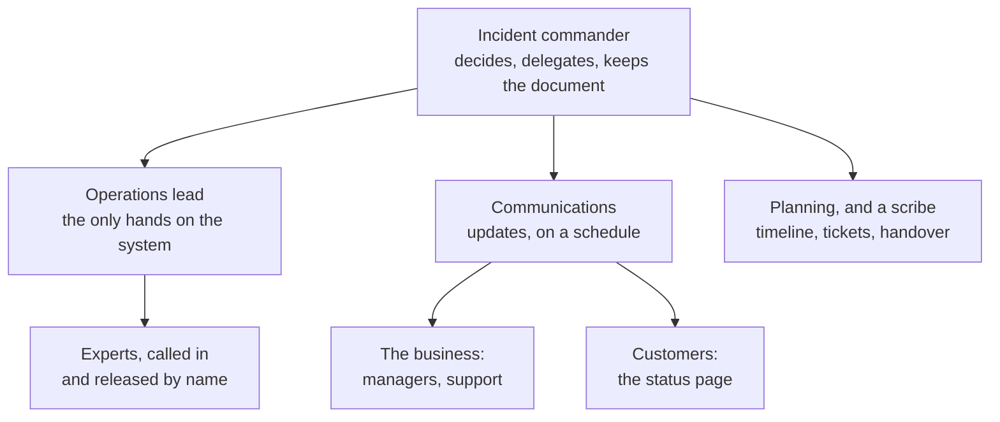

# 7.6 Incidents

[Syllabus](../SYLLABUS.md) · Phase 7 · Previous: [7.5 Debugging production](05-debugging-production.md) · Next: [Capstone 7](capstone-operable-payments.md)

> **Time:** about 35 minutes to read, 45 minutes of practice.
> **You need:** pages and tickets from [Chapter 7.3](03-alerting.md); *stop the harm, keep the evidence* from [Chapter 7.5](05-debugging-production.md); the error budget policy from [Chapter 7.2](02-slis-slos-error-budgets.md). The example is a calculator, needs only Go, and runs at once.

**By the end of this chapter you can**

- say when a problem becomes an incident, and declare one;
- run the first ten minutes: one person in charge, the jobs handed out, one place to talk;
- keep an incident document that somebody who joins late can read;
- tell three audiences what they need, on a schedule;
- hand over, and close;
- write a postmortem that blames nobody and whose actions get done;
- judge whether a rota and a pager can be kept up for a year.

---

## The problem

*An illustrative scenario, after the one in Google's SRE book.* At 14:05 on a Tuesday, checkout begins to fail for some customers. By 14:20 there are twelve people on a call.

Three of them are looking at the database. Two are restarting things, and neither has told the other. A director joins and asks for a summary. The engineer who knows most stops work to give it, and gives it again ten minutes later to a second director. Support has told customers three different things. The status page is green. At 14:50 somebody rolls back the morning's release, which had nothing to do with it, and search goes down too. At 15:40 the fault is fixed by an engineer who was not on the call, and who had no idea that two people on it had spent an hour on the same theory.

Nobody was idle, and nobody was careless. The SRE book says of its own version of this story: "Note that everybody in the preceding scenario was doing their job, as they saw it" ([Andrew Stribblehill, *Managing Incidents*](https://sre.google/sre-book/managing-incidents/)). It names three hazards, and the scenario has all of them.

- **Everyone was solving the technical problem**, so nobody was running the incident. Of the engineer at the centre: "She wasn't in a position to think about the bigger picture of how to mitigate the problem because the technical task at hand was overwhelming."
- **Nobody was told anything.** "Nobody knew what actions their coworkers were taking."
- **People acted alone.** The book calls it freelancing, and its example ends: "His changes made a bad situation far worse" ([*Managing Incidents*](https://sre.google/sre-book/managing-incidents/)).

The scenario has a second part. The following week there is a meeting to establish what went wrong. Its summary names the engineer who ran the migration. In the next quarter, problems are reported later, and described as smaller than they are.

The first five chapters of this phase were about instruments. An outage is also twelve people, and this chapter is about them.

---

## The concept

### 1. An incident is declared

A problem becomes an **incident** when somebody says so. Saying so changes how people work: one person is in charge, there is one place to talk, and changes to the system go through one pair of hands.

The usual mistake is to say it late. The SRE book: "It is better to declare an incident early and then find a simple fix and close out the incident than to have to spin up the incident management framework hours into a burgeoning problem" ([*Managing Incidents*](https://sre.google/sre-book/managing-incidents/)). Its author's team uses three questions, and one *yes* is enough ([*Managing Incidents*](https://sre.google/sre-book/managing-incidents/)):
- "Do you need to involve a second team in fixing the problem?"
- "Is the outage visible to customers?"
- "Is the issue unsolved even after an hour's concentrated analysis?"

Write the conditions down before they are needed, with a few levels of severity, so that the person who is paged at 03:00 does not have to judge. Anyone may declare. An incident that turns out to be nothing costs ten minutes. One that is declared an hour late costs the hour.

### 2. One job each

Google's process is borrowed from people who fight fires: "Google's incident management system is based on the Incident Command System" ([*Managing Incidents*](https://sre.google/sre-book/managing-incidents/)). Its idea is that each job has one owner, and it has a result that is not obvious: "a clear separation of responsibilities allows individuals more autonomy than they might otherwise have, since they need not second-guess their colleagues."

| Role | The book's description ([*Managing Incidents*](https://sre.google/sre-book/managing-incidents/)) | In the scenario |
|---|---|---|
| **Incident commander** | "The incident commander holds the high-level state about the incident." | nobody |
| **Operations** | "The operations team should be the only group modifying the system during an incident." | five people, separately |
| **Communications** | "This person is the public face of the incident response task force." | the engineer who knew most, twice |
| **Planning** | "The planning role supports Ops by dealing with longer-term issues, such as filing bugs, ordering dinner, arranging handoffs, and tracking how the system has diverged from the norm so it can be reverted once the incident is resolved." | nobody, so the rollback of 14:50 was never undone on purpose |



**The commander does not touch the keyboard.** PagerDuty's public guide for its own commanders puts the job in a sentence, "Keep the incident moving towards resolution", and is blunt about what it excludes: "You should not be performing any actions or remediations, checking graphs, or investigating logs. Those tasks should be delegated" ([PagerDuty, *Incident Commander*](https://docs.pagerduty.com/ops-guides/incident-response-guide/incident-commander)). The person who is typing cannot also be watching the whole.

**The commander outranks the room, for the duration.** "They become the highest ranking individual on any major incident call, regardless of their day-to-day rank." And the role is a skill, not a grade: "You don't need to be a senior team member to become an IC" ([PagerDuty, *Incident Commander*](https://docs.pagerduty.com/ops-guides/incident-response-guide/incident-commander)). The director in the scenario is an interested party. The commander sends them to the communications lead.

**The roles are hats.** For a small incident one person wears several: "De facto, the commander holds all positions that they have not delegated" ([*Managing Incidents*](https://sre.google/sre-book/managing-incidents/)). What matters is that it is known who wears which, and that the commander's is put on first.

**Decisions are made aloud, and quickly.** PagerDuty teaches its commanders a form of words. State the plan, then ask whether anyone objects strongly, and wait. The reason: "Asking for any STRONG objections gives people the chance to object, but only if they feel strongly on the matter." Then give the task to one named person with a time: "Tasks should be assigned to an individual and be time-boxed." And when no option is good: "If you have nothing but bad options, pick one and proceed" ([PagerDuty, *Incident Commander*](https://docs.pagerduty.com/ops-guides/incident-response-guide/incident-commander)).

### 3. One place, and one document

**One place to talk**: a channel, and a call if needed. Everything goes there. A decision made in a private message has not been made.

**One document**, kept up while the incident runs: "The incident commander's most important responsibility is to keep a living incident document", and "This living doc can be messy, but must be functional" ([*Managing Incidents*](https://sre.google/sre-book/managing-incidents/)). The book's [example](https://sre.google/sre-book/incident-document/) has, in this order:

- a summary of one or two lines, and the status;
- where the command post is;
- who holds each role now, and who is next;
- the conditions for calling it over;
- what has been done, what is being tried, and by whom;
- a timeline.

It has two readers. One is the person who joins at minute forty and must not ask the room to start again. The other is whoever writes the postmortem.

**Neither may depend on the thing that is broken.** The book notes that the team that runs Google Docs keeps its incident documents somewhere else: "depending on the software you are trying to fix as part of your incident management system is unlikely to end well" ([*Managing Incidents*](https://sre.google/sre-book/managing-incidents/)). The same goes for the chat, the dashboards, the login, and the tool that makes the fix. The example below turns on exactly this.

### 4. The work, in order

The order is Chapter 7.5's, and the book makes it the first of its practices: "Prioritize. Stop the bleeding, restore service, and preserve the evidence for root-causing" ([*Managing Incidents*](https://sre.google/sre-book/managing-incidents/)).

- **Stop the harm** with the tools of Phase 6: roll back, move traffic, shed load, switch a feature off. A switch that was built and rehearsed beforehand is worth more than a clever fix on the day.
- **One change at a time**, announced in the channel before it is made, by the operations lead or with their agreement. This is what ends freelancing.
- **Keep the evidence** before any step that destroys it.
- **Look for the cause when users are no longer being hurt**, or in parallel if there are people to spare.

The commander also watches the people, themselves included. "Introspect. Pay attention to your emotional state while responding to an incident. If you start to feel panicky or overwhelmed, solicit more support" ([*Managing Incidents*](https://sre.google/sre-book/managing-incidents/)). A long incident needs relief, and the change of commander is made out loud: "It's essential that the post of incident commander be clearly handed off at the end of the working day." The outgoing commander says who now has command, and waits to hear it accepted.

### 5. Telling everyone else

There are three audiences, and they need different things.

| Audience | They need | Where |
|---|---|---|
| The people responding | the current state, who is doing what, what has been ruled out | the channel and the document |
| The business: managers, support, sales | what customers are seeing, what to tell them, when the next news will come | a short update on a fixed schedule |
| Customers | that you know, what is affected, what they can do, when you will say more | the status page |

Three rules cover most of it.

- **Promise the next update, and keep the promise**, even when there is nothing new. *Next update at 14:45* stops twelve people from asking.
- **Say what users see, not what you suspect.** *Some payments are failing. We are working on it.* The cause can wait until it is known.
- **Say it early.** A status page that is green while customers are failing costs more trust than the outage does.

None of this is the commander's to write. It is why communications is a role.

### 6. Afterwards: the postmortem

An incident is closed when the harm has stopped, the system is stable, and what remains is in tickets. Then it is written up. The SRE book's definition: "A postmortem is a written record of an incident, its impact, the actions taken to mitigate or resolve it, the root cause(s), and the follow-up actions to prevent the incident from recurring" ([John Lunney and Sue Lueder, *Postmortem Culture*](https://sre.google/sre-book/postmortem-culture/)).

**When to write one is decided in advance**: "It is important to define postmortem criteria before an incident occurs so that everyone knows when a postmortem is necessary." The book's usual triggers include "User-visible downtime or degradation beyond a certain threshold", "Data loss of any kind", and "A monitoring failure (which usually implies manual incident discovery)" ([*Postmortem Culture*](https://sre.google/sre-book/postmortem-culture/)). Chapter 7.2 gave one in numbers: any incident that spends more than a fifth of the error budget.

**It blames nobody.** This is the part that the scenario's company got wrong, and it is a practical rule and not a kindness. The book: "For a postmortem to be truly blameless, it must focus on identifying the contributing causes of the incident without indicting any individual or team for bad or inappropriate behavior. A blamelessly written postmortem assumes that everyone involved in an incident had good intentions and did the right thing with the information they had" ([*Postmortem Culture*](https://sre.google/sre-book/postmortem-culture/)).

The reason is what blame does to the supply of information. Where it is the custom, "people will not bring issues to light for fear of punishment". The alternative is to fix what let the mistake through: "you can fix systems and processes to better support people making the right choices when designing and maintaining complex systems" ([*Postmortem Culture*](https://sre.google/sre-book/postmortem-culture/)). An engineer ran a migration that locked a table. The useful questions are why the tool allowed it, why no test showed it, and why it took forty minutes to see.

**What is in it.** The book's [example](https://sre.google/sre-book/example-postmortem/) has these parts:

- a summary, and the impact in numbers: users, requests, minutes, and the share of the error budget;
- the causes, the trigger, how it was detected, and how it was resolved;
- lessons, under three headings: what went well, what went wrong, and where we got lucky;
- actions, each with one owner and a ticket;
- the timeline.

The third heading is the one that people skip, and it holds the incidents that have not happened yet.

**It is reviewed, and its actions are tracked.** "An unreviewed postmortem might as well never have existed" ([*Postmortem Culture*](https://sre.google/sre-book/postmortem-culture/)). The same is true of an action with no owner and no date. Share it widely. Other teams have the same fault and do not know it.

### 7. On-call that people can keep doing

All of the above is done by people who were asleep, or at dinner. How they are treated decides how well it is done. The SRE book gives the reason from psychology. There are two ways of thinking, "Intuitive, automatic, and rapid action" and "Rational, focused, and deliberate cognitive functions", and for an outage in a complex system "the second of these options is more likely to produce better results and lead to well-planned incident handling" ([Andrea Spadaccini, *Being On-Call*](https://sre.google/sre-book/being-on-call/)). Stress and lack of sleep push people into the first. So: "it's important to reduce the stress related to being on-call."

The book turns that into three numbers.

- **Time.** "we strive to invest at least 50% of SRE time into engineering: of the remainder, no more than 25% can be spent on-call" ([*Being On-Call*](https://sre.google/sre-book/being-on-call/)).
- **People.** From that, with two on call at a time and shifts of a week: "the minimum number of engineers needed for on-call duty from a single-site team is eight". With two sites, which lets each cover the other's night: "a reasonable minimum size of each team is six".
- **Load.** An incident costs about six hours in all, as Chapter 7.3 quoted, so: "the maximum number of incidents per day is 2 per 12-hour on-call shift." That is a ceiling. What is wanted is far below it: "the distribution of paging events should be very flat over time, with a likely median value of 0" ([*Being On-Call*](https://sre.google/sre-book/being-on-call/)).

Too little is also a fault. An engineer who is on call twice a year has forgotten the system by the second time: "Being out of touch with production for long periods of time can lead to confidence issues" ([*Being On-Call*](https://sre.google/sre-book/being-on-call/)).

The rest is ordinary decency, made policy. Time off after a bad night. A secondary who can be called without apology. A written handover between shifts. A new engineer who shadows before carrying the pager alone. And a pager quiet enough to be believed, which was Chapter 7.3.

---

## A real example

### Run it: the arithmetic of a rota

[`code/ch06-oncall/main.go`](code/ch06-oncall/main.go), about 135 lines, is a calculator. It applies the book's three numbers to a team, and then to the two pagers of Chapter 7.3. The defaults are a team of four with two incidents a week.

```bash
go run ./phase-7-observability/code/ch06-oncall
```

```text
PART 1 — the rota. Shifts of a week, with two people on call at a time: a primary and a secondary.

  people    share of the year        weeks on call   within the 25% rule?
                      on call         a year, each
  3                       67%                 34.7                     no
  4                       50%                 26.0                     no   ← this team
  5                       40%                 20.8                     no
  6                       33%                 17.3                     no
  8                       25%                 13.0                    yes
  10                      20%                 10.4                    yes
  12                      17%                  8.7                    yes
```

Four people with a primary and a secondary are each on call for half the year. Nothing clever gets a small team out of this table. The ways out are to make the rota larger by sharing it with another team, to drop the secondary and accept the risk, or to make the pager so quiet that being on call costs little.

```text
PART 2 — the shift. Incidents that need a person, arriving independently, at a steady rate.

  incidents         days with     shifts of 12 h   hours of work that         …as a share of a
  a week                 none   with more than 2    they make, a week     working week of 40 h
  0.5                     93%               0.0%                  3 h                       8%
  1                       87%               0.0%                  6 h                      15%
  2                       75%               0.0%                 12 h                      30%   ← this team
  4                       56%               0.3%                 24 h                      60%
  7                       37%               1.4%                 42 h                     105%
  14                      14%               8.0%                 84 h                     210%

  The book asks that the median day has no incident. That holds while fewer than 4.9 arrive in a week.
```

The limit of two in a shift is almost never what gives way. Read the last two columns. At six hours each, two incidents a week take 30% of one person's week. Seven take all of it, and at that point nothing is being fixed, so next week has seven again. The follow-up is where the cost is, and it is the first thing to be dropped. The model assumes that incidents arrive independently. Real ones come in clusters, which makes every row a little worse.

```text
PART 3 — two pagers. The eight weeks of Chapter 7.3, for the person who is primary.

                                                          pages   nights broken,    nights broken a year,
                                                         a week             of 7     each, in a team of 4
  before: a CPU rule and a threshold on errors             21.0              7.0                       91
  after: a burn-rate rule and a probe                       1.0              0.1                        2
```

The first pager woke its owner every night of the week, because one rule fired at 02:05 for a batch job. In a team of four that is 91 broken nights a year for each person, for nothing. The second woke someone once in eight weeks, for four minutes in which every server was down. Same service, same incidents, same people. Most of what makes on-call bearable is decided by the alert rules.

### Cloudflare, 2 July 2019

Cloudflare's own account of a 27-minute outage is worth reading whole, both for what the team did and for how it is written ([John Graham-Cumming, *Details of the Cloudflare outage on July 2, 2019*](https://blog.cloudflare.com/details-of-the-cloudflare-outage-on-july-2-2019/)). The fault: "we deployed a new rule in our WAF Managed Rules that caused CPUs to become exhausted on every CPU core that handles HTTP/HTTPS traffic on the Cloudflare network worldwide".

| Time, UTC | What happened ([*Details of the Cloudflare outage*](https://blog.cloudflare.com/details-of-the-cloudflare-outage-on-july-2-2019/)) | In this phase's terms |
|---|---|---|
| 13:42 | "an engineer working on the firewall team deployed a minor change to the rules for XSS detection via an automatic process" | the change |
| 13:45 | "the first PagerDuty page went out indicating a fault with the WAF. This was a synthetic test that checks the functionality of the WAF" | a probe from outside, three minutes after the change |
| soon after | "there was speculation it was an attack of some type we'd never seen before" | a first hypothesis, and wrong |
| | "This wasn't a normal problem that SRE could handle alone, it needed every relevant team online at once." | declared, and widened |
| 14:00 | "the WAF was identified as the component causing the problem and an attack dismissed as a possibility. The Performance Team pulled live CPU data from a machine that clearly showed the WAF was responsible." | a CPU profile from a live machine |
| 14:02 | the proposal to use "a mechanism built into Cloudflare to disable a single component worldwide" | a switch built beforehand: stop the harm, and leave the fix for later |
| 14:07 | "a team member executed the global WAF termination at 14:07 and by 14:09 traffic levels and CPU were back to expected levels worldwide" | the harm stopped, 27 minutes after it began |
| 14:52 | "we were 100% satisfied that we understood the cause and had a fix in place and the WAF was re-enabled globally" | the cause, after the harm had stopped |

**Five minutes went on reaching their own tools.** The decision was made at 14:02 and carried out at 14:07, and the write-up says why: "We use our own products and with our Access service down we couldn't authenticate to our internal control panel" ([*Details of the Cloudflare outage*](https://blog.cloudflare.com/details-of-the-cloudflare-outage-on-july-2-2019/)). That is section 3's rule, met in the field: the way to the fix ran through the thing that was broken.

**The write-up blames nobody.** The person who deployed the rule is *an engineer*, once, and the account then turns to everything that allowed one deployment to do this. Its list of what went wrong is a list of systems and procedures ([*Details of the Cloudflare outage*](https://blog.cloudflare.com/details-of-the-cloudflare-outage-on-july-2-2019/)):
- "The SOP allowed a non-emergency rule change to go globally into production without a staged rollout."
- "The first alert for the global traffic drop took too long to fire."
- "We didn't update our status page quickly enough."
- "We had difficulty accessing our own systems because of the outage and the bypass procedure wasn't well-trained on."

**Each finding has an action, and the actions have dates**: "Introduce performance profiling for all rules to the test suite. (ETA: July 19)", and for the status page, "Automating update of the Cloudflare Status page" ([*Details of the Cloudflare outage*](https://blog.cloudflare.com/details-of-the-cloudflare-outage-on-july-2-2019/)).

Google's summary of what its own process bought is the same lesson from the other side: "we were able to reduce our mean time to recovery and provide staff a less stressful way to work on emergent problems" ([*Managing Incidents*](https://sre.google/sre-book/managing-incidents/)).

---

## Trade-offs

**Declaring early against crying wolf.** Early costs a few minutes of ceremony for something small. Late costs the scenario. If people are embarrassed to declare, the conditions are too vague, or the ceremony is too heavy. Fix those.

**Structure against speed.** Four roles for a fault that one person can fix in ten minutes is theatre. The answer is that the roles are hats: one person, wearing all four, who says so in the channel. The structure is there for the moment when the incident grows.

**The commander's hands.** The person who knows the system best is tempted to command and to fix. They can do one. If they are the only one who can fix it, somebody else commands, and that somebody needs no deep knowledge of the system.

**Fast news against accurate news.** An early update may be wrong in its details. Say only what is known, say that more will follow, and it will not be. Waiting for certainty is how a status page stays green for forty minutes.

**Blameless against accountable.** People are accountable for taking part honestly, and for the actions that they own afterwards. They are not punished for a mistake that the system let them make. Where that line is not held, the first thing lost is the truth about the next incident.

**How many postmortems.** Too few, and nothing is learned. Too many, and they are skimmed. Set the triggers so that the team can review every one properly.

**One site against two.** A single team means nights. Two sites, twelve hours apart, means no nights, and it means handovers, two cultures and a larger payroll. The book's numbers are the minimum for each.

---

## Practice

### Check yourself

1. In the scenario, an incident commander takes charge at 14:10. Name the first three things that they do.
2. A draft postmortem says: *The outage was caused by an engineer who ran the migration without checking the replica lag.* Rewrite the sentence. Which actions follow from your version that did not follow from the draft?
3. A team of four runs a rota with a primary and a secondary. Which of the book's rules does that break, and by how much? Give three ways out.

<details>
<summary>Answers</summary>

1. Say so, in one place: *this is an incident, I am the commander, we talk in this channel.* Hand out the jobs by name: one operations lead, through whom every change goes, and one person for communications, to whom the directors are sent. Open the document with a summary of two lines, and promise a time for the first update. Finding the cause is not on the list.
2. *A schema migration took a lock on the orders table for forty minutes. The migration tool does not check replica lag or estimate lock time before it starts, and the runbook does not ask for either.* The draft leads to one action: tell the engineer to be more careful. The rewrite leads to several. Make the tool refuse when lag is high. Make it show how long a lock will be held. Add the check to the runbook. Alert on a lock that is held for more than a minute. Any engineer would have been caught by the first version of the system, and none by the second.
3. The rule that no more than 25% of a person's time is on call. Each of the four is on call for half the year: twice the limit. The ways out: share one rota with another team, to reach eight. Have developers carry the pager for their own services, which adds people and moves the pain to where the fixes are made. Or drop the secondary, which brings it to 25% and leaves no backup, so only with a quiet pager and a clear path of escalation.

</details>

### Exercise: the first thirty minutes

You are on call for the order service of Chapter 7.5. The objective is that 99% of orders are answered within 100 ms.

- **09:40** A release goes out.
- **09:47** You are paged: the latency objective for orders is burning its budget fast.
- **09:49** The dashboard: every instance answers in about 170 ms, where 3 ms is normal. No errors. CPU is low.
- **09:52** Support writes in the team channel that three large customers cannot place orders. Their software gives up after 100 ms.
- **09:55** A senior engineer writes: *restarting instance 3 to see if it helps.*
- **09:58** Your manager asks, in a private message, what is going on.
- **10:02** The author of the release writes: *it can't be my change, it only touched pricing.*

1. At 09:52, is this an incident? What do you do in the next three minutes?
2. What do you say at 09:55?
3. What do you do with the message of 09:58?
4. At 10:02, what do you ask of the release's author? What is your first step to stop the harm, and what do you collect before taking it?
5. Write the first update for the status page.
6. Afterwards: write three actions for the postmortem, each as a change to a system.

<details>
<summary>Worked solution</summary>

**1. Yes.** It is visible to customers, which is one of the three questions, and a second team is already involved. In the channel: *I am declaring an incident for slow orders. I am the commander. Everything goes in #inc-orders.* Then the hats. Ask one engineer to be operations lead, so that every change goes through them. Ask the person from support to handle communications. Start the document: a summary of two lines, the roles, and *next update at 10:05*. You have not opened a dashboard since 09:49, and that is correct.

**2.** *Please hold that. Changes go through the operations lead, one at a time. Before any restart, take a goroutine dump from instance 3 and post it here.* Every instance is slow, so a restart is unlikely to help, and it would destroy what the dump can say. This is Chapter 7.5 in one line. Say it without heat. The engineer was trying to help.

**3.** Answer in one line with a link: *Incident declared, orders are slow for all customers, updates in #inc-orders every 15 minutes, the next at 10:05.* Then stop. A conversation in a private channel is a second incident room. If managers keep asking, that is information for the communications lead: the updates are too rare, or too hard to find.

**4.** Do not argue about whose change it was. Nobody has said that it was theirs, and the question is not useful yet. Ask for something that can be checked: *does your change take a lock, or make a query, on the path of an order?* The dump from instance 3 will show thirty goroutines waiting at one `Lock`, and that answers it without anyone's opinion.

The first step is to roll back the release of 09:40. It is the only change in the window, the rollback is quick and safe, and it needs no agreement about the cause. Before it: the dump, ten seconds of CPU profile, and one instance taken out of the balancer and left running for study. If the rollback does not help within five minutes, undo it and think again.

**5.** *10:00 — Some customers are seeing orders time out. We have found the likely cause and are rolling back a change. Orders that timed out were not placed and can be retried. Next update by 10:20.* It says what customers see, what they can do, and when they will hear more. It does not name a cause that is not yet certain, and it does not say *a small number of customers*, because nobody has counted them.

**6. Three actions**, none of which is *be more careful*:

- The release pipeline watches the latency objective for ten minutes after a release, and rolls back by itself when the budget burns fast. The page came seven minutes after the release, and a person took twenty more.
- A test in the build fails when a network call is made while the price table's lock is held. The lock was the cause, and nothing would stop it from being written again.
- The runbook for a page on this service begins with *take a dump and a profile*, and one command does both. At 09:55 the reflex was to restart.

And under *where we got lucky*: the fault was in the newest release, so the rollback found it. If the same lock had arrived with a change of configuration, the list of releases would have shown nothing.

</details>

---

## Production tips and common mistakes

- **Write down when to declare**, with levels of severity, and let anyone do it.
- **Name the commander in the first minute.** The on-call engineer by default, until they hand it over aloud.
- **Keep one channel and one document** for each incident, from a template, and off the systems that might be down.
- **Route every change through the operations lead**, announced before it is made.
- **Send updates on a schedule**, each with the time of the next.
- **Build the switches beforehand**: rollback, feature flags, load shedding. Rehearse them, as Chapter 6.7 said.
- **Practise the roles** on small incidents and in game days, so that they are familiar on the large ones.
- **Write the postmortem within a week**, review it in a meeting, and track its actions like any other work.
- **Size the rota to the book's numbers**, and measure pages and broken nights for each person.
- **Give time back** after a night's incident.

**Common mistakes**

- **Nobody in charge**, or two people who each think they are.
- **The commander debugging.**
- **Changes made quietly**, by people trying to help.
- **A director running the incident by rank.**
- **A status page that is updated after the outage is over.**
- **A postmortem that finds a person.**
- **Actions with no owner**, or the same action in three postmortems.
- **A rota of three**, kept going by goodwill.
- **Heroes.** The engineer who fixes everything alone is a single point of failure that is thanked for it.

---

## Key takeaways

- An incident begins when someone declares it. Declare early. Write down the conditions beforehand.
- One person commands and does nothing else: they decide, hand out jobs, and keep the document. Operations is the only pair of hands on the system. Communications speaks for the incident.
- One channel, one living document, and neither on the system that is failing.
- Stop the harm first, one announced change at a time, and keep the evidence. The cause comes after.
- Tell responders, the business and customers what each needs, on a schedule, starting early.
- A postmortem blames nobody, because blame dries up the information that the next incident will need. Its actions change systems, and each has an owner and a date.
- People can do this well only if the rota is large enough and the pager is quiet enough. Both can be counted.

**Next:** [Capstone 7](capstone-operable-payments.md) — everything in this phase, applied to one service: its objectives, its dashboard, its alerts, its runbook, and an incident from the first page to the postmortem.

---

## Sources

- Google, *Site Reliability Engineering*, 2016: Andrew Stribblehill, [*Managing Incidents*](https://sre.google/sre-book/managing-incidents/); John Lunney and Sue Lueder, [*Postmortem Culture: Learning from Failure*](https://sre.google/sre-book/postmortem-culture/); Andrea Spadaccini, [*Being On-Call*](https://sre.google/sre-book/being-on-call/); the [*Example Incident State Document*](https://sre.google/sre-book/incident-document/) and the [*Example Postmortem*](https://sre.google/sre-book/example-postmortem/).
- PagerDuty, *Incident Response Guide*: [*Incident Commander*](https://docs.pagerduty.com/ops-guides/incident-response-guide/incident-commander).
- John Graham-Cumming, [*Details of the Cloudflare outage on July 2, 2019*](https://blog.cloudflare.com/details-of-the-cloudflare-outage-on-july-2-2019/), The Cloudflare Blog, 2019.
