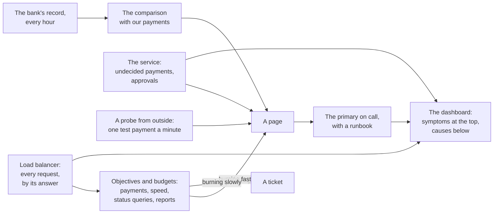

# Capstone 7: the payments API, operated — know, be told, and act

[Syllabus](../SYLLABUS.md) · Phase 7 · Previous: [7.6 Incidents](06-incidents.md)

> **Time:** three hours for your own design, then an hour with the worked design.
> **You need:** all of Phase 7, and the payments API of [Capstone 6](../phase-6-reliability/capstone-payments-api.md): its brief, and sections 3, 11 and 13 of its worked design. The reference implementation needs only Go, and runs at once.

Capstone 6 designed a payments API that keeps its promises while things fail around it. Its worked design ended with eight lines under the heading *Monitoring*. This capstone is those eight lines, done properly.

A service is not finished when it works. It is finished when the people who run it can tell that it is working, are told when it is not, and know what to do next. For most services, most of that follows from an error rate. Payments are harder, because their worst failures are silent. A customer who is charged twice was answered `200`. A payment that is never settled was answered with an honest `202`. A bank that declines every card answers quickly, and correctly, with `402`. None of these moves an error rate at all.

Every chapter of the phase is in it. What to record, and what never to (7.1). What to promise, and what the bank will do to the promise (7.2). What pages, and what must not (7.3). How one payment is followed through the fraud service, the bank and the reconciler (7.4). What the person who is paged looks at, in what order (7.5). And who that person is (7.6).

**How to use this page**

1. Read the brief.
2. Write your own design, on paper, against the task list. Give yourself a time limit.
3. Only then open the worked design and compare, section by section.
4. Run the reference implementation — and then run it with each part of the design removed.

---

## The brief

*From the head of engineering.*

> The payments API goes live in five weeks. Before it does, I want what the person on call will need at 03:00, and what I will need when a shop asks how reliable we are.
>
> **What I want**
> - The objectives: what we promise ourselves, how each is counted, and what we do when one is missed.
> - The alerts: what wakes someone, what opens a ticket, and what is only drawn on a graph.
> - The dashboard: one screen, for someone who has just been paged.
> - A runbook for each page.
> - One incident written out, from the first page to the postmortem, to show me that the pieces fit.
>
> **What you have**
> - Capstone 6's design. A shop is answered `200` paid, `402` declined, `202` pending, `503` refused with nothing charged, or `429`.
> - Traffic: 30 payments a second at night and 300 at the afternoon peak. Three status queries for every payment. Three reports a second.
> - The bank, as before: half its answers within 300 ms, 99 in 100 within 1.5 s. A few times a month it is slow, or refuses everything, for some minutes. Now and then it charges a card and its answer never arrives.
> - The bank can be asked what became of a reference, and every hour it publishes a record of what it charged.
> - Six engineers for the rota.
>
> **What must be true**
> - Nobody is paged for something that they cannot act on, or need not.
> - If a customer is charged twice, or charged for a payment that we call unpaid, we know within the hour.
> - A shop that asks what our availability was last month gets one number, and how it was counted.
>
> **Constraints**
> - The tools are your choice. Say what each must be able to do.
> - A card number never appears in a log, a trace or a metric.

---

## Your task

Produce a design document of three or four pages. The suggested times add up to three hours.

| # | Deliverable | Draws on | Time |
|---|---|---|---|
| 1 | Questions for the head of engineering; and what *working* means, for each kind of request and each answer | 7.2 | 15 min |
| 2 | Indicators and objectives: which events, what is good, where it is counted, the target, the window | 7.2 | 25 min |
| 3 | The budget: the arithmetic, what the bank will spend of it, and the policy | 7.2 | 15 min |
| 4 | Telemetry: the metrics and their labels, the log line, the spans, and what may not be recorded | 7.1, 7.4 | 20 min |
| 5 | **The silent failures**: for each invariant of Capstone 6, how you would know within the hour that it was broken | 7.1, 7.3 | 20 min |
| 6 | Alerts: pages, tickets and graphs. For each page, the rule, and why it needs a person | 7.3 | 25 min |
| 7 | The dashboard: one screen, in the order in which it is read | 7.1, 7.5 | 15 min |
| 8 | Runbooks for two of your pages | 7.5 | 15 min |
| 9 | The rota and the incident process | 7.6 | 10 min |
| 10 | An incident, written out: the timeline, what each person saw and did, and the postmortem's summary and actions | 7.5, 7.6 | 20 min |

The two standing rules:

- **Every number has a source**: the brief, arithmetic you show, or an assumption you label.
- **Choose.** Pick an option, give the reason, and name what you gave up.

And one for this capstone:

- **For every alert, name the incident that it exists for, and say what the person who receives it does in the first five minutes.** If you cannot, it is not an alert.

---

## Worked design

<details>
<summary>Open only after you have written your own</summary>



### 1. Questions, and what *working* means

Questions to ask, with the answers assumed here:

- *Is a declined payment a failure?* No. The bank said no, and we said so. It is a correct answer.
- *Is a pending one?* Not when it is given. It is the truth. It becomes a failure if the payment is still pending ten minutes later.
- *Is a `503` during the bank's trouble our failure?* It is the right thing to do, and the customer still could not pay. It counts. The objective describes what shops get, whoever caused it.
- *And a `429`?* The shop sent too much. It is left out, and graphed for each shop.
- *What can we compare our records with?* The bank's hourly record of charges, by reference.

So, for a payment request:

| Answer | For the objective | Why |
|---|---|---|
| `200` paid, `402` declined | good | the shop knows what happened |
| `202` pending | good, and watched | the shop was told the truth. Section 5 watches what becomes of it |
| `503`, `500`, no answer in 5 s | **bad** | the customer could not pay |
| `429`, other `4xx` | left out | the shop's doing |

### 2. Indicators and objectives

Counted at the load balancer (Chapter 7.2), over a rolling four weeks, for each kind of request separately.

| Objective | Good events, of all events | Target | Why this number |
|---|---|---|---|
| **Payments answered** | payment requests answered paid, declined or pending within 5 s, of all payment requests that are not the shop's fault | 99.9% | The bank is in trouble for some minutes a few times a month. That alone will take a third of this budget or more. 99.99% would be four minutes in four weeks, less than one of the bank's bad spells |
| **Payments answered quickly** | of those, the ones answered within 2 s | 99% | The bank's own 99th percentile is 1.5 s. We cannot promise to be faster than what we wait for |
| **Status queries answered** | status queries not answered `5xx` | 99.95% | They read our database and do not touch the bank, so they can be held to more |
| **Reports answered** | reports not refused | 99% | By design they are refused first when there is not room (Capstone 6) |

Two things are not objectives with budgets, because the amount of them that is acceptable is none. They are conditions, and any breach pages (section 5).

- **No payment is charged twice, and none is charged and not recorded.**
- **No payment is undecided for more than ten minutes.**

One total for every request would be simpler and wrong. Payments are a quarter of the requests. A fault that fails one payment in twenty would show as one request in eighty, and nobody would be told. The reference implementation shows it.

### 3. The budget, and the policy

At the brief's traffic there are about 399 million payment requests in four weeks, so the budget for the first objective is about 399,000 refused or failed payments. As a complete outage at the average rate, that is 40 minutes.

**The bank will be the largest spender.** In the reference implementation's four weeks, one slow spell of twelve minutes takes 31% of the budget, and a fault on one of the bank's routes takes 15%. Our own bad release takes 4%. This is assumed, from the brief's *a few times a month, for some minutes*, and it should be replaced by the real ledger after the first month.

The policy:

1. While the budget is not spent, releases go out as usual.
2. When it is spent, only fixes are released until it is positive again.
3. Any incident that takes more than a fifth of the budget has a postmortem (Chapter 7.2).
4. When the bank spent it, rule 2 does not make the bank better. The SRE workbook's example policy has the case of an outage "caused by a service maintained by another team" ([*Example Error Budget Policy*](https://sre.google/workbook/error-budget-policy/)), and there the team's own work may go on. Releases still halt, to stop us adding to it. The ledger goes to the head of engineering as the case for the second bank, which Capstone 6 had put six months away.

To the shop that asks: *99.9% of payment requests answered, counted at our load balancer, over four weeks. It includes the times when the bank refused. It does not include requests that never reached us, for which we run a probe.*

### 4. Telemetry

**Metrics** (Chapter 7.1). For each kind of request, a counter and a histogram of durations, with these labels and no others:

| Label | Values | For |
|---|---|---|
| `endpoint` | payments, status, reports | one objective each |
| `outcome` | paid, declined, pending, refused, failed | the objective, and the approval rate |
| `reason`, for a refusal | bank, no room, shop limit | the first question in the runbook |
| `zone`, `version` | three, and a few | *is it one zone? did it start with the release?* |

The histogram has buckets at 2 s and at 5 s, because those are the thresholds.

And for what is not a request: calls to the bank, by outcome, with their durations. The state of each instance's breaker. The number of undecided payments, and the age of the oldest. The reconciler's last run. The hourly comparison: when it last finished, and how many differences it found. Places in use, by kind of work.

The shop is not a label. There are thousands, and each would multiply every series. Which shop is in the log.

**The log line** (Chapter 7.1): one for each request, with the same field names in every service. The trace ID. The payment's ID and the shop. A hash of the idempotency key, and whether this was a first attempt or a repeat. The outcome and the status. The duration, and the part of it spent waiting for the bank. The breaker's state. The zone and the version.

**Never recorded**, anywhere: the card number, its expiry or security code, and the idempotency key itself. A test in the build fails if a log line matches the pattern of a card number.

**Traces** (Chapter 7.4). A span for the request, one for the fraud score, one for each call to the bank, one for each statement. The reconciler's work on a payment is linked to the trace of the request that left it pending, so that *what became of this payment?* is one search. Sampled at the tail: every failed, pending and slow request, and one in a hundred of the rest.

### 5. The silent failures

Each row is a way for Capstone 6's promises to be broken while every request is answered with a success.

| What is true | How it breaks, silently | How we know | How soon |
|---|---|---|---|
| A customer is charged once | A fault in the handling of repeats. Both attempts are answered `200` | **The ledger**: every hour, our payments are compared with the bank's record of charges. Two charges for one key, or a charge with no payment, is a difference | within the hour |
| Paid means charged, and declined means not | A fault in recording the bank's answer | The same comparison: any payment whose state disagrees with the bank's record | within the hour |
| A pending payment is settled | The reconciler stops, or cannot reach the bank | **The age of the oldest undecided payment** | ten minutes |
| A decline is the bank's decision | We send the bank something wrong, and it declines what it should approve | **The approval rate**, against the same five minutes a week before | minutes |
| Shops can reach us | A certificate, a DNS record, a route | **A probe**: a payment by a test shop with a test card, from outside, once a minute | three minutes |
| The comparison is running | The job fails, or the bank's record is late | The time since the comparison last finished | two hours |

The comparison is the important one. It is the only check that does not depend on our own code being right. Capstone 6's reviewer asked for exactly that.

### 6. Alerts

**Pages.** Each needs a person now.

| Page | Rule | The incident it exists for | The first five minutes |
|---|---|---|---|
| Payments: budget burning | 14.4 times the allowed rate over 1 h and 5 min, or 6 times over 6 h and 30 min (Chapter 7.3) | a bad release; the bank in trouble | Read the dashboard from the top. Is it refusals or failures? Is it the bank? Runbook A |
| Status queries: budget burning | the same rule, on its own objective | the database | Is the primary up? Is there a synchronous replica? |
| Payments undecided | the oldest is ten minutes old | the reconciler has stopped | Is it running? Can it reach the bank? Restart it. The payments settle themselves |
| The ledger | the hourly comparison found a difference | charged twice; charged and not recorded | Runbook B. The highest severity there is |
| Approvals | the approval rate of the last 5 min is under 70% of the same 5 min last week | we are sending the bank something wrong | Did it start with a release? Roll it back. Is it one card type, one currency? |
| The probe | three failures running | nobody can reach us | Certificate, DNS, the balancer. From outside, not from inside |
| The comparison is late | none finished in two hours | the check itself has failed | Run it by hand. Find out why |

**Tickets.** Each needs a person this week.

- The slow burn: the allowed rate over three days and six hours.
- Reports: budget burning. Refusing reports is the design working, so nobody is woken for it.
- A certificate with fourteen days left. A disk that will be full within a week.
- The database's primary has had no synchronous replica for ten minutes (Capstone 6).
- Places in use, with one zone gone, above 80%.

**Graphs only.** The bank's latency and its breakers. CPU, memory, pools. Repeats as a share of requests. Every one of them is a cause. They are on the dashboard, where the person who was paged for a symptom will look next.

The slow-burn ticket is inhibited while the page is firing, and alerts are grouped by service (Chapter 7.3). An alert that always fires goes to a second system, which pages if it stops arriving.

In the reference implementation's four weeks this design sends six pages, one of them at night, and three tickets.

### 7. The dashboard

One screen, read from the top. Each row answers the question that the row above it raises.

| Row | The question |
|---|---|
| Payments answered, last 5 min. Burn rate over 1 h and 5 min. Budget spent | *Are shops being hurt? How fast is it getting worse? How much is left?* |
| Payments a second, by answer: paid, declined, pending, refused, failed | *What are they being told?* Refused and failed are different incidents |
| The bank: median and 99th percentile, failures, breakers open | *Is it the bank?* |
| Payments undecided, and the oldest | *Is money in doubt?* |
| Approval rate, against last week | *Is the bank saying no more than usual?* |
| Status queries and reports: answered | *Is it only payments?* |
| The probe. The last comparison with the bank | *Can anyone reach us? Is the money right?* |
| Releases and configuration changes, marked on every graph. Zone and version, as filters | *What changed?* |

Every page links to this screen, with the time range set to the hour before it fired.

### 8. Two runbooks

**A. Payments: budget burning.**

*What it means.* Shops are getting `503` or `500` for payments, fast enough to spend 2% of the month's budget within the hour.

*First, look.* The second row of the dashboard: refused, or failed?

- **Refused, the bank is slow, and breakers are open.** The bank is in trouble and the design is doing its job. There is nothing to roll back. Check that refusals are quick and that status queries are unaffected. Declare an incident, because shops can see it. Put this on the status page: *some payments are being refused; no card is charged for a refused payment; retry later.* Call the bank's operations contact. Watch the undecided payments. **Do not** switch off the breaker or lengthen the timeout. That is how a slow bank becomes a full outage (Chapter 6.3).
- **Failed, and a release went out within the hour.** Roll it back. Take a dump and a profile from one instance first (Chapter 7.5).
- **One zone only.** Take it out of the balancer. Capstone 6's capacity allows for it.
- **None of these.** Declare an incident, call the secondary, and begin Chapter 7.5's method.

*When it is over.* Check the ledger at the next hour. If the incident took more than a fifth of the budget, write the postmortem.

**B. The ledger.**

*What it means.* The bank's record and ours disagree about money. A customer has been charged twice, or charged for something that we call unpaid. This is the incident with the highest severity that the service has.

*First, stop it from growing.* If a release or a change of configuration went out since the last clean comparison, roll it back now. The cause can wait.

*Then, keep everything.* Do not restart, and do not tidy up. Take the list of affected payments from the comparison, with their traces.

*Then, people.* Declare the incident. The communications lead takes the list to support and to finance. Refunds are theirs to make, and they need the list within the hour.

*Always* a postmortem.

### 9. The rota, and the process

**Six engineers.** With a primary and a secondary, each would be on call for a third of the year, which is over the SRE book's 25% (Chapter 7.6). So: one primary, for a week at a time, which is 17%. The secondary is the engineering manager on duty, shared with two other teams. That is thinner cover, and it is acceptable only because the pager is quiet: about a page and a half a week, and one night in four weeks.

**Who commands.** The primary, from the moment an incident is declared, until they hand it over aloud. For the ledger page and for a payments outage, the manager on duty takes command, and the primary becomes operations lead.

**Where.** One channel for each incident, and a document from a template. Neither is hosted on anything that runs behind our own balancer.

**Customers.** The support lead is the communications lead, and owns the status page.

### 10. An incident, written out

*Day 5 of the reference implementation: the bank slows down. The numbers are from its dashboard, in part 3 of its output.*

| Time | What happened | Who, and what they did |
|---|---|---|
| 13:55 | Normal. 263 payments a second paid, 13 declined. The bank's median answer is 300 ms | |
| 14:00 | The bank's median answer goes to 4 s. Within a minute the breakers open on five of the six instances | Nobody yet. The service refuses most payments at once, with `503`, and charges nothing |
| 14:01 | **The page**: *payments: budget burning*. About 20,000 payments have been refused | The primary acknowledges it |
| 14:03 | The dashboard. 52% of payments answered. 169 a second *refused: nothing was charged*. The bank: 4000 ms, five breakers open. Undecided payments: normal. Status queries: 100%. The last release: three and a half hours ago | The primary reads it from the top. The hypothesis is the bank. It predicts open breakers and no recent change, and both are on the screen |
| 14:04 | | **The primary declares an incident** and takes command. The engineer at the next desk is asked to be operations lead. The support lead takes communications |
| 14:06 | | Operations, from runbook A: refusals are quick, and nothing needs rolling back. **The decision is to change nothing.** The bank's operations desk is called |
| 14:07 | | Status page: *Some payments are being refused. No card is charged for a refused payment. Shops can retry. Next update at 14:20.* |
| 14:12 | The bank recovers. The breakers close, one trial at a time | |
| 14:17 | The page clears: the rate over the last five minutes is normal again, though the rate over the last hour is still far above the threshold | The commander waits |
| 14:20 | | Status page: *Payments are being accepted normally since 14:12. We are watching.* |
| 14:27 | The dashboard is as it was at 13:55. Undecided payments: normal | The incident is closed. The commander names the author of the postmortem |
| 15:00 | The hourly comparison with the bank: no differences | Noted in the document |

**The postmortem, in summary.**

- *Impact.* 122,470 payment requests refused in twelve minutes. No card was charged for any of them. 31% of the four-week budget.
- *Cause.* The bank answered slowly. The trigger is theirs, and their report has been asked for.
- *Detection.* A page, two minutes after it began.
- *What went well.* The breakers opened within a minute. Status queries and reports were unaffected. The dashboard pointed at the bank at the first look. Nobody tried to fix a service that was not broken.
- *What went wrong.* The status page was updated seven minutes in, by hand. Some shops' software repeated refused payments without pause, which added load when the bank came back.
- *Where we got lucky.* It was 14:00 on a weekday, and it lasted twelve minutes. The undecided payments were never tested: we do not know how the reconciler behaves after an hour of this.

| Action | Owner | By |
|---|---|---|
| The status page is updated by the paging rule itself, with the text of runbook A | support lead | two weeks |
| A game day: the bank slow for an hour, in the test environment (Chapter 6.7). Watch the undecided payments and the reconciler | primary of that week | one month |
| The bank's own status feed on the dashboard, beside its latency | platform team | two weeks |
| The second bank: bring the design forward. The evidence is the ledger, where the bank took 46% of this budget | head of engineering | decision in two weeks |

This was an incident in which the right action was to do nothing to the system. The work of this capstone is what let the person on call know that, in three minutes, at a glance.

</details>

---

## Reference implementation

[`code/capstone-operable/main.go`](code/capstone-operable/main.go), about 490 lines, is a model, like those of Chapters 7.2 and 7.3. It holds what happened to the payments API in every minute of four weeks: the payment requests and what each was told, the status queries and reports, the payments still undecided, the hourly comparison with the bank, and the probe. Servers restart on weekdays, and fail a few payments for a minute. Eight incidents are in it, each of a different kind. The worked design's objectives and rules are then evaluated over it, minute by minute.

The rules are section 6's, in a dozen lines:

```go
	list := []rule{
		{"burn rate", "page", func(i int) bool { return payments.burning(i, allowed) }},
		{"slow burn", "ticket", func(i int) bool { return payments.leaking(i, allowed) }},
		{"reports", "ticket", func(i int) bool { return reports.burning(i, 0.01) }},
		{"undecided", "page", func(i int) bool { return ms[i].oldest >= 10 }},
		{"the ledger", "page", func(i int) bool { return ms[i-i%60+59-60].mismatches > 0 }},
		{"approvals", "page", func(i int) bool {
			decided := approved.all[i+1] - approved.all[i+1-5]
			return decided > 0 && approved.rate(i, 5) < 0.7*approved.rate(i-7*day, 5)
		}},
		{"the probe", "page", func(i int) bool { return !ms[i].probe && !ms[i-1].probe && !ms[i-2].probe }},
	}
```

Two of section 6's pages are left out, because no incident in the model would set them off: the one for status queries, and the one for a comparison that is late.

```bash
go run ./phase-7-observability/code/capstone-operable
```

```text
PART 1 — four weeks, against the objectives.

  objective                                                      target     achieved   budget spent
  payments answered: paid, declined or pending                   99.90%      99.940%            60%
  payments answered within 2 s                                   99.00%      99.500%            50%
  status queries answered                                        99.95%      99.997%             7%
  reports answered                                               99.00%      99.840%            16%
  payments charged twice, or charged and not recorded              none        3,134

  Payments asked for: 399,114,440. The budget for the first objective is 0.1% of them: 399,114.

  day  where it went                                    payments    of the budget
    2  a bad release: 5% of payments fail                 15,648               4%
    5  the bank is slow: 60% of payments refused         122,470              31%
   23  one route to the bank: 0.2% refused                60,304              15%
       everything else: restarts, ordinary failures       40,954              10%
```

The first objective is met, with 40% of its budget left. Look at who spent the rest. The bank took 46% of the budget in two incidents, and the service's own bad release took 4%. The fifth row is not a percentage, and it is the worst news on the screen: 3,134 customers were charged twice, on a day when every objective was met.

```text
PART 2 — the alerts. Who was told about each incident, how soon, and what it had cost by then.

  day  incident                                   first told by         after  the cost by then             the cost in all
    2  a bad release: 5% of payments fail         page: burn rate      16 min  8,148 payments failed        15,648 payments failed
    5  the bank is slow: 60% of payments refused  page: burn rate       2 min  20,309 payments failed       122,470 payments failed
    8  the certificate has expired                page: the probe       3 min  8,602 could not connect      33,484 could not connect
   11  the reconciler is stopped                  page: undecided      10 min  874 undecided, oldest 10 min 48,786 undecided, oldest 6 h 00
   15  retries charged twice: 0.2% of payments    page: the ledger     61 min  1,490 charged twice          3,134 charged twice
   18  a wrong field: the bank declines 45%       page: approvals       4 min  28,511 wrongly declined      142,479 wrongly declined
   21  a zone is lost: 60% of reports refused     ticket: reports      15 min  1,622 reports refused        4,327 reports refused
   23  one route to the bank: 0.2% refused        ticket: slow burn   31 h 56  40,192 payments failed       60,304 payments failed

  In four weeks: 6 pages and 3 tickets. Nights with a page: 1.
    day 2 10:15 burn rate; day 5 14:01 burn rate; day 8 02:02 the probe; day 11 09:09 undecided
    day 15 12:00 the ledger; day 18 16:03 approvals

CHECKS
  incidents that nobody was told about                           0
  pages that began with no incident in progress                  0
```

**Eight incidents, and seven different rules.** Only the first two were paged by an error rate. The certificate was found by the probe, three minutes in, at two in the morning: the month's one page at night. The stopped reconciler was found by the age of a payment, and the double charges by the bank's record. The wrong field was found by the approval rate, in four minutes, while every request was being answered correctly.

**The ledger is the slow one**, and it shows what the brief's *within the hour* costs: 1,490 customers had been charged twice when the page went out. A comparison every ten minutes would have found it with fewer than 300. Whether the bank can publish its record that often is a question for the bank.

**Nobody was woken for the zone or for the bank's route.** Reports were refused, as designed. The route cost 15% of the budget over two days, and a ticket after 32 hours left time to act.

```text
PART 3 — the dashboard on day 5: five minutes before the bank slowed, three minutes in, and fifteen minutes after it recovered.

                                                                  13:55              14:03              14:27
  payments answered, last 5 min                                  99.99%             51.97%             99.99%
  burn rate: last hour, and last 5 min                      0.1 and 0.1     41.5 and 480.3      121.2 and 0.1
  budget of the four weeks, spent so far                             6%                16%                36%
  payments a second: paid                                           263                106                271
                     declined                                        13                  5                 14
                     pending                                          2                  1                  2
                     refused: nothing was charged                     0                169                  0
  the bank: median answer                                        300 ms            4000 ms             300 ms
            instances with the breaker open, of 6                     0                  5                  0
  payments undecided, and the oldest                   168, under 1 min    68, under 1 min   173, under 1 min
  status queries answered, last 5 min                           100.00%            100.00%            100.00%
  the probe                                                     passing            FAILING            passing
  the last release                                    10:30, 3 h 25 ago  10:30, 3 h 33 ago  10:30, 3 h 57 ago
```

This is section 7's screen, at three moments of the incident that section 10 walks through. Read the middle column from the top, as the person who was paged did. Half of the payments are being answered. The rest are refused, with nothing charged. The bank is slow and five breakers are open. No money is in doubt. Status queries are untouched. The last release was hours ago. Six rows, and the diagnosis is made.

The third column has Chapter 7.3's two windows in one line. Fifteen minutes after the bank recovered, the burn rate over the last hour is still 121, and over the last five minutes it is 0.1. A rule on the hour alone would still be paging.

### Remove one part at a time

Each run removes one part of the design. The program ends with an error when a check fails.

```bash
go run ./phase-7-observability/code/capstone-operable -without split
```

```text
  day  incident                                   first told by         after  the cost by then             the cost in all
    2  a bad release: 5% of payments fail         nobody                    —  —                            15,648 payments failed   ← NOBODY WAS TOLD
    5  the bank is slow: 60% of payments refused  page: burn rate       6 min  61,052 payments failed       122,470 payments failed
    8  the certificate has expired                page: the probe       3 min  8,602 could not connect      33,484 could not connect
   11  the reconciler is stopped                  page: undecided      10 min  874 undecided, oldest 10 min 48,786 undecided, oldest 6 h 00
   15  retries charged twice: 0.2% of payments    page: the ledger     61 min  1,490 charged twice          3,134 charged twice
   18  a wrong field: the bank declines 45%       page: approvals       4 min  28,511 wrongly declined      142,479 wrongly declined
   21  a zone is lost: 60% of reports refused     ticket: reports      15 min  1,622 reports refused        4,327 reports refused
   23  one route to the bank: 0.2% refused        nobody                    —  —                            60,304 payments failed   ← NOBODY WAS TOLD

  In four weeks: 5 pages and 1 ticket. Nights with a page: 1.
    day 5 14:05 burn rate; day 8 02:02 the probe; day 11 09:09 undecided; day 15 12:00 the ledger
    day 18 16:03 approvals

CHECKS
  incidents that nobody was told about                           2
  pages that began with no incident in progress                  0
```

One indicator for every kind of request. Payments are a quarter of all requests, so day 2's release, which failed one payment in twenty, shows as about one request in eighty, and stays under every threshold. 15,648 failed payments, and nobody was told. The bank's route goes the same way. The bank's slow spell still pages, four minutes later than it did.

```bash
go run ./phase-7-observability/code/capstone-operable -without burn-rate
```

```text
  In four weeks: 24 pages and 3 tickets. Nights with a page: 2.
    day 1 10:30 threshold; day 2 10:00 threshold; day 3 10:30 threshold; day 4 10:30 threshold
    day 5 10:30 threshold; day 5 14:00 threshold; day 8 02:02 the probe; day 8 10:30 threshold
    day 9 10:30 threshold; day 10 10:30 threshold; day 11 09:09 undecided; day 11 10:30 threshold
    and 12 more

CHECKS
  incidents that nobody was told about                           0
  pages that began with no incident in progress                  16
```

A threshold on ten minutes, in place of the burn-rate rule. It reports everything that the other did, and it pages at 10:30 on every weekday, when the servers restart. Twenty-four pages where there were six, and sixteen of them for nothing. It also pages before seven in the morning for the bank's route, which could have waited for a ticket.

```bash
go run ./phase-7-observability/code/capstone-operable -without ticket
```

```text
   21  a zone is lost: 60% of reports refused     nobody                    —  —                            4,327 reports refused   ← NOBODY WAS TOLD
   23  one route to the bank: 0.2% refused        nobody                    —  —                            60,304 payments failed   ← NOBODY WAS TOLD
```

```text
  In four weeks: 6 pages and 0 tickets. Nights with a page: 1.
    day 2 10:15 burn rate; day 5 14:01 burn rate; day 8 02:02 the probe; day 11 09:09 undecided
    day 15 12:00 the ledger; day 18 16:03 approvals

CHECKS
  incidents that nobody was told about                           2
  pages that began with no incident in progress                  0
```

No tickets. The lost zone and the bank's route were not urgent, so nothing paged, and now nothing says anything. The route alone took 15% of the budget.

```bash
go run ./phase-7-observability/code/capstone-operable -without backlog
```

```text
   11  the reconciler is stopped                  nobody                    —  —                            48,786 undecided, oldest 6 h 00   ← NOBODY WAS TOLD
```

```text
  In four weeks: 5 pages and 3 tickets. Nights with a page: 1.
    day 2 10:15 burn rate; day 5 14:01 burn rate; day 8 02:02 the probe; day 15 12:00 the ledger
    day 18 16:03 approvals

CHECKS
  incidents that nobody was told about                           1
  pages that began with no incident in progress                  0
```

No rule on the age of undecided payments. The reconciler was stopped for six hours, and 48,786 payments were left pending. Every one of their shops had been told the truth, so no objective moved. Their customers may have been charged, and nobody knew which.

```bash
go run ./phase-7-observability/code/capstone-operable -without ledger
```

```text
   15  retries charged twice: 0.2% of payments    nobody                    —  —                            3,134 charged twice   ← NOBODY WAS TOLD
```

```text
  In four weeks: 5 pages and 3 tickets. Nights with a page: 1.
    day 2 10:15 burn rate; day 5 14:01 burn rate; day 8 02:02 the probe; day 11 09:09 undecided
    day 18 16:03 approvals

CHECKS
  incidents that nobody was told about                           1
  pages that began with no incident in progress                  0
```

No comparison with the bank. 3,134 customers were charged twice, and the service's own telemetry is perfect: every one of those requests was answered `200`, quickly. This is the failure that the brief names, and nothing inside the service can see it.

```bash
go run ./phase-7-observability/code/capstone-operable -without approval
```

```text
   18  a wrong field: the bank declines 45%       nobody                    —  —                            142,479 wrongly declined   ← NOBODY WAS TOLD
```

```text
  In four weeks: 5 pages and 3 tickets. Nights with a page: 1.
    day 2 10:15 burn rate; day 5 14:01 burn rate; day 8 02:02 the probe; day 11 09:09 undecided
    day 15 12:00 the ledger

CHECKS
  incidents that nobody was told about                           1
  pages that began with no incident in progress                  0
```

No rule on the approval rate. For twenty minutes the bank declined 45% of payments, because of a field that we sent wrongly. 142,479 customers were told that their cards had been declined. Each request was answered correctly, by the definition in section 1.

```bash
go run ./phase-7-observability/code/capstone-operable -without probe
```

```text
    8  the certificate has expired                nobody                    —  —                            33,484 could not connect   ← NOBODY WAS TOLD
```

```text
  In four weeks: 5 pages and 3 tickets. Nights with a page: 0.
    day 2 10:15 burn rate; day 5 14:01 burn rate; day 11 09:09 undecided; day 15 12:00 the ledger
    day 18 16:03 approvals

CHECKS
  incidents that nobody was told about                           1
  pages that began with no incident in progress                  0
```

No probe. For twelve minutes nobody could connect, and the balancer, where every objective is counted, received nothing and so reported nothing wrong. With this part removed, the month has no page at night. That is not an improvement.

---

## Review your own design

Check your design against these. Each is a mistake that an experienced reviewer would look for.

- [ ] For each answer that a shop can get, did you say whether it is **good, bad or left out**, and why?
- [ ] Is a `503` during the bank's trouble counted? If not, what number do you give the shop that asks?
- [ ] Is there **one objective for each kind of request**, or did payments disappear into a total?
- [ ] Does your target survive the bank's own bad minutes? Did you work out what the bank will spend?
- [ ] What does your policy say when the budget was spent by somebody else?
- [ ] How do you know that a customer was **charged twice**? Does the check depend on your own code being right?
- [ ] What watches a payment that was answered *pending*? What watches the thing that watches?
- [ ] Would you notice the bank declining twice as many cards as last week?
- [ ] What tells you that **nobody can reach you**?
- [ ] For each page: which incident is it for, and what does its receiver do first? Is there a page for a cause?
- [ ] How many pages a week does your design send, and how many at night? Did you count?
- [ ] Is the dashboard in the order in which it is read? Does it say *what changed*?
- [ ] Does a runbook say what **not** to do?
- [ ] Is a card number, or an idempotency key, in any log, trace or label?
- [ ] Is anyone on call for more than a quarter of the year?

---

## Extensions

1. **Your own rules.** Replace the list in `rules` with the alerts from your design, and run it. Which incidents reach nobody? How many pages are for nothing?
2. **A ninth incident.** Add one that the worked design misses. A status query that returns another shop's payment is one. So is a reconciler that settles payments wrongly. What would find it?
3. **The comparison every ten minutes.** Change the model, and count the customers who are charged twice before the page.
4. **The latency objective.** Make the bank slow without tripping the breakers, so that payments take three seconds, and add the burn-rate rule for the second objective.
5. **Instrument the real thing.** Add section 4's metrics and log line to Capstone 6's reference implementation, run it with `-without idempotency-key`, and find the double charges from the log alone.
6. **The game day.** Run section 10's incident on Capstone 6's implementation for a whole minute, and watch the undecided payments.
7. **Write runbook C**, for the approvals page.

---

## Sources

This capstone applies the chapters of Phase 7, where the sources for each technique are given. The policy in section 3 follows Google's [*Example Error Budget Policy*](https://sre.google/workbook/error-budget-policy/), and the alert thresholds are those of the SRE workbook's [*Alerting on SLOs*](https://sre.google/workbook/alerting-on-slos/). All output shown was produced by the reference implementation.

**Next:** Phase 8 — Security *(planned)*. This phase assumed that everyone who could reach the service meant well. The next does not: who is asking, what they are allowed to do, and what an attacker would try first.
