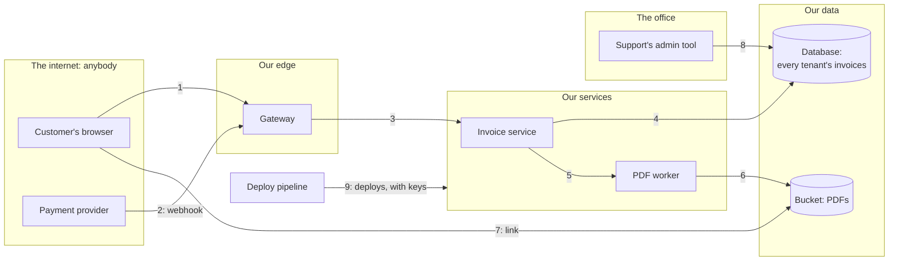

# 8.1 Threat modelling and trust boundaries

[Syllabus](../SYLLABUS.md) · Phase 8 · Previous: [Capstone 7](../phase-7-observability/capstone-operable-payments.md) · Next: 8.2 Authentication *(planned)*

> **Time:** about 30 minutes to read, 45 minutes of practice.
> **You need:** the path of a request from [Chapter 1.2](../phase-1-foundations/02-life-of-a-request.md); the idea of a tenant, which is one customer's data in a system that many customers share. The example needs only Go, and runs in under a second.

**By the end of this chapter you can**

- draw a design as flows of data that cross trust boundaries;
- say what is worth protecting, and from whom;
- find what can go wrong at each boundary, with six prompts;
- decide what to do about each threat, and write the decision down;
- count the controls between an attacker and what they want, and add one where there is only one;
- apply three principles that are fifty years old and still do most of the work;
- do all of it in an hour, while the design is still on a whiteboard.

---

## The problem

*An illustrative scenario; the example reproduces its first finding.* A team builds an invoicing product for small businesses, in three months. Two weeks before launch, a security review is booked, to *add security*. The reviewer returns five findings.

1. The invoice service learns which customer is asking from a header, `X-Tenant`, that the gateway sets. Anything else that can reach the service can set it too.
2. The support team's admin tool has no login, *because it can only be reached from the office*.
3. Invoices are stored as PDFs in a bucket that anyone can read who has the link, and the links can be guessed.
4. Every service uses the same database user, which may do anything.
5. The pipeline that deploys the code holds a key that can delete the whole account.

None of these is a bug in the usual sense. The code does what its authors intended. Each is a decision about **who is trusted**, made without noticing that it was a decision. And each would have cost an hour at the whiteboard. Two weeks before launch, the first means changing how identity travels through every service, the third means moving two hundred thousand files, and the fourth means sorting every query by who may run it.

Two are fixed. Three are left. Nobody decides to accept them. They are just not mentioned again.

Three things went wrong.

1. **Security was treated as a feature**, to be added. It is a property of the design: where the checks are, and what each part believes without checking.
2. **Nobody asked the questions when the answers were cheap.**
3. **Risks were accepted by silence**, which is the one way of accepting a risk that leaves nobody responsible for it.

---

## The concept

### 1. Four questions

**Threat modelling** is the name for asking early. Its practitioners' manifesto defines it: "Threat modeling is analyzing representations of a system to highlight concerns about security and privacy characteristics" ([*Threat Modeling Manifesto*](https://www.threatmodelingmanifesto.org/)). And it reduces the whole activity to four questions:

1. "What are we working on?"
2. "What can go wrong?"
3. "What are we going to do about it?"
4. "Did we do a good enough job?" ([*Threat Modeling Manifesto*](https://www.threatmodelingmanifesto.org/))

That is all of it. The rest of this section is one practical way to answer each. It is meant to take an hour, with the people who are designing the system, at the time when changing the design costs nothing. The manifesto's values say what matters more than method: "A culture of finding and fixing design issues over checkbox compliance", and "Doing threat modeling over talking about it" ([*Threat Modeling Manifesto*](https://www.threatmodelingmanifesto.org/)).

### 2. *What are we working on?* Flows and boundaries

Draw the system as a **data-flow diagram**: the people and systems outside it, the processes, the stores of data, and an arrow for every flow between them. Then draw the **trust boundaries**: the lines at which the two sides do not trust each other equally. OWASP's guidance on what the drawing is for: "it is important that the solution provides a clear view of trust boundaries, data flows, data stores, processes, and the external entities which may interact with the system" ([OWASP, *Threat Modeling Cheat Sheet*](https://cheatsheetseries.owasp.org/cheatsheets/Threat_Modeling_Cheat_Sheet.html)).



Every arrow that crosses a line is a place where a check belongs. For each one, ask four things:

- **Who is on the other side?**
- **How do we know?**
- **What are they allowed?**
- **What happens if they lie?**

The scenario's findings are all on this drawing. Arrow 3 crosses a boundary, and the service believes a header. Arrow 8 crosses one, and the tool believes the network. Arrow 7 crosses one with no check at all.

**A network is not a boundary that checks anything.** *It is only reachable from inside* is the most common unexamined decision in software. Google's engineers described why they gave it up: "this security model is problematic because, when that perimeter is breached, an attacker has relatively easy access to a company's privileged intranet" ([Ward and Beyer, *BeyondCorp*](https://static.googleusercontent.com/media/research.google.com/en//pubs/archive/43231.pdf)). Being inside tells you where a request came from. It does not tell you who sent it.

### 3. *What can go wrong?* Assets, actors, and six prompts

**Assets** are what would hurt to lose. For the invoicing product: every tenant's invoices. The ability to change one, or to mark it paid. Passwords, keys and sessions. The service's being up.

**Actors** are who might try. Four are enough for most systems:

| Actor | Starts with | Wants |
|---|---|---|
| Anyone on the internet | nothing | whatever can be had |
| A customer | a real account, in one tenant | another tenant's data |
| An insider, or someone with an insider's laptop | a place inside the network, and perhaps real access | data, or to cover a mistake |
| A supplier, or a dependency | our trust | usually nothing. But if it is compromised, so are we |

The second is the one that designs forget. Most attackers of a product with a free trial are its customers.

**Six prompts.** For each arrow that crosses a boundary, go through **STRIDE**. OWASP describes it as "a mature and popular threat modeling technique and mnemonic originally developed by Microsoft employees", and gives the six with the property that each attacks ([OWASP, *Threat Modeling Cheat Sheet*](https://cheatsheetseries.owasp.org/cheatsheets/Threat_Modeling_Cheat_Sheet.html)):

| | Threat | It violates | The question to ask at a boundary | In the scenario |
|---|---|---|---|---|
| **S** | Spoofing | Authentication | Can someone claim to be someone else? | The `X-Tenant` header |
| **T** | Tampering | Integrity | Can data be changed on the way, or at rest? | A webhook that says *paid*, from anyone |
| **R** | Repudiation | Accounting | Could someone do this and deny it? | The admin tool, with no login and no record |
| **I** | Information disclosure | Confidentiality | Can someone read what they should not? | The bucket |
| **D** | Denial of service | Availability | Can someone stop it working for others? | No limit on PDFs for each customer |
| **E** | Elevation of privilege | Authorization | Can someone do more than they are allowed? | One database user. The pipeline's key |

The prompts are for finding threats, and they do not need to be applied exactly. A threat that is found under the wrong letter is still found.

### 4. *What are we going to do about it?*

Each threat gets a response. There are four, and OWASP gives them in Adam Shostack's words ([OWASP, *Threat Modeling Cheat Sheet*](https://cheatsheetseries.owasp.org/cheatsheets/Threat_Modeling_Cheat_Sheet.html)):

- "Mitigate: Take action to reduce the likelihood that the threat will materialize."
- "Eliminate: Simply remove the feature or component that is causing the threat."
- "Transfer: Allocate contractual or financial responsibility to another party."
- "Accept: Do not mitigate, eliminate, or transfer the risk because none of the above options are acceptable given business requirements or constraints" ([OWASP, *Threat Modeling Cheat Sheet*](https://cheatsheetseries.owasp.org/cheatsheets/Threat_Modeling_Cheat_Sheet.html)).

*Eliminate* is used too little. The cheapest fix for the guessable links is not to have links that work without a login.

*Accept* is legitimate, and it has a form: a sentence, a name and a date. *We accept that support staff can read any invoice, because that is their job. Every read is logged. Owner: head of support. Review in six months.* The scenario's three unmentioned findings were accepted as well. Nobody signed.

There will be more threats than time. Rank them roughly, by how likely each is and how much it would hurt: "In theory, ranking should be based on the mathematical product of an identified threat's likelihood and its impact" ([OWASP, *Threat Modeling Cheat Sheet*](https://cheatsheetseries.owasp.org/cheatsheets/Threat_Modeling_Cheat_Sheet.html)). In practice three levels are enough, and the argument about which level is the useful part.

### 5. Three principles that do most of the work

The mitigations are rarely new. Most come from a paper of 1975, which starts from an admission: "no one knows how to build a system without flaws", so the alternative is to design so that flaws do less harm ([Saltzer and Schroeder, *The Protection of Information in Computer Systems*](https://www.cs.virginia.edu/~evans/cs551/saltzer/)). Three of its eight principles settle most findings.

- **Least privilege.** "Every program and every user of the system should operate using the least set of privileges necessary to complete the job." One database user that may do anything means that a flaw in any service is a flaw in all the data. The pipeline's key is the same finding.
- **Complete mediation.** "Every access to every object must be checked for authority." Every access, not the first one, and not only those that come through the front door. Arrows 7 and 8 reach data without passing a check.
- **Fail-safe defaults.** "Base access decisions on permission rather than exclusion" ([Saltzer and Schroeder](https://www.cs.virginia.edu/~evans/cs551/saltzer/)). The default is no. A new endpoint, a new bucket, a new role start with no access, and somebody has to decide to grant it.

### 6. Defence in depth

Any one control will fail one day. Someone will remove a line, a library will have a flaw, a firewall rule will be widened for a test. **Defence in depth** is designing so that one failure is not enough. NIST's definition is broad: an "Information security strategy integrating people, technology, and operations capabilities to establish variable barriers across multiple layers and missions of the organization" ([NIST, *Glossary: defense-in-depth*](https://csrc.nist.gov/glossary/term/defense_in_depth)).

For a design, it becomes a number that can be counted. Take one actor and one asset. Trace every path between them. On each path, count the controls that would each stop the attack on their own. **A path with one control is one mistake away from a breach.**

The controls have to be independent. The same check made twice by the same code is one control. A check in the service and a filter in the database query are two: a mistake in one leaves the other.

### 7. *Did we do a good enough job?*

- **Show it to someone else.** The people who drew the boundary are the worst placed to see what it assumes.
- **Turn threats into tests.** *A customer asks for another tenant's invoice and gets nothing* is a test like any other, and it runs on every change. The example below is a file of such tests.
- **Keep the model with the design**, and look at it again when an arrow, a store or a boundary is added. The manifesto's last value is "Continuous refinement over a single delivery" ([*Threat Modeling Manifesto*](https://www.threatmodelingmanifesto.org/)).

---

## A real example

### Run it: four attackers and five controls

[`code/ch01-boundaries/main.go`](code/ch01-boundaries/main.go), about 260 lines, is arrows 1, 3 and 4 of the drawing as three real HTTP servers: a gateway, the invoice service, and a store. Invoice 1001 belongs to tenant A. Mallory has a real account, in tenant B.

The design has five controls. Each is one check in one place:

| Control | Where | What it does |
|---|---|---|
| `session` | gateway | No valid session, no entry |
| `strip` | gateway | The tenant is taken from the session, whatever header the client sent |
| `caller` | service | Only the gateway can have signed this request |
| `object` | service | The invoice must belong to whoever is asking |
| `scope` | store | Every query names the tenant, and sees only that tenant's rows |

The last two look like this, and they are independent in section 6's sense:

```go
	// Control "object": the invoice must belong to whoever is asking.
	if s.works("object") && owner != tenant {
		http.Error(w, "service: no such invoice", http.StatusNotFound) // not 403: that would say that it exists
		return
	}
```

```go
	// Control "scope": every query names the tenant, and sees only that tenant's rows.
	// With it:    WHERE id = $1 AND tenant = $2.    Without it:    WHERE id = $1.
	if s.works("scope") && inv.tenant != r.URL.Query().Get("tenant") {
		found = false
	}
```

Four attackers ask for invoice 1001. Each is one request, to the servers that the program itself started.

```bash
go run ./phase-8-security/code/ch01-boundaries
```

```text
PART 1 — the design as built. Invoice 1001 belongs to tenant A. Four attackers ask for it.

                                               every control  without        without        without        without        without
  attack                                       working        session        strip          caller         object         scope
  no session at all                            401 gateway    404 service    401 gateway    401 gateway    401 gateway    401 gateway
  another tenant's ID, with her own session    404 service    404 service    404 service    404 service    404 service    404 service
  a forged header, through the gateway         404 service    404 service    LEAKED         404 service    404 service    404 service
  straight to the service, past the gateway    403 service    403 service    403 service    LEAKED         403 service    403 service
```

**With every control working, nothing leaks**, and that is where most reviews stop. The other five columns each take one control away, as one careless change would.

Read the second row. Mallory asks for another tenant's invoice by its number, which is the commonest attack on any product with more than one customer. It fails in every column, including the one where the service's own check is missing, because the store's query was scoped as well. Two controls, and one mistake is survived.

Read the third and fourth rows. Each has a column that says LEAKED. A gateway that passes on a header which the client sent, or a service that does not check who is calling: one mistake each, and tenant A's invoice goes to tenant B.

```text
PART 2 — how deep is the defence? Every combination of failing controls, tried.

  attack                                       the fewest failures that let it through
  no session at all                            3: session, object, scope
  another tenant's ID, with her own session    2: object, scope
  a forged header, through the gateway         1: strip
  straight to the service, past the gateway    1: caller
```

This is section 6's count, made by trying all 31 combinations of failures. Two paths are three and two mistakes deep. Two are one mistake deep, and those two are the scenario's first finding: **the service believes a header**. The header is true only while the gateway sets it properly and nothing else can reach the service. Two conditions, each on its own, with nothing behind either.

```text
PART 3 — one change: the service asks whose session it is, and takes no notice of the header.

  attack                                       the fewest failures that let it through
  no session at all                            4: session, object, scope, token
  another tenant's ID, with her own session    2: object, scope
  a forged header, through the gateway         2: object, scope
  straight to the service, past the gateway    2: caller, token
```

One change to the design. The gateway passes the session on, and the service finds out for itself whom it belongs to. The header is still sent, and nothing believes it. Now a forged header gains nothing, because Mallory's session is still Mallory's. A request that comes past the gateway has no session at all. **Every path is at least two mistakes deep.**

The change is not a fix to a bug. It moves a check to the other side of a boundary: the service stops trusting what it is told about the caller, and checks the caller. That is the kind of thing a threat model finds, and a code review does not.

### How Google stopped trusting its own network

The scenario's second finding, the tool that needs no login because of where it sits, was once how most companies ran. Google's account of leaving that model is the best-known ([Rory Ward and Betsy Beyer, *BeyondCorp: A New Approach to Enterprise Security*](https://static.googleusercontent.com/media/research.google.com/en//pubs/archive/43231.pdf)).

**The decision** was to remove the boundary that was not checking anything: "We are removing the requirement for a privileged intranet and moving our corporate applications to the Internet" ([*BeyondCorp*](https://static.googleusercontent.com/media/research.google.com/en//pubs/archive/43231.pdf)).

**What replaced it** is a check at every access, on the things that do identify a request: "access depends solely on device and user credentials, regardless of a user's network location". And: "All access to enterprise resources is fully authenticated, fully authorized, and fully encrypted based upon device state and user credentials" ([*BeyondCorp*](https://static.googleusercontent.com/media/research.google.com/en//pubs/archive/43231.pdf)).

It is part 3 at the scale of a company. The network is still there. Nothing believes it.

---

## Trade-offs

**An hour now against weeks later.** The cost of a threat model is an hour of four people. The cost of not having one is the scenario. The hour is still an hour, and a team that models everything in depth will stop doing it. Model what is new: a new flow, a new store, a new boundary.

**Depth against cost.** Every control is code to write, a place to be wrong, and often a few milliseconds. Spend depth where the asset deserves it. Every tenant's invoices deserve two. A page of marketing copy does not.

**Security against convenience.** A login on the admin tool is a nuisance to forty support staff every morning. Decide it openly, with the head of support in the room, and write down what was chosen.

**Mitigating against accepting.** Some risks are cheaper to carry than to remove. Accepting is a real answer, when it has an owner and a date. What has neither is not acceptance. It is forgetting.

**A method against a checklist.** STRIDE is a set of prompts for thinking about this design. A checklist of controls is someone else's thinking about another one. Use both: the prompts first, and the checklist afterwards, for what the prompts missed.

**Other methods**, in a line each. Attack trees start from the attacker's goal and work backwards: "Attack trees provide a formal, methodical way of describing the security of systems, based on varying attacks" ([Bruce Schneier, *Attack Trees*](https://www.schneier.com/academic/archives/1999/12/attack_trees.html)). They suit one high-value asset. STRIDE suits a whole design.

---

## Practice

### Check yourself

1. In part 2, which single control stands between the fourth attacker and the invoice? Name two ordinary events that could remove it. What did part 3 put behind it?
2. *The admin tool can only be reached from the office.* Which trust boundary does that sentence rely on? Give two ways across it that need no skill.
3. Take arrow 2 of the drawing: the payment provider calls a webhook to say that an invoice was paid. Give one threat each for S, T and R, with a mitigation for each.

<details>
<summary>Answers</summary>

1. `caller`: the service's check that the request was signed by the gateway. It goes if the secret leaks, say in a log or a repository. It also goes if someone switches the check off to debug a problem and forgets. Part 3 put the session check behind it: a request that comes straight to the service has no session, so the service refuses it whether or not it believes the signature.
2. The boundary between the office network and everything else. A laptop that was infected at home and is plugged in on Monday is across it. So is anyone who is given the office Wi-Fi password, or a VPN account that was never removed. None of them had to break anything.
3. *Spoofing*: anyone can call the URL and claim to be the provider. Verify the provider's signature on each call. *Tampering*: a real message is captured and sent again, or altered. Sign the whole body, include a time, and refuse old messages and ones already seen (Chapter 1.5). *Repudiation*: a customer says that they paid, and there is no record either way. Store every webhook as it arrived, with its signature, before acting on it.

</details>

### Exercise: an hour, for one feature

The invoicing product gets a new feature. *A customer can share an invoice with their accountant, who has no account. The customer enters an email address. The accountant receives a link, and can view and download the invoice for 30 days.*

1. Draw the flows, and the trust boundaries that they cross.
2. Name the assets and the actors.
3. Find at least eight threats, using the six prompts.
4. Give a response to each, and say which three you would do first.
5. Take the path from *anyone on the internet* to *an invoice that was shared with someone else*. Count the controls. If there is one, add another.

<details>
<summary>Worked solution</summary>

**1. Flows.** The customer's browser to the gateway, with the accountant's address: the request to share. The service to the database: a record of the share. The service to an email provider, and from there to the accountant's inbox: the link. The accountant's browser to the gateway, with the link. The service to the bucket, and the PDF back.

**Boundaries.** The internet to our edge, twice: once with a customer who has a session, and once with someone who has only a link. Ours to the email provider's. The email provider's to an inbox that we know nothing about. The last is new. The link leaves our control altogether, and is as safe as the accountant's email.

**2. Assets.** The shared invoice. Every other invoice of that tenant, and of every tenant. The customer's trust that *share* means *with this one person*. Our reputation as a sender of email. **Actors.** Anyone on the internet. A customer. Someone who can read the accountant's email, now or in a year. The email provider.

**3 and 4. Threats and responses.**

| | Threat | Response |
|---|---|---|
| S | Anyone who gets the link is taken to be the accountant | **Mitigate**: the link works only after a code sent to the same address is entered. **Accept** what remains: whoever controls that inbox is the accountant |
| S | A customer shares with an address they mistyped | **Mitigate**: show the address back before sending. A list of shares, each with a button to revoke it |
| T | The link's identifier is changed to another invoice's | **Mitigate**: the link is a long random token, stored with the one invoice it opens. It is never an invoice number |
| R | The customer says they never shared it | **Mitigate**: record who shared what with whom and when, and every view |
| I | The link is guessed | **Mitigate**: a long token from the system's random source, and a limit on wrong guesses for each address |
| I | The link is forwarded, or sits in an inbox for years | **Mitigate**: it expires in 30 days, as specified, and can be revoked. **Accept** forwarding within that time |
| I | The link appears in our logs, the provider's logs, and browser histories | **Mitigate**: never log it whole. Send it only over TLS. The page that it opens does not send it on to other sites |
| I | The token opens more than one invoice | **Mitigate**: the query is scoped to the invoice in the share record. This is the example's `scope` |
| D | The feature is used to send email to strangers | **Mitigate**: a limit on shares for each customer in a day. The email says who sent it |
| E | The accountant's page can call the customer's API | **Mitigate**: a share is not a session. It can call one endpoint, which returns one invoice |

**First**: the random token, the scoped query, and the limit on sending. They are the three that cost least now and most later.

**5. The path** from anyone on the internet to a shared invoice. As first written, there is one control: the token cannot be guessed. If tokens were ever made from something predictable, or logged, there would be nothing else. Add a second that is independent: the code sent to the address. Add a third that limits the harm when both fail: the token opens one invoice, for 30 days. That is three, of which two must fail before anything leaks, and the leak is then one document.

</details>

---

## Production tips and common mistakes

- **Do it at design time**, for an hour, with the people who are building the thing and one who is not.
- **Draw the boundaries first.** Most findings are an arrow that crosses one without a check.
- **Always include the customer as an attacker**, and the insider.
- **Write each decision down**: the threat, the response, the owner. A table in the design document will do.
- **Count controls on the paths to what matters most.** Where there is one, add an independent second.
- **Make the default no**: new endpoints, buckets, roles and network rules start closed.
- **Give each service its own identity and the least access** that its job needs.
- **Turn the important threats into tests** that run on every change.
- **Look again when the drawing changes.**

**Common mistakes**

- **A review at the end**, when every finding is a redesign.
- **Trusting a network.**
- **Trusting what a request says about itself**: a header, a hidden field, a role in a cookie.
- **One check, at the front door**, and none behind it.
- **The same check twice**, counted as two.
- **Accepting a risk without saying so.**
- **A threat model that nobody opens again.**
- **Modelling everything**, once, in a document of forty pages.

---

## Key takeaways

- Security is a property of a design: where the checks are, and what each part believes without checking. It cannot be added at the end.
- Four questions: what are we working on, what can go wrong, what are we going to do about it, and did we do a good enough job.
- Draw the flows and the trust boundaries. Every arrow that crosses a boundary needs a check on the receiving side. A network is not a check.
- Six prompts find most threats: spoofing, tampering, repudiation, information disclosure, denial of service, elevation of privilege.
- Every threat gets a response: mitigate, eliminate, transfer, or accept with an owner.
- Least privilege, complete mediation and fail-safe defaults settle most findings.
- Count the independent controls on each path to what matters. One is too few.

**Next:** 8.2 Authentication *(planned)* — every control in this chapter began with knowing who is asking. How a service comes to know that, and how it gets it wrong.

---

## Sources

- [*Threat Modeling Manifesto*](https://www.threatmodelingmanifesto.org/).
- OWASP, [*Threat Modeling Cheat Sheet*](https://cheatsheetseries.owasp.org/cheatsheets/Threat_Modeling_Cheat_Sheet.html).
- Jerome H. Saltzer and Michael D. Schroeder, [*The Protection of Information in Computer Systems*](https://www.cs.virginia.edu/~evans/cs551/saltzer/), 1975.
- NIST, Computer Security Resource Center, [*Glossary: defense-in-depth*](https://csrc.nist.gov/glossary/term/defense_in_depth).
- Rory Ward and Betsy Beyer, Google, [*BeyondCorp: A New Approach to Enterprise Security*](https://static.googleusercontent.com/media/research.google.com/en//pubs/archive/43231.pdf).
- Bruce Schneier, [*Attack Trees*](https://www.schneier.com/academic/archives/1999/12/attack_trees.html), 1999.
