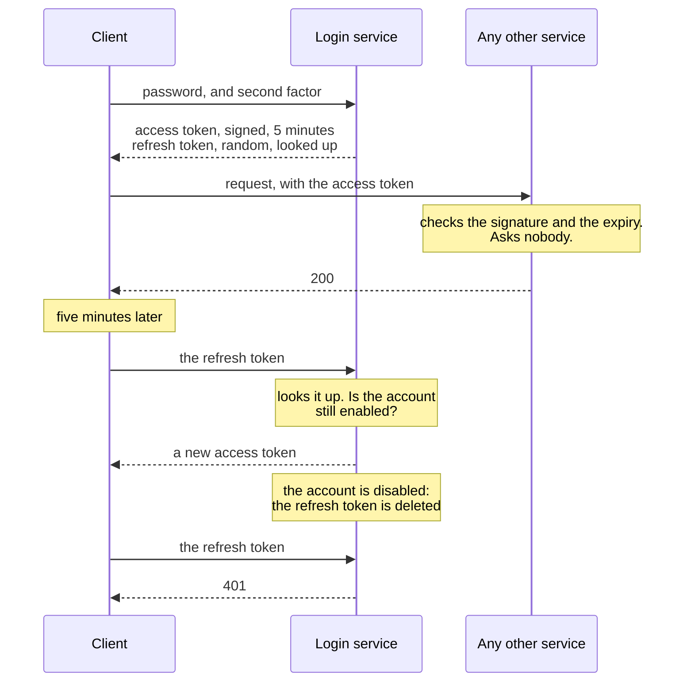
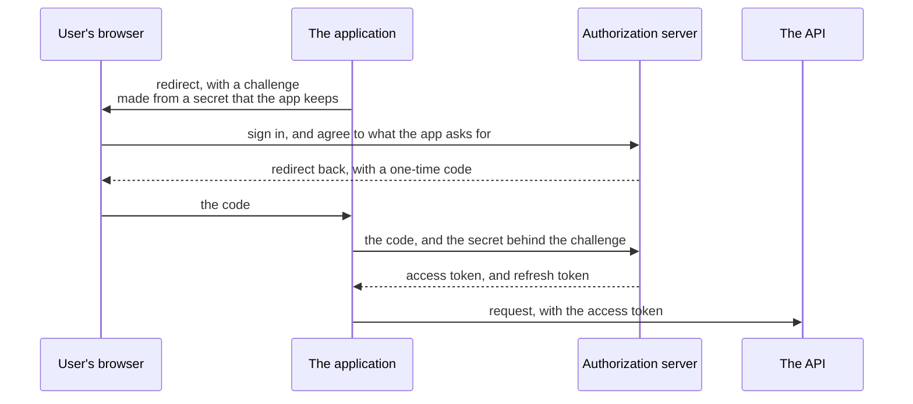

# 8.2 Authentication

[Syllabus](../SYLLABUS.md) · Phase 8 · Previous: [8.1 Threat modelling and trust boundaries](01-threat-modelling.md) · Next: [8.3 Authorization](03-authorization.md)

> **Time:** about 35 minutes to read, 45 minutes of practice.
> **You need:** trust boundaries from [Chapter 8.1](01-threat-modelling.md); HTTP headers and cookies from [Chapter 1.3](../phase-1-foundations/03-http-for-backend-engineers.md). The example needs only Go, and the `golang.org/x/crypto` module, which Go fetches the first time. It takes about three seconds.

**By the end of this chapter you can**

- store a password so that a stolen table is of little use to whoever stole it;
- say what makes a login hard to attack from outside: limits, a blocklist, a second factor;
- choose between a session ID and a signed token, and say what each costs;
- say how long it takes, in a given design, for a disabled account to stop working;
- name the mistakes that let a signed token be forged or misused, and check for each;
- say what OAuth 2.0 and OpenID Connect are for, and which flow to use.

---

## The problem

*An illustrative scenario; the example reproduces both halves.* Two things happen to one company in one year.

**In March, a copy of the users table gets out.** It was in an old backup, and how the backup got out is Chapter 8.4's subject. The team is calm: the passwords are hashed, with SHA-256, so nobody can read them. The attacker does not need to read them. A list of the ten thousand passwords that people most often choose is hashed in a few milliseconds and compared with the table. Four hundred of a thousand accounts are open before the team has finished its first meeting. Most of those people use the same password for their email.

**In September, a contractor's access is ended.** The account is disabled on Friday afternoon. On Monday the contractor's laptop is still working. The application signs people in with a token that is valid for thirty days, and checking a token does not involve asking whether the account still exists.

These look like two unrelated faults. They are the same misunderstanding, twice.

1. **A password was treated as data to be protected**, like an address. It is a secret that an attacker can *guess*, and the only defence against guessing is to make each guess expensive.
2. **Being signed in was treated as a fact.** It is a claim, which was true at the moment of login and has to be checked again for as long as it is relied on.

---

## The concept

### 1. Three questions, often run together

| Question | Name | This course |
|---|---|---|
| Who is asking? | **Authentication** | this chapter |
| Are they still who they were when they signed in? | **Session management** | this chapter |
| What are they allowed to do? | **Authorization** | Chapter 8.3 |

A request arrives. Before anything else can be decided, the service has to know who sent it. That knowledge starts with a proof, the password or something better, and is then carried from request to request by something that stands for the proof.

### 2. Storing passwords: make every guess expensive

**Never store a password. Store what a password-hashing function makes of it.** A hash cannot be turned back into the password, and OWASP calls hashing "the most appropriate approach for password validation" ([OWASP, *Password Storage Cheat Sheet*](https://cheatsheetseries.owasp.org/cheatsheets/Password_Storage_Cheat_Sheet.html)).

One-way is not enough, and this is the scenario's mistake. An attacker with the table does not reverse the hash. They guess, hash the guess, and compare. So the question is how many guesses a second they can make. A general-purpose hash is built to be fast: "Fast hashing algorithms such as SHA‑256 are not suitable for password storage because they allow attackers to perform large numbers of guesses quickly" ([OWASP, *Password Storage Cheat Sheet*](https://cheatsheetseries.owasp.org/cheatsheets/Password_Storage_Cheat_Sheet.html)).

Two things make guessing expensive.

**A salt**, so that the work cannot be shared between users. "A salt is a unique, randomly generated string that is added to each password as part of the hashing process. As the salt is unique for every user, an attacker has to crack hashes one at a time using the respective salt rather than calculating a hash once and comparing it against every stored hash" ([OWASP, *Password Storage Cheat Sheet*](https://cheatsheetseries.owasp.org/cheatsheets/Password_Storage_Cheat_Sheet.html)). The salt is not a secret. It is stored beside the hash.

**A function that is slow on purpose**, with a setting that says how slow: the **work factor**. NIST makes both a requirement: "Passwords SHALL be salted and hashed using a suitable password hashing scheme. Password hashing schemes take a password, a salt, and a cost factor as inputs and generate a password hash" ([NIST SP 800-63B-4](https://pages.nist.gov/800-63-4/sp800-63b.html)).

Which function, and how slow? OWASP's current answers ([*Password Storage Cheat Sheet*](https://cheatsheetseries.owasp.org/cheatsheets/Password_Storage_Cheat_Sheet.html)):
- first choice: "Use Argon2id with a minimum configuration of 19 MiB of memory, an iteration count of 2, and 1 degree of parallelism."
- where that is not available: scrypt.
- for older systems: "use a work factor of 10 or more and with a password limit of 72 bytes", for bcrypt.
- the upper limit is the login itself: "As a general rule, calculating a hash should take less than one second."

Argon2id and scrypt also need a lot of memory for each guess, which is what makes hardware built for guessing expensive.

**The work factor is meant to rise.** Machines get faster, and the setting is stored with each hash so that old and new can live together. "The most common approach to upgrading the work factor is to wait until the user next authenticates, then re-hash their password with the new work factor" ([OWASP, *Password Storage Cheat Sheet*](https://cheatsheetseries.owasp.org/cheatsheets/Password_Storage_Cheat_Sheet.html)). The same moment is the way out of an old, fast hash.

Use the library's own function to check a password. It reads the salt and the work factor from the stored value, and it compares in a way that does not leak how many characters matched.

### 3. Making the login hard to attack

A stolen table is one attack. The other is the login form, which anyone can try.

**Limit the guesses.** NIST: "Verifiers SHALL implement a rate-limiting mechanism that effectively limits the number of failed authentication attempts that can be made on the subscriber account" ([NIST SP 800-63B-4](https://pages.nist.gov/800-63-4/sp800-63b.html)). Limit by account and by source, and slow down before locking out. A hard lock lets anyone lock anyone else out, which is the *D* of Chapter 8.1.

**Refuse the passwords that attackers try first.** "When processing a request to establish or change a password, verifiers SHALL compare the prospective secret against a blocklist that contains known commonly used, expected, or compromised passwords" ([NIST SP 800-63B-4](https://pages.nist.gov/800-63-4/sp800-63b.html)). Most attacks on a login are lists of passwords that leaked from other sites.

**Ask for length, and for nothing else.** The same standard, on the rules that every reader has met ([NIST SP 800-63B-4](https://pages.nist.gov/800-63-4/sp800-63b.html)):
- a password used on its own is to be "a minimum of 15 characters in length", and one used with a second factor at least eight;
- "Verifiers and CSPs SHALL NOT impose other composition rules (e.g., requiring mixtures of different character types) for passwords."
- "Verifiers and CSPs SHALL NOT require subscribers to change passwords periodically. However, verifiers SHALL force a change if there is evidence that the authenticator has been compromised."

**Add a second factor**, because of what a password cannot do: "Passwords are not phishing-resistant" ([NIST SP 800-63B-4](https://pages.nist.gov/800-63-4/sp800-63b.html)). A person can be talked into typing one into the wrong page. A code from a phone can be typed into the wrong page too, and NIST says so: such authenticators "SHALL NOT be considered phishing-resistant". What does resist is a key held by a device, which signs a challenge and will not sign for the wrong site. That is what a passkey is, and it is where logins are going.

**Remember the side doors.** *Forgot my password* is a login. So is the support desk. An attacker takes whichever is weakest.

### 4. After the login: a session ID, or a signed token

The password is checked once. Every later request has to carry something that stands for that check. There are two kinds of thing, and the choice between them is the second half of the scenario.

**A session ID** is a random number. The server keeps a table: this number belongs to this user. Every request brings the number, and the server looks it up.

- It must be unguessable: "Session identifiers must have at least 64 bits of entropy to prevent brute-force session guessing attacks", from "A strong CSPRNG" ([OWASP, *Session Management Cheat Sheet*](https://cheatsheetseries.owasp.org/cheatsheets/Session_Management_Cheat_Sheet.html)).
- In a browser it lives in a cookie with three settings. `Secure`: sent only over TLS. `HttpOnly`, which "instructs web browsers not to allow scripts (e.g. JavaScript or VBscript) an ability to access the cookies". And `SameSite`, which "controls whether browsers send a cookie with cross-site requests" ([OWASP, *Session Management Cheat Sheet*](https://cheatsheetseries.owasp.org/cheatsheets/Session_Management_Cheat_Sheet.html)).
- It changes at login: "The session ID must be renewed or regenerated by the web application after any privilege level change within the associated user session."
- It ends: after a time with no use, and after a fixed time whatever the use.
- **To end it early, delete the row.** The next request finds nothing.

**A signed token** carries the answer with it. The usual format is the JSON Web Token: "a compact, URL-safe means of representing claims to be transferred between two parties" ([RFC 7519](https://www.rfc-editor.org/rfc/rfc7519.html)). It has three parts: a header that names the signing algorithm, the claims, and a signature over both. The claims say who the user is, which service the token is for, and when it expires. A service that holds the key checks the signature and believes the claims. **It asks nobody.**

That is the attraction. Ten services can check a token with no shared table and no call across the network. It is also the cost. Nothing is looked up, so nothing can be deleted. **A signed token is valid until it expires**, whatever has happened to the account since.

Two more things about tokens are regularly forgotten. The claims are signed, not hidden: anyone who holds a token can read it. And a token is a password while it lasts: whoever has a copy is the user.

**The usual answer is to use both**, each for what it is good at.



The **access token** is signed and short-lived, and services check it without a lookup. The **refresh token** is a session ID by another name: "Refresh tokens are credentials used to obtain access tokens" ([RFC 6749](https://www.rfc-editor.org/rfc/rfc6749.html)), and it is looked up each time it is used. Disable the account, and the refresh token stops working at once. The access token works until it expires. **The life of the access token is how long revocation takes.** Choose it as that.

### 5. How signed tokens go wrong

The format is flexible, and most of its failures come from the flexibility. RFC 8725 lists them, with the remedies.

**The token chooses its own algorithm.** The header says how the token was signed, and a careless verifier does as it is told. A token whose header says that it has no signature is then accepted without one. In another form of the same fault, a service that verifies with a public key is sent a token signed with that public key as if it were a shared secret, and "some libraries would try to validate the signature using HMAC-SHA256 and using the RSA public key as the HMAC shared secret" ([RFC 8725](https://www.rfc-editor.org/rfc/rfc8725.html)). The rule: "Libraries MUST enable the caller to specify a supported set of algorithms and MUST NOT use any other algorithms when performing cryptographic operations." The verifier decides. The token does not.

**The signature is checked and nothing else.** A good signature says who issued the token. It does not say that the token is still valid, or that it was meant for this service. Check the expiry. And check the audience: "the relying party or application MUST validate the audience value, and if the audience value is not present or not associated with the recipient, it MUST reject the JWT" ([RFC 8725](https://www.rfc-editor.org/rfc/rfc8725.html)). Without that, a token issued for the reports service opens the payments service, if both trust the same issuer.

**The token lives too long**, which was section 4.

**Secrets are put in the claims.** They are readable by anyone.

Use a maintained library, and then configure it: the one algorithm you use, the issuer, the audience, the expiry. In some libraries, the defaults were the vulnerability.

### 6. OAuth 2.0 and OpenID Connect

These two names appear in every design that involves more than one company, and they answer different questions.

**OAuth 2.0 is about delegation.** A user lets one application act for them at another service, without giving it their password: it "enables a third-party application to obtain limited access to an HTTP service" ([RFC 6749](https://www.rfc-editor.org/rfc/rfc6749.html)). An accounting tool that reads invoices from the invoicing product is the case. There are four parties: the user, the application that wants access, the server that issues tokens, and the API that accepts them.



The user's password goes only to the authorization server. The application never sees it. The steps with the challenge and the secret are **PKCE** ([RFC 7636](https://www.rfc-editor.org/rfc/rfc7636.html)): they make a stolen code useless to anyone but the application that began the flow.

The current rules are in RFC 9700, and four of them settle most designs ([RFC 9700](https://www.rfc-editor.org/rfc/rfc9700.html)):
- Use the flow above, with PKCE. For applications that cannot keep a secret, such as those in a browser or on a phone, it is required.
- Do not use the older flow that returns a token straight to the browser: "clients SHOULD NOT use the implicit grant (response type token) or other response types issuing access tokens in the authorization response".
- Never let an application collect the user's password to exchange it for a token: "This grant type insecurely exposes the credentials of the resource owner to the client."
- Compare the address to redirect back to exactly: "authorization servers MUST utilize exact string matching", with one exception for applications on the user's own machine. A pattern that almost matches sends the code to an attacker.

**OpenID Connect is about identity.** OAuth says what an application may do. It does not say who the user is. OpenID Connect adds that: "OpenID Connect 1.0 is a simple identity layer on top of the OAuth 2.0 protocol. It enables Clients to verify the identity of the End-User based on the authentication performed by an Authorization Server" ([*OpenID Connect Core 1.0*](https://openid.net/specs/openid-connect-core-1_0.html)). The application receives a second token, the ID token, which is addressed to the application and says who signed in. This is what is behind *Sign in with…*, and behind single sign-on for a company's own staff. Chapter 8.1's admin tool should have used it.

Keep the two tokens apart. The ID token is for the application, to learn who the user is. The access token is for the API. An API that accepts ID tokens has skipped the check on the audience.

And do not write an authorization server. Use one.

---

## A real example

### Run it: a stolen table, a disabled account, four bad tokens

[`code/ch02-auth/main.go`](code/ch02-auth/main.go), about 420 lines, has three parts. The second and third run a real HTTP server.

```bash
go run ./phase-8-security/code/ch02-auth
```

Part 1 measures this machine, so your numbers will differ.

```text
PART 1 — a stolen table of 1,000 passwords, and a wordlist of 10,000. One core of this machine.

  how the passwords were stored             guesses    passwords found          time to try the whole
                                           a second                            wordlist on every user
  SHA-256, no salt                         one pass                400                            5ms
  SHA-256, a salt for each user           3,820,744                400                         2.092s
  bcrypt, cost 10                                13   0, in one second                       7.4 days
  Argon2id, 19 MiB and 2 passes                  32   0, in one second                       2.9 days
```

A thousand users. Four in ten chose a password of the kind that is on every attacker's list, here ten thousand of them. The rest use sixteen random characters, and no row of the table finds those.

**Without a salt**, the attacker hashes the list once and looks each user up. Every weak password in the table falls in 5 milliseconds.

**With a salt**, the list has to be hashed again for each user. That takes 2.1 seconds and finds the same 400. The salt made the attack a thousand times more work, and SHA-256 is so fast that it did not matter: 3.8 million guesses a second, on one core.

**With a function that is slow on purpose**, the same core makes 13 guesses a second against bcrypt, and 32 against Argon2id. That is about 290,000 times fewer. The attack that took two seconds would take days, and found nothing in the second it was given. An attacker has more than one core. They do not have 290,000 times more.

The slow functions cost the service something as well: every login now takes some tens of milliseconds of one core. That is the price, and it is the reason to limit how many logins can be attempted (Chapter 6.4).

Storing a password, and checking one, is a line each:

```go
		{"bcrypt, cost 10", func(u user, w string, stored []byte) bool {
			return bcrypt.CompareHashAndPassword(stored, []byte(w)) == nil
		},
			func(u user) []byte { h, _ := bcrypt.GenerateFromPassword([]byte(u.password), 10); return h }},
```

```text
PART 2 — one account, signed in three ways at 09:00. At 09:02 the account is disabled.

                                            a session ID,      a signed token,   a token for 5 minutes,
  time since signing in                         looked up     good for 30 days      and a refresh token
  1 minute                                            200                  200                      200
  — the account is disabled —
  3 minutes                                           401                  200                      200
  6 minutes                                           401                  200                      401
  1 day                                               401                  200                      401
  29 days                                             401                  200                      401
  31 days                                             401                  401                      401

  lookups in the store, 1,000 requests              1,000                    0                       11
```

**The session ID stops at once.** The row is gone, and the next request is refused.

**The token that is good for thirty days works for thirty days.** This is the scenario's contractor. Nothing that the company did on Friday reached the laptop.

**The pair stops within five minutes.** At three minutes the access token is still inside its life, and it is accepted. At six it has expired, the client asks for another, and the refresh token is looked up and refused.

**The last row is what the difference costs.** A thousand requests needed a thousand lookups with a session ID, none with a long-lived token, and eleven with the pair. The pair buys nearly all of the token's saving for five minutes of exposure.

```text
PART 3 — four tokens that the shop should refuse.

  the token                                                  a careless verifier    a careful one
  claims changed to role admin, with the old signature       refused                refused: the signature is wrong
  role admin, and a header that says: no signature needed    ACCEPTED, as admin     refused: the algorithm is not one that this service accepts
  properly signed, and expired yesterday                     ACCEPTED               refused: the token has expired
  properly signed, by the same issuer, for another service   ACCEPTED, as admin     refused: the token is for another service
```

The careless verifier checks one thing, the signature, and it does that properly: the first token is refused. Then it believes a header that says that no signature is needed, does not look at the expiry, and does not ask whom the token was for. Three of the four are accepted, and two of them as an administrator.

The careful verifier is a few lines longer:

```go
	case header.Alg == "none" && !careful:
		// The token says that it needs no signature, and the careless verifier believes it.
	default:
		return c, errors.New("the algorithm is not one that this service accepts")
	}
```

```go
	if careful && now.Unix() >= c.Exp {
		return c, errors.New("the token has expired")
	}
	if careful && c.Aud != audience {
		return c, errors.New("the token is for another service")
	}
```

### How Dropbox stores passwords

Dropbox described its scheme in 2016, and it is section 2 with a layer added ([Devdatta Akhawe, *How Dropbox securely stores your passwords*](https://dropbox.tech/security/how-dropbox-securely-stores-your-passwords)).

**The core is a slow hash with a salt**: "We rely on bcrypt as our core hashing algorithm with a per-user salt and an encryption key (or global pepper), stored separately" ([*How Dropbox securely stores your passwords*](https://dropbox.tech/security/how-dropbox-securely-stores-your-passwords)).

**The work factor was chosen by measuring**: "A work factor of 10 translates into roughly 100ms for all these steps on our servers." And the reason for the function: "Unlike cryptographic hash functions like SHA, bcrypt is designed to be slow and hard to speed up via custom hardware and GPUs" ([*How Dropbox securely stores your passwords*](https://dropbox.tech/security/how-dropbox-securely-stores-your-passwords)).

**bcrypt's limit of 72 bytes is dealt with** by hashing the password first: "Some implementations of bcrypt truncate the input to 72 bytes, which reduces the entropy of the passwords" ([*How Dropbox securely stores your passwords*](https://dropbox.tech/security/how-dropbox-securely-stores-your-passwords)).

**Then a second, independent layer**: "the resulting bcrypt hash is encrypted with AES256 using a secret key (common to all hashes) that we refer to as a pepper. The pepper is a defense in depth measure. The pepper value is stored separately in a manner that makes it difficult to discover by an attacker (i.e. not in a database table)" ([*How Dropbox securely stores your passwords*](https://dropbox.tech/security/how-dropbox-securely-stores-your-passwords)).

That is Chapter 8.1's count, applied to one column. An attacker who copies the table has ciphertext. They need the key as well, from another place, and after that they still face bcrypt.

---

## Trade-offs

**A slow hash against a fast login.** The work factor is paid by every honest login and by every attempt on the form. Set it as high as the login can bear, measure it on your own servers, and protect the form with a limit.

**A session ID against a signed token.** The session ID can be ended at once and costs a lookup for each request. The token costs nothing to check and cannot be ended. For one service with one database, the session ID is simpler and better. Tokens earn their keep when many services have to check the same identity.

**A long life against a short one.** A short access token means quick revocation and more calls to refresh. Think in minutes. Thirty days is a session ID without the ability to delete it.

**Where the browser keeps it.** A cookie with `HttpOnly` cannot be read by a script, and is sent automatically, which needs its own defence against requests made from other sites. Storage that scripts can read is not sent automatically, and is open to any script that gets into the page. For a browser, prefer the cookie.

**Your own login against someone else's.** Signing in through an identity provider moves the password, the second factor and the recovery flow to a team that does nothing else. It also means that their outage is yours, and that your users need an account with them. For staff, use single sign-on. For customers, offer it, and have a plan for those who decline.

**Passwords at all.** Each rule in section 3 is a patch on something that people cannot do well, which is to remember a different strong secret for each site. A key on the device removes the secret. Offer it where you can.

---

## Practice

### Check yourself

1. In part 1, the salt made the attack a thousand times more work and it still took two seconds. Why did the salt not help more? What does?
2. Your service uses access tokens that last fifteen minutes and refresh tokens that last thirty days. An employee is dismissed at 14:00. Until when does their laptop work? What decides that, and how would you shorten it for the most sensitive actions?
3. The payments service and the reports service both accept tokens from the same issuer, and neither checks the audience. Describe the attack. Which claim stops it?

<details>
<summary>Answers</summary>

1. The salt removes the sharing of work between users: without it, one pass over the wordlist does for all thousand. With it, the attacker needs a pass for each user, which is ten million hashes. SHA-256 does several million a second on one core, so ten million is seconds. What helps is making each hash slow: bcrypt or Argon2id bring the same core down to tens of guesses a second. The salt and the slowness do different jobs, and both are needed.
2. Until 14:15 at the latest. The refresh token is refused from 14:00, if dismissing the employee deletes it. An access token issued just before 14:00 is good until it expires. The life of the access token decides it. For the most sensitive actions, such as moving money or reading every customer's data, look the account up on that request as well. The lookup is cheap when only a few endpoints need it.
3. An attacker has an ordinary account on the reports service. They sign in there, and present the token to the payments service. Its signature is good and its issuer is trusted, so it is accepted, with whatever role the reports service gave. The `aud` claim stops it: the payments service accepts only tokens whose audience is the payments service.

</details>

### Exercise: sign-in for the invoicing product

The product of Chapter 8.1 has a web application for customers, an API that their accounting tools call, and an admin tool for forty support staff. Design the authentication.

1. **Customers, in the browser.** How are passwords stored? What does the login form defend against, and how? What does the browser hold after login, and where?
2. **The same customers' accounting tools**, written by other companies, need to read invoices. What do they hold? What never leaves the customer's hands?
3. **Support staff**, on the admin tool. How do they sign in? What happens to their access on the day that they leave?
4. For each of the three: **how long after an account is disabled does access stop?**
5. One table of users is stolen. What does the attacker have?

<details>
<summary>Worked solution</summary>

**1. Customers.** Passwords are stored with Argon2id at OWASP's minimum or above, with the work factor measured on our servers and the parameters stored with each hash. At least fifteen characters, or eight with a second factor, with no rules about which characters. New passwords are checked against a list of leaked ones. The form limits attempts for each account and for each address, and gives the same answer for a wrong password and an unknown address. A second factor is offered to all, and required for the tenant's administrators. Passkeys are offered.

After login the browser holds a **session ID**, in a cookie that is `Secure`, `HttpOnly` and `SameSite=Lax`. It is one application with one database, and the lookup is cheap. The ID is 128 random bits, changed at login, with an idle limit of thirty minutes and a limit of twelve hours in all.

**2. Accounting tools.** OAuth 2.0, with the flow of section 6 and PKCE. The customer signs in **on our pages** and agrees to *read invoices*. The tool receives an access token for fifteen minutes, limited to reading invoices for that tenant, and a refresh token. It never sees the password. The customer has a page that lists the tools they have authorised, with a button that deletes each one's refresh token. We run an existing authorization server and do not write one.

**3. Support staff.** Single sign-on through the company's identity provider, with OpenID Connect, and a second factor that resists phishing. The admin tool has no passwords of its own. It is reachable from the internet and trusts nothing about the network (Chapter 8.1). Sessions last eight hours. When someone leaves, their account is disabled at the identity provider, and that is the only place.

**4. How long until access stops.**

| | Stops |
|---|---|
| A customer's browser session | at once: the row is deleted |
| An accounting tool | within fifteen minutes: the access token's life. At once for anything that changes data, because those endpoints look the grant up |
| Support staff | within eight hours by default. That is too long for this tool, so the admin tool checks the account with the identity provider every five minutes |

**5. The stolen table.** Addresses, salts and Argon2id hashes. Session IDs and refresh tokens are stored as hashes too, so that the table cannot be used to sign in as anyone. The attacker can try the common passwords against each user at some tens of guesses a second for each core. The weakest passwords will fall in time, so everyone is made to choose a new one, and the leaked-password check stops the worst being chosen again. No password has been read. Compare that with the scenario.

</details>

---

## Production tips and common mistakes

- **Store passwords with Argon2id, scrypt or bcrypt**, through a maintained library. Keep the parameters with each hash.
- **Measure the work factor on your own servers**, and raise it when they are replaced.
- **Re-hash at login** when the stored parameters are older than the current ones.
- **Limit attempts** for each account and each source. Give one answer for every kind of failed login.
- **Check new passwords against leaked ones.** Drop the rules about characters and the forced changes.
- **Offer a second factor to everyone**, and require it for administrators and staff.
- **Treat reset and recovery as logins**, with the same limits.
- **Generate session IDs and refresh tokens from the system's random source**, and store only their hashes.
- **Decide how long revocation may take**, and set the access token's life to that.
- **Tell the verifier which algorithm, issuer and audience to accept.** Do not let the token say.
- **Keep tokens out of logs and URLs.**

**Common mistakes**

- **A fast hash**, with or without a salt.
- **Encrypting passwords**, so that one key opens them all.
- **A token that lasts for weeks** and cannot be withdrawn.
- **Logout that only deletes the cookie.**
- **Believing the token's header.**
- **Checking the signature and not the expiry or the audience.**
- **Secrets, or personal data, in a token's claims.**
- **A reset link that does not expire**, or that says whether the address exists.
- **Your own authorization server**, or your own cryptography.

---

## Key takeaways

- A stored password is attacked by guessing. The defence is a salt for each user and a function that is slow on purpose: Argon2id, scrypt or bcrypt.
- The login form is attacked by guessing too. Limit attempts, refuse leaked passwords, ask for length and not for symbols, and add a second factor.
- A session ID is looked up on every request and can be ended at once. A signed token is checked with no lookup and cannot be ended before it expires.
- The usual design is a short-lived signed access token and a refresh token that is looked up. Revocation takes as long as the access token lives.
- A signed token is safe only if the verifier fixes the algorithm and checks the expiry and the audience.
- OAuth 2.0 delegates access without sharing a password. OpenID Connect says who signed in. Use the code flow with PKCE, and an existing server.

**Next:** [8.3 Authorization](03-authorization.md) — the service now knows who is asking. Whether they may have what they asked for is a separate question, and it is the one that fails most often.

---

## Sources

- OWASP Cheat Sheet Series: [*Password Storage*](https://cheatsheetseries.owasp.org/cheatsheets/Password_Storage_Cheat_Sheet.html) and [*Session Management*](https://cheatsheetseries.owasp.org/cheatsheets/Session_Management_Cheat_Sheet.html).
- NIST, [*Special Publication 800-63B-4, Digital Identity Guidelines*](https://pages.nist.gov/800-63-4/sp800-63b.html), 2025.
- IETF: [RFC 7519, *JSON Web Token*](https://www.rfc-editor.org/rfc/rfc7519.html); [RFC 8725, *JSON Web Token Best Current Practices*](https://www.rfc-editor.org/rfc/rfc8725.html); [RFC 6749, *The OAuth 2.0 Authorization Framework*](https://www.rfc-editor.org/rfc/rfc6749.html); [RFC 7636, *Proof Key for Code Exchange by OAuth Public Clients*](https://www.rfc-editor.org/rfc/rfc7636.html); [RFC 9700, *Best Current Practice for OAuth 2.0 Security*](https://www.rfc-editor.org/rfc/rfc9700.html).
- OpenID Foundation, [*OpenID Connect Core 1.0*](https://openid.net/specs/openid-connect-core-1_0.html).
- Devdatta Akhawe, [*How Dropbox securely stores your passwords*](https://dropbox.tech/security/how-dropbox-securely-stores-your-passwords), Dropbox, 2016.
