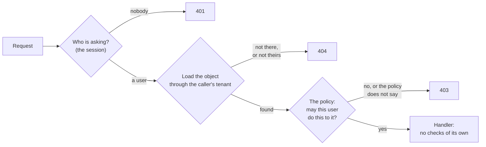
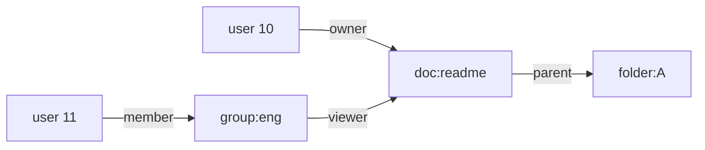

# 8.3 Authorization

[Syllabus](../SYLLABUS.md) · Phase 8 · Previous: [8.2 Authentication](02-authentication.md) · Next: 8.4 Protecting data *(planned)*

> **Time:** about 40 minutes to read, 45 minutes of practice.
> **You need:** sessions from [Chapter 8.2](02-authentication.md), and the controls called *object* and *scope* in [Chapter 8.1](01-threat-modelling.md). The first two parts of the example need only Go and take under a second. The third needs the PostgreSQL of [Phase 2](../phase-2-data/README.md), and is skipped without it.

**By the end of this chapter you can**

- tell apart the three levels at which a request is authorized, and say which is missed most often;
- write down who may do what as a matrix, and run the matrix as a test;
- put the check where a new endpoint cannot be without it;
- choose between roles, attributes and relationships for stating a policy;
- keep tenants apart in a shared database, and say what row-level security does and does not do;
- say how old an authorization decision is allowed to be in a given design.

---

## The problem

*An illustrative scenario; the example reproduces it.* The invoicing product of Chapter 8.1 has been live for six months. A bookkeeper at one customer opens an invoice, notices `/invoices/20417` in the address bar, and types `20418` to see what happens. She is shown an invoice from a company that she has never heard of. She writes to support.

The team is quick. The handler behind the invoice page gets one more line, which compares the invoice's tenant with the caller's, and the fix is live within the hour. Three months later a security researcher reports the same fault in the *Download PDF* button. That is a different handler, in a different file, written by someone who joined after the fix. It has been open all along, and the logs cannot say whether anybody used it.

This is not a rare kind of mistake.

- **It happens at scale.** In 2019 the website of First American Financial, a large American title insurer, was found to be serving its customers' documents to anyone who had a link, and "anyone who knew the URL for a valid document at the Web site could view other documents just by modifying a single digit in the link". The reporter who confirmed it put the exposure at "approximately 885 million files, the earliest dating back more than 16 years" ([KrebsOnSecurity, 2019](https://krebsonsecurity.com/2019/05/first-american-financial-corp-leaked-hundreds-of-millions-of-title-insurance-records/)).
- **It is first on both of OWASP's lists.** The first entry of the [API Security Top 10](https://api-security.owasp.org/editions/2023/en/0xa1-broken-object-level-authorization/) is *broken object level authorization*, which is the bookkeeper's finding exactly. The first entry of the general [Top 10 of 2025](https://top10.owasp.org/2025/A01_2025-Broken_Access_Control/), broken access control, begins: "Maintaining its position at #1 in the Top Ten, 100% of the applications tested were found to have some form of broken access control."

Three things went wrong.

1. **Signed in was taken to mean allowed.** Every handler asked who was calling. None asked whether that person may have this invoice. Those are different questions (the table that opens Chapter 8.2), and the second was never asked.
2. **The check, once added, lived inside a handler.** So any handler could be without it, and one was.
3. **Nobody had written down what should happen.** With no statement of who may do what, there was nothing to test the product against, and the gap was found by a customer.

---

## The concept

### 1. One question, at three levels

**Authorization** is "The process of verifying that a requested action or service is approved for a specific entity" ([NIST glossary](https://csrc.nist.gov/glossary/term/authorization)). Authentication supplies the entity. The decision needs two more things: the **action**, and the **object** that it is done to. *May this user void this invoice?*

The question is asked at three levels, and an API can get one right and another wrong.

| Level | The question | How it fails | OWASP's name for the failure |
|---|---|---|---|
| **Function** | May this caller use this operation at all? | A customer calls `GET /admin/export`, which no page of theirs links to | [Broken function level authorization](https://api-security.owasp.org/editions/2023/en/0xa5-broken-function-level-authorization/) |
| **Object** | May they use it on *this* object? | A customer asks for another tenant's invoice by its number | [Broken object level authorization](https://api-security.owasp.org/editions/2023/en/0xa1-broken-object-level-authorization/). The older name is *insecure direct object reference* |
| **Property** | May they read or change *this field* of it? | An update to an invoice includes `"paid": true` | [Broken object property level authorization](https://api-security.owasp.org/editions/2023/en/0xa3-broken-object-property-level-authorization/). Chapter 8.5 |

**The object level is the one that is missed.** A function-level check needs only the route and the caller's role, and a framework can make it before any of your code runs. An object-level check needs the object: the handler has to load the invoice, and then compare. OWASP's rule has no exceptions: "Every API endpoint that receives an ID of an object, and performs any action on the object, should implement object-level authorization checks" ([OWASP API1:2023](https://api-security.owasp.org/editions/2023/en/0xa1-broken-object-level-authorization/)). Using the gap takes no skill. It is done "by manipulating the ID of an object that is sent within the request".

**A role check is not an object check.** *Owners may void invoices* does not say which invoices. A handler that checks the role and goes no further lets the owner of one tenant void the invoices of all the others. "Just because a user has access to an object of a particular type does not mean they should have access to every object of that particular type" ([OWASP Authorization Cheat Sheet](https://cheatsheetseries.owasp.org/cheatsheets/Authorization_Cheat_Sheet.html)).

**Three refusals, three status codes.**

| Status | What [RFC 9110](https://www.rfc-editor.org/rfc/rfc9110.html) says it means | Use it when |
|---|---|---|
| 401 | "the request has not been applied because it lacks valid authentication credentials for the target resource" | nobody is signed in |
| 403 | "the server understood the request but refuses to fulfill it" | the caller may know that the thing exists, and may not do this to it |
| 404 | the server "did not find a current representation for the target resource or is not willing to disclose that one exists" | the object belongs to somebody else |

The last row matters. That invoice 20418 exists is a fact about another customer, and 403 would confirm it. "GitHub uses a 404 Not Found response instead of a 403 Forbidden response to avoid confirming the existence of private repositories" ([GitHub's REST API documentation](https://docs.github.com/en/rest/using-the-rest-api/troubleshooting-the-rest-api)).

### 2. Write the policy down first

Before a check is written, write down what it should decide. OWASP's name for the usual form is an [**authorization matrix**](https://cheatsheetseries.owasp.org/cheatsheets/Authorization_Testing_Automation_Cheat_Sheet.html): every kind of caller across the top, every request down the side, and in each cell the answer that the product should give. For five requests to the invoicing API, about invoice 1001 of tenant A:

| | Nobody | B's member | B's owner | A's member | A's owner | Support staff |
|---|---|---|---|---|---|---|
| Read invoice 1001 | 401 | 404 | 404 | 200 | 200 | 404 |
| List invoices | 401 | B's | B's | A's | A's | nothing |
| Download its file | 401 | 404 | 404 | 200 | 200 | 404 |
| Void it | 401 | 404 | 404 | **403** | 200 | 404 |
| Export every tenant's invoices | 401 | 403 | 403 | 403 | 403 | 200 |

The one 403 is the only refusal inside a tenant: A's member can see the invoice, and may not void it. Every other refusal is to somebody for whom the invoice should not exist.

Three things make a matrix worth having.

- **It can be read by the people who own the answer.** Whether support staff may read a customer's invoices is a product decision. In this table it is one cell, and somebody can be asked to sign it.
- **Its columns are chosen to catch mistakes.** *Nobody*. An outsider with the **lowest** role. An outsider with the **highest** role, which catches a role check with no object check. Each role inside the tenant. Your own staff. Later: an API token that was granted less than its user has (Chapter 8.2), and a person who was removed a minute ago.
- **It is a test.** Each cell is one request and one expected answer. The same cheat sheet says why that matters more than a review at launch: "most of the problems with authorizations occur because features are added/modified in updated releases without determining their effect on the application's authorizations" ([OWASP Authorization Testing Automation Cheat Sheet](https://cheatsheetseries.owasp.org/cheatsheets/Authorization_Testing_Automation_Cheat_Sheet.html)). The *Download PDF* button was such a feature.

### 3. Put the check where it cannot be forgotten



1. **Refuse unless something allows.** The policy lists what is permitted, and everything else is refused. An action that nobody has thought about starts closed. This is the fail-safe default of Chapter 8.1. "For security purposes an application should be configured to deny access by default" ([OWASP Authorization Cheat Sheet](https://cheatsheetseries.owasp.org/cheatsheets/Authorization_Cheat_Sheet.html)).
2. **One gate, in front of every handler.** A check that is written into each handler is as reliable as the least careful handler. "Remember an attacker only needs to find one way in", and "Validating permissions correctly on just the majority of requests is insufficient" ([the same cheat sheet](https://cheatsheetseries.owasp.org/cheatsheets/Authorization_Cheat_Sheet.html)). Make it impossible to add a route without naming the action that it performs.
3. **The caller and their tenant come from the session, and from nowhere else.** Not from a header (the `X-Tenant` of Chapter 8.1), a query parameter or the body. Where one person may act for several tenants, the request may *choose* among them, and the choice is checked against what the session proves. The exercise does this.
4. **Decide where the object is.** A gateway knows the route and the caller, so it can answer the function-level question and no more. Whether invoice 20418 is this caller's can only be decided by code that has read invoice 20418. Object-level authorization "is usually implemented at the code level" ([OWASP API1:2023](https://api-security.owasp.org/editions/2023/en/0xa1-broken-object-level-authorization/)).
5. **Scope the lookup too.** `WHERE id = $1 AND tenant = $2`, not `WHERE id = $1`. A handler that slips past the gate then finds nothing. These are the controls *object* and *scope* of Chapter 8.1, where an attack had to get past both.
6. **Decide on the server.** A button that is hidden from members is a convenience for members. "Developers must never rely on client-side access control checks" ([OWASP Authorization Cheat Sheet](https://cheatsheetseries.owasp.org/cheatsheets/Authorization_Cheat_Sheet.html)).

### 4. Roles, attributes, relationships

A policy has to be stated in terms of something. There are three established ways, and real products mix them.

| | A rule looks like | Good for | Runs out when |
|---|---|---|---|
| **Roles** (RBAC) | *Owners may void invoices.* | A few kinds of user, and rules that a customer can read | The answer depends on the object: *their tenant's*, *the ones they raised* |
| **Attributes** (ABAC) | *A member may void an invoice of their tenant if it is unsent and under £1,000.* | Conditions on the user, the object and the moment | Rules pile up, and *who can see this invoice?* has no quick answer |
| **Relationships** (ReBAC) | *Whoever an invoice has been shared with may read it.* | Sharing single objects; groups inside groups; folders | It needs a store of relationships, and a fast way to walk it |

NIST defines the first as "Access control based on user roles (i.e., a collection of access authorizations that a user receives based on an explicit or implicit assumption of a given role)" ([NIST glossary](https://csrc.nist.gov/glossary/term/role_based_access_control)), and the second as "An access control approach in which access is mediated based on attributes associated with subjects (requesters) and the objects to be accessed" ([NIST glossary](https://csrc.nist.gov/glossary/term/attribute_based_access_control)). OWASP describes the third: "ReBAC is an access control model that grants access based on the relationships between resources" ([OWASP Authorization Cheat Sheet](https://cheatsheetseries.owasp.org/cheatsheets/Authorization_Cheat_Sheet.html)).

**In a product with tenants, a role is already a relationship.** Nobody is simply *an owner*. They are an owner *of tenant A*, which is a fact about a user and a tenant. Store it that way, as a table of memberships (user, tenant, role), and not as a `role` column on the user. Then grow the policy only as the product asks:

- start with roles inside a tenant, and the object check, in one policy function;
- add conditions to that function when a rule needs them;
- add a store of relationships on the day that customers share single invoices with outsiders, or build teams inside teams.

**Where the policy is kept** is a separate choice. A function in the service is the simplest, and the place to start. A policy engine keeps the rules outside the code: "OPA decouples policy decision-making from policy enforcement" ([Open Policy Agent documentation](https://www.openpolicyagent.org/docs)). A relationship service answers for many products at once. Google's is described below.

### 5. Keeping tenants apart

For a product with customers, one rule stands above the others: a tenant never sees another tenant's data. "Crossing this boundary in any form would represent a significant and potentially unrecoverable event for a SaaS business" ([AWS Well-Architected SaaS Lens, *Tenant Isolation*](https://docs.aws.amazon.com/wellarchitected/latest/saas-lens/tenant-isolation.html)).

How much the tenants share decides how the rule is kept. AWS names the two ends: "The silo model refers to an architecture where tenants are provided dedicated resources", and "the pool model of SaaS refers to a scenario where tenants share resources". A mixture of the two is a *bridge* ([SaaS Lens, *Silo, Pool, and Bridge Models*](https://docs.aws.amazon.com/wellarchitected/latest/saas-lens/silo-pool-and-bridge-models.html)).

| | Pool: shared tables | Silo: a database for each tenant |
|---|---|---|
| What keeps tenants apart | A condition in every query | The connection |
| One forgotten condition exposes | Every tenant | Nothing |
| Each new tenant costs | A few rows | A database to connect to, migrate, back up and watch |
| A question about all tenants, such as billing | One query | One for each database |

In a pool, every table has a tenant column, and the rule becomes *every query names the tenant*. There are two ways to make *every* true, and they are better together.

**In the application:** data access that cannot be used without a tenant. The lookup takes a tenant and an identifier, and there is no other lookup to call by mistake.

**In the database: row-level security.** The database adds the condition itself, to every query on the table. In PostgreSQL, "When row security is enabled on a table (with ALTER TABLE ... ENABLE ROW LEVEL SECURITY), all normal access to the table for selecting rows or modifying rows must be allowed by a row security policy" ([PostgreSQL documentation, *Row Security Policies*](https://www.postgresql.org/docs/current/ddl-rowsecurity.html)). The policy is an expression, usually *this row's tenant is the tenant of the current request*, and the application tells the database which tenant that is at the start of each transaction. A query that forgets its `WHERE tenant = …` returns the caller's rows only. It is a second control and not a replacement for the first, for four reasons that part 3 of the example shows or the documentation states:

- It does not apply to the table's owner or to a superuser. The application must connect as neither.
- The tenant has to be set for the transaction and not for the session, or the next request on that pooled connection inherits it.
- It is one more condition on each query. PostgreSQL 16 used an index on the tenant column for it when this chapter was written, so index that column (Chapter 2.2).
- Constraints see through it. "Referential integrity checks, such as unique or primary key constraints and foreign key references, always bypass row security" ([the same page](https://www.postgresql.org/docs/current/ddl-rowsecurity.html)). A unique index across all tenants tells one tenant that a value is taken by another.

**The other roads to the data.** The request path is one of several. Each of these reads the same rows and needs the same rule: a cache, whose key must contain the tenant (Chapters 3.3 and 3.5); a search index; a background job, which must carry the tenant in its message (Chapter 4.2); an export; a file in object storage (Chapter 8.4); a line in a log.

### 6. How fresh is the decision?

A decision is made from facts, such as *this user is an owner of tenant A*, and facts change. Every design has a delay between a change and the last decision that is made on the old fact.

| Where the fact is read | How old it can be |
|---|---|
| The database, on each request | Not at all, or a replica's lag (Chapter 3.6) |
| A cache of memberships | The cache's time to live |
| A claim inside a signed token | The token's life (Chapter 8.2) |

Choose the delay for each kind of action. Reading may be allowed a minute. Voiding an invoice, or anything that follows *remove this person*, should read the fact where it is written.

Order matters as well as age. The paper on Google's authorization system gives the case: Alice removes Bob from a folder, and then asks Charlie to move new documents into it. Bob should not see them, and will if the check neglects the order of the two changes. "ACL checks must respect the order in which users modify ACLs and object contents to avoid unexpected sharing behaviors" ([Pang et al., *Zanzibar*, USENIX ATC 2019](https://www.usenix.org/system/files/atc19-pang.pdf)).

---

## A real example

### Run it: one policy, three versions of an API

[`code/ch03-authz`](code/ch03-authz/main.go) is three files, about 680 lines. [`main.go`](code/ch03-authz/main.go) is an invoicing API in three versions, each served over real HTTP on your machine. [`matrix.go`](code/ch03-authz/matrix.go) sends five requests to each version as six kinds of caller, and compares every answer with the matrix of section 2. [`postgres.go`](code/ch03-authz/postgres.go) is part 3.

```bash
go run ./phase-8-security/code/ch03-authz
```

There are 50 tenants with 40 invoices each. **Version 1** asks whether the caller is signed in, and nothing else.

```text
PART 1 — the matrix. Six callers send five requests. Invoice 1001 belongs to tenant A.

                                       nobody   B's      B's      A's      A's      support
                                                member   owner    member   owner    staff
  The policy, written down first
    read    GET  /invoices/1001        401      404      404      200      200      404
    list    GET  /invoices?tenant=A    401      B's      B's      A's      A's      nothing
    file    GET  /invoices/1001/pdf    401      404      404      200      200      404
    void    POST /invoices/1001/void   401      404      404      403      200      404
    export  GET  /admin/export         401      403      403      403      403      200

  Version 1 — signed in is enough
    read    GET  /invoices/1001        401      200 ✗    200 ✗    200      200      200 ✗
    list    GET  /invoices?tenant=A    401      A's ✗    A's ✗    A's      A's      A's ✗
    file    GET  /invoices/1001/pdf    401      200 ✗    200 ✗    200      200      200 ✗
    void    POST /invoices/1001/void   401      200 ✗    200 ✗    200 ✗    200      200 ✗
    export  GET  /admin/export         401      200 ✗    200 ✗    200 ✗    200 ✗    200
    ✗ 17 of 30 answers are on the wrong side of the policy
```

A ✗ is an answer on the wrong side of the policy. Read down the second column: a member of B reads A's invoice and its file, and voids it. The list looked safe in the browser, because the page always sends its own tenant. This caller sent `tenant=A`. The export has no link on any page that customers see, which hid it from honest customers only.

**Version 2** is the fix that a team in a hurry makes: a check, written by hand into each handler. Two of the five handlers are these.

```go
	mux.HandleFunc("GET /invoices/{id}/pdf", signedIn(s, func(w http.ResponseWriter, r *http.Request, _ user) {
		inv := db.any(r.PathValue("id")) // missed: this handler lives in another file
		if inv == nil {
			reply(w, 404, nil)
			return
		}
		reply(w, 200, inv)
	}))
	mux.HandleFunc("POST /invoices/{id}/void", signedIn(s, func(w http.ResponseWriter, r *http.Request, u user) {
		inv := db.any(r.PathValue("id"))
		if inv == nil {
			reply(w, 404, nil)
			return
		}
		if u.role != "owner" { // half a check: an owner, but of which tenant?
			reply(w, 403, nil)
			return
		}
```

```text
  Version 2 — a check written by hand into each handler
    read    GET  /invoices/1001        401      404      404      200      200      404
    list    GET  /invoices?tenant=A    401      B's      B's      A's      A's      nothing
    file    GET  /invoices/1001/pdf    401      200 ✗    200 ✗    200      200      200 ✗
    void    POST /invoices/1001/void   401      403 ~    200 ✗    403      200      403 ~
    export  GET  /admin/export         401      403      403      403      403      200
    ✗ 4 of 30 answers are on the wrong side of the policy    ~ 2 refuse, but with the wrong status
```

Thirteen of the seventeen are fixed. The four that are left are two different mistakes.

- **The file handler was missed.** It serves the same invoice by another route, and nobody thought of it as a second door.
- **The void handler checks the role and not the object.** Look at which column catches it: *B's owner*. A matrix whose only outsider was an ordinary member would have passed this handler.

The two answers marked ~ are refusals, so nothing is handed over. But a member of B who is told 403 about invoice 1001, and 404 about a number that is not in use, has learned that invoice 1001 exists.

**Version 3** has one gate and one policy. The policy is a function that lists what is allowed and ends with `return false`:

```go
// allow is the whole policy of version 3. Anything that it does not name is refused.
func allow(u user, action string, inv *invoice) bool {
	switch action {
	case "invoice.list":
		return true // anyone signed in; the list itself holds only the caller's tenant
	case "invoice.read":
		return inv != nil && inv.Tenant == u.tenant
	case "invoice.void":
		return inv != nil && inv.Tenant == u.tenant && u.role == "owner"
	case "admin.export":
		return u.role == "staff"
	}
	return false
}
```

The gate is the only way to add a route. It finds the caller, loads the invoice through the caller's tenant, asks the policy, and only then calls a handler:

```go
			var inv *invoice
			if id := r.PathValue("id"); id != "" {
				if inv = db.scoped(u.tenant, id); inv == nil {
					reply(w, 404, nil) // not this tenant's: for this caller it does not exist
					return
				}
			}
			if !allow(u, action, inv) {
				reply(w, 403, nil)
				return
			}
			h(w, u, inv)
```

```go
	route("GET /invoices/{id}", "invoice.read", show)
	route("GET /invoices/{id}/pdf", "invoice.read", show)
```

```text
  Version 3 — one gate, one policy, and every lookup through the caller's tenant
    read    GET  /invoices/1001        401      404      404      200      200      404
    list    GET  /invoices?tenant=A    401      B's      B's      A's      A's      nothing
    file    GET  /invoices/1001/pdf    401      404      404      200      200      404
    void    POST /invoices/1001/void   401      404      404      403      200      404
    export  GET  /admin/export         401      403      403      403      403      200
    all 30 answers are the policy's
```

The handlers of version 3 hold no checks, so there is none to forget. The file route names the same action as the read route, so the two cannot disagree. A route for an action that `allow` does not name is refused to everyone until somebody adds a line to the policy, and a cell to the matrix.

**Part 2** measures what the one missed handler of version 2 is worth to an attacker.

```text
PART 2 — what one missing check costs. 50 tenants, 40 invoices each. The caller is B's member, who
asks for the file of one invoice after another.

  version   identifiers                  requests   other tenants'   tenants   answers      time
                                                     invoices read   exposed    of 404
  2         1001, 1002, 1003 …              2,000            1,960        49         0    0.13 s
  2         128 random bits, guessed        2,000                0         0     2,000    0.13 s
  2         …and one link, forwarded            1                1         1         0
  3         1001, 1002, 1003 …              2,000                0         0     1,960    0.13 s
```

- **Row 1.** B's member counts upwards from 1001. In 0.13 seconds they hold 1,960 invoices: every invoice of all 49 other tenants. One missing check in one handler is the whole product. The server answered every request with 200, so nothing in its error rate moved, and no alert of Chapter 7.3 would fire.
- **Rows 2 and 3.** Identifiers of 128 random bits stop the counting. They do not stop the reading. An identifier is in every link that a customer forwards, in browser histories and in logs, and the one forwarded link opens. OWASP recommends them, "Prefer the use of random and unpredictable values as GUIDs for records' IDs" ([OWASP API1:2023](https://api-security.owasp.org/editions/2023/en/0xa1-broken-object-level-authorization/)), and says what they are not: "such an approach is generally not sufficient by itself" ([OWASP Authorization Cheat Sheet](https://cheatsheetseries.owasp.org/cheatsheets/Authorization_Cheat_Sheet.html)).
- **Row 4.** Version 3 answers the same walk with 1,960 refusals to one session. That is something a server can count. "Log access control failures, alert admins when appropriate (e.g., repeated failures)" ([OWASP Top 10:2025](https://top10.owasp.org/2025/A01_2025-Broken_Access_Control/)).

**Part 3** puts the tenant rule into PostgreSQL. The table gets a policy, and two roles are made: one that owns the table, as the role that runs migrations does, and one for the application's queries.

```sql
ALTER TABLE az_invoices ENABLE ROW LEVEL SECURITY;
CREATE POLICY one_tenant ON az_invoices
    USING (tenant = current_setting('app.tenant', true));
```

Each request runs in a transaction that begins by saying which tenant it is for: `SELECT set_config('app.tenant', 'B', true)`. Then it runs two queries from which the tenant has been left out.

```text
PART 3 — the same rule in the database: PostgreSQL row-level security, on 2,000 invoices.

  The policy:                       USING (tenant = current_setting('app.tenant', true))
  Two queries that name no tenant:  SELECT count(*) FROM az_invoices   and   … WHERE id = 1001

  who runs them                                               rows seen   invoice 1001, which is A's
  the application's role, with the tenant set to B                   40                    not found
  the application's role, with the tenant set to A                   40                        found
  the application's role, with no tenant set                          0                    not found
  the role that owns the table, with the tenant set to B          2,000                        found
  the same, after FORCE ROW LEVEL SECURITY                           40                    not found
  postgres, a superuser, with the tenant set to B                 2,000                        found
```

**The first three rows are the point.** The queries forgot the tenant and the database did not. With no tenant set there are no rows at all, which is the safe way to fail.

**The fourth and sixth rows are the trap.** "Superusers and roles with the BYPASSRLS attribute always bypass the row security system when accessing a table. Table owners normally bypass row security as well, though a table owner can choose to be subject to row security with ALTER TABLE ... FORCE ROW LEVEL SECURITY" ([PostgreSQL documentation](https://www.postgresql.org/docs/current/ddl-rowsecurity.html)). An application that connects as the user that created its tables has row-level security switched on and doing nothing, and every test that sends correct queries still passes. The fifth row is the remedy for an owner. For a superuser there is none, except not to be one. Test with a query that leaves the tenant out, run as the application's own role. (The sixth row is printed only when the program itself connects as a superuser.)

```text
  One pooled connection, two requests. The first is tenant A's. The second forgets to set a tenant.

  how the first request set its tenant                           it saw       the second request saw
  for the session:      set_config('app.tenant', 'A', false)         40                           40
  for its transaction:  set_config('app.tenant', 'A', true)          40                            0
```

The third argument of `set_config` decides this: "If is_local is true, the new value will only apply during the current transaction" ([PostgreSQL documentation, *System Administration Functions*](https://www.postgresql.org/docs/current/functions-admin.html)). With `false`, the setting stays on the connection, and the connection goes back to the pool (Chapter 2.6) with tenant A still on it. The next request that sets no tenant, perhaps a new endpoint or a background job, reads A's invoices. With `true` it reads nothing. A setting for the transaction is also the only kind that works behind a pooler in transaction mode, where "A server connection is assigned to a client only during a transaction" ([PgBouncer documentation](https://www.pgbouncer.org/features.html)).

### How Google answers the question for every product: Zanzibar

Google's products share one authorization service. "Zanzibar provides a uniform data model and configuration language for expressing a wide range of access control policies from hundreds of client services at Google, including Calendar, Cloud, Drive, Maps, Photos, and YouTube" ([Pang et al., *Zanzibar: Google's Consistent, Global Authorization System*, USENIX ATC 2019](https://www.usenix.org/system/files/atc19-pang.pdf)).

**Its model is relationships and nothing else.** "In Zanzibar, ACLs are collections of object-user or object-object relations represented as relation tuples" ([the same paper](https://www.usenix.org/system/files/atc19-pang.pdf)). These four are its own examples:

| Tuple | Meaning |
|---|---|
| `doc:readme#owner@10` | User 10 is an owner of doc:readme |
| `group:eng#member@11` | User 11 is a member of group:eng |
| `doc:readme#viewer@group:eng#member` | Members of group:eng are viewers of doc:readme |
| `doc:readme#parent@folder:A#...` | doc:readme is in folder:A |



*May user 11 view doc:readme?* is a walk along these edges. A role is a relation, a group is an object, and a folder is another relation, so one mechanism covers all three rows of the table in section 4.

**It has to be faster and more available than anything that calls it.** "Zanzibar scales to trillions of access control lists and millions of authorization requests per second to support services used by billions of people. It has maintained 95th-percentile latency of less than 10 milliseconds and availability of greater than 99.999% over 3 years of production use" ([the same paper](https://www.usenix.org/system/files/atc19-pang.pdf)). That is the price of a central service: every request of every product waits for it, and none works without it.

**It treats freshness as part of the interface.** When content changes, the client stores a token with the new version, and sends it with later checks, "to ensure that the check snapshot is at least as fresh as the timestamp for the content version" ([the same paper](https://www.usenix.org/system/files/atc19-pang.pdf)). Most checks can then be answered from a nearby replica without Bob ever seeing Charlie's documents.

Few products need this scale, and one that needs the design does not have to build it: [OpenFGA](https://openfga.dev/docs/fga) is an open-source service whose documentation names Zanzibar as its inspiration. What every product can take from the paper is smaller. Keep *who relates to what* as data in one place. Make every check a question to that place. Decide how fresh the answer has to be.

---

## Trade-offs

**Where the decision is made.**

| Place | It can decide | It costs |
|---|---|---|
| The gateway | The function level: who is signed in, and which kind of caller may use which route | It cannot see objects. Rules kept in two places drift apart |
| One gate in each service | All three levels | Each service needs one, and must load the object before deciding |
| The database, with row-level security | The tenant rule, on every query, including the one that forgot | A setting on every transaction. The wrong role bypasses it silently. A missing row is harder to debug than an error |
| A central authorization service | Relationships, in the same way for every product | A network call inside every request, and a dependency that every request has |

Have the second always. Add the third for the tenant rule, where a leak between customers would end the business. Consider the fourth when several products share users and sharing.

**A pool against a silo.** A pool costs little for each tenant and makes isolation your code's job. A silo costs a database for each tenant, and a forgotten condition exposes nothing. AWS's observation is that "many systems have a mixed mode where some of the system is implemented in a silo model and some is in a pooled model" ([SaaS Lens](https://docs.aws.amazon.com/wellarchitected/latest/saas-lens/silo-pool-and-bridge-models.html)): a pool for the many, and a silo for the few that pay for one or are required to have one. Moving a tenant from one to the other is a data migration (Chapter 2.7), so decide early which customers might ask.

**404 against 403.** A 404 tells an outsider nothing. It tells a confused insider nothing either, so log the real reason where support can find it. Inside a tenant, 403 is the useful answer and gives nothing away.

**Fresh against fast.** Reading the membership on each request costs one indexed lookup. A cache or a token saves that lookup, and delays every removal by its own lifetime.

**Fine against simple.** Each role, condition and exception is a row or a column of the matrix, and something that a customer's administrator has to understand. A policy that nobody can read is a policy that nobody can check.

---

## Practice

### Check yourself

1. A handler begins with `if user.role != "admin" { return 403 }`, and then deletes the invoice whose identifier is in the URL. Which column of the matrix shows the fault, and at which level is it?
2. An API answers 403 for another tenant's invoice and 404 for a number that was never used. What can a caller work out? What does answering 404 to both cost?
3. Roles are copied into a signed token at login, and the token is good for an hour (Chapter 8.2). At 10:05 an owner is made a member. Until when can they void invoices? Give three ways to shorten that.

<details>
<summary>Answers</summary>

1. The column for the **highest role in another tenant**: an admin of tenant B deletes tenant A's invoice. The function level is right, because only admins get in. The object level is missing, because nothing asks whose invoice it is. It is the void handler of version 2, and a matrix without that column passes it.
2. Which numbers are in use. With identifiers that count up, that is how many invoices the product has issued, and how fast the number grows. It is also a list of identifiers worth trying on every other endpoint. Answering 404 to both costs clarity for honest users: someone who follows a link while signed in to the wrong account is told *not found* and not *ask for access*. Support needs the real reason in a log.
3. Until the token expires, which can be as late as 11:05. Ways to shorten it: give the token a life of minutes and renew it with a refresh token that is looked up; keep only the identity in the token and read the role from the database on each request; or read it fresh only for actions that change or destroy something, such as voiding.

</details>

### Exercise: accountants

The product adds a kind of user: an **accountant**, who is engaged by several tenants at once. In each tenant that engages them, an accountant may list invoices, read them and download their files. They may not void. They are not staff.

1. **The matrix first.** Add a column for an accountant who is engaged by A and by T07, and a row for `GET /invoices?tenant=B`. Fill in the new cells. Does any existing cell change?
2. **The data.** `user` has one `tenant` and one `role`. What replaces them?
3. **The gate.** Where does the tenant of a list come from now? What does `allow` become?
4. Which of the new cells would a fix in the style of version 2 be most likely to get wrong?

<details>
<summary>Worked solution</summary>

**1. The matrix.** The accountant's column is A's member's column, with 403 for the void. The new row is the mirror of the list of A.

The existing list row does change. In version 3 the tenant parameter was ignored, so B's member who asked for `tenant=A` was given B's list. A caller may now belong to several tenants, so the parameter has to mean something, and asking for a tenant that is not yours becomes a request for something that is not yours: 404. Staff, who belong to no tenant, get 404 as well. The matrix made a change of behaviour visible before any code was written.

**2. The data.** Memberships: for each user, the tenants they belong to and their role in each. In a database it is a table of (user, tenant, role), which is a set of relationships in the sense of section 4.

```go
type user struct {
	roles map[string]string // tenant → the role held there: "member", "owner" or "accountant"
	staff bool              // one of the provider's own staff
}
```

**3. The gate.** With roles that differ by tenant, the policy is easier to read as a table than as a function: for each action, the roles that may take it.

```go
// The policy as a table: the roles that may take each action. For an action on a tenant's
// data, it is the caller's role in that tenant that counts.
var may = map[string][]string{
	"invoice.list": {"member", "owner", "accountant"},
	"invoice.read": {"member", "owner", "accountant"},
	"invoice.void": {"owner"},
	"admin.export": {"staff"},
}
```

The gate first works out which tenant the request is about, and then looks up the caller's role *in that tenant*. An invoice says which tenant by whose it is. A list says it in the parameter, which is now a choice among the caller's own memberships and is checked against them.

```go
			role, tenant := "", ""
			var inv *invoice
			if strings.HasPrefix(action, "invoice.") {
				if id := r.PathValue("id"); id == "" {
					tenant = r.URL.Query().Get("tenant") // a list says which tenant it is about…
				} else if inv = db.any(id); inv != nil {
					tenant = inv.Tenant // …and an invoice says so by whose it is
				}
				if role = u.roles[tenant]; role == "" {
					reply(w, 404, nil) // no such invoice or tenant, or none of this caller's
					return
				}
			} else if u.staff {
				role = "staff"
			}
			if !slices.Contains(may[action], role) {
				reply(w, 403, nil)
				return
			}
			h(w, tenant, inv)
```

There is a trap here. If the tenant is read from the parameter first and then replaced by the invoice's, a request for an invoice that does not exist keeps the parameter's tenant, and passes the gate with no invoice. The tenant of an object comes from the object and from nowhere else.

Run against the new matrix:

```text
                                     nobody     B's        B's        A's        A's        accountant support
                                                member     owner      member     owner      of A, T07  staff
  The policy, with accountants
    read   GET  /invoices/1001       401        404        404        200        200        200        404
    list A GET  /invoices?tenant=A   401        404        404        A's        A's        A's        404
    list B GET  /invoices?tenant=B   401        B's        B's        404        404        404        404
    file   GET  /invoices/1001/pdf   401        404        404        200        200        200        404
    void   POST /invoices/1001/void  401        404        404        403        200        403        404
    export GET  /admin/export        401        403        403        403        403        403        200

  Version 3, with memberships
    read   GET  /invoices/1001       401        404        404        200        200        200        404
    list A GET  /invoices?tenant=A   401        404        404        A's        A's        A's        404
    list B GET  /invoices?tenant=B   401        B's        B's        404        404        404        404
    file   GET  /invoices/1001/pdf   401        404        404        200        200        200        404
    void   POST /invoices/1001/void  401        404        404        403        200        403        404
    export GET  /admin/export        401        403        403        403        403        403        200
    all 42 answers are the policy's
```

**4. The likeliest mistake.** The list of B for the accountant of A and T07. A hand-written check would ask *is this caller an accountant?*, find that they are, and return the list. It is the mistake of version 2's void handler again: the role was checked, and the tenant in which it is held was not.

</details>

---

## Production tips and common mistakes

- **Write the matrix before the endpoint**, and run it on every change. Make the build fail for a route that the matrix does not cover.
- **Give the matrix its awkward columns:** the highest role in another tenant, your own staff, a token with a narrow grant, a person removed a minute ago.
- **Take the caller and the tenant from the session.** Treat a tenant in the request as a choice to be checked, never as a fact.
- **Give every route an action**, and let the policy refuse any action that it does not name.
- **Scope every lookup by tenant** as well as checking the object. Two controls survive one mistake.
- **Follow every road to the data:** lists, search, exports, file downloads, bulk endpoints, webhooks, background jobs and caches.
- **Count refusals for each caller**, and alert on a burst. Count the objects and tenants that each caller touches too, because a successful walk makes no errors.
- **With row-level security, connect as a role that neither owns the tables nor is a superuser.** Set the tenant for the transaction. Test with a query that leaves the tenant out.
- **Decide how long a removal may take**, and read memberships at least that fresh. Read them at the source for anything destructive.
- **Treat staff access as the widest road into every tenant.** Chapter 8.6 narrows it, limits it in time and records it.

Common mistakes:

- **Signed in, therefore allowed.**
- **A role check with no object check.**
- **The tenant taken from a header, a parameter or the body.**
- **A check in every handler but one.**
- **Hiding the button and leaving the endpoint.**
- **Random identifiers in place of a check.**
- **403 for an object in another tenant.**
- **Row-level security, and an application that connects as the table's owner.**
- **A tenant setting that outlives its request** on a pooled connection.
- **Roles carried for hours in a token.**

---

## Key takeaways

- Authentication says who is asking. Authorization decides whether this user may do this action to this object, and it is asked at three levels: the function, the object and the property.
- The object level is missed most. Every endpoint that takes an identifier must ask whose object it is, and a role check does not answer that.
- Write the policy as a matrix of callers and requests, with an outsider of the highest role among the callers. Run it as a test on every change.
- Put one gate in front of every handler, refuse by default, take the caller and tenant from the session, and scope every lookup by tenant.
- In a shared database, row-level security makes the database apply the tenant rule to the query that forgot. It does nothing for the table's owner or a superuser, and the tenant must be set for the transaction.
- Every decision is as old as the facts that it was made from. Choose that age for each action.

**Next:** 8.4 Protecting data *(planned)* — the right people are now the only ones who can ask. The data still has to cross networks, sit on disks and be copied into backups, and each of those is a place where it can be read without asking anyone.

---

## Sources

- OWASP, *API Security Top 10 2023*: [API1, Broken Object Level Authorization](https://api-security.owasp.org/editions/2023/en/0xa1-broken-object-level-authorization/); [API3, Broken Object Property Level Authorization](https://api-security.owasp.org/editions/2023/en/0xa3-broken-object-property-level-authorization/); [API5, Broken Function Level Authorization](https://api-security.owasp.org/editions/2023/en/0xa5-broken-function-level-authorization/).
- OWASP, [*Top 10:2025, A01 Broken Access Control*](https://top10.owasp.org/2025/A01_2025-Broken_Access_Control/).
- OWASP Cheat Sheet Series: [*Authorization*](https://cheatsheetseries.owasp.org/cheatsheets/Authorization_Cheat_Sheet.html) and [*Authorization Testing Automation*](https://cheatsheetseries.owasp.org/cheatsheets/Authorization_Testing_Automation_Cheat_Sheet.html).
- NIST Computer Security Resource Center glossary: [authorization](https://csrc.nist.gov/glossary/term/authorization); [role-based access control](https://csrc.nist.gov/glossary/term/role_based_access_control); [attribute-based access control](https://csrc.nist.gov/glossary/term/attribute_based_access_control).
- IETF, [RFC 9110, *HTTP Semantics*](https://www.rfc-editor.org/rfc/rfc9110.html), section 15.5.
- GitHub, [*Troubleshooting the REST API*](https://docs.github.com/en/rest/using-the-rest-api/troubleshooting-the-rest-api).
- PostgreSQL documentation: [*Row Security Policies*](https://www.postgresql.org/docs/current/ddl-rowsecurity.html); [*System Administration Functions*](https://www.postgresql.org/docs/current/functions-admin.html). PgBouncer, [*Features*](https://www.pgbouncer.org/features.html).
- AWS Well-Architected SaaS Lens: [*Tenant Isolation*](https://docs.aws.amazon.com/wellarchitected/latest/saas-lens/tenant-isolation.html); [*Silo, Pool, and Bridge Models*](https://docs.aws.amazon.com/wellarchitected/latest/saas-lens/silo-pool-and-bridge-models.html).
- Ruoming Pang and others, [*Zanzibar: Google's Consistent, Global Authorization System*](https://www.usenix.org/system/files/atc19-pang.pdf), USENIX Annual Technical Conference, 2019.
- [Open Policy Agent documentation](https://www.openpolicyagent.org/docs); [OpenFGA documentation](https://openfga.dev/docs/fga).
- KrebsOnSecurity, [*First American Financial Corp. Leaked Hundreds of Millions of Title Insurance Records*](https://krebsonsecurity.com/2019/05/first-american-financial-corp-leaked-hundreds-of-millions-of-title-insurance-records/), 24 May 2019.
