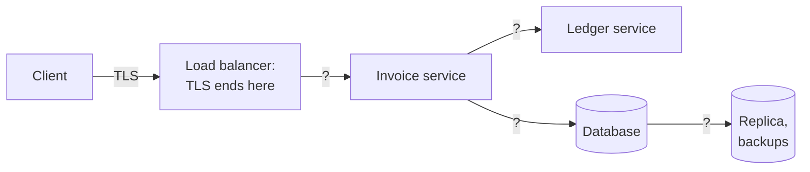
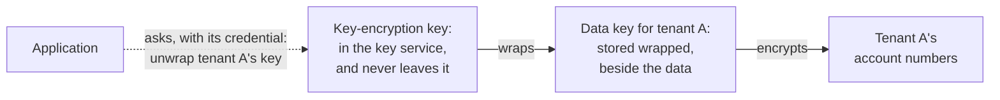

# 8.4 Protecting data

[Syllabus](../SYLLABUS.md) · Phase 8 · Previous: [8.3 Authorization](03-authorization.md) · Next: [8.5 Backend vulnerabilities](05-backend-vulnerabilities.md)

> **Time:** about 40 minutes to read, 45 minutes of practice.
> **You need:** the TLS handshake from [Chapter 1.2](../phase-1-foundations/02-life-of-a-request.md); trust boundaries from [Chapter 8.1](01-threat-modelling.md); tenants from [Chapter 8.3](03-authorization.md). The example needs only Go, and takes about a second.

**By the end of this chapter you can**

- say what TLS promises, what a client must check for the promise to hold, and where in your system TLS ends;
- give each service an identity with mutual TLS, and say what that does not decide;
- say, for each way of encrypting stored data, which attacker it stops and which it does not;
- build a key hierarchy with envelope encryption, and say what has to be redone when a key may have leaked;
- keep secrets out of code, images and logs, and make replacing one a routine;
- decide what not to store at all.

---

## The problem

*An illustrative scenario; the example reproduces its two halves.* The invoicing product is moving to a new database host. An engineer takes a dump of the production database and uploads it to a storage bucket, for the contractor who is doing the move. The contractor's access request has not come through, so the bucket is made public for the afternoon. The afternoon lasts four months. A scanner finds the bucket.

In the review, three things are said. All three are true.

1. *The database is encrypted at rest.* It is: the disk under it. The dump was read through the database, which gives plaintext to anyone it lets in.
2. *Everything uses HTTPS.* It does, as far as the load balancer. And the migration script connected to the new database with certificate checks switched off, because the new host's certificate did not match yet.
3. *No password was leaked.* None was needed. But the dump held a `settings` table, and in it the key that the application used to encrypt bank account numbers, and the API key for the payment provider.

Each protection existed. None of them stood between this attacker and this data. Two real reports say the same thing in fewer words.

- CircleCI, January 2023, after malware on one engineer's laptop: "Though all the data exfiltrated was encrypted at rest, the third party extracted encryption keys from a running process, enabling them to potentially access the encrypted data" ([CircleCI incident report](https://circleci.com/blog/jan-4-2023-incident-report/)).
- GitHub, March 2023: "This week, we discovered that GitHub.com's RSA SSH private key was briefly exposed in a public GitHub repository" ([GitHub blog](https://github.blog/news-insights/company-news/we-updated-our-rsa-ssh-host-key/)).

Three things went wrong.

1. **Protections were named without saying against whom.** *Encrypted at rest* and *uses HTTPS* each describe one attacker who is stopped. Neither says which.
2. **Keys were kept beside what they protect.** Encryption does not make data safe. It replaces *protect the data* with *protect the key*, and that is progress only when the key is somewhere that the attacker is not.
3. **A check was switched off where it was inconvenient,** and the connection went on working, which is exactly why nobody switched it back on.

---

## The concept

### 1. Keep less

The cheapest protection comes first. "The best way to protect sensitive information is to not store it in the first place" ([OWASP Cryptographic Storage Cheat Sheet](https://cheatsheetseries.owasp.org/cheatsheets/Cryptographic_Storage_Cheat_Sheet.html)).

- **Sort the columns.** Most of a database is dull. A few columns are not: bank accounts, tax numbers, tokens for other companies' systems, anything about health. Know which they are, because everything below costs something and is spent on those.
- **Let somebody else hold it.** A payment provider can hold the card number and give you a reference to it.
- **Do not copy it.** Every dump, test database and spreadsheet is another place to protect. Chapter 2.9's backups are copies too.
- **Keep it out of logs and URLs** (Chapter 7.1), where it is copied again by systems that were never meant to hold it.
- **Delete it on a schedule.** Data that was deleted last year is not in this year's breach.

### 2. In transit: what TLS promises, and the half that is the client's

TLS gives a connection three properties ([RFC 8446](https://www.rfc-editor.org/rfc/rfc8446.html), the TLS 1.3 standard):

| Property | In the words of [RFC 8446](https://www.rfc-editor.org/rfc/rfc8446.html) |
|---|---|
| Authentication | "The server side of the channel is always authenticated; the client side is optionally authenticated." |
| Confidentiality | "Data sent over the channel after establishment is only visible to the endpoints." |
| Integrity | "Data sent over the channel after establishment cannot be modified by attackers without detection." |

They hold, it says, "even in the face of an attacker who has complete control of the network" ([RFC 8446](https://www.rfc-editor.org/rfc/rfc8446.html)). That is a strong promise, and the first row carries the other two. Encryption to the wrong party protects nothing.

**The server is authenticated by the client.** The server shows a certificate (Chapter 1.2). The client has three things to check, and the promise holds only if it checks all three:

1. the certificate was signed by an authority that the client trusts;
2. it names the server that the client meant to reach;
3. today is between its two dates.

HTTP clients have a switch that turns the checks off. Go's documentation says what its switch does: "If InsecureSkipVerify is true, crypto/tls accepts any certificate presented by the server and any host name in that certificate. In this mode, TLS is susceptible to machine-in-the-middle attacks unless custom verification is used" ([Go `crypto/tls`](https://pkg.go.dev/crypto/tls)). The switch is used because it makes an error go away, and the connection that follows is encrypted, to whoever answered.

Database drivers have the same switch under a quieter name. PostgreSQL's client library describes its modes in the first person ([PostgreSQL documentation, *SSL Support*](https://www.postgresql.org/docs/current/libpq-ssl.html)):

| `sslmode` | Stops an eavesdropper | Stops an impostor | What the [documentation](https://www.postgresql.org/docs/current/libpq-ssl.html) says you are saying |
|---|---|---|---|
| `require` | Yes | **No** | "I want my data to be encrypted, and I accept the overhead. I trust that the network will make sure I always connect to the server I want." |
| `verify-full` | Yes | Yes | "I want my data encrypted, and I accept the overhead. I want to be sure that I connect to a server I trust, and that it's the one I specify." |

**Know where TLS ends.** *Everything uses HTTPS* usually describes the first arrow of this picture.



Each question mark is a separate decision. Chapter 8.1's rule applies: a private network is not a boundary, because an attacker may already be inside it. Encrypt every hop that carries the columns of section 1, and verify on every hop that you encrypt.

### 3. Between services: mutual TLS, and certificates that run out

TLS authenticates the client *optionally*. When it does, both sides show a certificate, and the result is called **mutual TLS**. Inside a system, that gives each service an identity that it cannot simply claim. Compare the `X-Tenant` header of Chapter 8.1, which any caller could set: a certificate can be shown only by a process that holds its private key, and it is checked before a single byte of the request is read.

Google does this for all traffic between its services, with its own protocol of the same shape: "Google's Application Layer Transport Security (ALTS) is a mutual authentication and transport encryption system developed by Google and typically used for securing Remote Procedure Call (RPC) communications within Google's infrastructure" ([Google Cloud documentation, *Application Layer Transport Security*](https://docs.cloud.google.com/docs/security/encryption-in-transit/application-layer-transport-security)). The reason it gives is the one that matters here: applications get an "authenticated remote peer identity, which can be used to implement fine-grained authorization policies".

Two cautions.

**Identity is not permission.** Mutual TLS tells the ledger that the caller is the reports service. Whether the reports service may move money is Chapter 8.3's question, and the ledger still has to ask it.

**Certificates run out, and that is an outage with a date on it.** The fix is not long-lived certificates. Let's Encrypt explains why it issues for ninety days only: "They limit damage from key compromise and mis-issuance", and "They encourage automation, which is absolutely essential for ease-of-use" ([Let's Encrypt, *Why ninety-day lifetimes for certificates?*](https://letsencrypt.org/2015/11/09/why-90-days.html)). Renew by machine, well before the date, and alert on the days that remain (Chapter 7.3). A certificate that a person renews once a year will be forgotten in the year that the person leaves.

### 4. At rest: three places for the key, three different attackers

*Encrypted at rest* can mean three things. They differ in where the key is, and so in who is stopped.

| The attacker has… | Key with the disk: disk or volume encryption | Key with the storage service: a bucket's or a managed database's default encryption | Key reached by the application: chosen fields, encrypted before they are stored |
|---|---|---|---|
| a disk that was stolen or thrown away | Stopped | Stopped | Stopped |
| a dump or export, copied somewhere | Not stopped | Not stopped | Stopped, for those fields |
| the ability to read through the database: an injection (Chapter 8.5), a curious administrator | Not stopped | Not stopped | Stopped, for those fields |
| access through the storage service, given by mistake | Not stopped | Not stopped | Stopped, for those fields |
| the running application | Not stopped | Not stopped | **Not stopped** |

The documentation of each layer says so itself.

- **The disk.** "This mechanism prevents unencrypted data from being read from the drives if the drives or the entire computer is stolen. This does not protect against attacks while the file system is mounted, because when mounted, the operating system provides an unencrypted view of the data" ([PostgreSQL documentation, *Encryption Options*](https://www.postgresql.org/docs/current/encryption-options.html)).
- **The storage service.** "As long as you authenticate your request and you have access permissions, there is no difference in the way you access encrypted or unencrypted objects" ([Amazon S3 documentation](https://docs.aws.amazon.com/AmazonS3/latest/userguide/serv-side-encryption.html)). What stops a reader there is the permission, and the encryption is not what stops them.
- **The application.** The last row is CircleCI's sentence in *The problem*. Whoever becomes the application can do what the application does.

The lower layers are still worth having. They cost almost nothing, and they stop the first row. A provider can also refuse some mistakes on your behalf: in Amazon RDS, "encrypted snapshots can't be shared as public" ([Amazon RDS documentation](https://docs.aws.amazon.com/AmazonRDS/latest/UserGuide/USER_ShareSnapshot.html)). But the middle three rows are the ones in the news, and only the right-hand column touches them.

**Encrypting in the application has a price.** The database can no longer search, sort or join on the field. Every read needs a key. The code is yours to get wrong. So it is for the few columns of section 1, and not for all of them.

### 5. Keys: envelope encryption

If the key sits in the same database as the data, the right-hand column of that table becomes the middle one. "Where possible, encryption keys should be stored in a separate location from encrypted data" ([OWASP Cryptographic Storage Cheat Sheet](https://cheatsheetseries.owasp.org/cheatsheets/Cryptographic_Storage_Cheat_Sheet.html)). The standard way to do that at any size is two layers of key.



"The key used to encrypt data itself is called a data encryption key (DEK)", and "The DEK is encrypted (also known as wrapped) by a key encryption key (KEK). The process of encrypting a key with another key is known as envelope encryption" ([Google Cloud KMS documentation, *Envelope encryption*](https://docs.cloud.google.com/kms/docs/envelope-encryption)). The same page gives the procedure: "generate a DEK locally, encrypt data with the DEK, use a KEK to wrap the DEK, and then store the encrypted data and the wrapped DEK. The KEK never leaves Cloud KMS."

What that buys:

- **A snapshot is ciphertext and wrapped keys.** Its finder needs the key service as well, and the key service has its own list of who may ask.
- **One place to watch and to shut.** "A central key service also is a singular point to more easily audit and restrict data access" ([the same page](https://docs.cloud.google.com/kms/docs/envelope-encryption)). Every unwrap is a line in a log.
- **A key for each tenant.** "Do not use the same DEK to encrypt data from two different users" ([the same page](https://docs.cloud.google.com/kms/docs/envelope-encryption)). One leaked data key is then one tenant's data, and the isolation of Chapter 8.3 holds in the cryptography too.
- **Few calls.** The application unwraps a tenant's key once and keeps it in memory for some minutes, so the key service is not inside every request. Those minutes are the trade: an unwrapped key in memory is what CircleCI's attacker took.

**Use authenticated encryption, through a library, and say what each ciphertext is for.** AES in Galois/Counter Mode both encrypts and detects changes. It takes a third input, the *associated data*, which is not secret and must be the same when decrypting. AWS's key service calls it the encryption context: "The encryption context is cryptographically bound to the ciphertext so that the same encryption context is required to decrypt the data" ([AWS KMS documentation](https://docs.aws.amazon.com/kms/latest/developerguide/encrypt_context.html)). Put the tenant, the column and the row in it, and a ciphertext that is moved to another row no longer opens. Part 4 of the example shows the attack that this stops. One rule about the mode cannot be broken: "The nonce must be NonceSize() bytes long and unique for all time, for a given key" ([Go `crypto/cipher`](https://pkg.go.dev/crypto/cipher)). A library that makes a random nonce for each call keeps it for you.

**Rotation.** A key has a **cryptoperiod**: "The time span during which a specific key is authorized for use" ([NIST glossary](https://csrc.nist.gov/glossary/term/cryptoperiod)). Changing keys on a schedule limits how much one key protects, and it keeps the procedure in practice: "Validate your key rotation procedures before a real-life security incident occurs" ([Google Cloud KMS documentation, *Key rotation*](https://docs.cloud.google.com/kms/docs/key-rotation)). But be exact about what a rotation does. In a key service, "Rotating keys creates new active key versions, but doesn't re-encrypt your data and doesn't disable or delete previous key versions" (the same page). What has to be redone depends on what may have leaked:

| What happened | What has to be redone |
|---|---|
| Nothing: the schedule says so | A new version of the key-encryption key. Re-wrap the data keys: one small write for each, and no row is touched |
| One tenant's data key may have leaked | A new data key for that tenant, and every field of that tenant encrypted again |
| The key-encryption key, or the application's credential for the key service, may have leaked | Assume that every data key is known. New data keys for everyone, and everything encrypted again |
| In all three cases | Copies that the attacker already holds stay readable with the keys that the attacker already holds |

### 6. Secrets

A **secret** is anything that grants access to whoever knows it: a database password, an API key, a token, a private key, the application's credential for the key service. Encryption turned the problem of protecting data into the problem of protecting these, so this is where the chapter was always going to end.

OWASP's description of the usual state: "Many organizations have them hardcoded within the source code in plaintext, littered throughout configuration files and configuration management tools" ([OWASP Secrets Management Cheat Sheet](https://cheatsheetseries.owasp.org/cheatsheets/Secrets_Management_Cheat_Sheet.html)).

1. **Never in the repository.** A repository is copied to every laptop, build machine and backup, and it remembers. Deleting the line in a later commit removes it from the latest version only. GitHub's own advice starts in the right place: "as a first step you need to revoke and/or rotate that secret. Once the secret is revoked or rotated, it can no longer be used for access" ([GitHub documentation](https://docs.github.com/en/authentication/keeping-your-account-and-data-secure/removing-sensitive-data-from-a-repository)). Scan for them as well: GitHub's scanner "scans your entire Git history on all branches of your repository for hardcoded credentials" ([GitHub documentation, *Secret scanning*](https://docs.github.com/en/code-security/concepts/secret-security/secret-scanning)).
2. **Delivered when the process starts,** from a secret manager or the platform, to the one process that needs it. Environment variables are the common way and a leaky one: they "are generally accessible to all processes and may be included in logs or system dumps" ([OWASP Secrets Management Cheat Sheet](https://cheatsheetseries.owasp.org/cheatsheets/Secrets_Management_Cheat_Sheet.html)). Know what your platform's secret store really does. "Kubernetes Secrets are, by default, stored unencrypted in the API server's underlying data store (etcd)" ([Kubernetes documentation](https://kubernetes.io/docs/concepts/configuration/secret/)).
3. **Better: no long-lived secret at all.** On a cloud platform a workload can prove what it is to the platform and be handed credentials that expire in hours. AWS states it as a rule: "Require workloads to use temporary credentials with IAM roles to access AWS" ([AWS IAM documentation](https://docs.aws.amazon.com/IAM/latest/UserGuide/best-practices.html)). A credential that expires tonight is worth little in a dump that is found in four months.
4. **One secret for each consumer, with the least access that works.** "Often, services share the same secrets, which makes identifying the source of compromise or leak challenging" ([OWASP Secrets Management Cheat Sheet](https://cheatsheetseries.owasp.org/cheatsheets/Secrets_Management_Cheat_Sheet.html)). Chapter 8.6 returns to this.
5. **Make replacing a secret boring.** Every secret will be replaced one day in a hurry. GitHub replaced its exposed host key within the week that it found the exposure. CircleCI had to tell every customer the same: "We recommended that all customers rotate their secrets, including OAuth tokens, Project API Tokens, SSH keys, and more" ([CircleCI incident report](https://circleci.com/blog/jan-4-2023-incident-report/)). A system can do that quickly only if it accepts the old secret and the new one side by side for a while, and if somebody has done it before.

---

## A real example

### Run it: an impostor, an uninvited caller, a lost snapshot, a moved ciphertext

[`code/ch04-data`](code/ch04-data/main.go) is three files, about 600 lines. It makes its own certificate authority and certificates, starts real HTTPS servers on your machine, and encrypts with AES-256-GCM from Go's standard library. [`tls.go`](code/ch04-data/tls.go) holds parts 1 and 2, and [`atrest.go`](code/ch04-data/atrest.go) parts 3 and 4.

```bash
go run ./phase-8-security/code/ch04-data
```

**Part 1.** The invoice service calls the ledger, and sends a secret with the request. Four different things answer at the ledger's address. Two clients are tried against each, and they differ in one line:

```go
	// The careful client trusts one authority, and expects one name.
	careful := client(&tls.Config{RootCAs: ours.pool(), ServerName: "ledger.internal"})
	// The careless client was told to stop complaining about certificates.
	careless := client(&tls.Config{InsecureSkipVerify: true})
```

```text
PART 1 — is that really the ledger? Two clients send a request, with a secret in it, to whatever
answers at the ledger's address.

  what answers, and what it shows                    the client that verifies    the one that does not
  the ledger; a certificate from our authority       200                         200
  an impostor; a certificate from its own authority  refuses: unknown authority  200
  our reports service; its own certificate           refuses: wrong name         200
  the ledger; a certificate that ran out yesterday   refuses: expired            200

  The impostor received one request, and the caller's secret was in it.
```

The three refusals are the three checks of section 2: the authority, the name, the dates. The right-hand column is what switching them off means. The impostor made its own authority and its own certificate for `ledger.internal`, which takes a few lines of code and nobody's permission. The careless client completed a TLS handshake with it, over an encrypted connection, and sent it the secret.

The last row is the one that tempts people. The certificate ran out, production is down, and one line makes the error go away. It also makes rows 2 and 3 go away.

**Part 2.** The ledger now asks every caller for a certificate from the company's authority.

```go
	ledger.TLS = &tls.Config{
		Certificates: []tls.Certificate{ours.issue("ledger.internal", tomorrow)},
		ClientAuth:   tls.RequireAndVerifyClientCert, // no certificate from our authority, no connection
		ClientCAs:    ours.pool(),
	}
```

```text
PART 2 — who is calling the ledger? It asks every caller for a certificate from our authority,
and it serves one caller only, "invoices".

  the caller                the certificate it shows   what the ledger does
  the invoice service       from our authority         serves it: the caller is "invoices"
  a process on the network  none                       ends the handshake: no certificate
  the same process          from its own authority     ends the handshake: unknown authority
  the invoice service       ours, ran out yesterday    ends the handshake: expired
  the reports service       from our authority         completes the handshake, then 403 for "reports"
```

Rows 2 and 3 are a process that has got onto the internal network, which Chapter 8.1 told us to expect. It never reaches a handler: with no certificate, or with one that it made for itself in the name of the invoice service, the handshake ends. Row 4 is the outage of section 3, seen from the other side. Row 5 is the first caution of that section. The reports service is who it says it is, and the handshake completes. The handler then reads the name out of the verified certificate, and refuses it:

```go
		who := r.TLS.PeerCertificates[0].Subject.CommonName // verified in the handshake, before this runs
		if !allowed[who] {
			http.Error(w, who, 403)
			return
		}
```

**Part 3.** Two thousand bank accounts, stored three ways, and a snapshot of each database copied to where anyone can read it. A small key service, which is a real HTTP server, stands in for a cloud provider's.

```text
PART 3 — a snapshot of the database is copied to a place that anyone can read. It holds 2,000 bank
accounts. The finder has the snapshot, can reach the key service, and has no credential for it.

  how the account numbers were stored                               the application       the finder
                                                                              reads            reads
  1  as they are, on an encrypted disk                                        2,000            2,000
  2  encrypted, with the key in a table of the same database                  2,000            2,000
  3  encrypted with a key for each tenant, and those keys                     2,000                0
     wrapped by a key that never leaves the key service

  A thief who has the application's own credential for the key service reads 2,000 of design 3.

  The key service's log, in order:
     50 × wrap for invoices-app
     50 × unwrap for invoices-app
     50 × unwrap REFUSED to an unknown caller
     50 × unwrap for invoices-app
```

- **Design 1** is the scenario. The program does not encrypt a disk, because it would change nothing in this column: a snapshot is read through the database, above the disk.
- **Design 2** encrypts every account correctly, with a strong key, and keeps the key in a table. The snapshot contains the table.
- **Design 3** is envelope encryption. Each tenant's data key is made by the application and stored only after the key service has wrapped it:

```go
	for t := 0; t < tenants; t++ {
		dataKey := randomBytes(32)
		wrapped, err := ks.ask("wrap", app, "tenant="+tenantName(t), dataKey)
		check(err)
		d3.wrapped[tenantName(t)] = wrapped
```

The finder holds fifty wrapped keys and two thousand ciphertexts, asks the key service to unwrap each key, and is refused fifty times.

Then read the line under the table. A thief with the application's credential reads everything. That is the last row of the table in section 4, and no design changes it. What design 3 adds for that case is the log. The fifty refusals are there, and so are the thief's fifty unwraps, under the application's name. With the time of each, which a real log has, that is how a team learns that keys were taken, when, and which.

**Part 4.** The attacker cannot read a key, and can write to the table. Tenant T01 pays two suppliers, and the attacker is the second.

```text
PART 4 — somebody can write to the table and has no key. They copy the ciphertext of payee 2's
account, which is their own, over payee 1's. Then the application pays an invoice of payee 1.

  what each ciphertext was bound to    the application decrypts payee 1's account, and gets
  nothing                              "account 0001-0002", which is payee 2's: the money goes there
  its tenant, its column and its row   an error: cipher: message authentication failed
```

No key was needed to copy bytes from one row to another, and with nothing bound to the ciphertext, the application decrypts it without complaint. In the second row each ciphertext was sealed together with a description of its own cell:

```go
// bound is the associated data for one cell: which tenant, which column, which row.
func bound(tenant string, id int) []byte {
	return []byte(fmt.Sprintf("tenant=%s|payees.account|id=%d", tenant, id))
}
```

Payee 2's ciphertext was sealed as `id=2`. Opened as `id=1`, it fails, and the application has an error to act on in place of a wrong account number.

### How Google keeps keys: one hierarchy under everything

The two-layer design of section 5 is the one that Google describes for its own storage, in the page that this chapter has been quoting. At the storage layer, "Google Cloud encrypts customer content stored at rest using envelope encryption, with Google's internal key management service as the central keystore" ([Google Cloud KMS documentation, *Envelope encryption*](https://docs.cloud.google.com/kms/docs/envelope-encryption)). The reason for two layers is arithmetic as much as security: "A single KEK can be used to protect many DEKs; this model permits individual data objects to each have their own DEK without massively increasing the volume of keys stored in a central key management service."

Three of its rules for the two kinds of key are worth copying exactly, and the example follows each:

| Google's rule ([*Envelope encryption*](https://docs.cloud.google.com/kms/docs/envelope-encryption)) | In the example |
|---|---|
| "Generate DEKs locally." | `dataKey := randomBytes(32)`, in the application |
| "Store KEKs centrally." | One key, inside the key service, never sent to anyone |
| "Rotate keys regularly, and also after a suspected incident." | The exercise below |

With section 3, that is the shape of Google's answer. Calls between its services are mutually authenticated and encrypted. Stored data is encrypted with data keys, and those are wrapped by keys in a central service that few can ask.

---

## Trade-offs

**Verifying against working.** A client that verifies will sometimes refuse a server that is perfectly honest and badly configured, at three in the morning. Decide beforehand that the fix is always a correct certificate, and make issuing one fast.

**Mutual TLS against a secret in a header.** A shared token is one line of configuration, and it can be copied, logged and replayed. A certificate needs an authority, issuing and renewal for every service, all automated. It is worth it once several services call each other with data that matters. A service mesh can do the work outside the application: "Istio offers mutual TLS as a full stack solution for transport authentication, which can be enabled without requiring service code changes" ([Istio documentation](https://istio.io/latest/docs/concepts/security/)).

**Short lives against dependence on the issuer.** Certificates and credentials that last hours limit a leak to hours. They also mean that when the issuer is down for longer than that, everything stops. The issuer becomes one of the most important services you run (Chapter 6.5).

**Field encryption against the database's help.** An encrypted field cannot be searched, sorted, joined on or checked by a constraint. Each one is a feature that the application now has to provide or do without.

**A key for everything against a key for each tenant.** One key is simple and its leak is total. A key for each tenant bounds a leak, lets one tenant's data be made unreadable by destroying one key, and costs an unwrap for each tenant and a cache of keys to manage.

**Asking the key service every time against keeping keys in memory.** Asking every time gives a complete log and puts the key service in the path of every request, with its latency and its outages. Keeping unwrapped keys for minutes takes it out of the path and puts keys where CircleCI's were found.

---

## Practice

### Check yourself

1. A colleague sets `sslmode=require` on the application's connection to PostgreSQL, *so that the connection is encrypted*. An attacker controls a router between the two machines. What can the attacker do? Which setting stops it, and what does that setting need?
2. A security questionnaire asks whether data is encrypted at rest, and the honest answer is *yes, the disks*. Name one attack that this stops and three that it does not.
3. An API key for the payment provider was committed on Monday, and removed by another commit on Tuesday. It is Wednesday. What is the state of the key, and what are the steps, in order?

<details>
<summary>Answers</summary>

1. With `require` the client encrypts to whatever answers and does not check who that is, so the attacker presents any certificate, receives the password and every query, and can pass them on to the real database so that nothing looks wrong. `verify-full` stops it: the client checks that the certificate comes from an authority it trusts and names the host it asked for. It needs that authority's certificate on the client, and a server certificate with the right name.
2. It stops somebody who has the disk and not the running system: a stolen or discarded drive. It does not stop a dump copied to a bucket, an injection that reads through the application, an administrator or a stolen database password, a public snapshot or bucket, or anyone who has become the application. All of those read through the database, which decrypts for them.
3. The key is compromised, and has been since Monday. It is in the history, in every clone and fork, and in whatever the build system kept. First, revoke it at the provider and issue a new one, delivered to the application from a secret store and not from the repository. Second, read the provider's logs for any use of the old key since Monday. Third, find out how it came to be in the code, and turn on scanning that blocks the next one. Rewriting the history is last and optional: once the key is dead, the history holds a string of no value.

</details>

### Exercise: rotate the key that wraps the others

The key service of part 3 has one key, and it has been in use for a year. Give it rotation.

1. **Versions.** `rotate` makes a new version of the key-encryption key. New wraps use the newest. Older versions still unwrap what they wrapped. How does `unwrap` know which version to use?
2. **Re-wrap.** Add an operation that takes a wrapped data key and returns it wrapped by the newest version, without the caller ever seeing the data key. Re-wrap all fifty. How many rows of accounts did you rewrite?
3. **Destroy** version 1. What can the application still read? What can be read from last night's backup, by someone who holds the application's own credential?
4. What does your answer to 3 mean for the restore drill of Chapter 2.9?
5. Suppose instead that the application's credential for the key service was stolen last week. Is this rotation the right response?

<details>
<summary>Worked solution</summary>

**1. Versions.** The key service keeps every version that still exists, and writes the version in front of each wrapped key. That byte is not secret. It is how `unwrap` finds the right key, and how you can later count what still depends on an old one.

```go
// wrap uses the newest version, and writes which one in front of the result.
func (ks *keyService) wrap(dataKey, context []byte) []byte {
	return append([]byte{ks.newest}, seal(ks.versions[ks.newest], dataKey, context)...)
}
```

```go
// unwrap reads the version from the front, and fails if that version has been destroyed.
func (ks *keyService) unwrap(wrapped, context []byte) ([]byte, error) {
	if len(wrapped) == 0 || ks.versions[wrapped[0]] == nil {
		return nil, errors.New("that version of the key no longer exists")
	}
	return open(ks.versions[wrapped[0]], wrapped[1:], context)
}
```

**2. Re-wrap.** It happens inside the key service, so the data key is never outside it in the clear. Cloud key services have the same operation: AWS's "Decrypts ciphertext and then reencrypts it entirely within AWS KMS" ([AWS KMS API reference, *ReEncrypt*](https://docs.aws.amazon.com/kms/latest/APIReference/API_ReEncrypt.html)).

```go
		case op == "rewrap":
			// The data key is unwrapped and wrapped again here. The caller never sees it.
			var dataKey []byte
			if dataKey, err = ks.unwrap(body, context); err == nil {
				out = ks.wrap(dataKey, context)
			}
```

Fifty small writes, and no row of accounts is touched, because the data keys themselves did not change. This is why there are two layers.

**3. Destroy.** Run with a copy of the database taken before the rotation:

```text
                                                            the application  the same credential, on
                                                                      reads      last night's backup
  before                                                              2,000                    2,000
  after rotate: version 2 exists, and nothing uses it yet             2,000                    2,000
  after rewrap: 50 data keys re-wrapped, 0 rows rewritten             2,000                    2,000
  after version 1 is destroyed                                        2,000                        0
```

The live database is unaffected at every step. The backup stays readable until version 1 is destroyed, and then it is not, even for the application: its wrapped keys were wrapped by a key that no longer exists.

**4. The restore drill.** Destroying an old version of a key destroys every backup that depends on it. That can be the intention, since it is the one way to make old copies unreadable wherever they are. It can also be an accident that is discovered during a restore. So keep each version for as long as the oldest backup that you might need, write the key's version into the backup's record, and make *restore a backup from before the last rotation* one of the drills.

**5. A stolen credential.** No. Re-wrapping changes which key wraps the data keys, and leaves the data keys as they were. Whoever held the credential last week could unwrap all fifty, and must be assumed to have them. That is the third row of the table in section 5: revoke the credential, make new data keys for every tenant, and encrypt every field again. The key service's log says which keys were unwrapped and when, which is where the investigation starts. And anything that was copied last week stays readable to whoever copied it.

</details>

---

## Production tips and common mistakes

- **For each protection, write down who it stops.** *Encrypted at rest* is not an answer until it names the attacker.
- **Never switch certificate checks off.** Fix the certificate. Search the code and the configuration for the switch, by every name that your libraries give it.
- **Use `verify-full`, or its equivalent, on connections to databases, caches and queues.**
- **Decide every hop.** Draw the arrows of section 2 for your system, and mark each one encrypted or not, verified or not.
- **Issue and renew certificates by machine,** with short lives. Alert on the days that remain.
- **Encrypt the few fields that matter in the application,** with a data key for each tenant, wrapped by a key in a key service.
- **Bind every ciphertext to its tenant, column and row.**
- **Let a library choose the nonce.** Do not write the cipher's plumbing yourself.
- **Alert on the key service's log:** refusals, and unwraps at odd hours or in odd numbers.
- **Keep secrets out of the repository, images and logs,** and scan all three.
- **Prefer credentials that expire** to ones that are stored.
- **Practise replacing each secret and each key** before the day that it has to be done in an hour.
- **Protect backups and dumps as you protect the database.** They are the database.

Common mistakes:

- ***Encrypted at rest*, meaning the disk, offered as the answer to a leaked dump.**
- **The key in the same database, repository or bucket as the data.**
- **`InsecureSkipVerify`, `sslmode=require`, and every other encrypted connection to an unknown party.**
- **TLS to the load balancer, and plaintext for everything behind it.**
- **A certificate that a person renews.**
- **Mutual TLS taken for authorization.**
- **One key for every tenant, in use for ever.**
- **Ciphertext that can be moved between rows.**
- **A secret removed from the code and not revoked.**
- **A platform's secret store assumed to be encrypted.**
- **An old key version destroyed while backups still need it.**

---

## Key takeaways

- The data that you do not store cannot leak. Choose the few columns that matter, and spend the rest of this chapter on them.
- TLS promises a private, unmodified channel to an authenticated server. The client does the authenticating, and a client that skips it has an encrypted channel to anyone.
- Mutual TLS gives each service an identity that it cannot merely claim. It does not say what that service may do.
- Encryption at rest protects against whoever can reach the data and cannot reach the key. Disk and storage-service encryption stop a stolen disk. Only encryption in the application stops a leaked dump or a read through the database, and nothing stops the application itself.
- Envelope encryption keeps data keys beside the data and the key that wraps them in a key service, which decides who may ask and records who did.
- Encryption turns the protection of data into the protection of secrets. Keep them out of code, prefer ones that expire, and make replacing them routine.

**Next:** [8.5 Backend vulnerabilities](05-backend-vulnerabilities.md) — the design is now sound. The code that implements it still takes input from strangers, and some of that input is written to make the code do something else.

---

## Sources

- IETF, [RFC 8446, *The Transport Layer Security (TLS) Protocol Version 1.3*](https://www.rfc-editor.org/rfc/rfc8446.html).
- Go documentation: [`crypto/tls`](https://pkg.go.dev/crypto/tls); [`crypto/cipher`](https://pkg.go.dev/crypto/cipher).
- PostgreSQL documentation: [*SSL Support*](https://www.postgresql.org/docs/current/libpq-ssl.html); [*Encryption Options*](https://www.postgresql.org/docs/current/encryption-options.html).
- Google Cloud documentation: [*Application Layer Transport Security*](https://docs.cloud.google.com/docs/security/encryption-in-transit/application-layer-transport-security); [*Envelope encryption*](https://docs.cloud.google.com/kms/docs/envelope-encryption); [*Key rotation*](https://docs.cloud.google.com/kms/docs/key-rotation).
- AWS documentation: [*Protecting data with server-side encryption*](https://docs.aws.amazon.com/AmazonS3/latest/userguide/serv-side-encryption.html) (Amazon S3); [*Sharing a DB snapshot*](https://docs.aws.amazon.com/AmazonRDS/latest/UserGuide/USER_ShareSnapshot.html) (Amazon RDS); [*Encryption context*](https://docs.aws.amazon.com/kms/latest/developerguide/encrypt_context.html) and [*ReEncrypt*](https://docs.aws.amazon.com/kms/latest/APIReference/API_ReEncrypt.html) (AWS KMS); [*Security best practices in IAM*](https://docs.aws.amazon.com/IAM/latest/UserGuide/best-practices.html).
- OWASP Cheat Sheet Series: [*Cryptographic Storage*](https://cheatsheetseries.owasp.org/cheatsheets/Cryptographic_Storage_Cheat_Sheet.html) and [*Secrets Management*](https://cheatsheetseries.owasp.org/cheatsheets/Secrets_Management_Cheat_Sheet.html).
- NIST Computer Security Resource Center glossary: [cryptoperiod](https://csrc.nist.gov/glossary/term/cryptoperiod).
- Let's Encrypt, [*Why ninety-day lifetimes for certificates?*](https://letsencrypt.org/2015/11/09/why-90-days.html), 2015.
- Kubernetes documentation, [*Secrets*](https://kubernetes.io/docs/concepts/configuration/secret/). Istio documentation, [*Security*](https://istio.io/latest/docs/concepts/security/).
- GitHub documentation: [*Removing sensitive data from a repository*](https://docs.github.com/en/authentication/keeping-your-account-and-data-secure/removing-sensitive-data-from-a-repository); [*Secret scanning*](https://docs.github.com/en/code-security/concepts/secret-security/secret-scanning).
- Mike Hanley, [*We updated our RSA SSH host key*](https://github.blog/news-insights/company-news/we-updated-our-rsa-ssh-host-key/), GitHub, 2023.
- Rob Zuber, [*CircleCI Jan 4, 2023 security incident report*](https://circleci.com/blog/jan-4-2023-incident-report/), CircleCI, 2023.
