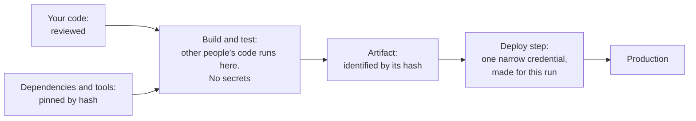

# 8.6 Abuse and operational security

[Syllabus](../SYLLABUS.md) · Phase 8 · Previous: [8.5 Backend vulnerabilities](05-backend-vulnerabilities.md) · Next: [Capstone 8](capstone-security-review.md)

> **Time:** about 40 minutes to read, 45 minutes of practice.
> **You need:** rate limiting from [Chapter 6.4](../phase-6-reliability/04-overload.md); tokens and their lifetimes from [Chapter 8.2](02-authentication.md); secrets from [Chapter 8.4](04-protecting-data.md). The example needs only Go, and takes under a second.

**By the end of this chapter you can**

- tell abuse from attack, and choose limits that count something which an abuser cannot cheaply multiply;
- say what a leaked credential is worth in a design, by what it may do and how long it lasts;
- give people and pipelines the least access that works, for the shortest time that works;
- design an audit log that says who did what, and can show that it has not been altered;
- reduce the chance that somebody else's code, or a changed copy of it, runs in your build.

---

## The problem

*An illustrative scenario; the example reproduces its four parts.* Two things happen to the invoicing product in one week.

**On Monday** the finance team asks why the weekend's bill for text messages is £4,000 and not £40. Nothing was broken. The endpoint that sends a verification code by SMS was called a hundred thousand times, for phone numbers in one range that pays a share of the fee to whoever arranged the calls. Every request was well formed, authenticated and authorized. The rate limiter of Chapter 6.4 was in place and never fired, because it protects the servers, and the servers were fine.

**On Thursday** a tool that the build downloads and runs, to report test coverage, turns out to have been altered at its source for two months. On every build it copied the environment of the pipeline to a server somewhere. In that environment was the token that the pipeline deploys with. It was created three years ago with administrator's rights, *to get the first deploy working*. It has no expiry. It is finding 5 of Chapter 8.1.

Then comes the question that nobody can answer: *what did they do with it?* There is a log of what was done in the cloud account. Any administrator can edit that log, and for two months the attacker was an administrator.

Thursday is a real story with the names removed. In April 2021 Codecov reported that its upload script had been modified by somebody else, repeatedly, since the end of January, in a way "which enabled them to potentially export information stored in our users' continuous integration (CI) environments". What was exposed: "Any credentials, tokens, or keys that our customers were passing through their CI runner that would be accessible when the Bash Uploader script was executed" ([Codecov, *Bash Uploader Security Update*, 2021](https://about.codecov.io/security-update/)).

Four things went wrong.

1. **The limits protected the servers and not the business.** Nothing counted messages, money, or numbers in one range.
2. **A credential had far more power, and far more life, than its job needed.**
3. **The record of what happened could be changed by those it recorded.**
4. **Code from outside ran inside the build, unchecked, with the pipeline's secrets within reach.**

None of the four is a bug of the kind that Chapter 8.5 was about. They are how a correct system is operated.

---

## The concept

### 1. Abuse: the product, used as built

An **attack** uses a fault. **Abuse** uses a feature, as designed, more than the business can bear. "Some business flows are more sensitive than others, in the sense that excessive access to them may harm the business" ([OWASP API6:2023](https://api-security.owasp.org/editions/2023/en/0xa6-unrestricted-access-to-sensitive-business-flows/)).

| The flow | Its abuse | What it costs |
|---|---|---|
| Send a code by SMS | Thousands of codes to numbers that pay the caller | Money, for each message |
| A bonus for inviting a friend | Scripted sign-ups that invite each other | Money, for each account |
| Reserve a seat, hold stock in a basket | Reserving everything | Sales to real customers |
| Search and list | Copying the whole catalogue | The data, and server time |
| Log in | Trying leaked passwords | Customers' accounts (Chapter 8.2) |

The first row has a name. "SMS pumping fraud happens when fraudsters take advantage of a phone number input field to receive a one-time passcode, an app download link, or anything else via SMS. The messages are sent to a range of numbers controlled by a specific mobile network operator" ([Twilio documentation](https://www.twilio.com/docs/verify/preventing-toll-fraud)), and the fraudsters share in the revenue. It works on any API that pays a third party for each call: such resources are "paid for per request, such as sending emails/SMS/phone calls, biometrics validation, etc." ([OWASP API4:2023](https://api-security.owasp.org/editions/2023/en/0xa4-unrestricted-resource-consumption/)).

OWASP's advice starts before any code. "The mitigation planning should be done in two layers: Business - identify the business flows that might harm the business if they are excessively used. Engineering - choose the right protection mechanisms to mitigate the business risk" ([OWASP API6:2023](https://api-security.owasp.org/editions/2023/en/0xa6-unrestricted-access-to-sensitive-business-flows/)). For the second layer:

1. **Count by something that the abuser cannot cheaply multiply.** That is the whole art of it, and part 1 of the example is about nothing else.

   | A limit for each… | To get another, the abuser needs | So |
   |---|---|---|
   | address that the request claims in a header | to type one | Worthless |
   | address that really connected | a proxy; they are rented by the thousand | Weak, and it punishes people who share an address |
   | account | a sign-up | As strong as the limit on signing up |
   | verified phone number, or payment card | a real one | Strong |
   | target of the action: the number range, the item, the coupon | nothing: the abuse needs that target | Strongest, where there is one |

2. **Limit the thing that costs,** and not only requests: messages for each number and for each range, bonuses for each payment card, money for each hour.
3. **Set a budget for the whole flow, with an alarm.** OWASP's list of limits that must exist ends with "Third-party service providers' spending limit" ([OWASP API4:2023](https://api-security.owasp.org/editions/2023/en/0xa4-unrestricted-resource-consumption/)). A cap on the hour's spending is crude, and it is the one limit that needs no knowledge of how the abuse works.
4. **Count the people that each limit refuses.** Every limit has honest victims. Give them another way through, and know how many they are.
5. **Watch the outcome and not only the requests.** Codes that are sent and never entered, accounts that sign up and never return: the ratio moves before the bill does (Chapter 7.3).

One trap deserves its own line. Behind a proxy, the caller's address arrives in a header, and a client can send that header too. "Any security-related use of X-Forwarded-For (such as for rate limiting or IP-based access control) must only use IP addresses added by a trusted proxy" ([MDN, *X-Forwarded-For*](https://developer.mozilla.org/en-US/docs/Web/HTTP/Reference/Headers/X-Forwarded-For)).

**This differs from Chapter 6.4.** There, a limit shared out capacity so that the service stayed up. Here, the service is not in danger. The limit is on money or fairness, its key is a business fact, and the abuser adapts to it. Limits raise the price of abuse. They do not end it.

### 2. Least privilege, for machines and for people

Chapter 8.1 named the principle. NIST's wording: "each entity is granted the minimum system resources and authorizations that the entity needs to perform its function" ([NIST glossary](https://csrc.nist.gov/glossary/term/least_privilege)). In operations it has two dimensions, and a credential that leaks is worth the product of the two:

- **what it may do**: its scope;
- **for how long**: its life.

**For a pipeline:**

- **No stored cloud credential.** A pipeline can prove to the cloud which repository and which run it is, and be given a credential for that run alone. "You won't need to duplicate your cloud credentials as long-lived GitHub secrets. Instead, you can configure the OIDC trust on your cloud provider, and then update your workflows to request a short-lived access token from the cloud provider through OIDC" ([GitHub documentation, *OpenID Connect*](https://docs.github.com/en/actions/concepts/security/openid-connect)). It is the workload identity of Chapter 8.4, for builds.
- **One job.** "When you set permissions with IAM policies, grant only the permissions required to perform a task" ([AWS IAM documentation](https://docs.aws.amazon.com/IAM/latest/UserGuide/best-practices.html)). This pipeline deploys this service to this environment.
- **Secrets only in the step that needs them.** Building and testing need none. Deploying needs one. Code from outside runs in the first two.
- **Remember what deploying is.** Whoever can deploy a service can do everything that the service can. So the path to that permission is protected too: review, protected branches, and approval for production (Chapter 9.2).

**For people:**

- **No standing administrator's access.** Day to day, engineers hold a narrow role. More is asked for, for a stated reason, granted for an hour or a day, and recorded. AWS's first recommendation is of this kind: "Require human users to use federation with an identity provider to access AWS using temporary credentials" ([AWS IAM documentation](https://docs.aws.amazon.com/IAM/latest/UserGuide/best-practices.html)).
- **Support staff see one tenant, for one ticket.** Chapter 8.3 left this open, and the exercise closes it.
- **An emergency way in** that works when the normal way is down, and that pages somebody whenever it is used.
- **Take away what is not used.** Access is granted in a hurry and never returned. "IAM provides last accessed information to help you identify the users, roles, permissions, policies, and credentials that you no longer need so that you can remove them" (the same page).

### 3. The audit log: who did what, and can you show it?

The logs of Chapter 7.1 are for finding faults. An **audit log** answers a different question, after an incident or for a customer: who did what, to what, when, from where, and was it allowed? OWASP gives the four parts as *when, where, who and what* ([OWASP Logging Cheat Sheet](https://cheatsheetseries.owasp.org/cheatsheets/Logging_Cheat_Sheet.html)).

**What goes in it:** sign-ins and failed sign-ins. Refusals by the authorization gate (Chapter 8.3). Every change to a role, a membership or a permission. Everything that staff do on a customer's behalf, with the reason. Exports and other bulk reads. Each use of a key (Chapter 8.4). Deploys and changes to configuration. Any change to the audit log's own settings. **What does not:** secrets, and personal data that the record does not need.

**What makes it worth having:**

1. **It is complete.** Written by the gate that every request passes, and not by each handler that remembers to.
2. **It can be added to, and not changed.** "Ensure all transactions have an audit trail with integrity controls to prevent tampering or deletion, such as append-only database tables or similar" ([OWASP Top 10:2025, A09](https://top10.owasp.org/2025/A09_2025-Security_Logging_and_Alerting_Failures/)).
3. **It is out of reach of those it records.** In another account or system, to which the application can write and from which nobody in the application's world can delete. An administrator's token that can erase its own tracks was the scenario's last problem.
4. **It can show tampering.** Each entry holds a hash of the one before, so that the latest hash stands for the whole history, and that hash is kept where a writer of the log cannot reach. AWS does this for the log of its own API: the feature "is built using industry standard algorithms: SHA-256 for hashing and SHA-256 with RSA for digital signing. This makes it computationally infeasible to modify, delete or forge CloudTrail log files without detection" ([AWS CloudTrail documentation](https://docs.aws.amazon.com/awscloudtrail/latest/userguide/cloudtrail-log-file-validation-intro.html)).
5. **Somebody is told.** "Without logging and monitoring, attacks and breaches cannot be detected, and without alerting it is very difficult to respond quickly and effectively during a security incident" ([OWASP Top 10:2025, A09](https://top10.owasp.org/2025/A09_2025-Security_Logging_and_Alerting_Failures/)). A few events should page: an export of everything, the emergency way in, a change to the log's settings.
6. **It is kept for longer than a breach takes to find.** Codecov's ran for two months.

### 4. Other people's code

A build runs a great deal of code that the team did not write: libraries, and the libraries that they use; build tools; the steps of the pipeline itself; the base image of the container. Each is somebody's account on somebody's server.



1. **Pin by content, and not by name.** A name or a version number can be made to mean something else tomorrow. A hash cannot. Go does this for every module: "The go.sum file contains cryptographic hashes of the module's direct and indirect dependencies. When the go command downloads a module .mod or .zip file into the module cache, it computes a hash and checks that the hash matches the corresponding hash in the main module's go.sum file" ([Go Modules Reference](https://go.dev/ref/mod)). Commit the lockfile, and let the build fail when it does not match.
2. **Pin the pipeline's own steps the same way.** A tag is a name: "there is risk to this approach even if you trust the author, because a tag can be moved or deleted if a bad actor gains access to the repository storing the action" ([GitHub documentation, *Secure use reference*](https://docs.github.com/en/actions/reference/security/secure-use)). Refer to a step, and to a base image, by its full hash.
3. **Update on purpose.** A new version arrives as a change that somebody reviews, and not as a side effect of the next build. Wait a few days before adopting a release that is hours old, unless it fixes something that you need fixed.
4. **Have fewer.** Each dependency is a maintainer whose account you now rely on, and each brings its own.
5. **Know when one is known to be bad.** For Go: "Govulncheck reports known vulnerabilities that affect Go code. It uses static analysis of source code or a binary's symbol table to narrow down reports to only those that could affect the application" ([Go documentation, `govulncheck`](https://pkg.go.dev/golang.org/x/vuln/cmd/govulncheck)). Run it in the pipeline.
6. **Keep the secrets somewhere else.** The picture above is section 2 applied: if nothing secret is present where foreign code runs, altered code has nothing to send.

The wider subject is called the security of the software supply chain. The framework to read next is [SLSA](https://slsa.dev/), which grades how far a build can prove where its output came from.

---

## A real example

### Run it: a script, a leaked token, an edited log, a replaced library

[`code/ch06-ops`](code/ch06-ops/main.go) is five files, about 490 lines, one for each part.

```bash
go run ./phase-8-security/code/ch06-ops
```

**Part 1** is a model of one hour, and it is deterministic. Each limit is a counter with a key, and the only thing that changes between rows is what the key is.

```text
PART 1 — an hour of "send me a code by SMS", at 4p a message. 300 people ask once each, 40 of
them from one office. A script asks 20,000 times, for numbers in one range, through 500 addresses.

  the limit                                                sent for the    cost of         people
                                                                 script      those        refused
  no limit                                                       20,000    £800.00              0
  5 an hour for each address in X-Forwarded-For                  20,000    £800.00             35
  5 an hour for each address that really connected                2,500    £100.00             35
  3 a day for each account, and anyone may sign up               20,000    £800.00              0
  …and 3 new accounts an hour for each address                    4,500    £180.00              0
  30 an hour for each range of numbers                               30      £1.20              0
```

- **Row 2** costs the same as no limit, and refuses 35 people. The script writes a new address into the header with every request. The 35 are in the office, where forty people really do share one address.
- **Row 3** uses the address that connected. The script has 500, so it gets 500 times the limit, and the office is still punished.
- **Row 4** counts by account, and an account is free, so the script makes one for every three messages.
- **Row 5** limits the making of accounts, and that is the first row where a second limit props up the first. It still costs £180, because addresses are cheap.
- **Row 6** counts by the one thing that the script cannot change. The fraud pays only for numbers in its own range, so that is where it must send. People's numbers are spread over thirty ranges, ten to each, and nobody is refused.

The key of row 6 was found by asking how this abuse makes its money. That is the *business layer* of OWASP's advice, and no general-purpose limiter would have found it. A script will move to the next weakness, which is why rule 3 of section 1, the cap on the hour's spending, belongs behind every row.

**Part 2** is real: an HTTP server that stands for the cloud account's API, and tokens signed as in Chapter 8.2. A token leaks at 14:00, and the thief tries it on every operation, twice.

```text
PART 2 — at 14:00 a build step that nobody on the team wrote prints the pipeline's token. The cloud
account has five operations. This is what the token does for whoever reads it.

  the pipeline holds                             at 14:05                     three days later
  a stored token that may do anything            all 5 operations             all 5 operations
  a stored token for its one job                 1 of 5: deploy/invoices      1 of 5: deploy/invoices
  a token made for this run, for ten minutes     1 of 5: deploy/invoices      nothing
```

Read across for *how long*, and down for *how much*. The first pipeline's token is the scenario's. The second has a narrow scope, and three days later it still works. The third was made for one run:

```go
		{"a token made for this run, for ten minutes", sign(key, grant{"pipeline", []string{"deploy:invoices"}, now.Add(10 * time.Minute).Unix()})},
```

One cell is not empty in any row: at 14:05 the thief can deploy the invoice service. That is the last rule for pipelines in section 2. A deploy is code, running as the service, so the narrowest possible pipeline token is still worth whatever the invoice service may do, for ten minutes. What limits that is outside the token: what the service's own role allows (Chapter 8.5), and whether a deploy to production needs a second person.

**Part 3.** Eight entries, and somebody with write access who would like the fourth to be different.

```text
PART 3 — an audit log of eight entries. Entry 4 says that sam exported a tenant's invoices. Somebody
who can write to the log would like it not to.

  what is done to the log                 rows in      rows that each hold the …and the latest hash
                                          a table      hash of the row before  is also kept elsewhere
  entry 4 is edited, and nothing else     not noticed  noticed at entry 4      noticed at entry 4
  the same, with every later hash redone  not noticed  not noticed             noticed: the end differs
  entries 4 and 5 removed, hashes redone  not noticed  not noticed             noticed: the end differs
  the last three entries cut off          not noticed  not noticed             noticed: the end differs
```

The middle column is the instructive one. A chain of hashes catches a careless edit. It does not catch a careful one, because there is no secret in a hash: whoever can write the log can work out every hash again, and the result is a perfectly consistent chain that tells a different story.

```go
// chain fills in the two hash fields of every entry from the given one onwards. Anyone who
// can write to the log can do this: there is no secret in it.
```

What the chain buys is in the last column. Because each hash covers everything before it, one short value stands for the whole log. Copy that value, as each entry is written, to somewhere that the log's writers cannot change, and all four alterations show. That is properties 3 and 4 of section 3 working together, and it is why neither is enough alone.

**Part 4** is real HTTP again: a registry that serves a small library by name and version, and three ways for a build to ask for it.

```text
PART 4 — the build uses a small library, tinycsv, and version 1.3.0 was read before it was adopted.
Then somebody takes over the maintainer's account at the registry.

  how the build asks for the library   publishes a new version, 1.3.1  replaces 1.3.0 where it is
  the newest 1.3.x, at every build     BUILDS THE ATTACKER'S CODE      BUILDS THE ATTACKER'S CODE
  1.3.0, by its name                   builds what was reviewed        BUILDS THE ATTACKER'S CODE
  1.3.0, and the hash in the lockfile  builds what was reviewed        stops: checksum mismatch
```

- **The first build** asks for *the newest 1.3*, as a version range does, and runs whatever was published this morning.
- **The second** names a version. That is safe from new versions and not from a replaced one: the name is the same and the bytes are not.
- **The third** has a hash, written down on the day that the library was read, and compares:

```go
			code := r.get("/tinycsv/1.3.0")
			if digest(code) != locked {
				return "", fmt.Errorf("checksum mismatch")
			}
```

A build that stops is the right result. It is also exactly how the real case was found.

### How Codecov's breach was found: one customer compared a hash

Codecov's report is worth reading in full, because each of this chapter's four sections is in it ([Codecov, *Bash Uploader Security Update*, 2021](https://about.codecov.io/security-update/)).

**How it started** is Chapter 8.4. "The actor gained access because of an error in Codecov's Docker image creation process that allowed the actor to extract the credential required to modify our Bash Uploader script" ([the report](https://about.codecov.io/security-update/)). A secret was in an image.

**What it reached** is section 2. The script ran inside customers' pipelines, and could read whatever those pipelines held: in [the report's](https://about.codecov.io/security-update/) words, "Any credentials, tokens, or keys". How much that was worth depended on each customer. For one whose pipeline held a narrow, short-lived token, it was worth little. For one with the scenario's token, it was worth the account.

**How long it lasted** is section 3. The alterations began on 31 January, and Codecov learned of them on 1 April.

**How it ended** is section 4. "A customer reported this to us on the morning of April 1, 2021. This customer was using the shasum that is available on our Bash Uploader to confirm the integrity of the uploader", and "Once the customer saw a discrepancy between the shasum on Github and the shasum calculated from the downloaded Bash Uploader, they reported the issue to us" ([the report](https://about.codecov.io/security-update/)). The script was downloaded and run by its users' pipelines for two months. One customer compared it with a hash first.

---

## Trade-offs

**Tight limits against honest users.** Every limit in part 1 that stopped the script by address also stopped the office. Choose keys that honest people do not share, measure who is refused, and prefer a slower path for a suspicious request to a refusal.

**Friction against sign-ups.** Verifying a phone number or a card before the first costly action stops scripted accounts, and loses some real customers at the same step. Put the friction where the cost is, and not at the front door.

**Short-lived credentials against dependence on the issuer.** As in Chapter 8.4: a pipeline that asks for a credential at every run cannot deploy when the issuer is down, and that may be during the incident that needs a deploy.

**No standing access against speed in an emergency.** Asking for access takes minutes that an outage does not have. That is what the emergency way in is for. Make it loud, and it will be used only when it should be.

**Recording everything against cost and privacy.** An audit log of who viewed which customer's data is itself sensitive data, and grows without limit. Record the sensitive actions completely, and the rest in the ordinary logs.

**Pinning against falling behind.** A pinned dependency never changes by surprise, and never fixes itself either. Pinning is safe only together with a routine that proposes updates and a team that merges them. A dependency that is two years old is the opposite failure.

---

## Practice

### Check yourself

1. The SMS endpoint allows ten requests a minute for each address, and reads the address from the first value of `X-Forwarded-For`. Name two things that are wrong with that, and a better key.
2. A deploy pipeline uses a credential that is made for each run, lasts ten minutes, and may only deploy one service. It leaks during a run. What can the thief still do, and what would limit that?
3. An attacker with administrator's rights deletes the last hour of an audit log whose entries are chained by hashes, and works the hashes out again. Is it noticed? What must be true of the system for the answer to be yes?

<details>
<summary>Answers</summary>

1. The first value of that header is whatever the client wrote, so a script gives itself a new address with each request and the limit never applies. And people who really share an address, in an office or behind a mobile operator, share the ten. Take the address from what your own proxy added, and then prefer a key that is hard to multiply and that honest users do not share: the account, with sign-ups limited, and above all the destination number and its range.
2. For ten minutes, deploy their own code as that service, which can then do whatever the service's role allows and read whatever its secrets open. What limits it: the service's own narrow role; a rule that a deploy to production must come from a reviewed commit on a protected branch, or be approved by a second person; and an audit log of deploys that somebody is alerted by.
3. Not by the chain alone: a shorter chain with correct hashes is a valid chain. It is noticed only if the latest hash, or the entries themselves, were also sent somewhere that this administrator cannot change: another account, a store that only accepts additions, or a third party. And only if something compares the two.

</details>

### Exercise: what the support team may see

Forty support staff use an admin tool. Today, any of them can open any tenant's invoices, at any time, and nothing records it. Chapter 8.3 left a cell in its matrix for them and said that this chapter would fill it. Design their access.

1. What can a support agent see when they have not been asked for help?
2. How does an agent get access to a tenant's data, to which data, and for how long?
3. What is written to the audit log, by what, and who can read it?
4. Which events alert somebody?
5. What happens when the tool that grants access is itself down?
6. One agent's laptop is taken over while they are signed in. What can the attacker reach?

<details>
<summary>Worked solution</summary>

**1. Nothing of a tenant's.** With no grant, an agent sees the ticket queue and each tenant's name and plan. No invoices, no customers' names, no files. This is the *support staff* column of the matrix in Chapter 8.3: 404.

**2. A grant, for a ticket.**

| | |
|---|---|
| What starts it | A ticket that the tenant opened. The agent asks for access *for ticket 311* |
| Who approves | Nobody, if the tenant opened the ticket and ticked *support may look at my account*. Otherwise a second member of staff |
| What it covers | That one tenant. Reading, and not changing. Bank details stay masked (Chapter 8.4) |
| How long | One hour, renewable while the ticket is open |
| How it is enforced | The grant is a row: agent, tenant, ticket, expiry. The policy function of Chapter 8.3 reads it, as it reads a membership |

In the terms of section 2: a narrow scope and a short life, given for a stated reason.

**3. The log.** Every grant, and every object that is viewed under it: who, which tenant, which invoice, when, and for which ticket. It is written by the authorization gate, and not by the admin tool's pages, so that a new page cannot forget. It goes to the audit store, to which the admin tool can add and from which it cannot delete, and the latest hash goes to a second place. Two kinds of reader: the security team, and **the tenant**, who can see in their own settings every time that a member of staff looked at their data, and why. That last reader does more for good behaviour than any alert.

**4. Alerts.** A grant without a ticket. A grant approved by the agent who asked for it. One agent opening many tenants in an hour. Any export. Any use of the emergency access. The numbers are small in normal work, so each can go to a person (Chapter 7.3).

**5. When the tool is down.** An emergency grant, which two named senior people can make by hand, lasts an hour, pages the security team at once, and is reviewed the next day. It exists so that nobody is tempted to keep a standing administrator's account *just in case*.

**6. The laptop.** What the agent could reach at that moment: the tenants for which a grant is open, for the rest of the hour, read-only, with bank details masked. Not forty thousand tenants. The session ends when the identity provider is told (Chapter 8.2), and the audit log says exactly which invoices were opened, which is what the affected tenants have to be told.

Compare this with the first sentence of the exercise. The agent's work is unchanged: a customer asks for help, and the agent can see what is needed to give it. What has changed is what one account is worth to somebody else.

</details>

---

## Production tips and common mistakes

- **For each flow that costs money or stock, write down how it could be overused,** and what would notice.
- **Key a limit on something that cannot be cheaply multiplied,** and never on a header that the client wrote.
- **Cap the spending of every paid dependency,** at the provider as well as in your code.
- **Count the honest requests that each limit refuses.**
- **Give pipelines credentials that are made for each run,** for one job. Keep secrets out of the steps that build and test.
- **Protect the right to deploy** as you protect the service's own credentials.
- **Remove standing administrator's access.** Grant more for a reason and a time, and record it.
- **Review who holds what, and remove what is unused,** on a calendar.
- **Write the audit log from the gate,** to a store that the application cannot rewrite, and keep its latest hash elsewhere.
- **Let customers see when staff looked at their data.**
- **Commit the lockfile, pin pipeline steps and images by hash,** and fail the build on a mismatch.
- **Make updating dependencies a routine,** with a short wait for brand-new releases, and scan for known vulnerabilities in the pipeline.

Common mistakes:

- **A rate limit taken for an abuse limit.**
- **Limiting by an address from a header.**
- **A limit for each account, and free accounts.**
- **No cap on what a third party may bill.**
- **The first deploy's administrator token, still in use.**
- **A narrow token that never expires.**
- **Secrets in the environment of every pipeline step.**
- **An audit log that its subjects can edit.**
- **A chain of hashes with its head in the same database.**
- **Logs that nobody is alerted by, kept for thirty days.**
- **`latest`, a version range, or a tag, where a hash should be.**
- **Dependencies pinned once and never updated.**

---

## Key takeaways

- Abuse uses a feature as it was built. Find the flows that cost money or stock, and limit each by something that the abuser cannot cheaply multiply, with a cap on spending behind it.
- A leaked credential is worth what it may do, multiplied by how long it lasts. Shrink both: one job, and one run.
- People need the same treatment as pipelines: no standing power, more for a reason and a time, and an emergency way in that is loud.
- An audit log is evidence only if those it records cannot change it. Chain its entries, and keep the latest hash out of their reach.
- A name can be made to mean something else, and a hash cannot. Pin dependencies, pipeline steps and images by hash, and keep secrets away from the steps where other people's code runs.

**Next:** [Capstone 8](capstone-security-review.md) — a security review of a multi-tenant API: one product, reviewed from its threat model to its audit log, with every chapter of this phase.

---

## Sources

- OWASP, *API Security Top 10 2023*: [API4, Unrestricted Resource Consumption](https://api-security.owasp.org/editions/2023/en/0xa4-unrestricted-resource-consumption/); [API6, Unrestricted Access to Sensitive Business Flows](https://api-security.owasp.org/editions/2023/en/0xa6-unrestricted-access-to-sensitive-business-flows/).
- OWASP, [*Top 10:2025, A09 Security Logging and Alerting Failures*](https://top10.owasp.org/2025/A09_2025-Security_Logging_and_Alerting_Failures/); OWASP Cheat Sheet Series, [*Logging*](https://cheatsheetseries.owasp.org/cheatsheets/Logging_Cheat_Sheet.html).
- Twilio documentation, [*Preventing Fraud in Verify*](https://www.twilio.com/docs/verify/preventing-toll-fraud).
- MDN Web Docs, [*X-Forwarded-For*](https://developer.mozilla.org/en-US/docs/Web/HTTP/Reference/Headers/X-Forwarded-For).
- NIST Computer Security Resource Center glossary: [least privilege](https://csrc.nist.gov/glossary/term/least_privilege).
- AWS documentation: [*Security best practices in IAM*](https://docs.aws.amazon.com/IAM/latest/UserGuide/best-practices.html); [*Validating CloudTrail log file integrity*](https://docs.aws.amazon.com/awscloudtrail/latest/userguide/cloudtrail-log-file-validation-intro.html).
- GitHub documentation: [*OpenID Connect*](https://docs.github.com/en/actions/concepts/security/openid-connect); [*Secure use reference*](https://docs.github.com/en/actions/reference/security/secure-use).
- Go documentation: [*Go Modules Reference*](https://go.dev/ref/mod); [`govulncheck`](https://pkg.go.dev/golang.org/x/vuln/cmd/govulncheck).
- [SLSA: Supply-chain Levels for Software Artifacts](https://slsa.dev/).
- Codecov, [*Bash Uploader Security Update*](https://about.codecov.io/security-update/), 2021.
