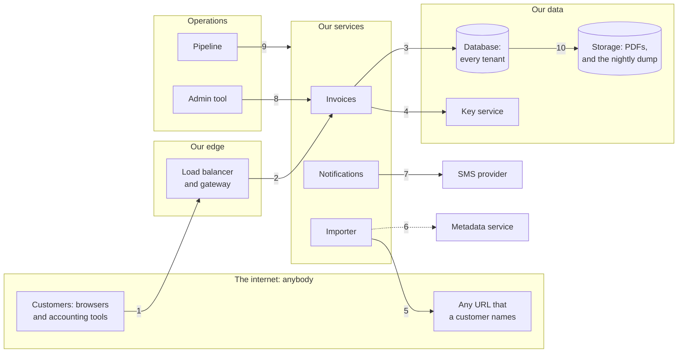

# Capstone 8: a security review of the invoicing API — count what stands in the way

[Syllabus](../SYLLABUS.md) · Phase 8 · Previous: [8.6 Abuse and operational security](06-abuse-and-operations.md)

> **Time:** three hours for your own review, then an hour with the worked one.
> **You need:** all of Phase 8. The reference implementation needs only Go, and runs in about two seconds.

The invoicing product has been in every chapter of this phase, one fault at a time: a header that anybody could set, a token that could not be withdrawn, an invoice that opened for the wrong customer, a key kept beside its data, a URL that pointed inwards, a pipeline that could do anything. This capstone is the whole product on one page, five weeks before it launches.

A security review is not a list of everything that could be better. That list has no end, and nobody acts on it. A review is a short, ordered list of what an attacker would do first, with three things beside each entry: what stands in the way today, what should, and what it costs. It ends with a decision that somebody signs.

Every chapter of the phase is in it. Where trust changes, and who might abuse it (8.1). How the system knows who is asking, and for how long it goes on believing them (8.2). What each caller may do, and to whose data (8.3). What the data looks like to somebody who has a copy of it (8.4). What the code does with what it is given (8.5). And what happens when a credential, a dependency or a colleague goes wrong (8.6).

**How to use this page**

1. Read the brief.
2. Write your own review, on paper, against the task list. Give yourself a time limit.
3. Only then open the worked design and compare, section by section.
4. Run the reference implementation — and then run it with controls removed.

---

## The brief

*From the chief technology officer.*

> A company with four thousand employees wants to sign with us, and its security team wants our answers first. We launch to everyone in five weeks. I would rather hear it from you than from them.
>
> **What I want**
> - A drawing of the system, with the places where trust changes.
> - The ten things most likely to hurt us, in order. For each: who would do it, and what they would get.
> - For each: what stops it today, what should, and what that costs us to build.
> - What you would do before launch, what can wait, and what we accept. Put a name beside anything that we accept.
>
> **What you have: the system as it is built**
> - A web application, and a public API for customers' accounting tools, behind one load balancer, where TLS ends. Then a gateway, and three services: invoices, imports and notifications. One PostgreSQL database holds every tenant. Invoice PDFs, and a nightly dump of the database, are in object storage.
> - Signing in gives a signed token that is good for thirty days and carries the user's tenant and role. The gateway checks it, and passes the tenant to the services in a header, `X-Tenant`.
> - Invoices are numbered in order. The invoice service checks that the caller is signed in.
> - Payees' bank details are encrypted by the application. The key is in the `settings` table. The disks are encrypted.
> - A customer can import an invoice from a URL, and the page shows what was fetched.
> - A new user proves a phone number with a code by SMS, at 4p a message. About 3,000 are sent in a normal week. There is a limit of a hundred requests a second for each address.
> - Forty support staff use an admin tool that can open any tenant. It can be reached from the office network.
> - All services use one database user, and run with one cloud role.
> - The pipeline builds, tests and deploys with one stored token, which is an administrator's. Dependencies are named by version range.
> - Application logs are kept for thirty days.
>
> **What must be true**
> - No tenant ever sees another tenant's data.
> - A user who is removed is out within fifteen minutes.
> - Nobody outside the company reads a payee's bank details. Nobody inside does without a reason on record.
> - If any of that fails, we can say within a day what was seen, and by whom.
> - A bad week costs no more than £500 in messages.
>
> **Constraints**
> - Six engineers, five weeks, and a date that will not move. Half of that time is already promised to features.
> - One cloud provider. Its key service, its metadata service and its identities for workloads are there to be used.

---

## Your task

Produce a review of three or four pages. The suggested times add up to three hours.

| # | Deliverable | Draws on | Time |
|---|---|---|---|
| 1 | Questions for the CTO. The assets, and the actors | 8.1 | 15 min |
| 2 | The drawing: every component, every arrow, and the boundaries that the arrows cross | 8.1 | 15 min |
| 3 | The threats: what can go wrong at each boundary, and the ten that matter, in order | 8.1 | 25 min |
| 4 | Authentication: customers, accounting tools and staff. How long until a removed user is out | 8.2 | 15 min |
| 5 | Authorization: the matrix, where the check lives, and how tenants are kept apart | 8.3 | 25 min |
| 6 | Data: each hop in transit, bank details at rest, and where every key and secret is | 8.4 | 20 min |
| 7 | Input: each place where input reaches something that interprets it. The importer in particular | 8.5 | 15 min |
| 8 | Abuse and operations: what costs money, the pipeline, staff access, the audit log, dependencies | 8.6 | 20 min |
| 9 | **Depth**: for each of your ten threats, the controls that must all fail before it succeeds | 8.1 | 15 min |
| 10 | The plan: before launch, after it, and accepted | 8.1 | 15 min |

The two standing rules:

- **Every number has a source**: the brief, arithmetic you show, or an assumption you label.
- **Choose.** Pick an option, give the reason, and name what you gave up.

And one for this capstone:

- **For every threat, name the attacker, the asset, and every control that must fail before the one reaches the other.** If the list has one entry, say whether you accept that. If it has none, it is what you fix first.

---

## Worked design

<details>
<summary>Open only after you have written your own</summary>



### 1. Questions, assets and actors

**Questions**, with the answers that this design assumes:

| Question | Assumed answer |
|---|---|
| Which data would end the business if it leaked? | Payees' bank details, first. Then every tenant's invoices |
| What may the accounting tools do? | Read invoices of the tenant that authorised them. Nothing else |
| May staff see a tenant's data at all? | Yes, to answer a ticket, with the reason on record |
| What have we promised about telling customers of a breach? | To tell them within a day what was seen. That needs a record that can be trusted |
| Whose money is the £500? | Ours. So the SMS flow is a target for fraud and not only for load |

**Assets.** Bank details. Every tenant's invoices and customers. The power to mark an invoice paid. Passwords, tokens and keys. The pipeline's credential. The record of who did what.

**Actors**, as in Chapter 8.1, and one more:

| Actor | Starts with | In this review |
|---|---|---|
| Anyone on the internet | Nothing | Threat 8 |
| A customer | A real account in one tenant | Threats 1, 3, 6 and 9. A free trial makes anyone a customer |
| An insider, or an insider's laptop | A place inside, and real access | Threats 2 and 7 |
| A supplier, or a dependency | Our trust | Threat 5 |
| Somebody who finds a copy of our data | The copy, and nothing else | Threat 4 |

### 2. The drawing

The picture above has ten arrows. Each crosses a boundary, and for each the four questions of Chapter 8.1 are asked: who is on the other side, how do we know, what are they allowed, and what happens if they lie.

| Arrow | Today, the far side is believed because | Verdict |
|---|---|---|
| 1 | of a signed token, for thirty days | Too long |
| 2 | of a header, from anything on the network | Not a check |
| 3 | of one shared database user, which may do anything | Too much |
| 4 | — there is no key service: the key is in the database | Missing |
| 5 | the importer goes wherever it is told | Unchecked |
| 6 | the metadata service answers anything on the machine | Unchecked |
| 7 | every request is believed to come from a new user | Unlimited |
| 8 | the request came from the office network | Not a check |
| 9 | of a stored administrator's token | Too much, for too long |
| 10 | the dump is a file, and whoever has it can read it | Unprotected |

### 3. The ten threats, in order

Ordered by how little the attacker needs, and then by how much they get.

| # | The threat | Who | What they get | What stops it today |
|---|---|---|---|---|
| 1 | Asking for another tenant's invoice by its number | Any customer | Every invoice of every tenant | Nothing |
| 2 | Sending `X-Tenant` to a service directly | Anything inside the network | The same, and the power to change it | The network |
| 3 | Pointing the importer at the metadata service | Any customer | The cloud role: the PDFs and the dump | Nothing |
| 4 | A dump, or a backup, that gets out | Whoever finds it | Everything, bank details included: the key is in it | Care |
| 5 | The pipeline's token, read by an altered dependency | A dependency's attacker | The cloud account | Nothing |
| 6 | A removed user who goes on working | A former employee of a customer | Their tenant, for thirty days | Nothing |
| 7 | A support account that opens any tenant, with no record | An insider, or their laptop | Any tenant, unseen | The office network |
| 8 | A script that asks for SMS codes for its own range of numbers | Anyone | Our money: 100 requests a second is £14,400 an hour | Nothing |
| 9 | A request that names fields the caller may not change | Any customer | An invoice marked paid, or moved | Nothing |
| 10 | One injected query, run as the shared database user | Any customer, given one fault | The whole database | Nothing |

The arithmetic of threat 8: 100 requests a second, for 3,600 seconds, at 4p, is £14,400. The limit that exists allows it.

Threats 1 and 3 are first because they need an account and a browser, and both are in every list of the commonest faults. Threats 4 and 5 are next because either is the whole company.

### 4. Authentication (Chapter 8.2)

| Who | Signs in with | Then holds | Out within |
|---|---|---|---|
| A customer, in a browser | A password stored with Argon2id, and a second factor for a tenant's owners | An access token for 15 minutes, and a refresh token that is looked up | 15 minutes, by the token's life. At once, by the next point |
| The same, on every request to the invoice service | — | — | The account is looked up: one indexed read |
| An accounting tool | OAuth 2.0, the code flow with PKCE. The customer agrees to *read invoices* | An access token for 15 minutes, for one tenant, read-only | 15 minutes, or at once if the customer withdraws the grant |
| Support staff | The company's identity provider, with a second factor that resists phishing | A session of eight hours, checked with the provider every five minutes | Five minutes |

**The choice.** Short tokens *and* a lookup, where either alone meets the brief's fifteen minutes. The lookup costs one read for each request, which this service can afford. It buys a second control for an asset that deserves two, and removal that is immediate where it matters. Given up: the invoice service can no longer serve a request without the database. It could not before, either.

### 5. Authorization (Chapter 8.3)

**The matrix**, for the requests that matter most. It is the specification, and it runs as a test on every change.

| | Nobody | Another tenant's owner | The tenant's member | The tenant's owner | An accounting tool | Support, no grant | Support, with a grant |
|---|---|---|---|---|---|---|---|
| Read an invoice | 401 | 404 | 200 | 200 | 200 | 404 | 200 |
| Read a payee's bank details | 401 | 404 | masked | 200 | 403 | 404 | masked |
| Edit an invoice's note | 401 | 404 | 200 | 200 | 403 | 404 | 403 |
| Mark it paid | 401 | 404 | 403 | 403 | 403 | 404 | 403 |
| Import from a URL | 401 | — | 200 | 200 | 403 | 403 | 403 |
| Export everything of one tenant | 401 | 404 | 403 | 200 | 403 | 404 | 403 |

*Mark it paid* is 403 for everyone: an invoice becomes paid when the payment provider says that money arrived, and in no other way.

**Where the check lives.**

- One gate in the invoice service, in front of every handler. A route cannot exist without an action, and an action that the policy does not name is refused.
- **The tenant comes from the token, which the service verifies itself.** `X-Tenant` is deleted. The gateway passes the user's token on, and the service checks the signature and the audience. Anything else that reaches the service has no token to show. That removes threat 2 without a new piece of infrastructure. Mutual TLS between the services (Chapter 8.4) is the second control for it, and is in the plan for after launch.
- Every lookup names the tenant. That is the second control for threat 1.
- Requests are decoded into a type that has only the fields which that endpoint may change. That is threat 9.
- A grant for support staff is a row that the policy reads like a membership (section 8).

**Given up for now:** row-level security in the database, which would be a third control for threat 1 and the answer to threat 10. It needs a database role for each service first. Both are after launch.

### 6. Data (Chapter 8.4)

**In transit.**

| Hop | Today | The design |
|---|---|---|
| Client to load balancer | TLS | TLS. Unchanged |
| Load balancer to gateway to services | Plaintext | TLS before launch. Mutual TLS after |
| Services to the database | Encrypted, not verified | `verify-full` |
| Services to storage, the key service, the SMS provider | TLS, by the provider's libraries | Unchanged. No code turns verification off: searched for, and tested |

**At rest.** Bank details are the one field that is encrypted in the application. Each tenant has a data key, made by the invoice service, and stored only after the cloud's key service has wrapped it. Each ciphertext is bound to its tenant and its row. The database, and every dump of it, then holds ciphertext and wrapped keys.

**The dump** goes to a bucket that only the backup role can read and that cannot be made public. No other copy of production data is made. When a contractor needs data, they get a copy with the bank details and the customers' names replaced.

**Secrets.** None in the repository, in an image or in a pipeline's settings. Each service gets its cloud credential from the platform, for hours. Each has its own database password, from the secret store, replaced every month by a job that has been run before.

**What this does not do.** Somebody who becomes the invoice service can read bank details, because the invoice service can. Against that there is the service's narrow role, the key service's log of every unwrap, and an alert on that log. It is accepted, in section 10.

### 7. Input (Chapter 8.5)

| What interprets it | Where | The design |
|---|---|---|
| The database | Every query | Values are parameters. *Sort by* chooses from a map. Checked by a search of the code for queries built from strings |
| An HTTP client | The importer | Below |
| The code that fills in objects | Every `PATCH` and `POST` | A type for each endpoint, and unknown fields refused |
| The file system | PDFs | The server names every file. Callers use the invoice's identifier |
| A decoder | Messages on the queue, the payment provider's webhook | JSON into named types, with a limit on size. The webhook's signature is checked first |

**The importer** is threat 3, and gets three controls, because what is behind it is everything.

1. It checks the address of each connection as it connects, and follows no redirect without the same check.
2. The old metadata service is turned off. The new one wants a session token, which a forged `GET` cannot obtain.
3. The role that the services run as cannot read the dump. Only the backup role can.

It also stops showing the caller what it fetched. It parses a PDF, and stores an invoice or an error. **After launch** it moves to a service of its own, with no role and no route inwards.

### 8. Abuse and operations (Chapter 8.6)

**SMS.** The fraud pays only for numbers in its own range, so that is the key.

| Limit | Value | From |
|---|---|---|
| For each number | 1 a minute, 5 a day | A person needs one or two |
| For each range of numbers | 30 an hour | Assumption: a normal hour sends fewer than 10 to any one range. To be checked against a month of real traffic |
| Spending, each hour | £10, set at the provider as well. An alert at £5 | 3,000 a week is 18 an hour, or 72p. £10 is nearly fourteen times that |
| Spending, each day | £70 | 7 × £70 = £490, under the brief's £500 |

The limit by address stays, for load. It was never a defence against this.

**The pipeline.** No stored token. Each run proves which repository and branch it is, and receives a credential for that run. Building and testing get none. The deploy step gets one that may deploy these three services and do nothing else, for ten minutes. Production deploys come from the protected branch, after review. Dependencies are pinned by hash in a lockfile that is committed, and the build fails on a mismatch. Updates arrive as changes to review.

**Support staff.** No access to any tenant without a grant: one tenant, for one ticket, for one hour, read-only, with bank details masked. The admin tool is reached through the identity provider, and the office network counts for nothing.

**The audit log.** Written by the gate, for every grant, every view under a grant, every export, every change of role, every use of the key service and every deploy. It goes to a second cloud account, to which the services can add and from which nobody in the first account can delete. Each entry holds the hash of the one before, and the latest hash is copied to a third place every minute. It is kept for a year. A tenant can read the entries about staff access to its own data.

**Alerts** that page: any export of a whole tenant, a grant without a ticket, an unwrap of keys for more than a few tenants in a minute, SMS spending over £5 in an hour, and any failure of the audit log's own check.

### 9. Depth

For each threat, the controls that must **all** fail before it succeeds. The reference implementation computes this table for eight of the ten.

| # | The threat | Controls that must all fail | Count |
|---|---|---|---|
| 1 | Another tenant's invoice | The gate. The scoped lookup | 2 |
| 2 | A forged tenant | The service's own check of the token | 1, until mutual TLS |
| 3 | The importer and the metadata service | The check at the connection. The metadata service's session. The narrow role | 3 |
| 4 | A dump that gets out | Envelope encryption | **1** |
| 5 | The pipeline's token | The lockfile's hash. No credential in the build step. A deploy-only token | 3 |
| 6 | A removed user | The token's life. The lookup | 2 |
| 7 | Support, unseen | The grant. The audit log, with its hash kept elsewhere | 2 |
| 8 | SMS fraud | The limit for each range. The cap on spending | 2 |
| 9 | Marking an invoice paid | The typed request. The daily comparison of paid invoices with payments received | 2 |
| 10 | An injected query | Parameters | 1, until each service has its own role |

Three rows have a count of one, and each needs a decision. Rows 2 and 10 get a second control after launch. Row 4 does not, and that is deliberate. The one control is cryptographic and does not depend on anyone's care, which is why it was chosen. But it covers one field. The rest of a dump is readable by whoever holds it, so the defence for the rest is that there are no loose dumps.

### 10. The plan

Six engineers for five weeks is 30 engineer-weeks, and half is promised to features. That leaves 15. The estimates are mine, and they are the part of this page most likely to be wrong.

| Before launch | Threats | Engineer-weeks |
|---|---|---|
| The gate, scoped lookups, typed requests, and the matrix as a test | 1, 9 | 3.5 |
| The services verify the token. `X-Tenant` is removed | 2 | 1 |
| Tokens of 15 minutes, a refresh token, and the lookup | 6 | 1.5 |
| The importer's check. The old metadata service off. Roles narrowed | 3 | 1.5 |
| Envelope encryption for bank details. The backup bucket locked. No loose dumps | 4 | 3 |
| The pipeline: a credential for each run, deploy-only, hashes in the lockfile | 5 | 1.5 |
| SMS limits and caps | 8 | 0.5 |
| Grants for support, and the audit log in a second account | 7 | 2.5 |
| | | **15** |

| After launch, in this order | Threats |
|---|---|
| A database role for each service, then row-level security | 10, 1 |
| Mutual TLS between the gateway and the services | 2 |
| The importer as a service of its own | 3 |
| Passkeys for customers. Tenants reading their own audit entries | 6, 7 |

| Accepted | By | Until |
|---|---|---|
| An injected query can read every tenant, with one control in the way | The CTO | The roles exist: within six weeks of launch |
| Somebody who becomes the invoice service can read bank details | The CTO | Standing. Reviewed each quarter, with the key service's log |
| A dump holds names and amounts in the clear | The CTO | Standing, with the rule that no dump leaves the backup bucket |

</details>

---

## Reference implementation

[`code/capstone-review`](code/capstone-review/main.go) is two files, about 630 lines. [`main.go`](code/capstone-review/main.go) is the product, small enough to read: an API with five endpoints, and behind it a key service, a metadata service, a cloud account, an SMS provider and a build. The API is served over HTTP. The things behind it are objects in the same process. [`attacks.go`](code/capstone-review/attacks.go) has eight attacks, which are threats 1 and 3 to 9 of the worked design.

The worked design's controls are a list, and each can be switched off:

```go
var controls = []struct{ name, chapter, what string }{
	{"expiry", "8.2", "an access token lasts fifteen minutes"},
	{"lookup", "8.2", "the account is looked up on every request"},
	{"gate", "8.3", "one policy check stands in front of every handler"},
	{"scope", "8.3", "every lookup names the caller's tenant"},
	{"envelope", "8.4", "bank details are encrypted under keys that a key service wraps"},
	{"bind", "8.5", "a request is decoded into a type that has only the fields it may change"},
	{"dial", "8.5", "the URL fetcher refuses internal addresses as it connects"},
	{"imds", "8.5", "the metadata service wants a session token first"},
	{"role", "8.6", "the service's cloud role cannot read backups"},
	{"ledger", "8.6", "invoices marked paid are compared with payments received"},
	{"pin", "8.6", "the build checks each dependency against the hash in the lockfile"},
	{"split", "8.6", "the build step holds no credential"},
	{"least", "8.6", "the pipeline's token may deploy, and nothing else"},
	{"range", "8.6", "SMS codes are limited for each range of numbers"},
	{"cap", "8.6", "what the SMS provider may bill in an hour is capped"},
	{"grant", "8.6", "staff see a tenant only with a grant made for a ticket"},
	{"audit", "8.6", "staff access is logged, and the log's latest hash is kept elsewhere"},
}
```

```bash
go run ./phase-8-security/code/capstone-review
```

```text
THE DESIGN IN THE BRIEF — eight attacks, each on a system that this program starts.

  1  tenant B's member asks for tenant A's invoice by number  SUCCEEDS: read invoice 1001
  2  a user disabled an hour ago reads an invoice             SUCCEEDS: read it, an hour later
  3  a member marks their own invoice paid, unnoticed         SUCCEEDS: paid, and no money came
  4  the URL importer is sent to the metadata service         SUCCEEDS: read 3 bank accounts
  5  an altered dependency runs in the build                  SUCCEEDS: read 3 bank accounts
  6  a dump of the database is copied to a public place       SUCCEEDS: read 3 bank accounts
  7  a script asks for 2,000 SMS codes for its own range      SUCCEEDS: 2,000 sent, for £80.00
  8  support opens a tenant with no ticket; the log is cut    SUCCEEDS: read, and no record is left

  8 of 8 attacks succeed.

THE REVIEWED DESIGN — the same attacks, against the 17 controls of the worked design.

  the attack                                                  stopped by  all of these must fail
  1  tenant B's member asks for tenant A's invoice by number  scope       2: gate, scope
  2  a user disabled an hour ago reads an invoice             expiry      2: expiry, lookup
  3  a member marks their own invoice paid, unnoticed         bind        2: bind, ledger
  4  the URL importer is sent to the metadata service         dial        3: dial, imds, role
  5  an altered dependency runs in the build                  pin         3: pin, split, least
  6  a dump of the database is copied to a public place       envelope    1: envelope
  7  a script asks for 2,000 SMS codes for its own range      range       2: range, cap
  8  support opens a tenant with no ticket; the log is cut    grant       2: grant, audit

  0 of 8 attacks succeed. The thinnest defence is 1 control deep: attack 6.
```

**The first table is the brief.** With no control in place, every attack works, and three of them end with the bank details.

**The second table is section 9, computed.** For each attack the program removes controls, one at a time, then two at a time, then three, and runs the attack against each result until one succeeds:

```go
	for size := 1; size <= 4; size++ {
		if found := search(0, nil, size); found != nil {
			return found
		}
	}
```

So the last column is not an opinion about the design. It is what the attacks found.

Two rows repay a second look.

- **Attack 4 does not list `envelope`.** Somebody who has stolen the service's own cloud credential can ask the key service to unwrap, as the service does. Encryption at rest is no defence against the application's own identity, which is the last row of the table in Chapter 8.4. What stops this attack is everything that keeps that credential from being stolen and from being useful.
- **Attack 6 lists only `envelope`.** Somebody who finds a dump has no credential at all, and here the encryption is the whole defence. The program says so in its last line.

What the model leaves out: threats 2 and 10 of the worked design, which need a second network hop and a database. The importer's check is on an address written in the URL, where Chapter 8.5's also covers names and redirects. The build is a function, and not a pipeline.

### Remove controls

Each run removes controls from the reviewed design. The program ends with an error when an attack succeeds.

```bash
go run ./phase-8-security/code/capstone-review -without gate
```

```text
THE REVIEWED DESIGN, WITHOUT: gate

  1  tenant B's member asks for tenant A's invoice by number  stopped by: scope
  2  a user disabled an hour ago reads an invoice             stopped by: expiry
  3  a member marks their own invoice paid, unnoticed         stopped by: bind
  4  the URL importer is sent to the metadata service         stopped by: dial
  5  an altered dependency runs in the build                  stopped by: pin
  6  a dump of the database is copied to a public place       stopped by: envelope
  7  a script asks for 2,000 SMS codes for its own range      stopped by: range
  8  support opens a tenant with no ticket; the log is cut    stopped by: grant

  0 of 8 attacks succeed.
```

Nothing happens. The lookup still names the tenant, so the invoice is not found. This is the result that defence in depth is for: a control was lost, perhaps in a refactoring that nobody reviewed with security in mind, and no customer's data moved. It is also why the matrix has to be a test. From outside, a design that has lost one of two controls looks exactly like one that has both.

```bash
go run ./phase-8-security/code/capstone-review -without gate,scope
```

```text
THE REVIEWED DESIGN, WITHOUT: gate, scope

  1  tenant B's member asks for tenant A's invoice by number  SUCCEEDS: read invoice 1001
  2  a user disabled an hour ago reads an invoice             stopped by: expiry
  3  a member marks their own invoice paid, unnoticed         stopped by: bind
  4  the URL importer is sent to the metadata service         stopped by: dial
  5  an altered dependency runs in the build                  stopped by: pin
  6  a dump of the database is copied to a public place       stopped by: envelope
  7  a script asks for 2,000 SMS codes for its own range      stopped by: range
  8  support opens a tenant with no ticket; the log is cut    stopped by: grant

  1 of 8 attacks succeeds.
```

Two mistakes, and it is the bookkeeper's finding of Chapter 8.3.

```bash
go run ./phase-8-security/code/capstone-review -without envelope
```

```text
THE REVIEWED DESIGN, WITHOUT: envelope

  1  tenant B's member asks for tenant A's invoice by number  stopped by: scope
  2  a user disabled an hour ago reads an invoice             stopped by: expiry
  3  a member marks their own invoice paid, unnoticed         stopped by: bind
  4  the URL importer is sent to the metadata service         stopped by: dial
  5  an altered dependency runs in the build                  stopped by: pin
  6  a dump of the database is copied to a public place       SUCCEEDS: read 3 bank accounts
  7  a script asks for 2,000 SMS codes for its own range      stopped by: range
  8  support opens a tenant with no ticket; the log is cut    stopped by: grant

  1 of 8 attacks succeeds.
```

One control, and the bank details are in the dump with their key beside them. Every other attack is still stopped, including the two that were also after the bank details, because they were never stopped by this control.

Try the others. `-without dial,imds,role` needs all three before attack 4 works. `-without expiry` changes nothing, and `-without expiry,lookup` is the contractor of Chapter 8.2.

---

## Review your own design

Check your review against these. Each is a mistake that an experienced reviewer would look for.

- [ ] Does your drawing show **every** arrow that crosses a boundary, including the pipeline's, the admin tool's and the dump's?
- [ ] Is *the internal network* anywhere in your review as a reason to trust something?
- [ ] Is a **customer** among your attackers? A dependency? Somebody who merely finds a file?
- [ ] Are your threats in an order, and can you say why the first is first?
- [ ] How long after a user is removed does their access end? Is it one control or two?
- [ ] Where does the tenant come from, in every service? Could anything else set it?
- [ ] Is there a matrix? Does it have a column for an outsider with the **highest** role, and for staff?
- [ ] Which hop after the load balancer is in plaintext, and which encrypted hop is not verified?
- [ ] *Encrypted at rest*: against whom? What is in a dump, and where is the key?
- [ ] Which attacks does your encryption **not** stop? Did you say so?
- [ ] Does the importer check where it connects, or what it was told?
- [ ] What may the service's cloud role read? What may the pipeline's token do, and for how long?
- [ ] What is the limit on SMS keyed on? What is the most that a week can cost, and where is the arithmetic?
- [ ] Can a member of staff open a tenant with no reason? Could they remove the record?
- [ ] For each threat, did you **count** the controls? Is anything protected by one, or by none?
- [ ] Does your plan fit in the time? Is there a name beside everything that you accepted?

---

## Extensions

1. **Your own design.** Change the list of controls to those of your review, write the attacks that your threats need, and run it. Which threat has the thinnest defence?
2. **Threat 2.** Put a gateway in front of the API, as Chapter 8.1's example has, with the `X-Tenant` header. Add the attack, and the two controls of section 5.
3. **Threat 10.** Give the system the PostgreSQL of Chapter 8.5's example, a search endpoint that joins strings, and a role for each service. How many controls must fail now?
4. **A ninth attack.** Somebody takes over an owner's session in a browser. Which controls of the seventeen stand in the way of the bank details? What would you add?
5. **A second control for the dump.** Design one that does not depend on anyone's care. What does it cost, and would you build it before launch?
6. **The questionnaire.** The customer's security team sends twenty questions. Write the answers to five that your review can now give in one line each, and one that it cannot.
7. **The cheapest plan.** You have 8 engineer-weeks and not 15. Which rows of section 10 go, and which threats are then accepted, by whom?

---

## Sources

This capstone applies the chapters of Phase 8, where the sources for each technique are given. The method of sections 1 to 3 is that of the [OWASP Threat Modeling Cheat Sheet](https://cheatsheetseries.owasp.org/cheatsheets/Threat_Modeling_Cheat_Sheet.html). The threats of section 3 are drawn from the [OWASP API Security Top 10](https://api-security.owasp.org/editions/2023/en/0x11-t10/) and from the scenarios of the chapters.

**Next:** Phase 9 — Shipping and running *(planned)*. The design is now correct, reliable, observable and defended. The last phase is about changing it every day without breaking any of that: deploying, evolving the architecture, planning capacity, and paying for it.
