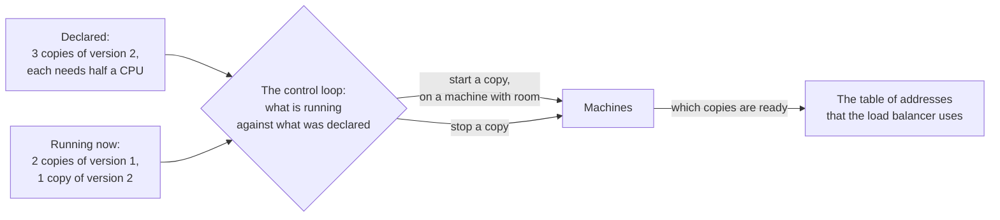
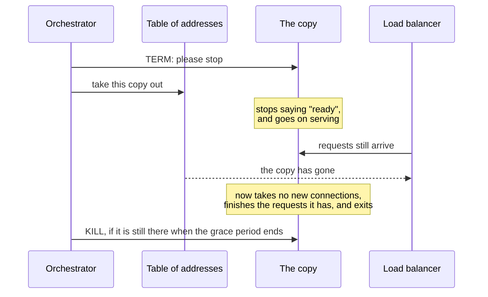

# 9.1 Containers and orchestration

[Syllabus](../SYLLABUS.md) · Phase 9 · Previous: [Capstone 8](../phase-8-security/capstone-security-review.md) · Next: 9.2 CI/CD and progressive delivery *(planned)*

> **Time:** about 35 minutes to read, 40 minutes of practice.
> **You need:** load balancers and health checks from [Chapter 3.2](../phase-3-scaling-out/02-load-balancing.md), and stateless services from [Chapter 3.1](../phase-3-scaling-out/01-stateless-services.md). The example needs only Go and takes about three seconds. It sends a signal to its own child processes, so it runs on Linux and macOS and not on Windows.

**By the end of this chapter you can**

- say what a container is, and what an orchestrator does with one;
- name the three separate ways in which a deploy drops requests, and stop each;
- write a startup, a readiness and a liveness probe, and say what each must not check;
- shut a server down without losing a request, and work out how long that may take;
- set requests and limits for CPU and memory, and say what happens at each limit.

---

## The problem

*An illustrative scenario; the example reproduces it.* The invoicing team deploys twice a day. Each deploy puts a small red bump on the dashboard: a few dozen failed requests, gone within a minute. Everybody knows the bump. *It is just the deploy.*

Then a customer runs its month-end batch during one. Forty invoices are not created, the customer's script does not retry, and the customer's finance team finds out a week later. For the first time, somebody on the team looks at what the bump is made of. It is three different failures, and they have been taken for one.

1. **New copies of the service get requests before they can serve them.** A copy needs a few hundred milliseconds to open its connections and load what it needs. The load balancer does not know that.
2. **Old copies are stopped with requests half answered.** The process is told to end, and it ends.
3. **Requests go on arriving at an old copy after it has been told to stop.** The signal to stop is fast. The news that the copy has gone travels to the load balancer more slowly, and for that interval requests are sent to something that is no longer there.

Each needs its own fix, and fixing one leaves the other two exactly as they were. That is why the bump survived three earlier attempts to remove it.

---

## The concept

### 1. A container is a process, and an image is its files

"A container is simply an isolated process with all of the files it needs to run. If you run multiple containers, they all share the same kernel, allowing you to run more applications on less infrastructure" ([Docker documentation](https://docs.docker.com/get-started/docker-concepts/the-basics/what-is-a-container/)).

Two ideas are in that sentence.

- **An image** is a filesystem in a file: your program, and every library and file that it needs, at exact versions. The same image runs on a laptop, in the pipeline and in production, which ends *it works on my machine*.
- **A container** is an ordinary process, started from an image, to which the kernel shows a limited view: its own files, its own network address, its own process list, and a ceiling on the CPU and memory that it may use.

A container is not a virtual machine. It has no kernel of its own, it starts in milliseconds, and its isolation is the kernel's, which is weaker than a hypervisor's.

### 2. An orchestrator keeps what is running equal to what you declared

With one server you start the process yourself. With forty copies on twelve machines, something has to decide where each copy runs, start it, notice when it dies, replace it, and tell the load balancer. That is an **orchestrator**, and the common one is Kubernetes.

Its central idea is that you do not give it commands. You declare a state, and it works towards that state for ever. Kubernetes describes itself as "a set of independent, composable control processes that continuously drive the current state towards the provided desired state" ([Kubernetes documentation, *Overview*](https://kubernetes.io/docs/concepts/overview/)).



Four words are enough to read most Kubernetes configuration:

| Word | What it is |
|---|---|
| **Pod** | One copy of your service: a container, or a few that are always placed together |
| **Deployment** | *I want N copies of this version*, and the rules for replacing them |
| **Service** | A stable name, and behind it the table of the pods that are ready |
| **Node** | A machine that pods run on |

What you get for declaring is in one sentence: "Kubernetes restarts containers that fail, replaces containers, kills containers that don't respond to your user-defined health check, and doesn't advertise them to clients until they are ready to serve" ([the same page](https://kubernetes.io/docs/concepts/overview/)). Every clause of that sentence depends on something that *you* have to supply: a health check that means something, a definition of ready, and a process that can be stopped politely. The rest of this chapter is those three.

A deploy is then a change to the declaration. "You describe a desired state in a Deployment, and the Deployment Controller changes the actual state to the desired state at a controlled rate" ([Kubernetes documentation, *Deployments*](https://kubernetes.io/docs/concepts/workloads/controllers/deployment/)). By default it keeps at least three quarters of the copies running while it does so.

### 3. Probes: three questions with three different consequences

The orchestrator cannot see inside your process. It asks, over HTTP, and what it does with the answer depends on which question it was.

| Probe | The question | If the answer is no | It must not check |
|---|---|---|---|
| **Startup** | Has it finished starting? | The other two probes wait. If it never starts, it is killed | Anything that can fail after start-up |
| **Readiness** | Can it take requests now? | It is taken out of the table. It is **not** restarted | — but see below |
| **Liveness** | Is it stuck, beyond recovery? | It is **killed and restarted** | Anything outside the process |

The documentation's definitions: "Readiness probes determine when a container is ready to accept traffic", and "Liveness probes determine when to restart a container. For example, liveness probes could catch a deadlock, where an application is running, but unable to make progress" ([Kubernetes documentation, *Liveness, Readiness, and Startup Probes*](https://kubernetes.io/docs/concepts/configuration/liveness-readiness-startup-probes/)).

**The liveness probe is the dangerous one.** It answers a failure by restarting, and a restart fixes only what is wrong inside the process. Make it check the database, and a slow database gets every copy of the service restarted at once, into a database that is still slow. The documentation warns of exactly this: "Incorrect implementation of liveness probes can lead to cascading failures. This results in restarting of container under high load; failed client requests as your application became less scalable; and increased workload on remaining pods due to some failed pods" ([the same page](https://kubernetes.io/docs/concepts/configuration/liveness-readiness-startup-probes/)). It is the retry storm of Chapter 6.1, performed by the platform.

**The readiness probe needs thought too.** It may say *no* while the copy warms up, and while it shuts down. If it also says *no* whenever a shared dependency is slow, then every copy says *no* together, the table is empty, and a degraded service becomes an absent one (Chapter 6.3).

### 4. Stopping: the signal is faster than the news

When the orchestrator stops a copy, two things happen, and they are not in order.



Kubernetes sends the signal: "first sending a TERM (aka. SIGTERM) signal, with a grace period timeout, to the main process in each container", and "Once the grace period has expired, the KILL signal is sent to any remaining processes". The period "defaults to 30 seconds". And the removal from the table is a separate thing that happens alongside: "At the same time as the kubelet is starting graceful shutdown of the Pod, the control plane evaluates whether to remove that shutting-down Pod from EndpointSlice objects" ([Kubernetes documentation, *Pod Lifecycle*](https://kubernetes.io/docs/concepts/workloads/pods/pod-lifecycle/)).

So a server that is told to stop has three things to do, in this order:

1. **Say that it is not ready, and go on serving.** Requests will arrive until every load balancer has heard. Allow some seconds for that.
2. **Then take no new connections, and finish the requests in flight.** Go's standard library does this in one call: "Shutdown gracefully shuts down the server without interrupting any active connections" ([Go `net/http`](https://pkg.go.dev/net/http)).
3. **Then exit,** before the grace period ends and the choice is taken away.

That gives an inequality to check for every service:

> grace period > time to go on serving + the longest request + a margin

A service whose slowest request takes forty seconds cannot be stopped cleanly in thirty. A process that ignores TERM is not shut down gracefully at all: by default it is simply killed half a minute later.

The same three steps apply to a worker that reads a queue (Chapter 4.2): stop taking messages, finish or release the one in hand, exit.

### 5. Requests and limits

A pod states two numbers for CPU and two for memory, and they do different jobs. "When you specify the resource request for containers in a Pod, the kube-scheduler uses this information to decide which node to place the Pod on. When you specify a resource limit for a container, the kubelet enforces those limits so that the running container is not allowed to use more of that resource than the limit you set" ([Kubernetes documentation, *Resource Management for Pods and Containers*](https://kubernetes.io/docs/concepts/configuration/manage-resources-containers/)).

| | The request | The limit, in the words of [the same page](https://kubernetes.io/docs/concepts/configuration/manage-resources-containers/) |
|---|---|---|
| What it is | What the copy is promised | The most that it may use |
| Used for | Choosing a machine with that much free | Enforcement, by the kernel |
| CPU, when the limit is reached | — | The copy is **slowed**: "cpu limits are enforced by CPU throttling" |
| Memory, when the limit is reached | — | The copy is **killed**: "memory limits are enforced by the kernel with out of memory (OOM) kills" |

They are two surprises that wait for every team in its first months on Kubernetes: latency that rises for no visible reason, with CPU apparently to spare, and copies that restart with no error in their own logs.

- **Set the request from measurement:** what one copy uses at its busiest (Chapter 1.7). A request that is too low packs too many copies on a machine. One that is too high pays for idle machines (Chapter 9.8).
- **Set the memory limit equal to the request,** or close to it. Memory cannot be taken back from a process, so a copy that exceeds what was reserved for it endangers its neighbours.
- **Be careful with a CPU limit.** Throttling is a pause of some milliseconds added to requests, and it is invisible in most dashboards. If you set one, alert on throttled time.
- **Tell the language's runtime.** A runtime that sees sixty-four cores and is allowed two will start too many threads and be throttled. Go now reads the limit itself: "If the CPU bandwidth limit is lower than the number of logical CPUs available, GOMAXPROCS will default to the lower limit" ([Go 1.25 release notes](https://go.dev/doc/go1.25)). Before that version, it had to be set by hand.

---

## A real example

### Run it: one deploy, four ways

[`code/ch01-deploy/main.go`](code/ch01-deploy/main.go), about 270 lines, is a very small orchestrator. It starts three copies of a server as real processes, sends them steady traffic from sixteen clients through a table of addresses, and replaces each copy with a new version while the traffic goes on. It does this four times, with one more piece of the chapter each time, and counts every request that failed.

```bash
go run ./phase-9-shipping/code/ch01-deploy
```

A new copy needs 300 ms before it can serve. A request takes 30 ms. The table hears that a copy is stopping 100 ms after the copy does. The counts depend on timing, so yours will differ a little.

```text
Three copies of a service are replaced, one at a time, under steady traffic from 16 clients.

  what the deploy does                                requests   served  told 503:  connection   cut off
                                                          sent           not ready     refused  half-way
  1  start the new copy, stop the old one                  775      536        162          58        19
  2  …and wait until the new copy says it is ready        1024      974          0          39        11
  3  …and a stopping copy finishes what it has            1020      977          0          43         0
  4  …and goes on serving until the table knows            984      984          0           0         0
```

**Row 1 is the scenario.** 239 of 775 requests failed, in three ways, and each column is one of the three failures of *The problem*.

**Row 2 waits for readiness.** The deploy asks the new copy whether it is ready, and puts it in the table only when it says yes. The first column of failures is gone, and the other two have not moved.

**Row 3 handles the signal.** Without this, TERM ends a Go process at once. With it, the copy finishes what it has:

```go
		go func() {
			<-term
			stopping.Store(true) // the readiness probe fails from now on
			if drains {
				time.Sleep(drain) // go on serving while the news travels
			}
			ctx, cancel := context.WithTimeout(context.Background(), 5*time.Second)
			defer cancel()
			srv.Shutdown(ctx) // take no new connections, and finish the requests in flight
			close(done)
		}()
```

No request is cut off half-way now. But 43 are still refused: the copy has closed its door, and for a tenth of a second the table goes on sending callers to it.

**Row 4 goes on serving for a moment.** The one line `time.Sleep(drain)` is the difference: the copy says that it is not ready, serves for 250 ms more, and only then shuts down. By then the table has caught up. 984 requests, and none failed.

The deploy itself is a dozen lines, and the race is in the middle of it:

```go
		old.cmd.Process.Signal(syscall.SIGTERM) // told to stop…
		go func() {
			time.Sleep(propagation) // …and, a little later, the table hears of it
			tbl.remove(old.addr)
		}()
```

One detail of the measurement matters. The clients open a new connection for each request. A client library that reuses connections will often retry a failed `GET` on its own, and hide some of these failures. It does not retry a `POST` (Chapter 1.5), and the customer's batch was made of `POST`s.

### How Google's Borg stops a task

Kubernetes was written by people who had run its predecessor at Google for a decade. Their paper on that system, Borg, says of Kubernetes that "It is under active development by many of the same engineers who built Borg" ([Verma et al., *Large-scale cluster management at Google with Borg*, EuroSys 2015](https://static.googleusercontent.com/media/research.google.com/en//pubs/archive/43438.pdf)). Both of this chapter's mechanisms are in it, in their original form.

**Stopping.** "Tasks can ask to be notified via a Unix SIGTERM signal before they are preempted by a SIGKILL, so they have time to clean up, save state, finish any currently-executing requests, and decline new ones" ([the same paper](https://static.googleusercontent.com/media/research.google.com/en//pubs/archive/43438.pdf)). That one sentence is section 4: finish what you have, and decline what is new.

**Health.** "Almost every task run under Borg contains a built-in HTTP server that publishes information about the health of the task and thousands of performance metrics", and "Borg monitors the health-check URL and restarts tasks that do not respond promptly or return an HTTP error code" ([the same paper](https://static.googleusercontent.com/media/research.google.com/en//pubs/archive/43438.pdf)). That is the liveness probe, and the metrics endpoint of Chapter 7.1, in one server.

The paper is worth reading for its last section, where the authors list what they would do differently. Kubernetes is, in part, that list.

---

## Trade-offs

**An orchestrator against something simpler.** Kubernetes solves the problems of many services on many machines, and brings its own: a cluster to upgrade, a vocabulary to learn, and a new layer in which things go wrong. A team with one service is usually better served by a platform that runs containers for it. The ideas of this chapter apply there unchanged, because every such platform sends a signal, waits, and asks whether a copy is ready.

**A strict readiness probe against an empty table.** The more a probe checks, the more truthfully it says *ready*, and the more likely every copy is to say *not ready* at the same moment. Prefer a probe that reflects this copy alone.

**A long grace period against fast deploys.** A grace period of two minutes makes every deploy, and every replacement of a machine, take minutes for each copy. Bound the longest request instead (Chapter 1.5), and move anything slower to a queue (Chapter 4.1).

**A CPU limit against a noisy neighbour.** With no limit, one copy can take CPU that others were counting on. With one, a busy copy is paused while CPU sits idle. Requests that are set honestly do most of the work of a limit, without the pauses.

**Replacing quickly against capacity during the deploy.** Replacing a quarter of the copies at a time is fast, and means that the service runs a quarter short, or a quarter over, while it happens. At the daily peak, that quarter may be the headroom (Chapter 9.7).

---

## Practice

### Check yourself

1. A service's liveness probe calls an endpoint that runs `SELECT 1` on the database. The database has a slow ten minutes. What happens to the service, and what should the probe have checked?
2. After a deploy, a few requests fail with *connection refused*, although the server shuts down gracefully. Where are they coming from, and what are two ways to stop them?
3. A Go service has a memory limit of 512 MiB and a CPU limit of two cores, on machines with 64 cores. It restarts every few hours with nothing in its log, and its latency has a long tail. Give a likely cause of each.

<details>
<summary>Answers</summary>

1. Every copy fails its liveness probe, and every copy is restarted, again and again, for ten minutes. Each restart drops the requests in flight and comes back cold, into a database that is still slow, and adds its reconnections to the load. An incident in which the service was slow has become one in which it is down. A liveness probe should check only that this process can still make progress: that its HTTP server answers, from inside the process, without calling anything else.
2. From the interval between the copy closing its listener and the load balancer learning that the copy has gone. Requests are still being sent to an address where nothing is listening. Either the copy goes on serving for a few seconds after TERM, and only then shuts down, as row 4 does. Or something waits before the signal is delivered: Kubernetes can run a hook before stopping a container, and a hook that sleeps for a few seconds has the same effect.
3. The restarts: the process reached its memory limit and the kernel killed it, which leaves nothing in the process's own log. Look at the pod's last state for *OOMKilled*. The tail: CPU throttling. If the Go version is older than 1.25, the runtime sees 64 cores, runs that many threads at once, uses its two cores' worth of time early in each period, and is paused for the rest of it.

</details>

### Exercise: the numbers for the invoice service

1. **Try it.** In the program, `drain` is 250 ms and `propagation` is 100 ms. Change `drain` to 50 ms. Predict row 4, and run it.
2. **The grace period.** The invoice service's slowest request, an export, can take 20 seconds. Assume that load balancers take up to 5 seconds to hear that a copy has gone. Choose the time to go on serving after TERM, the limit that the server puts on its own shutdown, and the grace period.
3. **The probes.** Say what each of the three probes calls, and what each does not check.
4. **The resources.** At the busiest hour, one copy uses half a core and 300 MiB. Choose the requests and the limits, and say what happens when each limit is reached.

<details>
<summary>Worked solution</summary>

**1.** The copy now stops serving before the table has heard, so for the last 50 ms of the race callers are sent to a closed door:

```text
Three copies of a service are replaced, one at a time, under steady traffic from 16 clients.

  what the deploy does                                requests   served  told 503:  connection   cut off
                                                          sent           not ready     refused  half-way
  1  start the new copy, stop the old one                  818      532        208          63        15
  2  …and wait until the new copy says it is ready        1027      971          0          42        14
  3  …and a stopping copy finishes what it has            1026      983          0          43         0
  4  …and goes on serving until the table knows           1004      981          0          23         0
```

Row 4 has refusals again. The drain time is not a politeness. It has to be longer than the slowest path by which the news travels.

**2.** Work from the inequality of section 4.

| | Value | From |
|---|---|---|
| Go on serving after TERM | 10 s | Twice the 5 s that load balancers may take. An assumption to measure |
| The server's own limit on shutting down | 25 s | The longest request, 20 s, and a margin |
| The grace period | 45 s | 10 + 25 = 35, and ten more, so that KILL is never what ends a clean shutdown |

A better answer changes the question. A request of 20 seconds is the reason for all three numbers, and it should be a job on a queue (Chapter 4.1). With the longest request at 2 seconds, the default of 30 seconds is ample.

**3.**

| Probe | Calls | Does not check |
|---|---|---|
| Startup | `/ready`, every 2 s, for up to a minute | — |
| Readiness | `/ready`: the pool has connections, migrations match, and the process has not been told to stop | Whether the database is fast today. Whether other services are up |
| Liveness | `/alive`: the HTTP server answers | The database, or anything else outside the process |

**4.** In Kubernetes' own form:

```yaml
resources:
  requests:
    cpu: 500m        # half a core: what one copy uses at the peak
    memory: 400Mi    # 300 MiB at the peak, and a third more
  limits:
    memory: 400Mi    # equal to the request. Beyond it, the kernel kills the copy
```

There is no CPU limit, and that is a choice. The request already reserves half a core for each copy. A limit would add pauses at exactly the busiest moments. What is given up: a copy with a bug that spins can take CPU from its neighbours, until the autoscaler or a person notices. On a cluster that is shared with other teams, that may be the wrong choice.

At the memory limit, the copy is killed and restarted, and its requests in flight are lost. So an alert at 90% of the limit, for longer than a few minutes, is part of the design.

</details>

---

## Production tips and common mistakes

- **Handle TERM.** Say *not ready*, go on serving for a few seconds, then shut down and exit.
- **Check the inequality** for every service: the grace period against the drain time and the longest request.
- **Give every copy a readiness probe,** and have the deploy wait for it.
- **Keep the liveness probe inside the process.**
- **Use a startup probe for anything that starts slowly,** and do not stretch the liveness probe to cover it.
- **Set requests from measurements at the peak,** and look at them again when the service changes.
- **Alert on kills for memory and on throttled CPU.** Neither appears in the application's own logs.
- **Tell the runtime its limits,** if it does not read them itself.
- **Run more than one copy, on more than one machine** (Chapter 6.5), or a deploy is an outage whatever else is right.
- **Watch a deploy on the dashboard of Chapter 7.1.** A bump is a bug.

Common mistakes:

- **A process that ignores TERM,** and is killed thirty seconds later.
- **A graceful shutdown that closes the door at once.**
- **A liveness probe that calls the database.**
- **One endpoint used for all three probes.**
- **A readiness probe that every copy fails together.**
- **A grace period shorter than the slowest request.**
- **No requests at all,** so that the scheduler packs machines blindly.
- **A memory limit lower than the peak,** found by restarts.
- **A deploy that is not watched because it always has a bump.**

---

## Key takeaways

- A container is a process with its own files and a limited view of the machine. An orchestrator keeps the copies that are running equal to the copies that you declared.
- A deploy drops requests in three ways: a new copy is sent traffic too early, an old copy is killed with work in hand, and callers are sent to a copy that has already stopped. Each has its own fix.
- Readiness decides whether a copy gets traffic. Liveness decides whether it is restarted, and must check nothing outside the process.
- To stop cleanly: say *not ready*, go on serving until the news has travelled, finish what is in flight, and exit before the grace period ends.
- A request is a promise that is used to place the copy. A limit is enforced: a copy over its CPU limit is slowed, and a copy over its memory limit is killed.

**Next:** 9.2 CI/CD and progressive delivery *(planned)* — the deploy no longer drops requests. Whether the new version should have been deployed at all is the next question, and the way to find out is to show it to a few users first.

---

## Sources

- Docker documentation, [*What is a container?*](https://docs.docker.com/get-started/docker-concepts/the-basics/what-is-a-container/).
- Kubernetes documentation: [*Overview*](https://kubernetes.io/docs/concepts/overview/); [*Deployments*](https://kubernetes.io/docs/concepts/workloads/controllers/deployment/); [*Liveness, Readiness, and Startup Probes*](https://kubernetes.io/docs/concepts/configuration/liveness-readiness-startup-probes/); [*Pod Lifecycle*](https://kubernetes.io/docs/concepts/workloads/pods/pod-lifecycle/); [*Resource Management for Pods and Containers*](https://kubernetes.io/docs/concepts/configuration/manage-resources-containers/).
- Go documentation: [`net/http`](https://pkg.go.dev/net/http); [*Go 1.25 Release Notes*](https://go.dev/doc/go1.25).
- Abhishek Verma, Luis Pedrosa, Madhukar Korupolu, David Oppenheimer, Eric Tune and John Wilkes, [*Large-scale cluster management at Google with Borg*](https://static.googleusercontent.com/media/research.google.com/en//pubs/archive/43438.pdf), EuroSys 2015.
