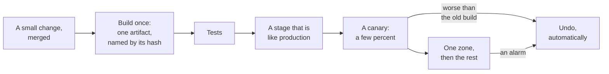

# 9.2 CI/CD and progressive delivery

[Syllabus](../SYLLABUS.md) · Phase 9 · Previous: [9.1 Containers and orchestration](01-containers-and-orchestration.md) · Next: 9.3 Backward compatibility across deploys *(planned)*

> **Time:** about 35 minutes to read, 40 minutes of practice.
> **You need:** the rolling deploy of [Chapter 9.1](01-containers-and-orchestration.md), and the burn-rate page of [Chapter 7.3](../phase-7-observability/03-alerting.md). The example needs only Go, and takes about two seconds.

**By the end of this chapter you can**

- say what a pipeline is for, and why it builds once;
- tell a deploy from a release, and choose between a rolling deploy, blue-green and a canary;
- design a canary: what it is compared with, what is measured, and who decides;
- say what an automatic judge can and cannot see, and what it costs to make it more sensitive;
- use a feature flag to release without deploying, and say what flags cost;
- roll back first, and name the changes that cannot be rolled back.

---

## The problem

*An illustrative scenario; the example reproduces it.* The team of Chapter 9.1 now deploys without dropping a request. On a Tuesday afternoon a change goes out that passed every test. It has a fault that the tests could not have found: for customers with more than a few thousand invoices, one query is slow enough to time out. That is one request in fifty.

The rolling deploy replaces every copy in four minutes. The pager goes at minute five. The engineer on call needs five minutes to see that the errors began with the deploy and to start a rollback, which is another rolling deploy of four minutes. For fourteen minutes, all users were on a build that nobody had watched for even one.

The tests were not at fault. No test suite has production's data, production's traffic, or production's clients. Some faults can only be found there. Three things went wrong.

1. **Everyone got the build before anyone had looked at it.** The first evidence about the new version in production came from all of production.
2. **The only judge was the pager,** which was built to notice trouble with the whole service over five minutes, and not to compare two builds.
3. **Undoing took as long as doing,** and it started with a person.

---

## The concept

### 1. A pipeline builds once, and then only promotes

**Continuous integration** is the habit of merging small changes into one main branch many times a day, with a build and tests on each. **Continuous delivery** is keeping that branch in a state that could go to production at any moment. The machinery that does both is the **pipeline**.



Two rules make a pipeline trustworthy.

- **Build once.** The artifact that was tested is the artifact that is deployed, byte for byte (Chapter 8.6). A build made again for production is a different build that has not been tested.
- **Small changes.** A change of forty lines that breaks production is found in minutes. A release of four thousand is found by reading four thousand lines.

Whether delivery is going well can be measured. The research programme called DORA uses a small set of measures in two groups: how fast changes move, such as "Change lead time: The amount of time it takes for a change to go from committed to version control to deployed in production", and how often they go wrong, such as "Change fail rate: The ratio of deployments that require immediate intervention following a deployment" ([DORA, *Software delivery performance metrics*](https://dora.dev/guides/dora-metrics-four-keys/)). The rest of this chapter is about the second group.

### 2. Deploying is not releasing

To **deploy** is to put a build on servers. To **release** is to send users to it. They can be separated, and every technique here is a way of doing that.

| | How users move to the new build | If it is bad | Costs |
|---|---|---|---|
| **Rolling** | A copy at a time, until all are replaced (Chapter 9.1) | Everyone is on it within minutes. Undoing is another rolling deploy | Nothing extra |
| **Blue-green** | A complete second set of copies is started, and the load balancer is switched to it | Everyone is on it at once. Undoing is one switch back | Twice the capacity, for a while |
| **Canary** | A few percent of traffic goes to the new build, and it is compared with the old | A few percent, for a few minutes | A way to split traffic, and a judge |

Blue-green is the simplest to describe. "The blue-green deployment approach does this by ensuring you have two production environments, as identical as possible", and "Blue-green deployment also gives you a rapid way to rollback - if anything goes wrong you switch the router back to your blue environment" ([Martin Fowler, *BlueGreenDeployment*](https://martinfowler.com/bliki/BlueGreenDeployment.html)). It makes undoing fast. It does nothing about who sees the fault first.

### 3. The canary: a small share, compared

"We define canarying as a partial and time-limited deployment of a change in a service and its evaluation" ([Google, *The Site Reliability Workbook*, chapter 16](https://sre.google/workbook/canarying-releases/)). The two halves of that sentence matter equally. A small share limits the damage: "impact on the budget is directly proportional to the amount of traffic exposed to defects" ([the same chapter](https://sre.google/workbook/canarying-releases/)). The evaluation is what turns a small deploy into information.

**Compare with the old build now, and not with the service yesterday.** The copies that stay on the old build are the **control**. They get the same traffic in the same minutes, so that whatever else is happening happens to both. The alternative is to watch the whole service's graphs before and after, and the workbook is blunt about it: "Because time is one of the biggest sources of change in observed metrics, it is difficult to assess degradation of performance with before/after evaluation" ([the same chapter](https://sre.google/workbook/canarying-releases/)).

**What to measure.** The indicators of Chapter 7.2, split by build: the share of requests that fail, and how long they take. Then anything that the new build could plausibly break: the rate of a business event, memory, the size of a queue.

**Who decides.** A program, on a schedule. People are slow, and they are worst at this at the moment that matters, when the difference is small and the release is theirs.

**What a judge cannot do** is see a difference that the traffic has not yet shown. A fault that affects one request in five hundred needs thousands of requests before it stands out from luck. So every canary has three dials, and they pull against each other:

- **the share of traffic:** more shows a fault sooner, and exposes more users to it;
- **the time:** longer catches smaller and slower faults, and delays every release;
- **the threshold:** a jumpier judge catches more, and stops more good builds.

Part 2 of the example turns each dial.

### 4. Roll back first

When a release looks wrong, undo it, and find out why afterwards (Chapter 7.5). That is only possible if undoing is fast, automatic and safe.

- **Fast:** the old build is still running, or can be started from an artifact that already exists. Nothing is rebuilt.
- **Automatic:** the same alarms that would page a person stop the release and reverse it. A person is told what happened.
- **Safe:** the old build can run against whatever the new build has already written. That is the subject of Chapter 9.3, and it is where rollbacks fail.

Some changes cannot be rolled back at all: a column that was dropped, a message that was sent, an email. For those, the only direction is forward, so they are released in steps, each of which can be undone (Chapter 2.7).

### 5. Feature flags: release without deploying

A **feature flag** is a condition in the code that is decided by configuration: *is the new export on, for this user?* "Feature Toggles (often also refered to as Feature Flags) are a powerful technique, allowing teams to modify system behavior without changing code" ([Pete Hodgson, *Feature Toggles*](https://martinfowler.com/articles/feature-toggles.html)).

With a flag, the code for a feature is deployed switched off, through the whole pipeline, days before anyone uses it. Releasing it is then a change to the flag: for staff first, then for 5% of users, then for all. Turning it off again takes seconds and no deploy, which makes a flag the fastest rollback there is.

Three rules.

- **Decide by the user, and not by the request.** A user who has the feature on one page load and not on the next has a broken product. Hash the user's identifier, as part 3 of the example does.
- **A flag is configuration,** and a change to it is a release. It gets the care of Chapter 9.4: reviewed, staged and watched.
- **Take flags out.** "However toggles do come with a carrying cost. They require you to introduce new abstractions or conditional logic into your code. They also introduce a significant testing burden" ([the same article](https://martinfowler.com/articles/feature-toggles.html)). Each flag doubles the number of ways that the code can run. A release flag should be gone within weeks of reaching 100%.

### 6. In stages, in space as well as in time

A canary limits a fault to a few percent of one place. The same idea continues outwards: one zone before the others, one region before the rest (Chapters 6.5 and 6.6), with time between each step for slow faults to show. The waiting has a name, **bake time**, and it is for the faults that a ten-minute canary cannot see: a slow leak, a job that runs on the hour.

---

## A real example

### Run it: one bad build, released four ways

[`code/ch02-release/main.go`](code/ch02-release/main.go), about 320 lines, is a model, like those of Chapters 7.2 and 7.3. A service takes 200 requests a second on ten copies. One request in a thousand fails. The new build fails one in fifty. Its random numbers come from a fixed seed, so every run prints the same thing.

```bash
go run ./phase-9-shipping/code/ch02-release
```

```text
PART 1 — a build that fails 1 request in 50, where 1 in 1,000 is normal. It passed its tests.

  how it is released                         the most users the page     the release   requests that
                                             on it          fires at     is undone at  the build failed
  a rolling deploy; a person rolls it back   100%           5 min 12 s   14 min 12 s   2,317
  blue-green; a person switches back         100%           3 min 21 s   8 min 21 s    1,912
  blue-green; the alert switches it back     100%           3 min 21 s   3 min 22 s    807
  a canary of 5%; a judge compares the two   5%             never        1 min 00 s    7
```

- **Row 1 is the scenario.** The page is Chapter 7.3's, and it needs 5 minutes and 12 seconds to fire, because for the first four minutes only part of the traffic is on the bad build. The person takes five minutes. The rollback takes four more. 2,317 requests failed that would not have.
- **Row 2 is blue-green.** Everybody is on the bad build from the first second, so the page fires sooner, and the switch back is instant once a person makes it. It is a little better, and for the same reason it is worse in the first minutes.
- **Row 3 lets the alert switch back.** Nothing else changed, and the failures fall from 1,912 to 807. All of the difference is the five minutes of a person.
- **Row 4 is the canary.** One request in twenty goes to the new build. Every thirty seconds a judge compares its failures with those of the old build, over the same seconds:

```go
	n1, n0 := float64(h.newTotal), float64(h.oldTotal)
	p1, p0 := float64(h.newFails)/n1, max(float64(h.oldFails), 1)/n0 // one failure at least, so that no rate is zero
	if p1 <= times*p0 {
		return false
	}
```

It stops the release after 1 minute, with 7 requests failed. Nobody was paged, and 95% of requests never met the build.

**Part 2** asks how good that judge is, by running four hundred releases of four different builds past four different judges.

```text
PART 2 — the judge. A canary takes a share of the traffic for ten minutes, and every 30 seconds a
judge decides whether to stop it. 400 releases of each build: how many are stopped, and the usual time.

  the judge stops a canary that fails…       good: 1 in 1,000 1 in 500         1 in 200         1 in 50
  5% of traffic; 3 times the old rate          2%              32%  in 2:30    100%  in 2:00    100%  in 0:30
  5% of traffic; 1.5 times                    28%              90%  in 4:00    100%  in 2:00    100%  in 0:30
  5% of traffic; 1.5 times, beyond chance      2%              43%  in 4:00    100%  in 2:00    100%  in 0:30
  25% of traffic; 1.5 times, beyond chance     3%              95%  in 3:00    100%  in 0:30    100%  in 0:30
```

Read the first column first. It is the price of each judge: how often it stops a build that had nothing wrong with it.

- **The first judge** is the one from part 1. It is nearly always right about a good build, always catches the scenario's fault, and catches a build that is twice as bad as normal only a third of the time. Ten minutes at 5% is 6,000 requests. At one failure in 500, that is 12 failures where 6 were expected, which is within the range of luck.
- **The second judge** has a lower threshold, and catches that build nine times in ten. It also stops more than a quarter of the good builds. A judge that cries wolf that often will be switched off within a month.
- **The third judge** adds a condition: the gap must be more than chance explains. That is a standard test of two proportions, at three standard errors. The false alarms go back down, and so does its sight.
- **The fourth judge** has the same rule and five times the traffic. Now it sees the small fault 95 times in 100, with few false alarms. The information was never in the threshold. It is in the number of requests.

So the dials of section 3 are real. A small, short canary is a detector of large faults. To catch small ones, a release needs more requests, which means a larger share, a longer wait, or the later stages of section 6.

**Part 3** is a feature flag, opened in steps to ten thousand users.

```text
PART 3 — a feature flag for 10,000 users, opened to 5%, then 25%, then 50%, then closed.

  who is in                              at 5%  at 25%  at 50%   at 0%   had it, and lost it as it grew
  a coin is tossed on every request        448   2,459   4,982       0   1,560
  the user's identifier is hashed          522   2,548   5,012       0   0
```

Both rules let in about the right number at each step. With a coin tossed on each request, 1,560 users who had the feature at one step had lost it at the next. With the user's identifier hashed, nobody did: a user whose hash is below 5 is also below 25.

```go
func in(flag, user string, percent int) bool {
	h := fnv.New32a()
	h.Write([]byte(flag + "/" + user))
	return int(h.Sum32()%100) < percent
}
```

The flag's name is hashed with the user, so that each flag has a different first five percent. Otherwise the same users would be the first to meet every new feature, and every new fault.

### How Amazon releases: one box, one zone, one region, and time between

Amazon has described its own pipelines in detail ([Clare Liguori, *Automating safe, hands-off deployments*, Amazon Builders' Library, 2020](https://aws.amazon.com/builders-library/automating-safe-hands-off-deployments/)). Three of its practices are this chapter's.

**The smallest possible first step.** "The one-box stage in gamma deploys the latest code to the smallest unit of deployment, such as to a single virtual machine or single container, or to a small percentage of AWS Lambda function invocations" ([the same article](https://aws.amazon.com/builders-library/automating-safe-hands-off-deployments/)). It is a canary of one.

**Stages in space.** "The first wave deploys to a Region with a low number of requests to limit the possible impact of the first production deployment of the new change. The wave deploys to only one Availability Zone (or cell) at a time within that Region" ([the same article](https://aws.amazon.com/builders-library/automating-safe-hands-off-deployments/)). Later waves take more regions at once, as confidence grows.

**Automatic rollback, and bake time.** "Using these standard metrics, the deployment system can roll back automatically if there are anomalies in the metrics during a deployment." And between stages the pipeline waits, because "Sometimes a negative impact caused by a deployment is not readily apparent. It's slow burning" ([the same article](https://aws.amazon.com/builders-library/automating-safe-hands-off-deployments/)).

The title's phrase, *hands-off*, is the point. Nobody watches these deployments. The pipeline watches them, with rules that were written when nobody was in a hurry.

---

## Trade-offs

**Speed against exposure.** Every stage and every minute of bake time delays a change, including the one that fixes an incident. Keep a fast path for an urgent fix, and make it the same pipeline with shorter waits, and not a way round it.

**A sensitive judge against a trusted one.** Part 2's second judge catches more and is wrong more. A judge that is often wrong gets overridden, and then catches nothing. Prefer few false alarms, and catch small faults with more traffic and later stages.

**Blue-green against a canary.** Blue-green needs double capacity and no judge, and gives a fast switch back. A canary needs a way to split traffic and a judge, and gives a small exposure. They combine well: bring up the new set, send it 5%, then switch.

**Flags against simple code.** A flag is the best way to release a feature and a lasting cost in the code. Use one for anything risky, and schedule its removal on the day that it is added.

**A canary against low traffic.** A service with two requests a second cannot judge a 5% canary in ten minutes: that is 60 requests. For such a service, make the canary synthetic, with a probe that exercises the new build (Chapter 7.3), and lean on the stages.

**What a canary cannot see at all.** Faults that depend on time, on rare customers, or on the build being everywhere at once, such as a new build that is fine alone and overloads the database at full scale. Bake time, stages and the alerts of Chapter 7.3 are for those.

---

## Practice

### Check yourself

1. A team judges its canaries by looking at the service's error graph for ten minutes before and ten minutes after the deploy. Give two ways in which that misleads, and the fix.
2. A release adds a column, starts writing to it, and stops writing to the old one. Twenty minutes later the canary's judge stops the release and rolls it back. What is the old build looking at now?
3. A flag called `new-export` has been at 100% for six months. What does it cost? What should have happened?

<details>
<summary>Answers</summary>

1. Traffic changes between the two windows: a batch job, lunch, a customer's import. So a healthy build can look bad, and a bad one can be hidden by a quiet ten minutes. And the canary's requests are a twentieth of the graph, so a build that fails one request in ten moves the whole service's error rate by half a point, which is easy to miss. The fix is to split the indicators by build, and compare the canary with the control over the same minutes.
2. Rows written in the last twenty minutes that have the new column filled in and the old one empty. The old build reads the old column, and for those rows it finds nothing. The rollback has turned a fault for 5% of requests into wrong data for everyone. A change to the shape of data has to be made in steps that each work with the build before and the build after: Chapter 9.3.
3. Every change to that code still has two paths to think about and to test, and one of them has not run for six months. Somebody will one day turn the flag off, by mistake or in an incident, and send every user down a path that nobody has maintained. The flag should have been removed, with the old code behind it, within weeks of reaching 100%. A ticket for the removal should have been opened on the day that the flag was added.

</details>

### Exercise: a fault that is twice as bad as normal

1. **Predict, then run.** In part 1 the bad build fails one request in fifty. Change it to one in five hundred: twice the normal rate. Before you run it, say for each row whether the page fires, and when the release is undone.
2. **What finds it?** If the canary's judge misses a build like this, what is the next thing in this course that would notice, and how long would it take?
3. **Design the release** of the invoice service, which takes 200 requests a second at its peak and 20 at night, and runs in three zones. Give the stages, the share and the time for each, what is automatic, and what a person does.

<details>
<summary>Worked solution</summary>

**1.** With the build's failure rate set to 0.002:

```text
PART 1 — a build that fails 1 request in 500, where 1 in 1,000 is normal. It passed its tests.

  how it is released                         the most users the page     the release   requests that
                                             on it          fires at     is undone at  the build failed
  a rolling deploy; a person rolls it back   100%           never        never         461
  blue-green; a person switches back         100%           never        never         468
  blue-green; the alert switches it back     100%           never        never         468
  a canary of 5%; a judge compares the two   5%             never        2 min 30 s    3
```

The page never fires. It waits for failures at more than 14.4 times the rate that the objective allows, and this build fails at twice that rate. The first three rows are never undone, and go on failing an extra request every five seconds for as long as the build is out. The canary's judge did stop this one, in this run. Part 2 says how far to trust that: this judge catches such a build about one time in three.

**2.** The slow-burn rule of Chapter 7.3, which opens a ticket when failures run at more than the allowed rate over days. A build that doubles the failure rate spends the whole month's error budget in half a month, and the ticket arrives after a day or more. That is the right tool: a small fault is not an emergency. But a ticket that says *the error rate doubled three days ago* is much harder to act on than a canary that says *this build is worse*, so it is worth giving the release a stage that can see it: more traffic, for longer.

**3.**

| Stage | Share | For | Passes when | Otherwise |
|---|---|---|---|---|
| A stage like production | — | Until the tests pass | Tests, and a short load test | The pipeline stops |
| Canary | 5% of traffic | 10 minutes | Failures and latency are no worse than the control's, beyond chance | Automatic rollback. A message to the team |
| The first zone | A third of traffic | 30 minutes | The same comparison, now on twenty times as many requests, and no alarm | Automatic rollback |
| The other two zones | Everything | An hour of bake time before the next release may start | No alarm | Automatic rollback, and a page |

The canary at 5% of 200 requests a second sees 6,000 requests in ten minutes, which is enough for large faults only. The first zone sees 120,000 in half an hour, which is enough for a fault of one in five hundred. At night, with 20 requests a second, the canary sees 600 requests, so releases that are not urgent wait for the morning.

Features that change what users see go out behind a flag, switched off, and are released separately: staff, then 5%, 25% and 100% of users, a day apart.

A person does two things. They merge the change. And they read the message when a release was stopped.

</details>

---

## Production tips and common mistakes

- **Build once.** Promote the same artifact through every stage.
- **Keep changes small,** and release often. A release that is rare is large.
- **Split every indicator by build,** so that a canary can be compared with its control.
- **Let a program judge the canary,** and let the alarms undo the release.
- **Tune the judge for few false alarms.** Catch small faults with more requests.
- **Wait between stages.** Give slow faults time to show.
- **Go one zone, and one region, at a time.**
- **Practise the rollback.** One that has never been run will not work on the day.
- **Release features with flags,** by user and not by request, and remove each flag when it is done.
- **Make the urgent path the same pipeline.**
- **Do not release on a quiet night** and call the canary passed.

Common mistakes:

- **A rolling deploy with nobody watching.**
- **A canary that is compared with yesterday.**
- **A canary that a person judges by eye.**
- **A judge that is overridden every week.**
- **Blue-green taken for a canary.**
- **A rollback that rebuilds.**
- **A rollback of code after the data has changed shape.**
- **A flag decided by a coin on each request.**
- **Flags that are never removed.**
- **A second, faster pipeline for emergencies.**

---

## Key takeaways

- Tests cannot find every fault, because they do not have production's data and traffic. The first evidence about a build in production should come from a small part of production.
- Deploying puts a build on servers, and releasing sends users to it. A rolling deploy does both at once, blue-green makes undoing fast, and a canary makes the first exposure small.
- A canary is compared with the old build over the same minutes, by a program. What it can see is limited by how many requests it gets.
- Undo first, automatically, and investigate afterwards. Know which changes cannot be undone.
- A feature flag releases without a deploy and is the fastest rollback. It is decided for each user, it is a release in its own right, and it should be removed.

**Next:** 9.3 Backward compatibility across deploys *(planned)* — every technique in this chapter runs two versions of the code at once. That is safe only if each can live with what the other writes.

---

## Sources

- DORA, [*DORA's software delivery performance metrics*](https://dora.dev/guides/dora-metrics-four-keys/).
- Martin Fowler, [*BlueGreenDeployment*](https://martinfowler.com/bliki/BlueGreenDeployment.html).
- Google, [*The Site Reliability Workbook*, chapter 16, *Canarying Releases*](https://sre.google/workbook/canarying-releases/).
- Pete Hodgson, [*Feature Toggles (aka Feature Flags)*](https://martinfowler.com/articles/feature-toggles.html).
- Clare Liguori, [*Automating safe, hands-off deployments*](https://aws.amazon.com/builders-library/automating-safe-hands-off-deployments/), Amazon Builders' Library, 2020.
