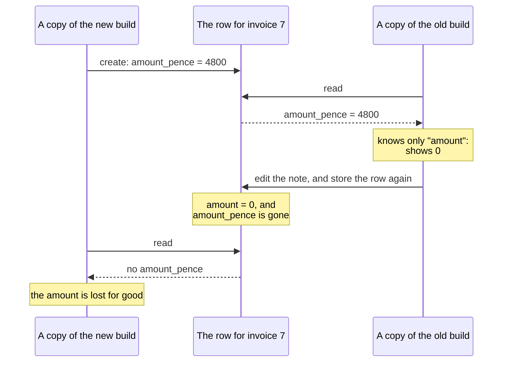

# 9.3 Backward compatibility across deploys

[Syllabus](../SYLLABUS.md) · Phase 9 · Previous: [9.2 CI/CD and progressive delivery](02-cicd-and-progressive-delivery.md) · Next: [9.4 Configuration and infrastructure as code](04-configuration-and-infrastructure.md)

> **Time:** about 30 minutes to read, 40 minutes of practice.
> **You need:** the rolling deploy of [Chapter 9.1](01-containers-and-orchestration.md), rollback from [Chapter 9.2](02-cicd-and-progressive-delivery.md), and the schema changes of [Chapter 2.7](../phase-2-data/07-schema-changes.md). The example needs only Go, and runs at once.

**By the end of this chapter you can**

- say why two versions of your code are always running, and name everything that they share;
- tell backward compatibility from forward compatibility, and say which a rollout needs;
- sort a change to a format into safe and unsafe, for a field, a value and a type;
- make an incompatible change in three deploys, each of which can be rolled back;
- choose the order: readers before writers;
- change an API whose callers you cannot redeploy.

---

## The problem

*An illustrative scenario; the example reproduces it.* Invoices store their amount as `amount`, a number of pounds with a decimal point. That was a mistake (money should be whole pence), and an engineer fixes it properly: the new build stores `amount_pence`, reads `amount_pence`, and has a migration that converts the old rows. It is tested. It goes out on a Thursday, through the canary of Chapter 9.2, which sees nothing wrong in ten minutes at five percent.

The rolling deploy takes four minutes. During them, some invoices show an amount of zero, and some requests fail. Nobody is sure why, the errors are rising, and the release is rolled back.

That makes it worse. Every invoice that the new build created now has an amount that the old build cannot see. And a few hundred invoices have no amount at all, in either field, and never will again.

The build was correct. The old build was correct. Three things went wrong, and all of them are in the minutes when both were running.

1. **The old build read rows that the new build wrote,** and found no `amount` in them.
2. **The new build read rows that the old build wrote,** and found no `amount_pence`.
3. **Each build edited rows that the other had written.** It read the row into the fields it knew, changed a note, and stored the row again without the field it did not know. That is how amounts were destroyed.

The tests ran one version at a time. Production never does.

---

## The concept

### 1. Two versions are always running

There is no moment at which a system changes version. There are minutes, at least, in which the old code and the new code serve side by side, and they are not rare:

- **every deploy**, for as long as it takes (Chapter 9.1);
- **every canary**, deliberately, for longer (Chapter 9.2);
- **every rollback**, which is a second deploy in the other direction;
- **every client that you do not deploy**: a mobile app that was installed last year, a customer's script, another team's service.

What the versions share is anything that one of them writes and the other reads:

| Shared thing | Lives for |
|---|---|
| A row in the database | Years |
| A message on a queue, an event in a log (Phase 4) | Seconds, or for ever |
| An entry in a cache, a session (Phase 3) | Minutes or days |
| A request or a response between two services | Milliseconds, but the two services deploy at different times |
| A file, a backup (Chapter 2.9) | Years |



**Data outlives code.** A deploy replaces the code in minutes. The rows, the messages and the cached entries that the old code wrote are still there, and for a while the old code is too.

### 2. Two directions

The two directions have names, and a rollout needs both.

- **Backward compatible:** new code can read what old code wrote. In the words of a schema registry's documentation: "BACKWARD compatibility means that consumers using the new schema can read data produced with the last schema" ([Confluent documentation, *Schema Evolution and Compatibility*](https://docs.confluent.io/platform/current/schema-registry/fundamentals/schema-evolution.html)).
- **Forward compatible:** old code can read what new code writes. "FORWARD compatibility means that data produced with a new schema can be read by consumers using the last schema, even though they may not be able to use the full capabilities of the new schema" ([the same page](https://docs.confluent.io/platform/current/schema-registry/fundamentals/schema-evolution.html)).

Engineers think of the first. It is the second that fails in a rollout, because it asks something of code that was written before the change existed. The old build cannot be made to understand `amount_pence` after the fact. All that can be arranged is that it was never shown a row which it could not read.

### 3. What old code does with what it does not know

When old code meets a field or a value that it has never heard of, it does one of three things, and which one is decided by how it was written long before.

| It | For example | During a rollout |
|---|---|---|
| **Ignores it, and keeps it** | A format that carries unknown fields through | Safe |
| **Fails** | A `switch` over statuses, with no case for a new one | Errors, for as long as both run |
| **Ignores it, and loses it** | Reads the row into its own fields, and stores it again | Silent destruction |

The third is the worst and the least known. Protocol Buffers were designed to avoid it: "Unknown fields are well-formed Protobuf serialized data representing fields that the parser does not recognize. For example, when an old binary parses data sent by a new binary with new fields, those new fields become unknown fields in the old binary", and they are kept: "Proto3 messages preserve unknown fields and include them during parsing and in the serialized output" ([Protocol Buffers documentation](https://protobuf.dev/programming-guides/proto3/)). JSON that is read into a struct or a class, and written out again, does not keep them. Most web services work that way.

### 4. Safe changes, and unsafe ones

| The change | Old code, new data | New code, old data | So |
|---|---|---|---|
| Add an optional field, with a default | Ignores it | Uses the default | **Safe**, if old code does not rewrite rows and lose it |
| Add a required field | Does not send it | Rejects old data | **Never** |
| Remove a field | Still expects it | — | Only after every reader has stopped reading it |
| Rename a field | Sees it vanish | Sees it missing | **Never in one step.** It is an add and a remove |
| Change a field's type or its meaning | Misreads it | Misreads it | **Never.** Add a new field |
| Add a value to an enumeration | Fails, or guesses | — | Readers must tolerate unknown values first |

Google's rules for its own APIs say the same things in the same words. "New required fields must not be added to existing request messages or resources", and "Existing components (interfaces, methods, messages, fields, enums, or enum values) must not be removed from existing APIs in the same major version" ([Google AIP-180, *Backwards compatibility*](https://google.aip.dev/180)). A rename, it notes, is a removal and an addition.

Where fields are known by number, as in Protocol Buffers, a number is never used twice: "you must reserve the deleted field number. If you do not reserve the field number, it is possible for a developer to reuse that number in the future" ([Protocol Buffers documentation](https://protobuf.dev/programming-guides/proto3/)). Old data would then be read as the new field.

### 5. Expand, migrate, contract

An incompatible change is made as a sequence of compatible ones. "Parallel change, also known as expand and contract, is a pattern to implement backward-incompatible changes to an interface in a safe manner, by breaking the change into three distinct phases: expand, migrate, and contract" ([Danilo Sato, *ParallelChange*](https://martinfowler.com/bliki/ParallelChange.html)). Chapter 2.7 used it for a database column. It applies to anything that two versions share.

For the rename:

| Step | The build | It reads | It writes | Safe beside |
|---|---|---|---|---|
| 0 | Old | `amount` | `amount` | — |
| 1. **Expand** | A build that knows both | Either, preferring the new | **Both** | The old build, which still finds `amount` everywhere |
| 2. **Migrate** | No deploy: a job | — | Fills in `amount_pence` on old rows | Both |
| 3. **Contract** | New | `amount_pence` | `amount_pence` | The expand build, which finds `amount_pence` everywhere |

Then, when nothing reads `amount`, it is removed from the rows.

Two rules come out of the table.

- **Each deploy must be safe beside the one before it and the one after it.** That is what makes every step possible to roll back, which the one-step change was not.
- **Readers first, writers second.** Nothing may write a new field, value or format until everything that reads it can cope. For messages: "there is no assurance that consumers using older schemas can read data produced using the new schema. Therefore, upgrade all consumers before you start producing new events" ([Confluent documentation](https://docs.confluent.io/platform/current/schema-registry/fundamentals/schema-evolution.html)).

It is three deploys where one would have done, and a week where an afternoon would have done. That is the price, and section 7 says when it need not be paid.

### 6. Callers that you cannot deploy

Inside one team, *the old version* lasts minutes. For a public API it lasts years: a customer's integration is a copy of the old reader that you will never be able to upgrade (Chapter 1.4).

- **Add, and do not change.** New fields, new endpoints, new optional parameters. Clients should ignore what they do not know, and yours should say so in its documentation.
- **When a change must break something, version it,** and keep the old behaviour for callers who have not moved. Stripe's way is described below.
- **Know who still uses the old form,** by counting calls for each version and each field (Chapter 7.1). Removal is a decision made from that count, with notice. There is a standard header for the notice: it "indicates that a URI is likely to become unresponsive at a specified point in the future" ([RFC 8594, *The Sunset HTTP Header Field*](https://www.rfc-editor.org/rfc/rfc8594.html)).

### 7. Checking it

- **A compatibility check in the pipeline.** For messages with declared schemas, a registry can refuse a schema that old readers could not read. For an API, a test can compare the new description of the API with the old.
- **Tests that mix versions.** Run the new build's readers on data that the old build wrote, and the old build's readers on data from the new. The second half is the one that is forgotten.
- **A first stage that runs beside the old build.** Amazon's pipelines do this on purpose: "we need to detect whether the latest code writes data in a format that the current code can't parse" ([Clare Liguori, Amazon Builders' Library](https://aws.amazon.com/builders-library/automating-safe-hands-off-deployments/)). The scenario's canary did not catch the fault only because nobody looked at the old build's errors.

---

## A real example

### Run it: one rename, in one deploy and in three

[`code/ch03-compat/main.go`](code/ch03-compat/main.go), about 320 lines, has three builds of an invoice service, which store each invoice as a JSON document. Ten copies are replaced one at a time. At each of the ten steps there are a thousand requests, and each is served by whichever copy it reaches. The random numbers are seeded, so every run prints the same thing.

```bash
go run ./phase-9-shipping/code/ch03-compat
```

```text
PART 1 — "amount", in pounds, becomes "amount_pence". Ten copies are replaced one at a time, with
1,000 requests at each step: 4 in 10 create an invoice, 5 in 10 read one, 1 in 10 edits a note.

  the change                                       reads with the  amounts lost    after turning back
                                                     wrong amount      for good  half-way: unreadable
  in one deploy: old build to new build                     2,439           450                   755
  in three steps: 1  expand: old to expand build                0             0                     0
                  2  migrate: fill 3,434 old rows               —             0                     —
                  3  contract: expand to new build              0             0                     0
```

**The first row is the scenario.** In a rollout of ten thousand requests, 2,439 reads returned the wrong amount or none. 450 invoices lost their amount for good. And when the release is turned back with half the copies replaced, 755 invoices are left that the old build cannot read.

The destruction is in three lines of the old build, which look harmless:

```go
		var r rowOld
		json.Unmarshal(row, &r) // a field that this build does not know is dropped here…
		r.Note = note
		return encode(r) // …and so is not in what it stores
```

**The other rows are the same change in three steps.** The build in the middle knows both fields:

```go
// The build in between knows both. Pointers tell a field that is absent from one that is zero.
type rowBoth struct {
	Amount      *float64 `json:"amount,omitempty"`
	AmountPence *int     `json:"amount_pence,omitempty"`
	Note        string   `json:"note"`
}
```

It reads either, and it writes both, so the old build beside it always finds an `amount`. Then a job fills in the 3,434 rows that still lack the new field. Only then does the last build go out, and by then every row has `amount_pence`. Every number in those rows is zero, including the last column: at each step, the release can be turned back.

**Part 2** is a new value in an old field.

```text
PART 2 — a third status, "refunded", is added to a field that had two. One new invoice in ten is
refunded. The old build's reader has a case for each status that it knows, and fails on any other.

  the order of the deploys                                   reads that failed during the rollouts
  one deploy: the build that writes the new status           50
  two deploys: a tolerant reader first, then the writer      0
```

The old reader was written when there were two statuses, and fails on a third:

```go
func strict(status string) error {
	switch status {
	case "open", "paid":
		return nil
	}
	return fmt.Errorf("unknown status %q", status)
}
```

Deployed in one step, the build that writes `refunded` runs beside copies that cannot read it. In two steps, a build goes out first that reads the new status and never writes it. When the writer follows, there is nothing left that it can surprise. Readers first.

### How Stripe keeps old callers working: a version for each account

Stripe's API is called by code that Stripe cannot change, and some of that code is as old as the company. "To date, we've maintained compatibility with every version of our API since the company's inception in 2011" ([Brandur Leach, *APIs as infrastructure: future-proofing Stripe with versioning*, Stripe, 2017](https://stripe.com/blog/api-versioning)).

**Versions are dates, and an account is pinned to one.** "At Stripe, we implement versioning with rolling versions that are named with the date they're released (for example, 2017-05-24)", and "The first time a user makes an API request, their account is automatically pinned to the most recent version available, and from then on, every API call they make is assigned that version implicitly" ([the same article](https://stripe.com/blog/api-versioning)). No later change reaches an integration that has not asked for it.

**The core of the code knows only the newest version.** Each change that breaks compatibility is written once more, as a small module that turns a new response back into the older shape. A request from an old account has its response passed backwards through those modules until it looks as that account expects. "Version change modules keep older API versions abstracted out of core code paths" ([the same article](https://stripe.com/blog/api-versioning)). It is the expand step, kept for ever, in one place.

**And it is not free.** "Providing extensive backwards compatibility isn't free; every new version is more code to understand and maintain" ([the same article](https://stripe.com/blog/api-versioning)). So the first rule is still the cheapest: add, and do not change.

---

## Trade-offs

**Three deploys against one.** Expand, migrate and contract take longer, need more code for a while, and leave a field behind that somebody must remember to remove. They are for data that matters and services that cannot stop. A change to a cache that can be emptied does not need them.

**Stopping the service against all of this.** With one version running at a time, none of this chapter applies. A short maintenance window is a legitimate choice for a system whose users can bear one, and a much cheaper one.

**Tolerant readers against strict ones.** A reader that ignores what it does not know lets writers move first, and also lets mistakes through: a misspelt field is silently ignored. Be tolerant of *unknown* things from newer versions, and strict about what is *known* and wrong (Chapter 8.5).

**Keeping old versions against a clean codebase.** Every supported version is code and tests. Decide how long each lasts, publish it, measure who is left, and remove it on the date.

**A schema for everything against moving fast.** Declared schemas with compatibility checks catch these faults before production. They are also a registry to run and a step in every change. They pay for themselves where several teams share a format.

---

## Practice

### Check yourself

1. A change adds an optional field, `currency`, with a default of `GBP`. The reviewers agree that adding an optional field is safe. During the rollout, some invoices in euros turn into pounds. How?
2. A producer starts to send a new event type on a queue that three services consume. One of them crashes on every such message and, by Chapter 4.6, retries it for ever. Which rule was broken, and what would the sequence have been?
3. A mobile app, last updated a year ago, reads a list of invoices. You want to rename a field in the response. What are your options, and what would you measure before choosing?

<details>
<summary>Answers</summary>

1. The new build writes `currency: EUR`. A copy of the old build edits that invoice: it reads the row into a type with no `currency`, and stores it again without one. The new build then reads the row, finds no currency, and applies the default. Adding the field was safe for reading. It was not safe beside old code that rewrites whole rows. Either the old build must keep fields that it does not know, or old code must stop writing before new code starts.
2. Readers first. The consumers were not able to read the new event when it began to arrive. The sequence: deploy all three consumers with code that handles the new type, or ignores it on purpose; confirm that they are out; then deploy the producer. A compatibility check on the schema, in the producer's pipeline, would have refused the change until then.
3. You cannot rename it for that app. Add the new field and keep sending the old one, for as long as that version of the app is in use. Or put the change in a new version of the API, and keep the old version for old apps. Measure which versions of the app still call the endpoint, and how many users they are. The old field can go when that number is one that the business accepts, and not before.

</details>

### Exercise: skip a step, and then plan one

1. **Predict, then run.** In the program, remove the migration, so that step 3 follows step 1 directly. Which columns of the last row change, and why?
2. **Plan a change to an event.** The `invoice.paid` event has a field `amount`, in pounds. Three services consume it: billing, reporting, and a partner's integration that you do not deploy. Write the sequence of changes that gets every consumer onto `amount_pence`, and say when `amount` can be removed.

<details>
<summary>Worked solution</summary>

**1.** With `migrate` skipped:

```text
  the change                                       reads with the  amounts lost    after turning back
                                                     wrong amount      for good  half-way: unreadable
  in one deploy: old build to new build                     2,439           450                   755
  in three steps: 1  expand: old to expand build                0             0                     0
                  2  migrate: fill 0 old rows                   —             0                     —
                  3  contract: expand to new build          1,129           189                    68
```

The last row is no longer zero. The expand build had been writing both fields, so new invoices were fine. But the invoices that the old build created were never filled in, and the new build reads only `amount_pence`. It returns nothing for those, and when it edits one, it stores the row without `amount`, which destroys the only copy. The contract step is safe only once *every* row has the new field, and that has to be checked by a query, and not assumed because a job ran.

**2.** Readers first, and the partner decides the length of the last step.

| # | Change | Who | Safe because |
|---|---|---|---|
| 1 | The schema gains `amount_pence`, optional. The registry checks that old consumers can still read it | Producer's team | Nothing sends it yet |
| 2 | Billing and reporting read `amount_pence` if it is there, and `amount` if not | Each consumer | They still work with today's events |
| 3 | The producer sends **both** fields | Producer | Every consumer can read at least one |
| 4 | The partner is told, with a date. The events that they receive are counted, and so are their calls to the documentation for the old field | Producer | Nothing changes for them yet |
| 5 | Billing and reporting stop reading `amount` | Each consumer | `amount_pence` has been in every event since step 3. Events from before step 3 have been consumed, or are older than the queue keeps |
| 6 | The producer stops sending `amount` | Producer | Only once the partner has confirmed, or the date has passed and somebody has decided |

Step 5 has a condition that is easy to miss: an event log keeps old events (Chapter 4.4). A consumer that replays last month's events will meet ones without `amount_pence`, for as long as the log keeps them. Either the consumer goes on reading both for that long, or the old events are rewritten.

Step 6 may never come. If the partner cannot change, sending both fields for ever costs a few bytes for each event, and that may be the right answer.

</details>

---

## Production tips and common mistakes

- **Assume that two versions are running,** in every review of a change to a stored or transmitted format.
- **Ask the forward question:** what does the build that is in production now do with what this build writes?
- **Never rename, retype or reuse.** Add a new field, move, and remove the old one later.
- **Deploy readers before writers,** for a field, a value, an event or a format.
- **Make each deploy safe beside its neighbours,** and so safe to roll back.
- **Check that a migration finished,** with a query, before the step that relies on it.
- **Do not rewrite whole rows from a type that knows only some of the fields.** Update the fields that changed.
- **Give readers a default case** for values that they do not know.
- **Put a version in cache keys,** so that a new build does not read an old build's entries.
- **Test with mixed versions** in the pipeline, in both directions.
- **Count the use of everything that you mean to remove.**

Common mistakes:

- **A change that is correct before the deploy and after it, and wrong during it.**
- **A rename in one step.**
- **A rollback after the new build has written.**
- **A new enum value sent to readers with no default case.**
- **A new required field.**
- **A consumer deployed after its producer.**
- **A contract step taken on the word of a migration job.**
- **Old events in a log, forgotten.**
- **A public API changed because *nobody uses that*.**

---

## Key takeaways

- Two versions of the code are always running: during a deploy, a canary and a rollback, and for as long as old clients exist. They share every row, message and cached entry.
- New code must read old data, and old code must survive new data. The second is the one that fails, because the old code is already written.
- Old code that reads a row into the fields it knows and stores it again destroys what it did not know.
- Make an incompatible change as expand, migrate, contract: three steps that are each safe beside their neighbours, and each possible to roll back.
- Readers first, then writers.
- For callers that you cannot deploy, add and do not change, version what must break, and measure before removing.

**Next:** [9.4 Configuration and infrastructure as code](04-configuration-and-infrastructure.md) — code now changes safely. The other half of what runs in production is not code, and it is usually changed with far less care.

---

## Sources

- Confluent documentation, [*Schema Evolution and Compatibility*](https://docs.confluent.io/platform/current/schema-registry/fundamentals/schema-evolution.html).
- Protocol Buffers documentation, [*Language Guide (proto 3)*](https://protobuf.dev/programming-guides/proto3/).
- Google, [*AIP-180: Backwards compatibility*](https://google.aip.dev/180).
- Danilo Sato, [*ParallelChange*](https://martinfowler.com/bliki/ParallelChange.html), 2014.
- IETF, [RFC 8594, *The Sunset HTTP Header Field*](https://www.rfc-editor.org/rfc/rfc8594.html).
- Brandur Leach, [*APIs as infrastructure: future-proofing Stripe with versioning*](https://stripe.com/blog/api-versioning), Stripe, 2017.
- Clare Liguori, [*Automating safe, hands-off deployments*](https://aws.amazon.com/builders-library/automating-safe-hands-off-deployments/), Amazon Builders' Library, 2020.
