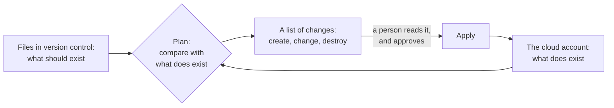

# 9.4 Configuration and infrastructure as code

[Syllabus](../SYLLABUS.md) · Phase 9 · Previous: [9.3 Backward compatibility across deploys](03-backward-compatibility.md) · Next: [9.5 Service architecture](05-service-architecture.md)

> **Time:** about 30 minutes to read, 40 minutes of practice.
> **You need:** the staged release of [Chapter 9.2](02-cicd-and-progressive-delivery.md), and the question *what changed?* from [Chapter 7.5](../phase-7-observability/05-debugging-production.md). The example needs only Go, and runs at once.

**By the end of this chapter you can**

- say what configuration is, and why a change to it is more dangerous than a change to code;
- name three kinds of mistake in a configuration, and the defence that catches each;
- write a loader that checks a new configuration and keeps the last good one;
- deliver configuration in stages, as code is delivered;
- describe infrastructure in files, read a plan before applying it, and say what drift is;
- put a limit on how much one command may do.

---

## The problem

*An illustrative scenario; the example reproduces it.* The invoice service has a limit on the requests that each server accepts in a second. It is a number in a file. One afternoon it is to be raised from 500 to 600, for a customer's month-end. The engineer types `5` where `600` was meant, the tool that delivers configuration sends the file to all sixty servers, and each begins, within seconds, to refuse 95 requests in every hundred.

Nothing was deployed. The pipeline of Chapter 9.2, with its canary, its judge and its stages, was not involved, because *it was only a configuration change*. The page fires within seconds, and the engineer on call spends five minutes looking for a deploy that did not happen.

This is how large outages usually begin. Google's SRE organisation "has found that roughly 70% of outages are due to changes in a live system" ([*Site Reliability Engineering*, Introduction](https://sre.google/sre-book/introduction/)), and many of the best known were changes to configuration or commands typed by hand.

- **Cloudflare, 2019.** A new firewall rule held a regular expression that used all the CPU it was given, on every server at once. The rule was not at fault alone: "The SOP allowed a non-emergency rule change to go globally into production without a staged rollout" ([John Graham-Cumming, Cloudflare, 2019](https://blog.cloudflare.com/details-of-the-cloudflare-outage-on-july-2-2019/)). Code at Cloudflare went out in stages. Rules did not.
- **Amazon S3, 2017.** "Unfortunately, one of the inputs to the command was entered incorrectly and a larger set of servers was removed than intended" ([AWS, *Summary of the Amazon S3 Service Disruption*](https://aws.amazon.com/message/41926/)).
- **Facebook, 2021.** "a command was issued with the intention to assess the availability of global backbone capacity, which unintentionally took down all the connections in our backbone network", and "a bug in that audit tool prevented it from properly stopping the command" ([Santosh Janardhan, Meta, 2021](https://engineering.fb.com/2021/10/05/networking-traffic/outage-details/)).

Three things went wrong in the scenario.

1. **A change went everywhere at once,** by a path that had none of the pipeline's stages.
2. **Nothing checked the value.** The file was well formed, and the number was a number.
3. **Nothing limited what one change could do.** A single edit could take the limit down by a hundred times.

---

## The concept

### 1. Configuration is code that skips the pipeline

**Configuration** is everything that changes what a running system does without a new build: limits, timeouts, addresses, feature flags (Chapter 9.2), routing and firewall rules, and the description of the infrastructure itself.

It exists for a good reason: it can be changed quickly, and differs between environments. "Config varies substantially across deploys, code does not" ([*The Twelve-Factor App*](https://12factor.net/config)). The speed is the danger. Compare the two paths.

| | A change to code | A change to configuration, often |
|---|---|---|
| Reviewed | Yes | By whoever typed it |
| Tested | By the pipeline | Not at all |
| Released | In stages, with a judge | Everywhere, at once |
| Takes effect | Over minutes | In seconds |
| Rolled back | By a tested path | By typing the old value from memory |
| Shows in *what changed?* | The deploy log | Often nowhere |

The fix is in the chapter's title: **treat it as code.** Keep it in version control. Review it. Check it by machine. Deliver it through stages. Record every change where the person on call will look.

### 2. Three kinds of mistake, three defences

| The mistake | For example | What catches it |
|---|---|---|
| **It cannot be read** | A missing comma. A tab in the wrong place | A parser, before it leaves the author's machine, and again when it is loaded |
| **It can be read and is impossible** | A timeout of 8 ms. A negative limit. An address that does not exist | Checks on type, range and relation, written for each setting |
| **It is possible, and wrong** | A limit of 5 where 600 was meant | Nothing that looks only at the file. It has to be tried, on a small part of the system |

Most teams have the first defence. The second is cheap and catches a great deal. The third is the one that matters most, because the worst mistakes are plausible values.

### 3. A loader that checks, and keeps the last good configuration

Whatever delivers the file, the process that loads it is the last line. A careful loader does four things.

1. **Parse into a new value,** and not over the configuration in use.
2. **Check everything:** that it parsed, that each value is in range, and that the values make sense together.
3. **Swap it in at once, whole,** so that no request sees half of a change.
4. **If anything fails, keep the old configuration, and say so loudly.** A process that starts refusing requests, or exits, because of a bad file has turned a typing error into an outage. The one exception is at start-up, when there is no old configuration: then refuse to start, and let the orchestrator keep the old copy running (Chapter 9.1).

### 4. Deliver it in stages

A value that passes every check can still be wrong, and the only test is production. So configuration goes out as a build does in Chapter 9.2: to one server, then to one zone, then to the rest, with a comparison at each step and an automatic way back.

This raises a fair objection. Some configuration exists to be changed fast: a switch that turns off a failing feature in the middle of an incident. Keep that fast path, and keep it small:

- a short list of switches, each of which was tested in both positions before it was needed;
- a value that can only be one of a few known things, and not free text;
- everything else through the stages, including changes that *feel* urgent.

### 5. Limit what one change can do

AWS's response to the 2017 incident was not to tell engineers to type more carefully. "We have modified this tool to remove capacity more slowly and added safeguards to prevent capacity from being removed when it will take any subsystem below its minimum required capacity level" ([AWS, *Summary of the Amazon S3 Service Disruption*](https://aws.amazon.com/message/41926/)).

That is a general rule for tools and for configuration: a single action has a ceiling.

- A limit cannot change by more than some factor in one step.
- A command cannot remove more than some share of the servers.
- A rule cannot apply to all regions in one change.

The ceiling can be raised by a person, on purpose, with a second person's agreement. It cannot be passed by a slip of the finger. The exercise finds the trap in this rule.

### 6. Infrastructure as code

The servers, networks, databases and permissions that a system runs on are configuration too, and the largest kind. Made by hand in a web console, they cannot be reviewed, repeated or explained afterwards. **Infrastructure as code** declares them in files: a tool such as Terraform "lets you define both cloud and on-prem resources in human-readable configuration files that you can version, reuse, and share" ([Terraform documentation](https://developer.hashicorp.com/terraform/intro)).

The idea is Chapter 9.1's, one level down: declare what should exist, and let a tool make it so.



- **The plan is the review.** "The terraform plan command creates an execution plan, which lets you preview the changes that Terraform plans to make to your infrastructure" ([Terraform documentation, *plan*](https://developer.hashicorp.com/terraform/cli/commands/plan)). The change to the file may be one line. What it will do is in the plan, and that is what the reviewer reads.
- **Drift** is the difference between the files and the world, made by hand: a server resized in an incident, a port opened *for a minute*. The next plan shows it, and the next apply removes it. So a change made by hand is put into the files, or it will be undone.
- **Some things must never be destroyed by accident.** A tool that makes the world equal to the files will delete a database whose name was changed in the file. Mark such things: "When prevent_destroy is set to true, Terraform rejects plans that would destroy the infrastructure object associated with the resource and returns an error" ([Terraform documentation, *lifecycle*](https://developer.hashicorp.com/terraform/language/meta-arguments/lifecycle)).
- **Environments from the same files.** Staging and production are the same description with different inputs, so that what was tested is what is made (Chapter 9.2's *build once*).

---

## A real example

### Run it: three mistakes, three ways to deliver them

[`code/ch04-config/main.go`](code/ch04-config/main.go) is about 270 lines. Part 1 is a model of sixty servers round a real loader. Part 2 is a small version of plan and apply. Nothing in it is random.

```bash
go run ./phase-9-shipping/code/ch04-config
```

```text
PART 1 — a change to a configuration file, for 60 servers that take 3,600,000 requests in ten minutes.

  The mistake: a comma is missing.   {"rate_limit_per_second": 500 "timeout_ms": 800}
    A  everywhere at once, and used as given      1,830,000 failed   50.8%  a person, after 5 min
    B  everywhere at once, and checked first              0 failed    0.0%  every server refused it
    C  one server, one region, then all; checked          0 failed    0.0%  the first server refused it

  The mistake: a timeout of 8 ms, for 800.   {"rate_limit_per_second": 500, "timeout_ms": 8}
    A  everywhere at once, and used as given      1,830,000 failed   50.8%  a person, after 5 min
    B  everywhere at once, and checked first              0 failed    0.0%  every server refused it
    C  one server, one region, then all; checked          0 failed    0.0%  the first server refused it

  The mistake: a limit of 5 a second, for 500.   {"rate_limit_per_second": 5, "timeout_ms": 800}
    A  everywhere at once, and used as given      1,738,500 failed   48.3%  a person, after 5 min
    B  everywhere at once, and checked first      1,738,500 failed   48.3%  a person, after 5 min
    C  one server, one region, then all; checked      5,700 failed    0.2%  stopped at one server
```

**Design A is the scenario's.** Each server parses the file and uses whatever comes out. For the first mistake, what comes out is a configuration full of zeros. All three mistakes take down every server, until a person puts the old file back.

**Design B adds the loader of section 3.**

```go
func (s *server) loadChecking(file string) error {
	var c config
	if err := json.Unmarshal([]byte(file), &c); err != nil {
		return fmt.Errorf("not applied: %w", err)
	}
	if c.RateLimit < 1 || c.RateLimit > 100000 {
		return errors.New("not applied: rate_limit_per_second must be between 1 and 100,000")
	}
	if c.TimeoutMS < 50 || c.TimeoutMS > 30000 {
		return errors.New("not applied: timeout_ms must be between 50 and 30,000")
	}
	s.current.Store(&c)
	return nil
}
```

The first two mistakes are refused by every server, and no request fails. The third passes. Five is between 1 and 100,000.

**Design C adds the stages.** The file goes to one server. A minute later that server is compared with its neighbours, as a canary is, and the change is taken back. 5,700 requests failed, on one server in sixty, and the other fifty-nine never saw the file.

Each design catches what the one before it could not. None of them is a substitute for the others: B without C lets the plausible mistake through, and C without B would have sent a file that cannot be parsed to one server, which is better than sixty and worse than none.

**Part 2** declares four resources, and shows four plans.

```text
PART 2 — infrastructure that is declared in a file. The tool compares the file with what exists.

  The plan, in an empty account:
    + create   database  invoices-db    size=large, backups=daily
    + create   server    web-1          size=medium
    + create   server    web-2          size=medium
    + create   balancer  web-lb         port=443

  The plan, after it has been applied:
    no changes: what exists is what is declared

  The plan, after two changes made by hand in the console:
    - destroy  server    debug-box
    ~ change   server    web-2          size=large  →  size=medium

  The plan, after the database is renamed in the file:
    + create   database  invoices       size=large, backups=daily
    - destroy  database  invoices-db
    refused: this plan would destroy database invoices-db, which is protected
```

- **The second plan is empty.** Applying twice does nothing the second time. That is what makes it safe to run again after a failure.
- **The third plan is drift.** Somebody resized a server by hand and left a debugging machine with a port open to the world. Neither is in the files, so the plan proposes to undo both. It is also the first time that anyone else has heard of them.
- **The fourth plan is a one-line tidy-up.** The database was given a better name in the file. To a tool that compares names, that is one database to destroy and one, empty, to create. The plan says so plainly, for anyone who reads it, and the protection refuses it for anyone who does not:

```go
		case !wanted && exists && have.protect:
			err = fmt.Errorf("refused: this plan would destroy %s %s, which is protected", have.kind, n)
```

### How AWS changed a tool after one mistyped command

The S3 incident of 2017 is worth reading because of what the report does not say ([AWS, *Summary of the Amazon S3 Service Disruption in the Northern Virginia (US-EAST-1) Region*](https://aws.amazon.com/message/41926/)). It does not blame the engineer, who was "an authorized S3 team member using an established playbook". It asks why a correct person with a correct playbook could do so much with one wrong argument.

**The finding:** "While removal of capacity is a key operational practice, in this instance, the tool used allowed too much capacity to be removed too quickly" ([the same report](https://aws.amazon.com/message/41926/)).

**The two changes** are sections 4 and 5 of this chapter. The tool now works slowly, which is a staged rollout for a command. And it has a floor: it will not take any subsystem below the capacity that it needs. An input that is wrong by a factor of ten now fails, where before it succeeded.

**And then the general question.** "We are also auditing our other operational tools to ensure we have similar safety checks" ([the same report](https://aws.amazon.com/message/41926/)). One mistyped command is an accident. A tool that will carry out any mistyped command is a design.

---

## Trade-offs

**Speed against safety.** Staged delivery makes a configuration change take minutes or hours. For a kill switch that is too slow, which is why the fast path exists, and why it has to stay small. Every setting that is moved onto the fast path *for convenience* is a setting that can take everything down in seconds.

**Dynamic against static.** A value that can change at run time needs a loader, checks, delivery and a history. A value that is fixed at deploy time gets all of that from the pipeline for nothing. Make a setting dynamic only when it has to change faster than a deploy.

**Strict checks against the unforeseen.** A range that is too tight will one day refuse a value that is unusual and right, in the middle of an incident. Allow an override, by two people, that is logged.

**Declared infrastructure against the console.** Files are slower for a first experiment and much faster for the tenth copy. The console is right for learning what a thing does, and wrong for anything that has to exist tomorrow.

**One description against real differences.** Staging is smaller than production. Keep the differences as a short list of inputs, such as sizes and counts. A staging environment that is described by different files tests those files.

---

## Practice

### Check yourself

1. A service reads its configuration at start-up, and exits if the file is invalid. A bad file is delivered to all servers. Nothing happens for two days, and then the service goes down during a routine deploy. Explain, and say what should have happened on the first day.
2. During an incident, an engineer doubles a database's size in the cloud console. A week later it is back at its old size, and the incident repeats. What happened, and what was missing from the engineer's change?
3. Your team has thirty feature flags and a tool that changes any of them on every server in two seconds. Which chapter's lesson is being ignored, and what would you change first?

<details>
<summary>Answers</summary>

1. The running processes never read the bad file: they loaded their configuration when they started. The deploy started new processes, which read it, found it invalid and exited. So the damage arrived two days after the cause, attached to an innocent deploy. The file should have been checked when it was written, by the same code that loads it, in the pipeline that delivers it. And delivery should have included a restart of one server, so that the failure appeared at once and in one place.
2. The next apply of the infrastructure's files compared them with the account, saw a database larger than declared, and put it back. The change by hand was drift. It should have been followed, the same day, by the same change in the files, or made through the files in the first place.
3. Chapter 9.2's, and this one's: a flag is a release, and thirty of them can be released to everybody in two seconds with no stage and no judge. First, flags that change behaviour for users should move by percentage, with the comparison of a canary. Second, the two-second path should be kept for a short list of switches that only turn things *off*.

</details>

### Exercise: a ceiling on one change

1. **Add a check.** In `loadChecking`, refuse a rate limit that differs from the current one by more than ten times. Predict the third block of part 1, for all three designs, and then run it.
2. **Explain row A.** It is worse than before. Why? What rule about rollbacks does that give you?
3. **Design the delivery** of a change to the SMS limits of Chapter 8.6: which checks, which stages, and what the fast path is.

<details>
<summary>Worked solution</summary>

**1.** The check compares the new value with the one in use:

```go
	if old := s.current.Load(); old != nil && (c.RateLimit*10 < old.RateLimit || c.RateLimit > old.RateLimit*10) {
		return errors.New("not applied: rate_limit_per_second changes by more than ten times in one step")
	}
```

```text
  The mistake: a limit of 5 a second, for 500.   {"rate_limit_per_second": 5, "timeout_ms": 800}
    A  everywhere at once, and used as given      3,420,000 failed   95.0%  a person, after 5 min
    B  everywhere at once, and checked first              0 failed    0.0%  every server refused it
    C  one server, one region, then all; checked          0 failed    0.0%  the first server refused it
```

Designs B and C now refuse the third mistake as well. A change from 500 to 5 is a hundredfold, and no server applies it.

**2.** Design A does not check when it loads, so every server took the limit of 5. Five minutes later a person put the old file back, and this model puts it back through the checking loader. From 5 to 500 is also a hundredfold. The new check refused the rollback, and the outage ran for the whole ten minutes.

That is a real trap, and it has caught real teams: a safety check that stands in the way of the way back. The rule: **going back to a configuration that was in use before must always be possible.** Keep the last good version, by its identifier, and let a rollback restore exactly that, without the checks that are meant for new values. A ceiling is for steps forward.

**3.**

| | |
|---|---|
| In version control | The limits for each number, each range and each hour, and the spending caps, in one file. Reviewed by a second person |
| Checked by machine | It parses. Every limit is positive. The hourly cap is no more than the daily cap. No limit changes by more than five times in one step |
| Stage 1 | One server, for ten minutes. Compared with the others: codes sent, codes refused, and the share of codes that were entered |
| Stage 2 | One zone, for an hour. Then the rest |
| Automatic way back | If refusals to people rise, or spending passes the alarm of Chapter 8.6 |
| The fast path | One switch: *send no SMS codes at all*. It was tested when it was built, it can only be on or off, and using it pages the owner of the flow |
| The record | Every change, with who and why, in the audit log of Chapter 8.6, and on the dashboard where *what changed?* is asked |

A limit that is too high costs money slowly, and one that is too low locks new users out at once. So the stages watch refusals first.

</details>

---

## Production tips and common mistakes

- **Keep every setting in version control,** reviewed, with a history.
- **Check a configuration with the code that loads it,** before it is delivered.
- **Load into a new value, check it, and swap it whole.** On failure, keep the last good one and raise an alarm.
- **Deliver configuration in stages,** with a comparison and an automatic way back.
- **Keep the fast path short:** a few tested switches, with fixed values.
- **Give every tool a ceiling** on what one action can do, and make the way back exempt from it.
- **Show configuration changes beside deploys** on the dashboard and in the incident channel.
- **Declare infrastructure in files,** and read the plan, not the diff.
- **Protect what must not be destroyed,** and practise restoring it anyway (Chapter 2.9).
- **Put a change made by hand into the files the same day.**
- **Make staging from the same files as production.**

Common mistakes:

- ***It is only a configuration change.***
- **A file that is checked for syntax and for nothing else.**
- **A process that exits on a bad file,** days later, during a deploy.
- **A change delivered to every region at once.**
- **A rollback typed from memory.**
- **A safety check that also refuses the rollback.**
- **A tool that does whatever its arguments say.**
- **Infrastructure that exists only in the console,** and in one person's memory.
- **A plan that nobody read.**
- **Drift that is discovered by the next apply.**

---

## Key takeaways

- A change to configuration changes production as surely as a change to code, and usually faster, with less review and no stages. Most large outages begin with a change.
- There are three kinds of mistake: a file that cannot be read, a value that is impossible, and a value that is plausible and wrong. A parser, a set of checks and a staged delivery catch one each.
- A loader checks a new configuration before using it, and keeps the last good one if the check fails.
- Give every change and every tool a ceiling, and keep the way back clear of it.
- Declare infrastructure in files. The plan is what will happen, and it is what to review. Changes made by hand are drift, and will be undone.

**Next:** [9.5 Service architecture](05-service-architecture.md) — the system can now be changed safely. How many separately deployed parts it should have, and where the lines between them go, decides how often that has to be done, and by whom.

---

## Sources

- Google, *Site Reliability Engineering*, 2016: [*Introduction*](https://sre.google/sre-book/introduction/). Further reading: [*The Site Reliability Workbook*, chapter 14, *Configuration Design and Best Practices*](https://sre.google/workbook/configuration-design/).
- John Graham-Cumming, [*Details of the Cloudflare outage on July 2, 2019*](https://blog.cloudflare.com/details-of-the-cloudflare-outage-on-july-2-2019/), Cloudflare, 2019.
- AWS, [*Summary of the Amazon S3 Service Disruption in the Northern Virginia (US-EAST-1) Region*](https://aws.amazon.com/message/41926/), 2017.
- Santosh Janardhan, [*More details about the October 4 outage*](https://engineering.fb.com/2021/10/05/networking-traffic/outage-details/), Meta, 2021.
- [*The Twelve-Factor App*, III. Config](https://12factor.net/config).
- Terraform documentation: [*What is Terraform?*](https://developer.hashicorp.com/terraform/intro); [*terraform plan command*](https://developer.hashicorp.com/terraform/cli/commands/plan); [*lifecycle*](https://developer.hashicorp.com/terraform/language/meta-arguments/lifecycle).
